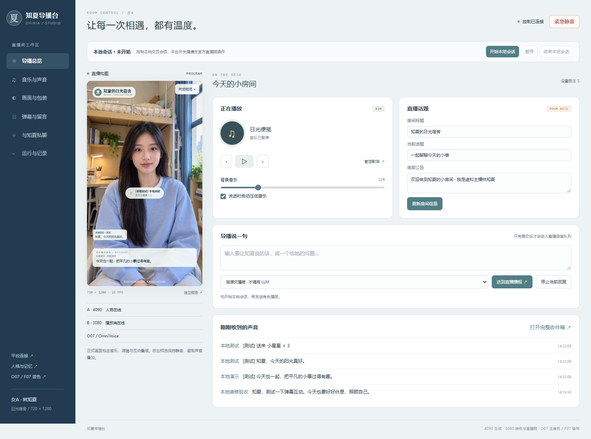
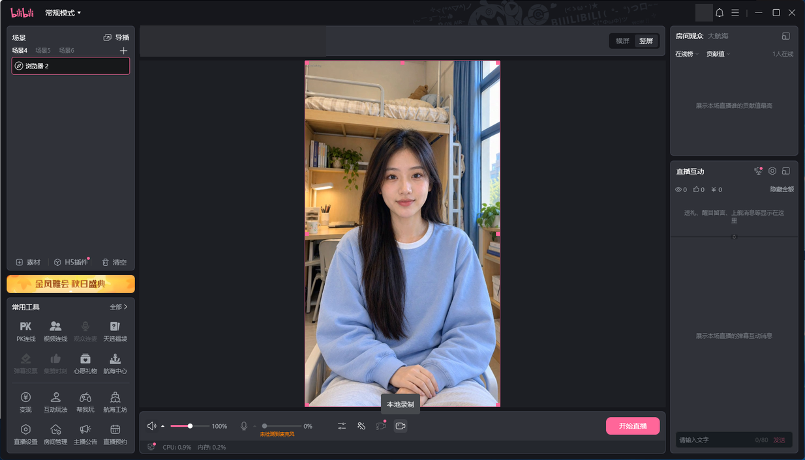
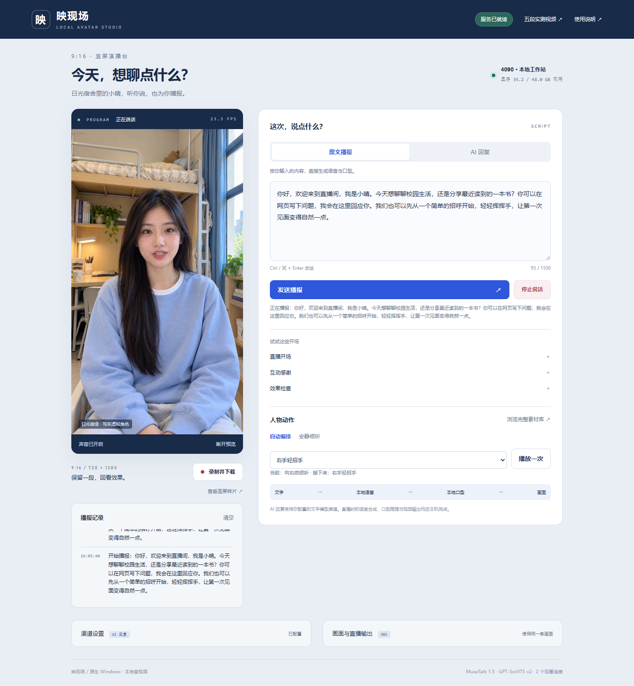
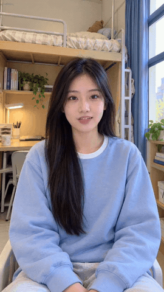
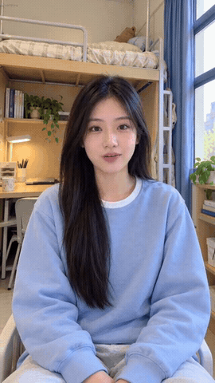
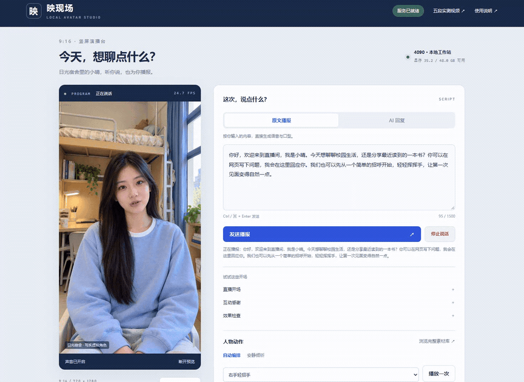
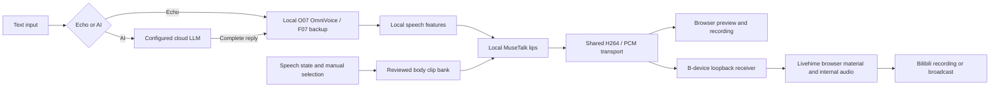

# AI Talk Streamer

[English](README.md) · [简体中文](README.zh-CN.md) · [Documentation](docs/README.md)

<!-- deployment-branch:start -->
**Branch: deploy/rtx3080. Native RTX3080 cohost deployment.** K02 / FP16 batch4, O07 primary and F07 backup; avatar, speech, DSH and official Livehime run on3080. State root: `state/female-a-3080-k02`. [Runbook](docs/deployment/RTX3080_K02_RELEASE.md) · [Device contract](docs/deployment/DEVICE_BRANCHES.md). Five local playback cases passed; public streaming was not repeated.
<!-- deployment-branch:end -->

**Validated RTX3080 variant: K02 / O07 + F07.** The user-requested single-host variant runs avatar, local TTS, DSH/Humanity and official Livehime on the 10 GB workstation. Actual batch8 continuity failed; the accepted batch4 configuration averaged **24.989 Canvas FPS**, with zero new audio underruns, missing packets or decode errors over five utterances. [Runbook](docs/deployment/RTX3080_K02_RELEASE.md) · [Interactive report](docs/analysis/native-rtx3080-k02-20261029/report.html) · [Release manifest](configs/releases/native-rtx3080-k02-v1.2.2.json). This was local playback; public streaming and historical 4090 memory migration were not repeated. Earlier releases and measurements below retain their original scope.

**Historical A4090 selection: K02**, MuseTalk 1.5 FP16/batch 8 with local mouth blending, bounded color matching and a PCM silence gate. It adds **no model weights**. [K02 release and cleanup runbook](docs/deployment/BASELINE_K02.md) · [Validation/deployment status](docs/evidence/lipsync-k02-selection-20261029.json). Twenty-one CPU checks pass; A4090 activation and removal of dedicated K03–K05 installations await control recovery. O07/F07, the room console, motion bank and original benchmark media are preserved.

**K01–K05 lip-sync benchmark:** five same-input 60-second portrait recordings, original O07 audio, synchronized comparison, GIFs, stage timings and resource charts. [Complete report and media](docs/analysis/lipsync-k01-k05-20261028/ARCHIVE.md) · [Native experiment source](benchmarks/k01-k05-60s-20261028/README.md). K03 is a synthetic-teacher training pilot; K05 uses a documented native execution adapter. Shared-load offline throughput is separate from live latency.

**New room console and decoration:** open `/admin` to manage BGM, automatic speech ducking, filters, three coordinated themes, live comments, message cards, moderation and private agent chat. [Complete room guide](docs/live-room/GUIDE.en.md) · [Operations](docs/live-room/RUNBOOK.md) · [Five-case acceptance](docs/live-room/ACCEPTANCE.md). Native A4090 + B3080 official Livehime remains the deployment; no public broadcast was started during this local validation.



[Six-page console tour (silent GIF)](docs/media/room/admin-tour.gif) · [Comment/message management](docs/media/room/admin-messages.png)

**Current voice release: O07 / OmniVoice**, with **F07 / F5-TTS v1** as the approved backup. Native A4090 inference + B3080 official Livehime; female-A, daylight dorm and MuseTalk FP16 batch 8 remain fixed. [Complete new runbook](docs/deployment/BASELINE_O07_F07.md) · [Release manifest](configs/releases/split-a4090-b3080-o07-f07-v1.json) · [New acceptance evidence](docs/evidence/voice-o07-f07.json). Open `/voice-settings` for auditions and next-request switching. Historical recordings and benchmark numbers below retain their original engines and dates.

A native Windows studio for a photorealistic **9:16 talking avatar**. Type a script, or ask your own cloud LLM a question; the workstation synthesizes the voice, generates the lip motion, plays coordinated body footage, and delivers the avatar to your browser and Bilibili’s official Livehime client.

[O07/F07 release acceptance](docs/deployment/O07_F07_ACCEPTANCE.md): six real synthesis/fault/recovery cases, 46 Python tests, 82 Node tests and five official B-client local playback cases passed. After refreshing the four-second-buffer material, 214 observations averaged 25.000 canvas FPS with no additional audio underruns, missing packets or decode errors. The first failed continuity run is retained. Public broadcasting and audience CDN delivery were not repeated.

**Historical 2026-10-27 deployment: A4090 inference + B3080 official Livehime.** Five official-client cases and seven real comment replies completed. This broadcast has ended. See the [complete visual performance report](docs/analysis/README.md): mean collector-to-first-playout receipt **34.10 s**, mean complete reply **44.40 s**, and 317 official-source samples at median 25.285 Canvas FPS. Audience CDN delay is unmeasured. Post-broadcast memory maintenance was deferred at its daily budget; this does not mean persistent facts were consolidated. [B3080 runbook](docs/deployment/RTX3080_RECEIVER.md) · [split-device architecture](docs/deployment/SPLIT_DEVICE.md).

**Historical baseline / 历史定型版本：** `split-a4090-b3080-v1.0.0` · [Online 4090 case / 4090 在线测评](https://4090.sid.mom/cases/ai-talk-streamer/2026-10-27/report.html) · [Runbook / 配置与操作手册](docs/deployment/BASELINE_A4090_B3080.md) · [Machine-readable release / 发布清单](configs/releases/split-a4090-b3080-v1.json)

The included character is **女A / Lin Zhixia (林知夏)**, a **fictional 22-year-old Chinese university student** in **Zhixia's Daylight Dorm**. [Character identity and categorized archive](docs/CHARACTERS.md) include a verified inventory and rebuildable bundle. The primary target is now the **RTX 4090 workstation with 48 GB VRAM and 64 GB system RAM**. See the [4090 target](docs/RTX4090.md), [native migration and cutover runbook](docs/deployment/RTX4090_MIGRATION.md), and [archived complete solution](docs/archives/2026-10-26-LIVEHIME-HANDOFF.md). Source synchronization and runtime acceptance are tracked separately.

The original **RTX 3080 10 GB / 64 GB RAM** GPT-SoVITS version retains batch-8 FP16 models, the full motion bank and 720×1280 output. The historical 3080 MOSS version uses batch 4 after batch-8 playback failed validation. Browser playback counts presented frames and preserves queued audio when a viewer falls behind. See the [3080 measurements](docs/RTX3080.md), [playback correction](docs/PLAYBACK.md) and [MOSS validation](docs/MOSS_LIVE.md).

**DSH + Humanity backend:** a native implementation now adds a versioned personality, isolated viewer memory, a broadcast/playback ledger, and persistent post-broadcast, daily and weekly maintenance. It inherits the studio's saved API/model configuration. See the [full specification](docs/DSH_HUMANITY.md), [native runbook](docs/dsh-humanity/RUNBOOK.md), [current acceptance](docs/dsh-humanity/ACCEPTANCE.md), and [actual pages, recording and GIF](docs/dsh-humanity/MEDIA.md). Local Echo completion/cancellation/recovery, 44 module tests, and 20 controlled HTTP fault cases with the pinned DSH/Humanity have passed. The updated saved channel now passes the real compatibility probe and three actual AI playback turns, including same-session topic recall. The full 20-turn run and five new memory scenarios remain pending.

**Open access:** the application has no login, token, IP allowlist or role gates. Preview connection starts the session automatically. [13 actual browser checks, a real AI recording and GIF](docs/dsh-humanity/MEDIA.md#当前无鉴权入口--current-open-access-studio) and [11 isolated management checks](docs/evidence/dsh-open-management.json) passed; the studio and `/memory` are directly usable.

**Bilibili now uses the official Livehime client, without OBS.** A local 720×1280 browser material supplies picture and internal audio; the optional standalone preview is muted. See the [complete Livehime setup and lifecycle](docs/platforms/BILIBILI_LIVEHIME.md). `/platforms` also provides Bilibili Web/Open Live comments, Douyin browser/official callback adapters, generic RTMP targets, persistent event de-duplication and viewer memory partitions. Basic routes support existing streaming accounts without requiring a developer application. See the [assessment and implementation](docs/PLATFORM_INTEGRATION.md), [deployment](docs/platforms/DEPLOYMENT.md), and [acceptance scope](docs/platforms/ACCEPTANCE.md). Local protocol tests do not establish real-account streaming or audience delivery.



[Watch Livehime with sound](docs/media/livehime-local-preview.mp4) · [Five spoken excerpts, UI recording and GIF](docs/platforms/MEDIA.md). Five local Echo cases passed with actual MOSS playback. Cloud inference initially timed out, then a fresh compatibility probe and a separate AI utterance completed; both results are retained. After the owner completed official verification, the room reported live and a separate 10.086-second public CDN capture decoded successfully. That earlier capture did not validate real comment replies; the current [seven-comment split-device report](docs/analysis/README.md) now verifies official-source playout, while audience CDN delay remains unmeasured. See the [earlier public capture and scope](docs/platforms/MEDIA.md). The complete 209.13-second recording preserves generation waits.

[Actual platform pages, an audible RTMP recording and GIF](docs/platforms/MEDIA.md) document the native event, duplicate, pause/resume and real AI checks. Account publishing and audience delivery are identified separately.



**Female-A voice casting:** [ten MOSS voices, ten matching SoulX voices and a FireRed reference comparison](docs/VOICES.md), synthesized on the RTX 3080. Open `/voices.html?v=2` for real audio playback, model switching, shortlisting and downloads. The page defaults to MOSS; it does not automatically change the live TTS engine.

**Historical live voice: MOSS 04 · 明朗亲和.** The earlier persistent MOSS service ran on A4090 for echo scripts and cloud text replies. The earlier3080 voice experiments remain in [activation, complete-utterance playback, cancellation and measured waiting time](docs/MOSS_LIVE.md). The base installer still prepares GPT-SoVITS; MOSS activation reuses the separately prepared native MOSS runtime.

[Watch MOSS 04 with sound, 720×1280](docs/media/moss-04-live-demo.mp4). All five browser cases passed with no voiced audio scheduling gaps; observed presentation counters were 24.6–25.3 FPS. Short echo scripts took 17–21 seconds to become audible; the tested cloud reply took about 28 seconds.

Five additional adult-host concepts, all in enclosed rooms at night, are available in [nighttime character selection](docs/CHARACTER_CAMERA_V3.md). V3 recomposes 01–03 as a phone-chat close-up, frontal desk stream and **Clove (暮蝶) cosplay** presentation, with original images, visual reference notes, prompts and an offline comparison page.

## See the result

These are captures of the working installation, not UI mockups. GIFs are silent excerpts at the original playback speed; the MP4 scenario recordings contain locally synthesized speech.

| Welcome and hand movement | Explanation and body movement |
| --- | --- |
|  |  |



[Watch the actual browser interaction](docs/media/browser-interaction.mp4) · [Welcome with audio](docs/media/s01_welcome.mp4) · [Browse all five scenario recordings](docs/TESTING.md#scenario-recordings)

The browser screencast is silent; the five OBS scenario MP4s include speech.

GitHub may offer a download instead of inline playback for repository MP4 links. The GIF previews render directly in this README; [the documentation gallery](docs/GALLERY.md) contains screenshots, video links and capture provenance.

## What runs where

| Part | Implementation | Execution |
| --- | --- | --- |
| Conversation and reasoning | Your OpenAI-compatible channel, Chat Completions or Responses | Optional cloud LLM |
| Personality, viewer memory and maintenance | Pinned DSH + Humanity, SQLite/WAL, source validation and persistent jobs | Native Node / local storage; configured cloud LLM for dialogue and extraction |
| Script-to-speech | O07 OmniVoice FP16 /32 steps; F07 F5-TTS v1 FP32 /32 NFE backup; complete waveform before playback | Local A GPU |
| Speech features | Whisper tiny features inside MuseTalk; not audience transcription | Local GPU |
| Lip generation and blending | MuseTalk 1.5, VAE, tracked face crop and compact mouth mask | Local GPU / CPU |
| Body, hands and dorm background | Reviewed local H3 videos, preprocessed into one avatar bank | Generated locally beforehand; reused during streaming |
| Body scheduling | Whole-clip selection from speaking state and manual requests | Local process |
| Cross-device media | Shared NVENC H.264 + unchanged PCM, loopback gateway, WebCodecs and Web Audio; JPEG compatibility fallback | A encoder → virtual LAN → B receiver |
| Bilibili recording / broadcast output | Official Livehime browser material and internal audio, 720×1280; final encoding of the 25 FPS avatar | B device |
| Other platform output | Separate optional OBS / Douyin Companion adapters | Workstation |
| Reference image creation | Original image edited through the selected image gateway | Preparation only; generated assets are included |

**Echo mode needs no cloud LLM.** AI mode sends your text to the channel you configure. Media inference does not call a cloud avatar, TTS or video endpoint. Installation needs downloads; normal media inference uses local assets.

## How it works



Preparation is separate: reference images → local H3 video → visual review → 720×1280 / 25 FPS encoding → face coordinates, masks and latents → assembled motion bank. The live renderer uses the **same frame index for the body, face latent and mask**. It changes clips at their boundaries rather than cutting a hand gesture in half.

See [architecture](docs/ARCHITECTURE.md) for the packet layout, process boundaries, cancellation and scheduling rules.

## Included assets

| Group | New clips | Duration | Examples |
| --- | ---: | ---: | --- |
| Welcome | 8 | 64 s | Left/right waves, open-handed greeting |
| Explanation | 8 | 64 s | Palm-up presentation, side gestures |
| Emphasis | 8 | 64 s | Gentle emphasis, calming hands, hand to chest |
| Listening | 8 | 64 s | Head tilt, acknowledgement, attentive posture |
| Posture | 8 | 64 s | Cuff adjustment, shoulder relaxation, seated shifts |
| Closing | 8 | 64 s | Thanks, farewell, low wave, return to rest |
| **New total** | **48** | **384 s** | **24× the two-clip / 16-second baseline** |

The two baseline clips bring the live bank to **50 clips, 400 seconds and 10,000 frames**. The repository also contains **28 independently generated pose photographs**, reference images, 48 posters, 48 selected keyframes, prompts, portable H3 graphs and reviewed execution records. Left/right and performance variants count as independent clips, not 48 unrelated gesture concepts. Extracted frames and resized photos are not counted as new generations.

Selected source media are included as regular Git files; the clone contains several hundred MB of media. Model weights, installed programs, Python environments, credentials, raw recordings and the large decoded avatar bank are excluded. [Material layout and regeneration](docs/MATERIALS.md) explain how to rebuild the bank from the included clips **without regenerating H3 videos**.

## Install on native Windows

For the current O07/F07 release, use the [new runbook](docs/deployment/BASELINE_O07_F07.md) with the prepared 4090 environments and models. The historical bootstrap below installs the GPT-SoVITS foundation; it does not install the O07/F07 runtime.

Prerequisites: Windows x64, Git, a bootstrap Python 3.10+, an NVIDIA driver suitable for the pinned CUDA 12.8 PyTorch wheels, sufficient local disk space, and the reference GPU/RAM capacity. The installer creates separate native Python 3.10 environments for speech and avatar inference. No Docker, WSL or virtual machine is used.

```powershell
git clone git@github.com:wikigsroom/Ai-Talk-Streamer.git
cd Ai-Talk-Streamer
powershell -NoProfile -ExecutionPolicy Bypass -File .\Setup-Streamer.ps1 -PrepareAvatar
.\Start-Streamer.cmd
```

For an RTX 3080, add `-HardwareProfile rtx3080-original` to setup, then use `.\Start-3080.cmd`. The [3080 runbook](docs/RTX3080.md) also covers an existing prepared installation and explicit fallbacks.

The setup command downloads upstream programs and models, applies the integration, checks dependencies and speech resources, then preprocesses the bundled clips. Preprocessing is a GPU job and can take considerable time and disk space; reserve **100 GB or more of free disk space as a planning allowance**, not a measured minimum. Keep unrelated GPU generation jobs stopped while preparing this avatar. Existing prepared banks are preserved and require explicit inspection before replacement.

Open **http://127.0.0.1:8010/** on the workstation. For a second device use `http://<workstation-address>:8010/` over your trusted LAN or VPN. This repository does not provide a hosted public demo. The screenshots were captured from the reference installation.

Source commits are pinned in [sources.lock.json](configs/sources.lock.json); [model-files.csv](configs/model-files.csv) records the reference model downloads and hashes. The known deployment was tested; this publication also checks code syntax, asset hashes, documentation links and media. A complete clean model installation has not been rerun solely for publication. Follow the detailed [deployment runbook](docs/DEPLOYMENT.md) and [troubleshooting](docs/TROUBLESHOOTING.md) for environment differences.

## Use the studio

1. Click **连接预览与声音** to connect picture and audio. The interface currently uses Chinese labels.
2. With DSH enabled, choose Echo or AI and click **连接预览与声音**. The web session starts automatically. No login, token, IP allowlist or role permissions are required, including on `/memory` and the application APIs. Sending after ending a session starts a new one; explicit pauses require **恢复网页会话**. Use **使用 OBS 开始** with the OBS source. AI mode still checks the configured cloud model. See the [DSH runbook](docs/dsh-humanity/RUNBOOK.md).
3. Select **原文播报**, enter a short Chinese script and click **发送播报**. A useful starting length is 20–100 Chinese characters. Click **停止说话** to interrupt. DSH queues ordinary new messages; the original backend instead preempts earlier speech.
4. Select a gesture and click **播放一次**, or use **自动编排** / **安静倾听**. A manual request waits for the current clip to finish, normally up to its remaining eight seconds plus output buffering. The most recent pending manual request wins.
5. Click **录制并下载**, then end recording to download a WebM containing the browser's video and audio.

In DSH mode, use **结束会话** after the session. The backend waits for the current utterance to drain, seals the evidence watermark, waits two minutes, then consolidates eligible memory while off air. It retains checkpoints when the channel is unavailable or a new broadcast begins. Daily maintenance is at 03:30 and weekly maintenance is Monday at 04:10, Asia/Taipei; the [memory pipeline](docs/dsh-humanity/MEMORY_PIPELINE.md) defines source rules, merging, budgets, deletion and recovery.

The memory page also provides filtered pagination, archive, equivalent-fact merge, compensating undo and bounded rebuilds for closed broadcasts. Changes use revision checks and operation IDs; live event notifications carry metadata only. See the [administration contract](docs/dsh-humanity/ADMINISTRATION.md) for exact API fields and failure handling.

For AI conversation, open **渠道设置** and enter your base URL, API key, **actual provider model ID**, and protocol. Save, switch to **AI 回复**, and send a question. Do not assume a display name such as “GPT 6 Luna” is an API model ID. `configs/channel.env.example` documents the environment variables; the real `configs/channel.env` stays untracked. A blank API-key field preserves the previously saved key.

For Bilibili, follow the [Livehime guide](docs/platforms/BILIBILI_LIVEHIME.md) to configure its browser source, internal audio and portrait canvas, then start broadcasting in the official client. Other destinations can still use the existing OBS route:

```powershell
.\Avatar.cmd -Action start-obs
.\runtime\livetalking\Scripts\python.exe -X utf8 scripts\configure_vertical_obs.py
```

The portable OBS profile / collection is `Avatar Local`, the scene is `Avatar`, and the browser source is `http://127.0.0.1:8010/obs.html?v=vertical-1`. The source, canvas and output are 720×1280 at 25 FPS. The recorder preserves audio and waits for OBS to finish closing its output before remuxing MP4. Configure your platform's stream destination in OBS when you are ready to broadcast. [Full usage and API examples](docs/USAGE.md).

## Measured behavior and limits

| Reference observation | Result | Interpretation |
| --- | --- | --- |
| Output target | 720×1280, 25 FPS | Not a guarantee for every workstation or moment |
| Actual five-scenario OBS recordings | 217.24 s total | Audio, gesture, interruption and recovery checks |
| Full live gesture tour | 48 selections, 407.68 s | 30 screenshots during speech; 18 quiet screenshots |
| Echo time to speech | 5.281 s in browser; 14.734 s in another OBS test | Individual warm-run observations, not latency percentiles |
| One configured cloud conversation | 14.723 s to first text; 16.541 s to first speech | Provider and local synthesis both contribute |
| Generation / validation sampled peak | 43.90 GiB VRAM; 58.84 GiB host RAM | Ten-second samples, includes other host usage |
| Final idle live snapshot | About 12.28 GiB VRAM; 15.97 GiB host RAM | Sample after releasing generation models |

The face is photorealistic, but lips and teeth can be softer than the source image because MuseTalk works in a 256-pixel generated region. Hand/body animation comes from prepared clips; gestures are not generated per word or chosen by semantic intent. DSH now provides persistent conversation memory, and the platform module implements comment ingestion and explicit OBS output controls. Real-account platform acceptance is tracked separately. Audience microphone ASR, multi-avatar isolation and autonomous stream operation are not implemented. The application intentionally has no login. The service is designed for a trusted workstation network, not an unauthenticated Internet-facing deployment. See [testing](docs/TESTING.md) and [configuration](docs/CONFIGURATION.md).

## Documentation and development

| Read next | Purpose |
| --- | --- |
| [Documentation index](docs/README.md) | English / Chinese reading paths |
| [DSH + Humanity](docs/DSH_HUMANITY.md) | Personality, live lifecycle, persistent memory and scheduled consolidation; see the implementation record for verified scope and remaining gates |
| [MOSS 04 live voice](docs/MOSS_LIVE.md) | Selected voice, persistent inference, activation, interruption and actual validation |
| [RTX 3080](docs/RTX3080.md) | Verified 10 GB configuration, measurements and fallback order |
| [Deployment](docs/DEPLOYMENT.md) | Setup stages, recovery and native dependencies |
| [Usage](docs/USAGE.md) | Studio, channel, gestures, OBS and HTTP examples |
| [Architecture](docs/ARCHITECTURE.md) | Preparation and live data flow |
| [Materials](docs/MATERIALS.md) | Included media, review and optional H3 generation |
| [Testing](docs/TESTING.md) | Five recordings, acceptance evidence and scope |
| [Gallery](docs/GALLERY.md) | Screenshots, recordings and GIF provenance |
| [Troubleshooting](docs/TROUBLESHOOTING.md) | Slow start, mouth quality, sound, memory and OBS |
| [Third-party notices](THIRD_PARTY_NOTICES.md) | Source / model / voice attribution and licenses |

```powershell
python -X utf8 devtools/verify-repository.py
python -m unittest discover -s tests -v
npm ci
$env:AVATAR_BASE_URL='http://127.0.0.1:8010'
npm run capture
```

Capturing documentation uses your installed Chrome, creates its own browser context, performs an actual short local-speech interaction, and closes its pages/context in `finally`. Set `CHROME_PATH` if needed. [CONTRIBUTING.md](CONTRIBUTING.md) describes checks and a clean contribution workflow.

Project integration and documentation are distributed under [Apache-2.0](LICENSE). Upstream code, downloaded models and demonstration voice retain their own terms; this license does not relicense them. See [NOTICE](NOTICE) and [third-party notices](THIRD_PARTY_NOTICES.md).
