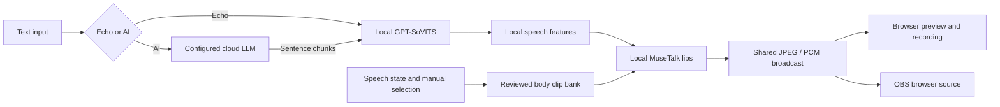

# AI Talk Streamer

[English](README.md) · [简体中文](README.zh-CN.md) · [Documentation](docs/README.md)

A native Windows studio for a photorealistic **9:16 talking avatar**. Type a script, or ask your own cloud LLM a question; the workstation synthesizes the voice, generates the lip motion, plays coordinated body footage, and delivers the same avatar to your browser and OBS.

The included character is a **fictional 22-year-old Chinese university student in a daylight dormitory**. The reference deployment uses an **RTX 4090 with 48 GB VRAM and 64 GB system RAM**.

A tested **RTX 3080 10 GB / 64 GB RAM** version retains the original batch-8 FP16 models, full motion bank and 720×1280 output. Browser playback now counts presented frames and preserves queued audio when a viewer falls behind. See the [3080 deployment and measurements](docs/RTX3080.md) and [playback diagnosis and correction](docs/PLAYBACK.md).


## See the result

These are captures of the working installation, not UI mockups. GIFs are silent excerpts at the original playback speed; the MP4 scenario recordings contain locally synthesized speech.

| Welcome and hand movement | Explanation and body movement |
| --- | --- |
|  |  |


[Watch the actual browser interaction](docs/media/browser-interaction.mp4) · [Welcome with audio](docs/media/s01_welcome.mp4) · [Browse all five scenario recordings](docs/TESTING.md#scenario-recordings)

The browser screencast is silent; the five OBS scenario MP4s include speech.

GitHub may offer a download instead of inline playback for repository MP4 links. The GIF previews render directly in this README; [the documentation gallery](docs/GALLERY.md) contains screenshots, video links and capture provenance.

## What runs where

| Part | Implementation | Execution |
| --- | --- | --- |
| Conversation and reasoning | Your OpenAI-compatible channel, Chat Completions or Responses | Optional cloud LLM |
| Script-to-speech | GPT-SoVITS v2 | Local GPU |
| Speech features | Whisper tiny features inside MuseTalk; not audience transcription | Local GPU |
| Lip generation and blending | MuseTalk 1.5, VAE, tracked face crop and compact mouth mask | Local GPU / CPU |
| Body, hands and dorm background | Reviewed local H3 videos, preprocessed into one avatar bank | Generated locally beforehand; reused during streaming |
| Body scheduling | Whole-clip selection from speaking state and manual requests | Local process |
| Browser preview and recording | WebSocket JPEG + PCM, canvas and Web Audio, MediaRecorder | Local service + viewer browser |
| Portrait recording / broadcast output | Portable OBS, 720×1280 at a target 25 FPS | Workstation |
| Reference image creation | Original image edited through the selected image gateway | Preparation only; generated assets are included |

**Echo mode needs no cloud LLM.** AI mode sends your text to the channel you configure. Media inference does not call a cloud avatar, TTS or video endpoint. Installation needs downloads; normal media inference uses local assets.

## How it works



Preparation is separate: reference images → local H3 video → visual review → 720×1280 / 25 FPS encoding → face coordinates, masks and latents → assembled motion bank. The live renderer uses the **same frame index for the body, face latent and mask**. It changes clips at their boundaries rather than cutting a hand gesture in half.

See [architecture](docs/ARCHITECTURE.md) for the packet layout, process boundaries, cancellation and scheduling rules.

## Included assets

| Group | New clips | Duration | Examples |
| --- | ---: | ---: | --- |
| Welcome | 8 | 64 s | Left/right waves, open-handed greeting |
| Explanation | 8 | 64 s | Palm-up presentation, side gestures |
| Emphasis | 8 | 64 s | Gentle emphasis, calming hands, hand to chest |
| Listening | 8 | 64 s | Head tilt, acknowledgement, attentive posture |
| Posture | 8 | 64 s | Cuff adjustment, shoulder relaxation, seated shifts |
| Closing | 8 | 64 s | Thanks, farewell, low wave, return to rest |
| **New total** | **48** | **384 s** | **24× the two-clip / 16-second baseline** |

The two baseline clips bring the live bank to **50 clips, 400 seconds and 10,000 frames**. The repository also contains **28 independently generated pose photographs**, reference images, 48 posters, 48 selected keyframes, prompts, portable H3 graphs and reviewed execution records. Left/right and performance variants count as independent clips, not 48 unrelated gesture concepts. Extracted frames and resized photos are not counted as new generations.

Selected source media are included as regular Git files; the clone contains several hundred MB of media. Model weights, installed programs, Python environments, credentials, raw recordings and the large decoded avatar bank are excluded. [Material layout and regeneration](docs/MATERIALS.md) explain how to rebuild the bank from the included clips **without regenerating H3 videos**.

## Install on native Windows

Prerequisites: Windows x64, Git, a bootstrap Python 3.10+, an NVIDIA driver suitable for the pinned CUDA 12.8 PyTorch wheels, sufficient local disk space, and the reference GPU/RAM capacity. The installer creates separate native Python 3.10 environments for speech and avatar inference. No Docker, WSL or virtual machine is used.

```powershell
git clone git@github.com:wikigsroom/Ai-Talk-Streamer.git
cd Ai-Talk-Streamer
powershell -NoProfile -ExecutionPolicy Bypass -File .\Setup-Streamer.ps1 -PrepareAvatar
.\Start-Streamer.cmd
```

For an RTX 3080, add `-HardwareProfile rtx3080-original` to setup, then use `.\Start-3080.cmd`. The [3080 runbook](docs/RTX3080.md) also covers an existing prepared installation and explicit fallbacks.

The setup command downloads upstream programs and models, applies the integration, checks dependencies and speech resources, then preprocesses the bundled clips. Preprocessing is a GPU job and can take considerable time and disk space; reserve **100 GB or more of free disk space as a planning allowance**, not a measured minimum. Keep unrelated GPU generation jobs stopped while preparing this avatar. Existing prepared banks are preserved and require explicit inspection before replacement.

Open **http://127.0.0.1:8010/** on the workstation. For a second device use `http://<workstation-address>:8010/` over your trusted LAN or VPN. This repository does not provide a hosted public demo. The screenshots were captured from the reference installation.

Source commits are pinned in [sources.lock.json](configs/sources.lock.json); [model-files.csv](configs/model-files.csv) records the reference model downloads and hashes. The known deployment was tested; this publication also checks code syntax, asset hashes, documentation links and media. A complete clean model installation has not been rerun solely for publication. Follow the detailed [deployment runbook](docs/DEPLOYMENT.md) and [troubleshooting](docs/TROUBLESHOOTING.md) for environment differences.

## Use the studio

1. Click **连接预览与声音** to connect picture and audio. The interface currently uses Chinese labels.
2. Select **原文播报**, enter a short Chinese script and click **发送播报**. A useful starting length is 20–100 Chinese characters.
3. Click **停止说话** to interrupt. Sending a new message also invalidates the previous speech generation.
4. Select a gesture and click **播放一次**, or use **自动编排** / **安静倾听**. A manual request waits for the current clip to finish, normally up to its remaining eight seconds plus output buffering. The most recent pending manual request wins.
5. Click **录制并下载**, then end recording to download a WebM containing the browser's video and audio.

For AI conversation, open **渠道设置** and enter your base URL, API key, **actual provider model ID**, and protocol. Save, switch to **AI 回复**, and send a question. Do not assume a display name such as “GPT 6 Luna” is an API model ID. `configs/channel.env.example` documents the environment variables; the real `configs/channel.env` stays untracked. A blank API-key field preserves the previously saved key.

For OBS:

```powershell
.\Avatar.cmd -Action start-obs
.\runtime\livetalking\Scripts\python.exe -X utf8 scripts\configure_vertical_obs.py
```

The portable OBS profile / collection is `Avatar Local`, the scene is `Avatar`, and the browser source is `http://127.0.0.1:8010/obs.html?v=vertical-1`. The source, canvas and output are 720×1280 at 25 FPS. The recorder preserves audio and waits for OBS to finish closing its output before remuxing MP4. Configure your platform's stream destination in OBS when you are ready to broadcast. [Full usage and API examples](docs/USAGE.md).

## Measured behavior and limits

| Reference observation | Result | Interpretation |
| --- | --- | --- |
| Output target | 720×1280, 25 FPS | Not a guarantee for every workstation or moment |
| Actual five-scenario OBS recordings | 217.24 s total | Audio, gesture, interruption and recovery checks |
| Full live gesture tour | 48 selections, 407.68 s | 30 screenshots during speech; 18 quiet screenshots |
| Echo time to speech | 5.281 s in browser; 14.734 s in another OBS test | Individual warm-run observations, not latency percentiles |
| One configured cloud conversation | 14.723 s to first text; 16.541 s to first speech | Provider and local synthesis both contribute |
| Generation / validation sampled peak | 43.90 GiB VRAM; 58.84 GiB host RAM | Ten-second samples, includes other host usage |
| Final idle live snapshot | About 12.28 GiB VRAM; 15.97 GiB host RAM | Sample after releasing generation models |

The face is photorealistic, but lips and teeth can be softer than the source image because MuseTalk works in a 256-pixel generated region. Hand/body animation comes from prepared clips; gestures are not generated per word or chosen by semantic intent. There is currently no persistent multi-turn conversation memory, audience microphone ASR, automatic platform-chat ingestion, multi-avatar isolation, user authentication or automatic stream operation. The service is designed for a trusted workstation network, not an unauthenticated Internet-facing deployment. See [testing](docs/TESTING.md) and [configuration](docs/CONFIGURATION.md).

## Documentation and development

| Read next | Purpose |
| --- | --- |
| [Documentation index](docs/README.md) | English / Chinese reading paths |
| [RTX 3080](docs/RTX3080.md) | Verified 10 GB configuration, measurements and fallback order |
| [Deployment](docs/DEPLOYMENT.md) | Setup stages, recovery and native dependencies |
| [Usage](docs/USAGE.md) | Studio, channel, gestures, OBS and HTTP examples |
| [Architecture](docs/ARCHITECTURE.md) | Preparation and live data flow |
| [Materials](docs/MATERIALS.md) | Included media, review and optional H3 generation |
| [Testing](docs/TESTING.md) | Five recordings, acceptance evidence and scope |
| [Gallery](docs/GALLERY.md) | Screenshots, recordings and GIF provenance |
| [Troubleshooting](docs/TROUBLESHOOTING.md) | Slow start, mouth quality, sound, memory and OBS |
| [Third-party notices](THIRD_PARTY_NOTICES.md) | Source / model / voice attribution and licenses |

```powershell
python -X utf8 devtools/verify-repository.py
python -m unittest discover -s tests -v
npm ci
$env:AVATAR_BASE_URL='http://127.0.0.1:8010'
npm run capture
```

Capturing documentation uses your installed Chrome, creates its own browser context, performs an actual short local-speech interaction, and closes its pages/context in `finally`. Set `CHROME_PATH` if needed. [CONTRIBUTING.md](CONTRIBUTING.md) describes checks and a clean contribution workflow.

Project integration and documentation are distributed under [Apache-2.0](LICENSE). Upstream code, downloaded models and demonstration voice retain their own terms; this license does not relicense them. See [NOTICE](NOTICE) and [third-party notices](THIRD_PARTY_NOTICES.md).
