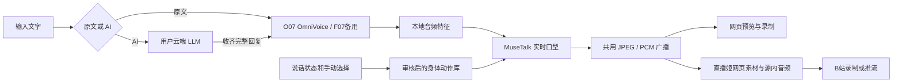

# AI Talk Streamer · 写实数字人直播

[English](README.md) · [简体中文](README.zh-CN.md) · [完整文档](docs/README.md)

**K01–K05 口型横评：** 五组同源60秒竖屏原片、O07原始音频、同步对比页面、GIF、逐阶段耗时与资源曲线。[完整报告与素材](docs/analysis/lipsync-k01-k05-20261028/ARCHIVE.md) · [原生实验代码](benchmarks/k01-k05-60s-20261028/README.md)。K03为合成教师训练试验，K05含已说明的原生执行适配；共享负载的离线吞吐与直播响应延迟分开记录。

**新增直播间导播台与包装：** 打开 `/admin`，可管理 BGM、人声压低音乐、滤镜、三套主题、弹幕、留言卡、屏蔽规则和 Agent 私聊。[完整方案与功能表](docs/live-room/README.md) · [操作部署手册](docs/live-room/RUNBOOK.md) · [五段实测](docs/live-room/ACCEPTANCE.md)。沿用 4090 推理＋3080 官方直播姬，本次仅做本地会话验证。


[六区巡览 GIF（无声）](docs/media/room/admin-tour.gif) · [弹幕与留言管理截图](docs/media/room/admin-messages.png)

**当前语音定型：O07 / OmniVoice 主用，F07 / F5-TTS v1 备用。** 保持A4090推理＋B3080官方直播姬、女A日光宿舍、MuseTalk FP16 batch 8。[新版完整操作手册](docs/deployment/BASELINE_O07_F07.md) · [发布清单](configs/releases/split-a4090-b3080-o07-f07-v1.json) · [独立新增验收](docs/evidence/voice-o07-f07.json)。`/voice-settings` 提供试听和下一句切换。下文旧录像与测评数字保留原引擎和日期，不作为新版性能数据。

一套运行在 **原生 Windows** 上的 **9:16 写实数字人演播台**：输入播报稿，或通过你自己的云端 LLM 渠道提问，由本机生成语音、实时口型和融合画面，并将人物送到网页与哔哩哔哩官方直播姬。

[O07/F07 新版验收](docs/deployment/O07_F07_ACCEPTANCE.md)：六个真实语音/故障/恢复用例、46项Python、82项Node及官方B客户端五段本地播放复测通过。刷新4秒缓冲素材后214次观测平均25.000FPS，无新增音频欠载、缺包或解码错误；首轮失败保留。未重复公开开播与观众CDN验证。

**2026-10-27历史部署为 A4090 推理、B3080 官方直播姬。** 五段官方客户端验收与七条真实弹幕均已完整播完，本场已下播。[完整可视化性能报告](docs/analysis/README.md)给出逐阶段周期、资源和维护状态：采集收到至首次播放回执平均 **34.10 秒**，至整句完成平均 **44.40 秒**；官方源 317 次采样的 Canvas FPS 中位 25.285。B站 CDN 到观众的延迟未测。下播记忆任务因每日额度耗尽延后，不能视为持久事实整理完成。详见[3080接收端操作与证据](docs/deployment/RTX3080_RECEIVER.md)、[双机完整部署](docs/deployment/SPLIT_DEVICE.md)和[历史及本次验收](docs/deployment/SPLIT_DEVICE_ACCEPTANCE.md)。

**Historical baseline / 历史定型版本：** `split-a4090-b3080-v1.0.0` · [Online 4090 case / 4090 在线测评](https://4090.sid.mom/cases/ai-talk-streamer/2026-10-27/report.html) · [Runbook / 配置与操作手册](docs/deployment/BASELINE_A4090_B3080.md) · [Machine-readable release / 发布清单](configs/releases/split-a4090-b3080-v1.json)

当前角色档案编号为 **女A**，正式姓名 **林知夏**，配套场景为 **知夏的日光宿舍**。她是**虚构的 22 岁中国女大学生**，沿用白天宿舍、长发、浅蓝卫衣的形象。[角色与素材归档](docs/CHARACTERS.md)提供分类目录、可校验清单和归档包。后续主运行目标为 **4090 工作站：48 GB 显存＋64 GB 内存**。详见 [4090 目标](docs/RTX4090.md)、[原生迁移与切换手册](docs/deployment/RTX4090_MIGRATION.md)及[完整方案归档](docs/archives/2026-10-26-LIVEHIME-HANDOFF.md)。仓库同步与新机器运行验收分别记录。

已增加 **RTX 3080 10 GB／64 GB 内存**实测版本。原 GPT-SoVITS 版本保留 batch 8；当前 MOSS 版本在 batch 8 播放验收失败后改用 batch 4，沿用 FP16 人物模型、完整动作库和 720×1280 输出。网页统计视频实际呈现的帧率，慢连接积压时保留排队的音频。参见 [3080 实测](docs/RTX3080.md)、[播放修正](docs/PLAYBACK.md) 和 [MOSS 验收](docs/MOSS_LIVE.md)。

**新增 DSH + Humanity 后端：** 已原生实现人格版本、观众记忆隔离、直播与播放账本，以及下播后、每日、每周的持久整理任务，默认继承网页保存的 API／模型配置。详见[完整方案](docs/DSH_HUMANITY.md)、[原生操作手册](docs/dsh-humanity/RUNBOOK.md)、[逐项验收](docs/dsh-humanity/ACCEPTANCE.md)和[实机页面、录像与 GIF](docs/dsh-humanity/MEDIA.md)。本地 Echo 完整／取消／恢复、44 项模块测试及固定 DSH/Humanity 的 20 个受控 HTTP 故障案例已通过；更新后的真实渠道兼容探针及三轮 AI 实播已通过，含同场主题回忆；20 轮完整对话与五段新增记忆场景仍待验收。

**当前已取消应用鉴权：** 无登录、令牌、IP 白名单和角色门槛，连接预览自动开始会话。已通过 [13 项实际网页检查、真实 AI 录像与 GIF](docs/dsh-humanity/MEDIA.md#当前无鉴权入口--current-open-access-studio)，以及 [11 项隔离记忆管理检查](docs/evidence/dsh-open-management.json)；演播台与 `/memory` 均可直接使用。

**B站现已改为官方直播姬，不使用 OBS。** 本地 720×1280 浏览器素材同时提供人物和源内音频，独立预览静音。详见[直播姬完整方案与操作](docs/platforms/BILIBILI_LIVEHIME.md)。`/platforms` 继续提供B站 Web/官方弹幕、抖音网页/官方回调、通用 RTMP 与弹幕工具接入，以及跨平台去重、排队和观众记忆分区。已有开播权限但没有开放平台应用时，可使用基础接入路径。详见[方案评估与完整接入文档](docs/PLATFORM_INTEGRATION.md)、[部署配置](docs/platforms/DEPLOYMENT.md)和[验收范围](docs/platforms/ACCEPTANCE.md)；本地协议测试不替代真实账号开播验证。


[观看直播姬带声音节选](docs/media/livehime-local-preview.mp4) · [五段语音、页面录屏和 GIF](docs/platforms/MEDIA.md)。五项本地原文播报用例通过；云端初轮超时，随后兼容性检查和独立 AI 语音播报完成，两次结果均保留。主播完成人脸验证后已公开开播，房间状态和独立10.086秒公开CDN抓取/解码均已核实；此早期录像未验收真实弹幕；当前[双机七条真实弹幕报告](docs/analysis/README.md)已验证官方源完整播放，观众端CDN时延仍未测。早期素材详见[公开流媒体与范围](docs/platforms/MEDIA.md)。完整 209.13 秒录像保留了实际生成等待。

[查看实际平台页面、带声音的推流录像和 GIF](docs/platforms/MEDIA.md)。完整工作站验收涵盖 B站/抖音事件、去重、暂停恢复与真实 AI 回复；平台账号公开开播与观众端验收单独标记。


**女A音色选型：** [MOSS 10 款、SoulX 10 款同号对比与 FireRed 01 对照](docs/VOICES.md)，由 3080 实际生成。运行中演播台的 `/voices.html?v=2` 默认展示 MOSS，可切换模型、保存候选及下载；页面选型不会自动修改直播引擎。

五款夜间封闭室内人物方案见[夜间角色选型](docs/CHARACTER_CAMERA_V3.md)。V3 将 01–03 重做为手机聊天近景、正面桌播与**暮蝶 / Clove 真人 Cos** 展示，包含原图、平台机位参考、提示词和可离线打开的对比页面。

## 先看实际效果

以下素材来自真实运行服务和 OBS 录像，不是界面设计稿。GIF 为原速无声片段；MP4 测试视频保留本地合成的声音。

| 招手欢迎 | 摊掌讲解 |
| --- | --- |
|  |  |


[观看网页操作录屏](docs/media/browser-interaction.mp4) · [观看带声音的欢迎测试](docs/media/s01_welcome.mp4) · [查看五段测试](docs/TESTING.md#scenario-recordings)

网页操作录屏不带音轨，五段 OBS 场景视频带声音。

GitHub 对仓库 MP4 链接可能提供下载而非内嵌播放器，README 中的 GIF 可直接观看。[截图与视频画廊](docs/GALLERY.md)收录全部演示文件及来源说明。

## 具体采用的方案

**当前采用O07主用、F07备用的常驻本地语音服务。** 本段MOSS04录像及生成等待为历史参考，详见新版操作手册。此前3080原文播报与云端回复使用MOSS04。启用步骤、完整播报、停止逻辑与生成等待见 [MOSS 实时接入文档](docs/MOSS_LIVE.md)。基础安装器仍准备 GPT-SoVITS；MOSS 分支复用单独准备好的原生推理环境。

[观看 MOSS 04 带声音的 720×1280 实录](docs/media/moss-04-live-demo.mp4)。五项网页用例全部通过，发声期间音频排程间隙为 0，观察时刻画面约 24.6–25.3 FPS。此次短句从提交到实际出声约 17–21 秒，云端回复约 28 秒。

| 环节 | 实现 | 运行位置 |
| --- | --- | --- |
| 逻辑、推理、文字对话 | 用户指定的 OpenAI 兼容渠道，支持 Chat Completions / Responses | 可选云端 LLM |
| 人格、观众记忆与周期整理 | 固定 DSH + Humanity、SQLite/WAL、来源校验与持久作业 | 原生 Node／本地存储；对话与抽取使用已配置云端 LLM |
| 中文语音合成 | O07 OmniVoice FP16 /32步；F07 F5-TTS v1 FP32 /32NFE备用；完整波形后播出 | A本地 GPU |
| 音频特征 | MuseTalk 使用 Whisper tiny 提取特征，不是观众语音识别 | 本地 GPU |
| 实时口型与融合 | MuseTalk 1.5、VAE、人脸跟踪与嘴部紧凑遮罩 | 本地 GPU / CPU |
| 手部、肢体和宿舍画面 | 本地 H3 生成并审核的动作视频 | 准备阶段本地生成，直播时复用 |
| 动作编排 | 根据说话状态和手动选择播放完整片段 | 本地程序 |
| 网页播放与录制 | WebSocket JPEG＋PCM、Canvas、Web Audio、MediaRecorder | 本地服务与观看端浏览器 |
| B站录制与推流 | 官方直播姬网页素材＋源内音频，720×1280；25 FPS 人物流按 30 FPS 编码 | 本机 |
| 其他平台输出 | 独立可选 OBS / 抖音直播伴侣适配器 | 本机 |
| 参考图制作 | 携带原图，调用选定的图片编辑渠道 | 准备阶段；成品已随仓库提供 |

**原文播报不需要云端 LLM。**「AI 回复」只把文字发送到你配置的渠道；直播中的语音、口型与画面不调用云端数字人、语音或视频接口。安装阶段需要下载程序与模型，常规媒体推理使用本地资产。

## 工作逻辑



素材准备是另一条链路：参考图 → 本地 H3 视频 → 人工复核 → 720×1280 / 25 FPS 编码 → 人脸坐标、融合遮罩和潜变量 → 动作库装配。直播时，**身体帧、人脸潜变量和遮罩使用相同帧索引**，切换发生在片段边界，避免把手势切到一半。

这是一套「预制身体动作＋实时语音口型」方案，尚未实现按每个词的含义实时生成任意全身动作。详细进程与数据流见[架构文档](docs/ARCHITECTURE.md)。

## 随仓库提供的素材

| 类别 | 新增片段 | 时长 | 示例 |
| --- | ---: | ---: | --- |
| 欢迎互动 | 8 | 64 秒 | 左右招手、双手迎接、致意 |
| 摊手讲解 | 8 | 64 秒 | 摊掌、小弧线示意、侧边展示 |
| 强调认可 | 8 | 64 秒 | 轻压安抚、贴胸口、双掌强调 |
| 思考倾听 | 8 | 64 秒 | 倾头、回应、前倾、搭手 |
| 坐姿与肢体 | 8 | 64 秒 | 放松肩膀、整理袖口、坐姿调整 |
| 转场收尾 | 8 | 64 秒 | 挥手、致谢、回到待机 |
| **新增合计** | **48** | **384 秒** | **相对两段、16 秒基础版为 24 倍** |

加上两段基础动作，运行库共有 **50 段、400 秒、10,000 帧**。另有 **28 张独立生成的动作参考照**、人物/背景参考图、48 张封面、48 张关键帧、提示词、便携 H3 工作流和审核后的执行记录。左右侧及表演变体按独立片段计算，不声称是 48 种完全不同的手势；视频抽帧、同一照片的不同尺寸不算新增生成。

入选源素材按普通 Git 文件提供，克隆会下载数百 MB 媒体。模型权重、安装后的程序、Python 环境、密钥、原始长录屏和体积很大的解码角色帧不入库。可直接用随仓库视频重建角色，**无需重新生成 H3 视频**。见[素材文档](docs/MATERIALS.md)。

## 安装与启动

当前O07/F07版本使用4090已有环境与模型，按[新版手册](docs/deployment/BASELINE_O07_F07.md)激活。以下全新安装命令准备的是历史GPT-SoVITS基础版，不能替代O07/F07部署。

准备原生 Windows x64、Git、用于引导安装的 Python 3.10+、支持 CUDA 12.8 PyTorch 的 NVIDIA 驱动及足够磁盘空间。脚本会创建两套原生 Python 3.10 环境，分别运行语音和人物。全程不使用 Docker、WSL 或虚拟机。

```powershell
git clone git@github.com:wikigsroom/Ai-Talk-Streamer.git
cd Ai-Talk-Streamer
powershell -NoProfile -ExecutionPolicy Bypass -File .\Setup-Streamer.ps1 -PrepareAvatar
.\Start-Streamer.cmd
```

RTX 3080 安装时增加 `-HardwareProfile rtx3080-original`，随后使用 `.\Start-3080.cmd`。已有完整角色的迁移及显式降级步骤见 [3080 专项文档](docs/RTX3080.md)。

完整安装会下载依赖与模型、应用集成改造、检查本地语音资源，并预处理已提供的视频。预处理占用 GPU，可能持续较长时间并生成大量图像；建议预留 **100 GB 以上空闲磁盘作为规划余量**，这不是实测最低需求。预处理时释放其他 GPU 生成任务，已有完整角色不会被无条件覆盖。

本机访问 **http://127.0.0.1:8010/**；其他设备通过可信局域网或 VPN 访问 `http://<工作站地址>:8010/`。仓库本身不提供公网托管演示，截图来自参考部署。

已用源码版本固定在 [sources.lock.json](configs/sources.lock.json)，模型下载及哈希见 [model-files.csv](configs/model-files.csv)。参考部署经过真实运行验证；发布时另做源码语法、素材哈希、文档链接和媒体检查。本次整理没有为发布再次完整下载并重装全部模型；新机器按[部署文档](docs/DEPLOYMENT.md)逐阶段检查。

## 网页使用顺序

1. 点击 **连接预览与声音**，允许页面建立音视频流。
2. 启用 DSH 后，选择原文播报或 AI 回复，点击 **连接预览与声音**，网页自动开始会话。**无需登录、令牌、IP 白名单或角色权限**；`/memory` 与应用 API 同样直接开放。结束后再次发送会自动创建新会话；主动暂停后点 **恢复网页会话**。使用 OBS 源时点 **使用 OBS 开始**。AI 模式仍核验所配置云端模型是否可用，详见 [DSH 操作手册](docs/dsh-humanity/RUNBOOK.md)。
3. 选 **原文播报**，输入 20–100 字作为初次测试，点击 **发送播报**。点 **停止说话**可打断。DSH 普通新输入按顺序排队；原版后端则会抢占上一轮。
4. 选择动作并点 **播放一次**，或使用 **自动编排／安静倾听**。手动动作会等当前片段完成，通常等待不超过剩余八秒加画面缓冲；连续选择时保留最新待播请求。
5. 点击 **录制并下载**，结束后保存带声音的 WebM。

DSH 模式结束时点 **结束会话**：当前句排空后固定证据水位，静默两分钟，再于下播状态整理合格记忆。渠道不可用或重新开播时保留游标，等待恢复。每日 03:30、周一 04:10（Asia/Taipei）执行相应维护；来源规则、压缩、合并、预算、删除及恢复见[记忆流水线](docs/dsh-humanity/MEMORY_PIPELINE.md)。

记忆页还提供按分区/状态/事实键分页、归档、等值合并、补偿撤销和已结束场次的范围重建。写入核验 revision 与操作 ID，事件订阅只传元数据；具体字段、重试和失败处理见[管理操作契约](docs/dsh-humanity/ADMINISTRATION.md)。

使用云端文字模型时，展开 **渠道设置**，填写接口地址、API Key、渠道的**实际模型 ID**及协议，保存后切换 **AI 回复**。例如“GPT 6 Luna”只是显示名称时，不能据此猜测 model ID。变量模板见 `configs/channel.env.example`，真实 `configs/channel.env` 被 Git 忽略；保存时密钥留空会保留原值。

B站按[直播姬专章](docs/platforms/BILIBILI_LIVEHIME.md)配置网页素材、源内音频和竖屏画布，再在官方客户端确认开播。其他平台如需使用已有 OBS 方案：

```powershell
.\Avatar.cmd -Action start-obs
.\runtime\livetalking\Scripts\python.exe -X utf8 scripts\configure_vertical_obs.py
```

便携 OBS 的配置/场景集合为 `Avatar Local`，节目场景 `Avatar`，浏览器源为 `http://127.0.0.1:8010/obs.html?v=vertical-1`。源尺寸、画布、输出均为 720×1280、25 FPS。录制程序等待 OBS 确认文件关闭，再转封装为 MP4。正式直播时在 OBS 填写平台推流信息。[完整操作与 HTTP 示例](docs/USAGE.md)。

## 实测结果与边界

| 项目 | 观察结果 | 含义 |
| --- | --- | --- |
| 画面输出目标 | 720×1280、25 FPS | 不代表所有机器与时刻都固定达到 |
| 五种情境实测 | 合计 217.24 秒 | 验证声音、动作、停止和恢复 |
| 全动作巡检 | 48 项、407.68 秒 | 30 张说话截图、18 张静默截图 |
| 原文发送至开口 | 网页一次 5.281 秒；另一 OBS 测试 14.734 秒 | 已预热的单次测量，不是延迟分布 |
| 一次云端对话 | 首段文字 14.723 秒；开口 16.541 秒 | 包含渠道与本地合成等待 |
| 生成/验证采样峰值 | 显存 43.90 GiB、整机内存 58.84 GiB | 每 10 秒采样，包含整机其他占用 |
| 最终空闲直播快照 | 显存约 12.28 GiB、整机内存 15.97 GiB | 已释放生成模型的一次快照 |

口唇和牙齿细节可能比原图柔和，受 MuseTalk 256 像素生成区域影响。DSH 已提供持久对话记忆，平台模块已实现弹幕接入与 B站直播姬本地互动控制，真实账号联调结果单独记录。观众麦克风 ASR、多人物会话隔离及自主直播运营尚未实现；应用按当前要求不设登录。动作按状态和手动请求编排，不做逐词语义手势生成。演播台用于可信工作站网络，尚不适合未经访问控制直接暴露公网。具体证据与限制见[测试文档](docs/TESTING.md)。

## 文档与维护

| 文档 | 说明 |
| --- | --- |
| [文档索引](docs/README.md) | 中英阅读路线 |
| [DSH + Humanity 构建方案](docs/DSH_HUMANITY.md) | 人格、直播状态、播放确认、持续记忆、下播压缩合并；实施记录区分已验证与剩余门槛 |
| [MOSS 04 实时播报](docs/MOSS_LIVE.md) | 当前音色、常驻推理、接入、打断与实测 |
| [RTX 3080](docs/RTX3080.md) | 10 GB 显卡实测、优化、迁移和降级顺序 |
| [部署](docs/DEPLOYMENT.md) | 原生环境、安装步骤、断点恢复 |
| [使用](docs/USAGE.md) | 播报、渠道、动作、OBS、API |
| [架构](docs/ARCHITECTURE.md) | 准备与直播的数据流、打断逻辑 |
| [素材](docs/MATERIALS.md) | 资产结构、重建角色、可选 H3 生成 |
| [测试](docs/TESTING.md) | 五段实录、验收范围与数据 |
| [截图/录屏/GIF](docs/GALLERY.md) | 完整演示内容与来源 |
| [排障](docs/TROUBLESHOOTING.md) | 首次加载、声音、口型、内存与 OBS |
| [第三方声明](THIRD_PARTY_NOTICES.md) | 开源代码、模型与示范声音来源 |

```powershell
python -X utf8 devtools/verify-repository.py
python -m unittest discover -s tests -v
npm ci
$env:AVATAR_BASE_URL='http://127.0.0.1:8010'
npm run capture
```

录制文档使用已安装的 Chrome，单独创建浏览器上下文，实际发送一段本地播报并操作动作，结束时通过 `finally` 关闭自己的页面和上下文。可用 `CHROME_PATH` 指定浏览器位置。贡献流程见 [CONTRIBUTING.md](CONTRIBUTING.md)。

本项目集成与文档采用 [Apache-2.0](LICENSE)；上游代码、下载模型及示范声音仍遵循各自许可，不因本仓库许可而被重新授权。见 [NOTICE](NOTICE) 与[第三方声明](THIRD_PARTY_NOTICES.md)。
