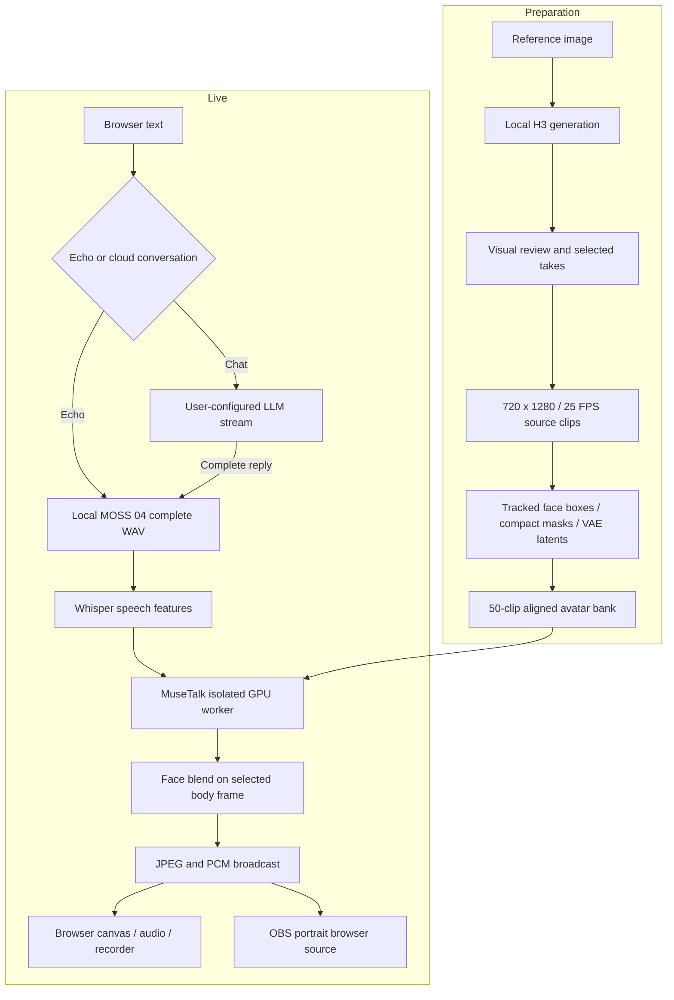

# Architecture / 方案与实现逻辑

[Index / 导航](README.md) · [Usage / 使用](USAGE.md)

## Preparation and live inference / 准备与实时推理

The background and body are part of one photographed-looking video plate. This avoids a separate background replacement or 3D skeleton during streaming. The final face movement is generated from current speech, while the body follows one of the reviewed clips. The character is fictional and adult; the accepted scene is the original daylight dorm.

背景与身体位于同一张写实视频底片里，直播时不再单独抠背景或驱动三维骨骼。身体播放经过审核的动作片段，嘴部随当前语音实时推理；角色为虚构成年学生，采用已确认的白天宿舍。

## Code boundaries / 代码分工

The selected MOSS branch uses a persistent NF4/BF16 speech process and CPU codec, buffers the complete reply, and supports generation cancellation. The original GPT-SoVITS branch retains sentence output. See [MOSS live](MOSS_LIVE.md) for activation, process ownership and measurements. / 当前 MOSS 分支使用常驻语音进程与 CPU codec，收齐回复后合成并支持取消；原 GPT-SoVITS 分支保留分句输出，具体见 MOSS 文档。

| Area / 范围 | Files / 文件 | Responsibility / 职责 |
| --- | --- | --- |
| Reproducible integration / 集成 | `deployment/configure_stack.py`, `activate_studio.py` | Apply explicit patches to locked upstream checkouts; retain originals under ignored `.setup` / 给上游应用补丁并保存原文件 |
| Controls / 控制 | `integration/studio_routes.py`, `llm_channel.py` | Status, channel, speech, interrupt, event subscription, gallery and sentence dispatch / 状态、渠道、播报、打断和事件 |
| Shared session / 共享实例 | `integration/studio_rtc.py` | One `studio` session and shared renderer; up to six socket viewers / 单人物共享渲染及最多六路观看连接 |
| GPU boundary / GPU 隔离 | `integration/isolated_inference.py`, `scripts/gpu_worker.py`, `sitecustomize.py` | Isolate avatar CUDA ownership in a worker process / 分离口型 GPU 进程 |
| Media state / 媒体状态 | `integration/motion_control.py`, `frame_store.py` | Whole-clip scheduling and bounded frame decoding / 完整片段调度与有限帧缓存 |
| Browser transport / 传输 | `integration/local_broadcast.py`, `web/local-stream.js` | Paced JPEG/PCM packets, local audio clock, canvas and recorder / 音画包、时钟与录制 |
| Asset pipeline / 素材处理 | `scripts/prepare_vertical_avatar.py`, `tracked_landmarks.py`, `vertical_face_material.py` | Face tracking, five-frame box smoothing, compact mouth mask and aligned latents / 人脸跟踪、框平滑、嘴部蒙版与潜变量 |

## Gesture selection / 动作选择

`motion-index.json` maps every clip to `start_frame` and `frames`. The controller returns a batch of frame indices, and the face input, body frame, mask and coordinates all use those same indices. It advances in chronological order within a clip and changes clips only at its end.

动作索引保存每个片段的起始帧与帧数。调度器输出批量索引，身体、脸部潜变量、坐标和蒙版统一使用这些索引。片段内部顺序播放，在边界切换，避免中途截断手势。

In automatic mode, quiet clips are drawn from idle/listen/posture; during speech, every third automatic selection at the configured phase can draw explain/emphasis. A shuffled deck reduces immediate repetition. Welcome and closing are available as explicit manual requests. Calm mode keeps automatic selection in the quiet categories. A manual request replaces the previous pending request and applies at the next boundary; it does not interrupt the current body gesture. Clip boundaries preserve source continuity but are not a guarantee of invisible transitions between all possible takes.

自动模式以待机、倾听、坐姿为主；说话时按计数节奏加入讲解与强调，打乱的候选牌堆减少连续重复。欢迎和告别可手动指定。安静倾听只从安静类别自动选择；手动请求采用最后一次待播动作，并在当前片段结束后生效。动作不是逐字语义生成，也不保证任意片段连接完全无痕。

## Speech and interruption / 语音与打断

The text channel supports streaming Chat Completions or Responses. It sends each request with a system prompt and the current user message; there is **no persistent multi-turn conversation memory**. Chinese/English sentence punctuation triggers local speech; commas can split long buffers above 80 characters. GPT-SoVITS returns a complete WAV for each segment. The integration resamples it locally to the avatar's 16 kHz stream.

云端渠道支持两种流式协议。每次只传系统提示词与当前消息，**没有持久多轮上下文**。句末标点触发播报；超过 80 字的缓冲可按逗号切分。GPT-SoVITS 对每段返回完整 WAV，之后本地重采样到 16 kHz。

Each new speech request or interrupt advances a generation number. Streaming LLM and TTS results check that number before adding further speech. Old queued speech is flushed; stale generation results are ignored. Audio already delivered to a viewer may remain briefly buffered. “Stop speaking” does not reset the body clip, kill the GPU process or cancel an already running cloud billable request at the provider.

新播报或打断会递增 generation 标记，LLM/TTS 继续投送前检查是否过期，清空旧队列并忽略旧结果。已经送到浏览器的声音仍可能有短暂缓冲。停止说话不重置当前身体动作，也不终止 GPU 进程；不能据此认定云端供应商已停止计费。

## Transport and memory / 传输与内存

Each binary WebSocket packet begins with three little-endian uint32 values: sequence number, JPEG byte count and sample rate (16,000). The JPEG is followed by mono signed 16-bit PCM, normally 640 samples / 40 ms. The sender targets 25 FPS. Each viewer retains at most three queued JPEGs; earlier entries become **audio-only packets with JPEG length zero**, preserving their sequence and all PCM. A queue exceeding 125 packets closes that viewing connection rather than silently discarding audio.

The browser schedules PCM before decoding pictures, starting about 2.4 seconds ahead to cover measured long-speech stalls. Compressed pictures wait until about 120 ms before playout, then a bounded decoder prepares them. It displays pictures against the audio clock and explicitly requests one canvas capture per draw. The FPS indicator uses `requestVideoFrameCallback` when supported; canvas draws and packet arrivals are separate counters. MediaRecorder captures the resulting stream as WebM. Both sender and browser must be updated together. The current portrait path does not use the upstream WebRTC offer route. See [playback measurements and latency tradeoffs](PLAYBACK.md).

音画包包含 12 字节小端头：序号、JPEG 长度、采样率，后接 JPEG 与单声道 PCM16，每包通常为 40ms 音频。每个观看连接最多保留三张排队图片；更早的图片改成 JPEG 长度为零的纯音频包，完整保留序号和 PCM。超过 125 包积压时断开该观看连接，不通过丢音频追赶直播。

浏览器先排声音，初始预缓冲约 2.4 秒以覆盖实测的长播报抖动；图片以压缩形式等待至临近播放约 120ms 再交给有界解码器。按音频时钟显示图片，每次绘制显式捕获一帧，支持时以视频实际呈现计算 FPS。接收包数、绘制数与呈现数分别记录。发送端与网页须同步更新，旧网页需刷新。当前竖屏输出使用 JPEG/PCM，不走上游 WebRTC offer 链路。

Latents remain on CPU until the selected batch is needed. Full frames and masks each use a 48-entry LRU store instead of decoding all 10,000 images eagerly. Native hard links reduce the assembly's extra disk duplication. These changes reduce memory pressure; they do not make the optional H3 generation workload inexpensive. Releasing generation models before live inference materially changes the observed VRAM footprint.

潜变量保留在 CPU，需要时搬入 GPU；整帧与蒙版各用 48 项 LRU，避免一次解码一万张图片。硬链接减少磁盘重复。这些改动降低直播资源压力，但不意味着 H3 视频生成同样轻量；生成模型卸载后，直播显存占用明显不同。
