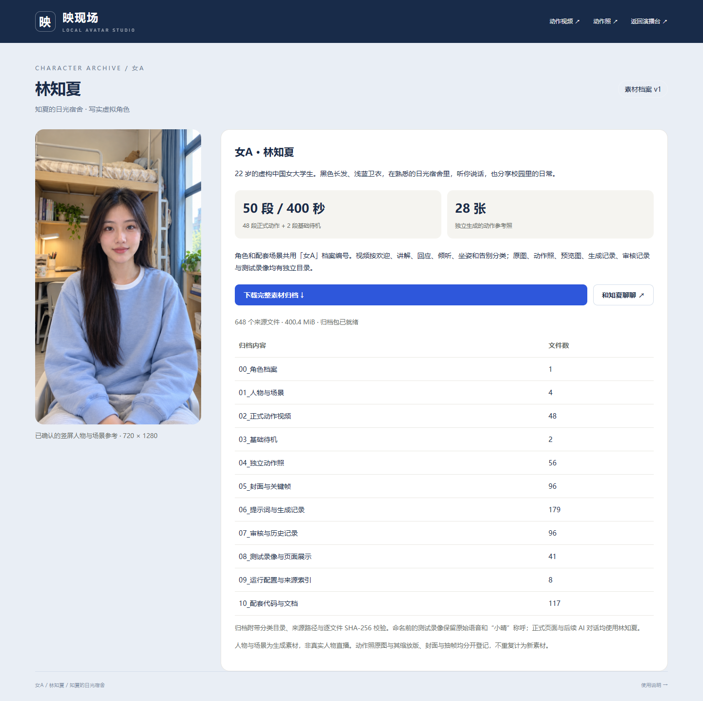

# 女A · 林知夏 / Character archive

[中文 README](../README.zh-CN.md) · [English README](../README.md) · [Registry / 素材档案](../archives/female-a/README.md)

**女A** 是角色与配套场景的共同档案编号。正式姓名为 **林知夏 / Lin Zhixia**，场景为 **知夏的日光宿舍 / Zhixia's Daylight Dorm**：虚构的 22 岁中国女大学生、黑色长发、浅蓝卫衣、已确认的白天宿舍、720×1280 竖屏。

`female-a` is the stable registry ID. Character names are presentation metadata; the prepared runtime ID remains `student_dorm_motion_bank_v3` so that body frames, face latents and masks stay aligned. This archive introduces no model or inference downgrade.

## 生效范围 / Where the identity applies

统一设定在 [female-a.json](../configs/characters/female-a.json)。演播台、角色档案页、状态接口和新测试话术使用林知夏。云端 AI 请求会将角色身份作为 system 提示的一部分，并保留已有渠道、模型、密钥和用户自定义对话设定。原文播报仍照读用户输入。

The public identity file drives the status response and the cloud conversation's identity prefix. Existing custom conversation instructions are appended; provider settings and secrets are preserved. Echo mode continues to speak the supplied text verbatim. Open `/character` for the character page and `/character/archive.zip` for the downloadable bundle on a running workstation.

旧测试录像、原始对话转录中出现的“小晴”属于命名前的测试称呼，保留原始记录。当前命名不改变过去录音中的声音内容，也不把旧录屏声称为新命名后的复测。

Historical recordings and transcripts retain the original spoken alias 小晴. Current labels and future scripts use 林知夏. The archive records this distinction explicitly.

## 目录与数量 / Layout and counts

| 分类目录 / Directory | 内容 / Contents |
| --- | --- |
| `00_角色档案` | 角色 JSON、说明、JSON 清单与 CSV 表格 / Identity and inventory |
| `01_人物与场景` | 4 张人物、竖屏锚点与宿舍场景参考 / Four accepted references |
| `02_正式动作视频` | 48 段、384 秒；按 6 种动作类别存放 / Six categories of reviewed motion |
| `03_基础待机` | 2 段、16 秒原始基础待机 / Original baseline clips |
| `04_独立动作照` | 28 张原图 + 28 张 720×1280 缩放版 / Originals and separately labeled derivatives |
| `05_封面与关键帧` | 48 张封面 + 48 张关键帧 / Posters and extracted frames |
| `06_提示词与生成记录` | 视频工作流、提示词、执行记录、动作照提示词 / Reproducible generation records |
| `07_审核与历史记录` | 已选与未选素材的审核记录和证据 / Acceptance and rejection evidence |
| `08_测试录像与页面展示` | 5 段历史场景录像、浏览器实录、GIF、截图、实测证据 / Published validation media |
| `09_运行配置与来源索引` | 动作映射、素材清单、模型来源索引 / Runtime and provenance metadata |
| `10_配套代码与文档` | 原生安装、直播、归档脚本、网页和说明 / Matching public code and documentation |

48 段正式动作与 2 段基础待机合计 **50 段、400 秒**，对应现有直播库的 **10,000 帧**。缩放版、封面、抽帧分别登记，不计作独立生成。未验收视频不进入正式动作目录；现有退回记录及可用审核图另存。模型权重、安装环境、渠道密钥和解码后的万帧缓存沿用运行目录，不重复打入素材包。

The asset archive contains reproducible selected sources and matching code, rather than installed environments or model weights. Its source media are sufficient to rebuild the existing motion bank. Hashes verify file integrity; they do not imply a new frame-by-frame quality review.

## 生成与校验 / Build and verify

在仓库根目录运行原生 Python，无需 GPU、Docker 或 WSL：

```powershell
python -X utf8 -B scripts/archive_character.py build
python -X utf8 -B scripts/archive_character.py verify
```

生成位置为 `outputs/archives/女A_林知夏/v1/` 和 `outputs/archives/female-a-lin-zhixia-v1.zip`。脚本复制素材并保留原路径，不移动运行依赖。归档已存在时，显式增加 `build --refresh` 可重建当前快照；计划长期留存时先保留旧版 ZIP。

The builder accepts only the fixed reviewed selection, verifies existing motion/pose hashes, copies files into categories, creates a source-to-archive manifest and a UTF-8 BOM CSV, and builds a ZIP with fixed metadata. Verification checks every archived source file in both the folder and the ZIP. Generated bundles remain ignored by Git; [manifest.json](../archives/female-a/manifest.json), [inventory.csv](../archives/female-a/inventory.csv) and [release.json](../archives/female-a/release.json) track the deliverable.

Each manifest entry provides `source`, `archive_path`, `group`, `bytes` and `sha256`. To reconstruct canonical layout in a fresh project, copy each `archive_path` back to its `source`, then follow the existing [deployment guide](DEPLOYMENT.md). Do not substitute a pose photo for a prepared video frame without preprocessing.



页面截图来自更新后的实际 3080 服务；历史测试视频的日期与原始称呼以各自证据记录为准。
