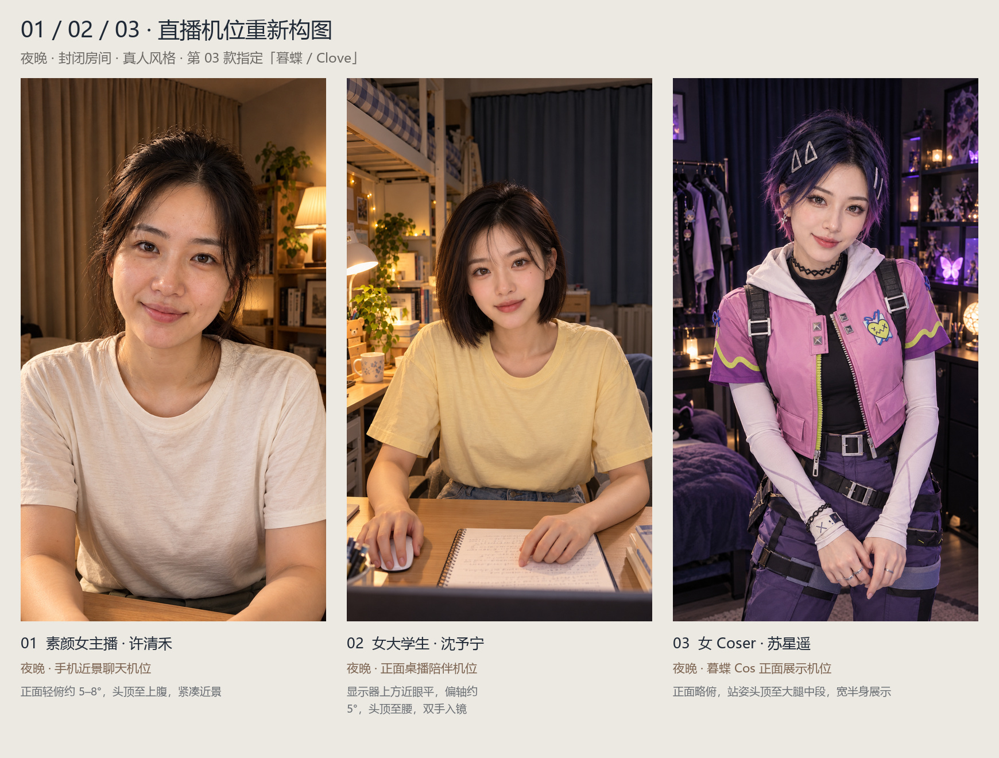

# 夜间人物与直播机位 V3 / Nighttime casting and camera V3

使用 **sub2-image-gen / gpt-image-2.5 / high**，以已有虚构成年人物为身份参考，重新生成 **01、02、03** 的直播构图；**03 指定 Cos《无畏契约》的暮蝶 / Clove**。04、05 沿用已审核的 V2 夜间原图。五款均为**夜晚、封闭室内、人工灯光、无窗外景色、9:16 竖屏**。

V3 recomposes candidates **01–03** using their existing fictional adult identities. **03 specifically cosplays Clove from VALORANT**, with official Riot artwork supplied as costume-only references. Candidates 04 and 05 retain their reviewed V2 outputs. All five scenes remain enclosed nighttime interiors with artificial lighting and no exterior view. This is a static casting round.



| 编号 / No. | 类型与人物 / Host | 机位与用途 / Camera and purpose | 封闭夜间场景 / Enclosed night set |
| --- | --- | --- | --- |
| 01 | 素颜女主播，许清禾，27 / Xu Qinghe | 正面轻俯近景，头顶到上腹，近距离聊天 / Slightly high conversational close-up | 米色厚帘全闭、原木层架、暖灯 / Closed blackout curtains, oak shelves, warm lamp |
| 02 | 女大学生，沈予宁，22 / Shen Yuning | 显示器上方近眼平、正面桌播，双手和笔记本入镜 / Monitor-mounted desk view with both hands visible | 封闭宿舍、蓝灰厚帘全闭、阅读灯、床架 / Dorm, closed curtains, study lamp, bed frame |
| 03 | 女 Coser，苏星遥，25 / Su Xingyao | 正面略俯、站姿宽半身，至大腿中段，展示暮蝶服装 / Frontal wider standing cosplay presentation | 深蓝厚帘全闭、手办柜、紫色蝴蝶实体灯 / Closed navy curtains, display cabinet, butterfly lamps |
| 04 | 魅惑氛围主播，叶晚棠，30 / Ye Wantang | 保留 V2 轻俯坐姿 / Retained V2 seated mild high angle | 全闭酒红厚帘、琥珀灯 / Closed burgundy curtains, amber lamp |
| 05 | 播客女主播，程书言，31 / Cheng Shuyan | 保留 V2 偏轴访谈，麦克风侧置 / Retained V2 interview view | 胡桃木吸音墙、关闭房门、暖色壁灯 / Acoustic walls, closed door, warm sconces |

## 参考画面与取舍 / Visual references and adaptations

2026-10-24 实际检查了 B站公开回放页显示的主播画面，以及抖音可公开检索、由平台图片域名提供的直播截图。参考镜头与主播的位置关系、人物大小、桌面与背景占比；人物脸部继续采用本项目虚构人物的参考图。

The reference sample consists of publicly visible Bilibili replay-page frames and a platform-hosted Douyin livestream screenshot, visually inspected on 2026-10-24. It informs framing and camera placement. This is a small qualitative sample, not a survey of platform prevalence. The fictional performers' identities were preserved.

| 参考来源 / Source | 实际观察 / Observation | 应用 / Application |
| --- | --- | --- |
| [B站：真栗直播翻唱回放](https://www.bilibili.com/video/BV1AQ4y197JR/) | 正面肩胸、座椅、侧置悬臂麦克风 / Frontal desktop presenter and side microphone | 02 正对观众的桌播关系，并扩展下沿露出双手 / Frontal desk relationship, expanded to include hands |
| [B站：咬人猫公开直播回放](https://www.bilibili.com/video/BV1Pb4y1D7Co/) | 固定正面真人半身、实体房间 / Fixed frontal upper-body view | 02 固定正面；03 从正面展示拓展为站姿宽半身 / Fixed frontal presentation, widened for costume visibility in 03 |
| [抖音：可检索的竖屏聊天截图出处](https://m.douyin.com/shipin/7616936639201331238) | 人脸占比较高、直视观众、肩胸入镜 / Face-dominant vertical conversation | 01 拉近距离、正面轻俯，保留素颜生活气质 / Closer conversational view for the bare-faced host |
| [Riot：Clove 角色页](https://playvalorant.com/en-us/agents/clove/)与[官方设计文章](https://playvalorant.com/en-us/news/game-updates/clove-death-is-only-the-beginning/) | 蓝紫短发、银色发夹、粉色短外套、白袖、黑背带、紫色工装 / Official hair, clips, jacket, sleeves and utility clothing | 03 真人暮蝶 Cos；官方图仅作造型参考，不收入素材包 / Costume references only; source artwork is not redistributed |

抖音常规直播页未完整加载，因此采用公开索引的直播截图作构图参考；未声称完整观看直播或验证当前房间正在开播。提示词中的俯仰角、距离、焦段是本项目设计目标，未经原片测量。实际结果见[逐图审核](../output/imagegen/character-selection-angles-v3-20261024/reviews.json)和[参考记录](../output/imagegen/character-selection-angles-v3-20261024/camera-research.json)。调研浏览器页面与进程均已关闭。

The regular Douyin live/video pages did not fully render, so only the publicly indexed platform-hosted screenshot supports that reference. Continuous playback and real-time room viewing are not claimed. Numerical camera settings are design targets, not measurements of source recordings. All research browser sessions were closed.

## 查看与下载 / Compare and download

演播台静态入口为 `/selection.html?v=3`，本机示例 `http://127.0.0.1:8010/selection.html?v=3`。点图放大、加入多款候选，并导出含版本、机位和 Cos 角色的 JSON 记录。V3 使用新的浏览器存储键，避免旧版选型与新版混淆。

Open `/selection.html?v=3` on the running workstation, or open the self-contained [offline comparison page](../web/selection.html). It supports enlargement, multiple shortlisted candidates and JSON export with revision/camera information. Images are embedded; no CDN, web font, generation service or model is called by the page. V3 uses a separate shortlist storage key.

| 交付内容 / Artifact | 路径 / Location |
| --- | --- |
| 三款重点总览 / Focused comparison | [camera-trio-overview.jpg](../output/imagegen/character-selection-angles-v3-20261024/camera-trio-overview.jpg) |
| 五款总览 / All five candidates | [night-selection-overview.jpg](../output/imagegen/character-selection-angles-v3-20261024/night-selection-overview.jpg) |
| 原始 PNG、竖屏 PNG、预览、提示词 / Native images, portraits, previews, prompts | `output/imagegen/character-selection-angles-v3-20261024/` |
| JSON 与 CSV 清单 / Inventories | [catalog.json](../output/imagegen/character-selection-angles-v3-20261024/catalog.json) · [选型清单.csv](../output/imagegen/character-selection-angles-v3-20261024/选型清单.csv) |
| 包与页面校验 / Release hashes | [release.json](../output/imagegen/character-selection-angles-v3-20261024/release.json) |
| 实际页面截图 / Actual page captures | [桌面 / Desktop](media/character-selection-v3-desktop.png) · [手机 / Mobile](media/character-selection-v3-mobile.png) |
| 实际交互验收 / Interaction verification | [character-selection-v3.json](evidence/character-selection-v3.json) |

完整包为 `outputs/character-selection/night-character-selection-v3.zip`，服务下载入口为 `/night-character-selection-v3.zip`。包内包含五款原始生成 PNG、720×1280 PNG、JPG 预览、实际提示词、总览、审核与参考记录、CSV/JSON 清单和离线网页。原始图尺寸与 SHA-256 以清单实测值为准，缩放版与总览不计为独立生成。V2 历史图仍保留，见[上版说明](CHARACTER_SELECTION.md)。

The V3 ZIP includes the native outputs, 720×1280 portraits, previews, prompts, contact sheets, reviews, reference records, inventories and offline page. Measured dimensions and hashes are in the catalog. Resized images and contact sheets are derivatives, not additional generations. V2 originals remain available; ZIP bundles are excluded from Git.

```powershell
python -X utf8 -B devtools/build-character-selection.py --revision v3
```

上述命令只复建已有审核素材的网页和包，不调用图像接口或 GPU。`--revision v2` 可复建历史版，同时将 `web/selection.html` 切回旧版；再次运行 V3 命令恢复当前页面。Pillow 和 Windows 微软雅黑字体用于总览排版。

The command rebuilds the presentation and archive from reviewed outputs without image-generation or GPU calls. `--revision v2` rebuilds the historical presentation and replaces `web/selection.html`; rerun V3 to restore the current page. Pillow and the installed Microsoft YaHei font produce the contact sheets.

五款仍是静态人物与场景选型，尚未制作对应动作视频、音色或口型缓存；既有女A / 林知夏继续使用原配置。静态素材验收不能代替后续实时说话测试。

These candidates have not yet received matching motion videos, voice designs or lip-sync preparation. Existing 女A / Lin Zhixia remains active. This static delivery does not demonstrate live speaking performance for the new candidates.
