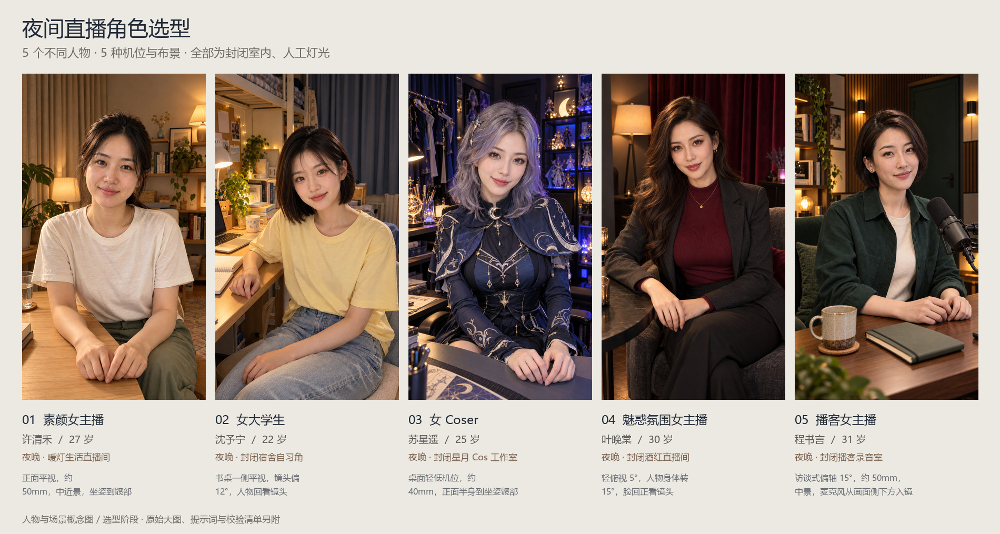

# 夜间人物与场景选型 / Nighttime character selection

本轮使用 **sub2-image-gen / gpt-image-2.5 / high** 实际生成五位不同的虚构成年女性角色，统一满足：**夜晚、封闭室内、人工照明、窗外不可见、竖屏构图**。

Five different fictional adult hosts were generated for static character-and-scene selection. All are in enclosed rooms at night. Four images were revised from the first-pass identity references; the mature evening host is a fresh fully clothed fashion portrait after the image gateway rejected the earlier edit. The model was not changed. Earlier daytime drafts are superseded and excluded from this delivery.



| 编号 / No. | 类型 / Type | 暂定姓名 / Name | 机位 / Camera | 夜间封闭背景 / Enclosed night set |
| --- | --- | --- | --- | --- |
| 01 | 素颜生活主播 / Bare-faced lifestyle | 许清禾，27 / Xu Qinghe | 正面平视 / Frontal eye level | 原木生活角、完全闭合米色遮光帘、暖灯 / Oak shelves, closed blackout curtains, warm lamps |
| 02 | 女大学生 / Adult university student | 沈予宁，22 / Shen Yuning | 书桌侧前方，回看镜头 / Desk-side view | 封闭宿舍、蓝灰厚帘、阅读灯 / Dorm, closed thick curtains, study lamp |
| 03 | 女 Coser / Cosplayer | 苏星遥，25 / Su Xingyao | 轻低机位、正面坐姿 / Mild low angle | 封闭星月工作室、手办柜、蓝紫灯 / Enclosed cosplay studio, display cabinet, blue-violet lights |
| 04 | 魅惑氛围主播 / Mature evening host | 叶晚棠，30 / Ye Wantang | 轻俯视，身体略侧 / Mild high angle | 完全闭合酒红厚帘、琥珀灯、深色直播间 / Closed burgundy curtains, amber lamps, dark studio |
| 05 | 播客女主播 / Podcast host | 程书言，31 / Cheng Shuyan | 偏轴访谈中景 / Off-axis interview | 胡桃木吸音墙、关闭房门、侧置麦克风 / Walnut acoustic walls, closed door, microphone to the side |

## 查看与选型 / Compare and shortlist

运行中的演播台新增静态页面 `/selection.html`。打开后可点图放大、加入多款候选并导出 JSON 选型记录。页面无外部 CDN 或字体依赖，图片直接内嵌，也可离线打开 [selection.html](../web/selection.html)。选择保存在当前浏览器，不会切换直播角色。

The static page supports enlargement, local shortlisting and JSON export. On a running workstation, open `http://127.0.0.1:8010/selection.html`. The browser stores the shortlist locally. The existing 女A / 林知夏 live configuration remains active; these five candidates have not had motion videos, voices or lip-sync assets prepared.

原图、720×1280 竖屏 PNG、JPG 预览、实际提示词、[JSON 清单](../output/imagegen/character-selection-night-20261024/catalog.json)、[CSV 清单](../output/imagegen/character-selection-night-20261024/选型清单.csv)、[审核记录](../output/imagegen/character-selection-night-20261024/reviews.json)均在 `output/imagegen/character-selection-night-20261024/`。图像尺寸以清单记录的实测尺寸为准；缩放和总览不计作独立生成。

The archive is generated at `outputs/character-selection/night-character-selection-v2.zip`. It includes all five native model outputs, portrait deliveries, previews, prompts, inventories and a self-contained offline selection page. The ZIP is excluded from Git. [Release hashes](../output/imagegen/character-selection-night-20261024/release.json) record the exact bundle and page.

复建展示与归档 / Rebuild the presentation and archive:

```powershell
python -X utf8 -B devtools/build-character-selection.py
```

This command packages the existing reviewed model outputs; it does not call an image generator or run GPU inference. It uses Pillow and the installed Microsoft YaHei font on Windows for the comparison sheet. Static checks and visual review cover this concept delivery; they do not demonstrate live speaking quality for the new candidates.
