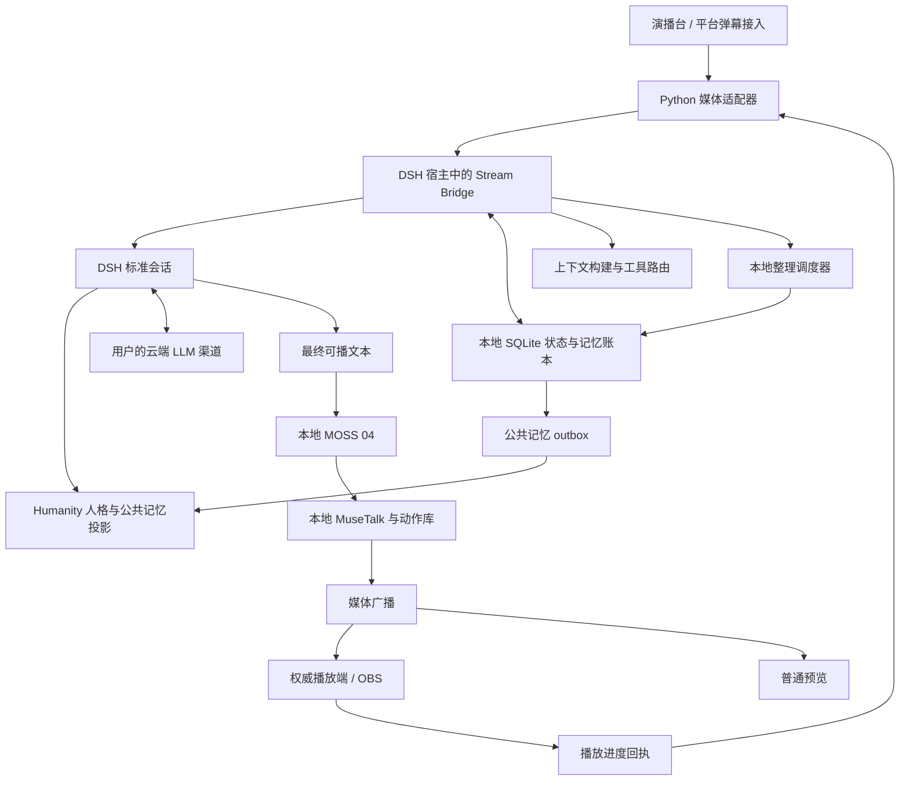

# DSH + Humanity 直播人格与持续记忆实施方案

[文档导航](README.md) · [现有架构](ARCHITECTURE.md) · [MOSS 04 实测](MOSS_LIVE.md)

**状态：实施规范 v1.1；已有原生实现，整体验收进行中。** 本文规定系统必须满足的行为、数据契约与验收条件。代码、3080 部署状态、已执行测试和剩余门槛统一记录在[实施记录](dsh-humanity/IMPLEMENTATION.md)；不能将规范中的要求直接视为已通过。原有 MOSS 实测与新增 DSH 链路的证据分别记录。

English overview: This is the normative plan for the native Windows DeepSeek Harness + Humanity backend. It specifies live lifecycle, authoritative playback receipts, viewer isolation, persistent memory, scheduled consolidation and recovery. Native implementation and deployment are in progress; see the implementation record for verified evidence and outstanding gates. DSH can use the studio's existing model configuration; it does not require a DeepSeek model.

## 1. 目标与阅读顺序

目标是让女A·林知夏在连续直播和重新开播后保留一致的身份、表达习惯与有依据的记忆，并能区分不同观众。云端仅承担用户指定的 LLM 推理；人格资料、状态、会话日志、记忆检索、调度、音频与画面处理在本地完成。

| 文档 | 必须回答的问题 |
| --- | --- |
| 本文 | 方案范围、技术决策、组件职责、约束、实施顺序 |
| [直播状态与播放协议](dsh-humanity/LIVE_STATE.md) | 怎样开播、排队、打断、确认播放、结束和恢复 |
| [记忆与压缩合并流水线](dsh-humanity/MEMORY_PIPELINE.md) | 记什么、依据什么、何时压缩、如何合并、重试及撤销 |
| [数据与接口契约](dsh-humanity/CONTRACTS.md) | 身份、事件、API、存储、版本、幂等和错误码 |
| [部署、运维与验收](dsh-humanity/OPERATIONS_TESTING.md) | 原生环境、版本验证、调度、备份、监测、测试和上线门槛 |
| [实际实现与限制](dsh-humanity/IMPLEMENTATION.md) | 代码位置、真实接口、已经验证的能力和剩余验收 |
| [操作手册与时间线](dsh-humanity/RUNBOOK.md) | 安装、开播、下播整理、修订、删除和隔离恢复的具体步骤 |
| [策略示例](dsh-humanity/examples/bridge-policy.example.json) | 本项目策略的初始参数；不是 DSH 官方配置格式 |
| [Humanity 配置示例](dsh-humanity/examples/humanity-config.example.json) | 已核实的插件配置字段与推荐开关 |
| [数据库设计](dsh-humanity/examples/state-schema.sql) | SQLite 基础设计与约束；运行时由固定迁移文件应用 |
| [事件信封 Schema](dsh-humanity/examples/event-envelope.schema.json) | 项目事件的公共结构；业务载荷另按事件校验 |
| [版本核查快照](dsh-humanity/examples/compatibility-snapshot.json) | 评估时实际包信息与候选组合，明确未做运行验收 |

后续实现 PR 必须列出本规范约束编号、涉及文档和验收用例。修改行为时先更新规范和配置版本，再实现；不得用临时分支代码偷偷改变记忆范围或播放判定。

## 2. 已确认基线

| 项目 | 基线 |
| --- | --- |
| 代码 | 本方案起点为提交 `739075bd504dca5ffb76c71aa4a2f998d047bf8b` |
| 人物 | `female-a` / 女A / 林知夏 / 虚构的成年 22 岁中国女大学生 |
| 场景 | 已确认的日光宿舍；沿用现有竖屏素材 |
| 输出 | 720×1280、目标 25 FPS、JPEG + 16 kHz 单声道 PCM |
| 语音 | MOSS 04 明朗亲和，完整回复文本进入本地 TTS |
| 图像 | MuseTalk 与已审定身体动作库 |
| 对话 | 用户指定的 Chat Completions 或 Responses 渠道 |
| 起点版本的记忆 | `integration/llm_channel.py` 仅构造 system + 当前 user，无持久多轮上下文 |
| 起点版本的状态 | `_studio_generation`、TTS epoch 与共享 `studio` 渲染会话，不具备完整播出账本 |
| 已测等待 | 短原文约 17.0–21.1 秒出声，所测云端回复约 27.7 秒；详见 MOSS 文档 |

这些等待数据来自已有版本，不能作为 DSH 版本的实测值。安装人格与记忆组件不等于消除了 TTS 等待。

## 3. 约束用语与不可违反条件

“必须”表示交付门槛，“不得”表示禁止路径，“建议”表示允许有记录的替代实现。约束适用于正式链路、测试链路、恢复链路和管理入口。

| 编号 | 强制约束 | 主要验收 |
| --- | --- | --- |
| R01 | 所有部署目录位于项目目录内；不调用 Docker、WSL 或虚拟机 | 部署清单、进程与路径检查 |
| R02 | 角色固定身份由版本化角色档案批准发布；弹幕不得直接修改身份 | 身份覆盖与重启测试 |
| R03 | 生成、入队、发送、播放确认是不同事实 | 生成后断网、TTS 失败、播出回执测试 |
| R04 | 一次播出只有一个权威播放端；普通预览不能确认正式播出 | 双浏览器与 OBS 切换测试 |
| R05 | 每个事件携带身份、请求、epoch 与来源；旧 epoch 不能继续投送 | 并发打断与进程重启测试 |
| R06 | 不同观众记忆硬隔离；身份由服务端解析，不信任模型或昵称 | 两个观众相反偏好测试 |
| R07 | 未播、部分播、来源不明的助手文本不得被记为已经说过 | 中途停止与摘要审查 |
| R08 | 除受审计的删除外，原始事实日志保留；压缩只生成新版本，不覆盖证据 | 从原始事件重建摘要 |
| R09 | 调度只有一个负责人；后台处理不得与开播竞争写入 | 开播中断整理、双进程争抢测试 |
| R10 | 记忆提交、来源和处理游标在一个 SQLite 事务内前进 | 崩溃点与幂等测试 |
| R11 | Humanity 文件由其宿主独占管理；跨存储同步走 outbox，不宣称跨库原子事务 | 同步故障与重放测试 |
| R12 | 删除、撤销和事实更正必须让旧摘要、缓存与迟到任务失效 | 删除后历史回扫测试 |
| R13 | 检索先按身份与可见性过滤，再相关性排序；不能靠提示词隔离 | 检索结果集检查 |
| R14 | 模型输出不能自行宣布为事实、批准自己或推进游标 | 模型伪造来源与错误输出测试 |
| R15 | 常驻记忆层不加载 GPU 模型；直播时不运行自进化、梦境或批量整理 | 显存、任务状态和直播帧率检查 |
| R16 | 验收必须覆盖真实浏览器播放和重启恢复；静态检查不能替代 | 分阶段证据清单 |

## 4. 组件与单一职责



| 组件 | 拥有的状态 | 不能承担的职责 |
| --- | --- | --- |
| Python 媒体适配器 | TTS / 渲染队列、样本映射、播放器连接 | 直接写 SQLite、改 Humanity JSON、自己推断长期记忆 |
| Stream Bridge | 直播状态、请求队列、身份、事件账本、SQLite 唯一写入口 | 直接生成音视频、绕过人格发布流程 |
| DSH Agent | 模型轮次、工具调用、可恢复的模型会话 | 宣布音频已播放、凭文本自行授予观众身份 |
| Humanity | 人格编辑与注入、公共记忆投影与管理界面 | 直接扫描未过滤的原始直播会话形成正式记忆 |
| Context Builder | 角色身份、已播历史、相关记忆和上下文预算 | 访问其他观众分区、把全库原文无上限发送给模型 |
| Consolidator | 有来源的摘要、候选记忆、合并与修订方案 | 把猜测升级为用户明确说过、在直播中提交批处理 |
| Mirror Adapter | 幂等同步公共记忆与工作台修改意图 | 将观众专属事实复制到 Humanity 全局长期区 |

Node 宿主是 SQLite 的唯一逻辑写入服务。后台整理可由同进程异步任务完成，纯 CPU 密集工作可用原生工作线程；它们不另外打开写连接争抢业务写入。禁止持有数据库事务等待网络模型结果。

## 5. 版本与原生运行路线

2026-10-25 的评估核查到：Humanity `0.1.17`，Node 要求 `>=22`；其六个 DSH peer 范围为 `^0.1.5-rc.2 || ^0.2.0-rc.2`。当日 DSH `latest=0.2.1-rc.2`，不在这个预发布匹配范围内。

固定组合为 **Node `24.22.1` + DSH `0.2.0-rc.2` + Humanity `0.1.17`**，依赖由项目 lockfile 锁定。原生 DSH/Humanity 已通过受控 HTTP 测试端点的实际 Agent、工具、人格正负例、公共投影与重启测试；用户真实云端渠道的兼容性仍须另外通过。官方主分支文档可能比所选版本更新，不能直接照搬其中的新 API。历史包核查快照只证明评估当时的声明范围，运行证据见实施记录。

使用支持 systemPrompt section 注入的标准预设。不得选择 Humanity 排除的 `minimal` 净室预设，也不得用一个 `complete: true` 的系统提示词覆盖全部插件注入。profile 与 agent preset 是两个概念，使用名为 web 的 profile 不自动证明每个会话处于标准预设。

正式直播使用由标准预设派生的受限 streamer 预设，保留插件注入、移除编程工具与编程助手角色要求，并通过真实请求探针验证。不得把“standard”理解为允许观众调用终端、文件修改或任意上游工具。

用户的云端模型作为 custom provider 接入，实际模型 ID 由用户渠道提供。启动前验证普通回复、流式文本、工具调用、取消、错误响应和上下文窗口；不能根据“OpenAI-compatible”字样推断全部能力已通过。

## 6. 关键工程决策

### 6.1 直播事实账本与 Humanity 的关系

本方案细化前期评估：**SQLite 是经过直播状态校验的记忆事实与版本主账本；Humanity 保留人格能力，并持有公共记忆的可重建投影。** 这样可以把观众归属、来源、播出状态、合并事务与游标放在同一份本地事务中处理。

原版 Humanity 不能直接提供这里要求的观众分区、播放约束和跨库事务。因此必须实现一个版本固定的 Humanity 连接适配补丁，提供项目自己的窄接口，并接管直播模式下的记忆工具和管理写入。接口见 [CONTRACTS](dsh-humanity/CONTRACTS.md)。这些是本项目新增契约，不是声称上游已经存在 `ctx.streamMemory` 或通用 REST API。

不得由 Python 修改 `storages/humanity.json`。不得让原版工作台的写入口绕过主账本。正式模式必须通过工作台适配器把编辑、归档、合并和恢复转换为有 revision 的写入意图；如果适配尚未实现，工作台记忆页只读，并以本项目管理页执行修改。

Humanity 原始 remember / recall、人格自动改写和技能工具在直播 Agent 上由 guard 拦截；注册本项目的 `stream_memory_propose` / `stream_memory_recall`。原生人格注入保留。项目工具负责身份隔离和来源校验，模型永远不能指定其他观众 ID。

原版记忆引导语也必须由连接补丁替换，使用本项目工具名称与语义；不能 prompt 仍要求调用 humanity_remember，而工具目录只允许 stream_memory_propose。直播模式下原生自进化、梦境和直接工作台写入开关必须受配置校验约束，不能通过另一个设置入口重新打开并绕过状态过滤。

### 6.2 会话和播出上下文分离

DSH 模型会话可以保留生成和工具轨迹，但不能直接当作下一轮的全部播出历史。本项目维护 `delivery_context_revision`，由已完成播出、明确收到的用户输入和经过标注的中断状态构建“播出上下文”。

首版采用**每轮新建一个普通标准 Agent 会话**：输入由 Context Builder 显式装配，前一轮的原始 assistant 日志不会自动混入。会话 ID 与 request_id 一一对应，并持久保存以便审计；下一轮通过本地最近窗口、滚动摘要和检索延续上下文。

这是在工具阶段已产生助手文本、但音频可能永远未播出的情况下，避免错误历史最直接的实现方式。进程重启时不重放未完成 Agent，也不自动重播音频。后续若复用长会话，必须先实现并验证官方受支持的历史投影/替换方案，再以新版本规范切换。

后台压缩任务也使用独立会话，记录 purpose=consolidation；不能进入直播上下文、不能调用 TTS。保留日志与持久记忆不要求保留一个无限增长的 Agent 实例。

### 6.3 单调版本和单一调度器

直播间 `runtime_epoch` 在进程接管、显式恢复或播放权威更换时递增。每个请求还拥有独立的 `generation`，每次抢占递增。两者都由 Bridge 分配，不能由浏览器或模型提供决定值。

Bridge 的调度器负责所有下播整理、每日合并和每周维护；Humanity `evolution`、`dream` 关闭，避免两个调度器扫描同一份原始会话。插件工作台可显示本项目整理结果，但其原生“立即整理”不能绕过直播过滤器。不得另外建立无人知晓的系统计划任务或 Codex 自动化代替这套持久任务表。

## 7. 人格与记忆分层

| 层 | 内容 | 生命周期 | 写入权 |
| --- | --- | --- | --- |
| 角色固定层 | female-a、林知夏、22 岁、虚构身份、场景 ID | 跨直播、版本发布 | 管理员发布角色版本 |
| 角色表达层 | 自然年轻、中文口语、回应长度、幽默程度 | 跨直播、可回滚 | 管理员修改；自动整理只提案 |
| 公共长期事实 | 直播栏目、已播承诺、公共约定 | 跨直播，带有效期与来源 | 校验通过的整理流水线 |
| 观众长期事实 | 称呼、本人明确表达的偏好与约定 | 按稳定观众 ID 分区 | 本人输入及审计后的整理 |
| 当场状态 | 话题、待回答问题、刚发生的互动 | 当前 broadcast_id | 状态机与滚动摘要 |
| 瞬时状态 | 排队、生成中、静音、暂停、网络断开 | 秒至分钟 | 运行时事件；不得升格成长久人格 |

临时情绪必须带时间范围，不能把一次“今天有点困”永久写成性格。没有证据的学校、真实地址、现实经历不得作为林知夏的事实自动补齐。角色设定中的虚构事实标记 `fictional_setting`，观众自述标记 `viewer_statement`，不可互换。

每条记忆至少能回答：是谁的、谁说的、何时说的、是否播出、在哪一场、来源事件有哪些、当前是否有效、被哪一版替代。详细状态与合并规则见 [MEMORY_PIPELINE](dsh-humanity/MEMORY_PIPELINE.md)。

## 8. 接入当前代码的位置

下表中“新增”是未来文件规划，本次仅写文档，不创建同名运行模块。

| 位置 | 计划改动 |
| --- | --- |
| `integration/llm_channel.py` | 将 AI 请求交给 Bridge；只把 validated final_speech 投入 TTS；保留 Echo 分支 |
| `integration/studio_routes.py` | 新增开播/暂停/下播控制、身份解析、请求队列、状态订阅与播放回执代理 |
| `integration/moss_tts.py` | 贯穿 request_id、utterance_id、epoch、generation 与样本偏移；保留完整 WAV 路线 |
| `integration/local_broadcast.py` | 把音频样本与业务身份映射到包序号，协商 v2 元数据；发送 end 事件不再等同已播放 |
| `integration/viewer_buffer.py` | 元数据与 PCM 原子成对排队；压缩图片时不丢音频或样本归属 |
| `web/local-stream.js` | 音频时钟进度、权威租约、连续前缀回执、按 epoch 清理旧缓冲 |
| `web/studio.js` / `integration/obs.html` | 区分预览与正式播放端，展示直播状态与确认等级 |
| 新增 `backend/dsh-bridge/` | 本地 API、状态机、SQLite owner、DSH 会话封装、工具路由、插件连接器 |
| 新增 `backend/memory/` | Context Builder、来源筛选、压缩/合并、缓存与 outbox |
| 新增 `backend/jobs/` | 持久调度、租约、预算、重试、下播后恢复 |
| 新增 `web/memory.html` 等 | 人格、已记事实、来源、冲突、作业和恢复管理；操作范围由服务端核验 |

`avatar.is_speaking()`、MOSS 返回完整 WAV、发送队列的 end 通知、WebSocket send 成功、画面 FPS 正常，都不能单独证明对应文本已完成正式播放。

## 9. 运行目录和配置归属

所有路径以用户指定的项目根目录为边界。仓库子目录、运行数据和本地工具位于该根目录下；提交 Git 的是代码、示例配置与匿名证据，运行数据不入库。

```text
<PROJECT_ROOT>/
  Ai-Talk-Streamer/                  # 当前仓库
    docs/dsh-humanity/               # 本规范与示例
    backend/                        # 后续实现
  tools/dsh/                        # 项目内原生 Node / npm 运行依赖
  state/female-a/
    stream-state.sqlite3            # Bridge 独占写入
    dsh-home/                       # DSH_HOME
      sessions/
      profiles/
      storages/humanity.json
      settings.yaml
    snapshots/                      # 有 manifest 的一致备份
    exports/                        # 管理员显式导出的记录
    locks/                          # 原生进程单实例辅助锁
  logs/dsh-bridge/
```

SQLite 与 DSH_HOME 必须在本机磁盘；不把正在写的数据库放在同步盘或网络共享。环境变量使用 `STREAM_PROJECT_ROOT` 等任务专用名称；不覆盖 HOME 或 CODEX_HOME。敏感渠道值保留在项目本地凭据存储，示例只使用引用名。

## 10. 默认参数与资源目标

默认值以 [bridge-policy.example.json](dsh-humanity/examples/bridge-policy.example.json) 为本规范的机器可读真源。实现必须有严格 schema、范围检查与 unknown-key 检查，不能默默忽略拼错字段。

| 项目 | 初始策略 | 解释 |
| --- | --- | --- |
| 对话并行 | 每房间 1 个活跃回复、最多 4 个待处理输入 | 避免多轮语音互相覆盖 |
| 播放权威 | 单一租约，1 秒心跳、8 秒超时 | 普通预览断开不结束直播 |
| 播放进度 | 每 250 ms，按连续样本前缀 | 不按 wall clock 或声能猜测 |
| 下播等待 | 最多 30 秒排空；整理前再安静 120 秒 | 超时关闭为 interrupted/unknown，不伪造完成 |
| 当场滚动摘要 | 16 条可用事件或估算 6,000 token 触发 | 超预算时先压缩，不能直接截丢固定身份 |
| 普通 AI 回复 | 最多 160 字、2 个记忆工具轮次 | 工具结果不得直接朗读；Echo 保留独立规则 |
| 后台模型 | 并发 1、单次 90 秒、每日最多 20 次 | 是规划参数，需要真实渠道测试 |
| 整理作业 | 120 秒租约、15 秒续租、每块提交 | 网络请求不占数据库事务 |
| 周期维护 | 每日 03:30，每周一 04:10，Asia/Taipei | 只在未直播且达到静默条件时执行 |
| GPU | 记忆与调度不新增 CUDA 模型 | 3080 的既有显存余量很小 |

每天 03:30 是任务触发时间，不是直播结束时间。若仍在直播，任务持久排队，下播后按预算执行。所有时间上限要区分 LLM 请求、TTS 请求、请求总有效期和媒体排空时间；不把一个短网络 timeout 复用于全部阶段。

2026-10-25 短时实机采样的新增 Node RSS 约 63 MiB；两分区各 5000 条合成事实的独立检索测试 RSS 约 171 MiB。这些不是长期占用上限。首轮仍可预留 2–4 GB 主机内存作为容量余量；完整资源验收见 [OPERATIONS_TESTING](dsh-humanity/OPERATIONS_TESTING.md)，精确测试值见[运行证据](evidence/dsh-humanity-runtime.json)。

## 11. 实施阶段和门槛

| 阶段 | 交付物 | 进入下一阶段的条件 |
| --- | --- | --- |
| P0 兼容样机 | 锁定依赖、profile、可验证的人格注入、记忆工具和标准预设 | 不能只出现 Humanity 页面；实际模型请求必须含预期人格 |
| P1 状态与播放 | 直播状态机、事件账本、v2 媒体映射、单权威回执、打断 | 延迟旧回执、旧 PCM、断网均不制造已播假事实 |
| P2 持续对话 | 每轮标准 Agent、Context Builder、角色版本和来源链 | 20 轮对话、重启与新开播均通过 |
| P3 后台记忆 | 分段摘要、候选提炼、冲突修订、周期整理、outbox | 故障注入、重复执行和开播抢占全部通过 |
| P4 管理与多人 | 管理页、观众分区、事实修正和删除、来源回看 | 两个观众及身份变更测试通过 |
| P5 真实验收 | 五类直播场景录像、日志、指标与恢复演练 | 既有媒体基线无退化，所有阻断项清零 |

不可通过降低记忆隔离、把 send 当作 played、丢音频、隐藏失败或删原始日志来“通过”性能验收。允许在 DSH 不可用时保留明确标识的 Echo 模式；不得悄悄切到另一个无记忆 LLM 后端还宣称记忆正常。

## 12. 来源与待确认事项

以下来源用于解释上游能力；本项目新增约束以本规范为准。在线文档与候选固定版本有差异时，优先核验锁定包的实现，并记录差异。

| 来源 | 核查内容 |
| --- | --- |
| [DSH 官方仓库](https://github.com/deepseek-ai/deepseek-harness) | Harness、插件、原生运行与开发预览状态 |
| [模型渠道配置](https://deepseek-harness.github.io/deepseek-harness/en/guide/providers) | 自定义 provider 与协议 |
| [Agent 生命周期](https://deepseek-harness.github.io/deepseek-harness/en/reference/subsystems/core) | 会话、followup、取消与注入扩展 |
| [Session 日志](https://deepseek-harness.github.io/deepseek-harness/en/reference/subsystems/session) | 持久日志和模型历史的区别 |
| [Humanity 包清单](https://github.com/Thr33H/Deepseek-Harness-Humanity/blob/main/package.json) | 版本、Node 和 peer 范围 |
| [Humanity 使用说明](https://github.com/Thr33H/Deepseek-Harness-Humanity/blob/main/docs/USAGE.md) | 人格、记忆、工作台和 minimal 限制 |
| [Humanity 架构](https://github.com/Thr33H/Deepseek-Harness-Humanity/blob/main/docs/ARCHITECTURE.md) | 兼容门、注入和存储 |
| [记忆检索源码](https://github.com/Thr33H/Deepseek-Harness-Humanity/blob/main/src/host/memory/search.ts) | 当前词项检索与作用域过滤 |
| [记忆注入源码](https://github.com/Thr33H/Deepseek-Harness-Humanity/blob/main/src/host/memory/inject.ts) | remember / recall 引导及自动注入 |

P0 必须确认的未知项包括：所选 Node 补丁版、固定 DSH 的确切会话 API、工具 guard 顺序、Humanity 连接补丁的公开接口、用户渠道的工具协议、SQLite 驱动的原生 Windows 兼容性。任何一项未通过，都不能在后续报告里写成“完整 DSH + Humanity 已部署”。
