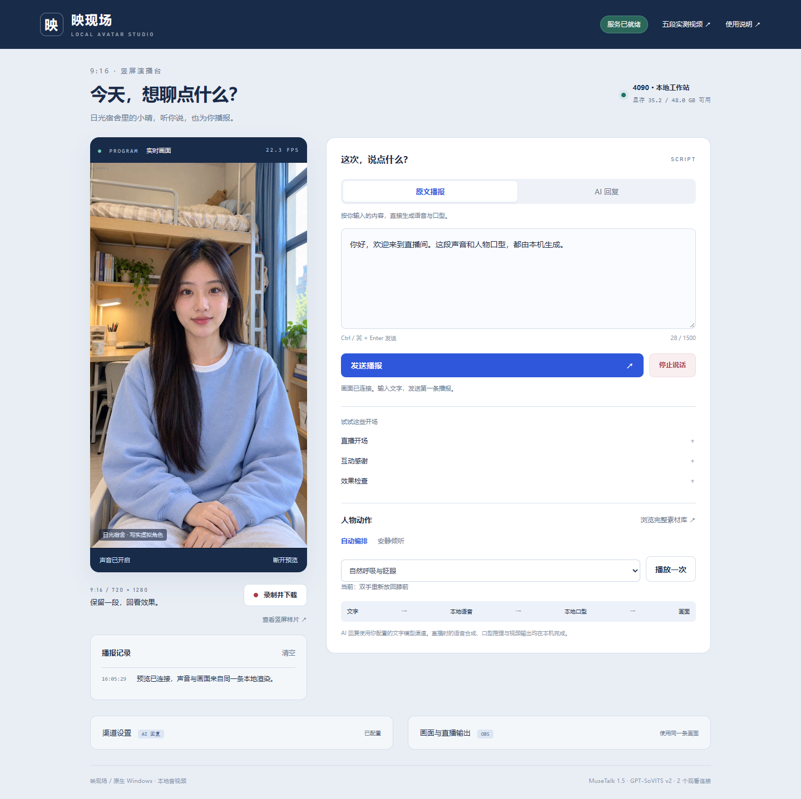
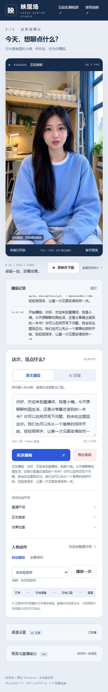
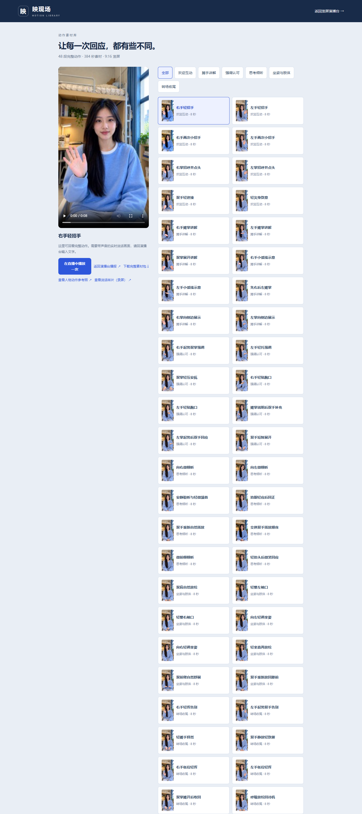
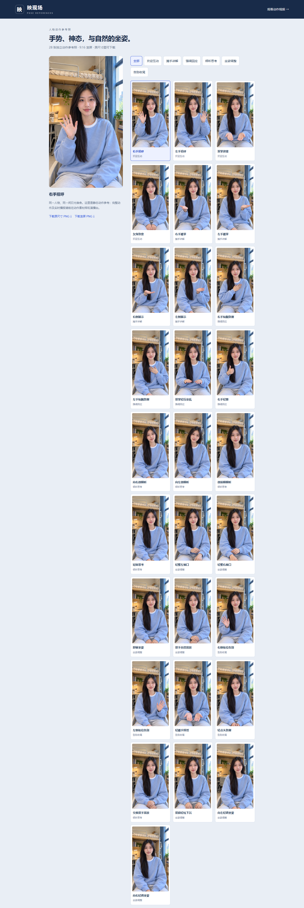
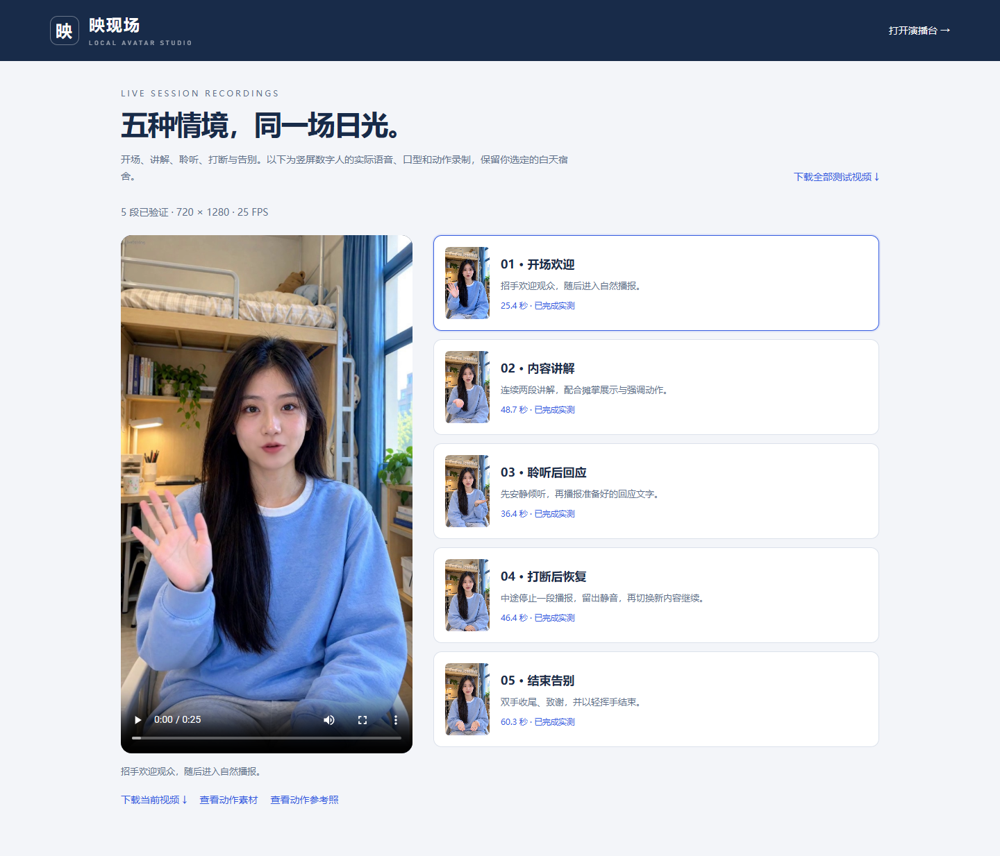

# Screenshots and recordings / 页面与动态展示

[Index / 导航](README.md) · [Test results / 验证结果](TESTING.md)

All images below are screenshots of the working studio. The reference character and scene were generated; the interface screenshots, submitted-text response and recordings were captured from actual running services. No screenshot is a design mockup or simulated response.

下列页面均为实机截图。角色与场景本身属于生成素材；网页、文字响应、实时口型和录制过程来自实际服务，不是设计稿或假响应。

## Studio / 演播台






The mobile image shows the actual responsive page at a 390-pixel viewport. It is a tall full-page screenshot; open the image to inspect the controls. The desktop/speaking screenshots are full-page captures at a 1440-pixel viewport.

移动端为 390 像素视口的整页实截，桌面为 1440 像素视口；长图可点开查看细节。

## Real response / 实际响应


[Browser interaction MP4 / 网页操作录像](media/browser-interaction.mp4) shows text submission, waiting for local synthesis, spoken lip movement and a selected hand wave. This is an actual browser screencast, **without an audio track**. For sound, watch the scenario MP4s below. Screen capture encoding, GIF frame sampling and network buffering make these illustrations unsuitable for timing benchmarks.

网页录像展示真实提交、等待本地合成、嘴部响应和手动招手，但**没有音轨**。带声音的效果见下方场景视频。GIF 和屏幕录像不能用于精确测延迟。

| Welcome / 欢迎 | Explanation / 讲解 |
| --- | --- |
|  |  |

[Interrupt/resume GIF / 打断恢复 GIF](media/interrupt-resume.gif) preserves a 20-second excerpt at normal speed. All four GIFs are silent, sampled at 8 or 12 FPS for size; none is sped up to imply faster response.

四个 GIF 均静音，以 8 或 12 FPS 抽样并保持原速，没有加速伪装响应。打断恢复 GIF 为 20 秒节选。

## Galleries / 素材及测试页







Off-screen thumbnail images were explicitly loaded before the gallery screenshots. These pages show the reference installation's assets and completed tests. A newly installed `/tests` is populated by running the scenario recorder, as described in [Usage](USAGE.md).

图库截图前已加载屏幕外缩略图。测试页来自已经验收的参考机器；新部署需录制测试才会显示本机结果。

| Full recording with speech / 带声音完整录像 | Duration / 时长 |
| --- | ---: |
| [01 Welcome / 开场欢迎](media/s01_welcome.mp4) | 25.44 s |
| [02 Explanation / 内容讲解](media/s02_explain.mp4) | 48.68 s |
| [03 Listen then reply / 聆听回应](media/s03_listen_reply.mp4) | 36.44 s |
| [04 Interrupt and resume / 打断恢复](media/s04_interrupt_resume.mp4) | 46.40 s |
| [05 Closing / 结束告别](media/s05_closing.mp4) | 60.28 s |

## Media provenance / 媒体来源与再制作

[capture-manifest.json](media/capture-manifest.json) records the original capture time and actual live metrics. [gallery-capture-manifest.json](media/gallery-capture-manifest.json) records the completed-thumbnail recapture. [media-manifest.json](media/media-manifest.json) records video/GIF source filenames, original SHA-256 values, dimensions, duration and output checksums.

原始页面录制清单、图库补拍清单及媒体清单分别记录时间、实时指标、原文件哈希、尺寸、时长和发布文件校验值。私有设备地址与凭据未包含在这些文件内。

Use native FFmpeg/FFprobe and the existing original delivery to rebuild these resized previews:

```powershell
python -X utf8 devtools/build-doc-media.py --delivery-root 'C:\path\to\original-delivery'
```

The original delivery must contain the five full scenario recordings; the raw browser screencast must exist at the path recorded in the capture manifest. Raw screencasts are ignored by Git. A clone alone includes finished previews, not that private raw recording. GitHub may download repository MP4s rather than play inline; the adjacent GIFs remain directly viewable.

重新制作需要原交付目录中的五段原片，以及清单所指的原始网页录屏。仓库只包含成品预览，不包含私有原始屏幕录像。GitHub 可能以下载方式提供 MP4，GIF 可直接观看。
