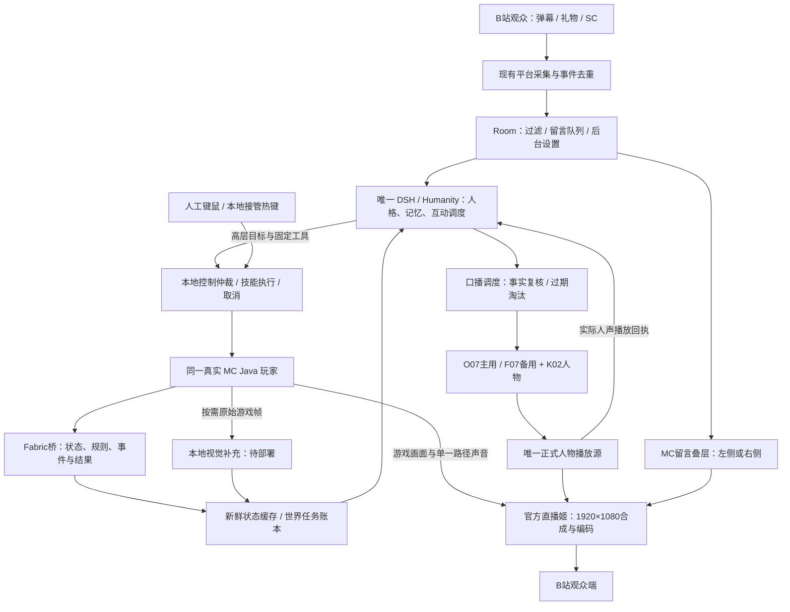

# 林知夏 AI 主播 × Minecraft × B站互动：完整总方案

规划入口更新：2026-10-31（Asia/Taipei，r6）；原方案整理于2026-10-30。工作分支：`mc`。本文统一现有游戏研究、直播间定稿、后台实现与设备约束，不代表已经完成游戏部署。布局沿用 v1.0.0 / revision04；本文不另建一套布局坐标。

已冻结的是横屏布局与交互要求；游戏架构部分是综合仓库现有研究的推荐实施路径，实际执行器、依赖组合和设备发布仍须通过后续验证，不能把研究文件的选型措辞当成用户已批准设备切换或游戏已上线。

**成品目标：同一位林知夏、同一个真实 MC 玩家，支持 AI 自主游玩和人工接管；持续读取真实游戏信息、与 B站观众互动，以游戏为主体进行 16:9 横屏直播。**

开发级细节见 [完整技术方案 v1.2](technical/mc-live-v1/README.md)与[全端实现蓝图](technical/mc-live-v1/09-全端实现蓝图.md)，包含接口/数据契约、各端模块、控制状态机、媒体改造、部署恢复、内部工程依赖与68项统一验收矩阵。

按用户最新要求，当前按[完整交付规划 v1.2](technical/mc-live-v1/08-完整交付规划.md)统一组织全部开发：15个必需交付域、两套完整人物素材、视觉、普通生存/PvE、建议/投票、平台与运维一次齐备，68项统一验收。内部依赖与测试不形成分批用户交付。

[全量交付执行总表](technical/mc-live-v1/全量交付执行总表.md)集中列出14个工作包的全部实现、依赖、产物、完成证据和统一交接条件，作为后续推进的完整执行依据。

[全量执行与资源计划](technical/mc-live-v1/10-全量执行与资源计划.md)补齐从哪里入手、全部工作责任/估算/依赖、跨端接线、资源费用、故障关闭、验收样本和完整发布包。全部范围从规划开始纳入同一候选，最终一次验收交接。

该计划r2进一步明确24种运行组合、12类并发场景、同一候选证据规则及8项发布判据，所有端在同一个完整范围中实施和验收。运行版本/设备/素材等实测绑定、现有源码缺口和测试失败都保留在统一计划，不通过后续另补功能或删减验收来宣布完成。

当前完整总规划以[13章完整方案实施总纲r6](technical/mc-live-v1/13-完整方案实施总纲.md)为总入口，集中全部端、15域、实际接口和源码、控制/互动/媒体、100段素材、恢复与维护、14项工程依赖、8项运行输入和8项发布条件。沿用[12章r5](technical/mc-live-v1/12-一次完整交付总计划.md)与[10章](technical/mc-live-v1/10-全量执行与资源计划.md)的详细施工依据，保留历史起点，不重写旧规划证据。当前推进到[074轮原生桥接线](technical/mc-live-v1/14-NeoForge整合包与NAIMEI接入约束.md)，NAIMEI已在3080进入实际NeoForge整合包服务器，取得世界、背包与原始画面；自动游玩、模型弹幕与正式节目仍需完整接线。最新逐项实现和全部剩余工作见[实现进度](technical/mc-live-v1/实现进度.md)。036的维护接线、990项当时检查及r6形成时035/036草稿和首次失败作为历史保留，原失败完整原因不判关闭。真实验收仍0/68、新人物0/100。用户只接收一个全功能、同版、可安装维护的完整版本。

实现已开始，实际源码、验证边界与全系统剩余事项见[编号进度表](technical/mc-live-v1/实现进度.md)。服务端协议客户端检查不替代真实游戏、人物、视觉或平台验收。

## 1. 决策总表与文档关系

| 编号 | 决策 | 当前结论 |
|---|---|---|
| D01 | 游戏接入 | 沿用 G01-R1：真实 Minecraft Java 客户端、自有 Fabric 状态/控制桥、本地技能执行、现有 DSH/Humanity |
| D02 | 角色与控制 | AUTO 与 MANUAL_COMMENTARY 共用同一玩家、存档、背包和观测；本地人工接管优先 |
| D03 | 执行层 | Baritone 是原选型基线；优先建立 MiranCZ/altoclef 与其配套寻路依赖的独立验证档，验证后才能替换运行锁 |
| D04 | 模型分工 | 现有外接文字模型负责人格、高层目标和口播；本地规则负责即时动作；本地人物/语音链负责演出 |
| D05 | 画面理解 | 结构化游戏数据优先；已选 Qwen3-VL-4B 作为按需视觉补充，仍待原生部署与测评 |
| D06 | 弹幕接入 | 复用现有 blivedm 采集及 Room 管理；留言显示和 DSH 回复共享去重后的事件 |
| D07 | 弹幕样式 | 参考 blivechat 的留言组织与样式，自有 MC 叠层接入 Room，不直接再运行一套主播/TTS |
| D08 | 直播间 | 1920×1080 全画布游戏、右下圆形人物、最多四条连续留言；后台左右切换 |
| D09 | 输出 | 官方 B站直播姬负责最终采集、合成、编码和推流；正式人物声音沿用唯一播放权威 |
| D10 | 实施与设备 | MC 相关开发继续在 `mc`；当前继承 3080 契约，4090 控制继续暂停；全程 Windows 原生 |

依据为 [G01-R1选型](analysis/game-streaming-neuro-20261029/SELECTION.md)、[系统可行性评估](analysis/game-streaming-neuro-20261029/FEASIBILITY.md)、[战斗与生存社区复核](analysis/game-streaming-neuro-20261029/COMMUNITY_COMBAT_SURVIVAL.md)、[横屏定稿](design/mc-landscape-v1/定稿说明.md)及[设备分支规范](deployment/DEVICE_BRANCHES.md)。

历史研究中的“720×1280竖屏”“feature/game-streaming开发分支”不作为本轮 MC 的执行要求：后续布局使用横屏权威配置，开发使用用户指定的 `mc`。历史 A4090+B3080 架构仍是独立的双机实施规划，不能解释为当前已恢复4090或已经部署。

布局唯一来源是 [mc-landscape-v1.json](../configs/layouts/mc-landscape-v1.json)；设备运行目标依旧由现有部署配置和预检决定。本文不覆盖它们。

## 2. 从观众到游戏、再到直播画面的完整链路

图中是逻辑分工，可以同机或按部署契约拆到两台设备。游戏动作、人物声音和观众看到画面的时延分别测量，不以一个“响应时间”代替整条链路。

## 3. 游戏方案：同一角色、两种运行模式

### 3.1 游戏实例与版本

首个验证档沿用 Minecraft Java 1.21.1、原生 JDK21、独立新存档。Fabric Loader/API 与 Baritone 的候选版本及发布元数据保存在 G01-R1 中，安装前锁定文件、依赖及校验值，联合启动后才登记为运行锁。用户旧存档不降级覆盖。

基础路径是自有 `zhixia-game-bridge` Fabric Mod：在游戏线程生成快照和执行已校验动作，异步传输状态，避免网络等待或模型推理阻塞游戏逻辑。Minescript只作为诊断工具，正式运行不增加另一条持续输入控制链。

AltoClef验证档用于复用资源依赖、补给、生存与任务协调。其构建包含配套 `baritone-unoptimized`；它与原标准 Baritone API 档分开验证，不同时放入重复依赖。当前仅有社区源码依据，尚未成为本项目已验收的执行层。[上游构建文件](https://github.com/MiranCZ/altoclef/blob/main/build.gradle)

### 3.2 控制模式

| 模式 | 玩家输入 | AI感知与互动 | 切换约束 |
|---|---|---|---|
| AUTO 自主 | 唯一执行器运行已开放技能及本地反射 | 持续理解游戏、解释进度、回应观众 | 只接受当前世界、当前控制代数且未过期的任务 |
| MANUAL_COMMENTARY 人工陪玩 | 人工控制；自动移动、攻击、进食等全部停止 | 继续观察同一角色，陪玩解说和回复 | 本地取消任务、释放合成输入后才确认接管完成 |
| PAUSED 自动化暂停 | 停止自动输入 | 可保留状态诊断；游戏主动解说按导播设置暂停 | “停止自动化”不等于服务器或世界时间已暂停 |

AUTO切人工时，本地先递增 `control_epoch`，停止任务链、寻路、攻击和其他持续输入，释放合成按键，再回报实际模式。迟到的模型结果不能重新启动旧任务。人工切AUTO前重新读取世界、界面、背包、血量与执行器状态，再决定是否续接目标。

完整版本包含六项基础能力：到已知目标、采集、合成、使用支持物品、返回登记基地和取消；同时实现并验收普通PvE、补给、防御/撤离、危险处理和多步骤资源链。外部goal固定为五种，取消走独立任务操作。复杂Boss、PvP、任意整合包和随机种子全自动通关不纳入本次未限定能力承诺。

## 4. 她如何获得真实游戏信息

| 信息 | 来源与用途 | 明确边界 |
|---|---|---|
| 玩家状态 | 血量、饥饿、氧气、位置、维度、装备和当前界面 | 绑定玩家与世界会话；旧值不能当现场 |
| 库存与规则 | 背包、工具耐久、运行时配方与操作条件 | 当前运行时优先；未知Mod或服务端规则保留未知 |
| 局部环境 | 客户端已观测的方块、实体、已登记基地与可达目标 | 不宣称知道未加载区块或未打开容器的内容 |
| 游戏事件 | 受伤、拾取、死亡、成就、任务完成或失败 | 去重、分级、保留原始事件与关联任务 |
| 外观与特殊UI | 原始游戏帧按需送本地视觉模型 | 不分析合成后的弹幕与人物；推断保留帧时间和来源 |

每包观测携带世界会话、连接代数、递增序号、采样时间、来源、能力清单和未知字段。启动、重连、换世界和序号缺口触发完整快照；稳定时发送增量。

初始预算沿用研究：本地约10–20Hz观察、状态通道约2–5Hz、心跳约1Hz、视觉按需且单并发，0.5–1帧/秒作为试验上限。它们是待测起点；高频数据留在缓存，不按该频率调用文字模型。

状态通道P95≤500ms是待验收目标，不包含LLM、TTS或观众CDN。初始以超过2秒无有效更新标记状态过期；阻止新自动任务，本地持续操作按租约/看门狗退出。跨机时先报告各进程耗时与RTT，校时后再估计单向时延。

## 5. DSH、外接模型与本地模型如何分工

| 层 | 推荐分工 | 当前状态 |
|---|---|---|
| DSH/Humanity | 统一人格、观众上下文、长期记忆候选与高层调度 | 现有链路可复用；游戏工具尚未实现 |
| 文字LLM | 解释事件、选择目标、回应观众；沿用已保存渠道 | G01-R1记录为gpt-6-luna渠道；本方案不改私有配置 |
| 本地执行层 | 寻路、库存交互、任务协调、已验证生存规则 | 待集成；执行动作不等待口播结束 |
| 本地视觉 | Qwen3-VL-4B GGUF + llama.cpp原生CUDA，补充外观/UI | 选型已记录；未下载、未部署、未联合测评 |
| 人物与声音 | K02、O07 OmniVoice主用、F07 F5-TTS v1备用 | 已有独立媒体基线；MC新素材需重新验收 |

**DSH与所选模型是不同层次。** 更换文字模型不等于更换游戏执行器，也不会自动获得DSH游戏插件。若后续使用DeepSeek或本地文字模型，先验证工具调用、取消、上下文和既有渠道兼容；当前不把新模型作为开工前提。

Mindcraft本身采用LLM＋Mineflayer，支持云端API（含DeepSeek）和本地Ollama等选项。它适合自主机器人原型；本项目总方案延续已选真实客户端路线，参考其技能和生存调度，保留现有人格与记忆入口。[Mindcraft官方说明](https://github.com/mindcraft-bots/mindcraft)

Neuro SDK提供游戏接入协议与SDK参考；我们拟实现核心消息兼容桥及独立内部任务协议。SDK不提供本项目完整人格后端，内部扩展也不能宣称第三方服务自动兼容。[Neuro SDK](https://github.com/VedalAI/neuro-sdk)

### 5.1 哪些属于DSH相关插件

| 组件 | 实际类别 | 与DSH关系 |
|---|---|---|
| 现有记忆工具 | 项目DSH工具 | 已有 `stream_memory_propose`、`stream_memory_recall` |
| 拟新增游戏工具及上下文桥 | 本项目定制DSH适配 | 需要编写、注册、测试；当前无完成实现 |
| Fabric / Baritone / AltoClef | 游戏Mod或执行依赖 | 由自有桥对接；不是DSH原生插件 |
| Mindcraft | 独立LLM游戏代理框架 | 技能与调度参考；不是已装好的DSH插件 |
| Neuro SDK | 游戏通信协议和开发SDK | 协议参考；不是完整主播系统 |
| blivedm | B站事件采集库 | 项目已使用的外围适配 |
| blivechat | 留言显示与主题生态 | 样式参考；它自身的插件不等于DSH插件 |

## 6. 观众互动与游戏如何同时运行

一份平台事件经过统一去重、过滤后分发给留言显示与DSH。显示不等于必须回复；观众指令先进入建议/投票和任务可行性检查，不直接映射为任意代码或系统操作。

规划队列与口播队列分开：本地执行持续推进已授权任务，DSH在任务边界、关键事件或相关弹幕触发时决策。危险由本地处理；无需等模型先说“有危险”。事件候选按紧急状态、任务阻塞/结果、相关观众问题、普通探索变化排序，重复变化合并。

例如观众问“缺铁就下矿吧”：她查询实际库存与任务，决定采纳或说明条件；执行器接收任务并返回编号；后续真实拾取/库存证据确认进度；她在适当口播窗口回应。收到任务请求不提前说“已经挖到了”。

每条口播绑定事件、世界、任务和有效期，生成前、播放前都核对事实。已解决的危险改述为经历或丢弃；过期回复不会无限排队。礼物/SC进入同一调度体系，不另开一套自动TTS。

语音完成继续由唯一正式播放源的真实人声回执判断，不能由文本生成、TTS返回、管理页或静音预览提前确认。导播私人聊天不自动播音，也不自动写入观众长期记忆。

平台未知的头像、舰长/房管身份、金额和删除事件不猜测。当前采集器的SC可作为有类型的文本事件；若要显示真实金额、身份徽章或可靠删评，需要同时扩展采集、Room公开字段和渲染契约。

## 7. 横屏直播间定稿

视觉定位为克制的日光宿舍陪玩风格：浅蓝、纸白、木色与少量叶绿；半透明留言、简洁细边框和小面积姓名/状态标签，减少大底板。人物风格与林知夏身份连续，游戏保持主体。

| 区域 | 定稿规格 | 行为 |
|---|---|---|
| 游戏 | 1920×1080、16:9铺满底层 | 不为侧栏缩小；浮层仍会覆盖局部，不等于全画面无遮挡 |
| 默认人物 | 右下264×264圆形，X1624/Y732 | 圆内面积约占画布2.64%；脸与上肩优先 |
| 备选人物 | 右下320×180圆角横窗，X1568/Y816 | 与圆形互换，不同时显示 |
| 连续留言 | 408×480、最多四条、向上滚动 | 默认右侧X1480/Y136，左侧X32/Y136 |
| 礼物提醒 | 与留言同侧、同一水平位置 | 简短合并显示，不附加另一套提示音 |
| 字幕 | 下方中部1120×84，X320/Y840 | 跟随实际播报，避开底部游戏HUD |
| 备选飘屏 | 顶部两行、右向左 | 与连续留言互斥；切左右不改变飘动方向 |
| 保护区 | 中央准星、底部快捷栏、顶部Boss条 | 不放固定留言和装饰底板；容器等特殊界面另做实机检查 |

不恢复“正在看的弹幕”或精选提问大卡片。游戏、人物和留言均不因换边被镜像。

后台入口为 `/admin → 画面与包装 → 统一直播包装 → MC 弹幕位置`，字段 `overlay.mc_chat_side`，默认 `right`，可选 `left/right`。已实现保存、校验和Room实时同步。切换只移动留言与礼物，保留消息节点、队列及计时；人物始终右下。

留言原型使用有界队列：最多24条待显示，默认每次进入至少间隔1秒、320ms过渡、四条可见，昵称/正文限制长度。真实平台接入后还需按实际时间丢弃陈旧消息；浏览器动画暂停不应使陈旧平台内容无限保留。

页面的游玩、互动、休息、恢复是节目显示状态，不代替游戏控制模式。“恢复中”应隐藏失效字幕并标注连接问题；只有本地执行器确认，后台才能显示自动化确已停止。

定稿证据：[右侧留言](design/mc-landscape-v1/preview-play-1080.png)、[左侧留言](design/mc-landscape-v1/preview-left-1080.png)、[横窗人物](design/mc-landscape-v1/preview-landscape-1080.png)、[交互样稿](design/mc-landscape-v1/preview.html)。样稿游戏为原创占位图，人物为旧静态参考裁切，留言为虚构示例。

## 8. 人物素材重制与声音

人物继续使用虚构成年角色林知夏、黑长发、浅蓝卫衣和日光宿舍识别线索。旧原图、原48手势和两段待机作为历史原件保留，新素材独立ID、版本、索引与缓存。

| 项目 | 圆形主方案 | 横窗备选 |
|---|---|---|
| 制作母版 | 720×720方形；显示时加圆形遮罩 | 1280×720真实横构图 |
| 待测推理尺寸 | 640×640 / 25FPS | 960×540 / 25FPS |
| 完整素材包 | 2待机＋48逐项改编动作，共50段 | 同样50段，动作按横幅重做 |
| 动作要求 | 头部安全余量、轻点头与表情，手不挡嘴 | 头肩为主、小幅肩侧/胸前手势 |

两套完整素材同版交付，共100段；小样与抽样检查属于内部制作质量控制。原50段的改编CSV是计划，不证明新素材已生成；圆形不能保留所有旧大幅手势，须明确语义改编映射。

复用MuseTalk/Whisper/VAE和O07/F07，不因换窗口重新引入人物或语音模型。遮罩只改变显示范围，不自动降低GPU推理成本；新分辨率需要明确的媒体尺寸契约、预处理和解码检查。[完整素材规范](design/mc-landscape-v1/人物素材重制规范.md)

## 9. 输出、声音与音画时间线

正式画布切为1920×1080。优先由官方直播姬把真实MC游戏源放底层，MC浏览器素材呈现人物、留言、字幕和包装；透明背景、圆形遮罩及鼠标/键盘焦点在当版官方客户端实测。现有正式人物页仍是竖屏，不能把原型HTML直接当正式播放器替换。

正式MC页面应复用现有唯一人物媒体消费者与播放租约，将布局、Room设置和MC留言组件接入同一正式输出，不因人物换形状、留言换边或管理预览创建第二个可听播放端。

音频明确三路：人物人声使用正式浏览器源内音频；游戏声音只选一种捕获路径；BGM复用既有混音/人声压低机制。麦克风和桌面音源按实际用途配置，防止同一声音采集两次；无物理音频设备的机器不能仅依赖“扬声器播放后再录桌面”这一假设。

新增游戏音频压低和合成时间线需要单独实现与验证。人物说话时可以降低BGM，是否同时降低游戏音量以实际采集接口能力为准；不把现有BGM压低功能写成游戏音量控制已完成。

游戏事件、人物人声、人物视频和观众录像需保留时间关联。旧3080短句记录的首播约5.027–8.133秒，只能作为既有人物链时序背景，不是新游戏操作或观众端时延。本版本采用新鲜事实和晚到口播改写，观众侧游戏缓冲仅在同步验证支持时启用；操作者本地画面保持即时。

源人物25FPS与最终编码帧率分别记录。输出25FPS或30FPS需按官方客户端支持与实测选择，不能仅设置画布就宣称已获得稳定1080p流畅直播。

## 10. 设备方案与启动约束

| 角色 | 当前有依据的状态 | MC实施安排 |
|---|---|---|
| 当前3080人物基线 | 原生同机K02 FP16 batch4，状态根 `state/female-a-3080-k02`；五段本地人物播放通过 | 可复用软件基础；没有MC同机联合负载结论 |
| 目标双机A4090 | G01-R1规划承载DSH、人物、语音、按需视觉；现有48GB规格设备契约FP16 batch8 | 控制仍暂停，K02激活等仍待恢复后的独立实施；不套用于普通24GB4090 |
| 目标双机B3080 | 真实MC、状态/控制桥、媒体接收与官方直播姬 | 在双机方案中不再同时加载人物/TTS；区别于当前3080同机推理角色 |
| 操作者设备 | 管理页与人工操作 | 远程游戏可按既有Sunshine/Moonlight规划验证；当前不自动安装或远控 |

总体上，游戏与人物推理拆机更便于隔离负载，是既有游戏研究的目标拓扑；当前只能把它记为待实施方案。单3080全链路如需作为MC候选，必须验证游戏、人物、TTS、编码和视觉的完整联合负载，不能凭人物五段用例推断MC可用，也不能删除视觉后记为完整交付。

MC开发继续在 `mc`。当前 `deployment-target.json` 仍绑定 `deploy/rtx3080`，因此 `mc` 的源码开发权限不等于运行部署已获预检认可。后续若在mc运行或发布MC版本，需建立与真实设备、发布清单和来源记录一致的MC部署契约，再走既有预检；不临时切开发分支绕过用户要求，不手改来源收据跳过检查。

保持每个安装一个DSH/Humanity权威写入者，状态目录隔离；不跨设备复制活动SQLite、私有凭证或`.setup`。全程原生Windows、Java、Node和Python，不使用Docker、WSL或虚拟机。4090不会因本文而恢复控制。

## 11. 后台与代码实施路径

实现统一落在`backend/game/`及自有Fabric工程；已有源码与仍需新增的组件按实现进度区分。下表使用职责名称，[W00–W13工程编号](technical/mc-live-v1/07-实施与验收.md)和[D01–D15完整责任](technical/mc-live-v1/09-全端实现蓝图.md)分别统一维护。

| 职责 | 实际/计划位置与复用点 | 完整交付要求 |
|---|---|---|
| 游戏桥/执行器 | `game-adapters/minecraft/fabric/`，已有部分源码/构建 | 完整采集、输入/GUI/线程归属、全部技能与生存绑定、真实任务 |
| 状态/规则/协议 | `backend/game/state.mjs`、`recipes.mjs`、`protocol.mjs` | 序号/过期、实际配方/库存、未知值、能力协商与兼容 |
| 控制/任务 | `backend/game/manager.mjs`、`tasks.mjs`及Mod仲裁 | 租约/代数/幂等、真实后置条件、取消/接管与恢复 |
| DSH/口播 | `backend/dsh-bridge/host.mjs`、`game-tools.mjs`、`planner.mjs`及计划口播调度 | 真实渠道兼容、用途分流、预算/过期、结果公开回应及播前核验 |
| 观众/视觉 | `suggestions.mjs`、`votes.mjs`、`frames.mjs`、`vision.mjs` | 自然语言建议、完整投票/任务闭环、真实视觉与失败隔离 |
| 正式画面/接收 | 计划`web/mc-programme.*`、现有媒体/Room客户端和接收器 | 正式横屏、v3/v2、唯一声音/回执、留言/礼物/字幕 |
| 后台 | `web/admin.*`、`web/mc-control.*`，部分已有 | 完整世界/任务/互动、回复、人物/声音、记忆与诊断维护 |
| 人物包 | 独立`mc-avatar-circle-v1` / `mc-avatar-landscape-v1`，待制作 | 100段完整派生视频及manifest/索引/脸框/动态QA/缓存隔离 |
| 数据/运维 | `backend/game/store.mjs`、`worlds.mjs`、`continuity.mjs`及计划原生入口 | 完整历史/清理/删除、联合备份恢复、设备profile与同版运行锁 |

游戏工具已有源码接入：只读状态、事件、库存、配方、前置、任务、图像观察及`game_get_audience`，执行使用`game_start_task`和`game_cancel_task`，合计10种。真实DSH渠道与完整游戏能力仍需联合验收；内部使用固定技能，不开放任意系统Shell。

任务请求至少携带世界会话、控制代数、请求ID、依据的观测序号、有效期和前置条件。本地核对后返回任务ID，按 `accepted → running → succeeded / failed / cancelled`报告；只有当前游戏证据核对结果后才允许说“完成”。断线重连先查任务真实状态，不盲目重发动作。

后台的模式按钮以游戏侧确认作为真值；留言位置设置以Room保存结果作为真值；说完以正式播放回执作为真值。三者不能互相替代。

## 12. 记忆与跨场运行

数据分三层：血量/位置等短时缓存；世界基地、库存检查点和任务结果等事实账本；与观众共同经历、偏好和关系等Humanity长期记忆。高频状态不逐条进入长期记忆。

不同存档/服务器使用稳定世界命名空间；切换人工与AI不更换人格。再次开播先读真实世界并核对上次目标，不凭旧摘要恢复持续输入。

下播顺序为：停止新任务、游戏本地取消并释放输入、保存末次新鲜快照及任务终态、归档事件摘要、经既有唯一写入者提交记忆候选与整理。历史跨日维护、额度恢复、公开状态一致性等剩余门槛继续保留，不能因新增MC文档视为解决。

## 13. 完整交付与统一验收

| 能力域 | 完整交付内容 | 通过条件 |
|---|---|---|
| 运行与兼容 | 原生游戏档、依赖/设备/媒体运行锁、预检与回滚 | 版本可启动，来源/角色/状态根一致 |
| 感知与视觉 | 同一玩家状态、库存、规则、关键事件与原始帧视觉 | 新鲜/未知/过期及视觉负载有真实证据 |
| 控制与自主游戏 | 六项基础能力、普通PvE、补给与资源链、人工接管 | 任务后置条件、取消/失败与20次接管通过 |
| 人格与互动 | DSH游戏工具、弹幕礼物/SC、建议/投票、口播与记忆 | 单一人格、真实完成、不过期误播、跨世界隔离 |
| 人物与节目 | 两套完整50段素材、正式横屏、留言/礼物/字幕/混音 | 新素材动态QA、唯一播放权威、官方音画与HUD检查 |
| 平台与运维 | 实际平台/观众证据、4小时完整负载、跨场恢复、备份回滚 | 68项统一验收均有通过证据，无必需未完成项 |

所有能力在同一完整版本内实现与交付。内部可按依赖开发和验证，视觉超时不得阻塞本地控制或人物语音；当前约束仍不允许本轮擅自下载模型或恢复4090。

唯一完成定义见完整交付规划：D01–D15产物齐备，V01–V44及C01–C24全部有通过证据，代码/协议/素材/数据库/运行锁一致。任一必需项未实现、未测试或失败，整套保持未完成。

## 14. 当前已完成、待实施与最大风险

| 范围 | 当前事实 |
|---|---|
| 系统研究 | G01-R1、可行性、状态/任务协议、社区战斗生存复核已文档化 |
| 横屏设计 | v1.0.0 / revision04冻结，权威布局配置、交互样稿与素材改编计划已有 |
| 后台位置 | 左右保存、校验、SSE投影及留言/礼物同步移动已实现；本地隔离服务联动通过 |
| 已有验证 | 布局/位置历史记录保留；最后完整实现记录为第013轮296项本地CPU/协议检查，通过范围见实现进度；本次规划不重跑或提升其证据等级 |
| 已有人物基线 | 3080 K02/O07/F07五段本地播放有独立历史证据；不能替代MC验证 |
| 游戏实现 | Fabric桥、服务端、工具和部分仲裁已有源码及本地检查；完整生存/GUI/线程绑定和真实MC仍未完成，生存候选保持启动阻挡 |
| 新人物与正式输出 | 当前是旧静态裁切和占位游戏图；新视频、MC正式媒体及官方横屏联合输出待实现 |
| 设备与平台 | 4090控制仍暂停；MC真实游戏负载、B站联合运行及观众端未验收 |

现有证据：[后台位置联动](design/mc-landscape-v1/backend-position-verification.json)、[布局检查](design/mc-landscape-v1/preview-verification.json)、[3080人物基线](deployment/RTX3080_K02_RELEASE.md)。

主要风险集中在同一玩家输入接管、社区依赖兼容、同机计算争用、晚到口播、官方透明合成及真实平台时序。分别通过本地仲裁、独立实例、联合负载采样、事实过期策略、官方本地录像和观众端验证处理。复杂自主生存与节目可观看性均需真实任务/录像评估，不承诺装好组件即可长时间无人值守。

完整系统的首场节目可编排人工探索、观众问答/投票、自主采集/资源链、普通生存、失败解释、接管和复盘。节目内容按可观看性安排，全部交付能力仍在同一个版本验收。

## 15. 无人深空及后续扩展

无人深空保留为独立游戏研究方向，不纳入本次完整MC交付或当前已完成能力。可复用人格、弹幕、口播、记忆、节目布局和任务协议；观测、规则、动作与接管需要针对该游戏重新适配、搜索和验收，MC的结构化接口与技能不能直接继承。

## 16. 规划与实现状态维护

当前完整规划修订1.2，以08章为范围依据、09章为全端实现蓝图，接口和Schema单独维护版本；[实现进度](technical/mc-live-v1/实现进度.md)记录实际代码与验证。规划检查不启动游戏、推理、远程设备或公开广播，不使用虚拟化、不创建本地浏览器页面。原有源码和历史运行记录保留，全部68项真实完整系统验收仍待执行。
