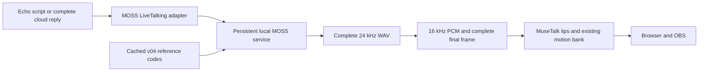

# MOSS 04 live voice / MOSS 04 实时播报

[English README](../README.md) · [中文 README](../README.zh-CN.md) · [音色试听 / Casting](VOICES.md)

## 当前选择 / Selected voice

女A·林知夏使用 **MOSS 04「明朗亲和」**。原文播报和云端 LLM 回复均经过本地 **MOSS-TTSD-v1.0** 合成，再由 MuseTalk 驱动口型。试听页选择候选只保存选型，不自动改动直播配置。

Female-A / Lin Zhixia uses **MOSS 04, 明朗亲和**. Both echo scripts and configured cloud text replies are synthesized by local MOSS-TTSD-v1.0, then drive MuseTalk lips. Casting-page shortlist controls do not activate a live voice.

| Item / 项目 | Configuration / 配置 |
| --- | --- |
| Selected reference / 参考声 | [v04.wav](../assets/voices/female-a-v1/references/v04.wav), registered transcript in [references.json](../assets/voices/female-a-v1/references.json) |
| Reference SHA-256 | `72c38cbcf3e06dd86d8edc5d4167f696b42bdac80b31e9f096fa300c94929fa4` |
| Language model / 语音语言模型 | MOSS-TTSD-v1.0, NF4 4-bit weights, BF16 compute, SDPA |
| Audio codec / 音频编解码 | MOSS-Audio-Tokenizer, FP32 CPU, mono 24 kHz output |
| Sampling / 采样 | Seed 20261026, temperature 1.1, top-p 0.9, top-k 50, repetition penalty 1.1 |
| Avatar / 人物 | Validated batch-4 FP16 MuseTalk, 720×1280, target 25 FPS; original batch 8 was tested first |
| Tested host / 实机 | Native Windows, RTX 3080 10 GB, 64 GB system RAM |

## 运行逻辑 / Runtime behavior



常驻服务缓存模型、处理器和参考编码，避免每句话重新加载。完整音频生成后才开始播放；云端回复也先收齐文字，避免句子之间反复等待模型。超过 70 个字符的内容分段生成，保留原文字与标点；当前接口最多接收 1,500 个字符，遇到 token 上限且未正常结束时会报错，不播放截断结果。

The persistent service caches the model, processor and reference codes. Playback begins after the utterance has finished synthesizing. Cloud replies are collected before synthesis, avoiding a separate generation pause after every sentence. Text is partitioned at up to 70 characters without dropping punctuation; the endpoint accepts up to 1,500 characters and rejects a segment that exhausts its token budget without an end marker.

停止说话会取消当前生成并使旧请求失效；旧音频不能在下一轮偷偷播放。适配器核对服务返回的引擎与音色标识，错误会显示在页面。启动人物服务时，用真实语音特征和实际人物潜变量预热 GPU，再开放预览。

Stopping speech cancels generation and invalidates stale requests. The adapter checks the returned engine and voice identity and reports errors to the page. Avatar startup warms actual speech features and the real avatar latent layout before accepting viewers. The launcher initializes the avatar before loading MOSS, avoiding overlap with MuseTalk's measured approximately 7.2 GB conversion peak.

启动器先初始化人物并释放启动缓存，再加载 MOSS，避免与 MuseTalk 约 7.2 GB 的模型转换峰值重叠。若只有 MOSS 运行而人物未运行，启动器会要求先停止本项目两项服务再按顺序启动。

## 已准备机器上的启用方法 / Activation on a prepared workstation

本分支复用机器上已经安装、验证过的原生 MOSS Python、vendor 代码和本地模型；常驻播报不要求 ComfyUI 服务运行。配置模板中的路径相对项目根目录。这里不声称安装脚本会自动下载一个全新的 MOSS 环境。

This integration reuses an already installed, verified native MOSS Python runtime, vendor source and local models. The ComfyUI HTTP service is not needed for live speech. Paths in the template resolve from the project root. This is not a new-machine MOSS dependency installer.

1. Stop the project's current avatar and TTS services. / 停止本项目现有的人物与 TTS 服务。
2. Copy [moss-live.example.json](../configs/moss-live.example.json) to the ignored `configs/moss-live.json`; set native Python, runtime and model paths. / 复制模板，填写本机路径。
3. Activate the adapter and start the studio:

```powershell
python deployment/activate_moss.py --voice v04 --batch-size 4
python scripts/start_studio.py --no-browser
```

激活程序先校验路径和参考素材，为被改文件备份到 `.setup/moss-live/activate-*`，再更新 LiveTalking 注册、适配器、页面和 `configs/livetalking.yaml`。启动器使用指定的原生 Python 启动 MOSS；关停只匹配登记的解释器、脚本与创建时间，避免影响共用解释器的其他程序。

Activation validates paths and reference assets, backs up replaced files to `.setup/moss-live/activate-*`, and installs the registry, adapter, page and live configuration. The launcher uses the configured native Python. Shutdown matches the registered interpreter, script and process creation time so unrelated users of that interpreter remain independent.

访问 `/studio.html?v=moss04-1`，连接预览后使用原文播报或 AI 回复。`/api/studio/status` 的 `voice.engine` 必须为 `MOSS-TTSD-v1.0`、`voice.voice_id` 为 `v04`，并且 `tts_ready` 为真。仅检查端口打开不能证明模型已经就绪。

Open `/studio.html?v=moss04-1`, connect the preview, then use echo or AI mode. The status endpoint must report `voice.engine=MOSS-TTSD-v1.0`, `voice.voice_id=v04`, and `tts_ready=true`; an open TCP port alone does not establish model readiness.

## 等待与验收 / Waiting and verification

这套 10 GB 配置存在明显的生成等待。此次 35 字台词生成 6.88 秒音频，服务端耗时约 14.8 秒；三条原文播报从提交到实际出声约 17.0–21.1 秒，云端回复约 27.7 秒。MOSS 加载实测约 106–153 秒，人物服务另需初始化与预热。它适合允许等待的完整播报，不能视为低延迟即时对话。

This 10 GB configuration has a noticeable synthesis wait. The 35-character script produced 6.88 seconds of speech in about 14.8 seconds at the service. Three echo scripts became audible about 17.0–21.1 seconds after submission; the cloud reply took about 27.7 seconds. MOSS loading took approximately 106–153 seconds, with separate avatar initialization and warm-up. This is suitable for complete utterances when a wait is acceptable; it is not instant conversation.

**All five browser cases passed after restarting both services with batch 4.** The first request was tested immediately after model readiness, without a preliminary synthesis request. All four spoken cases had zero scheduling gaps within their voiced intervals and zero missing transport packets; observed presentation counters were 24.6–25.3 FPS. Cancellation stopped the pending utterance, and the following new utterance played successfully. / **两项服务重启、使用 batch 4 后，五项网页测试全部通过。** 模型就绪后直接提交首条台词，没有先请求语音生成预热。四项实际发声用例的人声区间排程间隙和丢失数据包均为 0；观察时刻约 24.6–25.3 FPS。生成中取消未播放旧音频，随后新台词正常播出。

After the full host reboot and ordered loading, the original batch-8 configuration still produced one approximately 2.42-second voiced gap. Reducing the avatar batch to 4 preserves voice precision and 720×1280 output while reducing measured real-speech warm-up reservation by about 1.1 GiB. This establishes the tested configuration, rather than proving a single cause for every earlier stall. / 整机重启并顺序加载后，原 batch 8 仍出现约 2.42 秒人声间隙。改用 batch 4 后，声音精度与输出尺寸沿用原配置，真实语音预热的显存保留量减少约 1.1 GiB；这证明了当前配置的可用性，不能据此把此前所有卡顿归因于同一原因。

[Original batch-8 failure / 原 batch 8 失败记录](evidence/moss-live-ordered-batch8-failure.json)

[实际网页截图 / Actual studio](media/moss-04-live-studio.png) · [浏览器测试记录 / Browser evidence](evidence/moss-live-browser.json)

[带声音的竖屏实录 / Portrait recording with sound](media/moss-04-live-demo.mp4) · [实际运行参数 / Runtime evidence](evidence/moss-live-runtime.json) · [媒体来源清单 / Media provenance](media/moss-media-manifest.json)


验证程序覆盖同句实播、新文本、生成中取消、取消后重播，以及配置好的云端文字回复；检查实际 MOSS 标识、非静音 PCM 和发声期间的浏览器排程间隙。等待期间的静音缓冲重置单独记录，不混作人声卡顿。浏览器程序结束时关闭自己创建的浏览器。

The browser check covers the shared audition line, novel text, cancellation during generation, recovery and configured cloud text replies. It checks actual MOSS identity, non-silent PCM and scheduling gaps within the voiced interval. Silent buffer resets while waiting are reported separately. Its own browser is always closed on exit.

The measurements cover one local Chrome run on the prepared workstation. They do not establish long-duration stability, Edge equivalence or performance with additional GPU workloads. The final idle snapshot used 9,311 MiB of GPU memory with ComfyUI stopped. / 本次数据来自已准备机器上的一次 Chrome 测试，尚不代表长时间稳定性、Edge 等效性或并行 GPU 工作负载下的表现。ComfyUI 关闭时，验收后空闲快照占用约 9,311 MiB 显存。

```powershell
$env:VOICE_BASE_URL='http://127.0.0.1:8010'
$env:MOSS_TEST_CHAT='1'
node devtools/verify-moss-live.cjs
# After all five cases pass, encode the real browser capture for documentation:
python devtools/build-moss-doc-media.py
```

选择新的参考声时，使用相同激活程序的 `--voice v01` 至 `--voice v10`，并重启项目 TTS 与人物服务。声源授权与模型许可见[第三方说明](../THIRD_PARTY_NOTICES.md)；模型上游为 [OpenMOSS/MOSS-TTSD](https://github.com/OpenMOSS/MOSS-TTSD)。

To change voices, activate `--voice v01` through `--voice v10` and restart the project's speech and avatar services. See [third-party notices](../THIRD_PARTY_NOTICES.md) for source and model terms and [OpenMOSS/MOSS-TTSD](https://github.com/OpenMOSS/MOSS-TTSD) for upstream code.
