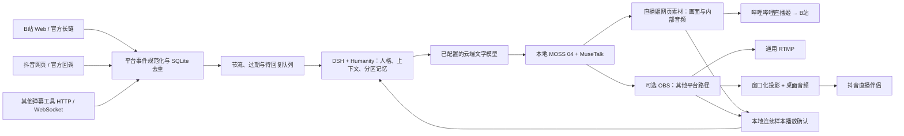

# 直播平台接入 / Live platform integration

本方案将女A「林知夏」接入哔哩哔哩、抖音和提供 RTMP/RTMPS 推流地址的其他平台。运行于原生 Windows，复用本地 MuseTalk、MOSS 04 与 DSH + Humanity；文字模型继续使用演播台已保存的云端渠道。无需 Docker、WSL、云端数字人或云端语音。

**当前账号条件：已有直播账号和开播权限，尚无开放平台应用。** 因此，基础接入不依赖申请开放平台应用；官方弹幕接口作为可切换的适配器提供。平台的账号登录、推流码、应用密钥属于平台自身连接参数，网页与应用后端仍然无需管理员登录。

## 方案评估

| 平台 / 路径 | 画面与声音 | 互动输入 | 当前账号能否使用 | 适用情况 |
|---|---|---|---|---|
| B站：直播姬 + blivedm（当前默认） | 官方直播姬网页素材加载本地 720×1280 人物页，内部网页音频直接进入节目混音 | 原生 Python blivedm Web 弹幕客户端；可填写自己的 B站 Cookie | 在直播姬登录有开播权限的账号即可配置；无需在本项目填写推流码 | 当前选用路径，不启动或调用 OBS；详见[直播姬专章](platforms/BILIBILI_LIVEHIME.md) |
| B站：直播姬 + 网页采集 | 同上 | 独立本地浏览器读取直播间新渲染的评论 | 无需开放平台应用；平台要求登录时，在独立窗口登录 | 不想填写 Cookie 或 Web 客户端暂时失效时 |
| B站：官方开放平台 | 同上 | `/v2/app/start`、项目心跳、官方消息长链和 `/v2/app/end` | 需要获批应用、开发密钥与主播身份码 | 后续正式应用接入 |
| 抖音：直播伴侣 + 网页采集 | OBS 窗口化投影作为直播伴侣窗口源；OBS 音频监听到桌面播放设备，再由直播伴侣采集 | 独立本地浏览器读取自己的直播间新评论 | 已有直播伴侣开播权限即可配置；网页登录按平台提示处理 | 无开放平台应用时的基础方案 |
| 抖音：已有推流地址 | OBS 直接推流，独立采集弹幕 | 网页采集 / 已有弹幕工具 / 官方回调 | 仅在账号实际提供有效第三方推流地址时可用 | 已获对应能力的账号；系统不生成或破解推流码 |
| 抖音：官方直播互动数据 | OBS 或直播伴侣输出不变 | 官方数据推送 HTTP 回调，本地原始报文验签、落库、去重 | 需要相应应用、挂载及评论数据权限 | 取得开放平台资格后替换采集输入 |
| 其他平台 | 填写该平台提供的 RTMP/RTMPS 服务器与推流码，复用同一个 OBS 场景 | 统一事件 HTTP 接口或现有 WebSocket 弹幕工具 | 取决于账号提供的推流与消息能力 | 后续接入视频号、快手或其他平台，不虚构通用弹幕权限 |

OBS 虚拟摄像头只提供视频。抖音基础方案单独处理音频，不能把“摄像头出现人物”视为“声音接入成功”。B站官方消息长链、抖音官方数据回调都存在独立的应用准入要求，普通开播权限不会自动获得这些权限。

## 实现组成

所有平台共用同一个人物、语音和对话生成队列，不为每个平台加载一份模型。直播姬和 OBS 的编码均会额外使用显存；需要在当前 10GB RTX 3080 上按实际负载验收。默认 B站只运行直播姬路径。

| 部件 | 源码 / 入口 | 职责 |
|---|---|---|
| 平台控制页 | [web/platforms.html](../web/platforms.html) | 保存连接参数、准备对应客户端、检查链路、开停本地互动、管理弹幕和回复节奏 |
| B站直播姬控制 | [livehime.mjs](../backend/platforms/livehime.mjs) | 验证客户端安装凭据、启动官方客户端、准备静音独立预览、检查实际网页素材心跳 |
| 平台生命周期 | [manager.mjs](../backend/platforms/manager.mjs) | 接入现有 Bridge，控制平台输出、交互排队与本地会话 |
| 本地参数 | [config.mjs](../backend/platforms/config.mjs) | 私有配置落盘，读取接口不返回密钥与 Cookie |
| 平台事件账本 | [store.mjs](../backend/platforms/store.mjs) | 跨进程重启的去重、事件状态和输出所有权记录 |
| OBS 控制 | [obs.mjs](../backend/platforms/obs.mjs) | OBS WebSocket 5.x，场景准备、录制、投影与推流 |
| B站 Web 客户端 | [blivedm.mjs](../backend/platforms/blivedm.mjs)、[Python 适配器](../scripts/platform_blivedm.py) | 隔离的 CPU Python 环境，Cookie 通过 stdin 传递 |
| B站官方接口 | [bilibili.mjs](../backend/platforms/bilibili.mjs) | 签名、项目生命周期、二进制长链、压缩包解析和重连 |
| 网页评论采集 | [browser.mjs](../backend/platforms/browser.mjs) | 独立浏览器资料目录、只接收新评论、可改选择器、停止时关闭窗口 |
| 抖音官方回调 | [douyin.mjs](../backend/platforms/douyin.mjs) | 原始 body 验签、时间检查、批量事件转换 |
| 第三方弹幕工具 | [relay.mjs](../backend/platforms/relay.mjs) | WebSocket 输入及常见 Type/Data 消息适配 |
| 完整操作说明 | [部署](platforms/DEPLOYMENT.md)、[事件与记忆](platforms/EVENTS_AND_MEMORY.md)、[运行手册](platforms/OPERATIONS.md)、[验收](platforms/ACCEPTANCE.md)、[实机媒体](platforms/MEDIA.md) | 配置、启停、诊断与证据范围 |

## 使用顺序

1. 打开工作站的 `/platforms`。访问地址为 `http://<WORKSTATION_IP>:8010/platforms`。
2. 选择平台，保存自己的直播间公开链接。B站默认“哔哩哔哩直播姬”；在官方客户端登录，不需要本项目保存推流码。
3. B站点击“准备竖屏画面”，按[直播姬配置](platforms/BILIBILI_LIVEHIME.md)添加网页素材：`http://127.0.0.1:8010/output.html?output=platform&renderer=livehime`，尺寸 720×1280，适应竖屏画布，网页音频输出到流。另开的 Chrome 预览静音，不参与节目音频。
4. 点击“检查连接”，确认实际直播姬网页素材心跳、人物、声音及渠道。先在直播姬本地录制，检查实际文件的声音和构图。人物仍按 25 FPS 生成；当前直播姬仅提供 30/60 FPS 编码时选 30，不声称提高了推理帧率。
5. B站先准备本地互动，再在官方直播姬自己点击“开始直播”。抖音仍可选原有直播伴侣/OBS 路径，详见专项部署。
6. 开始接收弹幕。第一次用网页采集时，可选择“打开房间并登录”。窗口位于运行采集的工作站；不接管个人浏览器。只有平台需要时才登录平台。
7. 在另一台设备的观众端检查实际画面、声音、平台延迟和评论回应。本地素材已连接或本地播完不等于观众端已验收。
8. 下播时在直播姬实际结束直播，再结束本地互动和弹幕采集。本项目不会将关闭预览误报为客户端已下播。最后一路由系统拥有的会话结束后，DSH 排空，再进入既有静默窗口与离线记忆整理。

### 同时使用 B站和抖音

当前默认 B站直播姬与原有 OBS 路径使用不同播放端。后端拒绝同时启用两种输出播放端（`OUTPUT_RENDERER_CONFLICT`），避免抢占播放确认租约。跨平台并行不能仅凭共用模型视为已完成；需另外实现单一播放权威到多客户端的已验证分发。

不通过反复修改 OBS 推流目标实现多路并行。多个 RTMP 目的地需要独立的转推器或多输出插件，属于不同的传输部署；本项目对“其他平台”提供可选择的主目标，不把单主输出称为任意多路转推。

## 保留的业务约束

应用仍为无鉴权模式。保留的数据格式校验、OBS 已有输出检查、单条语音队列、播放确认租约、广播版本号和记忆分区，是防止重复播报、破坏录制与记忆串线的业务一致性规则。

平台网页 DOM 可能变化，也可能需要平台登录或显示验证码。采集器报告 `WAITING_FOR_CHAT`、`ERROR` 或 `RECONNECTING`，不会把“浏览器进程存在”当作弹幕已到达。可以在设置中更新选择器，切换 B站 Web 客户端或官方接口；不调用外部签名售卖服务。

## 官方资料与开源来源

资料核对日期：2026-10-25；直播姬版本及实机复核更新至 2026-10-26。平台账号最终能使用哪些能力，以该账号实际显示的开播配置和开放平台授权为准。

- [哔哩哔哩直播姬官网](https://live.bilibili.com/liveHime)、[官方 Windows 版本 API](https://api.live.bilibili.com/xlive/app-blink/v1/liveVersionInfo/getHomePageLiveVersion?system_version=2)：当前默认的主播端、浏览器素材及源内音频。
- [B站开放平台项目开启、结束与心跳](https://open-live.bilibili.com/document/eba8e2e1-847d-e908-2e5c-7a1ec7d9266f)：获取 `game_id` 与长链信息，20 秒项目心跳，结束时调用 end。
- [B站消息长链协议](https://open-live.bilibili.com/document/657d8e34-f926-a133-16c0-300c1afc6e6b)：AUTH、30 秒长链心跳与压缩消息。
- [blivedm 上游](https://github.com/xfgryujk/blivedm)：MIT；固定提交 `3bf17fe862b8c2fc6bc04c81c3f0c5db95de93d6`，版本 1.1.7；上游明确未发布至 PyPI，本项目从官方 Git 仓库安装。
- [抖音直播伴侣官方下载](https://streamingtool.douyin.com/)：Windows 主播端画面和声音接入。
- [抖音直播间数据开放说明](https://developer.open-douyin.com/docs/resource/zh-CN/interaction/develop/server/live-room-scope/data-open/data-open-desc)：任务准入、评论/点赞/礼物回调、原始 body 签名及应答时限。
- [抖音互动工具开发者指南](https://developer.open-douyin.com/docs/resource/zh-CN/live-interactive-tools/development/tutorial/live-tool-guide)：直播伴侣互动数据需相应权限，不等同于普通账号任意读取。
- [OBS WebSocket 官方协议](https://github.com/obsproject/obs-websocket/blob/master/docs/generated/protocol.md)、[远程控制指南](https://obsproject.com/kb/remote-control-guide)、[虚拟摄像头指南](https://obsproject.com/kb/virtual-camera-guide)。

## English overview

The native Windows platform module reuses the local avatar, MOSS 04 speech and DSH + Humanity services. Bilibili now defaults to its official Livehime client: a 720×1280 browser material receives local video and internal browser audio, without starting or controlling OBS. Follow the [Livehime guide](platforms/BILIBILI_LIVEHIME.md). Douyin and generic RTMP retain their separate OBS routes; simultaneous native/OBS playback authorities are rejected.

Without an approved developer application, use Bilibili's pinned MIT-licensed `blivedm` Web client or the isolated browser collector. The Douyin browser collector reads newly rendered comments in the user's own room. Official Bilibili Open Live and Douyin callback adapters are also implemented, but they need the platform's application permissions and credentials. The UI and application API remain open, without an administrator login.

Platform events enter a persistent de-duplication ledger, a bounded expiring queue and the existing DSH speech pipeline. Stable user IDs are namespaced by platform and room; display names alone never create a persistent personal identity. Playback acknowledgements describe local output consumption, not verified delivery to the platform audience. See the linked deployment, operations and acceptance documents for configuration and evidence boundaries.
