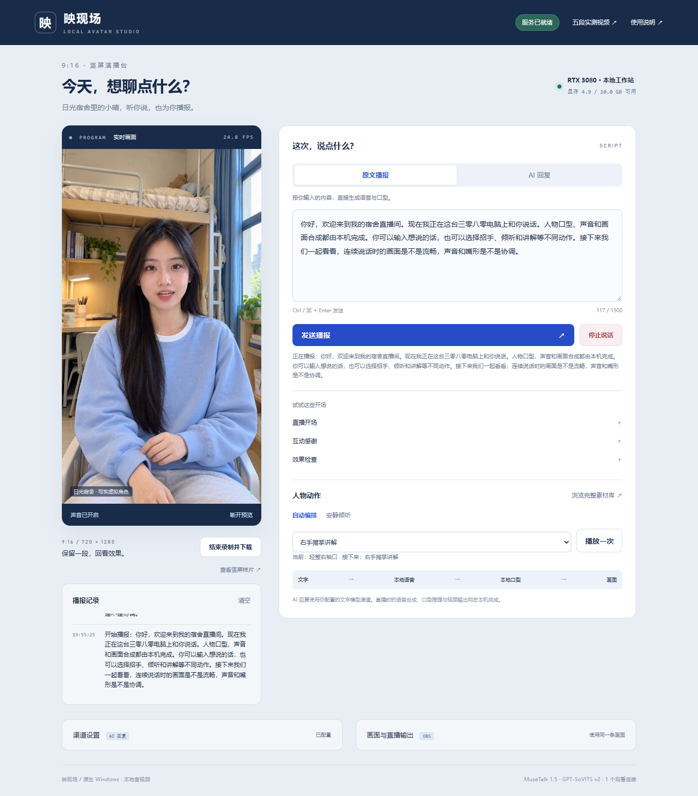

# RTX 3080 deployment / RTX 3080 部署

[English README](../README.md) · [中文 README](../README.zh-CN.md) · [Documentation](README.md)

## Verified configuration / 实测配置

**Current MOSS 04 selection:** use [the MOSS-specific configuration and evidence](MOSS_LIVE.md). It uses avatar batch 4 and passed five browser cases. The batch-8 measurements below describe the earlier GPT-SoVITS deployment. / **当前 MOSS 04 配置见 [MOSS 专项文档](MOSS_LIVE.md)**，人物 batch 4、五项网页测试通过；下方 batch 8 数据属于此前 GPT-SoVITS 版本。

The native Windows deployment was tested on an **RTX 3080 10 GB**, 64 GB host RAM, and a dual Xeon E5 workstation. It retains **MuseTalk 1.5 FP16, GPT-SoVITS v2 on CUDA in FP16, batch size 8, a 720×1280 / 25 FPS output target, and all 50 motion clips / 10,000 frames**. Media inference runs on this workstation. Text-only reasoning can use the existing user-configured cloud channel.

实测机器为 **RTX 3080 10 GB＋64 GB 内存＋双路 Xeon E5**，原生 Windows。最终保留 **MuseTalk 1.5 FP16、本地 CUDA GPT-SoVITS v2 FP16、batch 8、720×1280／目标 25 FPS、50 段／10,000 帧完整动作库**。语音、口型和合成均在本机运行；可选云端渠道只承担文字对话。



| Measurement / 项目 | Observation / 结果 |
| --- | --- |
| Historical canvas updates, idle / 旧版待机画布更新 | 25.00 FPS; intermediate counter / 中间环节计数 |
| Historical canvas updates, audible speech / 旧版播报画布更新 | 24.79 FPS; intermediate counter / 中间环节计数 |
| Browser presentation before playback correction / 修正前最终呈现 | 18.78 FPS idle / 待机; 22.17 FPS speech / 播报 |
| Final Chrome, 60 seconds including long Echo speech / 最终 Chrome 长播报 | 24.88 FPS presented; 0 audio scheduling gaps / 最终呈现；音频排程缺口为 0 |
| Final Edge, 60 seconds including cloud replies / 最终 Edge 云端多句回复 | 24.72 FPS presented; 0 audio scheduling gaps / 最终呈现；音频排程缺口为 0 |
| Initial playback prebuffer / 初始播放预缓冲 | 2.4 s; adds playback and interruption latency / 增加播放及打断延迟 |
| First speech in this cold 117-character Echo test / 此次 117 字冷播报首音 | 22.322 s |
| Browser sound, downloaded recording, gesture and mobile layout / 声音、录像、动作、手机布局 | Passed / 通过 |
| GPU baseline after unloading inference / 所有推理卸载后 | 259 MiB |
| GPU baseline after restarting empty ComfyUI / 空队列 ComfyUI 重启后 | 449 MiB |
| Cold model loading sampled GPU peak / 冷启动整卡采样峰值 | 9,455 MiB |
| Ready/live interval sampled GPU peak / 就绪后直播区间整卡峰值 | 7,788 MiB (about 7.61 GiB) |
| Ready/live interval sampled host RAM peak / 就绪后整机内存峰值 | 18.162 GiB |
| Five actual OBS recordings / 五段真实 OBS 实录 | 294.20 s total; all passed / 全部通过 |
| Warm cloud conversation / 一次预热后的云端对话 | 1.694 s first text; 3.906 s first received audio |
| Cloud media delivery, first audio to settled / 云端首音至播报结束后窗口 | 25.00 FPS over 8 s |

These are individual observations, not latency percentiles or an indefinite uptime test. **The original 24.79/25.00 FPS browser measurements counted canvas draws, not final video presentation.** A later `requestVideoFrameCallback` probe exposed frame coalescing and audio loss under viewer backpressure. See the [correction, new measurements and remaining limits](PLAYBACK.md). The historical [browser evidence](evidence/rtx3080-browser.json) and recordings are retained as provenance; their existence does not prove uninterrupted playback. The screenshots here come from the 3080; the original root README gallery remains the earlier 4090 reference.

以上是单次实测。**旧版 24.79／25.00 FPS 测的是画布绘制次数，不能代表视频最终呈现帧率。** 后续复查发现二次捕获合并画面，以及慢连接整包丢弃导致语音缺失，现已修正代码和统计口径，详见播放专项文档。保留历史测试与录像作为来源记录，不据此证明播放全程连续。本页截图来自 3080，根 README 原有画廊仍为此前的 4090 参考部署。


[Welcome recording with sound / 带声音的欢迎实录](media/rtx3080-welcome.mp4) · [Capture provenance / 媒体来源](media/rtx3080-manifest.json) · [Deployment measurements / 部署实测](evidence/rtx3080-deployment.json) · [Cloud conversation evidence / 云端对话证据](evidence/rtx3080-cloud.json)

| Scenario / 场景 | Actual duration / 实录时长 | Verified / 验证内容 |
| --- | ---: | --- |
| Welcome / 开场欢迎 | 40.00 s | Speech and wave / 语音与招手 |
| Explanation / 连续讲解 | 64.04 s | Two speech segments and hand gestures / 两段播报与手势 |
| Listen and reply / 倾听回应 | 53.00 s | Quiet phase followed by audible reply / 静默后回应 |
| Interrupt and resume / 打断恢复 | 56.00 s | Silent stop window, then new speech / 停止区间静音，随后新播报 |
| Closing / 结束告别 | 81.16 s | Closing pose and farewell wave / 收尾与挥手 |

All original recordings are 720×1280 with audio and are available at the running studio's `/tests` page; `/tests/download` bundles the five originals, screenshots and test records. The repository includes a compact welcome preview. [Scenario evidence](evidence/rtx3080-scenarios.json) records checksums, actual OBS captures, audio levels and interruption silence. OBS reported zero encoder-skipped frames for the final output and one render-skipped frame over 8,984 rendered frames across the session. This recording statistic is separate from the browser's live inference measurement.

全部原片为 720×1280，带本地合成声音；运行服务的 `/tests` 可在线观看，`/tests/download` 打包五段原片、截图与测试记录。仓库另提供压缩欢迎预览。测试证据包含哈希、真实 OBS 截图、音量和打断后的静音检查。OBS 最终输出无编码丢帧，整场 8,984 帧中有 1 帧渲染跳帧；这项录制统计与网页实际推理帧率分开看待。


## Why the original attempt was slow / 原始尝试为何缓慢

The original batch-8 configuration was tried first. Unused CUDA allocator blocks left after converting models to FP16 consumed most of the 10 GB card: whole-card usage approached 9,975 MiB, and one eight-frame render took about 8.7 seconds. An explicit batch-4 attempt also performed poorly before the allocator fix. The implementation now releases unused CUDA blocks **after loading and warming**, without unloading active weights or clearing the cache for every frame.

首先实测原 batch 8 配置，显存接近 9,975 MiB，8 帧推理约需 8.7 秒；随后试过 batch 4，清理前同样不能实时运行。问题之一是模型转 FP16 后留下大量空闲但仍被 CUDA allocator 保留的块。现于**模型加载后和预热后**归还这些空闲块，保留正在使用的模型权重。

Pillow blending also converted the entire 720×1280 image to RGB and back for each face. The new crop-only implementation uses the same Pillow paste and alpha arithmetic. Tests compare every output pixel against the pinned upstream implementation, including soft masks and crops extending beyond frame edges. A synthetic CPU microbenchmark on this host measured median blending time of **27.77 ms → 2.65 ms**; this is a component measurement, separate from the live frame-rate test. The explicit 3080 preset additionally enables cuDNN algorithm selection for the fixed inference shape.

另一处耗时来自每帧把完整竖屏图像进行 BGR／RGB 转换。新实现只处理人脸融合区域，保持原 Pillow 粘贴和透明度运算。测试对照固定版本上游逐像素比较，覆盖软遮罩和越界裁切。在该 CPU 的合成数据单项测试中，中位耗时为 **27.77 ms → 2.65 ms**，不将单项提速直接等同于端到端帧率。3080 显式配置还启用固定尺寸推理的 cuDNN 算法选择。

These inference optimizations allowed batch 8 to meet the original canvas-update threshold. They did not resolve the separate browser capture and audio-queue issues documented in [Playback](PLAYBACK.md). The original resolution, precision, face model, frame-rate target and asset library remain selected.

上述优化使 batch 8 达到旧版画布更新门槛，但不等于解决了浏览器最终播放问题。画面捕获与音频队列另行修正，详见播放专项文档；当前仍采用原分辨率、精度、人脸模型、帧率目标与完整素材库。

## Install and start / 安装与启动

```powershell
powershell -NoProfile -ExecutionPolicy Bypass -File .\Setup-Streamer.ps1 -PrepareAvatar -HardwareProfile rtx3080-original
.\Start-3080.cmd
```

For an existing prepared installation, stop its services, update the integration, select the original preset, and start:

已有完整角色和模型时，先停止本项目，再应用集成和原始配置：

```powershell
.\Avatar.cmd -Action stop
.\runtime\livetalking\Scripts\python.exe -X utf8 deployment\activate_studio.py
.\runtime\livetalking\Scripts\python.exe -X utf8 scripts\hardware_profile.py rtx3080-original
.\Start-3080.cmd
```

Open `http://127.0.0.1:8010/` locally, or `http://<workstation-address>:8010/` from your trusted LAN/VPN. `/tests` serves the completed scenario recordings when available. If Windows has an application-specific inbound **block** rule for the actual native Python executable, an allow rule alone may be insufficient; scope any exception to the studio's TCP port and trusted viewer subnet.

本机访问 `http://127.0.0.1:8010/`，可信局域网／VPN 使用 `http://<工作站地址>:8010/`；`/tests` 展示已完成的情境实录。若 Windows 对真实 Python 可执行文件已有入站**阻止**规则，只新增允许规则可能仍不通；只为演播台端口及可信观看网段添加必要例外。

The tested deployment migrated the previously verified native environments, weights and preprocessed avatar bank, verified **65 transfer parts by SHA-256**, and passed **21 installation checks and five avatar checks** on the target. It did not regenerate H3 source videos or repeat every preprocessing step on the 3080. The fresh-install command is provided, but a complete fresh download/preprocessing run on this machine is outside this migration's acceptance scope. Use the bundled clips to rebuild without running H3 generation during a live session.

本次通过迁移已验证的原生环境、权重及预处理角色，逐一校验 **65 个传输分片的 SHA-256**，并在目标机通过 **21 项安装检查和 5 项角色检查**。没有在 3080 上重新生成 H3 素材或重复全部角色预处理。全新安装命令已提供，但其完整下载及预处理不在本次迁移的实测范围内。直播期间应使用已准备的动作库。

## Explicit fallback order / 显式降级顺序

Presets never switch automatically. First stop unrelated inference jobs, unload generation models, and measure the original preset. Change a preset only after observing a real memory or performance failure. Applying one while the project ports are active is refused; each change backs up the configuration under `.setup/hardware-backups/`.

不会自动降级。先停止其他推理任务、卸载生成模型，再测原始配置；确认显存或性能不满足后才切换。项目服务运行时拒绝修改配置，每次修改都会备份原配置。

| Preset / 配置 | Lip batch | Speech / 语音 | Purpose / 用途 |
| --- | ---: | --- | --- |
| `rtx3080-original` | 8 | CUDA FP16 | Verified final choice / 最终实测选择 |
| `rtx3080-batch4` | 4 | CUDA FP16 | Smaller render batch / 减少口型批量 |
| `rtx3080-batch2` | 2 | CUDA FP16 | Further memory fallback / 进一步降低批量 |
| `rtx3080-batch1` | 1 | CUDA FP16 | Minimum batch / 最小批量 |
| `rtx3080-cpu-tts` | 1 | CPU FP32 | Last-resort speech offload / 最后选择语音转 CPU |

The last three presets are available fallbacks, not additional performance claims. All preserve the full motion bank, original face weights, 720×1280 canvas and target 25 FPS. The explicit profile lowers the startup free-memory gate from the default 12 GiB to 2 GiB per CUDA service; that gate permits a launch attempt and is **not** a claim that a service requires only 2 GiB. A CPU speech preset skips only the speech GPU gate. No-profile 4090 installations retain their previous gate.

后三项只是备用配置，未据此声称已实测可达目标帧率。所有配置保留完整动作库、原人脸权重、720×1280 画布和 25 FPS 目标。显式配置把默认 12 GiB 启动检查改为每个 CUDA 服务启动前至少 2 GiB 可用；这只是允许尝试启动，**不是模型仅需 2 GiB 显存的承诺**。CPU 语音配置仅跳过语音服务的 GPU 门槛。未选择配置的原 4090 部署保持原有检查。

```powershell
.\Avatar.cmd -Action stop
.\runtime\livetalking\Scripts\python.exe -X utf8 scripts\hardware_profile.py rtx3080-batch4
.\Start-3080.cmd
```

## Resource isolation / 资源隔离

The 3080 test began with an empty ComfyUI queue, released this project's previous speech/lip processes, unloaded ComfyUI models and restarted its existing native service. Desktop, remote-control services and unrelated user browser tabs were preserved. ComfyUI remained available with an empty queue; it did not run a generation workload during acceptance. Recording used the project's portable OBS. No Docker, WSL or VM was used, and test browser contexts close in `finally`.

测试前确认 ComfyUI 队列为空，停止本项目旧语音／口型进程，卸载 ComfyUI 模型并重启其原生服务。保留桌面、远程控制及用户已有浏览器页签。验收时 ComfyUI 可访问且没有生成任务；录像使用本项目的便携 OBS。全程未使用 Docker、WSL 或虚拟机，自动化浏览器上下文均在 `finally` 关闭。

Useful local evidence: `configs/hardware-profile.json`, `.setup/gpu-worker.json`, `.setup/gpu-inference-statistics.json`, and `logs/gpu-worker.stdout.log`. These runtime records are intentionally excluded from Git. Record whole-card VRAM and whole-host RAM separately from PyTorch allocated/reserved memory, and separate cold model loading from steady live inference.

本地排查可查看上述配置、worker 状态、推理耗时统计及日志。这些设备运行记录不提交 Git。整卡显存、整机内存与 PyTorch allocated／reserved 指标含义不同；冷启动加载峰值也应与稳定直播占用分开记录。
