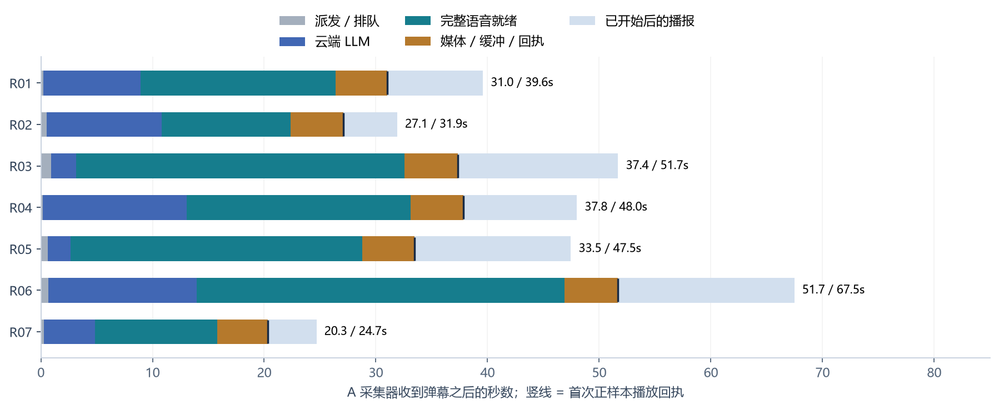
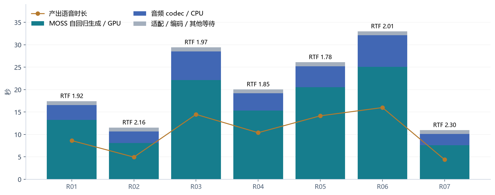
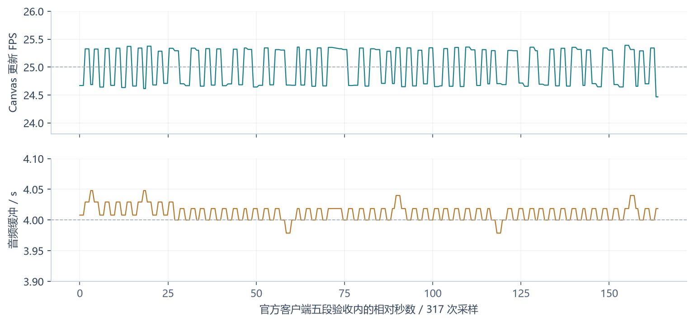
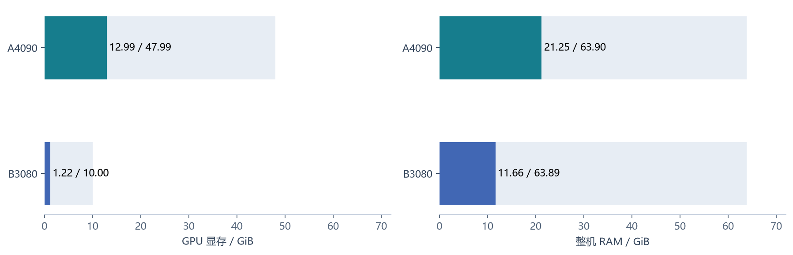
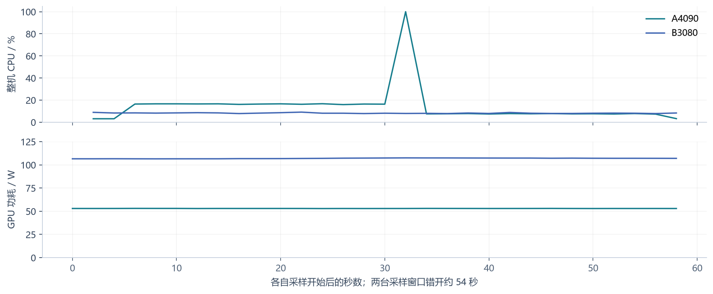
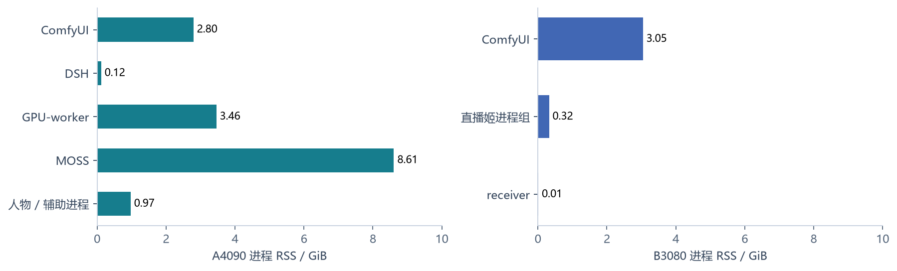

# 女A / 林知夏：双机直播周期与性能分析

数据日期：2026-10-27，Asia/Taipei (UTC+08:00)。本场已由用户下播，采集器已停止，内部会话 ENDED，A 的模型保留常驻。此文档是冻结快照，不会实时刷新。

[交互可视化](report.html) · [PDF](report.pdf) · [逐条 CSV](data/requests.csv) · [资源 CSV](data/resource-samples.csv) · [完整测量 JSON](data/evidence.json)

## 结论与样本

本场 7 条真实弹幕全部完成。A 收到弹幕至官方直播姬首次正样本播放回执平均 **34.10 s**，中位 **33.46 s**，范围 **20.32 - 51.70 s**；至整句播完平均 **44.40 s**，范围 **24.68 - 67.48 s**。此前三条的约 31.81 s 是子样本；本报告扩大到全部七条，因此平均值不同。

等待主要在完整语音生成：平均 21.21 s，占首次播放等待约 62.2%；云端 LLM 平均 7.72 s，占约 22.6%；媒体、缓冲与回执约 4.69 s。画布连续输出和 AI 回复开始速度是两个问题。

| 分组 | 条数 | 完成 | 首次回执均值 / s | 完整完成均值 / s | 说明 |
| --- | --- | --- | --- | --- | --- |
| R01 - R07 实播 | 7 | 7 | 34.10 | 44.40 | 真实弹幕，全为 Chat |
| C01 - C05 官方客户端验收 | 5 | 5 | 22.83 | 31.08 | 4 Echo + 1 Chat |
| H01 - H20 较早调试 | 20 | 19 | 30.57 | 40.53 | B 本机等旧路径，1 UNKNOWN，保留异常 |

当前 A 账本在本次导出日期内保留 32 条：31 COMPLETED、1 UNKNOWN。不是对整个项目所有历史直播的穷尽审计。五段脚本墙钟完成耗时分别为 38.857 / 32.621 / 26.955 / 23.353 / 39.910 s；下表与图统一用 A 账本，避免混入脚本轮询与跨机时钟差。

## 当前运行架构

A 为 48 GB 4090、约 64 GB RAM，承担模型、状态、语音、口型、融合、媒体编码与采集；B 为 10 GB 3080、约 64 GB RAM，仅接收、软件 H264 解码、Canvas / WebAudio 播放及官方推流。B 不加载人物 / TTS 模型。旧 B 的模型进程已停，415 个状态文件已独立归档，未自动合并到 A。原本本机 B 接收器已停，不重复推流。

人物是女A / 林知夏，沿用日光宿舍与 48 个动作素材，720 x 1280、25 FPS；身体动作来自素材库，实时推理用于口型与融合。A MuseTalk FP16 batch8；MOSS04 明朗亲和，NF4 4-bit / BF16 compute、FP32 CPU codec。DSH 0.2.0-rc.2、Humanity 0.1.17 通过连接层提供人格与记忆投影，native_humanity_tools=false，不能称为全部原生 Humanity 功能已开启。Node v24.22.1。

## 回复周期：收到弹幕到完整播完

| 阶段 | 平均 / s | 范围 / s | 精确定义 |
| --- | --- | --- | --- |
| 采集 / 派发 / 排队 | 0.49 | 0.17 - 0.93 | A 采集 received_at 至 request.thinking |
| 云端 LLM 与人格上下文 | 7.72 | 2.05 - 13.26 | request.thinking 至 text_ready；非首 token 延迟 |
| 完整语音就绪 | 21.21 | 10.96 - 32.97 | text_ready 至 audio_ready；含服务与适配 |
| 媒体 / 缓冲 / 回执 | 4.69 | 4.51 - 4.79 | audio_ready 至第一个已接受正样本回执 |
| 首次播放后至完整播完 | 10.30 | 4.36 - 15.78 | 第一个正样本回执至 playback.completed |

首次回执平均 = 0.485 派发 + 7.717 LLM + 21.208 完整语音 + 4.693 媒体与回执 = 34.103 s。之后平均 10.299 s 完成播报，总周期 44.403 s。首次回执前已消耗少量音频样本，所以完整播放余量与音频总时长不严格相等。

| 案例 | 本地入账时间 | 回复字数 | LLM/s | TTS/s | 缓冲回执/s | 首播/s | 完成/s | 状态 |
| --- | --- | --- | --- | --- | --- | --- | --- | --- |
| R01 | 05:14:38 | 36 | 8.75 | 17.43 | 4.64 | 31.02 | 39.59 | COMPLETED |
| R02 | 05:15:55 | 24 | 10.26 | 11.54 | 4.72 | 27.07 | 31.91 | COMPLETED |
| R03 | 05:18:30 | 73 | 2.22 | 29.42 | 4.78 | 37.35 | 51.70 | COMPLETED |
| R04 | 05:19:29 | 58 | 12.90 | 20.04 | 4.71 | 37.82 | 48.00 | COMPLETED |
| R05 | 05:20:50 | 69 | 2.05 | 26.10 | 4.70 | 33.46 | 47.46 | COMPLETED |
| R06 | 05:23:13 | 75 | 13.26 | 32.97 | 4.79 | 51.70 | 67.48 | COMPLETED |
| R07 | 06:23:11 | 19 | 4.57 | 10.96 | 4.51 | 20.32 | 24.68 | COMPLETED |

单房间只发一个回复，以这七条平均完整周期粗略折算，持续服务能力约 **1.35 条/分钟**。这是由样本周期推算的排队规划值，不是并发压力测试或平台观众数上限。增加 pending=50 不会提高生成速度；高频弹幕在 45 s TTL 下会过期。

## 语音生成周期

本场共合成 354 字、73.04 s 语音；MOSS 服务 wall 总计 142.547 s，整体加权 **RTF 1.952**。RTF = 合成墙钟秒 / 产出音频秒；1.95 表示合成 10 s 音频约需 19.5 s，当前语音引擎没有达到边生成边实时播放的速度。

平均 MOSS GPU 自回归生成 16.019 s、CPU codec 4.328 s、服务 wall 20.364 s。服务 wall 之外还有约 0.844 s 适配、清理、传输与准备；具体子项未独立打点。wall 在进入串行锁前计时，可能包含锁等待；本次上游一次只投递一个活跃请求。

| 案例 | 回复字数 | 分段 | 音频/s | GPU生成/s | CPU codec/s | 服务wall/s | RTF | PyTorch峰值/MiB |
| --- | --- | --- | --- | --- | --- | --- | --- | --- |
| R01 | 36 | 1 | 8.64 | 13.27 | 3.28 | 16.56 | 1.92 | 6388.9 |
| R02 | 24 | 1 | 4.96 | 8.09 | 2.61 | 10.71 | 2.16 | 6383.4 |
| R03 | 73 | 2 | 14.48 | 22.15 | 6.38 | 28.56 | 1.97 | 6389.3 |
| R04 | 58 | 1 | 10.40 | 15.36 | 3.82 | 19.20 | 1.85 | 6393.9 |
| R05 | 69 | 1 | 14.16 | 20.55 | 4.67 | 25.24 | 1.78 | 6396.7 |
| R06 | 75 | 2 | 16.00 | 25.09 | 7.04 | 32.15 | 2.01 | 6394.2 |
| R07 | 19 | 1 | 4.40 | 7.62 | 2.49 | 10.12 | 2.30 | 6382.1 |

代码先取得整段 WAV 再上报 audio_ready；即使按 70 字分成多段，也会先合成完并拼接后返回。R03 / R06 分成 2 段。当前 4 s 接收缓冲是在完整语音已生成后发生，不能用画面稳定 25 FPS 证明语音低延迟。MOSS 三次保留启动记录分别为 70.970 / 62.823 / 60.795 s；当前最后一次约 60.795 s，不属于逐次回复耗时。

## 画面、音频与传输稳定性

官方直播姬真实浏览器源五段窗口：163.819 s、317 次采样；Canvas 均值 25.006 FPS，中位 25.285，范围 24.466 - 25.390；音频缓冲均值 4.011 s，范围 3.979 - 4.048 s。媒体欠载 / 缺包 / 解码错误 / 主动跳帧均为 0，窗口内最大到达间隔 91.8 ms。重复请求拒绝、暂停恢复、云端人格回复均通过。

延长观察至下播后：同一接收器 1 次上游 WebSocket 连接、0 上游错误，媒体时钟累计 114.40 分钟，仍为 0 欠载 / 缺包 / 解码错误 / 跳帧；最大到达间隔升至 551.5 ms，缓冲末值 3.629 s。此窗口包括待机预览和公开停播，不能当作同等时长的公开直播成功证明。

累计网关媒体 2.797 GB / 媒体时钟 6864.12 s，粗算 3.260 Mbps；这是 A 到 B H264 + PCM 的平均负载，未含完整 TCP / WebSocket 等线缆开销，不是 B 到平台的推流码率或网络峰值。配置视频目标 3 Mbps，PCM 16 kHz x 16 bit 单声道理论 0.256 Mbps。

## 资源占用：下播后的常驻与预览

**采样窗口严格标为下播后**：A 10-27 06:43:17 开始，B 10-27 06:42:23 开始，各运行约 60 s、2 s 目标间隔，30 份 GPU / RAM 样本；CPU 首条无稳定区间，剔除后各 29 条。两窗口错开约 54 s，不是同步负载对比。

| 设备 | GPU容量/GiB | 已用显存/GiB | RAM已用/总GiB | CPU均/中/峰% | GPU均% | GPU均功耗/W |
| --- | --- | --- | --- | --- | --- | --- |
| A4090 | 47.99 | 12.99 | 21.25 / 63.90 | 14.27 / 7.80 / 100.00 | 0.87 | 52.97 |
| B3080 | 10.00 | 1.22 | 11.66 / 63.89 | 8.21 / 8.10 / 9.10 | 4.07 | 106.96 |

A 整卡常驻 13,302 MiB，约 12.99 GiB / 47.99 GiB，剩余约 35 GiB。B 约 1,252 - 1,255 MiB，约 1.22 GiB / 10 GiB。MOSS 本场 PyTorch allocated 峰值约 6,382 - 6,397 MiB，仅是 TTS 进程分配器的逐次峰值，不能与整卡 13,302 MiB 相加。旧 B 模型退出前后 9,613 -> 1,223 MiB，释放 8,390 MiB，约 8.19 GiB。

此前另一段 360 s 的 A H264 验证采到 GPU 利用率峰值 68%、NVENC 1%、显存 13,300 MiB；它不覆盖本次完整实播，不能代替本场峰值。本场逐秒直播 GPU / CPU 峰值未完整采集，按未测处理。

A CPU 均值 14.27%、中位 7.8%、峰 100%；100% 离群点保留，未能归因到模型。A GPU 仍仅 0 - 1%，说明这个采样窗口没有持续 TTS 生成。B GPU 3 - 5%，整卡功耗约 107 W，高于 A 的约 53 W 待机采样值；不能据此宣称 3080 推流更耗能，也不能把低利用率等同于低显存或低延迟。

## 进程与调度占用

| 设备 | 进程分组 | 平均 RSS / GiB | 平均整机 CPU / % |
| --- | --- | --- | --- |
| A4090 | ComfyUI | 2.795 | 0.000 |
| A4090 | DSH | 0.118 | 0.002 |
| A4090 | GPU-worker | 3.460 | 0.000 |
| A4090 | MOSS | 8.610 | 0.001 |
| A4090 | avatar-or-worker | 0.973 | 1.176 |
| B3080 | ComfyUI | 3.047 | 0.000 |
| B3080 | Livehime-process-tree | 0.324 | 1.256 |
| B3080 | receiver | 0.014 | 0.055 |

进程 CPU 由 psutil 单核口径除以逻辑 CPU 数转换为整机比例：A 80 逻辑 / 40 物理，B 48 逻辑 / 24 物理。RSS 分组只识别采样开始时的相关进程，不是完整进程树归属审计，不能求和作为系统总占用。ComfyUI 留在两机内存中，本轮未调用、未加载新模型；不要归为直播模型独占开销。

| 机制 | 当前值 | 实际行为 |
| --- | --- | --- |
| 弹幕派发轮询 | 1,000 ms | 有活跃回复或已有排队时不再接入下一条 |
| 最小回复启动间隔 | 8,000 ms | 从上次进入队列起计；不是额外固定等待 |
| 同观众冷却 | 15,000 ms | 基于当前采集身份；脱敏身份不足以长期识别 |
| 平台事件有效期 / 容量 | 45,000 ms / 50 条 | 过期标为 EXPIRED；不保证所有弹幕都会回复 |
| DSH 活跃 / 待处理 | 1 / 4 | 一房间只允许一个有效发声任务 |
| DSH 排队 TTL / 活跃期限 | 180 s / 300 s | 与平台 45 s TTL 是不同层级 |
| LLM / TTS 超时 | 90 s / 120 s | 超时失败并保留账本，不伪造完成 |
| MOSS 串行服务 | 1 活跃，至多 4 已登记请求 | 当前上游单任务，未压测并发吞吐 |
| MOSS 分段 / token | 70 字 / 每段最多 800 token | 分段全合成后才返回完整 WAV |
| 音频 / 视频节拍 | 16 kHz 单声道；25 FPS | 24 kHz TTS 波形重采样，媒体回执按有效样本确认 |
| A 到 B 音频缓冲 | 4,000 ms | 用约 4 s 启动等待换取抗网络抖动 |
| 播放心跳 / 进度回执 | 1,000 ms / 250 ms | 实际有效租约 30 s；恢复时以代次隔离旧音频 |
| 下播 drain 上限 | 30 s | 自然结束必须收到连续样本与 natural_end |
| 维护轮询 / 静默窗口 | 5 s / 下播后 120 s | 开播会打断或延迟后台压缩，不在直播期提交 |
| 每日 / 每周维护 | 03:30 / 周一 04:10 | Asia/Taipei；启动补查过去 12 h 的计划点 |
| 维护并发 / 单块限制 | 1 / 200 事件、24 KB、重叠 2 事件 | 每次运行至多 8 次模型调用，每日 20 次 |
| 维护重试 / 租约 | 最多 5 次；5 s 指数退避至 300 s | 模型超时 90 s，租约 120 s，心跳 15 s |
| 预算耗尽 / 渠道不可用 | 延迟 1 h / 60 s | 一小时后只是重查；日额度未重置仍可能继续延迟 |

实时媒体边：A 口型 / 融合随有效音频样本推进，NVENC 编码一份共享 H264 流；B 接收后软件解码并在 Canvas / WebAudio 播放，再由官方直播姬独立编码公开流。生成结束不等于播放结束，完整样本确认和 natural_end 才将请求写为 COMPLETED。中断 / 重连按 runtime_epoch、generation 与播放权威隔离，旧音频不能写成当前完成。

## 云端用量与上下文

| 案例 | LLM阶段/s | 输入token | 输出token | 已结算调用 |
| --- | --- | --- | --- | --- |
| R01 | 8.75 | 5669 | 33 | 1 |
| R02 | 10.26 | 635 | 22 | 1 |
| R03 | 2.22 | 6357 | 60 | 1 |
| R04 | 12.90 | 6722 | 47 | 1 |
| R05 | 2.05 | 7087 | 54 | 1 |
| R06 | 13.26 | 7454 | 58 | 1 |
| R07 | 4.57 | 7821 | 18 | 1 |

7 条实播前台调用 usage 均已结算，共 41,745 input / 292 output tokens；加 1 条官方 Chat 验收，当日保留的前台为 49,122 / 330。不能从此推算渠道费用，价格和缓存细分未采集。有效策略上下文估计 6,000 tokens、输出最多 256 tokens、最终播报最多 160 字；提供方实际单次输入 635 - 7,821 tokens，估算预算不等于总提示词硬截断。

## 平台状态与下播记忆

公开直播姬日志时间：05:10:19 返回开播成功，05:10:23 连接媒体；05:41:23.308 收到平台 PREPARING，随后媒体流停止。其后直播姬界面曾仍显示推流，而公开查询接口已未开播，用户也确认不能观看。未采集到平台停止的具体原因，不能归因为审核、网络或硬件。用户重开后公开接口记录 06:15:13；R07 在 A 06:23:11 入账并完整播完。用户后来下播，内部在 A 06:30:03.942 结束。不同设备时间未严格对齐，这些是各来源日志时间，不据此推断毫秒级跨端间隔。

本次内部会话从 A 05:06:34.040 到 06:30:03.942，约 83 分 30 秒；期间包含公开平台中断，**不是连续公开直播时长**。直播姬状态、应用会话状态、公开房间状态需要分别对账。

下播后 2 分钟静默窗口于 A 06:32:03.942 到期。截止 A 2026-10-26T22:51:19.598913+00:00，本场压缩任务状态 **DEFERRED / budget**，not_before=2026-10-26T23:34:19.928Z，即本地 07:34:19.928。20 / 20 当日维护调用额度已耗尽，下一次是重查，不承诺届时完成；若额度未恢复将继续延迟。

当前全部保留维护任务 10 个：3 COMPLETED、6 FAILED (extraction_failed，重试 5 次)、1 DEFERRED (budget)。6 个失败来自较早的 3 场压缩及其 daily_merge 重试。当前库持久事实 memory_entries=0，摘要版本 6 个（3 segment + 3 broadcast），不能将“上下文可回复”表述为“本场长期事实记忆整理成功”。官方五段验收的 post_broadcast job 在 05:04:23.304 已提交摘要，但新增持久候选数为 0。

| 日期 | 调用范围 | 已计调用 | 已知输入token | 已知输出token | usage未知调用 |
| --- | --- | --- | --- | --- | --- |
| 2026-10-26 | foreground | 9 | 44365 | 217 | 0 |
| 2026-10-26 | maintenance | 18 | 124630 | 4084 | 0 |
| 2026-10-27 | foreground | 8 | 49122 | 330 | 0 |
| 2026-10-27 | maintenance | 20 | 126196 | 4032 | 2 |

当前只用公开弹幕上下文。blivedm 脱敏 identity_quality=display_only，没有可验证稳定 viewer_id，不做跨场个人身份记忆。A 是唯一在线状态写入者；B 旧历史归档不自动混入。

## 可执行优化顺序（本报告未部署这些变更）

| 优先级 | 项目 | 数据依据 | 下一步实现与验收 | 边界 |
| --- | --- | --- | --- | --- |
| P0 | 修复记忆维护失败并保留失败原因 | 今日 20/20；当前 DEFERRED / budget；旧任务 6 个 extraction_failed | 先做结构化返回与来源引用校验，再按失败类别有限重试；清理预算后验证真实持久事实 | 不应直接加大额度掩盖重复失败 |
| P0 | 公开开播状态对账 | 05:41:23 平台 PREPARING 后 UI 曾仍显示推流 | 周期读公开直播状态，并关联直播姬结束事件；发现不一致立即显著提示 | 不自动重开被平台终止的直播 |
| P1 | 让首句尽快生成并播出 | MOSS 全音频 RTF 1.95；TTS 占首播等待约 62.2% | 比较保持音色的短句队列与真正流式声码器；保留语音连续性与取消栅栏 | 目标尚未验证，不能承诺秒回 |
| P1 | 评估本地 codec 的 GPU 路径 | 当前 CPU codec 平均 4.33 s；A 有显存余量 | 隔离测试该模型 codec GPU 兼容、音质、总延迟与峰值；完整回归后再替换 | 能否加速及提升幅度尚未测量 |
| P1 | 根据回复长度控制等待 | 19 - 75 字对应 10.96 - 32.97 s 完整语音准备 | 先验证 20 - 40 字首句，加后续补充；不能截断语音或虚报完成 | 本报告没有修改内容策略 |
| P2 | 自适应接收缓冲 | 稳定阶段 4 s；长时到达间隔最大 551.5 ms | 以 4 s 为基线测试 2 s，再分网络条件对比欠载与首播等待 | 理论可少约 2 s，不等于已实现 |
| P2 | 统一 trace ID 与采样 | MOSS UUID 与 DSH request_id 不同；CPU 有 100% 离群点 | 贯穿 trace ID、单调时钟阶段打点、每秒 NVML / CPU；区分直播、生成、待机窗口 | 本次 MOSS 使用经过 32 对匹配校验的分析关联 |
| P2 | 测观众真实端到端延迟与礼物 | 本次未验证礼物；未测 CDN 观众端音画起点 | 下一场设置独立观看端，统一时钟标记、音画检测与免费礼物事件留证 | 当前 34.10 s 仅截止官方客户端播放回执 |

## 证据边界与缺项

1. 主结论以本场 7 条真实 blivedm 弹幕为样本；不是大并发、长周期 SLA。经验 P95 为线性插值描述，7 条样本不能预测稳定尾延迟。

2. 首次播放是官方直播姬嵌入源已接受的正样本回执。它包含回执发送间隔与传输，不能精确定位扬声器物理出声，也不含 B站 CDN 和观众播放器延迟。

3. 主延迟使用 A 设备收到事件与 A 收到回执的同机时钟。平台时间只作参考：曾出现平台到采集器 -212 ms，不能把它解释成负网络耗时。A / B / 平台未做严格时钟同步。

4. 五段官方验收含 4 条 Echo + 1 条云端 Chat，不能用其较低平均值替代全部 AI 对话延迟。测试脚本的轮询耗时与 A 账本起止不同，也不能混用。

5. 历史 20 条保留全部异常：H04 状态 UNKNOWN、只确认了 80,640 / 102,400 样本；H20 从 audio_ready 到正回执 159.913 s。它们来自较早 B 本机调试，不代表当前 B3080 稳定窗口。

6. 资源采样是下播后、模型常驻且预览媒体继续运行的 60 s 窗口。每台 30 条，CPU 第一条弃用后为 29 条；不代表直播 / TTS 峰值。A CPU 仍有 100% 离群点，原值保留，原因未归因。

7. NVIDIA 整卡占用、PyTorch allocated 峰值、进程 RSS、整机已用 RAM 口径不同。RSS 可能含共享页，不能简单相加当作独占物理内存。功耗为整卡瞬时采样，不是电费或训练能耗。

8. 317 次 FPS 为 Canvas 更新计数；不是显示器实际呈现 FPS、MuseTalk 离线吞吐或观众 CDN FPS。零欠载是该采样范围计数，并非未来零卡顿保证。

9. MOSS 关联采用日志先后顺序，再校验全部 32 条回复字数及音频有效样本时长；原适配器没有直接记录同一个 trace ID。当前生成阶段平均值具备这一关联边界。

10. input_tokens / output_tokens 来自渠道返回的 usage。已知计数可以累加；2 次维护 usage 未知，费用、缓存命中、云端排队与首 token 细分未采集。6000 是上下文估计预算，不是提供方实际总输入的硬上限。

11. 本次没有持续记录口型批次耗时、实时 CPU / GPU 全程曲线、显存分进程 NVML 峰值、上行直播编码码率、观众礼物或观众视频录制；缺项按未测列出。

12. 公开报告只含案例编号、时间、长度、用量与状态；不含对话正文、观众昵称、身份哈希、Cookie、推流密钥或渠道密钥。原始私有导出保留在项目 outputs，未提交仓库。

## 全量案例索引

交互网页可以筛选全部 32 条。H 是历史调试，C 是当前官方客户端验收，R 是本场真实弹幕。UNKNOWN 的完成耗时留空，不伪造 0 或成功。

| 案例 | 分组 | 入账本地时间 | 模式 | 字数 | 首回执/s | 完成/s | RTF | 状态 |
| --- | --- | --- | --- | --- | --- | --- | --- | --- |
| H01 | historical | 10-26 17:29:10 | echo | 38 | 23.82 | 32.52 | 2.18 | COMPLETED |
| H02 | historical | 10-26 17:29:44 | echo | 46 | 22.39 | 31.58 | 1.96 | COMPLETED |
| H03 | historical | 10-26 17:30:20 | echo | 32 | 18.01 | 25.90 | 2.08 | COMPLETED |
| H04 | historical | 10-26 17:30:47 | echo | 26 | 20.49 | - | 2.09 | UNKNOWN |
| H05 | historical | 10-26 17:38:25 | echo | 38 | 21.47 | 34.95 | 1.88 | COMPLETED |
| H06 | historical | 10-26 17:39:02 | echo | 46 | 24.28 | 38.92 | 1.98 | COMPLETED |
| H07 | historical | 10-26 17:39:47 | echo | 32 | 18.28 | 29.66 | 2.04 | COMPLETED |
| H08 | historical | 10-26 17:40:19 | echo | 26 | 18.02 | 28.15 | 2.10 | COMPLETED |
| H09 | historical | 10-26 17:40:59 | chat | 35 | 24.97 | 40.15 | 1.88 | COMPLETED |
| H10 | historical | 10-26 18:00:36 | echo | 38 | 24.19 | 33.09 | 2.06 | COMPLETED |
| H11 | historical | 10-26 18:01:11 | echo | 46 | 24.18 | 33.21 | 1.97 | COMPLETED |
| H12 | historical | 10-26 18:01:48 | echo | 32 | 18.90 | 25.59 | 1.98 | COMPLETED |
| H13 | historical | 10-26 18:02:15 | echo | 26 | 18.89 | 25.05 | 2.06 | COMPLETED |
| H14 | historical | 10-26 18:02:49 | chat | 34 | 25.13 | 33.20 | 1.92 | COMPLETED |
| H15 | historical | 10-26 18:30:29 | echo | 38 | 23.18 | 31.95 | 1.89 | COMPLETED |
| H16 | historical | 10-26 18:31:02 | echo | 46 | 24.14 | 33.22 | 1.94 | COMPLETED |
| H17 | historical | 10-26 18:31:40 | echo | 32 | 20.11 | 26.68 | 2.10 | COMPLETED |
| H18 | historical | 10-26 18:32:08 | echo | 26 | 19.63 | 25.78 | 2.11 | COMPLETED |
| H19 | historical | 10-26 18:32:35 | chat | 33 | 44.84 | 52.20 | 2.07 | COMPLETED |
| H20 | historical | 10-26 20:24:13 | echo | 37 | 176.55 | 188.35 | 2.03 | COMPLETED |
| C01 | official | 10-27 04:59:17 | echo | 43 | 26.11 | 37.58 | 1.79 | COMPLETED |
| C02 | official | 10-27 04:59:56 | echo | 36 | 23.35 | 31.48 | 2.11 | COMPLETED |
| C03 | official | 10-27 05:00:31 | echo | 28 | 19.34 | 25.84 | 2.02 | COMPLETED |
| C04 | official | 10-27 05:00:58 | echo | 26 | 16.80 | 21.61 | 2.23 | COMPLETED |
| C05 | official | 10-27 05:01:21 | chat | 42 | 28.54 | 38.92 | 1.85 | COMPLETED |
| R01 | public | 10-27 05:14:38 | chat | 36 | 31.02 | 39.59 | 1.92 | COMPLETED |
| R02 | public | 10-27 05:15:55 | chat | 24 | 27.07 | 31.91 | 2.16 | COMPLETED |
| R03 | public | 10-27 05:18:30 | chat | 73 | 37.35 | 51.70 | 1.97 | COMPLETED |
| R04 | public | 10-27 05:19:29 | chat | 58 | 37.82 | 48.00 | 1.85 | COMPLETED |
| R05 | public | 10-27 05:20:50 | chat | 69 | 33.46 | 47.46 | 1.78 | COMPLETED |
| R06 | public | 10-27 05:23:13 | chat | 75 | 51.70 | 67.48 | 2.01 | COMPLETED |
| R07 | public | 10-27 06:23:11 | chat | 19 | 20.32 | 24.68 | 2.30 | COMPLETED |

## 可重建与来源

- 运行时代码：`fb7e6e8b0f655b9d6b9863486cc0e6f8b1e8f697`；报告前仓库文档：`85d8f25aa1a8c8b66cd95189ce524645b6c0c525`。
- 数据：A SQLite 只读事务导出 requests / stream_events / utterances / playback_receipts，平台事件 occurred_at / received_at，MOSS JSON 日志，B 官方源 317 份指标，A/B 原生 psutil + nvidia-smi 待机采样。
- 主要公式：首回执 = A 首个 accepted 且 played_samples > 0 的时间 - A 平台事件 received_at；完成 = playback.completed - received_at；TTS = audio_ready - text_ready；LLM = text_ready - request.thinking。
- P95 为排序后线性插值；样本数见各图与 JSON；历史 UNKNOWN 不进入完成周期统计。
- 从仓库根执行 `python -X utf8 devtools/build-performance-report.py`，仅使用 `data/evidence.json` 重建图、网页、Markdown 和 PDF，不访问机器、模型或平台。依赖 matplotlib / reportlab / Pillow，中文字体 Microsoft YaHei。
- 私有来源导出 SHA-256：

| 私有导出标识 | SHA-256 |
| --- | --- |
| 4090-a-export.json | 5d2927507b28afcd4658f20818b804a4e753a2dcb1e7f8470010e418e74e2b50 |
| 3080-result.json | 77f290e61176d9d94b6c7f96fd2fa487621aaadd743cba4e2be903439a1f0c70 |
| 4090-maintenance-export.json | 752d40d0d34848a1e86b0ab7b8d4b7b9d262f6b0cfb0b62cc764da1e506bae21 |
| 4090-A4090-offair-resources.json | 8dc1ba12078e325d0c207f5584571400275db32abdc9bd00885a3f48a67fc9d2 |
| 3080-B3080-offair-resources.json | 14ae3baef119de1059942240136af08770ede51c25c2c77cc8581cf595fa5fcb |

本报告没有新开播、没有新增直播录制、没有修改模型精度或调度策略。最终打开的报告页为用户交付页；用于验证的浏览器会话已关闭。
