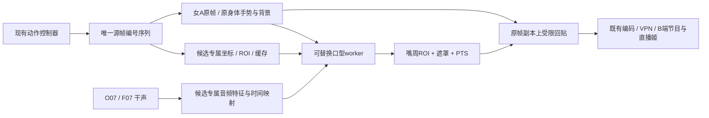

# 女A现有素材的局部口型模块替换评估

更新：2026-10-28。约束：A4090 48GB / 64GB RAM，原生 Windows；保留女A、日光宿舍、身体手势、O07 主用/F07 备用语音、DSH/Humanity 和 B3080 官方直播姬。**本轮只做源码与公开资料评估，没有下载模型、切换运行后端或新增候选跑分。**

结论：优先优化现有 MuseTalk；Wav2Lip 可作低成本速度对照，LatentSync 可作局部画质对照。FeatherTalk 是需要角色训练的条件路线。新补充的 Lip Forcing 符合“参考视频上改口型”的方向，但当前公开的 14B 版仍须通过原生运行、共驻留显存与吞吐验证；论文中的 1.3B 实时权重尚未发布。此前 FlashHead Lite / Ditto 的整头生成优先级，**不适用于本次只替换局部口型的要求**。

[完整22项清单](LIPSYNC_OPTIONS_20261028.md) · [局部候选JSON](local-lipsync-options.json) · [局部候选CSV](local-lipsync-options.csv) · [调优与准入](STREAMING_AVATAR_TUNING_20261028.md) · [既有模型预算](AVATAR_MODEL_STORAGE_20261028.md)

## 1. “复用当前素材”具体意味着什么

当前动作索引有 **50 条调度片段、10,000 帧**：48 条已验收动作和2条基础片段。节目为 720×1280、25 FPS。口播时身体、手势、眼神、头姿、衣服与宿舍来自同一源帧，模型负责修改嘴部及必要的嘴周区域。

| 对象 | 复用要求 | 新后端需要做的事 |
| --- | --- | --- |
| 源视频/源帧 | 保留已验收的48段动作、2段基础片段及原始文件校验值 | 按动作控制器给定的帧编号取图，不让候选自行循环或倒放 |
| 人物与场景 | 保留女A身份、日光宿舍、720×1280画布和已选机位 | 使用该帧的嘴部ROI，生成后贴回该帧；不重新生成整头或背景 |
| 动作调度 | 保留 idle/listening/speaking/thanks 等现有有界意图 | 模型消费调度结果，不能另选身体动作或引入自由头动 |
| 原有预处理结果 | MuseTalk 的 latent、坐标、遮罩保留用于回退 | 新模型的裁剪、仿射、音频特征和 latent 分目录重建，不假定通用 |
| 语音与记忆 | 保留O07/F07的干声音频、有效样本数及DSH播放确认 | 在人物层重采样、提特征；BGM不参与口型条件，不新增记忆写入者 |
| A→B与装修 | 保留视频编码、音频时钟、B四秒缓冲、BGM/滤镜/弹幕/留言 | 新模块输出相同的节目帧与PTS，复用当前接收和官方素材 |

因此，**源素材可以完整复用，不等于 MuseTalk 的 latent 或 Whisper 特征也能直接复用**。也不等于换一个权重文件就已完成接入。清单来自[动作索引](../../configs/vertical/materials/motion-index.json)、[素材目录](../../configs/vertical/materials/catalog.json)与[组库脚本](../../scripts/assemble_motion_bank.py)。本轮读取的是仓库实现和已归档配置，未重新探测远程设备的实时状态。

## 2. 符合局部替换方向的方案

下表仍按**首次新增模型磁盘预算升序**排列，未知总量置后；优先级另列，大小次序不表示画质或可用程度。GB为十进制磁盘容量，不是显存；不含Python/CUDA环境、导出engine、角色训练数据和新预处理缓存。除现有MuseTalk外，均未完成女A实测。

**后续选型统一使用K01–K08。** 选型编号固定绑定方案，之后调整排序不重新编号；原L/N技术编号继续保留，方便与22项总表交叉查询。观察项R02尚未发布，不编入当前选型序列。

| 选型编号 / 原编号 | 方案 | 新增模型预算 | 保留当前素材的方式 | 预期成品效果 | 实时性、接入条件与建议 |
| --- | --- | --- | --- | --- | --- |
| **K01** / L00 | [MuseTalk 1.5 基准](https://github.com/TMElyralab/MuseTalk) | 0 GB，已安装 | 原帧+现有latent+原帧遮罩 | 当前嘴部256×256生成；身体手势保持，牙齿、唇色、嘴周边缘仍需检查 | 已接入；保留为唯一已验证基准 |
| **K02** / L01 | MuseTalk局部优化；可另测ONNX/TensorRT | 0 GB新增原始权重；导出文件另计 | 继续使用当前素材/缓存，调整ROI融合和调度 | 重点改善闪烁、接缝、句尾闭口；加速本身不会增加原生细节 | **P0**：风险最小；先测融合。编译/导出作为独立子实验，不能预设加速倍数 |
| **K03** / L07 | [FeatherTalk / Ultralight路线](https://github.com/anliyuan/FeatherTalk) | FeatherTalk约0.04–0.10 GB，部署估算 | 按角色训练后，在源帧人脸区域推理并加受限遮罩贴回 | 专属模型有望稳定女A嘴周，默认144×144的唇纹/牙齿细节有限 | **有条件候选**：先补同身份、真实对齐的说话训练集。当前静音动作不够；旧Ultralight与新FeatherTalk特征和模型不通用 |
| **K04** / L08 | [Wav2Lip / Wav2Lip-GAN](https://github.com/Rudrabha/Wav2Lip) | 约0.53–0.60 GB | 源帧脸框+mel特征→局部预测→嘴周遮罩贴回 | 基本同步容易建立对照；96×96原生输入使嘴部偏软、牙齿与拼接较显眼 | **P1速度对照**：LiveTalking已有后端，但本项目worker/帧调度补丁仍须适配；开放权重限非商业用途 |
| **K05** / L06 | [LatentSync 1.6](https://github.com/bytedance/LatentSync) | 约5.2–5.6 GB；官方整包约10 GB | 源视频512对齐人脸→扩散修补→按原帧逆变换贴回 | 可比较更清楚的唇齿和闭口；需检查牙齿闪烁、边界与时间一致性 | **P1画质对照**：先离线；官方最低18GB推理显存不等于本机25FPS。需要时序分块与回调改造 |
| **K06** / N03 | [Lip Forcing 14B](https://github.com/cvlab-kaist/LipForcing) | 约41–42 GB工程预算；已知主要权重40.86 GB | 视频条件的两步因果扩散，512对齐，提供mouth-only贴回路径 | 目标是在保留源表演时改善同步和嘴部细节；女A的唇齿、手遮嘴和切片稳定性仍未知 | **第二批条件实验**：官方H200约37GB峰值需预计算文本；原生Windows、O07/F07共驻留及4090吞吐未证明。不是现成可切换后端 |
| **K07** / N01 | [DINet](https://github.com/MRzzm/DINet) | 未核实；不能填0 | 源视频+OpenFace关键点+DeepSpeech→变形修补→局部贴回 | 256 mouth区域的高分辨率配音路线；官方提示正面、正常光照更合适，侧转泛化有限 | **第三批**：可复用动作，需重建关键点/特征，改掉自循环并限制输出遮罩；旧依赖和实际25FPS待测 |
| **K08** / N02 | [Diff2Lip](https://github.com/soumik-kanad/diff2lip) | 未核实；不能填0 | 视频脸框+mel→掩码扩散→回贴原帧 | 可作局部扩散唇齿/身份保持对照；质量和耗时需同源音视频比较 | **第三批离线对照**：默认批量文件推理，需要原生依赖适配和流式接口；未证明实时 |

L07/L08/L06的预算沿用原规划，未改写历史测评或旧估算。N03新增预算包括一次性准备文本条件所需的T5；没有盘点确认的共享权重不预扣。N01/N02的官方资源包尚无已核实逐文件清单，不能用“轻量”猜测磁盘量。

**观察项 R02：Lip Forcing 1.3B。** [项目页](https://cvlab-kaist.github.io/LipForcing/)的31 FPS来自H100，源码仓库仍把1.3B学生权重列为待发布；截至本次核对不能计入已可安装选项，也不能把31 FPS标成当前4090成绩。公开14B权重与1.3B论文成绩要分开。

## 3. 当前集成的实际改动边界

已核对当前仓库实现：

| 源码 | 当前事实 | 对局部替换的约束 |
| --- | --- | --- |
| [GPU worker](../../scripts/gpu_worker.py) | 第25行导入MuseTalk；第38–40行绑定MuseReal、VAE/UNet和avatar[4]的latent；第93–95行渲染时透传indices | 需要后端适配层。换CLI参数或UNet检查点不能接入不同架构 |
| [隔离推理代理](../../integration/isolated_inference.py) | features/render协议和五元模型返回值按MuseTalk组织 | 候选保留同一进程所有权与取消边界，内部特征接口按后端版本化 |
| [动作控制器](../../integration/motion_control.py) | next_indices选择完整动作内的帧，只在边界切换 | 同一批indices必须同时控制源帧、脸框、mask、模型条件与回贴目标 |
| [部署补丁](../../deployment/activate_studio.py) | 第24–26行控制主渲染帧索引；第64–72行只补MuseTalk代理与latent索引 | 上游已有Wav2Lip/Ultralight不等于本项目双机补丁已覆盖它们 |
| [FrameStore](../../integration/frame_store.py) | 第17行起返回LRU中的同一张BGR数组，缓存上限48项 | 合成前必须copy，不能在共享源帧上原地写入而污染下一次循环 |
| [局部合成](../../integration/fast_blending.py) | 第11行起在裁剪区执行原有Pillow遮罩混合，要求调用者提供可写的自有帧 | 现有遮罩并不证明“只动嘴唇像素”；新契约需要显式限定允许修改的嘴周区域 |

这是一项**人物内部模块替换**：改动集中于worker后端选择、候选预处理/特征、局部合成与健康指标。网站管理、平台接入、TTS、动作资产与记忆系统继续复用。上述适配层是待实施设计，本轮未向运行代码添加虚假的可用开关。

## 4. 候选逐项需要处理的适配问题

### MuseTalk优化

先分开比较嘴周遮罩、颜色匹配、bbox时间稳定和静音/句尾闭口，不平均多帧嘴部图像，防止拖影。保留FP16/batch8，batch4单列吞吐/首帧实验。ONNX/TensorRT使用同一组权重，export/engine磁盘、Windows算子和数值误差独立记录；图编译不作为画质提升证据。

### Wav2Lip

[官方推理源码](https://github.com/Rudrabha/Wav2Lip/blob/master/inference.py)按脸框截取96×96图像，用mel窗口生成并回贴。默认视频循环索引必须换成现有MotionController提供的indices；官方输出整脸框，严格局部版本需再限制嘴周mask。检测缓存可以离线，mel/音频窗口重新计算，不复用MuseTalk的Whisper特征。上游LiveTalking的[Wav2Lip后端](https://github.com/lipku/LiveTalking/blob/main/avatars/wav2lip_avatar.py)可作适配参考；仍须覆盖当前独立worker和双机取消/回执契约。原始开放模型的非商业限制影响后续商用直播选型。

### FeatherTalk / Ultralight

[FeatherTalk推理](https://github.com/anliyuan/FeatherTalk/blob/main/inference.py)包含参考脸、遮嘴输入、音频特征和预测回贴，也有自己的FramePicker；后者必须禁用并使用现有帧号。其paste_prediction会回贴一块预测脸，需额外输出遮罩，不能因为输入遮嘴就声称输出只改嘴唇。

当前女A动作素材主要是静音表演，没有对应同一句音频的真实唇形。**给静音片段随便配一段O07音频，不构成正确训练标签。** 若采用高质量教师生成对齐训练集，要单独标明合成标签、教师版本和继承的口型瑕疵，并保留未参与训练的素材评测。补采/生成对齐语料、训练和验收是新增工作，不能把这一路线列为立即可替换。

新FeatherTalk与[旧Ultralight后端](https://github.com/lipku/LiveTalking/blob/main/avatars/ultralight_avatar.py)的特征提取和模型并不相同；不能因为Ultralight已在上游就直接加载FeatherTalk权重。

### LatentSync

[官方pipeline](https://github.com/bytedance/LatentSync/blob/main/latentsync/pipelines/lipsync_pipeline.py)提供人脸对齐、掩码外像素回填及逆变换，方向符合源视频局部编辑。新建512对齐缓存；MuseTalk的VAE latent和bbox不能直接代替。默认离线视频流程需要拆出分块回调，显式记录音频前视和时序上下文，切动作时清理跨镜头状态。先取得10/30/90秒离线画质与RTF，再判断有无实时价值；不能仅设置输出25FPS就认定实时。

### DINet / Diff2Lip

[DINet推理](https://github.com/MRzzm/DINet/blob/master/inference.py)使用OpenFace、DeepSpeech、参考帧和相邻帧条件，最后回贴脸部裁剪。预处理Windows入口存在，但其依赖、旧NumPy用法及整条推理链尚未原生验证。上下文不能从一个动作跨到另一个不连续动作；参考帧要固定种子或固定选择，方便复现。[官方说明](https://github.com/MRzzm/DINet)明确训练集泛化有限。

[Diff2Lip推理](https://github.com/soumik-kanad/diff2lip/blob/main/generate.py)先用mask合成预测和参考脸，再贴回脸框。可以适配同样的ROI契约；它的批量生成、多步扩散和旧依赖使其更适合先做离线第三组对照，不能凭局部结构就承诺低延迟。

### Lip Forcing 14B

这是本次新找到、方向更贴合当前要求的V2V口型项目。[流式源码](https://github.com/cvlab-kaist/LipForcing/blob/fc864771eb347ca3ccaaef9c0b583ff6ccc9f184/scripts/inference/inference_streaming.py)逐AR块编码、两步去噪、解码和贴回，支持mouth-only合成。仍需处理以下事项：

- 默认参考视频会循环/截短；接入时改由现有indices供帧，保留动作边界，避免两个不连续姿态共享旧KV/VAE状态。
- CLI内部按块生成，但仍累计结果后保存MP4；需新增直接帧回调与有界队列。不能把启动CLI导出文件当作现有实时worker的替代。
- 默认长度向下对齐AR块，可能比音频短约0.5秒。必须保留全部有效音频，末块只补零并按有效终点裁视频，不能用shortest截掉句尾。
- 不启用defer_composite；保持官方有界注意力配置。官方“显存恒定”不等于当前脚本CPU结果列表或全参考预处理也恒定，64GB RAM仍须测长时曲线。
- 优先提前生成固定文本embedding，运行时不加载T5；官方H200约37GB与运行时文本编码约50GB均不是本项目实测。与O07/F07、编码器共驻留后是否仍有余量必须再测。
- 官方测试Ubuntu/H200，标准attention回退不代表原生Windows整条链已通过。先做wheel/算子/ORT/视频IO预检，不使用Docker/WSL。
- 预处理默认可能自动获取InsightFace；未来安装须显式检查本地文件并阻止隐式下载。本次仅读取源码/文件元数据。

[公开14B文件](https://huggingface.co/JinhyukJang/lipforcing/tree/49f1f15bdc0d266e6e6ef64ccaa1ee86367a8799)为28,588,528,943字节。VAE约0.508GB、wav2vec约0.378GB、TAEW约0.023GB、T5约11.362GB，主要权重合计约40.86GB；检测模型、tokenizer等另留预算，首次准备按41–42GB估计。推理不需要另外下载训练教师或基础DiT分片；使用已验证的同SHA共享文件时才扣除重复量。详细出处及字节数见[JSON](local-lipsync-options.json)。

## 5. 待实现的局部后端契约

以下是设计约束，尚不是已实现API：

| 环节 | 必须满足 |
| --- | --- |
| prepare | backend/model/preprocess版本、素材SHA、支持帧率/ROI尺寸、所需音频前后文、峰值预算；冷启动单列 |
| begin / audio | request_id、utterance_id、runtime_epoch、generation、PCM采样率、有效样本数；候选自行提特征但保留原采样时间映射 |
| source_batch | source_frame_id列表、clip_id、BGR源帧、仿射/ROI及允许改动mask；时序模型的额外前后文也从同一动作时间轴取 |
| render / poll | 对应源帧ID的ROI像素/坐标、有效mask、PTS、有效音频区间；首个真正合成的口型帧单独打点 |
| composite | 对源帧copy后回贴；允许区域=嘴唇/口腔/必要嘴周与有限下巴，羽化外沿也算在允许区域内；不得碰眼睛、头发、衣服、手和背景 |
| occlusion | 手遮嘴时要保留前景遮挡；无可靠遮挡mask时保留该帧源嘴部并记降级，不能把生成嘴贴在手上 |
| end | 保留有效句尾样本；额外padding不得变成真实播报长度；输出帧不足必须报错/补齐，不静默截音频 |
| cancel / reset | 清空旧代次特征、时序缓存和排队帧；动作切片重置规则显式化；只有B真实消费的有效样本可回执，生成完成不代表观众已听到 |

25FPS的一帧为40ms，对应16kHz下640个音频样本；本系统每帧两块20ms音频，候选窗口可以更长，但必须给出准确PTS和前视延迟。句子级失败先取消旧代次并排空旧输出，再按既有播放/记忆规则回退；不能中途拼接新旧模型而重复播报或伪造成功回执。

缓存建议按`avatar / backend / model_sha / preprocess_sha / clip_sha`分层。原MuseTalk预处理包含硬链接与模型专属latent，禁止原地覆盖；新后端修改源帧或重写同名mask会污染基准与回退。

## 6. 后续横评如何证明确实满足要求

| 核验项 | 输入与记录 | 通过条件或比较方法 |
| --- | --- | --- |
| 素材保持 | 固定源帧ID与mask；保存合成前无损帧 | 允许mask之外逐像素相同。验证发生在编码前；H264重编码后的全帧像素变化不冒充越界编辑 |
| 口型/牙齿 | 同一O07/F07的10/30/90秒音频，中文闭唇/圆唇/停顿/句尾 | 同时间点原尺寸嘴部裁剪+完整竖屏盲评；同步、唇色、牙齿、闪烁与接缝分别评价 |
| 动作适配 | 正面、点头/轻侧转、上身移动、手靠近嘴、动作切换五组 | 逐组保留原片表演，无遮挡穿帮、嘴漂移或跨片段历史污染；失败样本保留 |
| 纯人物效率 | 音频已准备，含特征、生成、VAE、回贴与IO，冷1次/热至少3次 | 报首个合成口型帧、前视、RTF、P50/P95批耗时；实时目标RTF≤1，视频生成不能只计UNet |
| 共驻留 | 人物候选替换Muse，而非叠加常驻；O07/F07按当前策略运行 | 记录GPU峰值、RAM/提交量、换页与10分钟曲线；显存余量目标另测，不能用待机值推算 |
| A→B节目 | 同码率、buffer4000、网络，30次短句+10分钟，含打断/重连 | 真实呈现接近25FPS，无新欠载/缺样/解码错误；有效样本与回执完整 |
| 句尾与打断 | 非整AR块长度音频、末字、取消后立即换句、动作边界 | 最后有效样本不丢失；旧epoch/generation无输出、无播放确认、无记忆提交 |

batch8在25FPS中对应320ms节目时间，这只是该批的时间预算，不是每个流水阶段各有320ms。吞吐达标后仍要检查P95抖动、缓冲与前视；完整回复延迟还包括LLM、TTS、网络和平台分发，局部口型提速不能消除这些耗时。

## 7. 原清单哪些内容应移出本次替换范围

| 原方案 | 本次结论 |
| --- | --- |
| FlashHead Lite/Pro、Ditto、FlashTalk/fast-flashtalk、LiveAvatar、LiveAct、EchoMimic、SadTalker、FLOAT | 公开主链路面向整头/人物/身体生成，不能直接消费现有帧并承诺只改嘴周。另做头部贴合属于新的融合工程，暂不进入局部替换第一批 |
| LivePortrait、PersonaLive、EditaLive | 用于表情迁移、面捕或素材编辑；会改变嘴周以外区域，不作为本次纯口型替代。未来可另建素材分支 |
| MediaPipe | 可辅助关键点、遮挡/质量分析，但本身不生成口播视频 |
| Audio2Face-3D | 输出3D面部参数，需要新3D资产与渲染链 |
| Hallo-Live | 语音视频联合生成，改变既定O07/F07链路 |
| StreamAvatar | 完整部署发布尚未确认，且研究目标超出局部嘴部替换 |

**执行优先级：** P0当前MuseTalk融合/边界检查 → P1 Wav2Lip速度对照与LatentSync离线画质对照 → 条件成熟后FeatherTalk训练或Lip Forcing 14B受限实验 → DINet/Diff2Lip补充对照。Lip Forcing 1.3B只跟踪发布。当前保留MuseTalk正式后端；本次文档不代表任一新方案已经通过上述准入。
