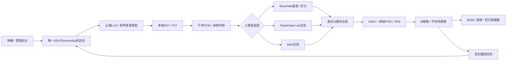

# 女A流式人物方案调优设计

日期：2026-10-28。目标：A单张RTX4090 48GB、64GB内存；B3080运行官方直播姬；原生Windows。本文约束下一轮比较与接入，**候选尚未下载、安装或实测，正式后端仍为MuseTalk 1.5**。

[22项横评表](LIPSYNC_OPTIONS_20261028.md) · [当前部署](../deployment/BASELINE_O07_F07.md) · [直播间管理](../live-room/README.md)

## 选择顺序

先做MuseTalk素材/融合/调度对照；新模型依次考虑FlashHead Lite、Ditto。保留O07/F07、女A身份和720×1280节目画布。FlashTalk量化版作为实验分支；LiveAct等先用于离线动作素材。顺序依据落地条件，尚不是画质排名。

| 路线 | 第一方资料核对 | 对本项目的含义 |
| --- | --- | --- |
| [SoulX-FlashHead](https://github.com/Soul-AILab/SoulX-FlashHead) | 1.3B；Lite单4090官方96FPS，Pro同卡10.8FPS；已提供流式入口 | Lite先做同机横评，核对原生尺寸、计时范围与TTS共驻留；Pro未达25FPS |
| [SoulX-FlashTalk](https://github.com/Soul-AILab/SoulX-FlashTalk) | 14B；32FPS/0.87秒为8×H800；单卡超过64GB，卸载约40GB | 48GB可探索卸载容量，不能承诺实时；共同运行时余量更少 |
| [fast-flashtalk](https://github.com/di-osc/fast-flashtalk) | A8W8、动态卸载、RoPE融合、提示缓存；作者称4090约2倍相对加速 | 须测绝对FPS、量化后嘴部质量及Windows内核；先不替换正式后端 |
| [SoulX-LiveAct](https://github.com/Soul-AILab/SoulX-LiveAct) | 18B；双H100/H200约20FPS，单5090约6FPS；动作/情绪编辑 | 先离线动作研究；ConvKV是模型视频历史压缩，不是DSH人格/观众记忆 |
| [LiveAvatar](https://github.com/Alibaba-Quark/LiveAvatar) | FP8支持48GB；实时成绩来自多H800；块式生成与流式VAE | 借鉴长段生成/解码流水，容量符合仍须验证速度 |
| [StreamAvatar](https://streamavatar.github.io/) | 双音频产生说话/倾听和手势；双H800拆分DiT/VAE，延迟含0.48秒输入块 | 借鉴互动状态；未确认完整官方推理和权重，不编造安装流程 |
| [Hallo-Live](https://github.com/fudan-generative-vision/Hallo-Live) | 联合生成语音视频，2×H200约20.38FPS/0.94秒 | 不直接适配既定O07/F07；长期架构参考 |

现有服务五段测试约25FPS节目播放，不证明256×256嘴部细节最佳。验收表的13–16秒为提交到播完，也不能当成纯人物生成耗时。[真实验收](../live-room/ACCEPTANCE.md)

## 人物适配层

各候选采用独立原生Python环境和进程，避免覆盖正式Torch依赖；只有一个人物适配层进入节目，不新增DSH/Humanity写入者。B仍负责播放、BGM和装修。BGM不送人物模型；16kHz人物音频与候选采样率之间采用有状态重采样，保留时间映射。

下表为**待实现适配契约**。复用现有request/utterance/epoch/generation和播放确认语义。

| 接口 | 必须保留的语义 |
| --- | --- |
| prepare | 身份锚点SHA、模型/精度、原生画幅/FPS与控制能力；冷启动单独计时 |
| begin | request_id、utterance_id、epoch、generation、采样率/时钟；重置本句运动条件 |
| push_audio | 输入采样起点、有效样本数、单调PTS；按模型原生块大小，不强拆任意40ms |
| poll_frames | RGB/BGR、尺寸、原生帧率、PTS、对应有效音频区间；首帧单独打点 |
| end_audio | 有效样本终点、末块补零数；补零不能计为已说内容或伪造自然结束 |
| cancel | 递增代次，丢弃旧队列/KV/帧；旧输出不能再入节目或触发记忆提交 |
| reset / close | 清理会话缓存和占用；由进程/显存实测确认释放 |

图像embedding可按身份SHA和模型版本缓存；跨角色/代次的运动历史不能直接复用。生成、VAE、合成、编码采用有界队列并分别计时；饱和须背压或报错，不能无限积压来维持表面25FPS。

## 可借鉴的流式设计

| 设计 | 本项目用法 | 边界 |
| --- | --- | --- |
| 分块与流水 | 足够干声到达后启动首块，分开计生成/VAE/合成/编码，有限预取 | 完整文件写完才送播放器不等于低延迟 |
| 长段身份锚点 | 固定女A与场景，检查脸/衣服/背景漂移，按模型支持方式重锚 | 任意裁KV或硬拼接可能改变生成行为 |
| 有界视频历史 | 按上游验证方式维护KV/运动缓存，记录10分钟显存曲线 | 不能替代DSH长期记忆压缩 |
| 说话/倾听状态 | DSH发出idle/listening/thinking/speaking/thanks有界意图，限制头姿差/最短停留 | 不让LLM每帧自由控制坐标 |
| 量化/卸载 | 保留FP16/原精度画质对照，记录传输与峰值内存 | 显存减少不等于更快；64GB RAM也要容纳CPU权重 |
| 缓冲治理 | 先保留B四秒；连续供帧合格后单独试3000/2000ms | 不同时换模型、降batch、减缓冲 |

FlashHead官方Gradio流式脚本为分段播放把三个chunk合并，并注明片段接近三秒才较稳定。接入时应优先消费推理层帧流，避免把导出MP4等待叠加到B缓冲；具体可减少多少须实测。[官方流式源码](https://github.com/Soul-AILab/SoulX-FlashHead/blob/main/gradio_app_streaming.py)

## 面部与身体配合

MuseTalk沿用全身源帧；单图生成不能假定自动继承48段身体动作。先测候选完整女A锚点原生输出，再比较整帧生成与头肩融合。融合必须核对脖颈、头姿、光照、头发和遮挡，避免自由头动与预制身体不一致。

LivePortrait优先离线做眨眼、轻笑、点头和倾听模板。PersonaLive/EditaLive需要驱动视频/摄像头；女A无声动作可作驱动参考，不能直接当作FeatherTalk要求的对齐口型训练集。[LivePortrait](https://github.com/KlingAIResearch/LivePortrait) · [PersonaLive](https://github.com/GVCLab/PersonaLive) · [EditaLive](https://github.com/GVCLab/EditaLive)

LiveAct等离线手势须复核手指、遮脸、椅子接触、衣服一致性与循环首尾，再进入动作库新版本；保留原48段和历史报告。实时新后端未证明完整身体能力前继续用已验收调度。

## 实验顺序与准入

以下均待执行，不是已通过成绩。安装先检查原生Windows解释器/GPU算子/wheel；仅Linux依赖未适配则记为失败，不使用Docker/WSL规避。下载仍遵守当前停止新模型下载的约定。

| 阶段 | 操作 | 判据 |
| --- | --- | --- |
| 0 固定输入 | 同一女A、O07/F07 WAV、10/30/90秒，输入SHA/软件版本 | 原音频不改写；原生尺寸与25FPS节目合成分列 |
| 1 当前模型 | ROI/遮罩/颜色/句尾闭口逐项对照；batch8和4另列 | 身份/闭唇改善，无新增拖影/卡顿 |
| 2 新模型独占 | FlashHead Lite后Ditto；冷1次、热至少3次 | 原生运行和帧接口通过；30/90秒含解码生成RTF≤1 |
| 3 实际共驻留 | 替换人物worker、复用O07/F07，不重复启动整套服务 | 总峰值显存留至少8GiB工程余量；RAM无持续换页；此为目标，未测得 |
| 4 A→B | 同buffer4000/码率/网络；30次短回复+10分钟，打断/重连 | 25FPS目标，欠载/缺样/解码错误无新增，采样回执完整/代次围栏有效 |
| 5 降时延 | 连续性合格后单独试buffer3000/2000，测P50/P95/最差 | 无新欠载且首声可复现改善才改默认 |
| 6 定型 | 同音频盲评/长段复看，原始音视频与资源曲线归档 | 质量不退步且改善同步/表情，具备回退步骤后更新release |

显存联合预算包括权重、KV/激活、VAE、特征、TTS峰值、NVENC与驱动。验收后约11.1GB为待机观测，不能当全程峰值；新模型替换原人物后应测整机峰值，不把旧人物重复计为永久共驻留。48GB扩展显存不增加4090计算吞吐。

质量包括中文闭唇/圆唇、句尾、牙齿、嘴周闪烁、情绪/身份；保留SyncNet等参考与人工盲评。LLM首字、TTS首块、人物输入块等待/首帧、编码、网络、B缓冲、平台分发分别计时；人物加速不会消除其他阶段等待。

## 归档和回退

新目录追加输入、模型版本、参数、原生视频、720×1280节目视频、WAV、失败日志和曲线。JSON未测指标保持null，不将官网FPS写成本机成绩；CSV供筛选，后续网页按首帧/总生成时长/显存/质量独立排序，未测排最后。

候选失败回到MuseTalk 1.5 FP16 batch8、O07/F07、buffer4000：先阻止新请求并取消代次，再切worker，核对健康与B源后恢复本地会话。保留唯一DSH数据库进程，不随人物回退数据库；下播记忆维护仍按DSH规则执行。

本轮交付源码核对、22项清单与调优约束；没有切换正式口型或下载新权重，没有改写历史测评。
