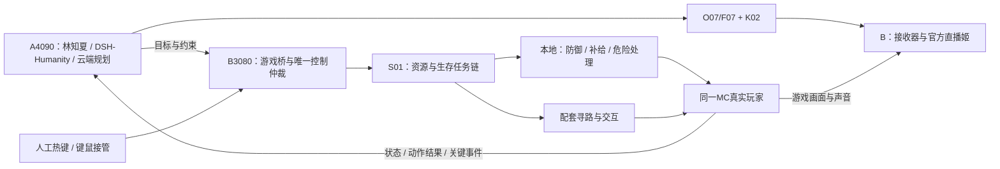

# Minecraft即时战斗与复杂生存：社区方案复核

日期：2026-10-29（Asia/Taipei）。范围：为G01-R1补充本地战斗、生存和长任务执行能力，重点检查社区项目、维护分支、关键源码与构建配置。

**修正结论：社区存在大量无需LLM逐帧决策、也无需新增AI权重的本地战斗与生存模块。普通PvE、进食、装备、躲避及资源任务链都有可复用基础。上一版评估对这些现成模块覆盖不足，不宜把即时战斗和复杂生存整体归为首版把握低。**

针对当前“同一真实玩家、AI/人工切换、Windows原生、A4090人物与B3080游戏”的要求，优先验证 **S01 MiranCZ/altoclef的1.21.1版本**；S02 UnionClef作为更强运动/战斗的独立对照；S03 Meteor作为战斗模块对照。下面的优先级是本项目适配判断，未执行实机对战、存活率或联合负载测评。

## 1. 社区候选表

“0”仅指所述规则执行层不需要新增AI模型权重；不代表程序、依赖、游戏文件、RAM或CPU开销为零。使用现有云端LLM做规划时，也不必给这些规则层另装本地LLM。

### 1.1 本地规则、任务树与战斗模块

| 编号 | 社区项目 | 可复用能力与证据 | 是否控制真实客户端 | 新增AI权重 | 对当前方案的判断 |
|---|---|---|---|---|---|
| **S01** | [MiranCZ/altoclef](https://github.com/MiranCZ/altoclef) | 生存优先级任务链、食物、资源依赖、盾牌/怪物防御、逃离危险、通关任务源码；构建明确含1.21.1 | 是，Fabric | **0** | **首选验证**。与当前版本和同一角色要求接近；需使用其配套Baritone并实现DSH桥/接管 |
| **S02** | [3ndetz/unionclef](https://github.com/3ndetz/unionclef) | AltoClef任务层、Tungsten运动/战斗、弹射物躲避、MCP与Py4J接口；有进展与失败记录 | 是，Fabric | **0**，指本地执行层 | 高价值对照；当前实际Tungsten固定1.21.11，多版本宣传不能当1.21.1已兼容 |
| **S03** | [Meteor Client](https://github.com/MeteorDevelopment/meteor-client) | KillAura、AutoEat、装备/图腾等模块；源码含与寻路/战斗协调逻辑 | 是，Fabric | **0**，基础规则模块 | **即时战斗对照**。v0.5.8构建明确为1.21.1；当前master为26.3，需锁版本 |
| **S04** | [LiquidBounce](https://github.com/CCBlueX/LiquidBounce) | 战斗模块、目标/视角控制及ScriptAPI；便于加入本地开关和外部事件桥 | 是，Fabric | **0**，基础规则模式 | 可研究战斗控制，缺少完整生存目标链；客户端版本与现有Mod共存待核对 |
| **S05** | [mineflayer-pvp](https://github.com/PrismarineJS/mineflayer-pvp) + [AutoEat](https://github.com/linkle69/mineflayer-auto-eat) + [ArmorManager](https://github.com/PrismarineJS/MineflayerArmorManager) | 本地近战/PvE、自动进食和自动装备；PVP类使用physicsTick回调 | 默认是独立协议玩家 | **0** | 搭建本地战斗原型方便；不能直接操控现有Fabric窗口的玩家，架构适配成本更高 |
| **S06** | [nxg-org/mineflayer-custom-pvp](https://github.com/nxg-org/mineflayer-custom-pvp) | SwordPvP、BowPvP；近战走位、盾牌处理、弹道预测等 | 默认是独立协议玩家 | **0** | 比基础PVP更丰富；README兼容范围与实际版本待测，宣传命中率不作为本项目成绩；许可依据待补核 |
| **S07** | [Mindcraft](https://github.com/mindcraft-bots/mindcraft) | 本地模式优先级、self_preservation、避险/防御等；LLM外的反射机制已有源码 | 默认是Mineflayer玩家 | **0**，复用反射层并沿用现有LLM时 | 适合借鉴生存调度和技能；整套接入会引入第二套对话/记忆，需要拆分 |
| **S08** | [XnUnknown/Minecraft-Agent](https://github.com/XnUnknown/Minecraft-Agent) | 作者描述约6.7Hz无LLM反射层，进食/逃离苦力怕/自卫；材料补全与合成恢复 | 默认是Mineflayer玩家 | **0**，本地反射层 | 分层方式与本项目接近；频率是作者说明，尚无本机性能验证 |
| **S09** | [gaucho-matrero/altoclef原版](https://github.com/gaucho-matrero/altoclef) | MobDefense/Food/WorldSurvival任务链，作者历史通关演示 | 是，旧版Fabric | **0** | 历史基础与源码参考。已归档；gradle固定1.18.2，不作为当前直接安装版本 |
| **S10** | [unionclef-26.3-native](https://github.com/smallduuude/unionclef-26.3-native) | AltoClef任务层与随包Baritone，保留Tungsten战斗相关代码；原生Java路线 | 是，Fabric | **0** | 作者明确Alpha；当前gradle为26.3。可作为将来版本对照，不能直接安装到1.21.1 |

S05的AutoEat存在不同维护分支；此表链接的是有完整API说明的linkle69分支，不能只凭npm包名把其API、nxg-org分支和历史CommonJS示例混用。当前文档说明它为ESM-only。

### 1.2 确实存在的本地动作模型

| 编号 | 项目 | 已公开路线 | 对战斗/生存的意义 | 当前Windows与素材体系的适配判断 |
|---|---|---|---|---|
| **S11** | [STEVE-1](https://github.com/Shalev-Lifshitz/STEVE-1) | 文本/视觉目标条件化的VPT动作策略，公开权重与运行代码 | 用本地网络输出键鼠动作；适合研究短任务的行为自然度 | 官方建议Linux，依赖MineRL/MineDojo；接普通1.21.1客户端需另做感知/输入适配，不是直接装Mod |
| **S12** | [OpenAI VPT](https://github.com/openai/Video-Pre-Training) | 公开1x/2x/3x基础及微调策略与模型文件 | 本地像素→动作基础，供后续条件化/训练使用 | 有旧环境与PyTorch复现约束；基础策略不自动具备本项目的目标、人格、接管和完整生存闭环 |
| **S13** | [JARVIS-VLA](https://github.com/CraftJarvis/JarvisVLA) | Qwen2-VL-7B动作模型，公开代码/模型链接，展示制作、采集和怪物战斗 | 可研究视觉指令到操作，覆盖范围超过单个近战模块 | 官方运行链使用MineStudio、JDK8、Xvfb/VirtualGL、vLLM；Windows原生与当前真实客户端需移植验证 |
| **S14** | [Optimus-3](https://github.com/JiuTian-VL/Optimus-3) | 已发布v2；规划、观察、动作和任务专家/路由，多阶段执行与反馈 | 值得关注的本地长任务与动作结合方向 | 官方GUI服务说明推荐32GB显存，部署段写至少28GB；依赖多份权重、定制MineStudio与Linux安装步骤。48GB联跑女A仍待测 |
| **S15** | [ROCKET-1](https://craftjarvis.github.io/ROCKET-1/) / [MineStudio](https://github.com/CraftJarvis/MineStudio) | 目标分割/跟踪与低层动作策略，ROCKET-1结合SAM-2 | 更侧重指向具体物体的交互，可研究采集、操作与动作连续性 | 需策略与跟踪相关权重；MineStudio官方渲染链偏Linux；没有普通1.21.1直播客户端即插即用的证据 |
| **S16** | [JARVIS-1](https://github.com/CraftJarvis/JARVIS-1) | 记忆增强规划＋STEVE-1控制，长任务研究 | 证明规划与本地控制组合有公开基础 | 官方明确Linux-only；公开版仍注明部分记忆/视觉模块未释放，不能把论文完整版直接当现成产品 |

上述动作模型需要模型权重，本轮未下载，未虚构其总下载量、显存、FPS或本机成功率。S14的显存数字来自作者部署说明，属于其指定运行配置，不是本项目测量。S13–S16官方运行环境不满足当前Windows原生方案的直接部署条件；如研究，需要原生移植工作，不能用Docker/WSL绕过约束。

另有 [Actionable](https://github.com/kaiguy71/actionable)，它把本地近战防御、技术树与LLM规划分层，值得参考。当前要求26.3/Java25，API元数据未识别出许可证；本轮关键MeleeCombat文件读取未成功，能力主要核对README，因此列作**源码可读的补充线索A01**，不把它作为授权明确且已查清代码的正式开源执行依赖。其README也明确近战无追击、远程、盾牌或Boss策略，不能因接入LLM就评为完整战斗系统。

## 2. 为什么S01最适合当前阶段

### 2.1 不仅有寻路，还有生存优先级

已经抽查MiranCZ分支的以下文件，链接对应公开代码：

- [TaskRunner.java](https://github.com/MiranCZ/altoclef/blob/main/src/main/java/adris/altoclef/tasksystem/TaskRunner.java)：本地tick遍历活动任务链，选择高优先级执行，并通知被抢占的链；具有全局enable/disable入口。
- [MobDefenseChain.java](https://github.com/MiranCZ/altoclef/blob/main/src/main/java/adris/altoclef/chains/MobDefenseChain.java)：怪物与危险判断、举盾协调、逃离/躲避相关任务和本地攻击控制；仍有具体怪物/行为的TODO。
- [FoodChain.java](https://github.com/MiranCZ/altoclef/blob/main/src/main/java/adris/altoclef/chains/FoodChain.java)：食物补给和进食控制，协调盾牌及寻路交互，不只是让LLM说“我应该吃东西”。
- [BeatMinecraftTask.java](https://github.com/MiranCZ/altoclef/blob/main/src/main/java/adris/altoclef/tasks/speedrun/beatgame/BeatMinecraftTask.java)：包含资源/装备前置条件和较长通关任务流程。代码存在不代表当前全部版本/随机种子已通过本项目复测。

原版还有可直接核对的 [WorldSurvivalChain](https://github.com/gaucho-matrero/altoclef/blob/main/src/main/java/adris/altoclef/chains/WorldSurvivalChain.java)：处理溺水、着火、岩浆和传送门卡住等情况。移植与复用应以选定分支的实际代码为准。

### 2.2 有1.21.1支持依据

[settings.gradle.kts](https://github.com/MiranCZ/altoclef/blob/main/settings.gradle.kts)显式包含1.21.1；[发布记录](https://github.com/MiranCZ/altoclef/releases)说明0.18.4后补充该版本支持，当前可查0.19发布。构建配置为不同版本选择映射/Fabric依赖。

重要依赖差异在 [build.gradle](https://github.com/MiranCZ/altoclef/blob/main/build.gradle)：它使用对应版本的baritone-unoptimized并将其包含进构建。因此不能直接假定G01-R1选定的标准Baritone API 1.11.3可替换它，也不能把两个包含相同包/Mod的Baritone同时放入实例。

建议建立独立1.21.1游戏配置，先验证S01及其配套依赖，再接入DSH。现有女A人物、音色、素材和接收器继续复用；游戏侧采用哪份寻路引擎，需要由该轮兼容结果确定。

### 2.3 首版能力可以更积极地规划

有了这些本地任务链，首版除了六项基础技能，还值得验证：近战自卫、远程怪物防御、苦力怕回避、饥饿补给、换装备、溺水/火焰/岩浆脱困，以及受控的铁器/钻石前置任务链。

其中有些是现成任务链，有些涉及分支差异与场景限制，应该逐项开放。普通PvE的工程可行性明显高于“依靠云端LLM每次决定攻击”，但实际表现仍由地形、装备、怪物组合与失败恢复决定。

## 3. S02和S03的价值与局限

### 3.1 UnionClef：能力更广，当前版本组合要核对

S02公开MCP工具与Py4J接口，适合从A调用B本地技能，并获取实际游戏状态。[项目接口说明](https://github.com/3ndetz/unionclef)。DSH可以在内部适配这些工具，网页仍保持现有使用逻辑；第三方传输凭据若必须使用，应由桥接器处理，不增加用户网页登录步骤。

关键兼容事实：虽然根gradle.properties写1.21.1，多版本设置也列出它，当前 [多版本说明](https://github.com/3ndetz/unionclef/blob/main/docs/MULTIVERSIONING.md)明确Tungsten尚非多版本；本轮读取的 [tungsten/build.gradle](https://github.com/3ndetz/unionclef/blob/6a457a8e27364fc7eb63e674f54f527f1cad15e6/tungsten/build.gradle)固定Minecraft 1.21.11。这是实际依赖差异，不能只看根版本号。

当前S02已转向Tungsten，仓库中Baritone/shredder目录主要是参考代码，不能看见目录就认定三套引擎都在运行。[项目说明](https://github.com/3ndetz/unionclef)。S10则明确回到随包Baritone，当前目标26.3；两个仓库不能混称同一个兼容构建。

其 [Tungsten战斗文档](https://github.com/3ndetz/unionclef/blob/main/docs/features/TUNGSTEN_COMBAT.md)区分本地瞄准、移动与tick攻击，并标注低血量脱离等未完成或部分完成项。仓库自己的 [2026-10-03生存验证记录](https://github.com/3ndetz/unionclef/blob/6a457a8e27364fc7eb63e674f54f527f1cad15e6/docs/ai/archive/03-10-2026-gamer-survival-verdict.md)保留了失败结论。因此它是有实际工程内容的高价值候选，也需要按失败案例复测。

### 3.2 Meteor：可复用战斗模块，保留普通生存的判断层

已核对 [v0.5.8构建参数](https://github.com/MeteorDevelopment/meteor-client/blob/v0.5.8/gradle.properties)对应1.21.1，并抽查该标签下的 [KillAura](https://github.com/MeteorDevelopment/meteor-client/blob/v0.5.8/src/main/java/meteordevelopment/meteorclient/systems/modules/combat/KillAura.java)与 [AutoEat](https://github.com/MeteorDevelopment/meteor-client/blob/v0.5.8/src/main/java/meteordevelopment/meteorclient/systems/modules/player/AutoEat.java)。当前master的Minecraft版本为26.3，不能用最新版替代标签测试。

Meteor适合作为攻击、进食和装备处理的模块化对照。它不直接提供“为什么去下界、材料缺什么、如何恢复大任务”的完整主播规划。与S01比较时，应分别测基础战斗表现、控制接管和生存任务链，不能把模块数量当作任务成功率。

当前master的 [ArrowDodge](https://github.com/MeteorDevelopment/meteor-client/blob/master/src/main/java/meteordevelopment/meteorclient/systems/modules/combat/ArrowDodge.java)是有源码的另一项能力，但不将其自动归为v0.5.8已验证功能。其默认移动模式涉及Velocity；直接修改运动和普通键鼠动作的结果需要分别注明。

## 4. 对当前A/B架构的具体修订建议

上图是建议的S01验证组合，不表示已更新生产配置。S02或S03作为独立执行配置进行对照；不同时启用几套会持续控制视角/移动的执行器。

1. **人格和记忆继续在现有DSH/Humanity。** 社区项目负责身体和技能，不再启动第二套常驻主播人格；已有gpt-6-luna渠道可以继续负责目标与口播。
2. **本地反射无需等待LLM、VLM或声音。** 受击、敌人、弹射物、血量、食物等直接进入B本地规则；云端决定高层目标并接收过程结果。
3. **人工接管优先于所有自动动作。** 提升epoch、全局停用自动任务链与持续输入、取消寻路/攻击、释放合成按键；人工模式的自动防御也只提示。S01的TaskRunner.disable可作入口，但仍需验证完整释放与旧任务不复活。
4. **定义协调关系。** 饥饿/进食、举盾、攻击和移动不能彼此抢按键。先复用候选自身已有协调机制，再加统一接管边界；不逐个模块盲目开启。
5. **云端故障与人工接管分开处理。** 仅云端LLM超时时，可继续已授权的本地技能/反射；A/B失联遵守已有本地暂停/租约策略。旧云端指令到达后不得恢复人工已停止的任务。
6. **实际动作结果驱动解说。** 本地战斗无需等她说完；语音仍由官方源播放回执确认。用事件时间改写晚到的口播，不能把本地战斗提速等同于语音提速。

建议工具使用高层语义，例如attack_known_hostile、defend_self、retreat_to_known_point、ensure_food、equip_available_gear、run_resource_goal、cancel_all_automation。这些是拟定桥接名称，并非声称第三方已有同名API。工具必须查询实际支持项并保留失败原因。

## 5. “即时”能改善到什么程度

本地规则直接读取游戏事件并输出动作，消除了每次动作等待云端和TTS的路径。按正常20TPS说明，一个游戏逻辑tick约50ms；本地tick控制具备这个调度粒度，但不代表端到端反应必定50ms。敌人观测、执行线程、渲染、物理、服务器确认与卡顿仍会影响结果。

S05源码使用physicsTick；S01使用本地任务tick；S02文档区分tick攻击与渲染频率运动；S08的6.7Hz来自作者README。它们都不能直接转换为我们尚未测量的击杀时间、躲避率、存活率或观众可感知反应速度。

采用S01/S03类规则执行层，主要新增成本在B的Java/游戏tick、路径计算和事件处理，不需要占用A显卡运行额外战斗神经网络。采用S11–S15动作模型则需要额外推理资源、动作输出适配和环境移植；两种路线的负载不能混算。

## 6. 修正后的效果判断

| 目标 | 本轮判断 | 可以合理预期的成品 | 仍不能声称的效果 |
|---|---|---|---|
| 普通怪物近战/PvE | 现成组件明确，优先实测 | 本地自动反击与防御，云端思考期间也能执行已授权动作 | 对所有怪物/装备/地形都稳定获胜 |
| 饥饿、装备、溺水/火焰等保命 | 多个项目已有机制 | 不再依赖主播说完才进食或逃离；有明确状态与原因 | 任意危险都能避免，或零死亡 |
| 多步骤资源/基础生存 | 复用S01比只用Baritone更完整 | 从材料依赖推进工具、食物和阶段目标，能解释中断原因 | 任意Mod整合包、任意种子都可靠完成 |
| 长时间普通难度生存 | 有可行路径，长期稳定待测 | 先在受控任务与多场景下逐步扩大自主时长 | 装好组件即可数小时无人值守 |
| 高强度PvP/复杂Boss | 可找到专门模块与长流程代码 | 可以建立独立战斗实验和专项技能 | PvP高手水平、全自动随机种子通关已获验证 |
| 动作自然度与节目效果 | 需要按录像比较 | 可以从规则控制与动作策略中选择更适合观看的实现 | 自动瞄准强就等于像真人、或者节目一定好看 |

我对“基础即时战斗”的可行性判断上调；对“复杂生存”的判断更具体地落在现成任务链、覆盖范围和长期恢复。更难场景保留专项验收，不再用“缺少本地方案”解释它们的工程风险。

## 7. 建议的社区方案对照测试

这是后续测试设计，本轮未执行。先做S01同一客户端基线，再做S03战斗对照；S02用其实际匹配版本建立独立新实例。所有测试继续Windows原生，不需要虚拟化。

| 用例 | 场景 | 重点指标 |
|---|---|---|
| B01 | 固定装备对单只普通近战怪 | 本地首次防御/攻击延迟、击杀耗时、掉血、命中与停手 |
| B02 | 骷髅弓箭，分别有盾/无盾 | 举盾或躲避时序、受击数、追击、地形影响 |
| B03 | 苦力怕接近并开始引爆 | 是否及时回避、误追击、掉血与路径中断恢复 |
| B04 | 多怪、低血量、有限地形 | 目标切换、退出战斗、补给与移动协调 |
| B05 | 水下低氧、着火、岩浆边界 | 本地脱困动作、所需物品条件、不可行时的反馈 |
| B06 | 低饥饿且有/没有食物 | 自动进食、获取食物、是否在危险中反复打断 |
| B07 | 普通难度资源链 | 木/石/铁工具、熔炼、装备、食物与库存满的处理 |
| B08 | 洞穴与昼夜交替的连续生存 | 30–60分钟首轮存活情况、停滞、死亡/复活恢复、目标进展 |
| B09 | 准备好装备的Boss与从零准备分开测 | 阶段成功率、失败原因、重试成本，不把两个条件混在一起 |
| B10 | 战斗/进食中人工接管 | 至少20次往返；无残留合成输入、旧epoch计划不执行 |
| B11 | 云端超时与A/B断线 | 本地能力是否按授权继续或暂停；恢复不重放过期指令 |
| B12 | 联跑人物、TTS、游戏和直播姬 | 游戏帧时间、人物连续、音频欠载、GPU/RAM与实际观众时间线 |

固定并记录游戏版本、难度、种子、装备、初始血量/饥饿、敌人组合、控制模式、是否允许特殊运动/包修改、是否使用额外世界权限。直接修改速度、瞬移、强制拾取或预置资源的测试与普通生存分组，才能解释实际成品能力。随机种子与长期生存还需要扩大样本，不能凭单次成功给出普遍成功率。

输出应保留游戏原始录像、直播合成录像、事件/输入/任务日志、失败片段与资源曲线。战斗效果与语音解说延迟分别报告，避免用一条指标覆盖两者。

## 8. 当前优先级与交付状态

- **优先S01**：与当前1.21.1、同一客户端、零额外战斗权重最接近，先验证配套依赖与接管。
- **对照S03**：衡量专门战斗模块相对S01防御链的效果与可观看性。
- **研究S02**：已有外部工具接口和运动/战斗工程，但以实际1.21.11依赖建立独立对照，不宣称1.21.1即插即用。
- **保留S05–S08**：如果以后接受独立机器人玩家，能快速复用较多本地插件；当前更适合拆出算法和调度经验。
- **另列S11–S15动作模型**：后续原生适配研究，当前不把论文环境成功当作直播部署通过。

证据记录见 [community-source-audit.json](community-source-audit.json)：包含14个仓库的GitHub元数据、提交标识与部分关键文件内容哈希，并附补充Web阅读来源。API的pushed_at与默认分支最后提交时间分别保存，二者不混称“最近代码更新”。部分raw请求被重置、API后续遇到限额，关键来源改由Web读取；未读取成功的文件明确保留失败状态，不当作已查完整源码。

本轮完成的是社区搜索、源码抽查与方案修订建议；没有安装候选、下载模型、恢复远端控制或启动游戏测试。现有人物/音色、历史测评数据和硬件部署状态不因此变更。

English: Community projects provide substantial local rule-based combat and survival execution without additional neural weights. MiranCZ AltoClef for Minecraft 1.21.1 is the first integration candidate, Meteor v0.5.8 is a combat comparison, and current UnionClef requires special attention to its actual 1.21.11 Tungsten dependency. Source review is not a runtime benchmark; neural-policy research stacks require separate native Windows adaptation.
