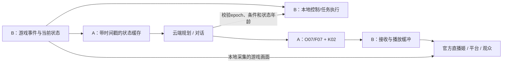

# G01-R1 可行性与成品效果评估

日期：2026-10-29（Asia/Taipei）。评估对象为 [G01-R1实施选型](SELECTION.md)：真实Minecraft Java客户端、自有Fabric桥、Baritone、Neuro核心协议兼容桥、现有DSH/Humanity，以及按需本地Qwen3-VL-4B。

社区复核补充：见 [即时战斗与复杂生存专项](COMMUNITY_COMBAT_SURVIVAL.md)。原评估对现成本地执行层覆盖不足；AltoClef、UnionClef、Meteor等已有可复用代码，基础PvE和生存任务的可行性应据此上调。以下仍属于待实机验证的工程判断。

**结论：有明确的工程实现路径，值得按阶段推进。首个交付目标应当是“能读取真实状态的双模式游戏主播”：人工游玩时陪玩解说，自主模式完成经过验证的基础任务。复杂战斗、开放世界长时间自主生存、持续自然的节目效果，需要后续专项开发与测评。**

本报告属于技术评估，不是运行测评。当前完成了方案选型和组件发布信息核查；Minecraft桥接代码、双模式接管、游戏与女A联合负载、实际直播效果均未验收。表中的“高/中/低”是针对本项目的工程可行性判断，不是模型得分、完成比例或实测成功率。

## 1. 成品能达到的程度

| 编号 | 能力 | 可行性判断 | 合理的成品效果 | 达标依赖与边界 |
|---|---|---|---|---|
| E01 | 持续获取游戏状态 | 高 | 知道玩家血量、饥饿、背包、所在维度、当前目标及已观测事件；能回答“现在缺什么” | 自有Mod尚待实现；数据有时间戳和来源；未加载区域、未打开容器、未同步的服务器信息不当作已知 |
| E02 | 游戏规则与配方问答 | 高，范围有约束 | 根据实际库存解释基础合成、材料不足和工具条件 | 查询当前版本/运行时数据；特殊Mod与服务器自定义机制需要额外适配；不能仅依靠LLM背诵 |
| E03 | 人工游玩、AI解说 | 高 | 你操作同一玩家，她追踪变化、回答弹幕、解释刚才的失败或进展 | 实时状态、事件筛选和对话调度待开发；语音反馈按秒级规划；不逐帧播报每个变化 |
| E04 | AI/人工切换同一角色 | 高，但必须认真验收 | 人工立即接管现有存档、位置和背包，AI继续观察；恢复自主时重新确认当前状态 | B本地仲裁、合成输入释放、Baritone取消、epoch拒绝过期计划；网络断开时也能本地接管 |
| E05 | 自主基础采集与导航 | 高，限已开放技能 | 自己走到已知目标、收集基础材料、执行已支持的合成、返回登记基地，并报告结果 | Baritone提供寻路/采集基础；材料检查、交互、超时、完成验证、失败恢复仍要编写 |
| E06 | 多步骤生存目标 | 中到高，社区任务链可复用 | 优先复用AltoClef类资源依赖、生存与合成流程，再验证受控存档中的连续目标 | 不需要全部从零编写；版本/配套寻路、工作台交互、库存、路径和失败恢复仍须联测 |
| E07 | 快速避险与战斗 | 普通PvE已有明确本地组件；复杂场景待测 | 可复用本地攻击、防御、进食、逃离和环境保命机制，不等待LLM或口播 | 优先验证S01/S03，复杂PvP/Boss及长期生存按场景验收；当前还没有本项目游戏成绩 |
| E08 | 画面内容理解 | 中 | 按需描述建筑大意、当前界面和可辨识文字，补足结构化接口没有提供的外观信息 | 4B量化模型在MC原始帧上的准确率和耗时未知；细小HUD、遮挡、特殊材质需测试；不用于逐帧战斗闭环 |
| E09 | 观众互动与人格连续性 | 现有人格链可复用；游戏语境整合中等难度 | 同一林知夏人格边玩边回复，能把观众建议关联到实际任务 | 规划与口播分轨调度；礼物、突发游戏事件和一般聊天有优先级；单一记忆写入者；不能让旧回复无限排队 |
| E10 | 跨场直播记忆 | 有实现路径，长期可靠性待测 | 记住世界标识、登记基地、未完成目标和已核验经历；下次先核对状态再续玩 | 采用世界任务账本和Humanity摘要；跨日整理、故障恢复尚无本轮游戏证据；聊天记忆不能代替当前游戏事实 |
| E11 | 人物外观与口型 | 现有素材可复用 | 保留女A、K02、O07/F07及48动作，以真人风格人物窗口陪伴游戏 | 现有素材是宿舍通用动作，缺少与游戏输入同步的键鼠手部、视线和身体动作；不能据此承诺完整真人打游戏姿态 |
| E12 | 整场直播可观看性 | 中，取决于内容和媒体调度 | 受控采集/建造挑战、观众投票和人工接管，能够形成有目标、有进展、有反馈的节目 | 需要任务面板、少重复口播、停顿处理、音画时间对齐及长期连续性测评；安装组件本身不能证明观众愿意持续观看 |

首批自主技能仍以选型文件的六项为准：移动到已知目标、采集基础资源、基础合成、使用已确认物品、返回登记基地、取消任务。E07中提到的具体避险动作仅在单独实现和通过测试后开放，不作为当前已经具备的技能。

### 1.1 两种模式的直观体验

**人工模式更适合先形成稳定节目。** 你负责探索、战斗和建筑，她根据真实状态做陪玩解说、回复观众、提示材料与目标。相比纯聊天人物，游戏话题有了可核对的现场依据；操作水平由玩家掌握。

**自主模式适合先做范围明确的任务直播。** 例如观众在几个可行目标中投票，她选择路径、采集材料、解释遇到的问题，再回到基地交差。它有机会形成“观众出题、AI执行、过程吐槽”的节目。具体笑点、重复率和行为自然度仍要人工观片评价。

自主模式初期可能出现路线机械、目标选择保守、遇到未覆盖条件时停止重规划等现象。建议首场内容以少量清楚的小目标组织，让进展、失败和接管都有可见反馈；无限漫游不是可观看性的验收标准。

## 2. 为什么这条路线可行

### 2.1 寻路有成熟基础，任务闭环需要补开发

Baritone官方发布提供与Minecraft 1.21/1.21.1对应的1.11.3版本，文档包含导航、采矿、路标和取消命令。因此基础动作有可复用基础，不必让LLM逐次决定每个按键。[官方发布](https://github.com/cabaletta/baritone/releases/tag/v1.11.3)、[命令文档](https://github.com/cabaletta/baritone/blob/1.21.4/USAGE.md)。命令文档所用分支是功能参考，具体API仍需对所选1.11.3二进制联测。

本项目仍须实现任务前置检查、实际库存操作、交互确认、超时、结果核对和接管。比如“合成木镐”除了知道配方，还需要确认材料和工作台、处理界面、确认合成产物进入库存。收到导航/执行请求不等于目标已经完成。

### 2.2 结构化感知与本地控制适合Minecraft

真实客户端Mod可以围绕实际游戏状态与事件建立适配器；读取游戏对象时应在正确游戏线程形成快照，再异步传输，避免网络或LLM等待阻塞游戏tick。高频状态进入缓存与本地控制，重要变化再整理给LLM。

AIRI当前Minecraft集成采用感知、反射、意识和动作分层，且官方文档说明其Mineflayer运行时处于计划迁移到Fabric的路径上。这是本选型的架构参考，不能解释成该社区已经交付了可直接替换本项目的完整Fabric版。[AIRI集成说明](https://github.com/moeru-ai/airi/blob/main/integrations/minecraft/README.md)。

### 2.3 Neuro提供接入参考，主播能力由本项目实现

Neuro公开SDK说明游戏通过WebSocket API接入，并提供引擎SDK；采用其核心消息结构有利于规范上下文和动作交换。这不提供本项目可直接运行的完整Neuro人格、记忆和游戏能力。[官方SDK](https://github.com/VedalAI/neuro-sdk)。

官方最佳实践建议使用有意义的事件而非不断发送微小位置更新，并要求尽早返回动作校验结果。对应到本项目，要另外保留任务真实生命周期：accepted、running、succeeded、failed、cancelled，避免把协议层“已接受”说成游戏内“已完成”。[官方接入建议](https://github.com/VedalAI/neuro-sdk/blob/main/API/BEST_PRACTICES.md)。

## 3. 当前证据与缺口

| 项目 | 已有依据 | 不能据此推导的结论 |
|---|---|---|
| 女A/K02/O07/F07媒体基础 | 3080原生版五段官方源本地播放验收与采样 | 4090游戏联合负载已通过、人物独立新帧率或主观口型质量已量化 |
| DSH对话与记忆入口 | 现有host工具为stream_memory_propose、stream_memory_recall；已有真实云端上下文用例 | 现有LLM已会调游戏工具、能返回正确游戏计划 |
| 双模式设计 | 同一真实客户端、本地仲裁与epoch方案已写入选型 | 输入抢占、旧任务取消、断线接管已经通过实机测试 |
| 组件版本 | 有对应发布页和文件元数据，详见SELECTION.md | Fabric、Baritone、自有桥和图形环境一起启动一定兼容 |
| 本地视觉 | Qwen官方GGUF文件存在；llama.cpp有图像输入接口 | 所选量化文件在本机CUDA构建上的速度和MC画面识别精度已测 |
| 持久记忆 | 现有DSH/Humanity可作为唯一记忆写入入口 | 世界切换、跨日压缩、断电恢复和长期事实一致性已经验收 |
| 平台直播 | 现有接收器和官方直播姬接入方案 | 本轮已验证真实弹幕/礼物、公开推流与观众CDN时延 |

本地源码依据：[host.mjs](../../../backend/dsh-bridge/host.mjs)。现有host主提示要求输出适合口播的最终文本，不能把JSON游戏计划混进口播。接入时需增加独立、经过校验的游戏工具/规划结果通道，同时保留现有口播和播放回执约束。

4090分支的K02激活和远端清理仍处于原有待处理状态。因此游戏开发前还需要恢复并确认A4090人物/声音基线；3080测试结果不能代替这一项。

## 4. 实时性：四种时间必须分别评估

| 时间 | 希望解决的问题 | 工程起点 / 证据 | 实际含义 |
|---|---|---|---|
| 本地控制响应 | 接管、取消、已实现规则能否及时生效 | 依赖B本地游戏线程和仲裁器，未实测 | 不经过LLM和TTS；不能由开口速度推导 |
| 游戏状态新鲜度 | A理解的是否还是当前状态 | 本地采样10–20Hz、B→A增量5Hz、关键事件立即推送；状态通道P95≤500ms为目标 | 频率和阈值均为待验收目标；高频缓存不等于高频调用LLM |
| 规划结果耗时 | 多久决定一个新目标或解释一件事 | 云端响应、排队、工具查询与计划验证均需游戏实测 | 规划时延不应让已在执行的本地技能卡住 |
| 观众听到回复 | 事件发生后多久实际听到声音 | 现有3080五用例本地首播5.027–8.133秒；游戏版及观众端未测 | 包含相应请求链路与播放等待；平台CDN还有额外延迟 |

现有 [3080原生验收报告](../native-rtx3080-k02-20261029/README.md) 的TTS耗时为2.157–2.640秒，音频长2.830–4.720秒；整句播完为8.565–12.589秒。其中只有S05明确覆盖一次真实云端上下文调用，其他用例主要是直接口播或本地路由，不能把整个区间当作普遍的完整LLM回复延迟。

这些历史数字来自3080全链路推理、特定五句文本和约0.3秒状态轮询。既不是本次游戏实测，也不是4090预测成绩。现有接收链有约4秒目标播放缓冲，实际开口等待还受队列、音频就绪和人物供帧影响。

**对成品的影响：游戏可以持续操作，但她对突发事件的语音评价可能在数秒后出现。** 目前应按秒级反馈设计用语，例如“刚才那只怪把我吓到了”，不承诺与游戏受击同帧惊叫。云端LLM、TTS、人物和平台构成的是多段时延链，TTS不是唯一可能的瓶颈。

### 4.1 必须做的调度

- B的已实现技能独立运行；本地接管、取消和失联处理不等待云端。
- 规划请求带world_id、control_epoch、状态版本和前置条件。收到结果时重新校验，丢弃旧世界、旧模式或过期计划。
- 口播候选记录触发事件、事件时间、重要性、可播截止时间和所依据状态；过期提醒丢弃或改写为回顾，避免播出已经失真的库存/危险提示。
- 合并重复事件，抑制“每掉一点血就说一句”等口播洪水；游戏目标和观众对话使用独立任务队列，记忆仍由唯一权威写入者处理。
- 主播媒体和B本地游戏画面绑定可核对时间线。若测出明显错位，再评估观众输出侧的有限缓冲；人工操作预览不随之延迟。固定延迟不能消除可变的LLM/TTS等待。
- 语音切句、优先级和缓冲调整需要重新测试自然度及欠载，不能仅把缓冲调低就宣称延迟已解决。

A/B单向时间只有在校时并记录误差后才有意义；不同机器的单调时钟不能直接相减。先记录各进程内部耗时与网络RTT，再报告带误差说明的跨机事件年龄。时延分析按实际关键路径计算，不能简单相加各阶段平均值。

## 5. 硬件与原生部署判断

| 设备 | 拟运行内容 | 容量/性能判断 | 必须采集的指标 |
|---|---|---|---|
| A4090，48GB显存、64GB内存 | K02人物、O07主用/F07备用、DSH、云端调用调度、按需本地视觉 | 容量配置有利，具有尝试联合运行的合理依据；GPU计算、显存带宽、上下文缓存仍可能竞争 | 各进程及整卡显存、GPU利用率、TTS/人物阶段耗时、VLM排队、接收端欠载、系统RAM |
| B3080，10GB显存、64GB内存 | MC真实客户端、集成单人服务器、Fabric/Baritone、本地执行器、女A接收器、官方直播姬 | 去掉人物/TTS推理后职责合理；游戏CPU帧时间、区块生成、捕获编码和实际GPU占用待测 | 游戏平均/低分位帧率、帧时间尖峰、游戏TPS/事件积压、编码负载、显存、音频路径 |
| 操作者设备，可选 | Moonlight、管理网页 | 操作者不在B时提供画面与输入；需要另验虚拟组网质量 | RTT、抖动、输入体验、串流丢帧、额外编码负载和音频设备变化 |

Minecraft以独立新存档、1080p、60FPS上限、8区块视距、6区块模拟距离、Java堆上限6GiB开始试验。这些是实施起点，不是已测性能；尚未核实两台机器的CPU及存储表现，不能仅凭显卡型号保证60FPS。

现有3080五用例的整卡显存采样峰值8027MiB、整机RAM峰值10.846GiB，只证明该次人物链在batch4下运行通过。它不包含Minecraft，也不能用于精确估算B端游戏剩余显存或按比例预测4090表现。

视觉选型的Q4_K_M主模型约2.50GB，F16投影约836MB，合计约3.34GB模型文件。[Qwen官方文件](https://huggingface.co/Qwen/Qwen3-VL-4B-Instruct-GGUF/tree/main)。文件大小不等于GPU运行占用。Qwen模型卡描述了图像/UI等能力，[模型说明](https://huggingface.co/Qwen/Qwen3-VL-4B-Instruct)；MC细节、量化精度及联合负载效果需另测。llama.cpp提供带mmproj的本地图像接口，[官方接口文档](https://github.com/ggml-org/llama.cpp/blob/master/docs/multimodal.md)；具体Windows CUDA构建尚未冻结。

首轮视觉请求并发为1、按需触发；0.5–1帧/秒仅作为采样上限试验。即使显存够用，连续视觉推理也可能使人物或语音卡顿，实际调度首先保证人物/声音连续。B端不加载女A/TTS模型，A/B不同时启动各自完整人物推理版。

所有组件均沿Windows原生Java/Python/Node/CUDA路径实施，符合不使用Docker、WSL和虚拟机的约束。

## 6. 最终画面和节目效果的实际限制

### 6.1 保留竖屏，需要重新安排游戏信息

如果1920×1080的游戏帧保持完整比例缩至720像素宽，高度为405像素。现有720×1280竖屏中能放下完整游戏视野，但原生HUD和物品文字会变小；“完整显示”不代表手机端可读。

建议保留完整游戏区域，并在额外面板放大当前目标、材料进度、血量/危险提示和操作模式。人物可使用现有真人素材窗口；关键字幕不能压住游戏准星、容器菜单或观众需要看的位置。具体占比应以本地录像和手机实际尺寸审核。

### 6.2 真人风格人物可以保留，游戏动作同步有边界

现有素材能保持人物身份、宿舍背景、口型和通用动作。它们不会自动变成“她的手正在按键、眼睛正在看怪物、身体正在跟游戏动作同步”。首版更合理的视觉定位是游戏旁的真人风格陪玩主播。

通过事件选择合适的既有动作、保持讲话/聆听/思考状态一致，可以改善表演连续性；当前没有手部游戏动作同步的验证证据。游戏功能接入不意味着人物生成质量自动提高。

### 6.3 可观看性依赖内容组织

每段节目需要明确目标、可见进度、完成反馈和失败解释。观众建议应进入任务筛选，避免每条弹幕都立即改写当前计划。预先准备多个已验证的小目标，遇到卡住时解释原因、换目标或交还人工控制，比持续无反馈重试更有利于观看。

对已有Neuro风格主播的相似程度，只能说能构建“人格化对话＋游戏信息＋执行动作＋观众互动”的同类能力组合。没有同场任务、同一延迟与观众评价数据，无法给出“达到Neuro多少百分比”的结论。

## 7. 主要工程工作与失败条件

| 工作包 | 难度判断 | 主要待实现项 | 会直接损害成品的失败方式 |
|---|---|---|---|
| W01 原生实例与Fabric状态桥 | 中到高 | 锁定版本、游戏线程快照、事件、世界与会话标识、重连快照 | 读旧存档、区块更新阻塞、状态字段有值但不新鲜 |
| W02 技能与输入仲裁 | 高 | Baritone API封装、库存/界面交互、任务租约、取消与epoch | 人工被抢按键、旧计划重放、任务无限循环 |
| W03 DSH游戏工具与规则查询 | 高 | 固定工具Schema、云端工具兼容、前置/后置条件、规划和口播分流 | 把计划当完成、只会聊天不会执行、JSON被直接朗读 |
| W04 本地视觉 | 中到高 | Windows CUDA构建、图像接口、裁图、时间戳、未知结果、并发限制 | 细字误识别、旧帧当现场、抢占人物计算 |
| W05 媒体合成与直播调度 | 中到高 | 竖屏布局、游戏与人物音视频时间线、音量/重复采集、过期口播 | 游戏流畅但她慢半拍、声音叠加、手机看不清、画面/语音卡顿 |
| W06 世界账本与长期运行 | 中到高 | 世界分区、任务检查点、摘要压缩、异常重启、唯一写入者 | 换世界记错基地、下播丢目标、记忆冲突、重启重复执行 |

这是一项有复用基础的定制集成工程。版本发布信息可降低试错范围，但主要工作仍集中在游戏适配、接管和真实任务闭环。更换更大LLM不能代替这些工作。

## 8. 实施与验收门槛

以下是后续工作顺序与验收要求，均未在本轮执行。不以任意百分比作为当前完成度。

| 门槛 | 验收内容 | 需要保留的证据 |
|---|---|---|
| R0 人物与硬件基线 | A4090先确认K02/O07/F07原生运行；B按接收端启动；记录CPU/GPU/网络与锁定构建 | 设备分支与部署校验、空载/口播采样、官方源播放回执 |
| R1 只读游戏理解 | 独立1.21.1新存档；库存、血量、界面和规则问答正确；旧状态明确失效 | 固定问答清单、原始游戏状态、时间戳/RTT、已知/未知示例 |
| R2 人工陪玩 | 你玩、她解说；事件可追溯、口播不会持续落后成队列；管理员私聊不误播 | 事件到首播时间线、官方源录像、过期候选处理记录 |
| R3 六项技能与接管 | 每项技能在预定义正常/失败场景验证；至少20次双向切换，无合成输入残留、无过期计划执行 | 任务前置/后置状态、取消日志、epoch、成功和失败录像；报告样本数与实际成功率 |
| R4 视觉与联合负载 | 针对建筑、菜单、可辨文字和未知内容核对原帧；连续运行30–60分钟 | VLM准确/错误案例、推理耗时、游戏帧时间、人物连续性、音频欠载和占用曲线 |
| R5 本地直播姬与世界恢复 | 游戏/人物/弹幕面板在竖屏可读；音频仅采一次；下播重启能核对世界和恢复目标 | 本地录制、手机尺寸截图、混音路径、前后世界账本与唯一记忆写入证据 |
| R6 真实平台与长期运行 | 本地通过后单独验证真实弹幕/礼物、公开状态一致性、观众CDN、跨日摘要和故障恢复 | 平台事件原始时间、观众端实录、跨场运行记录；未经验证不并入本地通过结论 |

R1–R5通过后，才有依据称“G01-R1双模式本地游戏直播版可用”。R6决定真实开播与长期运维可靠性。30–60分钟联合测试只是首轮连续性门槛，不能代替数小时或跨日稳定性。

首场录像应至少覆盖：人工探索与提问、自主基础采集、材料不足/路径失败、人工中途接管、重连或下播重启。效果审核同时看事实正确性、任务闭环、输入交接、声音连续、回应时序、手机可读性和口播重复程度。

## 9. 最终建议

维持G01-R1选型。先交付“人工陪玩可靠、六项自主技能可验证、同一角色可接管”的版本，再逐项扩大自主能力。视觉作为补充，不挡住结构化游戏理解和基础动作闭环；危险控制保留在本地。

最合理的近期成品是：林知夏能够理解当前MC场景中的实际状态，陪你玩、解释进度、与观众互动，并在自主模式完成范围明确的任务。更高程度的自然反应、长时间自主策略和演出感染力，要以之后的实机录像与真实直播数据评估。

本轮只增加评估文档与导航引用；未新增模型下载、远程控制、游戏安装、生产配置变更或公开开播，未修改任何历史测评数据。

## 10. 资料索引

- [实施选型与版本元数据](SELECTION.md)、[详细架构与T01–T12用例](README.md)、[结构化选型记录](selection.json)
- [现有3080五用例原始报告](../native-rtx3080-k02-20261029/README.md)
- [Baritone官方发布](https://github.com/cabaletta/baritone/releases/tag/v1.11.3)、[使用文档](https://github.com/cabaletta/baritone/blob/1.21.4/USAGE.md)
- [Neuro官方SDK](https://github.com/VedalAI/neuro-sdk)、[接入最佳实践](https://github.com/VedalAI/neuro-sdk/blob/main/API/BEST_PRACTICES.md)
- [AIRI官方Minecraft集成](https://github.com/moeru-ai/airi/blob/main/integrations/minecraft/README.md)
- [Qwen模型卡](https://huggingface.co/Qwen/Qwen3-VL-4B-Instruct)、[官方GGUF文件](https://huggingface.co/Qwen/Qwen3-VL-4B-Instruct-GGUF/tree/main)
- [llama.cpp多模态接口](https://github.com/ggml-org/llama.cpp/blob/master/docs/multimodal.md)

English: This is an engineering feasibility assessment, not a game benchmark. The selected stack has a plausible implementation path for same-player manual commentary and bounded autonomous tasks. Minecraft integration, local control handover, combined GPU load, platform delivery, and cross-day memory remain unverified. Existing RTX3080 media measurements must not be presented as RTX4090 game-streaming results.
