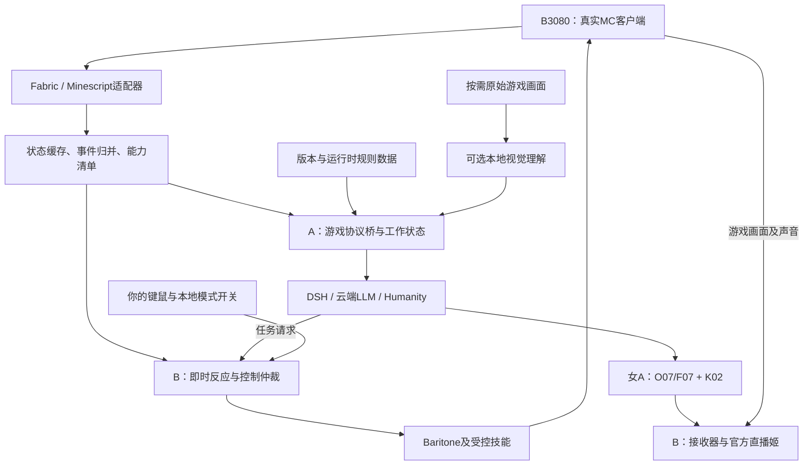

# 女A游戏直播：Neuro 生态参考与实时游戏理解设计

日期：2026-10-29（Asia/Taipei）。状态：研究与接入设计，未部署、未执行游戏测评。

具体选型已收束为 **G01-R1**：见 [实施选型决定](SELECTION.md) 与 [结构化选型记录](selection.json)。正式接入采用自有Fabric桥接，Minescript作为诊断工具；视觉补充选定Qwen3-VL-4B。下文保留前置研究与接口约束。

落地把握、成品效果、时延/资源边界和验收门槛见 [可行性与成品效果评估](FEASIBILITY.md)；该评估不表示已完成游戏实测。

即时战斗与复杂生存已补充 [社区专项复核](COMMUNITY_COMBAT_SURVIVAL.md)：S01–S16涵盖本地任务链、战斗插件与动作模型；当前优先验证MiranCZ AltoClef的1.21.1分支。该建议尚未转为已部署配置。

本设计补充用户的新要求：女A在“AI自主游玩”和“人工游玩、AI解说”两种模式中，都持续获取当前游戏的信息、内容、规则与动作结果。本文的频率、延迟、验收阈值均为建议目标，不是实测成绩。

## 1. 推荐路线与当前边界

推荐在上一轮 G01 上增加游戏理解层：真实 Minecraft Java 客户端 + Fabric/Minescript 状态适配器 + Baritone/受控技能执行器 + Neuro 风格游戏协议桥 + 现有 DSH/Humanity。

继续使用女A/林知夏、原白天宿舍素材、48动作库、K02、O07主用与F07备用；游戏感知不要求替换现有人物或TTS。结构化状态、规则数据和云端文本LLM组成的首版，可以不增加本地AI模型权重。画面理解作为后续按需能力单独评估。

两台设备按职责分工：A4090承担人物、语音、人格与高层规划；B3080承担真实游戏客户端、本地即时控制、媒体接收与官方直播姬。这里的B3080是接收端角色，不能套用3080全链路推理分支的启动配置。所有服务使用原生Windows/Java/Python/Node；不使用Docker、WSL或虚拟机。

当前工程还没有完成游戏接入：backend/dsh-bridge/host.mjs 的 LIVE_TOOLS 只有 stream_memory_propose 和 stream_memory_recall。游戏工具、状态通道、控制仲裁、游戏画面合成与端到端测试都属于待实现项。当前4090远端控制继续遵循原有暂停状态，本文不表示远端部署已经发生。

## 2. 已核实的社区参考

此处的“参考”区分接入协议、游戏代理、测试器与主播交互框架。它们不等同于Neuro-sama完整生产后端。

| 编号 | 项目与一手来源 | 可参考的已公开内容 | 本项目的用法与边界 |
|---|---|---|---|
| N01 | [VedalAI/neuro-sdk](https://github.com/VedalAI/neuro-sdk) | 游戏上下文、动作注册及回执的WebSocket协议；Unity/Godot SDK | 将其作为跨游戏接口参考。仓库不是可直接启动的完整主播大脑；高频动作仍需本地控制 |
| N02 | [AIRI Minecraft](https://github.com/moeru-ai/airi/blob/main/integrations/minecraft/README.md) | 感知、反应、推理、执行的分层设计；当前运行时基于Mineflayer | 借鉴事件和任务架构。文档声明计划迁移Fabric，不能据此认定迁移已完成；紧急战斗等仍列为未来增强 |
| N03 | [TypeScript Neuro Game API](https://github.com/KTrain5169/typescript-neuro-game-api) | Neuro协议服务端实现 | 与现有Node侧桥接较接近；需核对协议版本，其README说明尚未处理新版语音API |
| N04 | [CoolCat467/Neuro-API](https://github.com/CoolCat467/Neuro-API) | Python侧SDK，官方索引同时列出其服务端入口 | 可用于Python桥接或协议互通验证；SDK不自动提供游戏状态提取能力 |
| N05 | [Gaming Gary](https://github.com/Govorunb/gary) 与 [Randy](https://github.com/VedalAI/neuro-sdk/tree/main/Randy) | 手工、随机与LLM驱动的协议联调 | 验证动作Schema和消息交互；Gary不实际合成语音，其speech_finished不能当作本项目真实播放完成 |
| N06 | [Open-LLM-VTuber](https://github.com/Open-LLM-VTuber/Open-LLM-VTuber) | 屏幕/摄像头输入、语音交互和打断、模块化Agent接口 | 借鉴观察与会话调度。屏幕感知不自动带来精确配方、背包或自主游玩能力 |
| N07 | [VedalAI/neuro-hollow-knight](https://github.com/VedalAI/neuro-hollow-knight) | 特定游戏的Mod接入与房间可达性处理 | 证明多游戏需要各自适配；不能把某款游戏的适配器直接应用到MC |
| N08 | [Minescript](https://minescript.net/docs) 与 [Baritone](https://github.com/cabaletta/baritone) | 读取本地玩家数据、脚本输入和客户端寻路API | MC真实客户端的状态与操作基础。还需版本匹配、桥接与可取消技能 |
| N09 | [minecraft-data](https://github.com/PrismarineJS/minecraft-data) | 按版本提供物品、方块、配方、食物、实体等资料 | 作为基础规则来源。当前服务器/Mod/数据包的实际规则优先于静态原版资料 |

旧 [airi-minecraft](https://github.com/moeru-ai/airi-minecraft) 已归档；检索与评估应以主仓库 integrations/minecraft 为准。AIRI的感知管线与任务执行代码也已抽查：[pipeline.ts](https://github.com/moeru-ai/airi/blob/main/integrations/minecraft/src/cognitive/perception/pipeline.ts)、[task-executor.ts](https://github.com/moeru-ai/airi/blob/main/integrations/minecraft/src/cognitive/action/task-executor.ts)、[task-state.ts](https://github.com/moeru-ai/airi/blob/main/integrations/minecraft/src/cognitive/conscious/task-state.ts)。分层代码和取消标记是接入参考，不能替代对每一种持续动作实际停止能力的测试。

## 3. 从Neuro公开接口中采用的设计

依据：[协议规范](https://github.com/VedalAI/neuro-sdk/blob/main/API/SPECIFICATION.md)、[集成最佳实践](https://github.com/VedalAI/neuro-sdk/blob/main/API/BEST_PRACTICES.md)、[动作竞态说明](https://github.com/VedalAI/neuro-sdk/blob/main/API/README.md)。以下为针对本项目的实现约束，不是对Neuro内部模型或记忆策略的推断。

1. 游戏主动提供有意义的上下文与可执行动作；后台实现自己的协议服务端并接现有云端LLM。
2. 原始高频状态保留在游戏侧与状态缓存；提交给LLM的是相关事件和当前任务摘要。
3. 基础规则在进入游戏时加载；换关卡、世界、版本或规则包时刷新相关内容。
4. 使用稳定、清晰的动作名称和参数；执行前重新检查当前世界、模式、物品与目标条件。
5. 参数验证/接收回执与真实动作完成分开记录。寻路已被接受，不等于人物已到达。
6. 紧急本地反应不等待口播结束。人工模式中本地反应只提示，不夺取人的控制权。

官方协议中的 context(silent)、actions/register、actions/force、action/result 可映射到本工程的状态、决策和回执链路。其 action/result 建议在验证后尽快返回，因此接收确认必须在文案中明确标成“已接收”，真实完成通过后续任务事件与状态复核确认。

同一连接内最多保留一个待处理的强制决策窗口，避免重复动作和死锁；动作ID需去重。SDK服务端、游戏客户端SDK和我们的DSH适配器是三个角色，安装一个游戏端SDK不会自动得到主播后端。

## 4. 女A应该获得的五类信息

| 层次 | 具体内容 | 主要来源 | 必须处理的缺口 |
|---|---|---|---|
| 实时状态 | 世界/维度、位置、朝向、血量、饥饿、氧气、状态效果、背包、快捷栏、当前界面、指向目标 | 客户端Mod；Minescript已有接口；缺失字段用Fabric桥接 | 不能假设每个字段都由Minescript直接提供；缺失用unknown/null及原因表示 |
| 环境与事件 | 已加载区域、附近实体、时间天气、受伤、死亡、拾取、成就、容器交互、聊天 | 游戏事件与已知区域状态 | 没有伤害来源时不能把受伤原因编成某只怪物；客户端不知道的状态不填假值 |
| 画面与声音 | 当前实际游戏窗口、可见建筑/外观、菜单文字；可选队友语音 | 原始游戏画面、游戏事件、按需OCR/视觉、可选本地ASR | 视觉结论保留时间和置信度；不把直播合成画面中的女A/弹幕误认成游戏对象 |
| 规则与逻辑 | 版本/Mod/数据包、配方、工具要求、物品效果、前置条件、当前可选操作 | 运行时可同步规则、版本匹配静态资料、技能条件检查 | 任意商业游戏的所有内部逻辑不能由截图自动完整恢复；当前服务器未暴露的规则需额外适配 |
| 任务与经历 | 目标、已完成步骤、失败原因、基地/路线、最近关键事件 | 任务账本、动作回执、按世界分区的记忆 | 意图、动作接受、游戏结果与实际播报完成是不同事实 |

感知范围以当前客户端实际已知数据为边界。附近实体可以由客户端读取，但不应说自己已经看见不在视野内的实体；字段应分别标记client_known、visible或remembered。历史坐标、箱子内容和目标生物都需要观测时间，不能永久当成当前状态。

## 5. 端到端结构



游戏态持续更新与LLM请求分开：状态缓存可每秒更新多次，不代表每次都调用云端。LLM始终使用最新摘要，并可调用只读查询获取背包、目标、配方等细节。

第一阶段用结构化数据处理位置、资源、任务和大部分游戏逻辑；遇到外观、建筑风格、未适配UI时再请求视觉补充。现有云端渠道的图片输入没有在本轮验证，不能默认已支持。可选视觉模型也没有在本轮下载、加载或验证。

## 6. 数据新鲜度与事件调度

以下是初始工程预算，需用真实两台机器和实际世界验证后调整。

| 通道 | 建议起点 | 目的 |
|---|---|---|
| 游戏侧观察与即时规则 | 与本地游戏tick挂接，目标约10–20次/秒，受实际TPS影响 | 保持本地操作与危险判断及时 |
| B到A状态增量 | 约2–5次/秒；关键变化另发事件 | 保持工作状态新鲜，不将每个坐标更新送给LLM |
| 完整快照 | 启动、重连、序号缺口、换世界时立即发送；稳定时低频补全 | 恢复一致性 |
| 心跳 | 约1次/秒 | 区分没有新事件与已经失联 |
| 高层规划 | 事件、任务边界或超时触发；合并正在等待的普通更新 | 控制并发与费用，避免旧规划排队 |
| 游戏画面理解 | 先按需或约0.5–1帧/秒试验 | 外观/UI补充；不承担近距离战斗控制 |

状态传输与归并可先以P95不超过500ms为目标，紧急游戏动作由B本地处理；这不包含云端推理、TTS和观众CDN时间。需要同时记录采集、发送、接收、推理、动作接收和执行确认时间。

两个设备的单调时钟不能直接相减。先记录各进程内单调耗时及往返时间，校准墙钟并报告误差后再估计跨机单向延迟。不能把RTT的一半直接当成已测单向延迟。

每个状态包包含世界会话ID、连接代数、递增序号、来源、采集时间与字段能力。重复包忽略，缺口请求全量；换世界或重启游戏生成新会话，旧世界事件不能污染新世界。

初版可将超过2秒无有效更新标为stale。失去新鲜状态时，阻止新的自动游戏任务，并让B的本地看门狗取消持续操作；主播可以说明暂时无法确认当前游戏状态，不能继续使用旧血量或旧背包回答。

事件采用“紧急状态 > 当前任务阻塞/完成 > 相关观众问题 > 普通探索变化”的顺序。重复受伤、连续坐标和大量拾取可归并，但保留严重程度、首末时间与总变化。任务相关物品或一次性成就应单独保留。

## 7. 规则与内容理解

在进入世界时建立规则指纹：游戏版本、Mod清单、已知数据包/配方版本，以及适配器能力版本。无法读取的数据包内容标记为未知；不要仅因为客户端加载了Mod就宣称掌握服务端所有规则。

规则查找顺序为：当前运行时实际返回内容 → 对应Mod的已适配规则 → 版本匹配的基础资料 → LLM提出的待验证假设。静态资料提供基础知识，执行器验证实际可行性。

建议提供game_get_recipe、game_check_action、game_query_inventory等只读工具。回答“为什么不能做铁镐”时，返回实际缺少的材料、工作台条件或未满足的前置条件；不能只依靠LLM记忆。服务端未提供充分信息时，返回unknown并附可做的下一项检查。

客户端读取方块、物品和实体时保留命名空间ID，并附本地化名称。自定义物品不能只按相似名字归类为原版物品；规则缓存按规则指纹失效，重进世界后重新确认动态数据。

持续动作的规划应结合实际成本：距离、路径可达性、工具耐久、库存空间、现有资源和局部危险。它们由适配器/技能查询计算，再交给LLM决定目标；纯语言判断不能替代碰撞检测和库存核对。

## 8. 双模式与即时控制

| 模式 | 感知与规则查询 | 自动游戏输入 | 口播与观众互动 |
|---|---|---|---|
| AUTO | 持续运行 | 允许本地技能执行；紧急规则优先于高层目标 | 根据任务、事件和弹幕安排 |
| MANUAL_COMMENTARY | 持续运行，观察同一玩家与画面 | 全部停止；包括自动避险也只提示 | 解说人的实际行为，回答当前世界问题 |
| PAUSED | 可以保留低频状态与连接诊断 | 停止、释放按键与持续技能 | 游戏主动解说暂停，其他口播按导播设置 |

AUTO切人工：B本地先提升control_epoch，禁止旧epoch任务启动，取消Baritone/挖掘/建造等持续动作，释放所有合成输入，然后确认输入已释放。模式确认不能仅依赖A端网页显示。云端迟到的规划仍可记录，但不能重新操作游戏。

人工切AUTO：读取新快照，确认界面、世界、血量、库存与执行器空闲，再决定是否续接原目标。上一条目标可以保留为候选，持续按键和旧路径不能原样恢复。

本地即时控制先覆盖可验证的有限行为，例如终止危险路径、停止无效挖掘、持续动作超时退出。进食、避险、战斗等技能按逐项验收结果启用。不能因AIRI文档列出了Reflex层，就认定已有可靠的所有生存反应。

## 9. 内部接口示例与任务结果

以下是本工程拟定的内部JSON示例，所有数值均为虚构，不是录制的游戏数据，也不是Neuro官方协议字段。Neuro兼容端点只按其公开规范传输；本工程扩展使用独立内部通道，不宣称第三方服务能自动识别。

```json
{
  "schema_version": 1,
  "adapter": "minecraft.fabric",
  "world_session_id": "example-world-session",
  "connection_generation": 2,
  "seq": 1042,
  "control_epoch": 7,
  "mode": "MANUAL_COMMENTARY",
  "source": "client_mod",
  "game_version": "detected-at-runtime",
  "capture_to_emit_ms": 8,
  "player": {
    "health": 8,
    "max_health": 20,
    "food": 12,
    "dimension": "minecraft:overworld"
  },
  "inventory": {
    "minecraft:oak_log": 3,
    "minecraft:apple": 1
  },
  "screen": "gameplay",
  "observation_scope": "client_known",
  "unknown_fields": ["unloaded_region", "unopened_container_contents"]
}
```

拟新增的只读工具：game_get_state、game_get_recent_events、game_query_inventory、game_get_recipe、game_check_action、game_get_task。按需画面查询另设game_request_observation；不把原始图片塞入普通文本context。

拟新增的执行工具：game_start_task、game_cancel_task。任务内通过固定技能完成navigate、gather、craft、use_item等动作。长期动作返回task_id，状态分为accepted、running、succeeded、failed、cancelled；每次变化附实际结果和证据序号。

任务请求应携带world_session_id、control_epoch、request_id、依据的观测序号、有效期和必要前置条件。执行器在B端用本地时间处理请求有效期，再核对实际状态；不能用A的单调时钟值直接判断是否过期。

同一玩家同一时刻只有一条有权写入游戏输入的控制链。任务重复提交复用结果，不重复制作或丢弃物品。若请求被接受后连接中断，重连先查询task_id和实际状态，不能简单重发所有动作。

只有以下证据之一满足时才能播报“完成”：到达目标的状态确认；库存/合成/拾取事件能与任务关联；执行器结束且结果由当前游戏状态验证。仅参数正确、HTTP成功或LLM说了“我完成了”，都不够。

## 10. 主播如何边玩边说

游戏规划与口播使用不同任务队列，但共享女A人格和同一持久记忆写入者。读到游戏事件不等于必须发言；普通位移或重复挖掘只更新工作状态，危急状态、失败、成就、目标变化和观众相关内容才进入口播候选。

每条口播候选绑定事件ID、世界会话、发生时间、相关任务及过期策略。生成前读取最新状态，播出前再次核对事实是否仍成立。例如已经吃完苹果，就不要再播放“我现在还没找到吃的”；可改为已经发生的经历，或者丢弃。

游戏视觉输入从实际游戏客户端取样，附窗口、帧ID和时间；避免分析直播姬合成后的女A画面、留言动画与弹幕。视觉模型说“像是岩浆”属于推断，Mod报告对应方块ID则是结构化观测；两者冲突时保留来源与新鲜度。

解说不应抢占游戏执行。按需视觉推理也不能阻塞人物/TTS的实时预算；实施时限制并发、按场景变化抽样并测量GPU占用。第一版没有必要为每个游戏帧运行视觉大模型。

现有 [3080原生验收](../native-rtx3080-k02-20261029/README.md) 的五段短句首播为5.027–8.133秒，包含媒体准备及缓冲，未包含观众CDN。它只提供已有链路的时序背景，不能当成新增游戏方案的测试结果。

严格的观众画面/解说同步，需要游戏事件和人物媒体的时间线对齐；可考虑在观众输出侧缓冲游戏画面。用户操作的本地游戏画面保持即时。官方直播姬的具体延迟/混音能力需实际核实，本文不宣称已有可用开关。

Neuro协议的speech_finished若由本项目发出，必须基于已有官方源真实播放回执，并正确标记尾段与取消；不能在LLM文本生成或TTS返回时提前宣告播完。Gary的文本联调不能验证这一点。

## 11. 记忆、下播整理与恢复

将游戏工作状态、任务账本和人格长期记忆分开。高频位置、血量和短时视觉描述放入有界内存缓存；世界相关事实放入按world_id/维度划分的账本；有叙事价值的经历由Humanity候选流程提炼。

例如，基地位置、命名宠物、首次进入下界、与观众共同决定的长期目标可以成为记忆候选。临时饥饿值、每一次挥镐和不确定的视觉判断通常不进入长期记忆。观众提议与游戏事实分别标记来源。

切换AUTO与MANUAL_COMMENTARY不更换人格或长期记忆分区。不同世界的基地坐标和任务不能互相覆盖。服务器没有提供稳定世界ID时，由本地安装/服务器标识与操作者确认的存档标签组成命名空间，不能靠世界显示名称唯一识别。

下播流程拟定为：停止新任务 → 在B端取消持续操作并确认 → 保存末次新鲜快照和任务终态 → 归档本场事件摘要 → 提交记忆候选 → 用既有唯一写入者执行压缩/合并。长时整理可异步，但不能同时运行另一份对相同SQLite的写入者。

规则资料属于可重建缓存，游戏完成记录属于事实账本，人物感受/关系属于人格记忆。三个层次各自保留来源，不把LLM反思直接改写成已经发生的游戏事实。

已有跨日压缩、额度耗尽恢复等维护项尚未在当前游戏设计中验收；本提案不把这些历史待办改成已解决。既有音视频及测评数据不因新增游戏缓存而自动删除。

## 12. 代码接入与后台内容

以下均是建议的新模块职责，尚未创建实现文件：

| 模块 | 责任 | 接入约束 |
|---|---|---|
| game-adapters/minecraft | 状态、事件、能力清单和版本规则读取 | 绑定真实客户端；API缺口由Fabric桥补全 |
| game-state | 快照、增量、去重、失联与事件归并 | 高频数据不直接刷入对话历史 |
| game-protocol | Neuro协议互通与内部任务状态映射 | 客户端/服务端角色清楚；固定协议版本 |
| game-rules | 配方、条件检查、规则指纹缓存 | 当前运行时数据优先；未知可表达 |
| game-control | 模式、epoch、任务租约、取消与看门狗 | B本地接管优先；人工模式无自动写输入 |
| dsh-game-context | 任务规划上下文、只读工具与事件摘要 | 使用现有渠道兼容层；遵循单一记忆写入者 |
| game-narration | 发言时机、事实绑定、过期取消 | 真实播放完成由官方源回执决定 |
| admin-game | 模式、状态、任务、规则与延迟可视化 | 延用现有免登录后台，不新增应用鉴权流程 |

现有host.mjs把最终回复约束为中文口播，因此机器任务结果不能直接混入这一文本出口。应在桥接层明确区分结构化任务调用、只读查询、私人导播聊天和最终口播。私人消息继续遵循现有“不自动播音”的约定。

后台应能显示：两种模式切换与暂停；实际B端确认的控制权；状态来源及年龄；当前玩家血量/背包/目标；规则版本；当前与排队任务；动作已接收/执行中/完成/失败；最近重要事件；云端、TTS、媒体和游戏各阶段耗时。状态断线要显示unknown或stale，不能继续显示为实时。

## 13. 验收矩阵

本表定义后续测试，不含任何虚构通过结果。

| 编号 | 场景 | 要验证的结果 |
|---|---|---|
| T01 | 人工移动、开背包、拾取与进食 | AI获取的是同一真实玩家最新状态，人工模式没有自动输入 |
| T02 | 查询当前配方与缺少的材料 | 输出依据实际库存与对应规则；未知规则明确返回未知 |
| T03 | 受伤、死亡、复活与换维度 | 事件有序，旧世界/旧生命状态不会用于新回答 |
| T04 | 一个采集/合成/到达任务 | 接受与完成分离；实际状态能证明任务结果 |
| T05 | 自动模式连续切换人工至少20次 | 没有残留按键、旧规划复活、重复物品操作和强制抢回视角 |
| T06 | 断线、丢增量、重连与切换世界 | 看门狗停止自动操作；补全快照；旧任务不会污染新会话 |
| T07 | 人工模式下突发危险 | AI可以提醒，但不注入自动游戏输入 |
| T08 | 同时弹幕、游戏事件、私人导播消息 | 优先级可解释；私人消息不误播，游戏状态不刷满记忆 |
| T09 | 口播生成后状态改变或任务取消 | 过时事实被取消/改写；不会把已接受任务说成已完成 |
| T10 | 自定义物品/未知菜单/视觉与结构化冲突 | 不冒充完整理解；来源、时间、置信度和缺口可检查 |
| T11 | 30–60分钟游戏与女A合成输出 | 记录游戏帧时间、人物连续性、音频欠载、显存/RAM、事件与口播时延 |
| T12 | 下播保存、记忆整理、再次开播 | 人格连续、世界分区正确、未完成任务可解释、数据库只有一个持久写入者 |

统计应分别记录：状态年龄P50/P95/P99、事件丢失与去重数、任务成功/失败/取消、人工接管耗时、LLM首结果、动作启动与确认、TTS耗时、官方源首播、语音长度、游戏帧时间和资源占用。公开直播观众端测量需另列，不能与本地播放混算。

## 14. 实施顺序与分支约束

第一步：真实客户端只读感知与规则查询，完成人工游玩/AI解说。第二步：增加有限可取消技能，验证AUTO与人工接管。第三步：按需视觉和复杂内容理解。第四步：用相同协议逐款扩展其他游戏，保持独立适配器及各自验收。

通用代码应先从main建立独立功能分支开发，再选择公共提交同步到deploy/rtx3080与deploy/rtx4090；两个部署分支的硬件描述、发布指针与状态路径不整分支互相覆盖。详见 [设备分支规则](../../deployment/DEVICE_BRANCHES.md)。本文作为新增研究文档归档，不修改部署指针、历史成绩、模型目录或远端进程。

若采用第三方源码，实施时固定提交并核对其许可与依赖；不能因为某库被官方README列出，就把它视为经过官方完整验证。初版优先实现少量协议与接口，避免为借用游戏能力同时引入另一套人物、TTS和持久记忆系统。

## 15. 评估结论

适配当前素材与双模式需求的组合是：G01真实客户端路线为基础，参考N01的游戏协议、N02的分层事件架构、N09的规则数据，并把同一世界的实时观测与任务反馈接到现有DSH/Humanity。自主游戏能力与口播呈现分别验收，形成“观测—理解—动作—实际结果—记忆”的可核对链路。

本轮只核实公开资料、抽查部分源码并形成设计；没有下载候选模型、安装游戏组件、启动公开直播，或生成新增游戏性能数据。Neuro-sama实际MC内部策略、训练数据和完整生产记忆机制无法由这些接入仓库确定。
