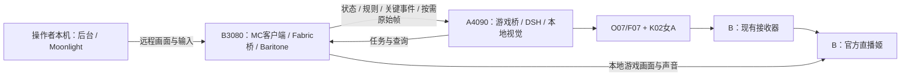

# G01-R1：林知夏 Minecraft 双模式直播选型

日期：2026-10-29（Asia/Taipei）。结论：完成技术选型，进入待开发状态；尚未安装、联合运行或验收。该文件不改变现有人物发布版本与硬件分支。

本页保留为历史研究依据。当前交付范围、工程目录、执行档和验收以[完整交付规划v1.2](../../technical/mc-live-v1/08-完整交付规划.md)及[全端实现蓝图](../../technical/mc-live-v1/09-全端实现蓝图.md)为准：全部15域一次完整交付，本页旧阶段表不再安排用户交付。

选型的可行性、预期成品效果和联合验收要求见 [评估报告](FEASIBILITY.md)。

游戏侧战斗/生存执行层的新证据与替换候选见 [社区专项复核](COMMUNITY_COMBAT_SURVIVAL.md)。优先验证S01及其配套寻路依赖；当前G01-R1版本表仍是已记录的原选型，尚未执行候选切换或联合验收。

## 1. 已选定的组合

主方案固定为：**真实 Minecraft Java 客户端 + 自有 Fabric 桥接 Mod + Baritone + Neuro 核心协议兼容桥 + 现有 DSH/Humanity + 本地 Qwen3-VL-4B 视觉补充**。

编号沿用G01，形成G01-R1。将之前的“Fabric/Minescript”具体收束为正式运行使用Fabric桥接；Minescript只作开发诊断。一个真实客户端和一套本地输入仲裁器负责自主游玩与人工游玩，两种模式持续感知同一角色的游戏状态。

| 层次 | 选定内容 | 位置 | 选择理由 |
|---|---|---|---|
| 游戏基线 | Minecraft Java 1.21.1，先使用独立新存档 | B3080 | 有对应Fabric、Baritone及调试工具；便于锁定兼容组合 |
| 状态与事件 | 自有Fabric Mod，暂定名zhixia-game-bridge，Java 21 | B3080 | 直接读取真实玩家、界面和事件，能在游戏线程调度查询与动作 |
| 寻路与技能 | Baritone API Fabric 1.11.3；外围增加采集、合成、交互与取消控制 | B3080 | 复用寻路基础；任务与接管由自有桥接器统一管理 |
| 即时控制 | 本地有限状态机、任务租约、control_epoch与输入释放 | B3080 | 人工接管和连接异常处理不依赖LLM或语音往返 |
| 游戏协议 | 在现有Node桥中实现Neuro核心消息兼容与内部任务通道 | A4090与B3080 | 游戏适配器与人格后端分离，方便以后接其他游戏 |
| 高层决策 | 现有DSH与保存的gpt-6-luna渠道 | 云端推理，经A调度 | 复用现有兼容层；本地执行固定技能，规划不直接接管系统Shell |
| 规则与逻辑 | 运行时实际配方/注册数据优先，版本匹配minecraft-data补充 | B采集，A查询 | 库存、材料、条件与失败原因有可核对依据 |
| 视觉补充 | Qwen/Qwen3-VL-4B-Instruct-GGUF，Q4_K_M主模型 + F16 mmproj | A4090 | 本地分析建筑外观、画面文字与特殊UI，结果带帧时间和置信度 |
| 视觉推理运行时 | llama.cpp原生Windows CUDA服务，独立进程 | A4090 | 图片经本地接口处理；无需假设现有云端渠道支持视觉 |
| 人格与记忆 | 现有DSH/Humanity，单一持久写入者；游戏账本按世界分区 | A4090 | 同一女A人格贯穿两种模式、观众互动与下播整理 |
| 人物与声音 | 女A原素材、K02、O07主音色、F07备用 | A4090 | 复用已选素材与声音；本轮不改现有人物参数 |
| 直播输出 | 现有B端接收器 + 官方直播姬，720×1280竖屏 | B3080 | 游戏画面、人物、弹幕和任务面板合成到现有输出链 |
| 远程人工操作 | 操作者不在B时，采用Sunshine(B) + Moonlight(操作者本机) | B与操作者设备 | 原生远程游戏画面和输入通道；直播仍由B本地采集 |

zhixia-game-bridge、游戏调度、规则查询和接管逻辑都属于待开发内容。组件选择不表示将它们安装在一起后已自动满足全部功能。

## 2. 为什么选择G01

按照三个硬条件做选择：①同一游戏角色可以切换控制；②能直接核对实际游戏状态和结果；③Windows原生部署且适配现有主播链路。下表是工程适配判断，不是性能测评分数。

| 路线 | 双模式与同一角色 | 游戏理解依据 | 本次决策 |
|---|---|---|---|
| G01真实客户端 + Fabric/Baritone | 有直接实现路径；接管取消仍须开发测试 | 真实客户端状态、事件、规则和画面 | **主方案** |
| G02 Mineflayer + DSH | 协议机器人通常是另一个玩家，切换机制需额外设计 | 对机器人自身的结构化状态支持良好 | 保留为独立研究分支，不作为当前双模式生产依赖 |
| G03 Mindcraft | 适合自主原型，但需协调机器人角色及现有人格/记忆 | Mineflayer状态与技能体系 | 借鉴技能，不接入整套主播/规划系统 |
| G04 NitroGen | 能围绕同一窗口设计接管，但当前模型缺少长期规划 | 画面到手柄动作，不能替代精确规则查询 | 后续手柄游戏研究 |
| G05 Cradle类纯视觉控制 | 可以接同一窗口，逐款游戏开发技能 | 截图与视觉推理，实时行动受等待影响 | 无结构化接口游戏的后续路线 |
| G06 Voyager | 技能学习有参考价值，仍需交接和环境改造 | 机器人状态、代码技能与学习循环 | 参考技能积累方法，不纳入本次运行栈 |

Minescript 4.0留作读取字段、事件和输入的诊断工具。正式接管收在一个Java桥中，减少Python脚本、Baritone和手动输入之间多方持有持续动作的情况。若未来改用Minescript执行器，应按同一任务协议重新验收，不同时启用两套动作写入者。

生产异常时的降级模式是**同一客户端的人工游玩/AI解说**。若只有视觉服务不可用，可继续基于新鲜结构化状态解说，并标明视觉观察不可用；这不算完整视觉能力验收通过。若状态通道也失效，停止新自动任务并显示未知状态。不会在后台悄悄换成另一个Mineflayer玩家。

## 3. 版本选择依据

以下属于已查询到发布元数据的实施候选，安装时校验文件并做联合启动测试后，才升级为已验收锁定版本。

| 组件 | 选定版本/文件 | 元数据核实 | 联合运行 |
|---|---|---|---|
| Minecraft | Java Edition 1.21.1 | Fabric与Baritone存在对应发布 | 待测 |
| Java | 原生x64 JDK 21；补丁版本部署时记录 | Fabric 1.21文档要求Java 21 | 待测 |
| Fabric Loader | 0.20.1 | Fabric元数据对1.21.1列为stable | 待测 |
| Fabric API | 0.116.17+1.21.1，Modrinth版本ID Mys3P7lK | 发布页列明1.21.1/Fabric | 待测 |
| Baritone | baritone-api-fabric-1.11.3.jar | 官方说明支持1.21/1.21.1 | 待测 |
| Minescript诊断 | minescript-fabric-1.21.1-4.0.jar，版本ID zqDGKDwY | 发布页列明1.21.1/Fabric | 默认不装入正式运行档 |
| 本地视觉 | Qwen3VL-4B-Instruct-Q4_K_M.gguf + mmproj-Qwen3VL-4B-Instruct-F16.gguf | Qwen官方仓库列出文件 | 待下载与测评 |
| llama.cpp | Windows CUDA；具体构建在视觉烟测通过后写入运行锁 | 原生Windows及图像接口有官方文档 | 待冻结构建与测试 |

Baritone候选文件发布大小4,810,562字节，发布SHA-256为f9a9b17a41d7d7ad22c759058b14fd01e3319663282e66f99e18153237fa6767。Fabric API发布大小2,452,735字节；这些是发布元数据，不代表本轮下载并校验了二进制。

Qwen仓库显示Q4_K_M主文件约2.50GB、F16视觉投影约836MB，合计约**3.34GB模型文件**。这是十进制、按页面四舍五入的估算，不含推理运行时、上下文缓存和日志，也不能解释成显存用量。这里只选定这两个文件，不需要下载整个含多种精度的16.1GB仓库。

协议研究基准：Neuro SDK 0cad33ac692f6cc90d36747fea9bbc53ca34b97a；AIRI架构参考e1df804cf3bcaab8c080598b60488fd37b24e503。前者用于记录协议解释依据，后者用于追踪架构文档；不代表将其全部源码或模型带入当前项目。

采用Java 1.21.1作为首个实施档是兼容性范围选择；用户已有高版本存档不降级加载、不覆盖。后续要升版本时另建配置并重跑接管与动作验收。

## 4. A/B与操作者的具体职责

首个游戏档先在B运行独立单人存档的集成服务器；单独的专用服务器不作为首版必需项。Minecraft游戏目录、存档、模组和游戏日志都放在项目目录内的独立实例中。

B接收端不加载女A/TTS/视觉模型。A是唯一人物与语音推理端；两台机器不同时启动各自的完整女A推理链。如果操作者直接在B用键鼠，远程游戏串流不必启动。

Moonlight观看与操控是操作者通道，直播画面仍由B本地采集。串流连接、断开可能影响音频设备与额外编码负载，实施时要核对游戏音频、直播源内女A音频和BGM混音，避免重复采集。远程操作者看到的延迟不应与观众CDN延迟混算。

游戏性能配置先以1080p、60FPS上限、8区块视距和6区块模拟距离作为工程起点；Java堆上限先取6GiB。上述参数不是已经测得的最优值，实际由游戏帧时间与资源采样调整。女A继续使用原25FPS竖屏输出参数，游戏画面在竖屏布局里完整显示HUD。

## 5. 实时理解的实现约束

状态采集挂接本地游戏tick，目标10–20Hz；到A的状态增量目标5Hz，关键事件立即发送。高频缓存不等于每秒多次调用云端LLM。规则查询和当前任务一起送入决策，LLM可按需再查背包/配方/目标。

选择本地视觉是为了覆盖结构化API之外的外观与特殊UI。Qwen3-VL-4B先按需、单请求并发、约0.5–1帧/秒上限试验；输入来自游戏原始窗口，结果绑定采样时间。与K02/O07联合运行后，先调节视觉采样与请求并发，核验不会损害人物和声音连续性。

视觉调用超时只取消该观察任务，不取消已经由B本地执行的必要动作。地图、背包、血量和配方优先使用新鲜结构化数据；视觉推断和旧记忆不能覆盖较新的游戏事实。

规则知识采用当前运行时实际数据优先于静态资料的顺序。状态中新出现未知Mod物品时，记录命名空间和名称，返回能力缺口，不直接套用原版配方。

本地状态通道P95不超过500ms为验收目标，不包括LLM、TTS和媒体播放。A/B单向时间需校时并注明误差；先能报告各进程内耗时与RTT。当前5–8秒级首播历史数据不能解释成游戏操作延迟，也不能承诺同等时延能完成即时战斗。

## 6. 首版交付功能与边界

两种模式共用同一玩家，后台按钮和B本地热键均可切换，实际模式以B确认回执为准。切换会提升epoch、取消旧持续任务并释放输入；人工模式下自动避险也只提示。

完整首版包含：持续状态和事件、规则/库存问答、按需视觉描述、自主基础采集与合成、目标导航、任务取消与失败解释、人工陪玩解说、观众任务建议/投票、世界任务账本、下播摘要，以及直播姬游戏/女A合成。

首批自主技能固定为：移动到已知目标、采集指定基础资源、基础合成、使用已确认可用物品、返回已登记基地、取消任务。复杂战斗、任意Mod整合包、全自动通关不写成首版已支持；危险应对按实际通过的技能逐项开放。

重要任务生命周期为accepted/running/succeeded/failed/cancelled；只有实际游戏结果证明完成时，才允许说“已经完成”。主播仍使用当前播放回执机制判断自己何时说完。

## 7. 验收顺序与通过条件

| 阶段 | 交付物 | 通过条件 |
|---|---|---|
| P1 | 原生MC档与只读Fabric桥 | 能连续读取同一真实玩家、背包、界面和关键事件，显示状态年龄 |
| P2 | 规则工具与人工模式解说 | 正确解释实际库存和配方；游戏状态改变后不会持续答旧事实 |
| P3 | Baritone技能与本地接管 | 至少20次AUTO/人工往返切换，无残留按键和旧任务恢复执行 |
| P4 | 本地视觉与完整女A联动 | 指定画面描述用例可用，30–60分钟采样没有新增持续音频欠载或人物连续性退化 |
| P5 | 直播姬本地组合、弹幕路由与记忆恢复 | 画面/声音来源清楚，完成反馈真实，下播重启后世界分区与目标可恢复 |

规则与库存问答先定义可复现固定用例；不能以“模型听起来懂了”代替核对。视觉分别测试建筑、菜单、画面文字和未知内容，并保留原始帧与结论。游戏帧率、显存、RAM和所有时延在实际运行后另出报告；本文件不填写虚构测评分数。

更多异常/断线/语音时序要求继承 [实时游戏理解设计](README.md) 的T01–T12。公开开播与观众端验收须单独执行。

## 8. 版本控制与当前交付状态

通用实现从main建立feature/game-streaming功能分支；在其上完成公共模块后，按 [设备分支约束](../../deployment/DEVICE_BRANCHES.md) 选择性同步。A4090推理与B3080接收是4090分支拓扑，不能把B启动成3080推理版。

本轮只完成选型、发布元数据核对和文档。未创建功能分支、修改生产配置、安装新模型、启动游戏或恢复4090远端控制。下一步工程任务就是按P1–P5实现G01-R1，主方案已不再保留多个并列候选。

## 9. 一手来源

- [Fabric 1.21与Java要求](https://fabricmc.net/2024/05/31/121.html)
- [Fabric Loader元数据](https://meta.fabricmc.net/v2/versions/loader/1.21.1)
- [Fabric API 0.116.17+1.21.1](https://modrinth.com/mod/fabric-api/version/Mys3P7lK)
- [Baritone 1.11.3发布](https://github.com/cabaletta/baritone/releases/tag/v1.11.3)
- [Minescript 4.0 for Fabric 1.21.1](https://modrinth.com/mod/minescript/version/zqDGKDwY)
- [Neuro协议](https://github.com/VedalAI/neuro-sdk/blob/0cad33ac692f6cc90d36747fea9bbc53ca34b97a/API/SPECIFICATION.md)
- [AIRI MC参考文档](https://github.com/moeru-ai/airi/blob/e1df804cf3bcaab8c080598b60488fd37b24e503/integrations/minecraft/README.md)
- [Qwen官方模型文件](https://huggingface.co/Qwen/Qwen3-VL-4B-Instruct-GGUF/tree/main)
- [llama.cpp多模态接口](https://github.com/ggml-org/llama.cpp/blob/master/docs/multimodal.md)
- [minecraft-data](https://github.com/PrismarineJS/minecraft-data)
- [Sunshine](https://github.com/LizardByte/Sunshine) 与 [Moonlight](https://github.com/moonlight-stream/moonlight-qt)
