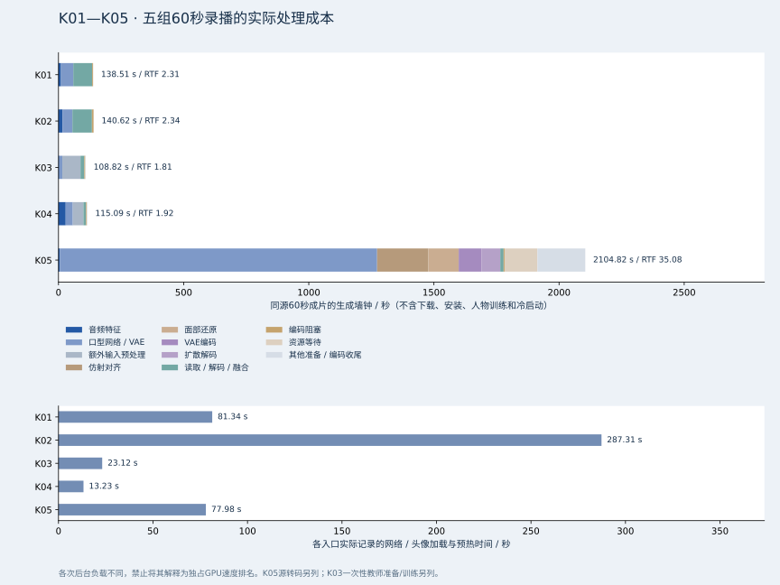
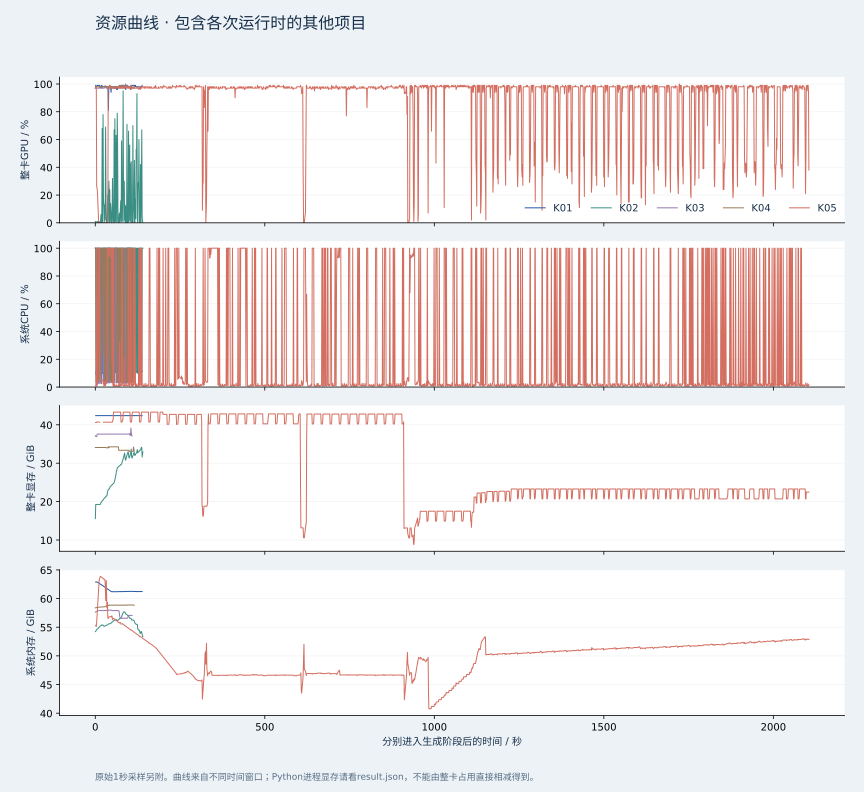
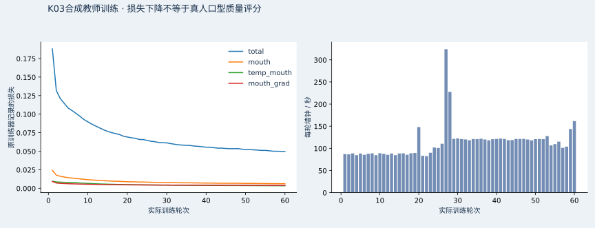

# 女A K01—K05：同源 60 秒口型模块横评

更新时间：2026-10-29T03:55:59+08:00

**状态：五组录播均已完成文件验证。**

## 比较表

| 编号 | 方案 | 状态 | 60秒生成耗时(s) | RTF | FPS | 冷启动(s) | 含初始化总耗时(s) | PyTorch峰值显存(MiB) |
|---|---|---|---:|---:|---:|---:|---:|---:|
| K01 | MuseTalk 1.5 原方案 | 验证通过 | 138.51 | 2.31 | 10.83 | 81.34 | 226.75 | 3112 |
| K02 | MuseTalk 1.5 局部融合优化 | 验证通过 | 140.62 | 2.34 | 10.67 | 287.31 | 430.63 | 3112 |
| K03 | FeatherTalk 女A教师训练实验版 | 验证通过 | 108.82 | 1.81 | 13.78 | 23.12 | 132.04 | 9011 |
| K04 | Wav2Lip GAN | 验证通过 | 115.09 | 1.92 | 13.03 | 13.23 | 128.42 | 2412 |
| K05 | LatentSync 1.6 | 验证通过 | 2104.82 | 35.08 | 0.71 | 77.98 | 2183.11 | 4896 |

这些是不同共享负载窗口下的首轮实测，不是独占GPU速度排名。冷启动入口的加载/缓存/预热边界也不同；请结合阶段耗时、线程限制与资源曲线判断。

## 本轮选型判断

本轮最短的完整60秒生成来自K03，耗时108.82秒。五个入口的RTF均大于1；在这套原生共享负载、CPU线程与读图/融合实现下，没有一组证明完整离线生成已快于实时。它不等于生产常驻worker的速度，也不能否定各项目在其他数据和官方环境中的能力。

当前优先保留K01作为对照、把K02作为下一轮局部优化回归候选。K03完成了合成教师初训，但仍有静音微张嘴和较柔的嘴部细节；K04细节更软；K05本次适配在多个发声画面中口型偏弱，且生成耗时很长。后两者当前结果不构成直接替换生产口播的依据。完整视觉观察与原片在后文。

K03峰值CUDA分配实测约8.8GiB，不能用约22MB视觉模型权重推断其完整运行显存；本报告保留真实峰值，未将未经单独实验的原因当成定论。人物专模、HuBERT、预处理和实际批次/运行时开销必须分别看待。

## 固定输入与实验边界

- 原人物：女A / 林知夏；宿舍、手部、身体动作沿用既有 10,000 帧素材库。
- 测试为 720×1280、25 FPS、1,500 帧、60 秒。八个动作片段按同一顺序组合，不用新视频替换身体和场景。
- 所有模型使用同一份 O07 原始 WAV；保留句间停顿，不对语音变速，不截断完整测试句子。以 audio/input.json 和 input-manifest.json 的最终 SHA-256 为准。
- 主测试关闭 BGM、滤镜和网页覆盖层；不调用云端视频、口型或 TTS 推理。
- 测试是离线录播生成；不启动 B站公共直播，不以此证明平台互动链路的首响或端到端延迟。
- 全部使用原生 Windows / Python；没有 Docker、WSL 或虚拟机。

## 每组替换范围

| 编号 | 实际替换 | 口型尺寸与强度 | 保留 / 说明 |
|---|---|---|---|
| K01 | 既有 MuseTalk 1.5 | FP16、batch 8、256级面部预测 | 原生产融合口罩 |
| K02 | K01 的后处理消融 | 相同网络/权重/精度/batch | 下半脸椭圆羽化、有限颜色校正、静音渐变；不是一个独立新模型 |
| K03 | FeatherTalk 人物专模 | 原144×144模型、FP32、batch16、60轮初训 | 独立动作 + 独立台词的 K01 教师合成训练；实验版，不能代表真实人物训练的质量上限 |
| K04 | Wav2Lip GAN | 原96×96网络、FP32、batch16 | 使用既有坐标、原80-bin mel输入；公开权重为非商业研究用途 |
| K05 | LatentSync 1.6 | 原512、16帧块、20 DDIM步、CFG1.5、FP16 | Windows dlib几何适配替换InsightFace检测，保留原仿射/网络/采样强度；复用既有VAE |

K02—K05 最终合成均约束在同一原画面的下半脸区域；K01 保留生产融合规则作为基线。K03 的人物预处理和训练时间单列，绝不合并到每次 60 秒推理耗时中隐藏。

## 指标口径

- **冷启动**：模块导入后开始加载网络、头像缓存与适用的预热，至可执行测试前；不包括下载和安装。各结果记录精确边界。
- **生成耗时**：进入该模型本次音频特征处理至最终 60 秒 MP4 编码关闭的墙钟时间，包括读图、推理、融合、编码阻塞及编码收尾。K05 额外列出源视频准备成本。
- **RTF** = 生成耗时 / 60，**FPS** = 1500 / 生成耗时。二者是本次离线吞吐，不是观看帧率或直播延迟。
- **首帧**：开始处理后第一张可编码口型帧的时间；不含模型冷启动。K05 官方批处理没有流式首帧，因此留空。
- **PyTorch峰值显存**：仅本次进程的 CUDA 分配/保留峰值；整卡显存、利用率、功耗为 nvidia-smi 1秒采样，包含用户的其他任务。
- 系统内存、进程RSS和CPU同样保留采样。保留其他项目/ComfyUI任务意味着这些结果不是独占GPU的极限跑分，需结合资源曲线看波动。
- K01/K02 提供约200ms右侧音频上下文，K04约200ms，K03约400ms；K05为离线批处理。吞吐快于实时仍需考虑算法前看、队列、音频分句、传输和播放器缓冲。
- 不伪造 SyncNet/LSE/人工质量分数。原始视频、同刻截图与网页并排播放用于人工比较；脸部帧差只描述运动，不代表口型正确性。

## 验收规则

1. 解码完整MP4，逐项确认1,500帧、25FPS、720×1280和60秒时长；禁止用截短、静帧循环冒充60秒口播。
2. 校验共用音频SHA。对最终AAC解码后与原WAV做相关校验，相关系数需>0.98，音频偏移绝对值<20ms。
3. 每秒抽样比较脸部允许区域以外的原图，平均像素误差阈值为3，容许统一H.264有损编码误差。
4. 每组保存六个同一帧号的全景截图，并保留完整的性能与资源JSON；失败必须显示错误原因。
5. 最后由观看者比较闭唇、牙齿、嘴角、颜色边界、动作稳定性。个人评分保存在浏览器，独立于测评原始记录。

## K03 训练与公平性

使用现有动作库中未参与60秒测试的其余40个动作片段，共8,000帧/320秒；训练台词与测试台词分开。K01生成带口型教师帧，FeatherTalk原110点预处理和FeatherHuBERT提取特征，以原损失默认权重训练60轮。Windows数据加载为num_workers=0。记录种子、每轮损失、训练时间、权重哈希和资源采样。

这解决了当前只有原始无声动作素材、缺少真实人物口播训练视频的问题，但训练标签带有MuseTalk误差，因此K03结果只适用于这一套合成教师训练试验。需要真人真实说话视频进一步训练时，应作为新实验独立归档。

## 文件索引

- `protocol.md`：原生环境、资源调度、复现和指标细则。
- `index.html`：本地同源对比页面，含同步播放、嘴部放大、按生成耗时/RTF/显存排序。
- `K01/`—`K05/`：60秒MP4、result.json、resources.json、verification.json、六张同刻截图。
- `audio/`：60秒原始WAV、逐句O07原始生成与时间轴。
- `input-manifest.json`：动作编号、帧序列、音频哈希和训练/测试分离声明。
- `training/`、`K03/training*.json`：人物训练来源与过程；训练权重属于模型目录，不进入Git。
- `results.json`、`results.csv`、`verification-summary.json`：可复核数据。

## 待完成与失败项目

五组文件验证均完成；主观选型请结合原始录播。

## 逐阶段实测（秒）

| 编号 | 音频特征 | 口型网络/VAE | 额外读图预处理 | 仿射对齐 | 扩散解码 | 面部还原 | 最终融合 | 编码阻塞 | 源视频准备 |
|---|---:|---:|---:|---:|---:|---:|---:|---:|---:|
| K01 | 10.00 | 49.03 | 不适用/未分拆 | 不适用/未分拆 | 不适用/未分拆 | 不适用/未分拆 | 75.55 | 3.57 | 不适用/未分拆 |
| K02 | 16.57 | 38.98 | 不适用/未分拆 | 不适用/未分拆 | 不适用/未分拆 | 不适用/未分拆 | 78.06 | 6.67 | 不适用/未分拆 |
| K03 | 3.26 | 11.99 | 72.64 | 不适用/未分拆 | 不适用/未分拆 | 不适用/未分拆 | 15.19 | 3.92 | 不适用/未分拆 |
| K04 | 28.70 | 28.44 | 42.31 | 不适用/未分拆 | 不适用/未分拆 | 不适用/未分拆 | 10.56 | 3.34 | 不适用/未分拆 |
| K05 | 5.45 | 1267.60 | 不适用/未分拆 | 204.73 | 74.17 | 121.27 | 13.22 | 4.06 | 不适用/未分拆 |

“未分拆”不等于零成本；该开销包含在总墙钟或其父阶段。K01/K02网络计时含VAE解码，K05分拆扩散解码。K05源视频准备在生成主计时前，已包含在含初始化总耗时中。各入口冷启动的导入/预热边界不同，不能把冷启动数字视为统一的纯网络加载对照。

## 这次执行的主要瓶颈

| 编号 | 最大已计时阶段 | 秒 | 占生成墙钟 |
|---|---|---:|---:|
| K01 | 读图 / 解码 / 最终融合 | 75.55 | 54.5% |
| K02 | 读图 / 解码 / 最终融合 | 78.06 | 55.5% |
| K03 | 额外读图 / 输入预处理 | 72.64 | 66.8% |
| K04 | 额外读图 / 输入预处理 | 42.31 | 36.8% |
| K05 | 口型网络 / VAE | 1267.60 | 60.2% |

这张表按本次入口的计时边界解释墙钟，不能把CPU贴回、原PNG读取或后台等待都算成GPU网络推理。K01/K02的读取、解码和融合为同一计时段；后续可单独检查原帧/口罩缓存、有限预取及CPU贴回，以新实验记录收益。阶段耗时小于60秒也不代表整条直播链路已经实时。K03的人物训练成本与K05的整段扩散成本需结合实际使用频率判断；选择替换前，还需在现有音频分句、播放时钟、B端接收和平台推流中另做实时回归。

## 首帧和初始化边界

| 编号 | 处理开始至首张可编码帧 / 秒 | 边界 |
|---|---:|---|
| K01 | 0.99 | 不含冷加载；含本入口特征提取、首批网络与输入处理 |
| K02 | 0.96 | 不含冷加载；含本入口特征提取、首批网络与输入处理 |
| K03 | 5.70 | 不含冷加载；含本入口特征提取、首批网络与输入处理 |
| K04 | 41.08 | 不含冷加载；含本入口特征提取、首批网络与输入处理 |
| K05 | 待实测 | 本入口未提供流式首帧，不据分块完成时间推算 |

冷启动数字不覆盖整个进程启动。K01/K02和K04的部分模块导入发生在计时前；K03/K05的导入更多发生在入口内。冷启动加生成耗时也可能小于入口总耗时，差额来自两段计时外的输入、清单、编码器或其他准备。原始时长不做回填或修正。网页同步播放器只用于比较已生成文件，首帧指标不包含网络传输、网页缓冲或直播平台CDN。

七张同刻截图（含网页首帧海报）从最终交付MP4重新解码，源文件签名与帧号保存在各组stills/source.json；不是将编码前缓存当作最终文件截图。

| 入口 | 冷启动段中的预热 / 额外边界 |
|---|---|
| K01/K02 | 生产load_model/load_avatar和batch8 warm_up在冷启动内；主要模块导入更早发生 |
| K03 | 上游融合后模型加载、权重哈希、HuBERT加载与batch16视觉模型零输入预热在冷启动内；完整语音特征另计 |
| K04 | 原网络权重加载与batch16零输入预热在冷启动内；librosa导入更早发生，首次实际音频特征处理另计 |
| K05 | 权重加载及CUDA同步在冷启动内，未另做完整20步UNet预热；首次扩散执行成本保留在生成主计时 |

若后续集成为常驻直播worker，模型可在开播准备时加载；本次每个独立录播入口的冷启动不等于每条弹幕都必须重复支付的成本。常驻并不会自动消除PNG读取、融合、音频分句和播放缓冲开销。

## K03一次性构建成本

| 环节 | 实际记录 |
|---|---|
| 320秒/8000帧教师素材 | 生成635.47秒；含加载663.31秒 |
| 原权重关键点与音频预处理 | 完成段1576.81秒，cpu；此前重试保存在attempts/ |
| 人物训练 | 请求60轮；本次训练入口总墙钟693.18秒；各轮详见training-history.json |
| 训练过程整卡显存峰值 | 48431MiB，含当时其他进程 |
| 独立推理权重 | 22,131,521字节，已从原最终模型导出，未包含优化器状态 |

训练曲线描述原教师标签上的拟合过程，不是口型同步质量分。CPU批处理仍使用原SCRFD/PFLD权重和裁剪规则；十帧对照关键点差异为0像素，见preprocess-backend-check.json。最初教师帧的汇总标签问题使用TRAIN/metadata-correction.json公开纠正；原测量与原记录保留。

### 续训和失败成本

本轮在已完成第23、56轮的检查点后，共发生2次Windows进度JSON替换被拒绝的入口退出。先增加唯一临时文件及有限重试，第二次后进一步将progress.json降为尽力而为的进度遥测，写入受阻时保留独立后备快照而不中止训练；检查点、训练历史和成绩仍为严格写入。只重载本实验的静态预览服务，使小JSON读完即关闭磁盘句柄，不重启MCP、设备或模型服务。

每次均从原检查点恢复模型、优化器和轮次；已完成轮次保留，没有改为提前停止。失败证据与原资源序列归档到attempts/。实际Win32只读共享句柄回归检查验证了临时进度失败不会中断调用，正式成绩写入仍等待锁释放；具体持锁方未被确定，不能把它断言为某个其他项目的故障。

此前失败训练阶段墙钟合计7104.71秒；最终续训入口墙钟693.18秒；两部分合计7797.89秒。合计未包含各次启动之间的人工修复间隔，失败阶段包含suite包装与发布开销，不能当成纯GPU优化器时长。

原上游检查点不保存全部Python/NumPy/CUDA随机数状态；续训入口重新设seed20261028。它是有记录的60轮续训实验，不宣称与一次不间断运行逐位一致。此前中断轮中已执行但未入检查点的批次会在恢复后重新执行。详见K03/training-attempts.json与K03/training-invocations.json。

## 实际新增权重与额外磁盘成本

以下按真实文件stat记录计算，GB为十进制。K01/K02复用生产权重；环境、头像缓存、原始训练数据和可续训检查点另计。

| 编号 | 新增推理权重 | 一次性预处理权重 | 说明 |
|---|---:|---:|---|
| K01 | 0GB | 0GB | 复用现有MuseTalk与预处理 |
| K02 | 0GB | 0GB | 相同网络，不导出新engine |
| K03 | 0.035612GB | 0.008331GB | 另需574,673,361字节VGG19仅用于训练；续训检查点含优化器，未计入推理权重 |
| K04 | 0.435802GB | 0.000000GB | 原GAN权重，96像素 |
| K05 | 5.147795GB | 0.000000GB | 复用既有334,707,217字节VAE，不重复下载 |

完整路径/字节与VAE哈希见model-file-inventory.json，选定下载的SHA256见setup-progress.json。库结构匹配不替代来源记录；K05使用既有VAE及dlib几何适配，应与原生官方检测器实验区分。

## K05实际执行适配

bounded frame I/O + VAE batch slicing + resident CUDA weights。原口型模型的分辨率、精度、窗口、扩散步数和CFG没有降低；这属于当前素材/共享资源下的执行实现，不能用其速度冒充官方未经修改的整段视频入口。

本次资源等待总计131.06秒；生成主阶段内等待131.06秒，实际处理墙钟（扣除显式等待）1973.75秒。表格主耗时包含生成阶段内等待。

K05直接分块读取同一组原始PNG，保留连续的仿射平滑状态、固定初始噪声、原音频特征和原20步DDIM更新。VAE仅沿独立图像批次切片；实际权重驻留方式见上面的execution adapter。mmap/meta初始化严格核验所有权重键与形状，不做部分权重加载。

音频编码器产生1502个特征帧，本实验取前1,500个，与60秒固定源帧逐一对齐；共94块，前93块各16帧，末块12帧。不会追加或循环额外视频帧。该尾部处理属于执行适配，不能宣称与官方按全部音频特征输出的尾块逐像素相同。

## 同步观看素材

[五组同步60秒总览](K01-K05-comparison-60s.mp4) · [8—14秒嘴部GIF，6秒无声](mouth-comparison-08s-14s.gif) · [六个同刻人脸截图](same-frame-face-sheet.jpg)

总览是五段真实测试视频的同步拼接，不能替代单个720×1280原片。GIF仅为局部预览，不代表60秒完整录播。

[57.35—60秒句尾静音闭口GIF（无声，10FPS量化）](mouth-comparison-silent-tail.gif)；该区间共用WAV样本全为0，可独立检查没有声音时的闭口行为。

## 成片人工观察

人工观察与选型建议

以下观察依据最终MP4解码的同刻截图、8—14秒嘴部GIF连续抽帧及57.35—60秒静音尾段。没有真实逐音素标注，未计算或编造MOS、SyncNet、LSE分数；音轨一致性验收也不等于口型同步质量评分。

| 编号 | 本轮可见画面表现 | 当前选型判断 |
|---|---|---|
| K01 | 嘴部细节较清楚；57.35秒后零样本静音区间的部分截图仍张嘴 | 保留原基线，便于判断后处理收益 |
| K02 | 同一网络的静音渐变在尾段恢复原素材闭口；没有新增权重 | 当前最适合优先验证的局部优化，后续再做实播回归 |
| K03 | 嘴部轮廓比K01更柔，与教师的开合形态接近；57.35—60秒静音段仍微张嘴 | 已完成60轮合成教师初训，但当前尚不构成清晰度或闭口质量升级 |
| K04 | 96像素中间预测贴回竖屏画面后，嘴唇和牙齿边缘更软 | 作为轻量速度对照；需接受当前素材上的细节损失 |
| K05 | 多个同刻画面保留较多皮肤和唇部纹理，但部分发声时刻口幅很小或接近闭口 | 当前适配的口型驱动幅度不足，不建议替换正式口播；本轮约35分钟生成60秒，也不能承担实时直播 |

K05的清晰纹理不能自动推导为更准确的发音口型。K02的静音闭口改善也只证明这项后处理有效，不能据此声称所有台词、遮挡和动作都已最佳。完整原片用于检查句中开合节奏、双唇闭合、齿音、转头、手势和边缘稳定性。

正式直播仍保持既有MuseTalk和O07/F07配置。这轮未自动切换生产后端，也未启动公开直播。后续替换宜先比较选中方案的常驻worker、原帧/口罩缓存与CPU融合成本，再单独测量音频分句、网络缓冲、B端播放及平台推流。

The visual notes are scoped observations of this exact female-A material and the documented adapters. They are separate from the immutable raw timings and integrity checks. The synthetic-teacher FeatherTalk fit is an initial pilot; shared-load wall times are not exclusive-GPU rankings or live-response latency.

本轮五组完整生成RTF均大于1。K03的网络段约11.99秒，但原图与输入预处理约72.64秒，占完整生成约66.8%；不能把11.99秒当成60秒视频交付时间。K01/K02的读图、解码与融合约占55%。下一轮应单列测试原帧/口罩缓存、有限预取、常驻worker与CPU贴回；所有优化收益须另起实验记录，不能回改本次数字。

网页验收与修复记录

初轮两个网页入口的首次共用音轨推进检查失败，原记录保留为[本机初轮回执](page-review-before-fix.json)与[4090初轮回执](page-review-before-fix-remote.json)。[起播事件轨迹](startup-before-fix.json)显示：视频先开始，共用音轨随后启动；同步校正触发seeking/waiting后被当作缓冲而暂停。修复为同轮并发启动音视频、取消过期的播放请求、跳过正在seek的同步校正，并忽略正常seek产生的waiting。原始录播与性能数字没有重做或改写。

修复后[本机17项检查](page-review.json)与[4090入口17项检查](page-review-remote.json)均通过；每组必须在音视频均未暂停时实际前进至少0.4秒，不能仅以当前时间大于某值冒充播放成功。[同条件5秒事件复查](startup-after-fix.json)中，音频前进到4.987秒，两路视频约4.980秒，保持播放。原片的完整1500帧与音轨检查另附，网页短时播放不冒充完整视频质量验收。所有测试浏览器均在finally中关闭。

资源曲线的限制：系统CPU为psutil原始样本，存在密集的0/100%跳变，未以独立Windows计数器校准，不能用它单独推算本模型的CPU成本。资源轮询在每次查询后等待1秒，实际间隔还包含查询开销，以elapsed_seconds为准；均值为样本均值。整卡显存/利用率和系统RAM包括其他项目，采样峰值也可能漏掉瞬时尖峰；PyTorch分配峰值与这些整机样本分别记录。

## 素材适配与官方来源

| 编号 | 当前素材适配 | 固定来源 |
|---|---|---|
| K01/K02 | 既有LiveTalking的MuseTalk1.5裁脸与latent缓存；K02仅改后处理 | [MuseTalk](https://github.com/TMElyralab/MuseTalk)、[LiveTalking](https://github.com/lipku/LiveTalking)；本机入口快照随实验代码保留 |
| K03 | 原SCRFD/PFLD110点、152像素裁剪与144像素网络；训练素材为独立合成教师集 | [FeatherTalk固定commit](https://github.com/anliyuan/FeatherTalk/tree/7a8bb0439eb5da5e10601168df329a7052b7edf3) |
| K04 | 复用既有MuseTalk人脸坐标裁96像素输入，未重新使用原SFD检测/默认padding；属于素材适配结果 | [原Wav2Lip结构](https://github.com/Rudrabha/Wav2Lip)、[已校验GAN权重镜像](https://huggingface.co/camenduru/Wav2Lip/tree/bfcd9263d1ccb60ab724f074e7c1b3555f6cb162) |
| K05 | dlib几何锚点、分块原PNG读写、原仿射/口罩/扩散模型、VAE独立批次切片 | [LatentSync固定commit](https://github.com/bytedance/LatentSync/tree/a229c3948406bc2cf6eaf4873e662e70c6a04746)、[1.6固定权重](https://huggingface.co/ByteDance/LatentSync-1.6/tree/c42c7e6c8e9c213626389fa7d9a3c444b8536353) |

这些结论用于当前女A素材上的局部模块选型，不能代表每个项目使用官方最佳训练数据、检测器和独占硬件时的质量上限。正式直播的O07/F07、DSH、房间管理和B端推流未因这轮离线实验自动切换。

## 实机与调度记录

| 项目 | 本次快照 |
|---|---|
| GPU / 驱动 / 总显存MiB | NVIDIA GeForce RTX 4090, 617.42, 49140 |
| CPU | Intel(R) Xeon(R) CPU E5-2673 v4 @ 2.30GHz；40核/80线程 |
| 物理内存 | 63.90GiB |
| 系统 | Windows-10-10.0.17763-SP0，原生Windows |
| 本任务GPU并行数 | 1；不停止其他项目 |
| 编码CPU线程 | 4 |

硬件快照见benchmark-hardware.json；共享任务影响由各组逐秒resources.json记录。PyTorch线程限制为K01/K02/K03推理/K04各1线程，K03训练和预处理/K05各2线程，以保留其他项目的CPU空间；这也是复现吞吐的条件。

| 编号 | 进程显存分配/保留峰值MiB | 进程RSS峰值MiB | 整卡GPU均值% | 整卡显存峰值MiB | 系统RAM峰值MiB |
|---|---:|---:|---:|---:|---:|
| K01 | 3112 / 4716 | 4247 | 95.4 | 48297 | 65415 |
| K02 | 3112 / 4716 | 5285 | 18.1 | 47353 | 65434 |
| K03 | 9011 / 9030 | 1194 | 97.6 | 41871 | 59394 |
| K04 | 2412 / 2442 | 1902 | 97.9 | 35975 | 60322 |
| K05 | 4896 / 5554 | 5937 | 90.3 | 44353 | 65413 |

整卡GPU/显存和系统RAM包括其他项目，不能当作该算法的独占消耗。RSS只统计Python主进程，未包括FFmpeg子进程。

## 同源台词与动作时间轴

下列时间来自实际音频索引与冻结素材清单；网页可点击台词时间跳到对应画面。每8秒的动作切换来自同一份源素材，需与模型造成的局部抖动区分。

| 台词编号 | 时间 / 秒 | 实际测试台词 |
|---|---:|---|
| 01 | 0.15–3.62 | 大家好，我是林知夏，欢迎来我的宿舍坐一会儿。 |
| 02 | 3.84–7.61 | 这次我们用同样的声音，比较不同模型的嘴部效果。 |
| 03 | 7.83–11.02 | 爸爸妈妈准备了八杯冰水，别忘了慢慢喝。 |
| 04 | 11.24–14.34 | 小熊吹泡泡，葡萄和苹果放在白色盘子里。 |
| 05 | 14.56–17.62 | 遇到复杂的事情，先把它拆成几个小步骤。 |
| 06 | 17.84–21.24 | 不要着急，我们可以一边思考，一边慢慢说明。 |
| 07 | 21.46–24.56 | 你最近在看什么书，或者有什么喜欢的电影？ |
| 08 | 24.78–27.94 | 嗯，我听见了。这个问题，确实值得认真想一想。 |
| 09 | 28.16–31.28 | 谢谢你的陪伴，也谢谢每一条真诚的留言。 |
| 10 | 31.50–34.74 | 今天先聊到这里，记得休息，我们下次再见。 |
| 11 | 34.96–37.81 | 微风吹过窗边，桌上的绿植轻轻摇晃。 |
| 12 | 38.03–41.30 | 不必每一步都很完美，保持自己的节奏就好。 |
| 13 | 41.52–45.09 | 我们再把数字读一遍，一二三四五六七八九十。 |
| 14 | 45.31–49.25 | 闭上嘴巴，然后轻轻呼气。现在放松肩膀，再继续说话。 |
| 15 | 49.47–53.17 | 苹果、葡萄、泡泡和白纸，这几个词的嘴形各不相同。 |
| 16 | 53.39–57.35 | 说到这里稍微停一下。好了，我们接着看下一段画面。 |

| 时间 / 秒 | 源动作 | 素材编号 |
|---:|---|---|
| 0.00–8.00 | 右手轻招手 | `m01_welcome_right_wave` |
| 8.00–16.00 | 右手摊掌讲解 | `m09_explain_right_palm_up` |
| 16.00–24.00 | 右手起势双掌强调 | `m17_emphasis_right_beat_take2` |
| 24.00–32.00 | 向右微倾听 | `m25_listen_tilt_right` |
| 32.00–40.00 | 双肩自然放松 | `m33_posture_settle_shoulders` |
| 40.00–48.00 | 右手轻挥告别 | `m41_closing_right_goodbye` |
| 48.00–56.00 | 右手低位轻挥 | `m45_closing_right_lower_wave` |
| 56.00–60.00 | 呼吸放松回待机 | `m48_closing_breath_reset` |

最后一段台词在57.35秒结束；其后的静音用于观察句尾闭口。
