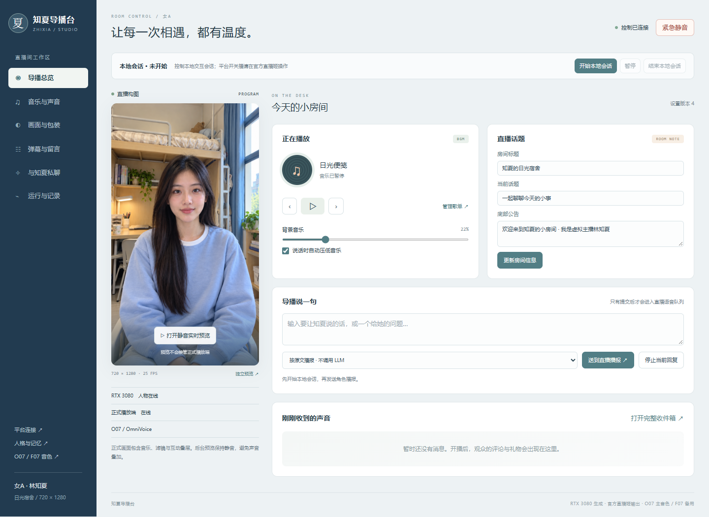
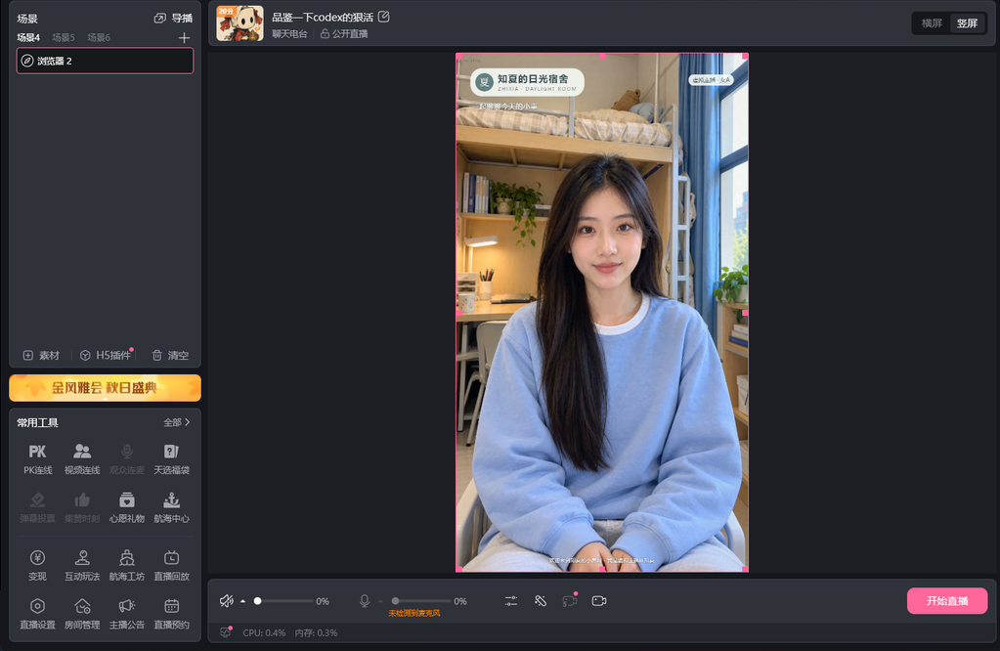

# 3080 K02 原生部署实测 / Native acceptance

日期：2026-10-29；版本：`native-rtx3080-v1.2.2-k02-o07-f07`。

**本轮结果：通过**。人物、O07与F07都在RTX3080本机原生推理；官方直播姬通过同机8020接收器播放。
固定720×1280、25FPS目标、MuseTalk FP16 batch4，O07 32steps、F07 FP32/32NFE。
原始batch8已实际尝试，连续性不达标后才按用户授权改成batch4；网络、K02融合、分辨率、音色精度和采样步数保留。

[可视化报告](report.html) · [完整最终证据](final.json) · [首轮原始失败证据](attempt01.json) · [操作与回滚手册](../../deployment/RTX3080_K02_RELEASE.md)

## 五段真实本地播放

单位为秒。合成耗时来自实际语音worker；音频就绪、首播、完成来自每约0.3秒轮询的请求状态，因此存在轮询误差。
首播是官方源的播放回执，不包括B站CDN和观众端网络。完整回复时间包含语音播放长度。

| 用例 | 音色 | TTS合成 | 音频长度 | 音频就绪 | 首次播放 | 整句完成 | 状态 |
|---|---|---:|---:|---:|---:|---:|---|
| S01-O07-BGM | O07 | 2.546 | 4.720 | 3.149 | 8.133 | 12.589 | COMPLETED |
| S02-PAUSES-FILTER-BOARD | O07 | 2.453 | 3.770 | 3.147 | 6.903 | 10.779 | COMPLETED |
| S03-COMMENT-ROUTING | O07 | 2.468 | 3.600 | 4.118 | 6.917 | 10.701 | COMPLETED |
| S04-F07-GIFT | F07 | 2.157 | 3.232 | 2.849 | 5.027 | 8.565 | COMPLETED |
| S05-CLOUD-CONTEXT | O07 | 2.640 | 2.830 | 5.328 | 7.196 | 10.038 | COMPLETED |

S01验证O07、BGM及暗号；S02验证停顿、滤镜与留言，随后暂停/恢复同一会话；S03走模拟B站弹幕正常路由及去重；
S04切换F07并验证模拟礼物；S05调用真实云端渠道并回忆人物名和前文“晚风”暗号。另做一次导播私聊，核对没有自动播音。

## 连续性与占用

| 指标 | 首轮失败 | 修复后最终轮 |
|---|---:|---:|
| Canvas FPS样本数 | 205 | 89 |
| 平均Canvas FPS，含0值 | 13.043 | 24.989 |
| 最低 / 最高FPS | 0.000 / 25.362 | 24.625 / 25.354 |
| 新增音频欠载 | 14 | 0 |
| 新增缺包 / 解码错误 | 0 / 0 | 0 / 0 |
| 整卡显存峰值 MiB | 10024.0 | 8027.0 |
| 整机RAM峰值 GiB | 15.727 | 10.846 |

首轮五段均播完但卡顿，不能作为通过；随后测试器还访问了不存在的`active`字段，最终使用正确的`active_request`。
新版本在TTS预热后及句末归还空闲CUDA缓存，保留权重、精度与步数。同时修复后台启动flags及后台硬编码4090标签。
中间复测还暴露了重启后的BGM永久媒体错误，修复为有界重试并增加下播状态下刷新官方源的接口；受控503恢复浏览器测试通过。
batch4首轮五段已达到25.011 FPS且无新增音频错误，但末尾私聊复用了已完成的DSH原生session而失败。
修复为逐轮独立执行ID后，两轮实际私聊分别用时2.234、1.656秒，最终五段末尾再做一轮私聊也完成，均没有自动播音。
重启还暴露旧DSH进程持有数据库租约：停止流程现在核对精确server路径与项目根，等待30秒后只结束同属本项目的残留进程，
再核实唯一写入者启动。新进程需重新执行渠道兼容性探测，不能继承旧进程内存中的通过状态。
初次batch8原强度冷启动161.095秒，不能将该时间解释成单次生成延迟。

复测期间发现另一项目正在执行ComfyUI任务；本项目主动停止自己的模型进程，让对方完成后再按原强度重启。
没有取消对方生成任务。最终是否发生其他任务重叠以final.json里的采样与checks为准。
资源样本是周期性采样峰值，可能漏掉短时尖峰；FPS是Canvas呈现计数，不能替代视觉MOS或精确口型同步误差测量。

## 界面与回归

12项语音身份/故障切换/取消/尾段、8项K02融合、12项接收器、3项DSH进程归属检查，共35项Python回归通过；
11项Node导播台检查通过，包含连续私聊的独立执行ID和历史注入。后台六页面与390px手机布局通过，
没有JS运行错误、页面横向溢出或登录拦截，临时浏览器已关闭。后台初始预览不连接媒体，避免额外占用。

公开证据只替换私有局域网主机标识，时间、资源、状态和失败记录未更改；未经处理的原始文件保留在项目operations归档。
原验收脚本scope字段沿用了首轮original-strength描述，具体执行强度以每份证据中的batch_size为准；最终为4。

## 验收边界

本轮未公开开播，评论和礼物是带测试标记的本地事件；真实账号弹幕采集、真实礼物、公开推流和观众CDN延迟未重复验证。
云端渠道实际调用及同会话短期上下文已测。4090历史状态未迁移，跨日记忆压缩、额度耗尽恢复和历史删除账本迁移
不在本轮五段覆盖范围。原4090暂停控制及候选模型清理状态保持原记录。

English: This report measures actual native GPU inference and official-source local playback. Synthetic platform events do not establish
real-account collection or public/CDN delivery. The failed first attempt and the final raw samples are retained independently.
