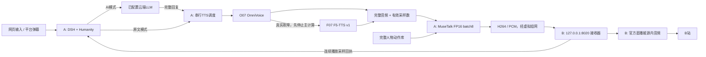

# O07 主用 / F07 备用：双机直播定型

Release: **`split-a4090-b3080-v1.1.0-o07-f07`**, 2026-10-28.

[English](#english-runbook) · [发布清单](../../configs/releases/split-a4090-b3080-o07-f07-v1.json) · [新版验收报告](O07_F07_ACCEPTANCE.md) · [新增数值与回执](../evidence/voice-o07-f07.json) · [历史 MOSS 基线](BASELINE_A4090_B3080.md)

## 本次决定

女A「林知夏」固定采用 **O07 / OmniVoice「夏栀 · 温柔清甜」**。**F07 / F5-TTS v1** 使用相同的合成参考声音，作为可手动启用、也可在主引擎故障时启用的备用。两者属于不同模型对同一参考的复现，音色接近，但不承诺完全相同。

角色仍为虚构的22岁成年女大学生，场景为日光宿舍，沿用完整48段新增动作库、MuseTalk FP16 batch 8、720×1280 / 25 FPS。A4090负责媒体推理、DSH/Humanity及唯一权威状态；B3080只接收并交由官方直播姬编码推流。原有云端LLM渠道和人格、观众分区、删除账本均保留。

本文件只定型新语音链路。历史测评的原始数据、音频、截图、报告和测评站不改写。旧报告中的 MOSS 延迟不是本版本的延迟。新版实测范围和未测项目见独立验收JSON；公开开播、真实弹幕、真实礼物及观众CDN时延需要在新版本上另行验收，不能继承为已通过。

## 固定配置

| 环节 | 固定值 |
|---|---|
| A | 原生 Windows；RTX 4090 48GB，64GB 内存 |
| B | 原生 Windows；现有3080接收端及官方直播姬；不加载TTS/人物模型 |
| 主语音 | O07，OmniVoice，FP16，32 steps，speed=1.0 |
| 备用语音 | F07，F5TTS_v1_Base，FP32，32 NFE，EMA，本地Vocos，speed=1.0 |
| 固定种子 | `2026102807`；只提高可复现性，不保证跨驱动逐位一致 |
| 参考音频 | `assets/voices/female-a-o07/reference.wav`，合成参考，无新增真人克隆 |
| 参考文字 | 晚上好，我是林知夏。今天也想陪你，慢慢聊一会儿。 |
| 参考SHA256 | `310c5d326dfabf0701eb255ca28e9e08f5626795d8b81d4e3b641bbac6b573a8` |
| TTS输出 | mono PCM16 WAV，24000Hz；适配器转成16000Hz媒体PCM |
| 长文字 | 1–1500字符；优先按标点分段，每段最多140字符；段间100ms静音 |
| GPU调度 | 一次一条TTS任务；正常合成和备用重试共用同一串行锁 |
| 播放 | 收齐完整回复与完整波形后播放；保留最后不足一帧的有效采样 |
| 传输 | H264 NVENC / PCM16 mono 16kHz；720×1280 /25FPS；4秒缓冲 |
| 状态 | `state/female-a-4090`，只允许A上的一个DSH/Humanity写入者 |
| 访问 | 网页/API直接使用；不新增登录、令牌或权限限制 |

模型权重继续使用4090已有本地文件，本次不下载新模型。权重和环境路径分别列在[配置示例](../../configs/resident-tts.example.json)。共享依赖目录仍可能被保留的环境引用，不能因旧引擎停用就删除整个 `runtime/tts`。

[原生环境与权重锁定快照](../../configs/releases/o07-f07-runtime-lock.json)记录人物、O07、F07各环境的Python/已安装包版本、上游Python源码树指纹和28个现有模型配套文件的逐文件SHA。三环境实测Python3.10.22、Torch2.9.1+cu128、Transformers4.51.3；模型及配套文件合计4,670,299,912字节。此清单只记录现有文件，不包含权重下载或自动安装命令，亦不能替代人物模型和完整动作库。

## 运行链路



A暴露8010演播台及媒体；9880调度器、9881 O07、9882 F07和3092 DSH只绑定A本机回环。B的8020接收器仍绑定B本机回环，按已保存的上游地址转发。不要把9881/9882直接暴露为网络TTS接口。

两个模型各自在独立原生Python环境中常驻，避免torch/transformers依赖冲突。人物先完成模型转换、动作库和真实音频预热，释放启动缓存，再依次加载O07和F07，避免冷启动峰值叠加。本次没有改变精度、缩减动作库或降低batch。

## 文件及职责

| 文件 | 职责 |
|---|---|
| `integration/resident_tts_worker.py` | 加载单引擎、参考校验、分段生成、24kHz WAV、取消标记、父进程监视 |
| `integration/resident_tts_service.py` | 回环9880、串行调度、声线选择、唯一一次备用重试、拥有的进程树停止、健康及恢复 |
| `integration/resident_tts.py` | LiveTalking `resident-local` 适配器；完整波形、代际隔离、尾帧、DSH回执 |
| `deployment/activate_resident_tts.py` | 离线前置检查、备份、注册适配器、写入新TTS配置；不重置记忆或平台配置 |
| `scripts/start_studio.py` | 先人物后语音；冷启动人物最长等待15分钟，再验证两个声线和参考指纹 |
| `scripts/tts_control.py` | `status`、`select`、`recover` 原生控制入口 |
| `web/voice-settings.html` | O07/F07试听、状态和下一句声线切换，无鉴权 |
| `configs/voices/female-a-o07-f07.json` | 参考来源、固定参数与音频SHA |
| `configs/resident-tts.example.json` | 可审核的部署模板 |
| `configs/resident-tts.json` | 本机实际模型/环境路径；不提交Git |
| `configs/tts-selection.private.json` | 当前选用声线，切换原子落盘；不提交Git |

## 已准备4090上的启用与启动

以下命令在**运行目录**执行，不能误在其下的只读Git检出目录启动另一套服务。先确认平台已下播，当前任务已结束；不复制正在写入的SQLite主文件，不覆盖渠道密钥。

```powershell
Set-Location -LiteralPath 'C:\dev\虚拟数字人直播'
.\runtime\livetalking\Scripts\python.exe -X utf8 -B scripts\dsh_control.py status
.\runtime\livetalking\Scripts\python.exe -X utf8 -B scripts\launch.py stop
# 将审核通过的仓库源码按原生迁移手册同步至运行目录。
.\runtime\livetalking\Scripts\python.exe -X utf8 -B deployment\activate_resident_tts.py
.\runtime\livetalking\Scripts\python.exe -X utf8 -B deployment\deploy_dsh.py
.\runtime\livetalking\Scripts\python.exe -X utf8 -B scripts\start_studio.py --no-browser
# 上一条返回ready后，再检查/启动原有唯一DSH服务：
.\runtime\livetalking\Scripts\python.exe -X utf8 -B scripts\dsh_control.py start
.\runtime\livetalking\Scripts\python.exe -X utf8 -B scripts\tts_control.py status
```

激活器拒绝替换仍在监听8010/9880/9881/9882的运行实例。先停止已有会话与媒体服务，避免端口冲突。冷启动在Windows文件缓存为空时可能很慢；启动器超时后必须检查原进程和日志，不能反复运行启动命令制造重复人物进程。

此步骤面向已经准备好权重、环境和人物库的4090。旧 `Setup-Streamer.ps1` 是GPT-SoVITS历史基础安装器，不能声称它能从空机器自动安装本版本。新机器迁移需要按[4090迁移手册](RTX4090_MIGRATION.md)携带既有原生环境、上游源码、四个保留模型、缓存和预处理角色；逐文件校验后再激活。

## 访问、试听与手动选择

- A演播台：`http://REMOTE_4090_HOST:8010/`；声线页：`/voice-settings`。
- B：`http://127.0.0.1:8020/receiver/`；声线页：`http://127.0.0.1:8020/voice-settings`。
- 官方直播姬素材为 `http://127.0.0.1:8020/output.html?output=platform&renderer=livehime&buffer_ms=4000&rev=o07-f07-v1.1.0`，720×1280，打开源内音频，关闭重复桌面音频/麦克风。发布切换后在素材设置内确认地址并重新载入；仅修改磁盘配置不能证明已运行的浏览器实例刷新。正常运行不循环刷新，否则会重置缓冲和播放租约。
- 独立40声线选型站保持独立；其中的原测量与试听不会因正式选用O07/F07而改写。

```powershell
.\runtime\livetalking\Scripts\python.exe -X utf8 -B scripts\tts_control.py select F07
.\runtime\livetalking\Scripts\python.exe -X utf8 -B scripts\tts_control.py select O07
.\runtime\livetalking\Scripts\python.exe -X utf8 -B scripts\tts_control.py recover O07
```

切换仅在合成队列为空时允许，正在播放的波形不变，下一条任务使用新选择；无需重启人物或DSH，不清空上下文。临时 `/tts` 请求的 `voice_id` 仅覆盖该请求，不改变全局默认。声线页的试听仅播放已归档WAV，不占用GPU、不自动创建直播场次。

## 故障、取消与恢复约束

1. 默认选O07，校验worker身份与参考指纹；正常情况只调用O07一次。
2. 主worker不可用、返回错误、无效WAV或超过90秒合成超时，先对该请求发取消，再确认主计算已经停止；必要时只停止broker拥有且路径/命令匹配的worker进程树。确认停止后，使用F07重新合成完整原文，最多一次。
3. 返回实际 `engine`、`voice_id`、`fallback` 和参考SHA，页面显示备用提示。禁止用O07标签包装F07音频。若无法确认主计算停止，则拒绝回退，避免两个引擎竞争GPU。
4. 用户停止、场次代际改变、旧请求失效属于取消，不属于合成故障：**不触发备用、不补播旧文本**。取消标记保留5分钟，排队任务也检查标记。
5. 模型一次扩散调用不能逐token打断；请求立即失效，当前模型调用可能继续运行到返回。调度锁在计算结束前不释放，过期结果丢弃。此行为避免停止后旧语音重新出现。
6. 主故障回退不永久改选F07；下次仍尝试O07。如果O07已被停止，后续请求会继续明确回退，维护时使用 `recover O07` 重新加载。恢复完成后再以短句验证，不重启DSH。
7. 手动明确选F07时，F07故障直接报告，不暗中跳回O07。两个引擎均故障时保留错误状态和上下文，不生成无声成功回执。
8. 只有单个输出拥有者累计确认全部有效采样并自然结束，DSH才把该句记为COMPLETED。HTTP成功、WAV生成成功或有画面均不等于播完。

## 人格、上下文与下播维护

本版本只替换TTS。平台事件去重、观众隔离、一次一条回复、单播放租约、runtime epoch、完整采样回执均沿用[双机契约](SPLIT_DEVICE.md)与[DSH规范](../DSH_HUMANITY.md)。B不是记忆写入者；换TTS不得启动第二个DSH或重建权威数据库。

下播先让当前语句排空，固定来源水位，结束场次；静默两分钟后在OFFAIR状态执行符合来源规则的整理。每日03:30与周一04:10的任务、预算、删除账本、可恢复游标和合并规则见[记忆流水线](../dsh-humanity/MEMORY_PIPELINE.md)。上个版本的记忆维护预算耗尽问题没有因更换TTS自动解决：必须查看任务终态和证据，不能将deferred当作已压缩合并。公开房间状态与官方客户端状态不一致、真实礼物和CDN延迟仍是独立验收项目。

## 资源、观测与维护

本轮六个真实TTS用例、46项Python、82项Node及官方B客户端五段复测通过。B刷新素材后平均25.000FPS，未新增音频欠载、缺包或解码错误；首轮16次欠载保留为失败记录。云端上下文例文本等待32.473秒，语音准备2.894秒，完整阶段明细见[新版验收](O07_F07_ACCEPTANCE.md)，不复用旧MOSS性能数字。

语音模型常驻以避免每句重新载入。空闲显存、合成峰值和人物启动峰值不同，必须分别记录。显存紧张时先检查本项目与其他已授权任务的真实进程，不杀未知GPU进程、不自动降低batch/精度。本版本没有新增下载，也没有修改既有测评或删除保留权重。

日志：`logs/resident-tts.runtime.*.log`、`logs/tts-O07.*.log`、`logs/tts-F07.*.log`、`logs/avatar.runtime.*.log`、`logs/gpu-worker.*.log`。生成日志记录request_id、实际声线、音频秒数、模型/排队墙钟、参考与音频SHA、模型进程峰值；不打印密钥。新增验收产物位于 `outputs/voice-release-20261028/`，不写回旧benchmark目录。

```powershell
.\runtime\livetalking\Scripts\python.exe -X utf8 -B scripts\tts_control.py status
nvidia-smi --query-gpu=memory.used,memory.free,utilization.gpu --format=csv
.\runtime\livetalking\Scripts\python.exe -X utf8 -B -m unittest discover -s tests -p test_resident_tts.py -v
```

释放显存时先确认已下播、结束自己的预览与任务，再用 `scripts/launch.py stop` 停止媒体服务。broker正常关闭时停止其拥有的worker树；异常关闭由worker持有的Windows父进程句柄检测并退出，避免PID复用导致模型孤留。不要停止独立CPU选型站或用户无关程序。

## 许可与后续变更

OmniVoice代码Apache-2.0，F5-TTS代码MIT；两套所用预训练权重为CC-BY-NC，合成参考不会改变权重条款。来源见[上游说明](../../THIRD_PARTY_NOTICES.md)。这两套方案的可运行性和商业授权是不同问题。

新声线、不同参考、降低精度/步数、改变缓冲、切换batch或替换动作库均需要新版本与独立验收。禁止覆盖2026-10-27及TTS选型测评的音频、数据或图表。回滚只切换到已经校验且实际存在的方案；当前不要求重新下载已删除的MOSS权重。

## English runbook

Version **v1.1.0-o07-f07** selects **O07 / OmniVoice** as the default and **F07 / F5-TTS v1** as the approved backup, using the same synthetic reference. Female-A / Lin Zhixia, her daylight dorm, the full motion bank, MuseTalk FP16 batch 8, portrait 720×1280 /25FPS, the four-second media buffer and A4090/B3080 separation remain fixed.

The avatar loads and warms first; two isolated native Windows Python workers then load O07 FP16/32 steps and F07 FP32/32 NFE with local Vocos. Both remain resident. A loopback broker serializes all speech work. It verifies the engine, voice ID, reference digest and 24kHz mono PCM16 WAV. The adapter resamples to the existing 16kHz media stream and preserves the exact valid sample count, including the final partial frame.

Use `deployment/activate_resident_tts.py` only with the media services stopped and all existing local dependencies present; it backs up configuration without resetting personality, channel credentials or persistent memory. Deploy the integration with `deployment/deploy_dsh.py`, start `scripts/start_studio.py --no-browser`, then start/check the existing sole DSH instance. The historical GPT-SoVITS setup script is not a clean-install bootstrap for this release. Model downloads were not performed for this cutover.

Open `/voice-settings` on A:8010 or through B:8020. The two archived auditions need no inference. Manual selection applies to the next request only after the synthesis queue is idle; it does not restart media or erase conversation context. `scripts/tts_control.py status`, `select O07`, `select F07` and `recover O07` provide equivalent native controls.

Default O07 failures permit exactly one F07 retry after primary computation has stopped. Timeout recovery terminates only the owned, validated worker tree, including the Windows venv launcher's Python descendant. Cancellation, a new runtime epoch or a stale request never triggers backup speech. Diffusion inference is not token-interruptible: cancelled results are discarded and the serial lock remains held until computation stops. Every response and receipt identifies the actual engine. Explicit F07 failure never silently selects O07.

DSH/Humanity on A remains the single state writer and playback authority. Completed speech requires full valid-sample presentation and a natural-end receipt. Post-air, daily and weekly memory consolidation retains its source rules, budgets, deletion ledger and resumable cursor; replacing TTS does not resolve prior deferred jobs. B receives media and runs official Livehime with source audio. Public broadcasting, new real comments/gifts and audience CDN delay are independent acceptance gates.

See the linked machine-readable release/evidence for actual new measurements and limitations. All historical benchmark results, original audio and published reports remain unchanged. The two pretrained models carry CC-BY-NC terms independently of their code licenses.
