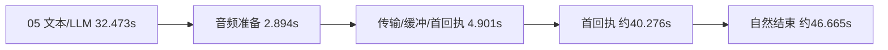
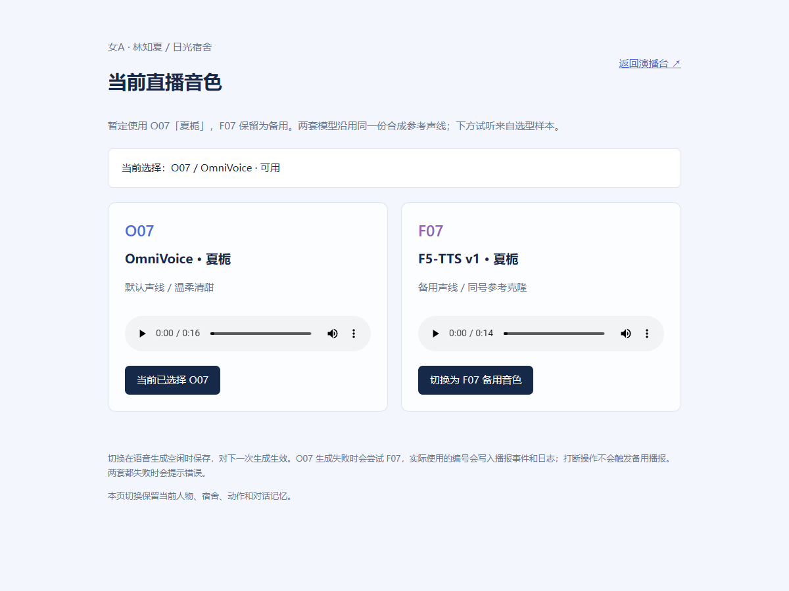

# O07/F07 新版验收 / Release acceptance

2026-10-28 · **split-a4090-b3080-v1.1.0-o07-f07**

[定型操作手册](BASELINE_O07_F07.md) · [逐项原始数值与回执](../evidence/voice-o07-f07.json) · [配置清单](../../configs/releases/split-a4090-b3080-o07-f07-v1.json)

新版已经在 A4090 完成真实模型生成，在 B3080 已登录的官方直播姬浏览器素材中完成五段本地交互。**主用 O07 / OmniVoice，备用 F07 / F5-TTS v1，结束测试后恢复 O07、保持下播。** 本轮没有开启公开直播或录制；云端上下文回复使用既有渠道，Echo 用例直接朗读测试原文。

## 固定条件

A：原生 Windows、4090 48GB /64GB RAM；女A /林知夏、日光宿舍、完整动作库、MuseTalk FP16 batch8、720×1280 /25FPS。O07 FP16 /32步和 F07 FP32 /32NFE 分环境常驻，同一串行调度器。本轮没有降精度、降 batch 或新增模型下载。

B：3080 只运行轻量接收器与官方直播姬，不加载人物或 TTS。官方素材使用 `output=platform&renderer=livehime&buffer_ms=4000`，源内音频输出；这不是另开一个 Chrome 播放页来替代官方客户端。

## 真实语音生成与故障验证

以下为六个不同任务的整次 HTTP 墙钟，含调度与波形返回；不是首音延迟，也不是相同文本的模型排名。输出为24kHz /mono /PCM16，文件 SHA 与字节数见 JSON，原件保存在 A 的 `outputs/voice-release-20261028/`。

| 用例 | 实际模型/声线 | 生成音频 | 耗时 | 结果 |
|---|---|---:|---:|---|
| O07 短句 | OmniVoice /O07 | 4.980s | 2.981s | 通过 |
| O07 长句 | OmniVoice /O07 | 20.800s | 2.844s | 通过 |
| 明确指定 F07 | F5-TTS v1 /F07 | 4.363s | 2.588s | 通过 |
| 停止已核实的主 worker，制造真实故障 | F5-TTS v1 /F07 | 3.797s | 5.360s | 一次回退，实际身份为 F07 |
| 全局手动选择 F07 | F5-TTS v1 /F07 | 3.232s | 2.466s | 通过 |
| 恢复主 worker、选回 O07 | OmniVoice /O07 | 4.280s | 2.931s | 通过 |

排队前取消、正在计算时取消均已验证：旧结果失效，取消不会调用 F07；不把一次不可中断的扩散运算误称为逐 token 中断。主 worker 恢复后，两引擎均返回就绪。

## 官方 B 客户端五段复测

所有行均取得 DSH 的完整有效采样和自然结束回执。各阶段统一使用 **A 的服务器时间戳**；“首个正采样回执”是 B 页面播放的观测代理，不能当作观众端声学首音。

| 场景 | 声线 | 文本准备/LLM | 文本到音频就绪¹ | 音频就绪到首回执 | 接收到首回执 | 接收到自然结束 |
|---|---|---:|---:|---:|---:|---:|
| 01 开场，介绍 A/B 分工 | O07 | 0.015s | 5.107s | 4.907s | 10.063s | 16.972s |
| 02 主用声线与场景 | O07 | 0.010s | 2.961s | 4.821s | 7.800s | 13.835s |
| 03 暂停后恢复同一场次 | O07 | 0.009s | 2.943s | 4.819s | 7.778s | 12.096s |
| 04 不重启人物，切备用 | F07 | 0.009s | 3.205s | 4.797s | 8.018s | 12.649s |
| 05 切回主用，云端人格与上下文 | O07 | 32.473s | 2.894s | 4.901s | 40.276s | 46.665s |

¹ 此阶段包含人物缓存释放/准备、TTS、重采样与回报，比独立 TTS 的墙钟范围更宽。01 在空闲后启动，不能拿它替换纯模型平均耗时。

05 的实际回复：“我是林知夏；刚才画面由四零九零生成，经虚拟网络传给三零八零设备上的直播姬接收。” 同时通过了重复事件拒绝与暂停恢复后场次不变的检查。该例主要等待来自云端文本生成；更快的本地语音不能消除这32.473秒等待。

## 连续性：保留失败与修复后结果

| 观测 | 首轮，旧素材实例 | 刷新素材后的独立复测 |
|---|---:|---:|
| 采样数 | 252 | 214 |
| 平均画布更新 FPS | 12.887 | 25.000 |
| 最低 /最高 FPS | 0 /25.395 | 24.640 /25.402 |
| 新增音频欠载 | 16 | 0 |
| 新增缺包 /解码错误 | 0 /0 | 0 /0 |
| 缓冲区最小值 | 0ms | 3949ms |
| 五个请求自然结束 | 5 | 5 |
| 连续性判定 | **失败** | **通过** |

首轮官方素材实例已运行约一天，出现断续，即使五个请求最终完成也不算连续性通过。随后在官方客户端内重新载入同一素材，显式固定4秒缓冲并附发布版本查询参数，再从头执行五段。人物精度、batch与模型步数均保留。该操作后的复测通过；没有足够证据把所有历史卡顿都归因于缓存或单个网络问题。

画布计数、Web Audio 回执和官方客户端内素材就绪属于本地链路证据，**不等价于官方编码器录制验收、公开弹幕/礼物验收或观众 CDN 观看质量**。首轮、复测的原始 JSON 分别保留，公开文件包含两次摘要及来源指纹。

## 资源与启动

复测后 A 整机一次观测：显存 **11,137 MiB 已用 /37,486 MiB 空闲**，GPU 与编码利用率各1%；系统内存 **13,961.7 MiB 已用 /65,433.9 MiB 总量**。这是空闲后单点值，不是峰值，也不全属于本应用。独立 TTS 用例的采样另附在设备原始记录中，不能据此承诺任何并发负载。

人物统计累计175个 render batch，共32.825秒，每批8帧，换算计算吞吐约42.65 FPS；这排除特征、等待、传输和显示，不应替代 B 的实测25 FPS。释放缓存10次共3.898秒；语音预备10次共2.089秒。

冷启动中曾出现人物预热尚未完成、旧180秒等待上限先超时的问题。本版本将主启动等待与隔离 worker 的人物就绪等待统一为900秒，并先完成真实音频预热，再按顺序启动语音模型。O07/F07 冷载分别记录155.438秒与100.391秒；O07 本次恢复加载28.203秒。不要把进程创建或端口存在当成所有组件已就绪。

## 回归、文件与边界

- 原生 A 环境 Python：**46通过**；本机 Node：**82通过、0跳过**，含原有状态、平台与浏览器相关检查。
- 新声线页6项浏览器检查通过：两个原始试听可解码、互斥播放、移动端无横向溢出、浏览不触发修改或场次、无脚本错误。测试浏览器已关闭。
- 源码与历史证据通过新一层 SHA 绑定；旧测评数值、音频、视频和校验文件保持原样。更换当前源码的证据放入独立新文件。
- 同一参考音频用于 O07/F07；不同模型复现并不保证声纹逐位相同。参考为合成声音，无新增真人克隆。
- 真实弹幕、礼物、公开房间状态/观众 CDN、长时间压力测试及此前延后的下播记忆整理仍是独立项目，不列为本次已通过。

## English

The native O07 primary /F07 backup deployment passed six real GPU synthesis cases, cancellation without fallback, a real primary-process fault with one F07 retry, and recovery to O07. Both workers are resident in separate native Windows environments. The avatar remains MuseTalk FP16 batch8 with the full portrait motion bank.

Five locally injected events completed through the existing official Livehime material on B3080. After explicitly refreshing the material with a four-second buffer, 214 samples averaged25.000 canvas FPS, with zero additional audio underruns, missing packets or decode errors. The first attempt averaged12.887 FPS with16 underruns and is retained as a failed continuity run. All five new utterances have full-sample natural-end receipts.

The cloud context case spent32.473s producing text,2.894s preparing audio, and4.901s until the first positive playback receipt. The request-to-receipt total was40.276s. These are server-side playback observations, not audience acoustic latency. No public broadcast or recording was started. Long soak, real gifts/comments, audience CDN quality, prior memory-maintenance deferral and room-state reconciliation remain separate gates. Tests ended off-air with O07 selected and both workers ready.
