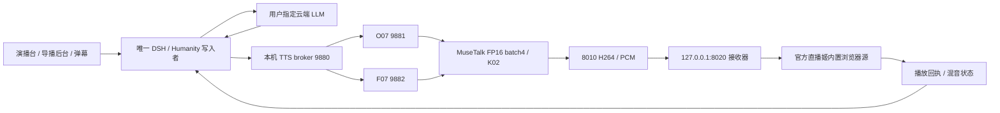

# RTX 3080 原生定稿 / Native RTX 3080 release

发布号：`native-rtx3080-v1.2.2-k02-o07-f07`；部署日期：2026-10-29。

对应部署分支：`deploy/rtx3080`。先读[设备分支规范](DEVICE_BRANCHES.md)；main不直接部署。

本次按用户要求，将已选择的 K02、O07/F07、女A素材和导播台部署到
**RTX 3080 10 GB / 64 GB RAM**。推理与官方直播姬同机运行，保留接收器
作为隔离的播放入口。原 A4090/B3080 架构及其历史报告仍保留；4090 控制
与候选模型清理继续等待用户通知，本次没有操作4090。

[新版本实测报告](../analysis/native-rtx3080-k02-20261029/README.md) ·
[发布清单](../../configs/releases/native-rtx3080-k02-v1.2.2.json) ·
[K02 算法](BASELINE_K02.md) · [导播台手册](../live-room/RUNBOOK.md)

## 成品与地址

| 项目 | 固定内容 |
|---|---|
| 人物 | 女A / 林知夏，原日光宿舍；完整48类动作库 |
| 输出 | 720×1280、25 FPS目标、H.264 NVENC＋16 kHz PCM |
| 人脸推理 | MuseTalk 1.5 FP16、batch 4；共用现有 Whisper / VAE |
| 融合 | K02 局部椭圆软融合、有限色差修正、与出队音频对应的静音门控 |
| 主音色 | O07 / OmniVoice，FP16、32 steps、速度1.0 |
| 备用音色 | F07 / F5-TTS v1，FP32、32 NFE、EMA、本地 Vocos |
| 合成 | 串行请求，完整波形就绪后播放；取消不触发备用合成 |
| 对话 | 已保存的云端 `gpt-6-luna` 渠道，Responses协议 |
| 人格记忆 | 本机 DSH 0.2.0-rc.2＋Humanity 0.1.17连接器 |
| 管理 | BGM、自动压低音乐、滤镜、弹幕姬、留言姬、私聊、运行记录 |

- 演播台：`http://REMOTE_3080_HOST:8010/`
- 导播后台：`http://REMOTE_3080_HOST:8010/admin`
- 人格记忆：`http://REMOTE_3080_HOST:8010/memory`
- 平台配置：`http://REMOTE_3080_HOST:8010/platforms`
- 音色控制：`http://REMOTE_3080_HOST:8010/voice-settings`

上述页面通过既有虚拟局域网访问，应用无需登录。官方账号核验在直播姬
完成。页面中的“开始本地会话”只控制数字人交互，不替代官方开播按钮。

实测报告：`http://REMOTE_3080_HOST:8010/reports/native-rtx3080-k02-20261029/report.html`。
报告含五段耗时表、合成耗时排序、FPS/显存曲线和原始证据。

## 运行链路



这些进程同在3080，接收器的上游改为 `http://127.0.0.1:8010`。
平台配置使用 `client_location=receiver`，表示复用8020已有的官方源；它
不是在描述物理上有第二台设备。避免另外打开一个有声输出浏览器。

| 服务 | 地址 / 归属 |
|---|---|
| 演播台与媒体 | `0.0.0.0:8010`，本机原生Python环境 |
| TTS broker / O07 / F07 | loopback 9880 / 9881 / 9882，隔离进程与依赖 |
| DSH | loopback 3092；3091保留管理重定向 |
| 轻量接收器 | loopback 8020；目录 `receiver-b` |
| 官方播放素材 | `http://127.0.0.1:8020/output.html?output=platform&renderer=livehime` |
| ComfyUI | 独立项目 `C:\dev\comfyUI`，8188；不作为实时推理依赖 |

浏览器源设为720×1280，使用源内音频；桌面声音和麦克风是否使用，按
实际直播需求设置，避免将同一数字人声音采集两次。官方源是唯一播放
确认端，后台静音预览和透明叠层不会取得播报权限。

## 显存与调度

先用原始batch8实际验证；两轮连续性不合格后，按用户预先授权改成
batch4，再验证完整五段。分辨率、精度、采样步数和K02算法保留。O07和F07
分别驻留模型权重，broker将合成串行化；媒体GPU进程单独运行，进程
退出由父进程句柄监视，避免遗留模型。

本版在语音预热结束及每句合成的 `finally` 中释放PyTorch空闲缓存。
**模型权重继续驻留**，只归还不再使用的临时激活/工作区；不在视频每帧
调用 `empty_cache()`。状态接口报告各语音进程的allocated/reserved MiB，
整卡占用另用 `nvidia-smi` 测量，二者不可相加当作精确整卡占用。

原生后台进程使用 `CREATE_NEW_PROCESS_GROUP | CREATE_NO_WINDOW`。
去掉与隐藏控制台语义冲突的 `DETACHED_PROCESS`，继续重定向日志并关闭
继承的输入句柄。停止服务按项目登记PID、实际命令及归属检查，不使用
`taskkill /IM python.exe`。

其他项目正在使用GPU时，性能结果不能代表独占吞吐。本次验收等待
ComfyUI队列空闲；只请求其空闲模型缓存释放，不取消生成任务、不重启
ComfyUI。测试中的资源峰值及首轮失败见独立报告。

## 模型、源码与依赖锁

K02新增口型权重 **0字节**。3080原来没有选定的两套TTS运行环境，本次
仅补齐O07/F07及Vocos和必要配置，共约4.67 GB；没有下载新候选方案，
没有恢复MOSS，也没有删除历史测评。

| 内容 | 固定版本 |
|---|---|
| OmniVoice源码 | `08be0b4ccbac3e13e374e86fbfead4b4cac343e2` |
| F5-TTS源码 | `45868abaabd74aabf03cd673d6dd00cc9d9c01ae` |
| 共享原生CUDA栈 | Python3.10.22、torch2.9.1+cu128、torchaudio2.9.1、torchvision0.24.1 |
| O07实际导入 | transformers5.3.0、tokenizers0.22.2、huggingface-hub1.3.0 |
| F07实际导入 | transformers4.51.3；独立F5附加依赖 |
| 女A参考 | SHA256 `310c5d326dfabf0701eb255ca28e9e08f5626795d8b81d4e3b641bbac6b573a8` |
| 随机种子 | `2026102807` |

每套TTS有独立的原生venv，通过只读`.pth`复用已经核实的Torch栈。
升级Omni所需Transformers只写Omni环境，不替换人物环境或ComfyUI环境。
因为共享site-packages可能带来同名distribution元数据，`pip freeze`
不能单独证明实际导入版本；本次同时验证 `module.__version__` 和
`module.__file__`。保存新验收证据，原4090 runtime-lock不改写。

49个Omni和47个F5 Python源文件按固定清单校验；Windows Git的CRLF
仅在转成LF后的哈希正好匹配锁文件时归一化。模型全部整文件SHA256
核对。F5词表必须使用锁定的11255字节版本；同名在线13800字节版本
被校验拒绝，不能用文件名相同代替内容相同。

运行期固定本地HF/Torch/Numba/NLTK缓存并开启offline模式；不会在
第一次直播请求时临时下载模型。原始完整安装器仍有历史GPT-SoVITS
路径，**不能用它覆盖本版O07/F07环境**。

## 部署与启动

运行根为 `C:\dev\虚拟数字人直播`。源码检出与运行目录不同；更新Git
不等于已将新代码激活到 `src/LiveTalking`。配置含私密渠道和平台信息，
不进入公开仓库。

离线配置仅在本项目服务全部停止后执行：

```powershell
Set-Location -LiteralPath 'C:\dev\虚拟数字人直播'
.\runtime\livetalking\Scripts\python.exe -X utf8 -B deployment\configure_rtx3080_k02.py
```

配置器检查模型、O07参考哈希、女A动作库、固定上游补丁契约及端口，
备份原私有配置，再激活演播台、TTS、DSH和K02。它不下载模型、不开播、
不启动服务。已配置好的运行环境日常只需启动：

3080正式分支固定使用已验收的batch4。配置器保留`--batch-size 8`离线实验能力，
但正式分支启动校验不会接受该参数；不同强度实验需独立分支与明确的目标规格。
K02激活器仅在硬件配置明确标记`rtx3080-k02-batch4`时接受batch4，其他
部署继续按原batch8基线校验。`configs/lipsync.json`记录实际batch和
`reference_profile_batch_size=8`，区分运行参数与历史算法参考参数。

```powershell
Set-Location -LiteralPath 'C:\dev\虚拟数字人直播'
.\runtime\livetalking\Scripts\python.exe -X utf8 -B scripts\dsh_control.py start
.\runtime\livetalking\Scripts\python.exe -X utf8 -B scripts\start_studio.py --no-browser
.\runtime\livetalking\Scripts\python.exe -X utf8 -B receiver-b\scripts\receiver_control.py start
```

启动器先检查已有服务，避免创建重复进程；服务就绪必须以实际HTTP状态
为准。首次编译、权重载入和预热有等待时间，不能当作每次回复的耗时。
官方直播姬需要保持打开并加载上述8020素材。日常在后台点击“开始本地
会话”，输入原文播报或选择对话模式。F07在音色页切换，正在播报时
等待或先取消；不能在同一句中途无标记切换音色。

## 状态与记忆

本版本唯一DSH状态目录为 **`state/female-a-3080-k02`**，对应
`configs/dsh-3080-k02.private.json`。原3080/4090状态保留，本次没有从
暂停控制的4090复制数据库。五段测试覆盖同一会话短期上下文，不能
等同于验证了跨设备历史记忆迁移或完整下播压缩计划。

DSH保留请求QUEUED/THINKING/SYNTHESIZING/AUDIO_READY/BUFFERING/
PLAYING/COMPLETED生命周期，实际播放回执才推进完成状态。播放租约
30秒；断线重连不会把同一请求重复创建为新观众发言。

Humanity连接器执行版本化人格、记忆投影、提取和维护；状态字段
`native_humanity_tools=false` 表示本版没有启用Humanity原生工具调用。
不要把连接器可用写成原生插件所有能力均已启用。详细下播后归档、
预算、日周压缩、删除与恢复仍按 [DSH总规范](../DSH_HUMANITY.md)
及其验收状态执行；定时计划存在不代表每轮维护已成功执行。

私聊只在后台显示；导播明确送到播报框后才发声，也不自动成为观众记忆。
平台事件保留原平台、房间和用户分区，模拟评论/礼物带测试标记。
每轮私聊分配独立DSH原生执行ID，界面聊天历史继续按同一导播会话保存，
将最近12条注入下一轮，避免重复创建已持久化的原生session。

## 停止、回滚与排查

先结束本地会话或官方直播，再停止本项目媒体，释放语音和人物显存：

```powershell
Set-Location -LiteralPath 'C:\dev\虚拟数字人直播'
.\runtime\livetalking\Scripts\python.exe -X utf8 -B scripts\launch.py stop
.\runtime\livetalking\Scripts\python.exe -X utf8 -B receiver-b\scripts\receiver_control.py stop
.\runtime\livetalking\Scripts\python.exe -X utf8 -B scripts\dsh_control.py stop
```

DSH仍有活动会话时会拒绝强行停止，先在网页结束会话。
即使HTTP端口已经关闭，也要等待旧写入者进程退出。控制器按精确server路径与项目根核对归属，
等待30秒后只结束该项目的残留进程，并再次验证退出；它不会对其他Node进程操作。上述命令不结束
其他项目的Python、ComfyUI或官方客户端。关闭直播姬之后，该客户端
自己的编码/渲染显存才会释放。不要以“服务PID已退出”替代整卡测量。

备份在 `.setup/k02-3080/configuration-backups` 和
`.setup/k02-3080/cache-fix-backups`，各激活器还保留自己的上游源备份。
回滚需先停止本项目服务，恢复同批源码和配置，再按相应旧版激活；
运行中不覆盖SQLite主文件。记忆备份使用SQLite一致性备份并保留删除账本。

排查顺序：`/api/studio/status` 人物/TTS → `/api/dsh/status`唯一写入者 →
`/api/dsh/platforms/status`官方源 → `127.0.0.1:8020/receiver/status`媒体
计数。`connected=true`不等于持续25FPS；同时检查音频欠载、缺包、解码
错误及实际Canvas帧率。平台公开开播状态另行核对，本次只做本地验收。

## English operational notes

This is the user-requested **native RTX3080 cohost variant**, with the selected
K02 compositor, FP16/batch4 MuseTalk, full portrait motion bank, O07 primary
and F07 backup. The retained receiver points to the same machine's loopback
avatar server. Its official Livehime source remains the sole playback authority.

Use the three startup commands above after the prepared assets and offline
configuration are present. The cloud channel stays in private configuration.
An isolated DSH state root avoids a second writer to the retained 4090 state;
historical 4090 memory was not migrated in this task.

This release returns unused CUDA workspaces after TTS utterances while keeping
weights resident. It preserves synthesis precision, sampling steps and the
selected reference. Its new acceptance report keeps the failed first run and
separates synthetic-event local playback from public-stream/CDN acceptance.
Batch8 was actually tested first; batch4 was selected after failed continuity
measurements, following the user's existing fallback authorization.
Stop only registered project services; do not terminate all Python processes.
