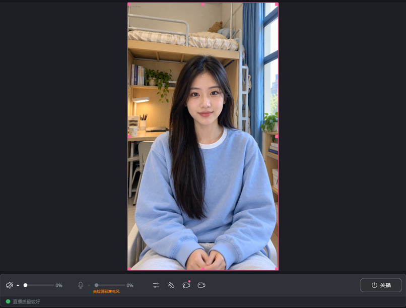

# A4090 + B3080：当前双机运行记录

[English below](#english) · [完整架构](SPLIT_DEVICE.md) · [机器可读证据](../evidence/split-3080-receiver.json)

2026-10-27，将B从操作者本机切换到远程3080。4090继续运行女A／林知夏、日光宿舍、48段动作库、MuseTalk FP16 batch8、MOSS04，以及唯一的DSH/Humanity状态写入者。3080只承担接收、官方直播姬、最终编码和上传。媒体源码版本为`fb7e6e8b0f655b9d6b9863486cc0e6f8b1e8f697`；后续文档提交不会重启活动直播。

## 目录与进程

| 设备 | 根目录 | 运行内容 |
|---|---|---|
| A4090 | `C:\dev\虚拟数字人直播` | 8010人物、9880 MOSS、3092 DSH；弹幕采集位于A |
| B3080 | `C:\dev\虚拟数字人直播\receiver-b` | 回环8020接收器；官方直播姬使用B原有安装和登录 |
| 原操作者本机 | 原项目目录 | 本次停止8020接收服务，不再作为输出播放器 |

B的`configs/receiver.private.json`保存A的虚拟网络原点、`receiver_id=receiver-3080`以及B官方客户端路径。B共校验并部署7个接收器文件，静态人物页面和API通过A提供。没有在B新增人物或语音模型，也没有使用Docker、WSL或虚拟机。

本次复用B现有标准Python环境`C:\dev\虚拟数字人直播\runtime\livetalking\Scripts\python.exe`，依赖实测为`aiohttp3.14.5`、`psutil7.2.2`。接收器不导入Torch、不加载模型。ComfyUI便携Python的隔离导入路径导致直接启动失败；未改动它的`._pth`或依赖。新设备可按完整架构文档安装独立接收环境。

现有B配置已保存时，重启接收器：

```powershell
Set-Location -LiteralPath 'C:\dev\虚拟数字人直播\receiver-b'
.\Start-Receiver.ps1 -PythonExe 'C:\dev\虚拟数字人直播\runtime\livetalking\Scripts\python.exe'
```

仅停止B接收器：

```powershell
.\Start-Receiver.ps1 -PythonExe 'C:\dev\虚拟数字人直播\runtime\livetalking\Scripts\python.exe' -Stop
```

不要同时重启旧3080人物、MOSS或DSH。本次旧会话先封口，旧DSH停服后完整备份415个状态文件，再停止经路径和创建时间核实的旧推理进程。整机显存由约9613MiB降至1223MiB。备份位于旧根目录的`archives/3080-state-retired-<time>/`，带哈希清单；该历史状态未覆盖或合并到A当前状态。ComfyUI和官方直播姬未被停止。

## 直播姬素材与声音

在B自己的直播姬浏览器素材中使用：

```text
http://127.0.0.1:8020/output.html?output=platform&renderer=livehime&rev=3080-fb7e6e8
```

画布与素材720×1280，浏览器素材音量100%，声音输出到流；桌面音和麦克风静音。该回环地址只能在B打开。A地址用于控制和普通网页交互；不要在A再打开正式输出播放器，以免争夺播放租约。

直播姬使用软件H264解码、直接画布和Web Audio默认输出。A到B仍为共享NVENC H264＋PCM，缓冲目标4秒。切换时实际观察到官方客户端「关播」按钮和绿色质量状态，随后在A标记`MANUAL_LIVE`。应用内部LIVE、采集器CONNECTED和平台真正开播分别检查；单凭其中一个不能证明其余两个。



## 本次验证

| 项目 | 本次结果 |
|---|---|
| 真正官方客户端五段测试 | 5/5 COMPLETED；含重复去重、暂停恢复、云端人格／上下文回复 |
| 317次画布帧率采样 | 中位25.285，最小24.466，最大25.390FPS |
| 测试时接收连接 | 1次WebSocket连接，1条活动连接，0上游错误 |
| 音频欠载／丢包／解码错误 | 0／0／0 |
| 真实弹幕 | 6条blivedm事件对应回复COMPLETED；独立于本地注入测试 |
| 新录制 | 按用户要求未启动录制；旧录像保留其原验收范围 |
| 真实礼物事件 | 本轮没有样本，未标记为通过 |

画布FPS统计解码后的画布更新次数；不是显示器呈现或CDN观众FPS。COMPLETED要求自然结束及有效样本全部连续播完，不以服务器生成完成替代播放完成。这些回执证明客户端消费链路；未测量观众扬声器实际发声时间。

## 真实弹幕响应延迟

| 样本 | LLM | MOSS整句合成 | 音频就绪到首次正样本回执 | 平台时间到首次回执 | 平台时间到播完 |
|---|---:|---:|---:|---:|---:|
| 1 | 8.746s | 17.428s | 4.645s | 31.263s | 39.832s |
| 2 | 10.264s | 11.536s | 4.725s | 27.707s | 32.547s |
| 3 | 2.223s | 29.421s | 4.778s | 37.139s | 51.482s |

三条首播均值32.036秒。平台事件时间与A系统时钟可能有偏差；若统一从A采集器收到事件计算，分别为31.017、27.068、37.351秒。首个正样本回执也是离散观测，不能当成精确的扬声器发声时刻。B站上传、转码、CDN及观众播放器延迟另计，尚未测量。

当前MOSS整句合成完成后再提交语音，语音长度会影响等待时间。模型推理与云端LLM是主要耗时；当前虚拟网络最大收包间隔在五段测试末次诊断为91.8毫秒，没有再次出现旧本机页面的反复断线、0FPS状态。

## English

On2026-10-27, B moved from the operator's PC to the RTX3080. The RTX4090 remains the sole avatar, MOSS04, DSH/Humanity and comment-collection host. The actual official Livehime source passed five tests at720×1280;317 canvas-update samples measured median25.285FPS, minimum24.466FPS. Audio underruns, packet gaps and decode errors remained zero. Public streaming was started on B, and six real comments completed playback.

The receiver lives under `C:\dev\虚拟数字人直播\receiver-b`. The commands above explicitly reuse the existing native Python; no GPU model is loaded by this receiver. Keep browser-source internal audio enabled and desktop/microphone muted. B uses its own loopback8020 URL. Do not start the retired B inference services alongside A.

The retired3080 state was backed up consistently after shutting down its writer, including415 files and a hash manifest. It was not merged into A's current state. GPU usage fell from about9613MiB to1223MiB. The active A services and the official B client were preserved.

Three real replies took27.707–37.139 seconds from platform timestamps to the first accepted positive sample receipt, averaging32.036 seconds. MOSS whole-utterance generation accounted for11.536–29.421 seconds, the cloud model2.223–10.264 seconds, and post-audio buffering/receipt observation4.645–4.778 seconds. Platform clock skew and discrete receipt observation limit precision. Audience CDN latency was not measured. No new recording or real-gift verification was performed. See the linked sanitized JSON; older recordings retain their original acceptance scope.
