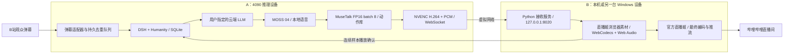

# A 推理 + B 直播姬：原生 Windows 双机部署

[English guide](SPLIT_DEVICE.en.md) · [4090 目标](../RTX4090.md) · [直播姬](../platforms/BILIBILI_LIVEHIME.md) · [人格与记忆](../DSH_HUMANITY.md)

本方案将 **人物、语音、人格和记忆放在 A 设备**，将 **官方哔哩哔哩直播姬和最终推流放在 B 设备**。两台设备通过现有 ZeroTier 等虚拟网络通信。新增代码直接运行于原生 Windows Python / Node，不使用 Docker、WSL 或虚拟机。

4090 部署沿用女A / 林知夏、日光宿舍、完整 48 段动作库、MOSS 04、MuseTalk FP16 batch 8、720×1280 / 25 FPS。云端只承担已配置的 LLM 对话和记忆提取。当前实测和验收范围见[双机验收](SPLIT_DEVICE_ACCEPTANCE.md)，不能用旧 3080 的直播录像代替本次双机验收。

## 1. 设备分工与实际链路



| 内容 | A：推理机 | B：直播机 |
|---|---|---|
| MuseTalk、脸部融合、动作调度 | 运行，单一人物实例 | 不安装模型 |
| MOSS 04 | 运行，本地模型与 CPU codec | 不安装 TTS |
| DSH / Humanity / 云端渠道 | 运行，唯一权威 | 通过接收服务访问 A |
| 弹幕接收、去重、观众记忆 | 默认运行 | 只显示平台界面 |
| 音视频传输 | 一路共享 NVENC H.264，配对 PCM | 转发、硬解码、同一时钟播放 |
| 官方直播姬、平台登录 | 无需运行 | 运行，保存 B 自己的官方登录 |
| 最终直播编码、录制、上传 | 无需承担 | 直播姬执行 |
| 正式状态库与下播维护 | 唯一读写者 | 不保存第二份业务状态 |

A 仍执行一次**传输用 NVENC 编码**，否则 JPEG 跨虚拟网络的开销会抵消分机收益；B 再由直播姬执行最终推流编码。NVENC 使用固定功能编码器，不能把它描述为 A 完全没有编码负载。B 的收益是无需加载人物/TTS模型，A 的收益是移走直播姬、平台界面、浏览器合成和最终上传。

## 2. 为什么增加本机接收服务

不能把所有来源简单改成 `http://A_DEVICE:8010/output.html` 后就认定方案完成。远程 HTTP 在 Chromium 中通常不是安全上下文，而 WebCodecs 需要安全上下文；浏览器源的音频、回执、页面资源和重连也必须保持一致。

B 接收服务固定代理已保存的 A 原点，提供 `http://127.0.0.1:8020` 同源页面、API、SSE 和双向 WebSocket。Chromium 将本机回环原点视作可信上下文，可使用硬件 H.264 解码。客户端不拼接任意远端主机，代理不转码、不重采样、不丢 PCM。

| 地址 / 端口 | 所在设备与作用 | 监听方式 |
|---|---|---|
| `http://REMOTE_4090_HOST:8010` | A 人物服务、网页、对 DSH 的代理 | 虚拟网络可达 |
| `http://127.0.0.1:9880` | A MOSS 私有服务 | A 本机回环 |
| `http://127.0.0.1:3092` | A DSH / Humanity | A 本机回环 |
| `http://127.0.0.1:8020/receiver/` | B 接收控制台 | B 本机回环 |
| `http://127.0.0.1:8020/output.html?output=platform&renderer=livehime` | B 直播姬唯一正式画面源 | B 本机回环 |
| `http://127.0.0.1:8020/`、`/platforms`、`/memory` | B 操作 A 的人物、平台与记忆 | 经 B 代理 |

`127.0.0.1` 永远指打开地址的那台电脑。B 的画面地址不能填成 A 的 `127.0.0.1`。B 服务只监听回环是它的进程位置设计；应用页面/API继续无需管理员登录、token 或角色鉴权。

## 3. 目录和配置

A 推荐根目录 `C:\dev\虚拟数字人直播`，Git 检出位于其 `Ai-Talk-Streamer` 子目录。B 可以直接以检出目录为根，例如 `E:\dev\sandbox\虚拟数字人直播\Ai-Talk-Streamer`。所有生成文件、环境和日志放在各自项目根内。

| 文件 | 位置 | 用途 |
|---|---|---|
| `configs/livetalking.yaml` | A 私有 | 人物、FP16 batch 8、MOSS服务和端口 |
| `configs/moss-live.json` | A 私有 | 原生MOSS解释器、vendor、模型根和 v04 |
| `configs/channel.env` | A 私有 | 已保存的 LLM 地址、密钥、模型和协议 |
| `configs/platforms.private.json` | A 私有 | B站房间、互动策略、`client_location=receiver` |
| `configs/split-device-policy.private.json` | A 私有 | 播放租约30秒，保留原有记忆目录或显式独立测试目录 |
| `configs/dsh-active-policy.json` | A 私有 | 当前DSH策略指针 |
| `configs/receiver.private.json` | B 私有 | A 虚拟网络原点、B 官方客户端路径、接收端编号 |
| `configs/receiver.example.json` | Git | 无私有地址的B配置模板 |
| `outputs/receiver/` | B 私有 | 接收服务自身PID、stdout/stderr和客户端启动回执 |

Git 更新不会自动将 A 检出覆盖至运行根。应备份并复制本次源码允许列表，再运行 `deployment/deploy_dsh.py`。保留所有私有配置、权重、运行环境、正式状态与进程记录；不使用镜像删除覆盖运行根。

## 4. A 设备部署与启动

### 4.1 已有安装的更新顺序

先检查当前 A 的 `/api/dsh/status`、进程归属和 GPU。若 A 有活动会话，先完成该会话的下播/排空，再部署；不得为了更新杀掉另一台正在公开直播的旧实例。

1. 固定仓库提交并同步应用源码，保存被替换文件。
2. 核实 MOSS 模型、vendor、注册的 v04 参考音频、人物源和完整预处理动作库；按本次迁移清单核对 SHA-256。
3. 用原生 Python 环境安装适配器，固定 DSH/Humanity/Node 版本。
4. 保留选定的 MOSS 音色和精度，将 MuseTalk 设为 FP16 batch 8。
5. 应用双机模式；正式切换之前使用独立测试状态。
6. 按人物 → MOSS → DSH 的顺序启动，避免模型加载峰值叠加。

以下命令在 **A 运行根**执行。前提是完整原生媒体环境已安装；它们不会下载或自动补齐 MOSS 模型。

```powershell
Set-Location -LiteralPath 'C:\dev\虚拟数字人直播'
$InferencePython = Join-Path (Get-Location) 'runtime/livetalking/Scripts/python.exe'
& $InferencePython -X utf8 -B deployment/activate_moss.py --voice v04 --batch-size 8
& $InferencePython -X utf8 -B deployment/deploy_dsh.py
& $InferencePython -X utf8 -B scripts/configure_split.py --isolated-state state/female-a-4090
& .\Start-Inference.ps1 -PythonExe $InferencePython
```

`configure_split.py` 检查活动会话、备份配置，保留渠道与平台凭据，设置 B 接收模式和30秒租约。`--isolated-state` 只用于新测试目录，正式运行保留已完成一致迁移的状态目录；不指定该参数就保留当前状态路径。配置后重启DSH使其生效。`Start-Inference.ps1` 不打开浏览器，不启动直播姬，不公开开播。

固定版本和依赖分工：人物原生 Python 3.10；MOSS 使用其独立 Python 3.13/vendor；Node 24.22.1；DSH 0.2.0-rc.2；Humanity 0.1.17。本次迁移复用了既有兼容环境，不把其他机器的 Python 虚拟环境当作可搬运安装包。MOSS 真实合成已验证；不要仅因可选 torchcodec 缺失就覆盖已工作的依赖。

### 4.2 虚拟网络检查

本次复用已存在的 ZeroTier，不更改系统路由、VPN或全局代理。新设备加入同一虚拟网络并获得授权后，在 B 执行：

```powershell
Test-NetConnection -ComputerName 'REMOTE_4090_HOST' -Port 8010
Invoke-RestMethod 'http://REMOTE_4090_HOST:8010/api/studio/status' -TimeoutSec 10
```

确认返回的是正确A主机的女A、MOSS04、人物就绪信息。排查虚拟网络路由/防火墙时，只处理实际的设备和端口；不能以网页HTTP200代替真实出帧、声音和回执验证。建议在两台设备的网络均空闲、稳定时验收；被其他传输占满的链路无法仅靠GPU升级解决。

## 5. B 设备安装和启动

B 只需原生 Python 3.10+、官方直播姬和支持 WebCodecs 的 Chromium 浏览器内核。无需 CUDA、Torch、ComfyUI、人物模型、TTS或DSH依赖。可以复用已签名的官方直播姬；未安装时使用项目官方准备脚本，安装来源和签名规则见[直播姬文档](../platforms/BILIBILI_LIVEHIME.md)。

以下命令在 **B Git 检出根目录**执行，替换实际原生 Python 和官方客户端路径：

```powershell
Set-Location -LiteralPath 'E:\dev\sandbox\虚拟数字人直播\Ai-Talk-Streamer'
& .\Install-Receiver.ps1 -PythonExe 'C:\Python313\python.exe'
& .\Start-Receiver.ps1 -Upstream 'http://REMOTE_4090_HOST:8010' `
    -ClientExecutable 'D:\Program Files (x86)\bililive\livehime\livehime.exe'
```

安装入口在项目内创建 `runtime/receiver`，只安装 `aiohttp==3.13.3` 和 `psutil==7.2.1`，缓存和临时文件也在项目内。已有兼容 Python 可通过 `Start-Receiver.ps1 -PythonExe ...` 直接使用。

`Start-Receiver.ps1` 保持窗口隐藏、幂等启动；配置变更前必须先停止接收服务。停止命令仅根据已核对的可执行路径、脚本和进程创建时间结束本项目接收服务，不依据历史PID停止其他程序：

```powershell
& .\Start-Receiver.ps1 -Stop
& .\Start-Receiver.ps1
```

打开接收控制台，点击“检查A设备”，应看到人物、MOSS和记忆服务就绪。启动官方直播姬按钮只在B运行已配置客户端；它不替用户登录，也不点击“开始直播”。

## 6. 直播姬竖屏与声音配置

1. 在 **B** 的官方直播姬选择竖屏画布，输出尺寸 **720×1280**。最终编码可为30 FPS，人物实际生成/传输仍为25 FPS。
2. 添加一个“浏览器”素材，名称建议 `女A-4090-分机输入`，URL填：

   ```text
   http://127.0.0.1:8020/output.html?output=platform&renderer=livehime
   ```

3. 浏览器素材宽720、高1280，铺满竖屏画布，启用其**源内音频**，该源音量100%。确认网页音频进入直播姬混音器。
4. 将麦克风和桌面声音静音，避免把用户操作音、重复语音和反馈回声混进直播。不要再用桌面声音转录同一浏览器素材。
5. 单独的Chrome/Edge预览使用 `renderer=preview`，它保持静音、不参与播放权威。验收完成关闭临时预览，正式直播只保留一个Livehime人物源。
6. 在 B 的 `/platforms` 选择“直播姬位于B设备 / receiver”，点击“准备竖屏画面”、检查就绪状态，再启动本地互动。
7. 先录制一段带声音的本地文件。核实竖屏尺寸、实际音轨、口型和音量后，才进行平台公开开播和观众回环验证。

**平台登录只在B的官方客户端完成。** A保存的Cookie、直播姬状态或机器路径不会让B自动获得平台登录。B站人脸验证等弹窗由账号本人处理。本地“会话已LIVE”/`COMPANION_READY` 仅说明互动与播放器就绪，不代表官方客户端已开始公开推流，更不代表观众收到内容。

## 7. 传输、时钟与回执约束

### 7.1 数据帧与硬件编码

默认 H.264 Baseline level3.1、720×1280、25FPS、CBR3Mbps、GOP50、无B帧、零延迟NVENC。每一编码输出必须恰好对应一个输入帧，且PTS与包序号一致；配置错误导致编码缓存时直接失败，不能悄悄把口型和声音错配。

每个二进制包先包含三个小端 `uint32`：`sequence`、`video_length`、`sample_rate`，随后是视频负载和本帧PCM。H264视频负载为 ASCII `AVC1` + 小端关键帧标志 + AnnexB码流。音频保持单声道16kHz、16bit PCM，每40ms640样本，即约256kbps。实际链路还含WebSocket、映射消息和TCP开销，不能将3Mbps视频码率当作总网络速率。

不支持WebCodecs时保留JPEG兼容模式，诊断可加 `codec=jpeg`。本次虚拟网络下JPEG实测约5FPS，不能将回退状态标记为流畅验收通过。直播姬内核若不支持H264，应更新官方客户端并重验；不使用浏览器不安全参数来绕过可信上下文。

### 7.2 播放与抖动缓冲

B 使用一个 AudioContext 时钟安排PCM与对应图像。画面临近播放时才硬解，避免在B持有数秒完整解码图像。默认4秒缓冲，`buffer_ms=800..10000`可显式调整。该缓冲增加接收延迟，用于容忍虚拟网络的短暂停顿；它不能保证任意网络中断下仍然连续。

不通过删音频追帧。H264的P帧依赖前序帧，发送队列也不能删参考帧；队列超过125包（约5秒）时断开过慢接收端并重连。JPEG兼容路径可跳过画面，保留全部PCM。

### 7.3 唯一播放权威

每段有效音频发出前，A先将范围映射持久化到DSH。B按序接收 `media.map` 与媒体包；实际AudioBufferSource自然结束、所有连续样本播放完毕后，才回传 `natural_end=true`。系统同时核对广播、租约、runtime_epoch、generation、transport_instance和连续样本数。

B网关会给播放器心跳附加自己的receiver_id与本机客户端存在信息；A在分机模式下忽略缺少receiver_id的A侧Livehime预览。该标识用于进程拓扑和就绪判断，不是用户鉴权。它也不能证明源在官方客户端内运行：Chrome测试播放器和官方浏览器素材需要分别验收。

一次正式输出只保留一个 `renderer=livehime` 的播放器。其他观看窗口用preview，避免切换播放租约。打断和generation切换清空旧排队声音、图像和映射，保留样本屏障；H264解码器重置后请求新关键帧。不能为消除等待而放宽旧音频隔离或把取消的ended事件当作自然播放结束。

上一句已自然完成、已知语音均完成或取消时，普通 `generation_advanced` 仅推进屏障并清理映射，保留安全的待机排队媒体，避免每次新输入都使画面冻结一个缓冲周期。存在未完成语音或明确的请求打断时仍完整清空；单元测试同时覆盖保留待机和强制停止旧语音。

## 8. 直播状态、断网和下播维护

| 操作 / 故障 | A业务状态 | B表现与后续 |
|---|---|---|
| 仅打开接收控制台 | 不创建正式会话 | 可查健康和打开静音预览 |
| 本地互动开始且B源就绪 | 创建/复用场次、取得播放权威、进入LIVE | `COMPANION_READY`；官方是否推流另行确认 |
| 暂停 | 保留场次ID，暂停生成与派发，取消活动音频 | 旧排队音频停止；恢复重建epoch和播放租约 |
| 普通接收断线 | A保留事件与播放账本；不能凭已生成认定已说完 | 约5秒后重连，等待关键帧，再取得租约 |
| 租约失效 | 停止确认旧消费者，进行权威丢失恢复 | 未播放完的内容不记为已完成；不自动重复播整句 |
| A服务失效 | 持久状态留在A，恢复沿用业务恢复规则 | 显示等待重连，不偷偷切换3080成为第二个写者 |
| 停止B接收服务 | 不自动公开下播、不结束A场次 | 若直播姬仍推流，可能冻结；先处理官方下播 |
| 停止本地平台互动 | 仅结束本模块拥有的场次；进入排空/下播流程 | 不等价于直播姬“结束直播” |
| 正式下播完成 | 事件封口、冷却期、下播压缩、投影，再执行日/周任务 | B无需开着；A的记忆服务需要继续运行 |

排空、取消、恢复和记忆压缩沿用[DSH完整状态规范](../DSH_HUMANITY.md)与[操作手册](../dsh-humanity/RUNBOOK.md)。低负载时可以关闭B；若关闭A的DSH进程，持久任务保留，下次启动再按租约/检查点恢复，但不会在关机期间执行压缩。

## 9. 从旧3080切换正式记忆

目前4090使用独立测试状态，旧3080正式公开直播与记忆保持原位。分机链路测试通过不授权将两个女A记忆库合并，也不把人工测试弹幕自动变成正式长期记忆。

正式迁移按以下顺序操作：

1. 在旧实例完成公开下播，关闭弹幕入口，排空或明确取消未完成请求。
2. 等待场次封口，创建SQLite在线备份或停服后一致备份；包含删除账本、人格版本、投影清单和业务状态，不能仅复制活动的 `.sqlite3` 主文件。
3. 停止旧实例业务写入，并记录末尾事件序号、删除屏障、备份SHA和版本。
4. 在A导入正式状态，先重放删除账本、核对投影滞后和版本，再打开唯一权威实例。
5. 将A策略指针切至已迁移的正式状态路径，停止独立测试实例后启动正式实例。
6. B重连，取得新的runtime_epoch与播放租约，验证已确认的上下文和删除生效；正式开播后做观众弹幕→有声回复回环。

回滚时先停止A的正式写者，再选择一致备份恢复旧机；不得通过同时运行两个正式实例来“无缝”回滚。详见[迁移手册](RTX4090_MIGRATION.md)。

## 10. 监控与验收

接收端：`GET /receiver/status`、`POST /receiver/check`。观察接收字节、媒体包、连接数、错误、最近媒体时间。`media_codec`从实际二进制媒体头识别；`player_fps`从同一消费者连续上报的已呈现视频帧数与接收时间计算，不把网络收包数当播放帧率。输出页新增`stream_metrics`后，网关只保留有限、非负、有限值的解码与播放诊断；不会把任意字段转发给A。旧输出页仍能提供已呈现帧差分。页面的 `window.avatarTransport.metrics()` 提供更完整的缓冲、音频耗尽、包缺失与解码错误。上述观察仍不能代替官方客户端的真实有声录制。

A端：人物、MOSS与DSH健康、`nvidia-smi`的显存/利用率/编码利用率、MOSS单次生成耗时、业务请求的连续播放样本。`logs/avatar.runtime.stderr.log`会记录超过200ms的媒体包处理延迟，便于区分生成、映射提交与网络停顿。

可重复的真实跨机五场景测试：

```powershell
# B仓库根；先确认A无活动测试/正式会话，且只由这个验收播放器取得权威。
$env:SPLIT_EVIDENCE_DIR = Join-Path (Get-Location) 'outputs/split-device/five-cases-new'
& 'PATH_TO_NATIVE_NODE_24\node.exe' devtools/validate-split-device.mjs
```

该命令真实调用A模型，依次测试欢迎、较长说明、暂停恢复、自然回复、云端人格与同场上下文；另测弹幕去重和媒体重连。它录制B接收的真实视频/声音，保存请求结果和逐秒指标，不启动公开直播。应使用新的输出目录，脚本在finally关闭自己的浏览器、恢复互动配置并结束自己拥有的测试场次。

验收至少同时包括：五段真实请求自然完成且有效样本全数确认、720×1280、稳定段≥22FPS、零音频缓冲耗尽、零媒体包缺失、零解码错误、断线后新关键帧恢复。还必须单独完成B官方直播姬有声本地录制，以及真正公开开播后的观众回环。后一项不能由注入弹幕或浏览器录像替代。

## 11. 常见故障

| 现象 | 定位与处理 |
|---|---|
| B页面无法连接 | 查A8010、虚拟网络、Bgateway进程和保存的upstream；勿填A的localhost |
| H264没启用 | 源必须是B的127.0.0.1:8020；检查VideoDecoder支持与实际codec指标 |
| 画面约5FPS | 先查是否已回退JPEG；本次链路不接受JPEG作为流畅模式 |
| 收包稳定、画面低FPS | 查B硬解码、浏览器可见性、CPU/GPU负载和实际呈现计数 |
| 语音中途卡顿 | 查音频缓冲耗尽与收包最大间隔；不以丢PCM或改播放速率掩盖 |
| 回复前等待较久 | MOSS仍需整句生成，云端也有等待；分机不改变模型自回归速度 |
| 本地有声但直播姬无声 | 核对浏览器源内音频、素材音量、直播姬混音器和真实录制音轨 |
| 客户端启动返回740 | 官方程序要求Windows管理员确认；由账号本人打开。网关会复用同一路径已运行的客户端，避免重复启动；此限制不是应用鉴权 |
| 改了画布但仍是横屏 | 8.11保存部分`*_v2`分辨率字段；以客户端和实际录制尺寸核验，不能仅改旧字段 |
| 双重声音或回声 | 关闭桌面声音、麦克风和其他未静音预览，只留源内音频 |
| LIVEHIME_PLAYER_NOT_READY | B正式源未加载/未出帧/音频未running，不能靠登录应用解决 |
| BROADCAST_NOT_LIVE | 先使B源就绪并开始本地互动，或恢复暂停场次；不是管理员鉴权问题 |
| 新机忘记旧直播内容 | 独立测试状态的正常边界；按一致备份程序切换正式状态 |

## 12. 代码地图和实现边界

| 源码 | 职责 |
|---|---|
| `scripts/receiver_service.py` | B同源HTTP/SSE/WS接收、固定A原点、B状态和客户端启动 |
| `scripts/receiver_control.py` | B私有配置、幂等启动、归属校验停止 |
| `Install-Receiver.ps1` / `Start-Receiver.ps1` | B轻量原生环境与操作入口 |
| `scripts/configure_split.py` / `Start-Inference.ps1` | A分机配置、状态路径保留、原生启动 |
| `integration/stream_encoder.py` | 单路NVENC、零帧缓存、PTS与音频严格配对 |
| `integration/local_broadcast.py` / `viewer_buffer.py` | 共享人物泵、持久映射、无丢PCM队列与关键帧请求 |
| `web/local-stream.js` / `dsh-playback.js` | B硬解码、共同音频时钟、样本回执与取消屏障 |
| `backend/platforms/livehime.mjs` / `manager.mjs` | 接收机拓扑、B心跳、预检和本地会话生命周期 |
| `web/receiver.html` / `web/platforms.js` | 接收控制台与平台设置 |
| `devtools/validate-split-device.mjs` | 真实五场景、媒体录像和重连验证 |

规范参考：[PyAV编码接口](https://pyav.org/docs/stable/api/codec.html)、[WebCodecs AVC码流注册](https://www.w3.org/TR/webcodecs-avc-codec-registration/)。这些解释编码和解码协议；本机/4090是否可用由本项目实际验收确认。
