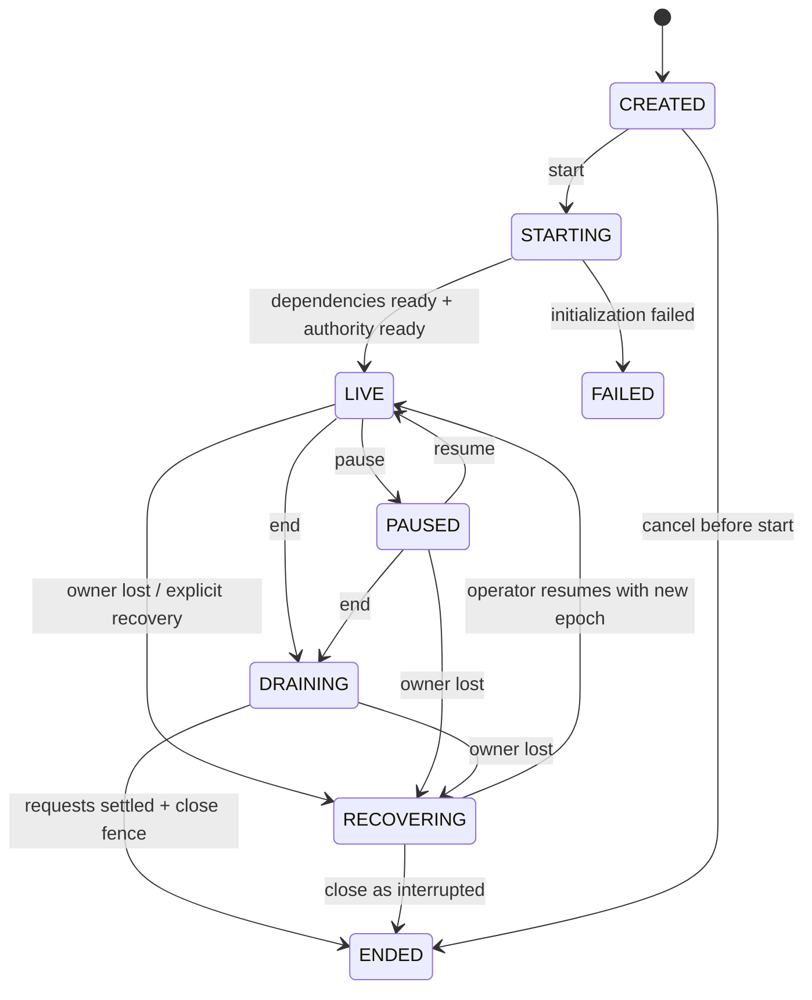
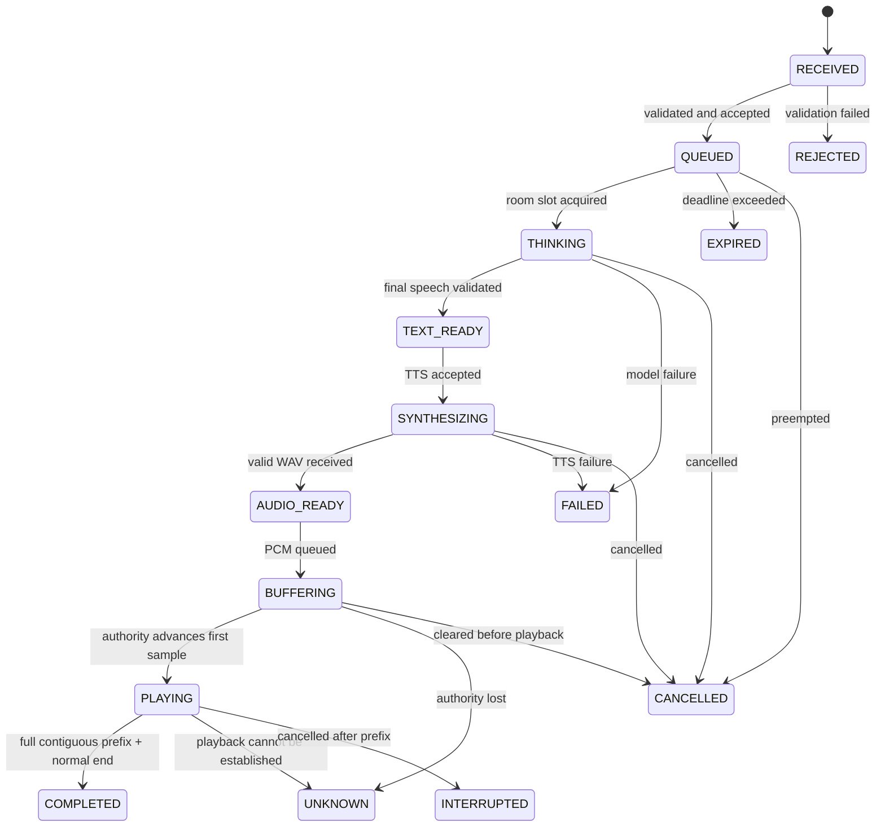

# 直播状态、播出确认与打断协议

[总方案](../DSH_HUMANITY.md) · [记忆流水线](MEMORY_PIPELINE.md) · [数据契约](CONTRACTS.md) · [验收](OPERATIONS_TESTING.md)

本文落实 R03–R07、R09、R16。所有状态名是本项目 v1 契约，不是现有 LiveTalking 或 DSH 的原生状态集合。示例参数见 [策略示例](examples/bridge-policy.example.json)。

## 1. 三类状态必须分开

| 对象 | 回答的问题 | 权威来源 |
| --- | --- | --- |
| Broadcast | 当前是否开播、是否接受新消息、是否允许后台写入 | Bridge 事务与控制事件 |
| Request / Utterance | 这条输入处理到哪、这段音频是否生成或入队 | 模型与媒体组件事件，经 Bridge 校验 |
| Playback observation | 哪个播放端实际推进到了哪一个样本 | 持有效租约的消费端回执 |

不使用一个 `speaking: true/false` 覆盖以上三类事实。尤其不能用“当前已不说话”反推上一条成功完成。

## 2. Broadcast 状态机



`FAILED` 与 `ENDED` 为终态；不能直接把同一 broadcast_id 改回 LIVE。重新开播创建新 ID。RECOVERING 不自动恢复为 LIVE，避免无人确认时重播旧音频；媒体预览仍可独立运行。

### 2.1 各状态的处理权限

| 状态 | 收新观众输入 | 启动模型/TTS | 正式播出 | 后台记忆提交 |
| --- | --- | --- | --- | --- |
| CREATED | 拒绝直播输入 | 禁止 | 禁止 | 不影响此前已结束直播的作业 |
| STARTING | 拒绝或由 UI 明示稍后重试 | 只做预热，不处理正式问题 | 禁止 | 禁止该角色批处理提交 |
| LIVE | 按身份与限流接纳 | 每房间串行 | 允许 | 禁止批处理；允许经验证的前台候选暂存 |
| PAUSED | 拒绝新输入，不让队列持续增长 | 禁止新处理；在途请求按暂停策略终止 | 停止并清理当前音频 | 仍视为直播占用，不整理 |
| DRAINING | 拒绝新输入 | 仅允许已在处理中的请求收尾，不再取待处理队列 | 排空当前有效音频，受排空上限约束 | 禁止 |
| RECOVERING | 拒绝 | 禁止重放未完成请求 | 停止旧 epoch 媒体 | 等恢复处置完成 |
| ENDED | 拒绝 | 禁止 | 禁止 | 静默等待后允许 |
| FAILED | 拒绝 | 禁止 | 禁止 | 封闭来源后允许处理已有效发生的事实 |

“观众页面无人观看”只更新观众计数，不等于下播。正式下播来自 operator.end 或经过确认的直播平台 stream_offline 事件。平台临时断线先标记 health=DEGRADED，超过策略阈值后仍需按明确规则结束，不依据网页 viewers=0 自动关闭。

### 2.2 开播事务

1. 校验角色版本、当前无另一活动 broadcast、依赖健康、模型渠道与媒体协议版本。
2. `BEGIN IMMEDIATE`：创建 broadcast_id、设置 STARTING，递增 room runtime_epoch，写 broadcast.start_requested，并获得房间业务 ownership。
3. 设置角色 maintenance_barrier，标记后台任务暂停。任务的旧 lease_generation 失效；不等待模型长调用结束才挡住写入。
4. 请求播放器确认当前 epoch 已清空旧媒体，获得唯一 authority lease。
5. 插件实际注入、Bridge、MOSS、人物服务与播放端均就绪后，在事务中转为 LIVE，写 broadcast.started。
6. 任一依赖失败转 FAILED，结算启动阶段的挂起状态；不能保留“页面显示 LIVE、实际无播放权威”的状态。

房间层只允许一个活动 broadcast。数据库的部分唯一索引与状态转移服务共同执行这一约束；不能仅靠页面禁用按钮。

### 2.3 暂停与恢复

暂停默认是停止当前说话、拒绝新输入，并保留本场记忆与话题。它不是下播，不触发定期整理。暂停操作与打断使用同一套取消屏障；待处理输入转 CANCELLED(reason=paused)，输入原文保留但不会自动当成已回答。

恢复需媒体依赖和播放权威重新确认。若未发生进程接管，可保留 broadcast_id；generation 必须变化。不得自动重播暂停前被截断的句子。要重新回答必须生成新 request_id，并以 `retry_of` 关联原请求。

## 3. Request 与 Utterance 状态

一个 Request 对应一条输入及一次可播回复。首版一条回复形成一个完整 MOSS utterance；未来分句时，一个 Request 可有多个按 segment_index 排序的 utterance，不改变已经生成的 segment 身份。



图示只展示主要路径。所有未终态可因明确故障进入 FAILED，或因取消进入 CANCELLED / INTERRUPTED；转移表必须在服务端集中验证。终态不可“复活”为 COMPLETED，后续证据通过 observation_revision 追加修订，而不是修改过去的状态事件。

| 终态 | 定义 | 下一轮可使用的信息 |
| --- | --- | --- |
| COMPLETED | 同一权威租约确认有效内容的完整连续样本前缀和正常结束，且无已知媒体缺口 | 整段助手文本可作为已播上下文 |
| CANCELLED | 播放前被取消，或只存在未获播放确认的生成结果 | 原用户输入；助手文本标记未播，不能当成答过 |
| INTERRUPTED | 已确认部分播放，后被停止 | 已知播放进度；没有字词对齐时不引用精确已说文字 |
| UNKNOWN | 权威中断、重启或信息不足，无法确证完成 | 用户输入与“不确定是否已完整回答”的状态 |
| FAILED | 某阶段明确失败 | 用户输入、失败原因；不记助手生成内容 |
| EXPIRED / REJECTED | 未进入有效处理或过期 | 排队记录；不作为角色已处理事件 |

COMPLETED 的含义是本系统权威消费端完成了输出，不证明远端平台观众听见，也不证明 OBS 混音器没有被人为静音。证据层级必须显示为 `consumer_playout`，不能标记为 `audience_heard`。

## 4. 身份、队列与抢占

每个请求携带 `character_id / room_id / broadcast_id / principal_id / viewer_id? / request_id / runtime_epoch / generation`。一条观众输入由平台消息唯一 ID 或页面生成的幂等键去重。显示昵称只参与展示，不能用作主键。

首版按同优先级 FIFO，每房间一个 active request，最多四条待处理。管理员的 interrupt_and_replace 优先于当前请求和普通队列；普通弹幕默认 enqueue，不能沿用现有 `interrupt=true` 让每条弹幕都打断上一句。

| 输入来源 | 默认动作 | 去重与失效 |
| --- | --- | --- |
| 普通观众消息 | 入队；容量满返回 queue_full | 同平台消息 ID 重试不重复计费、不重复播报 |
| 管理员 Echo | 显式选择排队或抢占 | 不进入 LLM，若完成播出仍可进入公共播出事实 |
| 管理员 AI 提问 | enqueue；显式按钮才抢占 | `Idempotency-Key` 与请求体 hash 一致才复用 |
| 平台重复投递 | 返回原接纳结果 | 不重新分配 request_id |
| 过期消息 | EXPIRED；不再启动模型 | 过期原文仍在事件账本中，可审计但不自动提炼 |

generation 只在请求真正激活、抢占或取消时递增。入队不能递增，否则会把当前有效请求错误标成过期。以数据库 event_seq 判断接纳顺序，不能用毫秒时间字符串保证唯一性。

## 5. 媒体归属协议 v2

当前二进制包是 12 字节小端头（sequence、JPEG 长度、sample rate）加 JPEG 与 PCM，通常每包 640 个样本。该格式缺少 utterance 身份；服务端 notify(end) 只是发送阶段事件。

v2 保留二进制头格式，通过 WebSocket 文本控制帧发送 `media.map` 和 `media.reset`。客户端先协商 `media_protocol=2`；v1 客户端只能作为普通预览，不能持有权威播放租约。DSH 运行是否健康与客户端协议是否满足播出确认要分别显示。

`media.map` 在对应二进制包之前发送，包含 transport_instance_id、packet_sequence、runtime_epoch，以及样本区间映射。例如一包的前半段属于句子、后半段是空闲音频，不能把整包都计为句子已播。

```json
{
  "type": "media.map",
  "version": 2,
  "transport_instance_id": "transport-01",
  "packet_sequence": 4821,
  "runtime_epoch": 12,
  "sample_rate": 16000,
  "sample_count": 640,
  "ranges": [
    {
      "packet_start": 0,
      "packet_end": 320,
      "utterance_id": "utt-01",
      "request_id": "req-01",
      "generation": 8,
      "utterance_sample_start": 35200
    }
  ]
}
```

所有样本区间使用半开区间 `[start,end)`。sample_count 必须等于随后 PCM 样本数，ranges 不得重叠或越界。未映射样本是空闲音频，不参与助手 utterance 完成判定。重采样后的 valid_sample_count 与尾部补零、结束标记分开记录，不能把额外静音当成台词。

必须完成以下发送和缓冲改造：

- Python 从 MOSS 输出到渲染结果持续保留 utterance_id 与样本偏移，不只在 start/end 两个点保留标记。
- 元数据和对应二进制包构成一个队列条目，原子地排队和发送；不能让两个 producer 交错发送造成错配。
- ViewerBuffer 把旧 JPEG 改成纯音频时，PCM 区间与 metadata 必须完整保留；不能为了赶上 FPS 丢音频或进度映射。
- 使用 transport_instance_id + packet_sequence 处理服务重启和 uint32 sequence 回绕；回绕前创建新的 transport instance，不猜测跨实例连续性。
- `media.reset` 是高优先级控制指令。客户端在处理之后不得继续把旧 epoch / generation 的缓冲当成有效新音频。

协议错误时普通预览可断开重连；权威端进入 DEGRADED，相关 utterance 不得完成。v1 与 v2 的升级必须覆盖服务端、演播台与 OBS 页面，不能只刷新其中一个脚本。

## 6. 权威播放端与租约

正式模式默认由 OBS 浏览器源担任 authority；只有浏览器测试时，管理员可以明确指定演播台预览端。不能把最先连接的任意观众页面自动升级为 authority。

权威身份包括 `consumer_id / authority_epoch / lease_id / lease_expires_at / broadcast_id / runtime_epoch`。租约通过受控服务端授予，浏览器仅获得当前播放用途的短期凭据；不得向网页暴露 Bridge 内部管理 token 或云端密钥。

每秒心跳，八秒未续租视为失效。Bridge 用自身单调时钟判断进程内期限，数据库保存 UTC 时间用于重启后保守恢复。浏览器时间戳只用于诊断，不决定租约是否有效。

切换 authority 时必须：冻结旧租约、追加最后可验证观察、递增 authority_epoch 和 runtime_epoch、清空旧媒体，再授予新租约。首版不把两个播放端的部分前缀拼成完整播出，跨租约仍未完整的句子结算 UNKNOWN / INTERRUPTED；需要重说时发起新请求。

## 7. 播放进度计算

### 7.1 必须使用的信号

客户端记录每段 PCM 的 scheduled_at_audio_time、sample_rate、sample_start、valid_sample_count 与 source 状态。每 250 ms 根据 AudioContext 播放时钟计算已越过的样本边界，并推进已确认的连续前缀。

仅 source.start 调用成功、next 调度时刻、收到 PCM、JPEG 已绘制、`is_speaking`、波形有能量，都不是已播放回执。初始 2.4 秒缓冲不能算入已播放时长。AudioContext 不在 running、媒体轨道 disabled、播放输出已知静音或断开时，不得继续前进正式前缀。

`source.onended` 在调用 stop 后也可能触发。客户端必须区分 natural_end 与 cancelled_stop；只有自然播放且样本连续才允许完成。使用 currentTime 和已调度区间作本地估计，有可用的输出时钟时记录更精确的诊断，但不承诺物理扬声器确实出声。

### 7.2 回执载荷

```json
{
  "consumer_id": "obs-main",
  "lease_id": "lease-01",
  "authority_epoch": 3,
  "broadcast_id": "bc-01",
  "runtime_epoch": 12,
  "utterance_id": "utt-01",
  "generation": 8,
  "receipt_sequence": 41,
  "contiguous_played_samples": 35520,
  "valid_sample_count": 110080,
  "natural_end": false,
  "audio_context_state": "running",
  "output_enabled": true,
  "known_gap": false
}
```

Bridge 必须校验身份绑定、租约、样本总量、generation、递增 receipt_sequence 与单调前缀。重复回执返回原结果；回退前缀只记异常，不覆盖较大已验证值；越过总长度、缺少映射、跨 epoch 的回执拒绝。

回执只能覆盖已经映射且有记录交付给该 consumer 的范围。累计值不是让客户端任意声明成功的权限。发现 known_gap 时不接受跨缺口的连续前缀；连接重建后不能把新连接样本数直接接到旧实例。

### 7.3 完成条件

只有以下条件同时满足，才在事务中产生 utterance.playback_completed：

1. 对应 utterance 的 valid_sample_count 已锁定，WAV 与文本 hash 均匹配。
2. 同一有效权威租约确认的连续前缀达到全部有效样本。
3. natural_end=true，输出未被 stop/reset，未报告已知音频缺口。
4. 未发生使该 utterance 失效的取消屏障、epoch 接管或提前终态。
5. 唯一事件键保证重复 end/ack 不能再次完成或重复记忆。

生成完成、发送完成和播放完成分别保留时间戳，延迟指标不能混用。可额外保留 OBS 录制证据以验证下游混音，但它是另一种证据，不改写本协议为“所有观众都听见”。

## 8. 打断事务与竞态处理

一次打断按以下顺序处理，不能仅调用 `flush_talk()`：

1. Bridge 事务锁定 room 当前 generation，写 cancel_requested，关闭旧请求的继续投送权，递增 generation，并为取消创建 barrier_id。
2. 发出 DSH cancel、MOSS cancel、Python 队列清理与播放器 reset。它们是尽力取消，不能声称云端已停止计费。
3. Python 丢弃尚未发送的旧 PCM；新控制指令携带 barrier_id，禁止旧结果在网络返回后重新入队。
4. 权威播放器先冻结旧样本账本，再停止旧 source、清理图片定时器和旧 buffer，回传 cancel_ack 及停止前的连续前缀。
5. Bridge 只在限定的取消确认窗口接纳该 barrier 的最后前缀结算；没有播放过则 CANCELLED，有可证明前缀则 INTERRUPTED，完全失联则 UNKNOWN。
6. 记录处理结果并释放房间 active slot。新请求可以开始思考，但其媒体必须等 reset 已确认或旧租约被撤销后才投送。

取消后的普通 progress 不再推进旧句子。专用 cancel_ack 必须匹配原 lease 与 barrier，且只能结算冻结前已映射的样本；不得把取消后的 natural_end 当成完成。

如果正常完整播放回执已经先提交，之后的 cancel 只影响下一条队列，不能追溯把已完成句子改成未播。如果取消屏障先提交、正常回执后来到，保留为迟到证据，不能把终态直接改成 COMPLETED。以 Bridge 的事件序号与取消屏障决定顺序。

## 9. 部分播放和文字引用

首版没有字词级音频对齐，因此不能用“播放了 50% 时长”截取“前 50% 汉字”作为已说内容。韵律、停顿与字音长度都不均匀。

对于 INTERRUPTED，只允许下一轮看到类似“上一条回复生成了完整文本，但只确认播放部分音频；不确定具体断句位置，请避免假定已完整告知”的上下文。完整生成稿保留在审计详情，默认不作为模型的历史 assistant 内容注入。

未来若加入本地强制对齐，须固定 aligner 版本、保存时间段置信度，并只纳入在已确认前缀内完整结束的语义单元。不得因当前 MuseTalk 使用 Whisper 特征就声称已有可靠字词转录或对齐。

## 10. 正式下播与封口水位

1. `end` 在事务中把广播转 DRAINING，拒绝新消息并冻结待处理队列；待处理但尚未开始的请求转 CANCELLED(reason=broadcast_ending)。
2. 当前已开始的请求最多等待配置的 30 秒排空。允许管理员选择立即停止，使用同一取消协议。
3. 排空结束后，所有非终态请求结算为对应终态；没有回执的不能补成成功。
4. 撤销 authority lease，清理本场媒体，写 broadcast.ended。事务记录 ended_event_seq 作为内容截止水位。
5. 设置 consolidation_not_before = ended_at + 120 秒，创建唯一 post_broadcast 作业，UI 显示“已下播，等待记忆整理”。
6. 作业只能读取截止水位内的输入及助手内容。截止后的迟到回执、人工更正或删除属于独立控制证据，递增 source_revision，使既有候选失效或触发修订，不可绕过截止水位悄悄增加聊天内容。

下播状态与整理状态分开：直播已 ENDED，而作业仍可能 PENDING / DEFERRED / FAILED。整理失败不会把直播改回 LIVE，也不会删除原始互动。

## 11. 进程重启和故障恢复

启动时读取 SQLite 与单实例 owner，递增 runtime_epoch。原有 LIVE / PAUSED / DRAINING 统一进入 RECOVERING；所有旧 lease 失效，播放器必须清空缓存。未完成模型调用与媒体队列不自动重试。

已提交的 playback_completed 事实保留；没有提交的完成不能根据 DSH 日志、缓存 WAV 或文件大小补推。之前已返回用户的幂等请求再次查询返回恢复状态，不重新生成。

管理员可以显式“恢复本场直播”或“结束并整理”。恢复保留 broadcast_id 并写新的 epoch 与恢复事件；下播按上述封口流程创建唯一整理作业。作业恢复从已提交块继续，不能从头重复写入。

| 故障 | 行为 |
| --- | --- |
| 云端 LLM 超时 | 当前请求 FAILED，不把部分草稿送 MOSS；保留用户输入 |
| MOSS 超时 / 错误音色 | 当前请求 FAILED；不切换别的声音冒充成功 |
| Bridge 暂不可达 | Python 停止接受新的 AI 请求；Echo 必须明确是独立降级模式 |
| 播放权威失联 | health=DEGRADED，阻止新媒体投送，已有句子按证据结算 |
| 普通预览失联 | 只清理该连接，不取消全房间直播 |
| 数据库不可写 / 磁盘满 | 停止新 AI 请求和后台提交，不能无日志继续形成记忆 |
| Humanity 投影落后 | 记忆健康显示 pending；读取主账本或暂停该投影注入，不能混用旧事实 |

## 12. 必须持久化的观测数据

每请求记录 receive、queue、model_start、first_token、text_ready、tts_start、audio_ready、first_send、first_play、play_completed 等时间与状态；缺失值为 null，不能填零伪造低延迟。

每次打断记录取消屏障、各组件响应、最后已确认样本和最终结算原因。每次下播记录内容水位、source_revision、未完成条数、作业 ID。事件重放必须重建相同的状态摘要，不能依赖已丢失的进程内变量。
