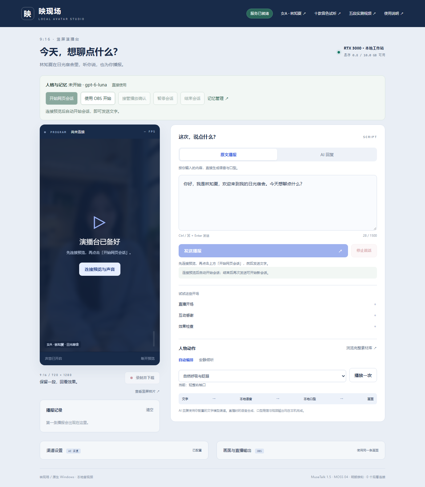
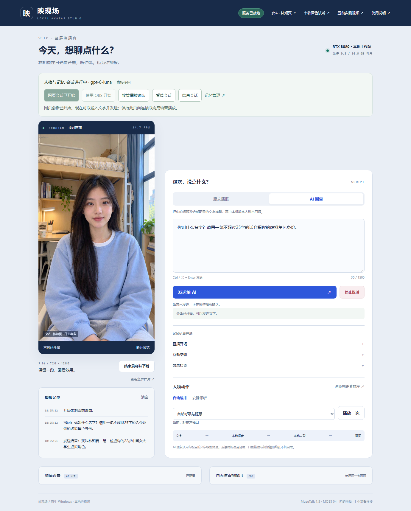
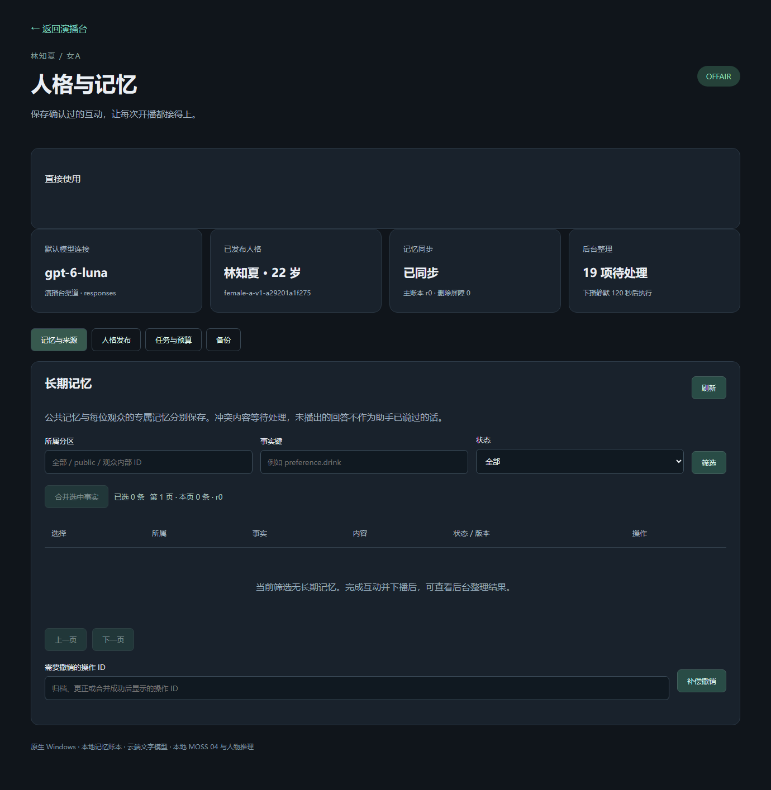
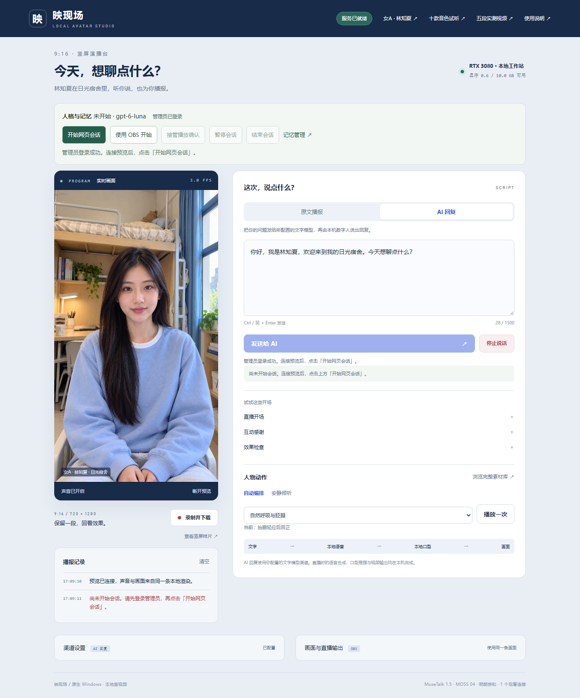
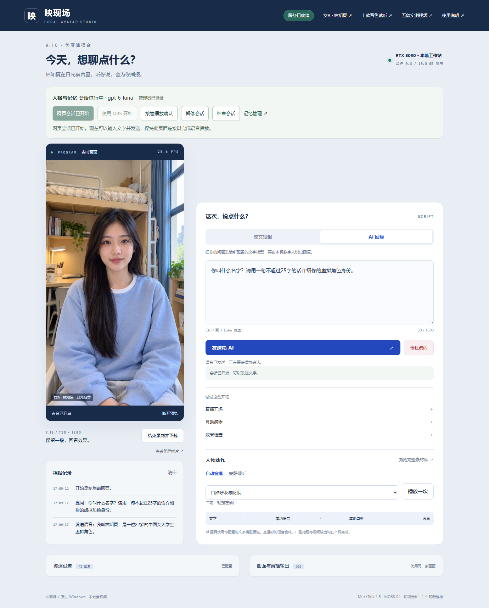
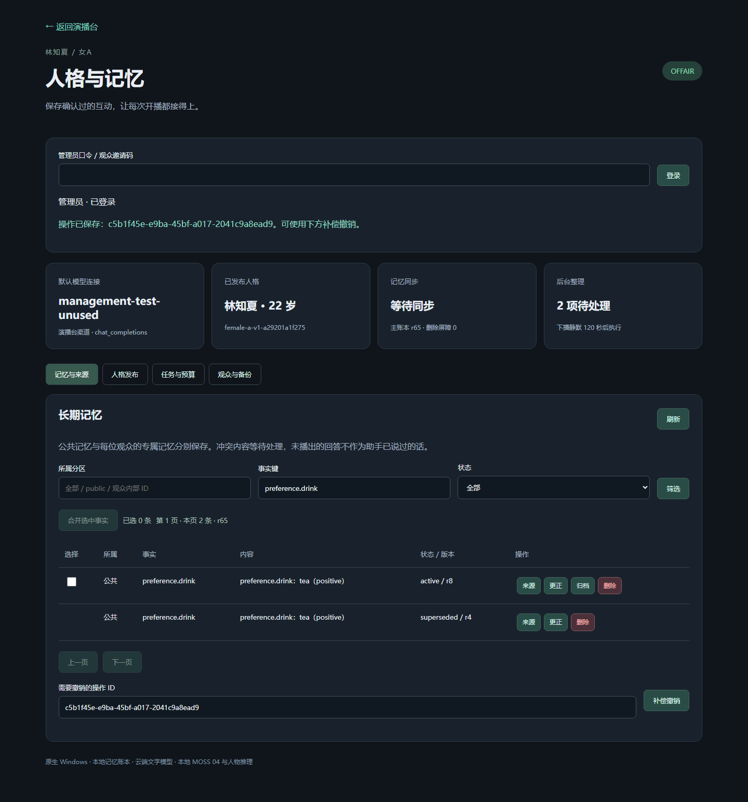

# DSH 实机页面与媒体记录 / Native DSH media

[实施记录](IMPLEMENTATION.md) · [操作手册](RUNBOOK.md) · [逐项验收](ACCEPTANCE.md) · [机器证据](../evidence/dsh-humanity-runtime.json)

2026-10-25，Windows 原生 RTX 3080 10 GB / 64 GB，女A·林知夏，日光宿舍，MOSS 04 + MuseTalk，720×1280 竖屏。下列素材来自实际 Chrome，按章节分别标明真实 AI、Echo 和隔离测试来源。

These are native Chrome captures using local MOSS 04 and MuseTalk. The new session-flow recording uses the configured cloud LLM; historical Echo captures and isolated fixtures are labelled separately. Short dialogue does not establish cross-broadcast memory acceptance.

## 当前无鉴权入口 / Current open-access studio

当前版本已移除网页与应用后端的登录、令牌、IP 白名单、Origin 拒绝规则和角色权限。点击“连接预览与声音”自动开始会话；结束后再次发送自动开场，刷新后重新连接也可继续使用。主动暂停仍需明确恢复。

[实际 AI 回复录像](../media/dsh-direct-studio-playback.mp4) 保留云端与本地语音等待，未加速。下面是同一录像中约五秒的原速无声摘录。

[13 项检查与三次自然播放回执](../evidence/dsh-direct-studio-flow.json) 来自观看电脑上的全新原生 Chrome：没有读取 token 文件、没有浏览器登录请求、没有鉴权 cookie。验证无凭据保存原渠道配置、直接打开记忆管理、连接预览自动开场、真实 AI 回复、主动暂停／恢复、结束后发送自动再开场，以及刷新后重新连接并再次播报。三次请求均 COMPLETED；音频连续性按各请求映射的样本区间计算，排除主动暂停／结束时的清缓冲操作。

MP4 仅录制第一条真实 AI 回复，后续两次 Echo 的完整播放由 JSON 回执记录。一次云端连接故障及一次将切场清缓冲混入语音连续性检查的失败记录保留在私有原始目录。修正检查范围后复验全部通过，未把失败记录覆盖为成功。该短测不替代 20 轮与 S1–S5 的完整记忆验收。

复验：`node tests/dsh-direct-studio-smoke.cjs <项目绝对目录>`；生成素材：`python devtools/build-dsh-studio-media.py <产物目录> --open-access`。[来源与 SHA-256 清单](../media/dsh-direct-studio-manifest.json)。测试结束自身场次并关闭自身浏览器；用户已有标签页不受影响。

## 历史手动登录流程 / Historical manual-login flow

以下保留移除鉴权之前的手动登录版本，展示当时的十项测试；不作为当前使用说明。当前行为以上面的无鉴权记录和运行手册为准。

[完整实际 AI 录像 / Actual AI recording](../media/dsh-studio-session-playback.mp4) 保留模型和语音等待；无加速、无替换配音。下图为同一录像中人声对应画面的约五秒无声原速摘录。

[十项流程检查与真实播放回执](../evidence/dsh-studio-session-flow.json) 覆盖匿名开始被拒绝、令牌错误解释、管理员登录、未开始/暂停时的按钮与快捷键限制、明确开始、同场恢复与新租约、结束后禁止发送。另有一次由浏览器测试拦截器构造的迟到 409，专门验证中文错误提示。该受控 409 不伪装成真实后端故障。

录像只包含第一条实际 AI 回复。暂停和恢复通过实际服务与浏览器验证，证据在 JSON 中，不在该录像内。当前渠道另有三轮实际对话与同场主题回忆通过，但 20 轮和 S1–S5 仍未完整验收。

该历史记录由旧版 `dsh-studio-smoke.cjs` 产生；当前该入口转到新的无鉴权测试。历史记录不重新生成或冒充当前验证。依赖、来源与文件校验见[独立清单](../media/dsh-studio-session-manifest.json)。

## 演播台 / Studio

下面保留较早 Echo 验证时的页面，按钮文案早于本次流程更新。显示的模型名来自已有渠道配置，单独显示模型名不代表探针成功。原文播报可独立验证媒体。

## 人格与记忆管理 / Personality and memory

管理页面显示当前版本、固定身份、记忆来源、整理作业、预算和维护操作。下面截图采集时旧渠道不可用，因此后台作业等待，长期事实列表为空；页面没有展示虚构的“整理成功”结果。

## 管理功能隔离测试 / Isolated management fixture

以下是另一套**隔离测试账本**的真实 Chrome 截图，显示分页、归档、等值合并和补偿撤销。图中 `management-test-unused` 和测试事实由自动化构造，未调用云端模型、未调用语音推理、未修改正式记忆。该截图展示操作界面与服务端修订结果，不代表人物已经从真实对话中学会这些事实。

[独立来源与文件校验](../media/dsh-management-manifest.json) · [完整管理规则](ADMINISTRATION.md) · [原生 DSH/Humanity/HTTP/Chrome 测试程序](../../tests/dsh-management-smoke.mjs)。正式环境和隔离账本的证据分开保存。

## 原文播报 / Echo playback

[下载完整 MP4 / Full actual recording](../media/dsh-echo-playback.mp4)。完整录像保留合成等待，没有用加速或剪掉等待来表示低延迟。下面 GIF 是同一录制中首段人声对应画面的约 7 秒无声摘录，按原速播放。

## 来源与复验 / Provenance

真实浏览器测试还执行“缓冲时取消 → 新请求播放完成”。机器记录保留范围、请求终态、浏览器错误、首句音频排程间隙和传输统计。取消与恢复的状态由测试记录证明；这里的 MP4 仅录制第一条完整播报，不能据此声称包含整组取消操作。

另有两个真实 Chrome 播放器的播放权切换测试，运行的是 OBS 浏览器源页面，未运行 OBS 应用混音器：预览抢占被拒绝，原权威中断、新权威新句完成。结果在机器证据中单列，没有把它包装成完整推流录像。

- 浏览器测试：[dsh-media-smoke.cjs](../../tests/dsh-media-smoke.cjs)，独立配置文件和 `finally` 关闭测试浏览器。
- 播放权切换：[dsh-authority-smoke.cjs](../../tests/dsh-authority-smoke.cjs)，演播台和本机 OBS 源页面。
- 素材生成：[build-dsh-doc-media.py](../../devtools/build-dsh-doc-media.py)，只接受通过的 Echo 记录，按音频能量选择 GIF 起点。
- [文件 SHA-256、媒体信息和来源说明](../media/dsh-media-manifest.json)。原始 WebM 与完整运行日志留在项目私有 `outputs/dsh-humanity/`，不提交运行密钥、数据库或完整聊天。

在已准备原生浏览器测试依赖的主机上，通过 `DSH_TEST_BASE_URL` 指定本机演播台地址；然后运行 `node tests/dsh-media-smoke.cjs <项目绝对目录>`。该测试会创建并结束测试直播场次，应在无正式直播时执行。生成文档素材使用 `python devtools/build-dsh-doc-media.py <已验收产物目录>`，需要原生 FFmpeg/FFprobe。
