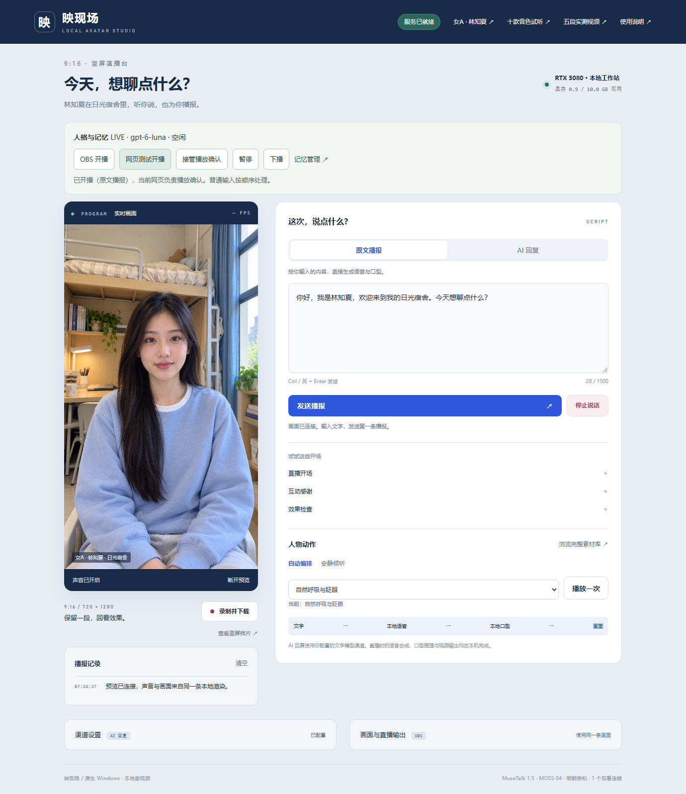
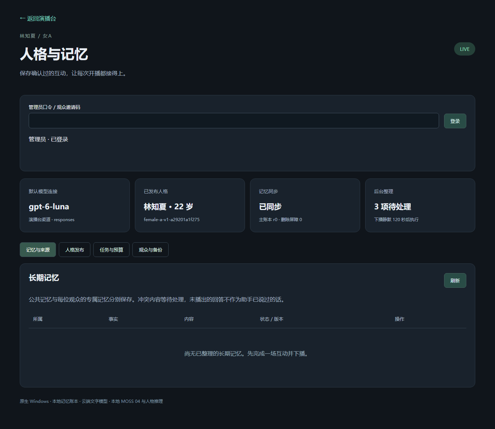

# DSH 实机页面与媒体记录 / Native DSH media

[实施记录](IMPLEMENTATION.md) · [操作手册](RUNBOOK.md) · [逐项验收](ACCEPTANCE.md) · [机器证据](../evidence/dsh-humanity-runtime.json)

2026-10-25，Windows 原生 RTX 3080 10 GB / 64 GB，女A·林知夏，日光宿舍，MOSS 04 + MuseTalk，720×1280 竖屏。下列页面和录像来自实际 Chrome。播报明确使用 Echo，未调用云端 LLM，不能作为真实人格对话或跨场记忆的验收。

These are actual native Chrome captures of the local RTX 3080 system, using MOSS 04 and MuseTalk. The recording uses explicit Echo mode, without a cloud LLM. It demonstrates local playback and state accounting, not model understanding or cross-broadcast memory.

## 演播台 / Studio

开播、暂停、下播、播放权接管与记忆管理位于画面上方。示例中显示的模型名来自网页已有渠道配置；显示模型名不代表渠道兼容探针已经成功。原文播报可独立验证媒体。

## 人格与记忆管理 / Personality and memory

管理页面显示当前版本、固定身份、记忆来源、整理作业、预算和维护操作。测试时真实渠道不可用，因此后台作业等待，长期事实列表为空；页面没有展示虚构的“整理成功”结果。

## 原文播报 / Echo playback

[下载完整 MP4 / Full actual recording](../media/dsh-echo-playback.mp4)。完整录像保留合成等待，没有用加速或剪掉等待来表示低延迟。下面 GIF 是同一录制中首段人声对应画面的约 7 秒无声摘录，按原速播放。

## 来源与复验 / Provenance

真实浏览器测试还执行“缓冲时取消 → 新请求播放完成”。机器记录保留范围、请求终态、浏览器错误、首句音频排程间隙和传输统计。取消与恢复的状态由测试记录证明；这里的 MP4 仅录制第一条完整播报，不能据此声称包含整组取消操作。

另有两个真实 Chrome 播放器的播放权切换测试，运行的是 OBS 浏览器源页面，未运行 OBS 应用混音器：预览抢占被拒绝，原权威中断、新权威新句完成。结果在机器证据中单列，没有把它包装成完整推流录像。

- 浏览器测试：[dsh-media-smoke.cjs](../../tests/dsh-media-smoke.cjs)，独立配置文件和 `finally` 关闭测试浏览器。
- 播放权切换：[dsh-authority-smoke.cjs](../../tests/dsh-authority-smoke.cjs)，演播台和本机 OBS 源页面。
- 素材生成：[build-dsh-doc-media.py](../../devtools/build-dsh-doc-media.py)，只接受通过的 Echo 记录，按音频能量选择 GIF 起点。
- [文件 SHA-256、媒体信息和来源说明](../media/dsh-media-manifest.json)。原始 WebM 与完整运行日志留在项目私有 `outputs/dsh-humanity/`，不提交运行密钥、数据库或完整聊天。

在已准备原生浏览器测试依赖的主机上，通过 `DSH_TEST_BASE_URL` 指定本机演播台地址；然后运行 `node tests/dsh-media-smoke.cjs <项目绝对目录>`。该测试会创建并结束测试直播场次，应在无正式直播时执行。生成文档素材使用 `python devtools/build-dsh-doc-media.py <已验收产物目录>`，需要原生 FFmpeg/FFprobe。
