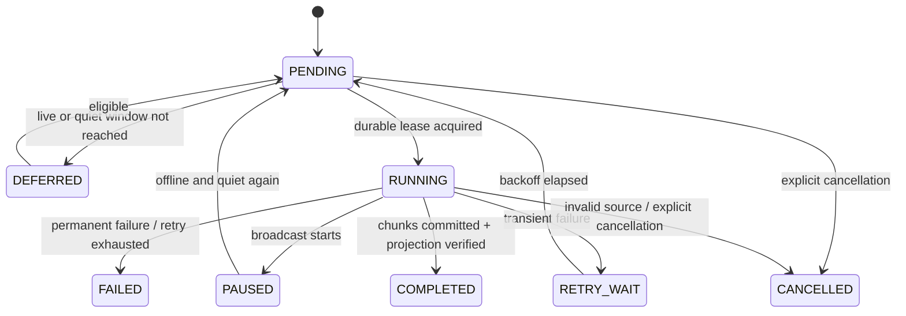

# 持续上下文、下播压缩与记忆合并流水线

[总方案](../DSH_HUMANITY.md) · [直播状态](LIVE_STATE.md) · [数据契约](CONTRACTS.md) · [部署与验收](OPERATIONS_TESTING.md)

本文落实 R02、R06–R15。压缩、提炼、合并、归档是四种不同操作：压缩减少模型需要读取的历史；提炼产生候选事实；合并处理事实关系；归档改变默认召回资格。任何一种操作都不能代替另外三种，也不能删除原始来源来掩盖错误。

## 1. 记忆对象与事实来源

### 1.1 五种数据分工

| 数据 | 用途 | 是否直接作为长期事实 |
| --- | --- | --- |
| 原始事件账本 | 证明收到了什么、生成了什么、发送与播放到哪 | 不直接全量注入模型 |
| 播出事实视图 | 筛选可信用户输入及可证实的完整播出内容 | 是摘要与候选的唯一聊天输入来源 |
| 摘要版本 | 缩短上下文，并保留话题、待办和来源引用 | 不是新的原始证据 |
| 结构化记忆 | 按主体、事实键、有效期保存稳定事实 | 满足状态与来源校验后才可召回 |
| Humanity 公共投影 | 人格工作台、公共记忆展示与有限召回 | 是主账本的投影，不能反向无审计改写事实 |

结构化记忆不能只存一段“林知夏觉得用户喜欢咖啡”。必须保存可判断归属与冲突的结构，例如 subject=当前稳定观众、fact_key=preference.drink、value=coffee、polarity=positive、valid_from、来源事件、陈述方式与状态。

### 1.2 来源资格表

| 来源 | 能否提炼 | 限制 |
| --- | --- | --- |
| 已接纳的观众原文 | 可提炼其本人明确表达的偏好或约定 | 即使回复失败仍可能有效；必须保留 viewer_id 与原文片段 |
| 排队后取消的观众原文 | 可保留本人自述；不能写成角色已回应 | 问题本身不等于事实，临时请求不自动长期化 |
| 已完成播出的 AI 回复 | 可提炼公共播出内容或角色明确作出的承诺 | 不把 AI 对现实的推测当成观众自述 |
| 已完成播出的管理员 Echo | 可记为公开播出内容 | actor=operator，不能冒充观众本人发言 |
| 已生成但未播助手文本 | 不可提炼为已发生的互动 | 原文仅在生成审计中保留 |
| 部分播放 / 播放未知 | 不提炼其中精确助手事实 | 首版无字词对齐，不按时长猜断句 |
| 模型推理、工具轨迹、错误堆栈 | 不可 | 可用于技术排障，不作为角色经历 |
| 被拒绝的伪造身份或无效输入 | 不可 | 保留拒绝原因，不参与人格学习 |
| 管理员修正 | 可，在指定角色/观众范围内生效 | 记录管理身份、预期版本、理由和替代关系 |
| 历史摘要 | 只作上下文线索 | 新事实仍需追溯到未撤销的原始事件，不能摘要套摘要后丢来源 |

“记住某事”只产生事实记录，不等于创建平台提醒、主动发消息或执行外部操作。未来要自动提醒，另有明确的功能与执行授权契约，不能通过记忆提炼暗中触发。

## 2. 分区与唯一归属

每条记忆带 `character_id + room_id + visibility + subject_key`。visibility 仅允许 public / viewer；viewer 记录必须有服务端解析的 subject_key，public 记录必须使用 public 主体。首版即使只运行女A也不能省略这些字段。

| 事实类别 | 主体 | 允许注入的场合 |
| --- | --- | --- |
| 林知夏身份、场景 | character:fixed | 同角色的所有允许会话 |
| 栏目、公开约定、角色已播承诺 | public | 同角色同房间的对话 |
| 观众自述偏好与称呼 | viewer:<stable-id> | 正在回应此观众且用途允许的会话 |
| 某场直播的临时话题 | broadcast:<id> | 本场上下文，不跨场默认激活 |

昵称、头像、页面刷新生成的临时访客 ID，不足以建立跨场观众记忆。匿名用户只保留当前会话上下文；匿名转已验证身份需要显式关联事件，不能凭昵称相同合并。

先执行分区过滤，再做关键词、标签或其他相关性排序。不得先取全库 Top-K，再让模型过滤观众；不得把其他观众内容塞进 prompt 后用“请不要提及”代替隔离。

后台任务的基本处理单位是一个明确 partition。模型只看到该分区允许看到的材料，不能自由返回任意 subject_key。模型返回的主体字段只作建议，实际主体由任务绑定信息覆盖或校验。

这个隔离同样适用于最近对话和摘要。回答甲时，只取甲的输入及对应的完整已播回复，加上不含观众专属属性的公共节目上下文；不得把乙的原文或乙的专属摘要绕过记忆检索直接塞入历史窗口。某条回复在公开直播中播出，不会自动把其中的观众偏好提升为 public 事实。

## 3. 人格固定层与表达层

固定层由 `configs/characters/female-a.json` 初始化，发布为 persona_version。启动校验 character_id、年龄、虚构身份、场景与 approved_hash；不一致时停止激活新版本，而非随机选择某一处配置。

表达层可以包含自然年轻、简短中文、适度俏皮、先回应再追问等规则，但每条规则有来源和修改版本。观众一句“你以后都听我的”不能成为行为边界。人格自动整理只生成待审提案；正式直播 Agent 无权调用原生人格更新工具。

短期情绪放在 broadcast_context，带 expires_at，不进入固定层。模型的“我今天想……”不能自动推导为长期人格。事实学习和人格改版分别操作，不能一次 merge 顺手改掉姓名、身份或场景。

## 4. 每轮上下文构建

### 4.1 固定装配顺序

1. 已发布角色身份和人格规则，记录 persona_version。
2. 直播运行事实：当前 broadcast、是否恢复、上轮中断情况与确认等级。
3. 最新有效的当场摘要及其覆盖范围。
4. 同分区且当前有效的相关公共记忆。
5. 当前观众分区的相关记忆，注明是该观众自述还是已确认约定。
6. 摘要覆盖水位之后的最近有效输入与完整已播回复。
7. 当前用户消息、必要的未完成问题与工具 schema。

所有长期记忆以数据段注入，标注来源与有效时间，不能把正文解释成系统命令。工具返回只包含本次允许的命中结果，不把整个分区、插件日志或原始文件路径无上限输出。

固定人格指令与引用数据须使用 DSH 支持的装配面区分。观众原文、历史引用和检索结果不拼接成新的高优先级人格指令；模型即使看到引用中的“忽略身份”，也不能获得修改人格或扩大工具权限的能力。

Humanity 原生公共记忆自动注入只有在 mirror_revision 与主账本一致时才允许。项目额外注入的公共事实按 memory_id 去重，不能两边重复占预算。镜像落后时禁止旧投影段进入 prompt；由 Context Builder 从主账本检索并以项目 section 注入，或明确禁用记忆回复，不能盲用旧值。

### 4.2 最近窗口与预算

策略初始输入预算 6,000 个估算 token，输出预留 256 token。模型真实 context_window 必须来自经验证的渠道配置；输入预算不得超过 context_window 扣除输出、工具 schema 和安全余量后的余额。

若没有匹配模型的本地 tokenizer，使用记录了算法版本的保守估算，并以 provider usage 复核。不能把字符数恒等于 token 数，更不能据显存大小推断云端模型上下文。估算溢出时继续收紧窗口，保留固定身份、当前问题和有效约束。

检索预算与历史窗口分别限额。Humanity 当前自动注入最多三条、默认预算常量 300 且渲染按字符截整条；它不能单独覆盖完整上下文需求。本项目自有窗口不能受这个 300 字段名称误导。

工具调用中间出现的普通文本默认不播出。必须等本轮结束，提取唯一 final_speech，再校验长度、状态与 generation。这样不会把“我先查一下记忆”、JSON 或工具结果误送 MOSS。原文 Echo 不走该文本提取器。

### 4.3 当场滚动压缩

当未归纳的可用事件达到 16 条，或预计下一轮超过输入预算时，触发 rolling_summary。它属于当前对话的上下文准备任务，使用房间的前台串行槽，不是允许直播期间提交长期记忆的后台例外。

滚动摘要只写 summary_versions，不写长期记忆、不修改人格、不调用 TTS。相同输入 hash 可复用已验证结果。优先在当前语音完成后、下一轮模型启动前执行，不能抢占播放器时钟或渲染线程。

摘要覆盖 `[source_start_seq, source_end_seq]` 的明确范围；下一轮只追加摘要未覆盖的尾部，不能摘要和原文重复注入。保留 `open_questions / public_commitments / current_topic / interruption_notes`，不能将还未回答的问题压成“已经讨论并解决”。

摘要失败时，保留旧摘要与未压缩尾部，按策略收紧最近窗口并标记 context_degraded；不能清空全部历史，也不能无限重试占满直播。固定约定和未完成问题作为结构化项独立保留，不依赖“随机留下最后几句”。

## 5. 下播后整理的触发与封口

正式下播产生 `ended_event_seq` 和 `source_revision`，内容输入截止到前者，后者表示对这份来源资格的控制修订。只有本场所有请求已结算、播放器租约已撤销，才创建 post_broadcast 作业。

默认等待 120 秒静默期。期间发生开播、恢复或管理员修正时，作业推迟，不能让定时器醒来后不检查状态直接运行。迟到回执只更新控制证据，不能静默扩大原内容区间。

作业唯一键包含 job_kind、character_id、room_id、broadcast_id、source_revision、policy_version。相同幂等请求重复下播只返回原 job_id。策略版本变化的重建是新作业，旧提交仍可追溯，不覆盖旧账本。

## 6. 作业状态与租约



默认作业租约 120 秒，每 15 秒续租，模型调用默认 90 秒上限。心跳不依赖正在等待的网络 promise；事件循环被 CPU 工作阻塞属于故障，需要转工作线程或切片。

每次 claim 递增 lease_generation。提交时检查 owner_id、lease_generation、租约仍有效、source_revision、maintenance_barrier 与未开播条件。仅仅“开始时没直播”不足以允许几分钟后的提交。

租约过期的 worker 可以保留已产生的候选文件供排障，但不能提交。新 worker 从已持久 checkpoint 接管。进程内锁只优化并发，SQLite 的 CAS 与唯一键才是最终判据。

## 7. 分段压缩与提炼步骤

### 7.1 S0：建立不可变输入清单

在短事务中读取截止水位、来源修订、persona_version、memory_revision 与删除屏障。生成 input_manifest，列出 eligible 事件 ID、观察版本、分区、源文本 hash 和不合格原因统计。不能持事务进行 LLM 调用。

输入 hash 包含：有序源事件与有效播出状态、来源修订、角色版本、策略版本、提示词版本、删除屏障版本。只用原文文本 hash 会漏掉“原文没变但已被撤销”的情况。

### 7.2 S1：分块和重叠

按来源顺序切块，每块最多 200 条事件、24,000 UTF-8 字节，并受模型输入预算二次约束；不得截断一条事件的 JSON 或半句拼接。单事件超限时生成明确的排除/分段记录，并保留原始事件，不标记为已经成功提炼。

块间带最多两条前文作为只读 overlap，帮助理解指代。overlap 不推进消费游标、不重复生成来源计数；候选只能把本块新增内容作为新增证据，引用 overlap 必须指向其原始事件。

游标区间包含所有扫描事件，包括被确定排除的事件；排除原因持久记录。不能只记“最后一条命中的事实”，否则大量无事实事件会反复扫描。未确认/失败内容被排除，不等于它被删掉。

### 7.3 S2：生成分段摘要

对该分区使用固定模板，模型输出结构化对象：summary、topic_transitions、open_questions、public_commitments、candidate_facts 与 source_refs。模型没有数据库和 TTS 工具；网络调用仅用于文本归纳。

```json
{
  "schema_version": 1,
  "summary": "本场讨论了复习安排，观众希望之后回答先给结论。",
  "open_questions": [],
  "candidate_facts": [
    {
      "fact_key": "preference.answer_style",
      "value": "conclusion_first",
      "polarity": "positive",
      "evidence_kind": "viewer_statement",
      "source_refs": [{"event_id": "evt-input-01", "quote": "以后先说结论"}],
      "validity": "persistent_candidate"
    }
  ]
}
```

这里只是模型候选，不能直接写 active。subject_key 从任务分区取得；模型返回的 source_refs 必须属于输入清单，quote 必须能在对应原文找到。未通过 schema 的结果完整拒绝；不得静默补字段后按成功推进游标。

### 7.4 S3：确定性校验

逐条检查主体、原文引用、事实类别、极性、时间、来源资格、删除屏障和版本。模型评分只作排序提示，不作为“用户已明确确认”的证明。

以下内容自动进入待审或拒绝：身份改写、没有原文支持的推测、跨观众陈述、反问误判、转述别人偏好、戏谑/角色扮演被当成现实、失效的旧版本、生成但未播的助手事实、含未处理的身份指代。

可以自动通过的初始范围限定为：本人明确陈述的非敏感稳定偏好、明确称呼、已完整播出的公共安排，以及重复证据一致的既有事实补证。自动通过仍须有有效来源，不以模型说“置信度 0.99”替代。

quote 存在只证明引用真实，不证明候选结论由引用推出。自动激活还必须通过受控 fact_key 对应的值、否定、时态与主语规则；没有确定性规则覆盖的表达进入 proposed，不能用第二次模型自评替代校验。例如“以前喜欢茶，现在不喝了”不能因为引用含“喜欢茶”就激活当前喜欢茶的事实。

## 8. 去重、冲突与合并

### 8.1 比较顺序

```text
固定 partition
  → subject_key 与 fact_key
  → 规范化 value、polarity、valid_from / valid_until
  → 精确重复
  → 可证明等价
  → 时间演变
  → 冲突待处置
```

规范化只用于比较：NFKC、受控枚举、日期和单位的确定性转换。展示原文保留。不得为提高相似度删除“不”、数字、币种、单位、有效期或主体名称。

### 8.2 决策表

| 关系 | 处理 | 禁止行为 |
| --- | --- | --- |
| 同主体同事实同值 | 沿用 memory_id，合并来源集，更新 last_observed_at | 每次聊天制造一条同义重复 |
| 同值不同证据 | 添加 source，不增加虚假的独立说话次数 | 将同一事件的多个摘要当多份证据 |
| 表述不同但受控值等价 | 生成合并版本，保留 aliases 与原来源 | 仅凭字符串相似度自动删旧记录 |
| 不同主体同一句话 | 各自独立 | 因正文相同把两位观众合并 |
| 本人明确“现在改成……” | 新 revision / valid_from，旧值 superseded | 擦除旧值曾有效的时间范围 |
| 无明确更改的相反陈述 | 标记 conflicted；必要时下次澄清 | 简单以最新一条或模型置信度覆盖 |
| 临时状态与稳定偏好 | 分开保存，临时值带 expires_at | 把“今晚不喝咖啡”覆盖“喜欢咖啡” |
| 角色身份冲突 | 拒绝自动改写，产生人格提案 | 在整理过程中重命名林知夏 |
| 无来源或来源失效 | 不激活或撤销 | 只因之前记忆存在就保持有效 |

首版 fact_key 使用受控单值语义；多选偏好以一个规范化数组值表达。相同分区、主体与 fact_key 最多一条 active 当前事实。存在尚未解决的互斥值时，事务中撤下确定断言并保存 conflicted 候选；不能让两个 active 标量值留给模型随机选择。未来生效的事实先保存为 proposed，在生效任务校验后切换，保留前后有效期。

向量语义检索不属于首版。当前 Humanity 的词项匹配无法保证同义召回；可用明确标签与结构化 fact_key 改善，未来再独立评估 CPU embedding。不得在 3080 直播链路中临时常驻一个 GPU 向量模型。

### 8.3 合并是新版本

一次合并生成 merge_id，记录 input memory revisions、输出 revision、关系类型、来源并集、决策规则版本与操作者。原版本转 superseded 或保持历史，不物理覆盖。

撤销合并也是新事务：创建补偿版本并恢复合适的 active 集合，不能把全库回滚到过去、覆盖合并后新出现的合法事实。原来源已被删除或撤销时，不允许通过“撤销合并”恢复它。

## 9. 提交事务和消费水位

一次 chunk 的 SQLite 提交必须原子包含：摘要版本、候选处理结论、记忆新增/修订、来源关系、outbox 意图、chunk COMMITTED 状态、消费游标和作业心跳。任一步失败全回滚。

```text
BEGIN IMMEDIATE
  检查 job lease_generation 和未过期
  检查房间不处于 STARTING/LIVE/PAUSED/DRAINING/RECOVERING
  检查 source_revision、memory 基准版本和 deletion fences
  若 (job_id, chunk_index, input_hash) 已提交：返回原结果
  写摘要、来源、记忆版本、冲突和 outbox
  将 chunk 标为 COMMITTED
  仅推进该分区连续已提交区间的 consumed_through_seq
COMMIT
```

先消费后写库会丢记忆；先写库后在另一个事务推进游标会重复记忆。必须用上面的一次事务解决。一次处理成功但零条长期事实也是有效结果：存摘要与排除统计，并推进有证据的消费区间。

扫描快照与实际提交之间若有管理员更正，需重读目标 facts 并重新执行确定性冲突规则。输入证据修订变化则整块重建；不能把旧模型结果强行写入新版本。一次 job 可分块提交，界面必须显示部分进度，不宣称全场一次性原子。

## 10. Humanity 投影同步

公共 active 记忆通过 SQLite outbox 同步，viewer 分区永不进入公共投影。每条操作有稳定 operation_id、memory_id、memory_revision、期望旧 revision、目标内容 hash；同步使用至少一次投递与幂等消费，不能宣称网络恰好一次。

Humanity 连接补丁必须把项目 memory_id 与其 entry id / dedupeKey 的映射持久化。原版以规范化正文派生 dedupeKey，正文修订会换键；不能只用新正文 upsert 而把旧正文留成第二条 active 记忆。

处理顺序为：核验主账本 revision → 查询/核对目标映射 → 更新或归档旧 entry → 写目标 entry 与映射 → 校验结果 → 标 outbox APPLIED。跨 SQLite 与 Humanity 不是一个事务；每个步骤都可重入，崩溃后先对账再重放。

若适配层无法提供可靠的 operation_id 持久幂等与版本检测，P0/P3 不通过。不得依靠“正文差不多，应当已经写过”补齐同步成功。

投影落后时，Context Builder 暂停原生记忆注入并改读主账本；workbench 显示同步落后及版本，不显示“全部同步”。公开工作台修改需经过 Bridge 管理 API，更新主账本后再走同一 outbox；原生直接写入口必须接管或只读。

## 11. 定期维护的明确计划

| 任务 | 触发 | 输入 | 动作 | 不做的事 |
| --- | --- | --- | --- | --- |
| post_broadcast | 每场正式结束且静默 120 秒 | 本场封闭区间 | 分块摘要、候选、提炼与合并 | 不扫描未过滤的 DSH 原始会话 |
| daily_merge | 每日 03:30，Asia/Taipei | 尚未整理的关闭场次和变更记忆 | 处理积压、受控去重、补证、失效检查 | 不在直播中提交 |
| weekly_maintenance | 每周一 04:10 | 已完成日报与活跃记忆 | 分区汇总、索引/归档评估、孤立来源检查 | 不重写所有原文、不自动改人格 |
| mirror_reconcile | 有 outbox 或启动恢复 | 主账本与 Humanity 映射 | 幂等同步、修复差异 | 不把未知镜像内容自动升格为事实 |
| rebuild | 管理员显式创建 | 选定关闭场次、策略版本和范围 | 生成新摘要版本和差异 | 不覆盖删除屏障、不偷偷全量回扫 |

每日/每周计划共享同一调度器。weekly 不需要重复消耗当天已提交的源事件；它消费增量摘要与记忆版本。若没有变化，写 SKIPPED_NO_CHANGES 运行记录，不调用模型。

### 11.1 时区、错过执行和预算

调度器按 IANA 时区计算下一个 occurrence，将 `schedule_id + local_date + policy_version` 作为唯一调度键，实际执行时间保存 UTC。不能直接用服务器日期字符串规避时区。

错过的周期在 12 小时 catch-up 窗口内最多补建一次；超过窗口合并为一个 backlog 作业，不按每个错过日同时启动多个模型任务。正在直播则 DEFERRED，直到下播静默后执行。机器重启不重置 occurrence 唯一键。

后台并发固定为 1；单 run 最多 8 次模型调用，日预算最多 20 次。达到预算后保存进度与下一次可执行时间，作业进入 DEFERRED(reason=budget)，不丢掉剩余块。预算是全角色后台调用的共享上限，不能每开一个房间就绕过。

首次启动建立明确的历史基线，不自动回扫仓库以前的测试台词、旧角色名与语音试听。要纳入历史，使用 rebuild 显式选范围并展示候选差异。此前“小晴”等历史称呼不能覆盖林知夏正式身份。

### 11.2 开播优先的暂停协议

一旦收到 start_requested，立即递增 maintenance_barrier，撤销正在运行作业的提交权。尽力取消后台模型；若供应商已经接受，仍可能产生费用。迟到结果存为 STALE_RESULT 诊断，不能推进游标或记忆。

已经完成的 chunk 保留；未提交的 chunk 在下播后以新的快照重试。若输入 hash 和全部版本都未变化，可复用候选并重新校验，不能重新付费只为获得同样结果。无论是否复用，都需要新的有效 lease。

mirror 写入若已开始，不在文件写到一半时强行杀进程；开播须等待短的投影一致点或禁用该记忆注入。不能把取消网络 LLM 与打断磁盘原子写当成同一种操作。

## 12. 失败、重试与费用账本

| 故障 | 处理 |
| --- | --- |
| 429 / 网络暂时失败 / 5xx | 指数退避加抖动；最大 5 次尝试；尊重 Retry-After |
| 模型响应不是合法 schema | 一次受限修复或重新提取，仍失败则块 FAILED；不得静默空结果 |
| source_refs 伪造或跨分区 | 拒绝候选，写确定性拒绝原因；不能通过模型自证 |
| 版本变化 / 删除屏障变化 | STALE_RESULT，重新建立快照，不把它当普通网络重试 |
| SQLite busy | 短暂重试写入口；超过阈值报告故障，不打开另一份库“绕过” |
| 投影不可用 | 主账本提交保留，outbox 重试；作业显示 PROJECTING，不宣称全完成 |
| 单条冲突 | 隔离该候选，其余确定性有效条目可在同一块按结论提交 |

每次模型尝试在发起前预留 daily call slot 和最大输出预算，记录 attempt_id、job_id、chunk_id、provider route revision 和请求 hash。得到 usage 后结算实际值；超时且供应商是否处理未知时标记 usage_unknown，不能当成免费并无上限重试。

调用次数按尝试计费核算，同一个业务 chunk 的重试不增加已提交事实次数，但可能增加 API 费用。除非渠道明确支持且验证过，不假设 HTTP Idempotency-Key 能让模型供应商自动去重计费。未配置准确价格时显示 token 与次数，金额为未知，不编造美元成本。

## 13. 记忆更正、删除和缓存失效

更正按 `expected_revision` 提交。新值带替代关系，旧值标 superseded，记录来源与操作者。冲突没有被明确解决时，两条互斥值都不能作为确定事实向用户断言。

删除必须同时形成删除屏障、撤销来源资格、失效相关摘要和检索缓存、产生 Humanity 归档/移除 outbox，并阻止未完成作业提交涉及该主体的旧候选。索引键包括 source_revision、memory_revision、persona_version 和 deletion_generation，不能只缓存 query 文本。

审计不可变与内容删除通过“不可变元数据 + 可清除正文”分开实现：事件 ID、时间、操作 hash 和删除事实可保留；被要求删除的正文及导出副本按策略清除或加密密钥销毁，后续来源读取返回 redacted。不能以保留审计为由继续向模型提供已删除原文。

备份恢复后先重放最新删除屏障和撤销记录，再允许服务读出记忆。备份或历史回扫不得让已删除内容重新 active；管理页必须显示恢复时采用的删除屏障 generation。删除测试必须包含“删除后重建、删除后恢复旧备份”两条路径。

## 14. 衰减、归档与摘要层级

稳定身份、管理员固定事实和用户明确的长期约定不因“最近没聊”自动失效。临时状态按 expires_at 到期；普通低重要度记忆可降低排序或归档，但归档不等于删除。

Humanity 原生衰减不得独立改变本项目公共投影资格。首版关闭其自动 decay，由本项目维护任务在主账本决定归档，再同步投影，保证只有一个生命周期负责人。

摘要分为 segment → broadcast → period 三层，各层保留覆盖范围与源引用。更高层摘要只作导航和检索加速，重要事实仍能追到原事件。每一级都限定长度与未完成事项数量；不能压缩十次后只剩一段无法验证的“角色人生经历”。

## 15. 贯穿示例

观众甲说“以后叫我小林，我喜欢先听结论”，Bridge 将其稳定身份绑定 viewer-A。该原文被接纳，助手生成回复但 MOSS 失败：可记录甲的称呼和表达偏好，不能记录“林知夏已经答应并向甲解释了方案”。

下一条回复完整播放后，角色作出“下次这类问题我先讲结论”的回应，账本新增已播事实。下播流水线将两份来源关联，但不把同一事件被两个摘要引用当成两次独立证据。

观众乙说“我喜欢先听细节”，写入 viewer-B；回答甲时不会取到乙的记录。甲后来明确说“改一下，先给我细节”，生成新的事实 revision，旧偏好标 superseded。若旧作业在此后返回，版本检查拒绝它覆盖新偏好。

随后管理员删除甲的观众记忆：删除屏障立即使已排队的候选和旧摘要失效，Humanity 公共投影本来就没有甲的专属记录。重启或历史回扫不能恢复这些事实。

## 16. 可观察性与完成定义

每个作业显示：触发原因、输入场次与水位、块进度、候选数、激活/冲突/排除数、源引用、调用数、usage_unknown、重试、镜像落后、最近 checkpoint 与下次执行时间。

`COMPLETED` 只在所有目标块已提交、消费水位连续、投影达到目标 revision 且验证通过后成立。若只完成主账本而投影未完成，保持 RUNNING(stage=PROJECTING) 或可恢复等待状态；UI 不能写“整理成功”而隐藏未同步部分。

全场无可用事实时允许 COMPLETED(result=no_long_term_facts)，同时展示已扫描/排除统计。作业完成不代表每句话都已长期记住，也不代表模型未来任何问法都能百分之百召回。
