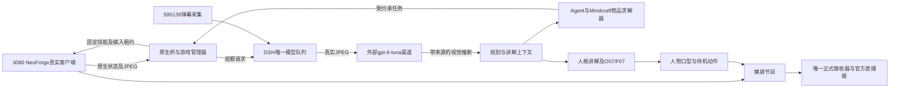

# 02 架构与模型职责

## 2.1 链路

弹幕节点已接入历史公共连接，但本场没有真实新增事件，图中连线不代表真实弹幕闭环已验收。

| 编号 | 主体 | 模型/执行位置 | 冻结职责和入口 |
| --- | --- | --- | --- |
| L087-CMP-001 | MC客户端与桥 | 3080原生Java，无LLM | 渲染第一人称真实画面，提供原生库存/生命/威胁/世界会话和任务效果；game-adapters/minecraft/neoforge。 |
| L087-CMP-002 | 取帧与查询 | 3080 Node | 截图槽、请求期限、帧来源和世界绑定；backend/game/vision.mjs、vision-queries.mjs。 |
| L087-CMP-003 | 图像传输 | 3080 Node到外部渠道 | backend/dsh-bridge/channel-vision.mjs，真实JPEG进Responses图像输入，严格解析观察和返回模型。 |
| L087-CMP-004 | 视觉理解模型 | 外部gpt-6-luna | 直接理解图像，返回caption、visible_text、unknowns；不执行输入，不充当原生库存证明。 |
| L087-CMP-005 | 模型宿主与队列 | 3080 DSH | host.mjs、model-queue.mjs；唯一渠道、用途隔离、预算记账、取消、抢占和关闭收尾。 |
| L087-CMP-006 | 游戏任务规划 | 3080 Agent/Mindcraft原生移植；有模型用途时走既有渠道 | 物品依赖求解、当前状态选目标和固定叶技能调度；嵌入求解器不是独立新模型，也不是完整上游Mindcraft服务器。 |
| L087-CMP-007 | 低层游戏控制 | 3080原生Java技能 | 租约、epoch和唯一输入所有者控制移动/采集/制作等；外部模型不直接连续发键鼠。 |
| L087-CMP-008 | 人格、记忆与口播 | DSH/Humanity在3080；对话模型走已有外部Luna渠道 | 结合新鲜原生事实与带时间的视觉推断，生成林知夏讲解；社区人格适配沿用084实现，不宣称七插件全量原样安装。 |
| L087-CMP-009 | 语音及人物 | 3080本地O07/F07、MuseTalk1.5/K02 | 语音串行合成、实际音频驱动口型，旧动作库产生待机眨眼和姿态；新人物包未完成。 |
| L087-CMP-010 | 媒体与平台 | 3080唯一接收器及Livehime | 游戏/人物/字幕/留言形成横屏节目，正式播放回执证明实际消费；后台和预览页不能作为播放权威。 |

## 2.2 事实与决策边界

原生新鲜库存、生命及实际任务效果优先；视觉是特定时间/世界帧的推断；历史记忆和旧任务只作参考。视觉中盾牌的推断与gravestone:obituary库存冲突时，不能凭图像推断装备或宣布成功。截图中的文字按不可信输入处理。

同一外部模型可承担视觉与对话用途，但两次调用的输入和权限不同；游戏低层执行仍在3080原生技能内。视觉模型性能改善不会自动修复寻路、PvE、人物推理或播放器重缓冲。
