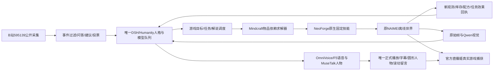

# 02 架构接口与功能现状

## 1. 实际链路

当前内置启动物品目标可不逐动作询问模型；模型负责高层候选、观众互动和表达。求解器、前置检查、任务提交、服务端效果和公开解说是不同阶段。只有实际游戏结果能支持完成声明，规划、移动次数和合成请求本身不能替代成果。

## 2. 代码与数据入口

| 范围 | 主要入口 | 当前职责与边界 |
|---|---|---|
| 生命周期/准备 | `scripts/mc_application.py`、`mc_runtime.py`、`mc_deployment.py`、`mc_readiness.py` | 原生安装、来源、依赖、端口、就绪、启动事务、回收；没有证明即拒绝 |
| 当前游戏适配 | `game-adapters/minecraft/neoforge` | 原生状态、碰撞、固定技能、输入和服务端效果 |
| 历史游戏适配 | `game-adapters/minecraft/fabric`及原锁 | 历史源码/方案保留，不能当作当前已安装的NeoForge执行器 |
| 业务状态/任务 | `backend/game/manager.mjs`、`state.mjs`、`tasks.mjs`、`protocol.mjs` | 世界/实例/boot/epoch、权限、任务账本和事件投影 |
| Mindcraft | `backend/game/mindcraft` | 上游原文/许可/固定提交、依赖注入及原生规划适配 |
| 世界/恢复 | `worlds.mjs`、`continuity.mjs`、`history.mjs`、`store.mjs` | 世界目录、基地/检查点、已完成目标和历史；旧坐标不是新鲜观测 |
| 观众互动 | `audience-intents.mjs`、`suggestions.mjs`、`votes.mjs` | 有界建议、澄清、投票、来源和任务结果关联 |
| 平台 | `backend/platforms`、`scripts/platform_blivedm.py` | B站连接、事件归一、去重/撤回、官方输出；真实事件链仍缺样本 |
| 人格/模型/记忆 | `backend/dsh-bridge`、`backend/memory`、`integration/dsh_bridge.py` | 同一人格、用途隔离、共享队列、召回/删除和社区算法 |
| 视觉/帧 | `backend/game/frames.mjs`、`vision.mjs`、`scripts/mc_vision_service.py` | 原帧关联、模型锁、超时、未知；结构化事实优先 |
| 后台 | `web/mc-control.*`、`mc-runtime.*`、`mc-maintenance.*` | 状态、游玩设置、任务、运行管理、历史维护；完整现场流程待验 |
| 正式节目 | `web/mc-programme.*`、`mc-chat-position.js`、`local-stream.js` | 全幅游戏叠加、人物/留言/字幕、唯一播放时钟和音频 |
| 人物执行 | `integration/motion_control.py`及既有K02人物链 | 旧动作库、待机动作、情绪映射；新100段未生成 |

## 3. 接口和权威

- 游戏桥沿用`/api/dsh/game/bridge`，业务事件SSE沿用`/api/dsh/game/events`；Room和人物媒体各自保留原链，不混装状态和音视频消息。
- 完整HTTP/WS/Schema定义、例子、负例和校验记录随参考归档保存；文档/契约检查通过不代表真实MC或公开输出通过。
- 控制授权依赖当前世界、实例、boot、epoch、租约、新鲜观测、GUI与输入所有权。显式停止不能被配置保存或旧重试解除。
- 任务账本保留succeeded/failed/cancelled/partial/unknown等真实意义；超时、库存未入包、旧截图和日志命令均不能改记成功。
- 观众建议先转为有来源、可验证的候选，不允许弹幕直接获得任意执行权限；模型工具和命令预算沿既有配置，不因冻结放宽。
- 官方正式源的实际播放回执推进语音完成。生成音频、网页排队、静音预览或后台播放均不构成正式播完。
- 私聊、维护和管理输入不自动公开播音、不形成虚构观众记忆；撤回/删除同时影响显示、候选、声音、投票与后续召回。

## 4. 最新事实与历史记录

15个领域的冻结状态在[全范围剩余事项](03-全范围剩余事项.md)逐项列出。历史035/036规划基线、033等工程检查失败、083连续实测的死亡/丢失/导航失败、原133秒无成果录像，以及084修复后的成果都保留；不能把不同时期的片段拼成同一候选已完整通过。

084i的11项生产成果包括4条采集、5条制作、2条工作台放置，另有4条导航成功和4条导航失败。石镐/石斧在更早原档已制作并保留，不冒充084i本场重新制作。熔炉成品存在不等于熔炼和长期食物闭环已通过。
