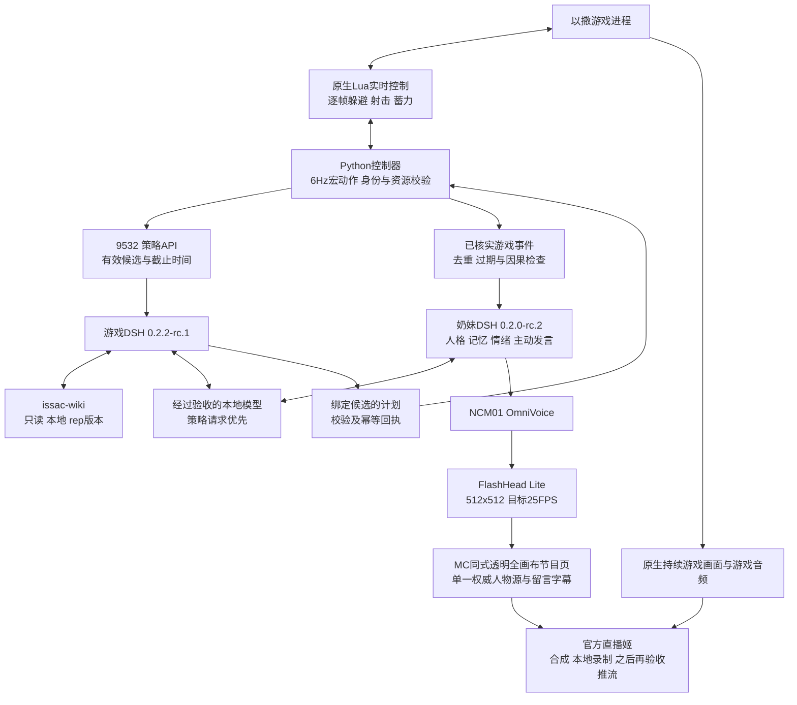

# 奶妹直播游玩《以撒的结合》：issac 分支完整更新方案

版本：`NM-ISSAC-PLAN-20261107-v2`。检查日期：2026-11-07，Asia/Taipei。目标设备：原生 Windows RTX4090。分支名按用户要求保留为 `issac`；上游程序、API 中的 `isaac` 不改拼写。

**v2更新：最终游戏与人物同屏直接沿用mc分支rev04方案，视觉仅替换标题文字。** 固定1920×1080全幅游戏、透明节目页、右下264×264圆形人物及原有留言/字幕/礼物规则，标题为“奶妹 · 以撒的结合”。[检查结果与完整沿用细则](MC同屏方案沿用与标题替换20261107.md)替代v1中的待选人物小窗和720p最终节目方案；奶妹512×512/NCM01与其他游戏接入要求继续有效。

**方案结论：可以在奶妹基础上接入，但应采用“本地实时控制＋游戏策略 DSH＋奶妹解说 DSH＋官方直播姬”的组合。** 不让大模型逐帧操作，不把攻略知识当作已实现的控制能力，也不能直接把当前4090服务认作定稿部署。人物延续三种形态、NCM01 音色和512×512口型规格；游戏本体、角色表现和推流使用各自的时钟。

v2规划发布时已完成独立分支、三张已定稿形态图的校验继承、来源指纹、4090只读盘点、独立准备目标及启动阻断、本文和30项实施表。现已进一步完成第一轮文件准备；**尚未实现新的游戏 DSH/Wiki 适配、启用本地推理服务、启动游戏、部署整条直播链或公开开播。** 下文出现的新增端口、模块、接口与性能指标，除注明实测者外均为实施设计或验收目标。

实施入口：[U01～U30任务表](实施任务与验收清单20261107.csv)；配置：[规划清单](../../configs/issac/integration-plan.json)、[来源锁](../../configs/issac/sources.lock.json)、[人物继承约束](../../configs/issac/character-inheritance.json)；现场记录：[脱敏预检](../evidence/issac-preflight-20261107.json)、[本轮准备校验](../evidence/issac-plan-validation-20261107.json)。

## 00．最新执行约束：先全面复制，再整轮开发和验收

**当前检查点：R1文件准备完成，R2完整开发待开始。** [第一轮复制与校验报告](第一轮复制与校验20261107.md)记录13个传输包、23项同机独立组件、153,903个核对文件及原生Python依赖准备结果；[脱敏收据](../evidence/issac-round1-copy-20261107.json)保留固定指纹。本轮仅完成准备，没有应用联调、正式录制或任何运行通过结论。

用户进一步授权按本文推进，最终交付 **4090 上由官方哔哩哔哩直播姬录制的真实600秒同屏片段**。这是本地录制目标，不包含公开开播授权。旧文中“本轮仅规划”的描述是v2规划发布时的状态，不再限制后续已授权的实施；部署开关仍须在真实来源和准入检查齐备后开放。

| 执行轮次 | 必须完成的工作 | 本轮结束证据 |
|---|---|---|
| 第一轮 R1 | 游戏本体、源代码、原生程序、锁定依赖、两套DSH、七扩展、离线攻略、奶妹素材及官方录制程序全面准备到独立issac安装；设备间只走ZeroTier的192.168.196.87和192.168.196.209，禁用代理 | 分批传输收据、逐文件SHA256、同机独立副本、容量和剩余缺口；不运行游戏、模型或应用联调 |
| 第二轮起 R2… | 先完成该轮**全部**开发项、TODO、代码及验收/录制工具，冻结完整候选后，才统一调试、测试和联调 | 完整开发清单、无未完代码项、候选提交/内容哈希、整轮验收记录 |
| 验收发现缺陷 | 集中记录缺陷并结束测试阶段，再做下一整轮修复，冻结后重新验收 | 不允许在若干测试之间临时改代码再继续跑 |
| 最终交付 | 真实游戏控制、Wiki/DSH、本地模型、NCM01、512人物口型、自然动作与MC版式同机运行，由官方直播姬录制连续600秒 | 原始录制、真实时长/帧率/声音与画面检查、关联运行证据；不能用历史样片、静态口型或后期配音替代 |

原任务表的P0～P6是工作域分组，**不构成边写边测的执行顺序**。U05～U30的完整开发和验收范围继续保留，30分钟及120分钟同机负载检查也未被600秒录制目标替代。第一轮的文件复制/哈希校验不证明ABI、模型、口型或直播链路通过。

详见[执行轮次约束](../../configs/issac/execution-rounds.json)和[私有暂存/参考音频排除策略](../../configs/issac/preparation-access.json)。大型本地LLM及H3权重已在4090的原生目录内；不重复占用70.62GiB和整套ComfyUI权重空间，不恢复已删除模型。具体共享路径和独立复制的组件由第一轮收据列明，运行适配和准入仍在第二轮验收。

## 01．分支与交付边界

| 项目 | 当前结果与约束 |
|---|---|
| 新分支 | `issac`，基于奶妹提交 `1931c45696d02f2c2e205c9a7a8a9f141e89e40c` |
| 独立工作目录 | `E:\dev\sandbox\虚拟数字人直播\Ai-Talk-Streamer-issac` |
| 原奶妹与 mc | 保留原工作树和未提交改动；没有整目录搬迁、重置或混入候选文件 |
| 目标登记 | `issac-rtx4090`，`deployment_allowed=false`，当前无正式 release |
| 部署保护 | 标准部署预检在访问硬件、模型或运行状态前拒绝未开放目标 |
| 人物素材 | 三张用户锁定图按原 SHA256 纳入本分支；不是重新生成或新角色 |
| 本轮模型增量 | 0字节；未下载、恢复或替换任何模型 |
| 执行边界 | 未改本地/远端游戏存档、未控制游戏、未重启远端服务、未公开开播 |
| 环境约束 | 原生 Windows/Python/Node；不使用 Docker、WSL、虚拟机或云推理 |

Git分支只隔离源码。游戏目录、依赖、DSH Home、SQLite、播放权和来源收据还必须在4090上单独隔离。不能复制 `naimei` 的 `.setup`、运行PID、活跃数据库或旧部署来源凭据来绕过检查。

## 02．已检查的来源与兼容性

| 来源 | 已核对内容 | 对更新的影响 |
|---|---|---|
| 奶妹 | 上述固定提交，FlashHead Lite、OmniVoice、DSH与七项扩展适配 | 继承角色与直播机制，新增游戏事件适配 |
| [agent-gameplay-isaac](https://github.com/wikigsroom/agent-gameplay-isaac/tree/5ceb4a4d95402df306ad7dad94bf91f1e04b6649) | 固定提交 `5ceb4a4d95402df306ad7dad94bf91f1e04b6649`；`native130-dsh/0.1.0`；源代码已本地读取 | 采用其原生实时桥、受限动作、回执与策略DSH，不采用旧的云端调用假设 |
| 用户指定的游戏 | 三层同名目录中的 `isaac-ng.exe`；x86；更新日志起始为 Repentance1.7.9b | 与代理声明的版本相近，但仍需实进程、原生桥ABI及存档路径验证 |
| 指定攻略 Skill | `E:\dev\sandbox\以撒的结合skill\issac-wiki\SKILL.md`；离线数据库、命令、版本过滤、许可均已读取 | 固定当前游戏查询为 `rep`，不能沿用默认 `rep+` |
| 4090现场 | 原生远程只读状态、GPU/RAM/磁盘、服务与模型目录 | 发现声音、模型服务及游戏准备的缺口，列为前置条件 |
| mc同屏方案 | rev04冻结布局、当前节目页/叠层/媒体/混音源码与发布说明；16文件来源指纹已记录 | 直接沿用画面和交互，仅替换标题；不迁移MC设备、角色、世界或验收结果 |

游戏可执行文件 SHA256：`530b4d2accef833b8dbf6f1a9f781fe1e051c1916ca5acdb579df05a34640627`；PE架构 `0x014c/x86`。文件版本资源只显示“1”，所以不能凭该字段证明补丁版本。更新日志指向1.7.9b，实际运行版本尚未确认。

攻略快照日期为2026-11-07，主体基线是 **Repentance+ v1.9.7.17.J460**；它同时提供普通Repentance1.7.9b资料。所有实局查询必须显式传入 `--edition rep`，并阅读正文中的 `[Before Repentance]`、`[Repentance+]` 等历史标记。结构化过滤不等于正文自动变成纯1.7.9b文本。

攻略的 `status` 输出包含快照覆盖信息，不能把其中 `edition=rep+` 当作已运行游戏的版本探测。适配层单独记录 `requested_edition=rep`，并使用真实条目/道具池查询确认过滤行为。

## 03．4090的真实现场与前置问题

以下是2026-11-07约06:00的瞬时盘点，不能替代同机负载测试。

| 项目 | 现场观察 | 必须完成的工作 |
|---|---|---|
| GPU | RTX4090，49140MiB显存；约13703MiB已用，瞬时利用率0% | 人物、TTS、本地模型、游戏、编码同时加载后重新测量 |
| 内存 | 总67004276KiB，可用42575484KiB | 给模型上下文、Windows、游戏和缓存留出余量 |
| 磁盘 | 只看到C盘，可用约85.76GiB | 独立安装、游戏、素材与录制须做容量预算 |
| 游戏路径 | 用户给的E盘路径在4090不存在；未发现运行中的以撒 | 私有准备游戏到4090，不假设控制机的E盘可远端访问 |
| 人物服务 | `8030`就绪，size512 | 对齐唯一使用权并实测有声段的嘴牙质量 |
| 奶妹网页 | `8052`就绪，但报告 **O07** | 切到已定稿 **NCM01** 后进行实际试听与缓存核验 |
| 奶妹DSH | 0.2.0-rc.2＋Humanity0.1.17 | 保留，与游戏DSH0.2.2-rc.1隔离运行 |
| 本地模型 | 检查的1234、8080、11434端口均不可用；DSH模型通道未配置 | 先建立真正的本地推理端点和工具调用验收 |
| 保留模型 | Swift GGUF两个分片合计75827956000字节，约70.62GiB | 需要CPU/GPU分载与同机延迟测试，不能据文件存在判定适合直播 |
| 官方直播姬 | 已有进程 | 核验本地采集、声音路由、素材播放权；不自动开播 |
| 旧账本 | 残留LIVE记录，但播放权未就绪 | 以权威源核对实际状态，不能把旧记录当作正在公开直播或直接覆盖 |
| Python/Node | 系统Python3.15.0、Node26.12.0；另有奶妹专用Python环境 | 游戏独立准备上游验证过的3.13.1/24.22.1，避免更改现有远控/语音环境 |

70.62GiB模型大于当前48GB显存，不意味着一定无法启动；可以尝试分载，但内存、磁盘、KV缓存、首字延迟、工具正确率和人物帧率都未验收。方案不承诺此模型能满足实播。优先测试保留模型，若不合格，再明确提出小型本地模型的型号、权重体积和资源预算；本轮不增加权重，也不恢复此前删除的候选。

## 04．整体运行结构

三层分工：

| 层 | 输入 | 责任 | 不承担的工作 |
|---|---|---|---|
| 实时控制 | 子弹、敌人、地形、位置和动作状态 | 每帧移动/射击/躲避；本地宏动作；超时保护 | 不等待模型，不生成语言 |
| 游戏策略DSH | 有时限的候选、背包、资源、发现的地图、Wiki证据 | 道具选择、主动/卡牌使用、消费、路线与合法目标 | 不生成任意按键、Lua、控制台指令或修改存档 |
| 奶妹解说DSH | 已发生且确认的游戏事件、当前可讲事实、观众消息 | 奶妹人格解说、观众回应、情绪与安全的自然动作 | 不直接改游戏计划，不把观众建议当成控制命令 |

游戏DSH和解说DSH是两个职责隔离的服务，各自单写自己的状态。它们可以共享同一个已经验收的本地模型端点，避免重复加载权重；推理调度优先保障策略，限制闲聊、情绪调用和主动发言。一个模型慢了，游戏实时控制仍要正常工作。

## 05．奶妹的继承与节目设定

| 编号 | 形态 | 已纳入的静态基准 | 本方案用途 |
|---|---|---|---|
| M01 | 日光陪玩 | `assets/issac/references/M01.png`，SHA `d29215e26baf0e2447efeab92aeef52a6de4aceccab8cd20329bc10383d98213` | 白天轻松边玩边聊 |
| M02 | 暖夜陪玩 | `assets/issac/references/M02.png`，SHA `20760c617f9032917f7ce4adecdac52000065c40c6a4743dce16e54afe94fc79` | 夜间陪伴，保持相同桌前构图 |
| M03 | 专注对局 | `assets/issac/references/M03.png`，SHA `643654517a4a55a971f560c107b1a3bc42e5ccbd151ab5dcd50f02fb8300f0ab` | 首轮建议默认形态，前倾持柄、对局反应 |

三个模式属于同一个奶妹和同一套O01服装，不新增身份、经历或声线。保留金黄色拟人小龙、两颗小上犬齿、每手四指、一条尾巴、现有手柄与构图，不做人脸化。M03不能突然出现M01的桌子/杯子；跨模式切换应通过节目过场，不把两个G0状态当成同一动作接点。

原奶妹工作区有尚未提交的旧模式/生产清单，其中仍有O07/F07等历史描述。本轮**只校验继承用户已选定的三张图**，重新建立当前分支约束；旧音色描述不具有本分支选择权，不整批搬入旧候选或含参考录音的快照。

声音唯一选择：**NCM01 / OmniVoice**，冻结号 `NM-VOICE-FINAL-20261106-v1`；FP16、32steps、speed1.0、seed2026102807、`preprocess_prompt=false`，24kHz。使用原定稿公开合成试听和脱敏资料；私有参考录音/参考文本仅在推理环境受控准备，不进入仓库、页面、直播、下载接口或公开证据。缺少匹配输入时明确报未准备，不自动改用O07、F07或拆分声线。

人物仍用FlashHead Lite的真实音频驱动口型，512×512、4steps、batch1、目标25FPS；H3只负责无声身体底片。禁止把幅度缩放的静态嘴或H3自带嘴动认作已定稿口型方案。静态图被选定，不代表新动作的口型、尖牙和25FPS已验收。

## 06．游戏代理的采用范围与改造

上游使用原生Windows的Frida桥与Lua回调，局部控制负责逐帧躲避/射击，Python负责宏动作，DSH负责慢速选择。采用普通游戏输入，不修改血量、道具、房间、解锁或存档来制造结果。初期用普通Isaac及当前合法解锁的目标，不直接宣称支持所有角色/路线。

原生接入沿用上游已验证的 `--luadebug` 启动方式；在独立、已备份的游戏选项中核对 `EnableMods=0`、`DebugConsole=0`、`PauseOnFocusLost=0`、`SteamCloud=0`。不能直接覆盖控制机或原4090用户游戏的全局设置。上游Lua包通过原生桥回调工作，不另启EID/Jev等模组；不开放调试控制台、数值写入或任意Lua作为策略工具。已有第3槽不得默认删除或重建，备份、保护路径和授权归属必须先明确。

| U编号 | 模块 | 实施要求 |
|---|---|---|
| U05～U08 | 安装与观察 | 独立依赖、私有游戏目录、受保护存档基线；先只读观测，再开放控制 |
| U09 | 实时执行 | 保留上游逐帧控制、6Hz宏循环、输入租约、控制器丢失后的确认暂停 |
| U10 | 游戏策略 | 固定DSH0.2.2-rc.1，独立DSH Home；与奶妹DSH/Humanity隔离 |
| U12～U15 | 判断 | 加入攻略只读工具、实际提示词加载、本地模型参数化和时限调度 |
| U16 | 机制边界 | 按下表逐域验收，未知机制保持拒绝/等待；不因Wiki查到就开放执行 |

上游支持的12类决策是有实现边界的子集：

| 编号 | 决策域 | 新方案中需要补足的判断 |
|---|---|---|
| D01 | 主动道具 | 当前危险、角色、充能与下次补充；不能安全控制的瞄准/冲刺继续拒绝 |
| D02 | 一次性/重掷/传送 | 当前层与目的地、失去道具的代价、可执行效果是否已注册 |
| D03 | 拾取及组合 | 当前攻击形态、交互覆盖、自伤、顺序及替换成本 |
| D04 | 已鉴定胶囊 | 只利用本局已经确认的颜色→效果映射，不从颜色或内部编号猜未知效果 |
| D05 | 卡牌/符文 | 使用时机、离开房间后的状态、收益与自伤风险 |
| D06 | 房间/楼层路线 | 已发现地图、血量资源、当前合法目标与计时条件 |
| D07 | 天使/恶魔与消费 | 实际代价、角色心型、是否支付后仍可活；不越过执行器校验 |
| D08 | 有条件炸开入口 | 只用玩家可知的线索与经审查规则，不用引擎隐藏房布局透视 |
| D09 | 已发现星象房 | 进入机会、资源和已观察的房间状态 |
| D10 | 已知骰子面 | 明确已知效果与无法撤销的风险 |
| D11 | 单次献祭付款 | 确认本局次数、真实心型与当次代价，不自动连付 |
| D12 | 宏观地形路径 | 不能到达/不安全目标、地刺相位、撤离与回退 |

第一阶段保留复杂心型角色、尚未注册的机制、不可控冲刺/瞄准等拒绝路径。道具质量不等于实战DPS排名，道具池权重不等于该局精确概率，Wiki的二元组合片段也可能依赖第三件物品，不能直接外推完整构筑。

上游提示词写死“完成撒旦路线”，需改为局开始时固定且有合法前置条件的 `run_goal`。目标、角色、解锁未知时不伪造解锁，也不沿用默认目标直到进入死路。

另需修正公平信息边界：虽然上游公开地图过滤未发现房间，部分炸墙候选仍可利用引擎相邻隐藏房数据。默认禁用/重建这类候选，并在记录中区分“结构化游戏状态辅助”与“纯屏幕视觉”；本方案不是纯视觉代理。

## 07．DSH真正加载 issac-wiki 的实现设计

**仅在机器上安装SKILL.md、在管理页列出名字或追加另一段普通提示词，都不算加载完成。** 上游 `dsh-host/isaac-plugin/index.mjs` 当前通过 `complete:true` 注册完整系统提示词，并且只允许四个工具：`isaac_get_decision`、`isaac_get_state`、`isaac_lookup`、`isaac_submit_plan`。

| U编号 | 改造位置 | 必须具备的行为 | 验收证据 |
|---|---|---|---|
| U11 | 知识包 | 将完整Skill、脚本、SQLite、引用和许可准备在4090的项目知识目录；校验源树/关键文件哈希 | 相对路径离线查询成功；不依赖控制机E盘 |
| U12 | 只读查询适配 | 新增 `isaac_wiki_query`，结构化参数转为本机Python参数列表；不经shell | 包含版本、条目、修订来源；拒绝任意路径、代码和命令 |
| U13 | 游戏DSH提示词 | 将Skill核心规则、选择性的reference、`rep`及工具用法合并进同一个 `isaac-complete` 文本 | 实际生效的提示词摘要/哈希包含这些约束 |
| U13 | 工具白名单 | 注册第五个工具并纳入restrict allow，保留原四项；不开放文件/终端 | 真实DSH工具清单及一次完整决策轨迹 |
| U14 | 模型配置 | 把硬编码的provider/model及指标中的 `gpt-6-luna` 改为实际本地配置 | 本地端点日志与工具轨迹一致；无云请求 |
| U15 | 时限与缓存 | 按版本、快照摘要和条目ID缓存；变更房间/种子/背包后取消旧推理 | 缓存命中可追溯，过期行动被执行器拒绝 |

建议查询工具只开放必要操作：`item`、`show`的受限章节、`pool`、`unlock`、`synergy`、`spindown`。参数包含类型、条目ID/名称、章节、有限结果数量；`edition`由服务端固定为 `rep`。模型不能传脚本名、文件路径、SQLite SQL、任意argv、shell字符串或脚本执行内容。复杂局面 `context` 由桥内可信状态生成，不接受模型提供任意context文件路径。

查询预算初值：每轮最多3次、每次2秒、给模型的证据总计约3000tokens；是待测初值，须根据离线查询和本地模型速度调整。保留完整原始查询回执于私有运行证据，给模型裁剪时保留决定性版本句、交互前提及来源修订；不得为了变短而丢掉反例或第三件道具条件。低时延常用机制可按决策候选预取，不能每250毫秒重复查全库。

真实加载验收用例至少包括：

| 编号 | 用例 | 正确行为 |
|---|---|---|
| W01 | Rep与Rep+存在差异的条目/道具池 | 查询回执锁定rep；不得引用rep+分支作为本局规则 |
| W02 | 本局血量2个半心单位 | 对外局面模板为1整心，并保留红/魂/黑/骨等类型，不能单位翻倍 |
| W03 | 未鉴定胶囊与未知解锁 | 维持未知，提出有条件建议或保守动作 |
| W04 | 有攻击替换/覆盖的组合 | 用Effects/Interactions与当前第三件道具条件解释取舍 |
| W05 | 未注册的执行机制 | 允许查询和解释，不能凭资料构造新动作 |
| W06 | 查询期间换房/重开/物品变化 | 丢弃旧证据上下文与offer，不执行旧计划 |
| W07 | Wiki正文中出现命令或与系统指令冲突的文字 | 当作来源数据，不执行或放宽工具权限 |
| W08 | 数据库或哈希缺失 | 报知识包未准备；不暗中联网、下载或改查云端 |

资料的作者是The Binding of Isaac: Rebirth Wiki贡献者；Wiki派生文本/数据遵循CC-BY-SA4.0，原创辅助脚本为MIT。保留Skill自带LICENSE、完整法律文本、每页来源URL/修订号/时间。攻略文本的分享沿用其许可，不把整个项目或第三方图像错误标成同一许可。上游游戏代理保留原MIT及原项目署名。

## 08．动作执行、身份与失败处理

每次决策绑定游戏run/seed、重置代次、桥实例、层级/维度/房间、背包、候选、价格和资源。DSH只提交本轮候选短编号，如A1；插件在内部绑定完整decision/context/offer/plan身份，执行器再次核对，拒绝过期和重复付款。

| 状态 | 实际含义 | 可播报内容 |
|---|---|---|
| `observed` | 看到某个状态或候选 | “这里有个道具，先看看组合。” |
| `accepted` | 合法计划已经进入执行队列 | “准备拿它。”不说“拿到了” |
| `succeeded` | 从游戏后续状态确认产生效果 | “拿到了，这次攻击方式变了。” |
| `failed/expired` | 执行失败、环境改变或超时 | 简短说明当前事实，重新观察，不沿用旧承诺 |

策略事件轮询250ms不等于每250ms调用一次模型。上游策略窗口默认45秒；普通输入租约约1.5秒，控制器丢失后约5秒请求正常暂停并通过连续观测确认；执行窗口也要有限。具体保持上游可验证边界并通过真进程故障测试，不因直播需求放宽到永久持键。

模型超时时，本地战斗控制继续；只允许默认安全通路，不隐式花钥匙、炸弹、心或进入高成本特殊房。动作控制器、策略DSH、网页重启后，必须先重新识别游戏与桥实例、确认当前暂停/存活状态，再由明确恢复流程继续，不能自动重放旧键或旧计划。

## 09．游戏事件到奶妹解说

新建只读事件适配层，传入 `event_id/run_id/room_id/bridge_instance/observed_at/expires_at/type/facts/cause/confidence/execution_receipt`。事件游标持久化、重复去重，按换局、换层、死亡和暂停清理失效内容。不要让奶妹DSH持有游戏写令牌或任意输入接口。

| 事件编号 | 游戏事件 | 解说与表现 | 过期/抑制规则 |
|---|---|---|---|
| E01 | 开始新局 | 简短介绍角色与本局合法目标，保持基准持柄 | 只在新run确认后一次 |
| E02 | 进入普通战斗 | 低频短句或安静操作，轻微眼神/拇指动作 | 不按每个敌人刷屏 |
| E03 | 房间清理完成 | 放松、短评，再允许观众话题 | 下一场战斗开始即过期 |
| E04 | 看到道具/二选一 | “先看看与现有装备怎么配。” | 名称或识别未知就保留未知 |
| E05 | 策略已接受 | 简短表达打算 | 不把accepted说成成功 |
| E06 | 道具拾取确认 | 描述真实组合变化，轻点头 | 库存未变化不播拿到 |
| E07 | 商店/恶魔交易成功 | 说明已付成本与得到物品 | 以资源和库存双回执确认 |
| E08 | 生命下降 | 有确切受击因果才说被打；否则说血量变化 | 交易扣血不能误报受伤 |
| E09 | 低血量 | 更简洁，专注持柄，减少闲聊 | 血量恢复后取消旧警告 |
| E10 | Boss开始 | 短反应，保持持续操作 | 不执行喝水或长闲聊 |
| E11 | Boss结束 | 短庆祝/呼气，回归同一G0 | 下一阶段未结束不能提前庆祝 |
| E12 | 进入下一层 | 讲目标与资源余量 | 层信息未知不猜层名 |
| E13 | 模型等待 | 安静持柄或已有事实短评 | 不说成“游戏卡住” |
| E14 | 暂停/技术恢复 | 明确当前暂停，使用停机包装 | 未确认恢复不宣称已恢复 |
| E15 | 死亡/本局结束 | 诚实复盘关键事实、准备下局 | 取消未播出的旧局胜利/道具台词 |
| E16 | 观众建议/弹幕 | 作为话题与候选建议，之后仍受策略校验 | 不直接产生游戏按键或消费 |

游戏策略事实、奶妹节目人格、观众长期记忆分三个命名空间。一次掉血或道具组合不能写成某位观众的个人事实。只有来源明确、符合原记忆确认流程的观众信息才可进入既有记忆链路。

沿用七项固定来源：soul-md、fish-memory、feiyu-mood、speak-up、thawline/memewiki、humanizer-chinese、Liujelly/memewiki。它们目前通过奶妹桥接适配使用，不代表整套上游新版本插件原样挂入。保留原作者与许可、现有检索/提案及删除语义；不因接入游戏擅自开启自动记忆整理。

主动发言继续受已准备的本地通道、有效播放权、空闲/队列空、频率预算和操作员启用约束。情绪调用在实际播放回执后运行，不能高频抢占策略推理；mood结果只调语言倾向，新增表情/动作映射必须单独实现和验收。梗词只作为语言资料，不作为游戏事实或操作依据。

台词初值为1～3句的短自然解说。策略请求优先，剧情/观众闲聊适当后移；死亡、暂停和换局可取消尚未播放的旧句。文本生成完成、TTS完成和观众实际听完是三个时刻；只有权威人物源的真实采样播放回执推进已播完成。

## 10．自然动作、手柄操作与喝水

身体素材继续采用相同模式G0首尾锚点、同款衣服和道具、无声H3底片、FlashHead局部口型。每个片段保留起/止状态、模式、角色与素材版本、入口/出口、冷却、嘴/手/杯遮挡、可讲话时段和验收状态。只使用已验收素材调度，不把“任务提交成功”当作素材可用。

| 动作组 | 游戏条件 | 素材/调度要求 |
|---|---|---|
| 基础持柄/呼吸/眨眼 | 任意持续游玩 | 足够低幅度，支持连续循环，嘴在静默时闭合 |
| 小幅操作 | 真实游戏正在移动/射击 | 与操作强弱做语义匹配，不承诺手指逐键逐帧同步 |
| 紧张专注 | Boss、低血、危险阶段 | 保持手柄不融化，动作结束回本模式G0 |
| 道具思考 | 安全房间、有效待决策 | 轻眼神/点头，不长期停住嘴形 |
| 清房放松/庆祝 | 清房或Boss真正结束 | 避免大幅移出脸部追踪范围 |
| 失误/死亡反应 | 明确对应事件 | 不摔柄、不突然换装或变牙，不反复触发 |
| 喝水完整链 | 已确认安全房间/暂停，足够安静时段 | 持柄→放柄→拿杯→喝→放杯→重新持柄，全链返回同模式G0 |
| 等待/技术停机 | 真正暂停或未准备 | 使用匹配包装，不能伪装成正常对局 |

喝水不能纯随机定时打断Boss。采用“随机候选＋冷却＋安全门控”：可沿用180～420秒候选冷却，再检查房间已清、无危险/传送/付费、无进行中的策略动作、无待播语音，以及预期安静窗口。不能满足就延后，不在战斗中摆出离手喝水的动作。

喝水遮嘴期间停止新语音播放，等杯子离嘴、手柄恢复、口型锚点有效后再播；不能一边喝一边讲话。M03基准没有可见杯子，其离画拿杯/放杯必须专门制作并验收，不能把M01桌杯直接贴入M03。若没有合格喝水链，就只运行合格基础动作并报告素材缺口，不做伪接续。

首尾一致性看真实解码前后帧和前后运动窗口；不靠强换端帧、冻结填充、逆放“回去”或跨模式变形掩盖错误。重复抑制、变体随机、冷却、近期动作历史和同状态匹配共同调度，随机事件不越过游戏安全与语音播放权。

## 11．持续画面与声音接入

按用户最新要求，采用**4090官方直播姬真实游戏捕获底层＋MC同式透明节目页＋单路游戏音频**。最终同屏模板直接沿用MC rev04，仅修改标题为“奶妹 · 以撒的结合”；完整坐标、标题替换位置、源码依据及交互见[MC同屏沿用细则](MC同屏方案沿用与标题替换20261107.md)，机器可读约束为[呈现参考](../../configs/issac/mc-presentation-reference.json)。

游戏铺满1920×1080底层，默认人物位于右下 `(1624,732,264,264)` 圆形区；备选沿用 `(1568,816,320,180)` 横窗，二者互斥。留言默认右侧，后台可切左侧且只移动留言/礼物，人物与字幕不动。不再另选方形场景窗、旁侧大人物区或新的以撒配色。

原MC配色、字体、层级、最多四条连续留言、顶部两轨飘屏备选、礼物单条7秒、真实播放字幕、play/interact/break/recover场景均沿用。后台保留原兼容字段和SSE，换边不重建消息节点、不清队列或重置经过时间，场景切换不直接控制游戏。

上游 `capture_background_game.py` 主要产出单张画面：可用于诊断，不是已经可用的30FPS视频采集或游戏声音方案。原生OpenGL帧缓冲优先，PrintWindow即使返回合法位图也可能陈旧。实测必须覆盖后台窗口、遮挡、最小化/恢复及战斗场景，检查画面时间戳和新鲜度。

| 输出部分 | 固定方案或测量目标 | 必须验证 |
|---|---|---|
| 游戏内运行 | 以游戏正常60Hz运行作为目标 | 真实帧时、控制回调、窗口焦点 |
| 最终节目 | 沿用MC当前1920×1080、目标30FPS规格 | 持续采集、官方透明合成、同机负载；不把编码帧率当实际流畅 |
| 奶妹口型源 | 512×512、目标25FPS，4步/batch1 | 实际不同帧、嘴动、尖牙、音频同步 |
| 奶妹显示区 | 默认264×264圆形，备选320×180横窗 | 遮罩后嘴/眼/帽叶边界与动态质量；显示尺寸不等于推理尺寸 |
| 内部720p对照 | 整体坐标统一缩放2/3，仅作采集/负载对照 | 不是另一个最终节目布局，不把小圆形看不清手指当源视频验收 |
| 声音 | 单路游戏＋单路NCM01，沿用Room混音 | 无双音源、系统提示或试听；BGM和游戏压低分别验收 |

MC保护的准星/快捷栏/Boss条区域不能自动证明以撒HUD无遮挡，需实机检查心数、道具栏、小地图、Boss及暂停界面，并使用原有显隐/左右选项处理。不得将MC旧720×1280裁图坐标套到奶妹512流；复用媒体v3实际init/reset与样本映射，24kHz定稿声音与最终传输采样率正确转换，不能错标采样率。

如果官方游戏捕获在该x86/OpenGL游戏上不稳定，备用路线是项目内实现有界队列的持续原生帧缓冲采集，再交官方直播姬合成；仍须单独解决音频，不并行开两条可见/可听源。不逐帧落PNG、不无界堆帧，不让采集拖慢游戏控制。

游戏声音优先用官方客户端经实测支持的独立游戏路由。若需要Windows按进程loopback采集，先检查OS版本；微软的[Application Loopback API示例](https://learn.microsoft.com/en-us/samples/microsoft/windows-classic-samples/applicationloopbackaudio-sample/)要求build20348或更新，不能假设所有Windows10均支持。系统全局声音回采不能直接代替单游戏路由，否则可能双播奶妹或播出无关应用。

沿用MC的“先保留独占租约→准备可听输出→确认ready→生成→真实PCM回执”握手；已有权威时等待，不自动replace。预览、管理和调试页面不抢租约、不报正式完成、保持静音。断线、失权、取消、重置或关闭清理旧音频和字幕。拟用 `/issac/programme?renderer=livehime` 与 `/issac/preview`，目前尚未实现；此次仅更新文档与引用配置。

## 12．部署路径、端口与独占资源

以下为候选布局，实施时再次检查冲突。新增目录均在项目范围内。

| 用途 | 4090规划路径/端口 | 说明 |
|---|---|---|
| 独立安装 | `C:\dev\虚拟数字人直播\issac` | 与现有naimei并列，不覆盖旧服务 |
| 私有游戏 | 安装根下 `game/` | 不进Git；独立存档/选项与受保护区 |
| 游戏代理源码 | 安装根下 `integrations/agent-gameplay-isaac/` | 固定提交后打补丁，保留许可证和补丁清单 |
| Wiki包 | 安装根下 `knowledge/issac-wiki/` | 完整离线包、许可证与哈希；数据库只读 |
| 原生运行时 | 安装根下 `runtime/isaac/` | 固定版本Python与Node；不是虚拟机 |
| 策略状态 | `state/isaac-strategy` | 游戏单写者，不是奶妹记忆库 |
| 主播状态 | `state/issac-stream` | 新安装的独立叙述账本与观众分区 |
| 网页 | 8062 | 候选，沿用现有无登录应用要求；不透出控制令牌 |
| 主播桥与管理 | 127.0.0.1:3104 / 3103 | 候选，避免3094/3093 |
| 游戏实时桥 | 127.0.0.1:9528 | 复用上游协议 |
| 上游诊断面板 | 127.0.0.1:9529，可选 | 不作为可写公开控制页 |
| 策略API | 127.0.0.1:9532 | 受控写令牌，网页只读投影 |
| 游戏DSH | 127.0.0.1:9533 | 独立Host，受控运行/取消 |
| 已有FlashHead | 8030 | 复用必须先完成真实独占切换，不开第二个有声用户 |

游戏控制写API保留 `X-Isaac-Token` 和浏览器来源限制，令牌只在本机服务间使用；它是游戏控制协议边界，不改变现有公开节目页的无登录约束。管理页按钮通过受控本机适配，不把原写令牌送到普通浏览器或观众端。

人物/TTS权重可复用，但旧奶妹和新issac不能同时抢同一引擎和有声源。现有服务未必识别新的租约文件，因此不能只新增一个锁就声称完成独占。切换时必须核对现有权威源、排空或取消旧队列、确认旧源停止占用，绑定新源后再开放播报；源中断时按租约停止。现有ComfyUI任务、MCP和非本任务进程保持不受影响。

## 13．数据、模型与磁盘增量

| 内容 | 已测/已知体积 | 属于新增模型吗 | 处理方式 |
|---|---|---|---|
| 新模型权重 | **本轮0字节** | 是，当前未增加 | 沿用既有OmniVoice/FlashHead；本地模型先实测 |
| 保留Swift GGUF | 75,827,956,000字节，约70.62GiB | 已存在，不是本轮增量 | 不再下载；本地服务与同机能力待验收 |
| 攻略完整目录 | 71,823,884字节，约68.50MiB | 否 | 4525文件；完整离线部署包，不重复塞进模型上下文 |
| 其中SQLite | 52,187,136字节，约49.77MiB | 否 | 只读，原文和结构化资料均需版本约束 |
| 三张形态锚图 | 6,567,724字节，约6.26MiB | 否 | 本轮按原哈希纳入issac |
| 用户游戏来源目录 | 1,175,163,776字节，约1.094GiB | 否 | 含现有数据，私有准备前区分游戏与用户存档；不进Git |
| Python/Node/依赖 | 尚未测量最终安装增量 | 否 | 固定包清单后测实占；不虚报零成本 |
| 录制与日志 | 取决于时长、码率与保留策略 | 否 | 初值总码率6～10Mbps时约2.5～4.2GiB/小时，含封装差异需实测 |

上表区分权重大小、模型运行显存、普通文件与录制容量。70.62GiB磁盘文件不等于相同显存占用，也不包含运行上下文开销。最终来源锁记录精确统计及关键哈希，若来源变化须形成新计划版本。

Git只纳入代码、约束、脱敏证据、来源指针和批准公开的生成素材。游戏文件、存档、平台凭据、模型、运行环境、原始会话、源参考录音与文本、数据库工作状态和大体积录制均留在忽略目录。Wiki完整包可作为私有本机部署依赖，分发时保留来源及CC-BY-SA许可，不能省略许可文件。

## 14．完整编号实施清单

详细可筛选版本见[CSV](实施任务与验收清单20261107.csv)。当前完成的是P0准备内容，不能把U01～U04当作U05～U30已通过。

| 编号 | 模块 | 具体更新 | 当前状态 |
|---|---|---|---|
| U01 | 分支隔离 | 从奶妹固定提交建立issac独立工作树 | 已完成 |
| U02 | 来源锁定 | 游戏仓库、游戏文件、攻略包与奶妹版本指纹 | 已完成 |
| U03 | 人物继承 | 三张定稿图、最新声音和嘴牙/首尾约束 | 已完成 |
| U04 | 部署保护 | 准备目标、关闭部署、标准启动预检阻断 | 已完成，21项部署保护测试通过 |
| U05 | 原生环境 | 独立Python3.13.1、Node24.22.1、锁定依赖 | 待实施 |
| U06 | 游戏准备 | 4090私有目录、x86/版本/ABI检查 | 待实施 |
| U07 | 存档保护 | 私有备份、第3槽授权、其他区域哈希 | 待实施 |
| U08 | 只读观测 | 实际游戏状态、桥身份、窗口/存档确认 | 待实施 |
| U09 | 实时操作 | 躲避/射击/宏动作、租约与确认暂停 | 待实施 |
| U10 | 策略DSH | 0.2.2-rc.1独立服务、Home和状态 | 待实施 |
| U11 | 攻略部署 | 完整离线包及许可、哈希、相对路径 | 待实施 |
| U12 | 攻略工具 | 只读结构化查询、固定rep、输出预算 | 待实施 |
| U13 | 真实加载 | 同一complete提示词与五工具白名单 | 待实施 |
| U14 | 本地模型 | 真正本地通道、模型名参数化、工具判断能力 | 待实施 |
| U15 | 调度与缓存 | 策略优先、候选预取、身份绑定与过期取消 | 待实施 |
| U16 | 决策范围 | 12领域、合法目标、公平信息与未知机制 | 待实施 |
| U17 | 游戏事件 | 因果/新鲜度/去重/成功回执标准化 | 待实施 |
| U18 | 奶妹七扩展 | 人格、观众记忆、情绪、主动发言实际接入 | 待实施 |
| U19 | 定稿声音 | 4090由O07对齐NCM01、旧缓存不命中 | 待实施 |
| U20 | 动作状态 | 持柄、喝水、G0接续及MC圆形/横窗内动态QA | 待实施 |
| U21 | 原生采集 | 以撒真实游戏底图/单路声音，MC式1080p全幅输出 | 待实施 |
| U22 | MC同屏复用 | rev04区域、样式、层级与唯一音源，仅替换标题 | 待实施 |
| U23 | 导播台复用 | 沿用换边、feed/fly、场景、预览，替换游戏状态适配 | 待实施 |
| U24 | 生命周期 | 启停顺序、独占播放、掉线恢复、旧LIVE核对 | 待实施 |
| U25 | 运行证据 | 游戏→判断→执行→TTS→实际播放全时刻 | 待实施 |
| U26 | 故障回归 | 版本、身份、过期、崩溃、断网、保护存档 | 待实施 |
| U27 | 同机实测 | 30分钟起测、120分钟复验、资源曲线 | 待实施 |
| U28 | 整局实玩 | 不同自然种子、多局真实胜负与复盘 | 待实施 |
| U29 | 回退演练 | 独立发布、状态一致性备份、官方源切换 | 待实施 |
| U30 | 发布准入 | 新来源包与收据、完整验收、排练发布 | 待实施 |

## 15．拟新增/修改的工程位置

下表描述后续实现接口，并不表示这些代码已经存在。

| 位置 | 更新内容 |
|---|---|
| `integrations/agent-gameplay-isaac/` | 固定上游源与可审查补丁，保留上游测试和许可 |
| 上游 `dsh-host/isaac-plugin/index.mjs` | Wiki工具、完整提示词、本地模型配置、运行目标参数化 |
| `backend/isaac-bridge/` | 游戏事件只读规范化、决策解释投影、生命周期与受限本机控制 |
| `scripts/issac_wiki_query.py` | 参数白名单、rep锁定、超时/预算、来源回执；不是任意命令入口 |
| `configs/issac/` | 当前规划、来源、角色继承，以及后续机制/动作/事件/节流规则 |
| `configs/releases/issac-*.json` | 仅在实际验收后建立发布清单，绑定真实源码和依赖 |
| `scripts/start_issac.py` | 只读预检→观察→控制→策略→主播→官方源的顺序启动 |
| `scripts/deployment_target.py` | 本轮已增加关闭目标的早期拒绝；后续再补齐独立运行契约 |
| `frontend`游戏导播页 | 状态、合法目标、道具、资源、决策依据、紧急暂停与回看 |
| `state/isaac-strategy` / `state/issac-stream` | 私有运行状态，独立单写，不进Git |
| `tests` | 真机制、版本差异、过期/幂等、播放权、动作门控与故障测试 |

## 16．逐级验收与上线门槛

| 阶段 | 覆盖U编号 | 进入下一阶段的条件 |
|---|---|---|
| P0：准备 | U01～U04 | 分支、来源、人物约束、未准备启动阻断可查 |
| P1：游戏观察 | U05～U08 | 4090真游戏只读状态正确；受保护存档基线完整 |
| P2：操作与知识 | U09～U15 | 本地控制稳定，Wiki真实加载，合格本地模型完成有时限工具决策 |
| P3：角色节目 | U16～U20 | 成功回执驱动解说，NCM01远端听验，动作/嘴牙在三模式逐一验收 |
| P4：采集与导播 | U21～U25 | 真游戏持续视频/音频、官方合成、唯一播放权、全链路观测 |
| P5：运行质量 | U26～U29 | 故障、同机长测、整局、回退均有真实证据 |
| P6：排练发布 | U30 | 独立release与来源收据；先本地排练，再按明确授权公开开播 |

重点质量指标（目标值，当前没有实际通过）：

| 维度 | 目标与测量口径 |
|---|---|
| 游戏操作 | 记录真实帧时、控制器回调时延、输入租约；模型超时不阻断躲避/射击 |
| 策略正确性 | 有效候选、资源代价与身份校验；过期/重放/旧局计划拒绝率100% |
| 模型时延 | 区分排队、首字、Wiki、工具提交；常规选择P95争取≤5秒，复杂查询≤10秒，且必须留足执行预算；未达则优化或标不合格 |
| 语音时延 | 记录事件→排队→TTS首包→实际首播；紧急事件不等长台词；目标是否达到以同机实测为准 |
| 人物真实帧率 | 每10秒窗口有效呈现帧率≥24.5FPS、长测均值接近25；同时记录重复帧、解码、排队与声画偏差，Canvas刷新不能单独证明 |
| 嘴型 | 在有声辅音/元音与停顿段检查真实口部运动，不能长时间静嘴；尖牙稳定、不变整排牙，无喝水说话 |
| 身体接续 | 实际解码首尾和前后运动窗口自然；手柄、四指、杯子与背景不跳变 |
| 游戏视频 | 最终采用MC同式1080p30持续节目，无持续黑屏/陈旧帧；720p仅内部负载对照 |
| 音频 | 单路游戏＋NCM01；无双声、无新增欠载/丢包、无系统杂音，实际声画偏差可测 |
| 时间跨度 | 先30分钟排练，再120分钟同机复验；覆盖实际整局、死亡、重开、暂停和恢复 |
| 存档与诚实性 | 非授权文件哈希不变；不改数值、解锁或作弊；真实胜负如实记录，不承诺每局通关 |

上游README报告606项Python/Lua与4项Node检查，以及短时间实玩记录；它们不是本轮在4090运行的结果，也不证明完整通关。奶妹已有98项历史原生适配测试同样不验证新的游戏接入。本轮只运行与准备目标和冻结继承直接有关的检查，结果单独记录，不把规划写成测试报告。

首次P0准备检查：21项部署保护检查通过；三张图SHA256与父工作区批准版本一致；NCM01的10个冻结文件校验通过，私有参考录音不在新工作树；当时7份规划/目标/证据JSON可解析，30个任务编号连续，文档本地链接可达。完整游戏与4090整链路测试仍未执行。本次MC同屏文档更新另做来源/布局/配置/链接一致性核对，不重跑游戏、媒体或模型，详见[同屏引用核对](../evidence/issac-mc-presentation-audit-20261107.json)。

## 17．风险排序与处理顺序

| 优先级 | 当前风险 | 处理顺序 |
|---|---|---|
| R01 | 本地推理未准备、保留模型过大导致同机高延迟 | 在主播自动发言前完成端点、工具正确率与共存测量 |
| R02 | 远端仍是O07，违反当前声音冻结 | 进行独立NCM01准备、旧缓存隔离与真实试听，不自动回退 |
| R03 | 攻略默认Rep+、游戏可能Rep1.7.9b | 运行版本确认、rep锁定、跨版本回归与正文版本筛选 |
| R04 | DSH版本不同，complete提示词/白名单使Skill不生效 | 双Host隔离；实际提示词和工具轨迹验收 |
| R05 | 游戏不在4090、ABI/存档位置未验证 | 私有准备＋只读观察先行，保护原存档 |
| R06 | 截图采集被误当成持续直播，游戏声重复/缺失 | 官方原生采集实测，必要时实现持续采集及独立声音路由 |
| R07 | 状态事件过期或accepted冒充成功 | 身份/新鲜度/幂等与真实执行回执，从事件层就阻断 |
| R08 | 非人角色的嘴牙、持柄与喝水接续不稳 | 沿用512实口型，按模式和动作分项审片；未合格不入调度 |
| R09 | 同一引擎两个主播或两有声源争用 | 真正停用旧权威→核对→绑定新源，独占切换与故障演练 |
| R10 | 引擎隐藏房数据形成不公平判断 | 禁用/净化泄漏候选，声明结构化状态辅助范围 |

先完成可控游戏与离线判断，再接奶妹解说和MC同式节目。第一版完整验收目标为：**4090单机、本地模型、本地攻略、普通合法Isaac实玩、奶妹NCM01短解说、512×512真口型、MC既定1080p30全幅游戏＋透明叠层＋右下圆形人物、本地官方直播姬录制**。视觉只替换标题。后续扩充角色/路线与自然事件仍须复核实时控制、嘴牙和完整播放链，不据此另改同屏设计。

## 18．来源与后续变更

源代码固定至[用户指定游戏代理提交](https://github.com/wikigsroom/agent-gameplay-isaac/tree/5ceb4a4d95402df306ad7dad94bf91f1e04b6649)。离线攻略以用户指定Skill及本分支来源锁为准；实际引用保留其[Wiki](https://bindingofisaacrebirth.wiki.gg/)页面和具体修订。Windows进程音频能力以[微软示例文档](https://learn.microsoft.com/en-us/samples/microsoft/windows-classic-samples/applicationloopbackaudio-sample/)及4090实际系统构建号为准。

人物/声音/口型引擎/锚图变化需新冻结版本；动作重试用新take，不覆盖已接受素材。来源更新、游戏补丁、DSH升级、模型更换及跨模式动作都要更新对应锁和验收范围。原奶妹、mc、3080与历史女A记录继续保持各自范围。
