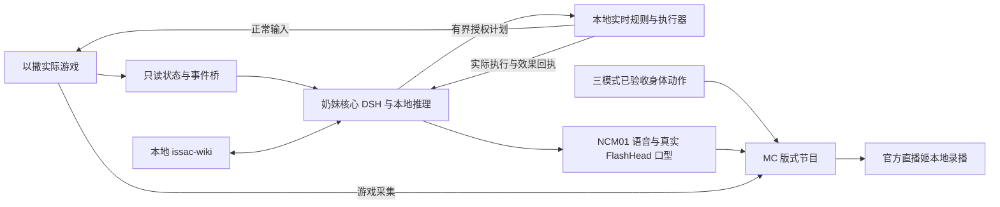

# 奶妹直播游玩《以撒的结合》：最终总需求冻结

冻结编号：`NM-ISSAC-REQUIREMENTS-20261109-v1`。日期：2026-11-09，Asia/Taipei。适用分支：`issac`。冻结类型：**产品需求与验收边界**。源码基点：`fc68c82`；这只是本次整理前的源码位置，不是最终实现或验收版本。

**最终目标：在 RTX4090 的原生 Windows 上，让具有既定身份、人格、声音和三种形态的奶妹真正参与游玩《以撒的结合》。纯本地规则承担实时操作；奶妹核心 AI / DSH 实时掌握游戏状态、直接使用指定 wiki，主导道具和掉落物的取舍，通过执行器落实自己的决定，并自然解说、反应和自言自语。游戏与奶妹共存于沿用 MC 的节目画面，最终交付官方哔哩哔哩直播姬录制的真实 600 秒完整节目。**

本文件冻结“应当做成什么”。冻结不表示现有程序已经符合要求，不授予新的模型下载或公开开播权限，也不恢复此前暂停的测试。此次工作只整理和冻结文档。

配套文件：[逐项需求验收矩阵](需求验收矩阵20261109.csv)、[机器可读冻结清单](../../configs/issac/requirements-freeze.json)、[最近一次人格与部署核查](奶妹人格与DSH配置核查20261108.md)。

## 0. 用户原意、优先级与纠偏

### 0.1 决策分工以这次用户澄清为准

用户明确要求：

> 以仓库的纯本地规则控制为基础，但是要求奶妹的核心Ai DSH能够介入去实时读取到 当前的 游戏中角色状态、房间状态，并且由它去主导决定所有的主动、被动道具、掉落物的拾取。并且要构建成 奶妹 在玩游戏的 展示体验，要自动根据游戏内容播报和说话和自言自语

用户同时要求：

> 奶妹 DSH 加载我上面提供的 issac相关的wiki skill。

因此，“纯本地”限定的是部署和运行位置，不排除奶妹 AI 的本地推理。必须同时保留本地规则的即时控制能力与奶妹本体的真实判断能力。只做规则自动游玩后配播报，或者另一套游戏 AI 决策后让奶妹照稿念，都不能满足本要求。

### 0.2 Swift 的含义与边界

用户进一步指出：**如果运行方案没有使用 Swift，仅强调保留它并无运行意义。** 本冻结据此分开记录三件事：

1. **产品能力：**奶妹核心 DSH 必须具备实际可运行的本地推理后端，支持状态理解、wiki 工具调用、游戏取舍及自然台词生成。
2. **现有资产：**现有 Swift 文件保留，不删除、不重新下载；此前“不下载新模型”的约束继续有效，Qwen 提案没有获得下载授权。
3. **选型状态：**Swift 尚未成为已验证合格的最终推理后端。它不是此需求冻结指定的唯一模型，也不是启动纯规则控制或独立人像排练的强制前提。其合理候选用途是承载奶妹核心 AI 的本地推理，而不是另设一个替奶妹作主的游戏人格。

当前后端标记为**待验证**，不能写成“已经不用任何模型”或“Swift 已经合格”。资源报告必须分别列出实际运行负载、拟同时运行的候选预算和未加载资产；未启动的权重文件不能被算作当前显存或内存占用。未来若要新增下载，须另有用户授权；本文件没有授权。

### 0.3 文件的效力与变更

适用顺序为：用户后续明确指令 → 本冻结与配套矩阵 → 被本冻结引用的角色/声音/MC 不变约束 → 现有实现方案与历史轮次记录。矩阵是本文件各项编号的展开索引，二者是一份需求基线。

`完整更新方案20261107.md` 中的“双 DSH：游戏策略决定、奶妹解说”的旧职责安排，以及核查报告对当时运行状态的描述，保留为历史证据。它们不能覆盖本次奶妹核心 AI 的主导权。后续允许保留多个兼容宿主、协议转换器、规则进程或不同 SDK 版本，但决策归属必须唯一、可追溯，不能产生第二个替奶妹决定的战略主体。

冻结文件后续需要改变时，记录用户来源、受影响编号、变更理由、验证影响和新版本；保留旧基线与历史证据，重新生成散列与矩阵。不得通过更换实现文件、解释旧文档或把失败项移出测试来暗改需求。

### 0.4 总目标编号

| 编号 | 总目标 |
|---|---|
| G01 | `issac` 分支、来源和角色状态独立 |
| G02 | RTX4090 原生 Windows、全本地运行及真实资源预算 |
| G03 | 指定游戏、上游仓库、版本与存档约束 |
| G04 | 本地实时规则控制、状态桥接与可靠执行 |
| G05 | **奶妹核心 AI 读取真实状态，主导全部道具及掉落物决策** |
| G06 | 同一奶妹身份与既定人格 |
| G07 | M01、M02、M03 三种冻结形态 |
| G08 | 完整直播周期的自然动作、操作及随机事件 |
| G09 | 素材首尾一致与连贯连接 |
| G10 | 定稿 NCM01 / OmniVoice 声音 |
| G11 | 真实 FlashHead Lite 512×512 / 25FPS 口型与尖牙质量 |
| G12 | 奶妹 DSH、Humanity、七项扩展的实际应用 |
| G13 | **奶妹核心直接加载并使用指定 `issac-wiki`** |
| G14 | 沿用 MC rev04 的游戏与人物同屏，仅改标题 |
| G15 | 统一验收、真实官方 600 秒录播与可复核交付 |
| G16 | 奶妹依据自己的观察、决定和结果自然播报与自言自语 |

## G01. 分支、来源和状态隔离

| 编号 | 冻结要求 | 验收证据 | 冻结时状态 |
|---|---|---|---|
| G01-01 | 所有本任务变更在 `issac` 工作目录及分支内完成，保留用户要求的拼写；上游 `isaac` API 名可继续使用。 | 分支、工作目录、提交清单与来源回执。 | 本次文档在正确分支整理。 |
| G01-02 | 基于 `naimei` 提交 `1931c45696d02f2c2e205c9a7a8a9f141e89e40c` 继承；`mc` 仅提供节目呈现参考。 | `sources.lock.json`、角色继承清单与 MC 来源指纹。 | 已有来源锁，运行验收不随之继承。 |
| G01-03 | 4090 最终安装使用独立 `C:/dev/虚拟数字人直播/issac`；不混入其他分支的活动状态、进程登记或频道凭据。 | 安装来源、进程归属、路径及状态写入检查。 | 已有隔离文件准备，实际组合待对齐。 |
| G01-04 | 奶妹人格、游戏局、观众记忆、删除账本和媒体会话按用途分区；同一人格状态只有一个权威写入者。 | 状态路径、锁/租约、数据库及删除传播记录。 | 现有设计需按本体主导重审。 |
| G01-05 | 不覆盖 `naimei`、`mc`、female-A、3080 基线和用户未提交修改；历史候选、模型及失败证据保留。 | 有限范围 Git 差异与资产清单。 | 继续适用。 |
| G01-06 | 文档区分需求冻结、候选源码冻结、已复制、已加载、运行中、已验收及公开直播，不以其中一项替代另一项。 | 每项交付状态、时间与证据引用。 | 本次仅冻结需求。 |

## G02. 部署、推理后端与资源边界

| 编号 | 冻结要求 | 验收证据 | 冻结时状态 |
|---|---|---|---|
| G02-01 | 最终游戏、规则、奶妹核心 DSH 推理、TTS、口型、节目页与官方录制在 4090 本机共存，全程不依赖云端方案。 | 同机进程、监听、本地推理地址、请求与整机录制证据。 | 全组合未验收。 |
| G02-02 | 仅使用原生 Windows 程序和 Python/Node；不得调用 Docker、WSL 或其他虚拟化环境。 | 启动入口、运行清单与部署说明。 | 强制约束。 |
| G02-03 | 本地推理后端需真实工具调用及可播台词验证；现有 Swift 是保留资产/待验证候选，不能视为已定型的唯一后端。 | 模型身份、实际配置、真实推理/工具调用/响应回执。 | 后端待验证，Swift 尚未合格。 |
| G02-04 | 不新增模型权重下载，不自动切换 Qwen、云 API 或未选声音；保留现有模型文件。 | 下载/资产差异、模型加载清单与失败行为。 | 本次新增权重 0 字节。 |
| G02-05 | 资源账分实际占用、候选共存估算、磁盘资产；覆盖初始化峰值、编译缓存、KV/上下文、游戏、浏览器及录制余量。 | 分阶段 GPU/内存峰值、模型配置回显及进程对应关系。 | 不继承旧容量结论为新组合合格。 |
| G02-06 | 实测未运行的 Swift 不能列为当前负载；人像独立成功不能证明整机带 AI 成功；拟同时运行的 AI 则必须计入完整预算。 | 人像独立与完整组合两套明确边界的测量。 | 需按实际组合重新核算。 |
| G02-07 | 保护其他程序、GPU 任务和共享权重；不为过关压低既有安全余量或强行加载超预算组合。保留原 Swift 验证时的 16384 上下文及原有预算口径。 | 冻结配置、余量、外部进程前后对照与退出回执。 | 继续适用，未授权换模型。 |
| G02-08 | 设备间数据走 ZeroTier `192.168.196.87 → 192.168.196.209` 直接传输、不经代理并校验；操作结束关闭本任务不用的浏览器标签，不影响用户其他窗口。 | 传输散列与归属明确的浏览器/进程清理记录。 | 本次不传输、不打开浏览器。 |

## G03. 游戏与来源锁

用户指定的原始游戏目录完整保留为：

```text
E:\game\The.Binding.of.Isaac.and.The.Binding.of.Isaac.Rebirth.Build.10102354\The.Binding.of.Isaac.and.The.Binding.of.Isaac.Rebirth.Build.10102354\The.Binding.of.Isaac.and.The.Binding.of.Isaac.Rebirth.Build.10102354
```

| 编号 | 冻结要求 | 验收证据 | 冻结时状态 |
|---|---|---|---|
| G03-01 | 采用用户指定仓库 `https://github.com/wikigsroom/agent-gameplay-isaac/` 的纯本地规则控制为基础，保留原项目来源。 | 上游地址、锁定提交与集成差异。 | 锁定 `5ceb4a4d95402df306ad7dad94bf91f1e04b6649`，`native130-dsh/0.1.0`。 |
| G03-02 | 以用户指定目录的实际游戏为准，当前版本基线为 Repentance 1.7.9b x86；程序名或 wiki 默认版本不能替换实际版本判断。 | 文件指纹、ABI/版本回执与运行检测。 | 来源已登记，最终运行仍需验证。 |
| G03-03 | 普通游玩只通过正常游戏输入；状态桥只读，不修改生命、背包、房间、伤害、解锁或游戏存档以制造结果。 | 输入与桥接代码审查、状态结果和存档差异。 | 强制约束。 |
| G03-04 | 使用已约定的测试槽 3；启动前保护原槽 1/2、Steam/持久数据及私有备份，不将存档上传到公开仓库。 | 一致备份、前后散列、槽位与恢复记录。 | 历史保护措施需继续保留。 |
| G03-05 | 只使用当前角色实际具有的能力与已知进度，不伪造解锁；不把尚未发现的隐藏房间/未知道具当作角色已知事实。 | 观测字段来源、过滤规则及实际决策轨迹。 | 需要完整组合证明。 |
| G03-06 | 游戏目标、可用路线与失败/通关结果依据真实局状态；死亡、重开、换层、传送必须切换相应身份与缓存。 | 局 ID、层/房间 ID、终局与新局记录。 | 待本体决策整合验收。 |

## G04. 规则控制、感知与执行器

即时操作与语义决策分层运行。移动、射击、躲避、寻路不等待语言模型逐帧输出；与拾取有关的路线和操作则服从奶妹核心 AI 的有效授权。

| 编号 | 冻结要求 | 验收证据 | 冻结时状态 |
|---|---|---|---|
| G04-01 | 本地规则承担实时移动、射击、躲避、战斗及普通导航，保持游戏可控，不用语言模型逐帧发方向键。 | 实际控制频率、战斗轨迹、输入和帧率记录。 | 已有上游基础，整合待验收。 |
| G04-02 | 只读桥提供角色、房间、敌人、危险、门、掉落物、动作与结果的结构化观测，不要求额外视觉推理模型作为基础依赖。 | 桥接协议、字段来源与真游戏对照。 | 需按核心 AI 直接消费对齐。 |
| G04-03 | 观测带运行/房间身份、时间、游戏帧或修订、观测来源、已知/未知标记；不能把旧房间缓存冒充当前状态。 | 换房、断线、传送、库存变化时的失效记录。 | 待验收。 |
| G04-04 | 奶妹可查询当前缓存并接收关键事件；全量快照与增量事件一致，有断线重连及缺口补全。 | 快照/事件序号和重连对照。 | 本体直接通路待实现对齐。 |
| G04-05 | 正常探索和战斗路径避免未经授权的可拾取目标；存在冲突时重规划或安全停留，不能借自动导航绕过决策权。 | 未批准目标阻挡、绕行、回退与真实拾取测试。 | 重点缺口，不能只测成功路径。 |
| G04-06 | 执行器只接受身份、有效期和前置条件都匹配的授权；幂等去重，区分收到、接受、执行中、成功、失败、取消。 | 计划/执行/效果三类回执及重复请求试验。 | 旧协议需按新权责核验。 |
| G04-07 | 失去控制、核心不可用或状态不可信时停止主动经济/拾取行为，保留合法即时安全操作并在必要时确认普通暂停；不得默认为另一战略主体接管。 | 断线、超时、过期、人工接管与恢复轨迹。 | 待验收。 |
| G04-08 | 只有一个游戏输入控制者；释放按键、控制租约、暂停确认及恢复均可核验，不重放上一局旧计划。 | 控制者切换、按键释放与进程退出证据。 | 继续保留既有保护要求。 |

### 必须提供的当前状态

| 类别 | 至少覆盖的信息 |
|---|---|
| 角色 | 当前角色、生命及可识别血量类型/上限、钱/钥匙/炸弹、主动道具与充能、被动道具、饰品、卡牌/符文/药丸及辨识状态、能力/异常、最近受伤/死亡。未知项保留未知。 |
| 房间与局 | 运行身份、种子/版本中可依法读取的字段、楼层和当前房间身份/类型/清空状态、已发现地图、门与开启代价、目标和本局进度。 |
| 战场 | 敌人/首领、弹幕或规则可用的危险信息、障碍、可行走区域、战斗/安全窗口。 |
| 可交互目标 | 唯一出生身份、实体类别/variant/subtype、位置、可辨识道具 ID、价格和支付类型、互斥选择组、箱子/机器/交易前置条件与是否仍存在。 |
| 执行 | 当前规则行为、待处理决策、已批准目标、实际行动阶段、真实效果、失败原因、观测时间与修订。 |

对底层桥暂时不能可靠提供的字段，应记录能力覆盖表并保持未知；不得编造值，也不能据此宣称“所有类别已经支持”。

## G05. 奶妹核心 AI 的决策权

**主导者是奶妹本体，规则是执行层。** “实时读取”要求决策针对新鲜、当前且可验证的状态；不等于每个游戏帧运行一次大模型。规则可以持续战斗，核心在事件与决策点介入。

| 编号 | 冻结要求 | 验收证据 | 冻结时状态 |
|---|---|---|---|
| G05-01 | 奶妹核心 DSH 直接取得当前角色/房间/目标状态，以同一身份形成意图、查询知识、选择行动、接收结果。 | 同一核心会话的状态、工具、决策及结果关联记录。 | 现有双角色分工不符合，需对齐。 |
| G05-02 | 全部主动道具的拾取、保留、放弃、替换及使用安排由核心主导；规则仅执行批准的具体动作。 | 原主动道具、替换理由摘要、授权目标、充能及结果。 | 待实现/验收。 |
| G05-03 | 全部被动道具的拿/不拿、互斥选择、构筑协同与风险取舍由核心决定。 | 实际背包、wiki 证据、选择组与拾取后结果。 | 待实现/验收。 |
| G05-04 | 饰品、卡牌、符文、药丸的拾取/交换/留存/使用由核心决定；未辨识药丸不得先宣称效果。 | 口袋/饰品前后状态、辨识信息与执行轨迹。 | 待实现/验收。 |
| G05-05 | 心、硬币、钥匙、炸弹、电池等普通掉落物同样由核心授权；不能只把高价值道具交给 AI、保留规则无条件自动捡。 | 各普通掉落类别的批准/拒绝/绕行与实际数量。 | 待实现/验收。 |
| G05-06 | 商店、恶魔/天使交易、选择底座、箱子等涉及价格、血量、消耗、互斥选项的交互由核心作取舍。 | 价格/资源前置条件及支付后实际变化。 | 全覆盖待验收。 |
| G05-07 | 一次判断可明确批准有限个已识别目标；每个目标可追溯，不能用无限期“以后全捡”代替实时主导。 | 有界授权列表、范围、到期与逐目标回执。 | 新权责要求。 |
| G05-08 | 授权绑定当前局、房间、目标出生身份、库存/资源、价格、观测修订及有效期。 | 计划字段、校验及拒绝原因。 | 待实现对齐。 |
| G05-09 | 目标消失、价格/资源/库存变化、换房、重开或授权到期后重新判断；不能执行过期认可。 | 故意变化前置条件的失败/再决策轨迹。 | 待验收。 |
| G05-10 | 本地危险检测可拒绝不安全动作并反馈核心；不得自行改变战略选择或偷偷领取未批目标。 | 安全拒绝、原因、核心后续决定。 | 待验收。 |
| G05-11 | 核心慢、不可用或资料不足时，安全等待、继续许可的战斗/躲避或确认暂停；不以独立规则/另一个 AI 的自动拾取冒充奶妹决定。 | 超时、异常、未知目标和恢复场景。 | 必须显式实现。 |
| G05-12 | 游戏机制自动发放或不可避免的意外拾取如实记为观察到的事件，不倒签 AI 授权；意外拾取作为缺陷/例外分析。 | 原始观测、无授权标记与后续策略更新。 | 待验收。 |
| G05-13 | 每个支持类别覆盖拿、跳过、替换/互斥、不可支付、目标变化等适用分支；上游仅注册部分类型不能宣称全类别完成。 | 类别×操作覆盖表与真实游戏证据。 | 完整覆盖尚未证明。 |
| G05-14 | 核心的可播理由为简短自然表达；内部调试记录与观众台词分离，不把工具请求、JSON 或长篇内部过程上屏。 | 实际播出内容及脱敏事件记录。 | 待组合验收。 |
| G05-15 | 报告状态新鲜度、事件可见延迟、判断/执行/播报延迟及 p95；旧 6Hz/250ms/45秒参数只是历史默认，45秒不是已接受的直播实时标准。 | 新一轮测试前确定的延迟预算与整段测量，含过期拒绝数。 | 数值预算待工程验证，不降低用户实时要求。 |

### 核心到执行器的最小契约

下列是待实现接口应满足的字段语义，不宣称现有同名接口已经满足：

```json
{
  "decision_id": "unique-decision",
  "actor_id": "naimei",
  "run_id": "current-run",
  "room_id": "current-room",
  "observation_id": "fresh-observation",
  "state_revision": 42,
  "inventory_revision": 9,
  "expires_at": "bounded-deadline",
  "targets": [
    {
      "spawn_id": "specific-pickup-instance",
      "action": "take-or-skip-or-replace-or-use",
      "expected_price": "observed-price",
      "preconditions": ["same-target", "sufficient-resources", "choice-still-valid"]
    }
  ]
}
```

具体协议名称和字段编码可在实现时细化；`decision_id → execution_id → observed_effect` 因果链、有效期、范围与再校验不可省略。这里的理由摘要仅用于可解释性，不需要将内部思考原文写入观众画面。

## G06. 奶妹的固定身份与人格

| 编号 | 冻结要求 | 验收证据 | 冻结时状态 |
|---|---|---|---|
| G06-01 | `character_id=naimei`，名称奶妹/Naimei，虚构的女性化金黄色拟人小龙；O01 橙子日常装。 | 身份配置、实际发布人格与节目接口一致。 | 配置已存在，旧服务发布映射有遗留错误。 |
| G06-02 | 绿色眼睛、蓝黑发、橙子贝雷帽、短圆吻；开口两颗小上尖牙，闭嘴不露齿；每手四指含拇指、一条尾巴。 | 三形态实际视频逐帧/连续播放复核。 | 静态图已定，动态质量未整体通过。 |
| G06-03 | 温暖亲近、机灵、轻俏皮、有独立判断；像同桌陪玩，失误可轻吐槽，关切观众时认真。 | 同一人格下的游戏选择、对话和反应样本。 | 配置已存在，最终行为待验收。 |
| G06-04 | 简体中文日常口语，通常 1～3 句；不持续尖叫、幼儿化或机械重复口头禅，允许安静。 | 连续节目台词与听感复核。 | 待组合验收。 |
| G06-05 | 年龄、身高、生日和身世未设定；不借用 female-A/林知夏的姓名、经历或私人记忆。 | 初始/已有发布人格及记忆分区检查。 | 必须修复错误身份映射，不能只改默认 JSON。 |
| G06-06 | 观众昵称来自真实输入，不能凭昵称编造熟悉关系；游戏知识、局状态和观众记忆各有来源。 | 记忆提议/召回与事实来源。 | 待整合核验。 |
| G06-07 | 默认配置、持久化发布人格、Humanity 注入及画面角色一致；不因旧数据库优先级而继续发布其他角色 ID。 | 干净状态与已有状态两条启动路径。 | 2026-11-08 旧服务有 `female-a` 元数据遗留。 |

## G07. 三种模式形态

| 形态 | 名称 | 冻结取景与状态 | 基准图 |
|---|---|---|---|
| M01 | 日光陪玩 | 桌前直立端坐，奶油白配橙边高背椅；左窗日光、右书架，左下橙杯；双手持同款手柄。 | [M01](../../assets/issac/references/M01.png) |
| M02 | 暖夜陪玩 | 与 M01 同一桌前构图和握柄基准；夜窗与暖色书架灯带，不改为前倾或深色椅。 | [M02](../../assets/issac/references/M02.png) |
| M03 | 专注对局 | 原 05 的前倾专注、深色电竞椅、较近景别；不混入 M01/M02 的桌沿和浅色椅。 | [M03](../../assets/issac/references/M03.png) |

详细左右位置、镜头、尾巴、杯与手柄约束以 [角色继承清单](../../configs/issac/character-inheritance.json) 的逐形态字段为准。

| 编号 | 冻结要求 | 验收证据 | 冻结时状态 |
|---|---|---|---|
| G07-01 | 三张用户锁定图片分别对应 M01/M02/M03，不重绘为新人物、不镜像、不混椅子/光照/道具。 | 原图 SHA256 和对应模式视频对照。 | 静态来源已锁定。 |
| G07-02 | 三形态是同一奶妹身份、人格、O01 与 NCM01；issac 可默认 M03，仍须保留三形态。 | 切换前后身份、音色和模式清单。 | 模式已定义，整段验证待补。 |
| G07-03 | 模式有独立 G0、动作素材和兼容约束；不能任意跨模式硬接；切换使用有定义的安全过渡。 | 模式隔离、过渡与口型基准复核。 | 需正式动作库验收。 |
| G07-04 | 三形态分别具备真实声音/口型/身体的独立验证材料；历史 30/120/300秒样片须标版本和真实链路，不因片长够就通过。 | 每形态样片、元数据、帧率与画质审查。 | 已有 30秒记录未达到成片有效25FPS。 |
| G07-05 | 保留用户要求的三形态各300秒人物片段作为素材阶段交付，按最新声音/口型逐项核验；不将其冒充最终游戏官方600秒，也不自动要求每形态另录600秒。 | 三份300秒文件及其真实链路/质量证明，最终600秒另列。 | 现有历史样片需逐项核验，未在本次宣告通过。 |

早期要求的五套不同外观/服装保留为角色选型历史与资产，不自动混入当前三形态的正式节目。增加新正式服装时需要独立约束和质量验收。

## G08. 自然动作、游玩操作和随机事件

身体素材使用获准参考图配合本地 H3 / ComfyUI 离线构建；运行时播放经审核素材并与真实口型组合。不引入 3D 建模、骨骼绑定或云视频生成作为本方案前提。

| 编号 | 冻结要求 | 验收证据 | 冻结时状态 |
|---|---|---|---|
| G08-01 | 覆盖持续直播的呼吸、眨眼、视线、轻微坐姿/肩部调整、倾听、思考及安静状态，避免单帧长期冻结。 | 每模式动作目录与长时间实际播放。 | 有候选，正式库未完整验收。 |
| G08-02 | 持柄动作包含拇指摇杆、按键、握姿微调及不同强度，手指/手柄结构稳定；不能只有嘴在动。 | 双手可见的连续动作与细节检查。 | 需逐动作审核。 |
| G08-03 | 构建探索、专注战斗、紧张躲避、松口气、疑惑、惊喜、小失误、受伤、胜负/清房等可区分反应。 | 动作语义、适用事件和真实触发记录。 | 丰富度及匹配度待验收。 |
| G08-04 | 构建自然喝水完整链：安全时机、放置/稳定手柄、伸手取杯、抬杯、饮水、放杯、回握与回 G0；杯和手不能闪现。 | 完整链视频、道具连续性与开始/完成回执。 | 候选不能视为成品库。 |
| G08-05 | 杯遮嘴时不叠加穿透杯子的说话口型；游戏危险阶段不能随意双手离柄，需安全窗口、合规暂停或明确协调。 | 饮水期间游戏/人物/声音的同时间线。 | 待整合。 |
| G08-06 | 随机自然事件具有权重、冷却、最小间隔、适用模式/状态、互斥和优先级；不纯随机打断关键决策。 | 调度配置、种子/事件记录、长期分布及连续性。 | 需正式调度验收。 |
| G08-07 | 重复动作有多个真实变体与轮换，避免固定短周期、连续重复同段及频繁喝水；不把播放倍速当新增素材。 | 独立素材数、变体关系、重复率和长段样片。 | 正式覆盖表待补。 |
| G08-08 | 动作可被紧急情况/人工操作安全中断，并沿允许出口归位；新状态不得继续旧事件动作或漏放手柄。 | 中断、恢复、模式切换与道具状态轨迹。 | 待验收。 |
| G08-09 | 资产带模式、动作/变体 ID、时长/帧率、起止姿态、手柄/杯状态、说话兼容区、过渡、优先级、冷却、来源和审核状态。 | 机器可读资产清单与实际解码对照。 | 需要生产级清单。 |
| G08-10 | 自然状态库按完整直播周期规划，需保留30分钟/120分钟级轮换验证；素材需求量按覆盖和复用测算，不把短样片通过等同全天循环合格。 | 各模式覆盖表、长循环计划、实际重复/卡顿/接缝报告。 | 长期自然性未通过。 |

## G09. 首尾一致与连接质量

| 编号 | 冻结要求 | 验收证据 | 冻结时状态 |
|---|---|---|---|
| G09-01 | 每个普通可循环片段从本模式 G0 出发并回到同一 G0；杯、手柄、双手、坐姿和视线状态可继续衔接。 | 解码首尾帧、接缝前后连续播放与状态清单。 | 属于不可降级的素材约束。 |
| G09-02 | 复合事件允许拆成有明确状态接口的片段，但入口/出口必须成对兼容；喝水必须完整回到持柄基准。 | 状态图、片段配对、复合链测试。 | 待正式库验证。 |
| G09-03 | 不得替换首尾帧、冻结填充、复制静态帧或仅凭生成器“首尾同图”设置宣称一致。 | 原始生成文件、实际解码帧序列与复核记录。 | 必须保留真实性。 |
| G09-04 | 跨片段检查脸形、尖牙、手指、尾巴、衣服、椅子、背景和道具连续；混合/转场不能掩盖结构变形。 | 真帧画质检查及连接段视频。 | 动态候选未整体通过。 |
| G09-05 | 身体段的静默嘴部保持可用基准；身体生成的假说话不能替代真实 FlashHead 音频驱动。 | 原始身体素材与合成输出对照。 | 继续沿用已选口型约束。 |
| G09-06 | 所有已接受资产有稳定 ID、来源、散列、审核人/时间、版本及替换记录；候选/拒绝/已接受分开。 | 清单、文件 SHA256 与审核证据。 | 静态图已锁，生产动作需继续完成。 |

## G10. 最终声音与音频管理

唯一当前定稿为 `NM-VOICE-FINAL-20261106-v1` / **NCM01**，来自用户最后批准的合并版本。历史 O07/F07、拆分版本、旧 NMV 仅作保留资产，不能回退为奶妹的现选声音。

| 编号 | 冻结要求 | 验收证据 | 冻结时状态 |
|---|---|---|---|
| G10-01 | 所有新奶妹台词使用定稿 NCM01，不因场景、心情、形态或模型缺失换音色。 | 生成任务、voice ID、实际试听与成品关联。 | 音色身份已定稿，新片听感仍需验收。 |
| G10-02 | 使用既有 OmniVoice FP16、32 steps、speed=1.0、seed=2026102807、`preprocess_prompt=false`，与锁定 profile 一致。 | 配置回显、profile散列与实际生成记录。 | 配置已存在。 |
| G10-03 | 原始克隆输入及其文字内容不进入 Git、公开页面、API、录播附件或交付包；仅发布生成成品和脱敏元数据。 | 排除清单、包内容/接口审查与仓库差异。 | 不在本冻结复制或附加原始输入。 |
| G10-04 | 私有运行输入缺失或散列不符应停止生成并报告，不使用旧缓存或其他声音蒙混。 | 缺失、错配、缓存隔离与正常生成场景。 | 需继续保留严格校验。 |
| G10-05 | 游戏道具名、数字、中英混读、停顿、感叹与连续解说发音自然；音量与响度稳定，不以更快语速掩盖延迟。 | 中文测试包、真实游戏台词和连续听感。 | 新内容待验收。 |
| G10-06 | 字幕来自实际最终可播文本及生成音频分段边界；没有强制对齐证据时不宣称逐字精确对齐。 | 文本、样本边界、字幕和文件时长。 | 继续适用。 |
| G10-07 | 只有正式播放权威输出可闻人声；预览静音，游戏/BGM在说话时按继承规则压低，不产生回声或双播。 | 播放租约、混音轨、录播听感及播放回执。 | 整机音频待验收。 |
| G10-08 | 新台词、过期台词、中断、取消与自然播完有明确队列状态；禁止中断后续播旧音频，生成完成不等于观众已听完。 | 队列、样本播放位置与自然结束/取消回执。 | 待整合验证。 |

## G11. 真实口型与实时画质

| 编号 | 冻结要求 | 验收证据 | 冻结时状态 |
|---|---|---|---|
| G11-01 | 角色原生处理规格固定 FlashHead Lite 512×512、目标25FPS、4 steps、batch1；不回到640～832嘴不动方案。 | 运行配置、真推理输出和实际画面。 | 规格已定稿，整机质量未通过。 |
| G11-02 | 口型由本次实际可闻 NCM01 音频驱动；禁止 H3预制假口型、静态贴嘴、仅拼接旧开口图冒充。 | 同源音频、帧索引、实时流与录像对照。 | 需要每次交付真实链路证明。 |
| G11-03 | 发音时持续自然开合、停顿闭合，音画同步；两颗上尖牙、短吻、眼睛与脸形稳定。 | 同步测试包及正常倍速/局部逐帧复核。 | 画质不能由帧计数代替。 |
| G11-04 | 静默时自然闭口，保留呼吸/眨眼/游玩动作，不持续咀嚼、不定格整个人物、不露额外牙齿。 | 说话→停顿→静默→再说话的连续视频。 | 待三形态逐一验收。 |
| G11-05 | 真正稳定有效25FPS是实时人像目标；推理吞吐、网络包速率、Canvas回调及容器标称帧率分别记录。 | 生成/传输/呈现/编码/文件五层时序及重复/丢帧分析。 | 历史30秒成片约19～20FPS，不能宣称通过。 |
| G11-06 | 不以补帧、复制帧、加速播放或30FPS节目封装冒充25FPS有效人像；画质和同步必须同时过关。 | 帧时间、唯一有效帧、同步与观感的联合报告。 | 强制要求。 |
| G11-07 | 身体动作与嘴部映射稳定，头部小运动和喝水遮挡不产生口部漂移、穿透或多层嘴。 | 三形态多动作的真实合成视频。 | 身体/口型联合质量待验收。 |
| G11-08 | 完整组合须在游戏、核心AI、TTS及官方录制同时运行时复测；人物独立性能不继承为全组合结果。 | 同机带负载整段录像与资源/延迟日志。 | 未通过。 |
| G11-09 | 优化优先保证已冻结512方案的真口型和稳定性；改变原生分辨率/引擎/音色不得未经变更记录悄悄替代。 | 前后配置、变更依据和同标准对照。 | 本次不更改冻结媒体规格。 |

## G12. 奶妹 DSH、Humanity、插件与记忆

核心身份、知识、决策和台词要能在同一个奶妹上下文中协作。适配器或独立进程的存在不改变这一点。现有两套 DSH 宿主版本只是迁移时需处理的兼容事实，不是冻结为永久双战略人格。

| 来源编号 | 用户指定来源 | 已锁版本/提交前缀 | 本方案应用及边界 |
|---|---|---|---|
| P01 | [Scorp1o117/dsh-soul-md](https://github.com/Scorp1o117/dsh-soul-md) | 0.12.1 / `0de8445b4941` | 奶妹人格卡与只读 `soul_read`；不开放任意人格切换或子代理控制。 |
| P02 | [Yuuyuko-uu/dsh-fish-memory](https://github.com/Yuuyuko-uu/dsh-fish-memory) | 1.5.5 / `a070ebf096f3` | 对项目已分区、可追溯的 SQLite 记忆作召回排序，避免第二个独立写入者。 |
| P03 | [Yuuyuko-uu/dsh-feiyu-mood](https://github.com/Yuuyuko-uu/dsh-feiyu-mood) | 0.9.1 / `2f52a367e2ea` | 公共对话播完后的心情评估影响后续语气，不自动声称身体动作已执行。 |
| P04 | [Yuuyuko-uu/dsh-speak-up](https://github.com/Yuuyuko-uu/dsh-speak-up) | 0.3.0 / `e3bc6362208c` | 空闲主动搭话，服从媒体/队列/游戏时机；与游戏事件触发解说区别记录。 |
| P05 | [thawline/dsh-memewiki](https://github.com/thawline/dsh-memewiki) | 0.1.20 / `bf3155ad93de` | 本地梗词库及模糊检索，保留来源。 |
| P06 | [jiji262/humanizer-chinese](https://github.com/jiji262/humanizer-chinese) | 1.0.0 / `1d6c08e10fbf` | 中文口语表达规则实际应用于自动生成台词；人工逐字播报不被擅自改写。 |
| P07 | [Liujelly/dsh-memewiki](https://github.com/Liujelly/dsh-memewiki) | 1.0.0 / `1d3f82664688` | 意图与查梗补充，关闭在线回退，与P05去重后统一受限工具。 |

完整来源、许可与提交以 [扩展来源锁](../../extensions/naimei-dsh/sources.lock.json) 为准。上述扩展锁定文件共84个、43,330,976字节，新增模型权重0字节；磁盘体积不等于常驻显存。适配方式为 `reviewed_stream_bridge_adapters`，不宣称原样启用了全部上游桌面功能。

| 编号 | 冻结要求 | 验收证据 | 冻结时状态 |
|---|---|---|---|
| G12-01 | 奶妹是核心 AI 身份，Humanity 注入、人格卡、状态记忆、游戏工具和最终台词共同指向 `naimei`。 | 组合回执、实际提示/工具清单和输出身份。 | 现有配置有基础，运行组合需重构对齐。 |
| G12-02 | 七项指定扩展均需实际加载/应用，保留各自来源、版本和许可，不能以复制文件代替运行生效。 | 84文件锁校验、宿主加载及每项行为证据。 | 已核对文件，当前issac主播运行未证明。 |
| G12-03 | DSH工具权限受限：允许必要游戏读状态/查询/提交有限计划、记忆与人格/梗查询；不开放任意终端、文件写入或子代理调度。 | 核心工具许可、拒绝路径与真实调用。 | 游戏工具需直接接入核心。 |
| G12-04 | SQLite是权威记忆源，Humanity仅镜像获准公共记忆；观众/公共/游戏局分区，删除和会话失效能传播。 | 数据流、召回、删除与重启记录。 | 需整合核验。 |
| G12-05 | 继续禁用自动人格演化、梦境和自动改人格，`automatic_memory_enabled=false`；人格变化需可审查，不让旧发布状态暗改身份。 | 有/无历史状态的启动与运行配置。 | 继续适用。 |
| G12-06 | fish-memory初始预算沿用候选200条、半衰期30天、最多6条/800字，最终公共3条/300字、当前观众3条/500字；不引入GPU向量模型。 | 召回与最终注入的实际条目、分区和长度。 | 配置已有，运行需证明。 |
| G12-07 | mood仅在符合条件的公共对话自然播完后调用；现有置信度75、间隔60秒、每日120次、384tokens/10秒预算可作初始值。 | 播放完成、评估/取消及语气变化关联。 | 初始心情70是默认值，不是现役实测。 |
| G12-08 | speak-up配置与独立运行开关分开；空闲搭话需核心/媒体/正式播放源就绪、队列允许，默认不因enabled字段自动开播。 | 每分钟检查、命中线20、2分钟冷却及实际触发/抑制。 | 配置存在，完整运行未验收。 |
| G12-09 | 游戏事件解说有独立的事件触发通路，不能只靠空闲随机搭话；心情和记忆后台任务不得阻塞游戏决策或声音。 | 不同事件源、优先级、取消和负载记录。 | 需对齐本体决策。 |
| G12-10 | Humanizer实际影响生成台词；只读取完整Skill文件但未应用规则不能宣称完成，输出仅为最终可播文本。 | 原始任务、实际注入规则与最终台词样本。 | 现有项目口播规则需在新核心验证。 |
| G12-11 | 两个memewiki本地查询去重，禁止在线回退；查梗事实不能覆盖游戏观测或制造观众经历。 | 查询来源、离线行为和实际引用。 | 现有适配器已具备基础。 |
| G12-12 | 模型配置、persona发布、扩展加载和工具调用分别证明；旧3093/3094或历史策略宿主回执不得冒充issac核心已上线。 | 本安装来源与时点对应的状态/加载/调用证据。 | 2026-11-08核查表明仍有缺口。 |

制作/部署阶段使用的 `remote-4090`、`sub2-image-gen` 和 H3 工作流属于制作工具；安装了它们不表示奶妹运行时能调用。奶妹本身必须直接具备的是此处受限工具与G13指定游戏知识能力。

## G13. 奶妹核心直接使用 issac-wiki

用户指定源文件：`E:/dev/sandbox/以撒的结合skill/issac-wiki/SKILL.md`。已锁快照为2026-11-07，4525文件、71,823,884字节，其中SQLite为52,187,136字节。快照默认Repentance+，实际游戏是Repentance，因此运行查询必须明确采用 `rep`，不能沿用默认 `rep+`。

| 编号 | 冻结要求 | 验收证据 | 冻结时状态 |
|---|---|---|---|
| G13-01 | 完整指定Skill及必要查询/局势评估规则直接进入奶妹核心可用能力，来源及散列可核验。 | 核心实际提示/资源加载回执、锁定源文件。 | 旧实现只挂在游戏策略DSH，需迁移/接通。 |
| G13-02 | 核心可直接调用 `isaac_wiki_query` 或等价受限只读工具；不能只能听另一代理给出的摘要。 | 奶妹核心真实工具调用与返回。 | 当前普通主播工具清单缺此项。 |
| G13-03 | 查询实际在4090本地运行，使用锁定SQLite/Python资源，不靠联网搜索或云模型补结果。 | 本地文件、执行来源、离线查询与无在线回退。 | 文件已准备，本体路径待验收。 |
| G13-04 | 明确 `rep` 版本，保留来源版本/历史变更/前置条件；不能把Repentance+改动用于当前游戏。 | 查询参数、版本标记和对应实际决策。 | 版本过滤需持续验证。 |
| G13-05 | 支持主动/被动/饰品/卡符/药丸/掉落/交易等决策所需知识与构筑协同；局状态来自游戏而非wiki猜测。 | 分类别真实查询及背包/局势关联。 | 完整覆盖待验收。 |
| G13-06 | 查不到、部分覆盖、未知机制或无法辨识时明确保留不确定性；不杜撰名称、效果或解锁。 | 空结果/版本冲突/未知物品样本。 | 必须显式处理。 |
| G13-07 | 查询与当前决策、局、房间和库存关联；换局/换房/目标变化后不能复用过期结论直接执行。 | 查询/决策/执行ID关联与失效记录。 | 待本体整合。 |
| G13-08 | 数据查询不开放任意SQL、Shell、文件或网络操作；资料文本按知识读取，不作为覆盖用户与系统权限的指令。 | 参数许可、拒绝样本与只读访问。 | 继续沿用受限工具原则。 |
| G13-09 | 初始可沿用每次决策最多3查、单查2秒、结果3000tokens预算；预算可在整轮优化中调整，需保持实时且不损害决策覆盖。 | 实际查询耗时、截断标记、缓存和总决策延迟。 | 初始工程参数，不是最终实时性通过证明。 |
| G13-10 | 用真实游戏至少证明“读当前状态→核心查wiki→核心作取舍→规则执行→核心看结果并回应”；只有加载文件/工具列名不能通过。 | 完整可回放轨迹及同时间线画面/声音。 | 尚无最终组合通过证据。 |

## G14. MC 同屏、节目和播放规则

| 编号 | 冻结要求 | 验收证据 | 冻结时状态 |
|---|---|---|---|
| G14-01 | 沿用MC分支rev04的节目几何、配色、字体、图层与细则，视觉仅改标题为“奶妹 · 以撒的结合”。 | [MC沿用约束](MC同屏方案沿用与标题替换20261107.md)、16份来源指纹与实际截图。 | 来源已核查，实际官方画面待验收。 |
| G14-02 | 最终节目1920×1080、目标30FPS，全幅游戏底层加透明节目覆盖；人像原生仍512×512/25FPS。 | 画布/采集配置和最终文件，不混淆两类帧率。 | 规格冻结。 |
| G14-03 | 默认右下264×264圆形奶妹，保留已有320×180替代布局及原位置切换行为；不擅自换新设计。 | rev04布局快照与实际人物/游戏合成。 | 实现存在部分路径，未完成官方验收。 |
| G14-04 | 继承留言侧、队列、字幕、礼物/飞行反馈、预览和播放操作细则；适配游戏数据源但不继承MC世界/状态/云端接口。 | 页面行为对照与来源/状态隔离。 | 需整段验证。 |
| G14-05 | 唯一正式播放权威，预览静音；本地生成、人物、字幕与游戏混音在官方录播中一致。 | 声音轨、权威租约及播完回执。 | 待官方整机验收。 |
| G14-06 | 对外画面不读内部工具名、路径、参数、私有内容或调试日志，游戏取舍以自然口语呈现。 | 连续录播及公开接口内容审查。 | 必须执行。 |
| G14-07 | 保留开场、过渡、休息、回来、收尾节目包装；人工播报和节目按钮应能实际出声/出字幕、可取消并恢复。 | 正式播放源的按钮操作与中断/恢复录屏。 | 需在issac路径真实验证。 |
| G14-08 | 使用官方哔哩哔哩直播姬本地录制，不切换OBS替代交付；不启动公开推流，不绕过系统/平台确认。 | 官方录制操作、实际文件与状态回执。 | 官方黑屏问题尚未闭环。 |

## G15. 推进顺序、验收及录播交付

| 编号 | 冻结要求 | 验收证据 | 冻结时状态 |
|---|---|---|---|
| G15-01 | 第一轮文件准备与校验不算应用/游戏/推理验收；保留既有复制记录，不因需求整理重做无必要传输。 | 第一轮清单、散列及后续差异。 | 历史复制记录已存在。 |
| G15-02 | 每轮先完成全部代码、工具、文档和TODO，整体复核并提交冻结，再统一测试；发现问题后收集关闭该轮，进入下一整轮修正。 | 开发清单、源码冻结、测试相位和缺陷闭环。 | 后续继续遵循。 |
| G15-03 | 不在同一冻结测试阶段边改边测，不删失败证据、不放宽标准冒充通过；资料校验不等于恢复运行测试。 | 源码前后散列与测试阶段记录。 | 此次仅文档/数据一致性检查。 |
| G15-04 | 依次验证桥/执行、核心/工具、三模式媒体、整机并行、官方画面与长段录播；每一层都保留真实输入及结果边界。 | 分层验收与完整组合证据。 | 当前未到整机通过状态。 |
| G15-05 | 最终提供至少一段连续600秒真实游戏＋奶妹节目，由官方直播姬本地录制；不能用脚本拼接旧视频或浏览器录制冒充。 | 原始官方录像、文件散列、录制开始/结束和连续时间线。 | 未交付合格最终录像。 |
| G15-06 | 最终片段需看到真实游玩、核心主导的拾取/取舍、wiki调用的真实轨迹及自然解说；缺少自然出现的类别另提供真实专项证据，不伪造事件凑数。 | 成片＋脱敏决策证据＋类别覆盖矩阵。 | 待实现对齐与验收。 |
| G15-07 | 三模式分别通过身份、声音、口型/尖牙、动作/接缝检查；最终600秒至少使用已通过的模式，可按合规过渡切换。 | 模式专项报告及最终使用模式清单。 | 没有完整生产模式验收。 |
| G15-08 | 交付给出可访问的本地页面/录播绝对路径、时长、实际帧率、声音及媒体/模型版本；原始克隆输入不随包交付。 | 文件探测、可打开链接、散列与脱敏清单。 | 待最终交付。 |
| G15-09 | 有稳定运行、停止、普通暂停、人工接管、重连、队列清理与回滚说明；保护游戏原存档和其他任务。 | 操作手册及真实故障恢复证据。 | 继续保留并按新架构验证。 |
| G15-10 | 本次需求冻结不恢复测试、不启动服务/模型/游戏、不触发公开直播；后续推进按冻结需求重新列整轮实现范围。 | 本次变更清单和无运行变更声明。 | 本次仅文档冻结。 |
| G15-11 | 保留先30分钟、再120分钟的同机完整负载验证，覆盖游戏、核心推理、声音、口型、节目及录制；正式600秒片段不能替代长期稳定性，身体素材轮换测试也不能替代整机负载。 | 同一冻结候选的资源峰值、帧率/同步、队列、故障恢复与长时间连续记录。 | 完整组合长期稳定性未通过。 |

## G16. 奶妹在玩游戏的自然展示体验

| 编号 | 冻结要求 | 验收证据 | 冻结时状态 |
|---|---|---|---|
| G16-01 | 奶妹从同一当前状态形成观察、意图、决定与反馈，观众能感到是她在玩，而非独立AI替她玩后配音。 | 核心状态/决策/结果与实际台词的同时间线。 | 现有分工需对齐。 |
| G16-02 | 看到道具时可自然说出短判断/取舍，执行后依据真实效果反应；不能先说“拿到了”再等执行。 | 等待、接受、成功、失败四类语音/状态对照。 | 待验收。 |
| G16-03 | 支持探索自言自语、战斗短反应、受伤/清房/首领/奖励反馈、构筑变化与观众互动，避免只有按钮触发的固定台词。 | 不同真实事件触发的连续节目。 | 需本体事件链实现。 |
| G16-04 | 允许自然停顿、安静游玩、轻声思考和少量梗，不要求对每次移动/拾取机械播报，也不无休止填满声音。 | 连续听感、重复率、沉默分布和行为匹配。 | 待长期评审。 |
| G16-05 | 只叙述实际知道的画面、进度、效果与观众事件；未知药丸、未发现房间、未执行动作或未播完内容保持未知/未完成。 | 信息来源、行为回执与台词事实核对。 | 强制事实约束。 |
| G16-06 | 决策与台词共享人格/游戏上下文，但私有调试轨迹和观众台词分开；不输出内部格式或过长解释。 | 实际核心上下文及最后可播文本。 | 待本体整合。 |
| G16-07 | 游戏事件台词队列有优先级、合并、去重、有效期和取消；换房/死亡/新局后不补播过期“刚才发生”事实。 | 队列压力、连续事件与失效测试。 | 待验收。 |
| G16-08 | 记忆/心情/查梗/空闲搭话在合理预算内异步运行，不抢占紧急决策或破坏口型稳定。 | 负载时间线、排队与媒体帧率/延迟测量。 | 整机未证明。 |
| G16-09 | 喝水、点头、庆祝等身体行为需实际动作开始/完成回执；语言只能按真实阶段表达，不能编造已经喝完。 | 动作状态、音频和同时间线视频。 | 需要联合验证。 |
| G16-10 | 自动解说使用最终NCM01，经真实FlashHead和正式播放源播出；不能只展示后台生成了文字。 | 文本→语音→嘴部→实际可闻播放→完成的链路。 | 存在部分链路，完整游戏组合未通过。 |
| G16-11 | 用户可手动接管、暂停、取消和恢复；自动游戏/自动搭话/正式播出有明确状态，关闭时不继续发输入或播放旧队列。 | 操作界面、状态机与恢复录像。 | 待整机验收。 |

## 17. 继承的 A01～A14 素材和内容管理

用户明确先做 A01～A14，并最终接入直播体系。该范围继续继承；A15～A22 保持搁置，不能以增加新范围替代当前闭环。早期文件里的 O07/F07、旧画布和手动播报阶段，分别被最新声音、MC画布和本次自动游玩要求覆盖。

| 继承编号 | 内容 | 当前冻结下必须具备的配套 |
|---|---|---|
| A01 | 正式角色档案 | 同一奶妹身份、人格、版本、状态隔离和实际发布映射。 |
| A02 | 首发形象与取景 | O01及M01/M02/M03锁定图、闭口G0、手/杯/手柄/椅子与镜头约束。 |
| A03 | 口型测试包 | 中文音节、数字、停顿、长句、游戏名词、尖牙稳定及真实同步。 |
| A04 | 自然待机 | 多变体呼吸/眨眼/视线/游玩操作，静默也保持自然。 |
| A05 | 倾听与思考 | 听观众、思考道具、短暂停手或持续持柄的兼容动作。 |
| A06 | 说话进出 | 真音频驱动，开始/停顿/中断/归位及实际播放回执。 |
| A07 | 高频互动 | 欢迎、感谢、鼓励、小笑、告别与游戏事件反应，按事实和优先级调度。 |
| A08 | 情绪强度 | 低幅自然微表情及不同强度反应，保持短吻、尖牙、眼睛和持柄结构。 |
| A09 | 正式声音 | 唯一NCM01，私有输入排除、生成缓存隔离和实际音频验收。 |
| A10 | 语音与字幕 | 发音表、分段、实际音频边界、字幕更新/撤销与单一播放权威。 |
| A11 | 场景和布局 | MC rev04横屏同屏，三模式人物源、游戏源和官方节目源。 |
| A12 | 边缘与背景 | 使用已验收的人物窗口/遮罩，保持构图边界，不发布未经验证的抠像质量。 |
| A13 | 音乐与音效 | 本地已授权资产、游戏/人声/BGM分层、压低及无双播。 |
| A14 | 节目包装 | 开场/过渡/休息/回来/收尾的标题、自然台词、动作与可中断播出。 |

每项资产记录：`asset_id / mode_id / action_id / variant_id / source / sha256 / duration / fps / start_state / end_state / compatible_states / speech_mask / cooldown / review_status`。成品台词与生成音频还要关联 voice ID、文本、生成配置、字幕边界和播出版本。运行状态及私有输入不进入公开资产清单。

动作库不冻结一个凭空估算的固定视频总数。下一轮按三模式、状态类别、真实变体、连接链、冷却与30/120分钟复用覆盖测算需求，列出已有合格数、候选数、拒绝数和缺口；数量丰富必须同时满足动作真实性及接缝要求。

## 18. 逻辑架构与责任流



核心可以按事件唤醒、缓存可靠观测、复用同版本知识并异步生成简短台词；这些优化不能转移道具决策权。规则层可高频独立处理即时生存，wiki是知识工具，DSH是角色与工具编排宿主，推理模型提供理解/生成能力，TTS和口型提供表现。不能因保留某个模型文件就宣称上述整条链已经运行。

### 已知接口和路径的处理

- 现有 `state/issac-stream`、`state/isaac-strategy`、两套DSH SDK和1235网关是既有实现事实；重构时可以做兼容转换，但不得继续让独立策略人格先决定、奶妹只解说。
- `isaac_get_state`、`isaac_get_decision`、`isaac_lookup`、`isaac_submit_plan`、`isaac_wiki_query` 是可沿用的接口名。最终需直接暴露到奶妹核心的受限能力，检查真实返回与权限，不能只复制工具列表。
- 角色、声音、MC布局的冻结配置继续是来源依赖。新的需求清单不自动激活运行开关，也不改写部署来源或“已合格”标记。

## 19. 冻结时的实际证据与差距

本节引用既有证据，不是2026-11-09重新启动远端测试。远端只读核查时点为2026-11-08 23:35:53，Asia/Taipei。

| 项目 | 已有证据 | 仍不能据此宣称 |
|---|---|---|
| 来源及文件 | 游戏、wiki、独立安装准备记录；角色图和声音profile有锁；七扩展本地/远端84文件符合锁。 | 源码复制不等于核心已加载或完整直播通过。 |
| DSH版本 | 主播宿主0.2.0-rc.2、Humanity0.1.17；旧游戏宿主0.2.2-rc.1的安装与历史插件加载记录。 | 两个宿主安装不等于奶妹本体已获得游戏和wiki工具。 |
| issac主播运行 | 核查时未见本安装的组合回执/主播状态库，3103/3104未监听。 | 不能将旧端口服务称为issac核心已运行。 |
| 旧奶妹服务 | 3093/3094有人格正文，但模型未配置、媒体/播放权威未就绪，扩展接口404；发布元数据仍有female-a映射。 | 正文是奶妹不表示发布身份、扩展及完整音画已经正确。 |
| 纯人像30秒 | 三形态真实NCM01＋FlashHead录像；成片约19.090/19.336/20.119FPS，浏览器计数与文件结果存在差距。 | 不算有效25FPS成片合格，不算游戏/DSH/官方录播验收。 |
| 资源测试 | 历史Swift组合预算失败发生在实际推理之前；人像单独可运行。 | 不能归咎为“人物方案本身不能跑”，也不能声称现有Swift已在运行。 |
| 身体素材 | 有持柄/喝水等审核候选与素材规划。 | 不等于所有模式的生产动作库及首尾连接已通过。 |
| 官方节目 | MC来源与同屏约束已明确；用户确认官方窗口本身黑屏。 | 渲染故障尚未闭环，没有合格600秒官方录播。 |

### 下一整轮实现必须处理的差距

1. 以奶妹本体为唯一战略主体，接通状态、候选、wiki、授权、执行和结果；覆盖普通掉落，取消绕过核心的自动拾取。
2. 为核心确定并实际验证本地推理后端。Swift不作为无条件加载前提；保留现有文件、不新增下载约束不变。核算实际组合的共存预算和初始化峰值。
3. 修复持久化人格发布身份与隔离状态；验证七项扩展在目标核心的真实生效，不把旧宿主版本当成验收。
4. 完成三模式身体库、自然事件调度、喝水协调、真实接缝和口型/尖牙质量；处理录制有效帧率问题。
5. 建立同一奶妹的“看到—判断—执行—确认—自然回应”自动链路，治理过期台词和后台任务抢占。
6. 修复官方窗口画面并按MC规则接入游戏和人物；最后验证整机稳定、真实600秒录制与可复核交付。

以上是需求对齐缺口，不能伪装成本轮已完成的开发任务。本次没有重新开始这些测试。

## 20. 验收口径与冻结产物

每个编号都有配套矩阵行，包含目标归属、冻结要求、验收证据和本次状态。所有 `Gxx-yy` 默认是当前交付的必需项；“初始参数可调整”不意味着可删除对应能力或降低媒体、决策主导权和真实性要求。实现阶段把每项映射到代码、候选、命令、真实结果和缺陷，未经实测不得改成通过。

必须分开报告：游戏实际帧率、规则控制频率、状态年龄/事件延迟、AI实际判断与工具耗时、执行延迟、可闻语音等待、有效口型帧率、节目呈现帧率、成片帧率、同步偏移、资源峰值和取消/过期/意外拾取统计。数值来自同一候选、同一运行时段，不能混用历史最佳值。

状态/决策的具体毫秒预算、生成台词等待预算和动作重复率阈值，须在下一轮完整方案中先列明并记录，再按真实直播体验验证；本冻结不把未商定数值伪称为用户批准，也不允许拿45秒旧超时或静态25FPS充当实时合格。

本冻结交付：本Markdown、逐项CSV、带SHA256的机器清单，以及AGENTS/项目入口/旧方案的上位需求指向。机器清单仅记录需求冻结和依赖，不写私有输入、凭据或实时状态，不启用部署/游戏/推流开关。冻结对应提交可由Git历史定位，不能将后续实现变化无声合入同一个版本。
