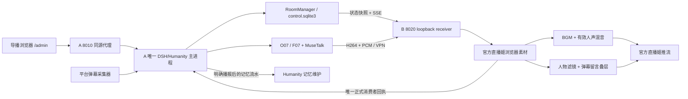

# 直播间管理架构与数据约束

[返回总览](README.md) · [接口](API.md) · [部署](RUNBOOK.md)

## 双机职责

没有新增 Node 服务端口、第二个 DSH 实例或独立记忆写入者。`backend/room/manager.mjs` 在已有 `StreamBridge` 内初始化，关闭时先中止私聊请求、关 SSE，再关闭宿主状态。平台事件在平台事务提交后交给 RoomManager，避免显示层异常回滚平台账本。

## 状态分类

| 数据 | 位置或归属 | 持久化与恢复 |
| --- | --- | --- |
| 房间设置、音乐队列/位置、上墙/置顶 ID | `state/live-room/control.sqlite3` | WAL；设置递增 revision；重启后音乐保持暂停 |
| 自建音频 | `assets/room/uploads/` | 随机内部 ID、SHA-256、真实媒体探测；不接收服务端 URL 抓取 |
| 内置音频 | `assets/room/bgm/` | 版本化源资产，三首默认曲目不可从管理台删除 |
| 评论/礼物/导播留言 | control.sqlite3 的 messages | 事件 ID 去重；最多约 5000 条；清理七日前旧记录时保留最近 500 条；页面返回最近 100 条 |
| 审计 | control.sqlite3 的 audit | 最多约 2000 条，API 返回最近 100 条 |
| 导播私聊 | control.sqlite3 的 agent | 全局最多约 300 条，每会话界面最近 40 条，生成时最近 12 条作为上下文 |
| 正式播报与回执 | 已有 DSH stream.sqlite3 | 沿用 request/utterance/epoch/generation 围栏和唯一播放权威 |
| 观众长期记忆 | 已有 Humanity 配置和维护队列 | 本次不改写压缩合并、预算、删除账本和维护规则 |

“开启新对话”切换私聊会话 ID，并丢弃旧生成结果；不是磁盘安全删除。导出设置也不导出私聊、评论、音频或模型。需要完整迁移时做一致备份，而不是把当前 SQLite 主文件单独复制。

## 配置并发与事件流

设置修改必须携带 `expected_revision`。冲突返回 `409 ROOM_CONFIG_CONFLICT_REFRESH`，客户端重新取状态，不覆盖其他导播已保存内容。客户端串行提交滑块变更，错误显式显示；未知字段、超限文本、NaN/Infinity 和不合法枚举拒绝保存。

SSE 新连接或重连先发权威 snapshot，随后发 state/message/agent 更新；15 秒心跳。客户端保留轮询兜底，部分更新不清空已有评论。初次快照不会将旧礼物重新排入动画队列。每进程最多 24 个 SSE 客户端，写缓冲超限时关闭慢客户端；不是无限堆积事件的消息总线。

页面和叠层仅用 `textContent` 渲染昵称、正文与 Agent 回复；这些内容不作为 HTML、脚本或后端指令执行。消息过滤在显示和待派发自动回复两处实施；已经进入 DSH 队列的回复须由导播停止。`panic` 同时取消当前和排队请求，暂停音乐并静音。

## 混音与字幕

`room-audio.js` 为 B 的现有 AudioContext 增加音乐、人声与总输出 gain，并保留轻量限幅。音乐使用媒体元素流式 Range 读取，不把整首歌预先解码入 RAM。默认音乐 22%、人声 100%；人声有效播放时 BGM 压到原来的 23%，attack 90 ms、release 650 ms。

压低以已排入 AudioContext 的有效 PCM 时钟区间为准，而不是按 LLM 返回或 TTS 开始时间猜测。取消时清除区间，避免迟到旧段继续压低。BGM 按 A 给出的锚点校时，显式 seek 立即执行，常规状态更新只修正明显漂移。

DSH 的完成只由正式消费者的有效人声采样回执判定；BGM、后台试听、透明叠层和静音预览都不能生成完成回执。正式播放器每次混音观测都核对当前消费者和新鲜度，后台显示的是实测状态，不以按钮状态代替播放成功。

字幕来自已提交的 `utterance.text_ready`，按正式播放的采样进度分为约 42 字页面。它是近似分页字幕，**没有 ASR 或逐字强制对齐**，不声称逐词准确。取消、请求 ID 不匹配或没有有效播放时隐藏。

## 包装与性能

720×1280 的叠层以容器缩放；画面滤镜仅作用于人物画面，卡片不跟着模糊。默认脸部安全区不放评论/留言/礼物，移动端按画幅缩放。礼物队列有上限 12、顶部飘屏最多 8 条并限速；相同待播礼物合并，屏蔽后清理对应显示。

CSS、Web Audio 与 SQLite 在现有服务和 B 浏览器执行，未新增图像/TTS 权重。A 的 MuseTalk FP16 batch 8、O07/F07 参数、48 段动作库和四秒缓冲不降级。实际本轮整体 FPS 与资源快照见[验收](ACCEPTANCE.md)，不能将一次空闲资源快照解释为直播峰值。
