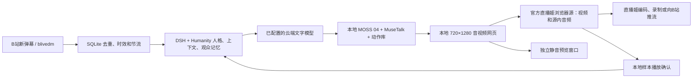

# 哔哩哔哩直播姬接入 / Bilibili Livehime

B站当前默认使用官方 Windows 直播姬。人物、MOSS 04、动作库和 DSH + Humanity 继续在本地运行；文字模型使用已保存的渠道。直播姬直接加载本地浏览器源、混合声音、编码和推流，整个 B站运行路径不启动、连接或调用 OBS。

本文对应 `livehime` 输出模式。抖音和通用 RTMP 的旧 OBS 适配器保留独立使用，不能据此推断 B站仍依赖 OBS。历史 OBS 录像保留原始来源说明。

## 1. 画面、声音与记忆链路



优先使用直播姬内置的**浏览器素材**。它直接接收网页的音频，不依赖 OBS 音频监听，也不把声音绕经系统扬声器再录一次。3080 工作站没有连接扬声器或耳机，因此“窗口捕捉＋桌面声音”不能作为这台机器的默认音频方案。

独立 Chrome/Edge 人物窗口只供预览，保持静音并且不争抢播放确认。真正加载 `renderer=livehime` 的直播姬浏览器源才取得本地平台会话的播放租约。`AudioContext` 运行说明网页音频时钟已启动；最终声音是否进入直播姬录像，要通过实际文件音轨验证。播放租约也不表示 B站观众已经收到内容。

## 2. 原生 Windows 准备

前提是现有数字人服务、DSH 和本地语音已经就绪。继续沿用 RTX 3080 的 MuseTalk FP16 batch 4、完整动作库、720×1280 人物流和 MOSS 04 配置，不额外加载另一套人物模型。

```powershell
Set-Location -LiteralPath 'C:\dev\虚拟数字人直播'
& '.\runtime\platforms\Scripts\python.exe' -X utf8 -B '.\scripts\prepare_bilibili_livehime.py'
& '.\runtime\platforms\Scripts\python.exe' -X utf8 -B '.\scripts\prepare_livehime_policy.py'
& '.\runtime\platforms\Scripts\python.exe' -X utf8 -B '.\scripts\dsh_control.py' stop
& '.\runtime\platforms\Scripts\python.exe' -X utf8 -B '.\scripts\dsh_control.py' start
```

此脚本：

1. 从[直播姬官网](https://live.bilibili.com/liveHime)使用的官方版本 API 查询 Windows x64 下载地址。
2. 验证官方文件大小、MD5，再验证安装包的 Windows Authenticode 签名和发布者。
3. 使用固定 SHA-256 的原生 Inno Unpacker 解包到项目目录；不运行全局安装器，不调用 Docker、WSL 或虚拟机，不安装虚拟声卡驱动。
4. 对解出的 `livehime.exe` 再次验证签名，写入项目内准备回执。

2026-10-26 实机准备的官方版本为 **8.11.1.11202**，安装包 365,076,600 字节，官方 MD5 为 `2308e4216c3997ea30de014cfb521d87`；SHA-256 为 `4bb0a58d5b21c640a47a44e91831f4db3a09e5258c0ce3b3b402b9e851903835`，安装包和程序签名均为 Valid，发布者为上海幻电信息科技有限公司。后续版本以脚本取得并核验的官方回执为准。

| 项目内路径 | 用途 |
|---|---|
| `downloads/platforms/` | 官方安装包与固定版本解包工具 |
| `tools/bilibili-livehime/app/` | 解出的官方客户端 |
| `outputs/platforms/setup/bilibili-livehime.json` | 版本、来源、哈希与签名回执 |
| `state/platforms/livehime/` | 启动时指定的客户端数据目录 |
| `cache/platforms/livehime-output/` | 独立人物预览浏览器资料 |
| `web/obs.html` | 共用干净输出页的部署文件，文件名属于兼容路径 |
| `/output.html` | 不带操作界面的通用人物输出入口 |

安装脚本可使用 `--proxy`；`--version-file` 可复用项目内已获取的官方版本响应。运行网页与应用 API 不需要管理员登录。官方直播姬使用主播自己的 B站登录状态，扫码由主播在本机完成，系统不代填、输出或提交平台凭证。

## 3. 配置直播姬

1. 打开工作站 `/platforms`，选“哔哩哔哩”，保存自己的直播间链接。当前使用的房间为 `595139`。B站模式为 `livehime`，不要求填写 RTMP 地址和推流码。
2. 点击“准备竖屏画面”。系统打开官方直播姬与静音人物预览，窗口名为 **女A · 林知夏 · 直播姬画面**。这一步不会公开开播。实际直播姬素材取得播放权威后，启动本地互动会自动关闭重复预览，释放其浏览器资源。
3. 在直播姬选择**竖屏**画布，添加**浏览器**素材，粘贴下面的本机 URL。

```text
http://127.0.0.1:8010/output.html?output=platform&renderer=livehime
```

4. 浏览器源宽度设为 **720**、高度设为 **1280**。把素材完整铺满竖屏画布，保持宽高比，避免裁掉头顶和手部。该 URL 的 `127.0.0.1` 指运行直播姬的工作站，不要改成观看者电脑的地址。
5. 浏览器源音量设为 100%，监听方式保留**声音输出到流**。无物理音频设备时不依赖桌面声音；不需要的桌面音源和麦克风静音，避免回声或重复采集。
6. 在“直播设置”核对分辨率、帧率、硬件编码与码率。当前设为 720×1280、30 FPS、NVIDIA H.264、3000 Kbps、p5，关闭前向考虑与心理视觉调整以减少共享 GPU 开销。人物仍按 25 FPS 推理，不另行生成插帧。最终参数以实际录制文件的 `ffprobe` 结果为准。录制路径设为项目的 `outputs/platforms/recordings/`。
7. 回到平台页点击“检查连接”。应看到“直播姬网页源”“源内竖屏画面”“源内音频运行”通过。单有独立预览窗口不能满足此检查。
8. 点击“准备直播姬互动”，本地 DSH 进入 LIVE，先做一次原文播报和本地录制。确认声音、嘴型与动作后，再在官方直播姬中填写标题、分区、封面并开始直播。

不要把这个 URL 添加到普通浏览器后再误认为它就是直播姬素材。真正的推流和录制由官方客户端执行；网页中的 `COMPANION_READY` 仅代表本地人物和互动已经准备好。

## 4. 弹幕、人格与下播

没有开放平台应用时使用现有 `blivedm` Web 客户端；可在本机配置页填写自己账号的 Cookie，也可以改用独立网页评论采集器。昵称被平台打码、平台不提供稳定 ID 时，只使用公开上下文，不把昵称当作长期个人身份。

事件依次经过平台/房间/用户命名空间、持久去重、过期检查、观众冷却与全局回复间隔，随后进入既有 DSH 队列。人格版本、同场上下文和长时记忆机制保持一致。B站登录直播姬不会自动把登录 Cookie 交给弹幕采集器，两者状态分别检查。

下播时：

1. **先在直播姬结束公开直播或本地录制**，等待文件完成写入。
2. 在平台页结束本地互动、停止弹幕接收。系统结束自己创建的最后一个本地会话，并关闭自己创建的预览浏览器。
3. DSH 完成排空、结束事件和静默窗口，再运行下播记忆压缩、每日合并和每周整理。详见[DSH + Humanity 方案](../DSH_HUMANITY.md)与[运行手册](../dsh-humanity/RUNBOOK.md)。

系统不会通过关闭人物预览来声称直播姬已经下播，也不会终止用户正在操作的官方客户端。客户端浏览器源在不用时应隐藏/移除或关闭客户端，以释放其页面资源；平台页停止的独立弹幕浏览器也会被关闭。

## 5. 后端接口和状态

全部接口位于 `/api/dsh/platforms` 下，沿用应用无鉴权约定。参数校验、单会话、租约和幂等处理用于防止重复播报，不是用户权限限制。

| 方法 | 后缀 | 行为 |
|---|---|---|
| POST | `/config` | 保存 `platforms.bilibili.output_mode=livehime` 和房间配置 |
| POST | `/bilibili/client/launch` | 打开已校验的官方客户端 |
| POST | `/bilibili/prepare` | 准备官方客户端和独立静音预览 |
| GET | `/bilibili/preflight` | 分别检查本地模型、网页源帧/声音和弹幕状态；不连接 OBS |
| POST | `/bilibili/start` | 等待直播姬网页源取得播放租约，进入本地互动准备态 |
| POST | `/bilibili/resume` | 暂停/恢复后在原场次重新取得播放确认 |
| POST | `/bilibili/confirm-live` | 记录主播已在客户端开播的手动确认；不标记观众端已验收 |
| POST | `/bilibili/stop` | 结束本地互动并关闭系统预览；不控制外部公开开播 |
| POST | `/bilibili/window/close` | 关闭未用于活动会话的系统预览 |
| POST | `/bilibili/collector/start`、`/bilibili/collector/stop` | 开停弹幕输入 |

同一场人物输出只能由一个播放端确认。活动中的 OBS 平台输出与直播姬输出不能互相抢占，混用时报 `OUTPUT_RENDERER_CONFLICT`。独立静音预览不会取得租约。如果只有预览、直播姬没有实际加载人物 URL，`start` 会报 `LIVEHIME_PLAYER_NOT_READY`，提示配置浏览器源，而不是显示已经可推流。

配置和源码入口：[输出管理](../../backend/platforms/manager.mjs)、[直播姬适配器](../../backend/platforms/livehime.mjs)、[配置](../../backend/platforms/config.mjs)、[输出页](../../integration/obs.html)、[官方程序准备脚本](../../scripts/prepare_bilibili_livehime.py)。

## 6. 验收与问题定位

**播放租约配置：** 实机观察到人物 `prepare_speech` 预热耗时 11.66 秒，原 8 秒租约会在共享 GPU 停顿时误判播放端离线。`prepare_livehime_policy.py` 在无活动本地场次时，从现有策略复制生成被 Git 忽略的 `configs/livehime-policy.private.json`，将播放租约改为 30 秒，并写入项目内的 `dsh-active-policy.json` 指针。仅重启 Node DSH 后生效，人物精度、batch、分辨率和音色不变。心跳仍每秒发送，连续音频样本和自然结束仍是完成的必要条件；该设置不生成播放回执，也不把生成等待称为实时出声。失联检测最长等待相应增加。

**历史诊断记录：** 初轮欢迎、去重和讲解通过，恢复后的语音触发 120 秒 TTS 超时；减少重复预览和编码开销后，MOSS 同一欢迎稿的生成阶段从 97.852 秒降至 16.963 秒，但随后 11.66 秒人物预热触发原租约失效。两次失败保留在账本和独立结果中，最终复测另记，不覆盖原报告。

采用四层证据：无 OBS 调用的生命周期/浏览器测试，实际官方客户端网页源，本地 MOSS/DSH 播放账本，官方客户端本地录像。公开开播和远端观众效果单独验收，不用“已登录”或本地绿色状态代替。

| 现象 | 核对方法 |
|---|---|
| 浏览器源空白 | 确认在工作站上访问 `127.0.0.1:8010`，源 URL 包含完整查询参数，数字人服务已就绪 |
| 只有预览，无法准备互动 | 直播姬内添加浏览器源，检查页面中的源连接指标；普通预览静音且不提供播放确认 |
| 画面被截断或留黑边 | 源尺寸为 720×1280，画布竖屏，保持比例铺满，不通过横屏裁切模拟竖屏 |
| 有画面、录像无声 | 源音量和“输出到流”监听选项；用录制文件音轨、实际 RMS 和试听确认，不能只看音频时钟 |
| 两次声音或回声 | 关闭桌面重复声音、麦克风和其他加载相同 URL 的素材 |
| 弹幕已连但没有回复 | 检查新评论是否到达、回复开关/模式、冷却时间、源播放租约、LLM 渠道和排队状态 |
| 帧率下降 | 看人物端实际呈现、客户端编码掉帧和显存峰值；先移除多余源/浏览器，不自动削减模型 |
| 停止本地互动后直播仍在 | 在官方直播姬中结束公开直播；这是客户端持有的平台状态 |

历史平台接入测试、实机媒体和当前证据说明见[验收](ACCEPTANCE.md)和[媒体](MEDIA.md)。

## English implementation notes

Bilibili now defaults to its official Windows Livehime client. Add a **Browser** source using the loopback URL above, set its viewport to **720×1280**, use a portrait canvas and send the source audio to the program mix. This avoids both OBS and the physical speaker/desktop-loopback dependency. The optional standalone Chromium window is a muted preview and cannot own the playback lease.

The backend prepares the signed official client, reports source readiness and starts the existing DSH + Humanity interaction session. MOSS 04, MuseTalk and gesture assets remain local and retain their tested RTX 3080 settings. New Bilibili comments use the existing persistent de-duplication, expiry, rate limiting and viewer-memory partitions. Cloud text-model configuration is reused.

The official client owns account login, source settings, local recording and public broadcast. `COMPANION_READY` and a local playback acknowledgement never assert audience delivery. End the broadcast in Livehime, then stop local interaction and comments so the existing post-broadcast memory-maintenance sequence can proceed. Application-managed downloads, profiles, recordings and generated artifacts stay in the project tree; upstream Windows applications may still consult their standard user-profile locations. No Docker, WSL, virtual machine or virtual audio driver is used.
