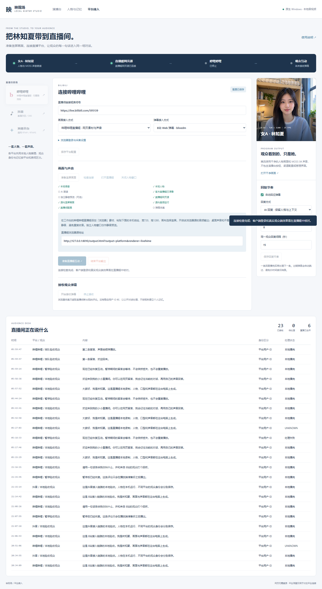
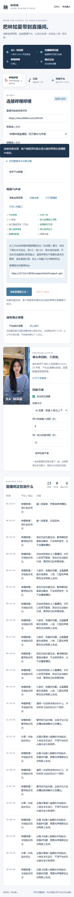
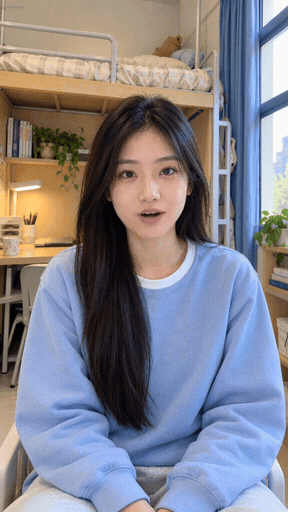
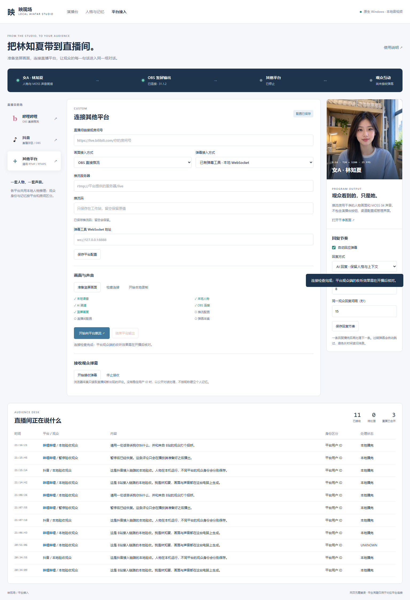
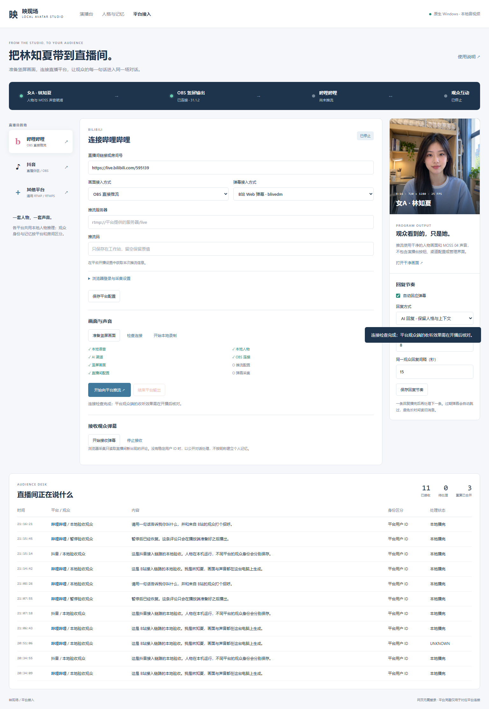
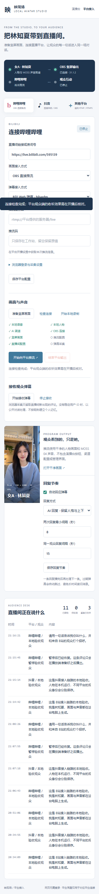
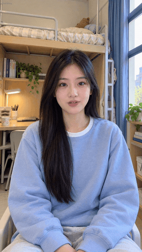
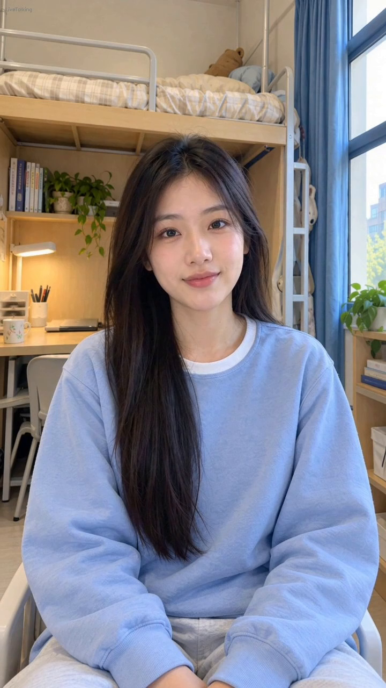

# 平台接入实机页面与录像 / Native platform evidence

## 当前官方直播姬（2026-10-26）

官方直播姬已登录并直接加载女A「林知夏」720×1280 浏览器素材，声音由源内部进入节目混音。这条路径没有使用 OBS。以下是真实客户端、本地服务和官方客户端本地录像，**不是 B站观众端实播**。

- [直播姬本地录制带声音节选](../media/livehime-local-preview.mp4)：保留 MOSS 04 实际语音，不补配旁白。
- [平台页实际操作录屏](../media/livehime-ui-interaction.mp4)：独立浏览器拍摄，无接口模拟，拍摄后关闭上下文。
- 完整原速录像在运行中工作站的 `/platform-evidence/livehime-local-validation.mp4`，与演播台共用 8010 端口。H.264 + AAC、720×1280、30 FPS；人物推理为 25 FPS。

五项本地场景为欢迎、去重、讲解、暂停恢复、两条留言按序播放。当前录制是**原文播报**，不包含云端模型生成回复。云端初轮超时，后续探针和独立 AI 播报完成，分别保留记录；该后续播报没有包含在本页五段录像中。真实 B站 595139 弹幕连接与心跳通过。初次开播要求本人完成人脸验证，完成后公开开播成功；独立的公开CDN抓取见下文。新观众评论触发可听回复仍未验收。

原始录像、节选时间、音频检查、播放账本及来源哈希见[直播姬证据](../evidence/bilibili-livehime.json)与[媒体清单](../media/livehime-media-manifest.json)。GIF/预览只截取说话区间，不代表整条留言的生成等待或响应延迟。公开的客户端截图已裁掉桌面并遮盖账号身份区域。

| 实际语音节选 | 原始录像区间 | 对应用例 |
|---|---|---|
| [欢迎](../media/livehime-welcome.mp4) | 45.2–55.4 秒 | L1 |
| [讲解](../media/livehime-explanation.mp4) | 82.7–91.7 秒 | L3 |
| [暂停恢复后播报](../media/livehime-resume.mp4) | 116.5–124.7 秒 | L4 |
| [排队第一条](../media/livehime-queue-first.mp4) | 140.5–144.3 秒 | L5 第一条 |
| [排队第二条](../media/livehime-queue-second.mp4) | 159.8–163.7 秒 | L5 第二条 |

五段语音不等于五项用例：L2 去重要求没有第二次声音，因此以持久事件与计数验收。完整录像为 209.13 秒。AAC 最大包时间差为 66.667 ms，发生在文件开头 0 秒处；后续包间隔约 21.333 ms。解码峰值约 1.239、超过满幅，原始声音存在峰值余量风险，未用后期压限遮盖；后续应在源音量/音频母带调整后另做实录。时间戳及样本完整不能证明任何观众设备听感绝无卡顿。

## 历史 OBS / 本机 RTMP（2026-10-25）

以下保留原生 Windows RTX 3080 上的真实服务、OBS 浏览器源和本地 RTMP 接收结果。它们属于旧路径；界面截图通过独立 Chrome 拍摄，未模拟接口，拍摄结束关闭相应上下文。它们不是 B站或抖音观众端截图。

控制页截图拍摄于最终测试结束后：本地测试输出与弹幕采集已经停止，平台私有配置已恢复。B站未填写推流参数，因此检查页正确显示“推流配置尚未就绪”；切换平台会清除前一平台的检查结果。

### 历史控制页面

### 历史视频与 GIF

- [带声音的原生推流预览](../media/platform-local-preview.mp4)：来自 OBS → 本机 FFmpeg RTMP 接收结果，保留实际 MOSS 04 语音。
- [平台页操作录屏](../media/platform-ui-interaction.mp4)：真实页面操作；此录屏不带人物声音。
- 完整录像在运行中工作站的 `/platform-evidence/platform-local-validation.mp4`，使用与演播台相同的 `8010` 端口；完整结果为 720×1280、25 FPS、H.264 + AAC。

GIF 是实际录像的原速节选，不代表整场平台延迟。视频预览的裁剪位置和来源哈希记录在[媒体清单](../media/platform-media-manifest.json)。

### 历史实际覆盖范围

| 项目 | 本次证据说明 |
|---|---|
| 软件环境 | 原生 Windows、OBS 31.1.2、720×1280、25 FPS、本地 MOSS 04 / MuseTalk、云端文字渠道 |
| 消息输入 | 本地统一事件接口提交带平台身份的验收事件；B站真实房间 595139 另行验证 WebSocket 与心跳连接 |
| 五项场景 | B站事件原文播报、重复消息只播一次、抖音事件原文播报、暂停时保留消息并在同场恢复、真实 AI 回复播报 |
| 播放确认 | 四次实际语音均需 DSH 收到连续样本自然结束确认，不能仅凭已生成音频判定完成 |
| 音频检查 | 解码后非静音，检查 AAC 包时间戳；连续时间戳不等同于证明任何平台观众端毫无卡顿 |
| 真实平台开播 | 未填写推流码、未登录抖音账号，尚未向真实房间公开推流或验收观众端新评论 |
| 官方应用接口 | 已做签名、二进制包与生命周期测试；尚无获批应用，因此没有宣称真实官方事件到达 |

平台页保留先前诊断的失败与中断事件，成功测试不会抹去账本历史。`COMPLETED` 表示本地指定播放端播完，不表示平台 CDN 或远端观众已经收到。

完整机器验收记录见[平台证据](../evidence/platform-integration.json)。此前 DSH 的历史证据保留原日期、原来源哈希与原范围；本次新增接入使用独立证据记录变更及复验，未将此前未做的 20 轮记忆验收改为通过。

## 公开CDN后续核验

主播完成官方核验后已实际开播，B站房间595139返回 `live_status=1`。以下独立抓取来自平台公开CDN，时长10.086秒，720×1280 / 30 FPS、H.264＋AAC，FFmpeg完整解码退出码0。抓取时为待机状态，因此不把存在AAC音轨称为已经验证公开语音回复。真实新弹幕→AI→观众端可听仍待测试。

[查看公开CDN十秒抓取](../media/bilibili-public-cdn-preview.mp4) · [完整方案与证据边界](../archives/2026-10-26-LIVEHIME-HANDOFF.md)。带签名的CDN地址、登录资料和人脸二维码未公开。记录只证明检查时已开播，不保证以后一直在线。

## English

The current Bilibili captures use the signed official Livehime client, its internal browser audio and a real local H.264/AAC recording. Five local cases cover greeting, de-duplication, explanation, pause/resume and ordered messages; they use Echo text and local MOSS 04/MuseTalk. An initial cloud timeout and a later successful compatibility probe/AI utterance are retained separately. Real Bilibili room connectivity is separate from locally injected acceptance messages. After owner verification the public room reported live, and a separate 10.086-second CDN capture decoded portrait H.264 video and AAC audio. The capture is an idle interval; it does not verify an audible response to a real viewer comment. The older OBS/RTMP media above retains its original provenance.
