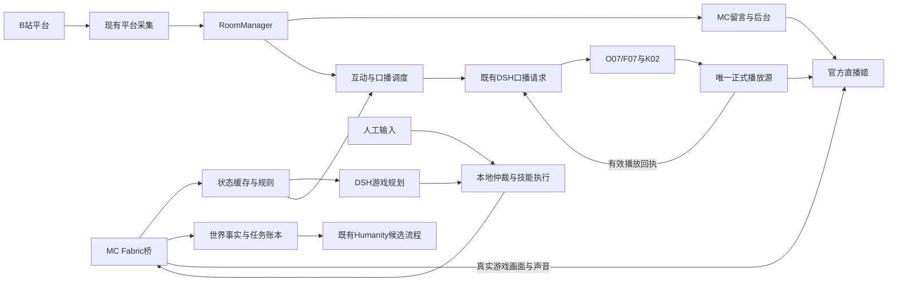

# 01 系统架构与模块

[文档入口](README.md) · [控制协议](02-游戏桥与控制协议.md) · [接口](04-接口与数据.md)

## 1. 逻辑架构

控制流、事实流与媒体流分离。MC Mod直接取得同一真实客户端的数据；文字模型决定目标，本地技能决定具体移动/交互；正式播放源独立确认说话完成。任何一条链成功不替代另外两条。

## 2. 进程与设备角色

| 进程 | 职责 | 单机候选 | 双机目标 |
|---|---|---|---|
| Minecraft/Fabric/执行器 | 状态、规则、本地控制、画面与游戏声音 | 游戏工作站 | B3080 |
| 现有Node DSH宿主 | 平台、Room、人格、记忆、拟新增游戏服务 | 当前人物安装 | A4090 |
| 人物/语音Python服务 | O07/F07、K02、媒体准备 | 3080 FP16 batch4 | A4090，现有48GB规格，batch8 |
| receiver_service.py | 同源代理、媒体接收与正式播放器投影 | 本机loopback | B3080，仅接收 |
| 官方直播姬 | 本地素材、游戏捕获、混音、编码、推流 | 游戏工作站 | B3080 |
| 视觉服务 | 原始帧分析；完整交付必须实现，运行时可关闭 | 单机需完整负载验证 | 推荐A4090，仍待允许与测评 |
| 导播浏览器 | 操作与观测 | 操作者设备 | 操作者设备 |

这张表是部署选项而非当前运行事实。当前mc继承3080部署契约；4090继续暂停。双机B端不再加载人物/TTS；游戏任务日志可以本地持久化，但不是第二个DSH/Humanity写入者。

## 3. 端口与连接

| 入口 | 状态 | 约定 |
|---|---|---|
| A8010应用入口 | 已有 | 管理页、HTTP API、现有媒体转发；新增游戏路径复用同源入口 |
| DSH内部3092 | 已有 | 现有Node服务；新增游戏HTTP路由挂接此宿主 |
| B127.0.0.1:8020 | 已有接收器 | 官方直播姬与本机管理入口；不把B接收器绑定到公网 |
| `/api/dsh/game/bridge` WebSocket | 服务端/8010协议检查通过，实机待验 | Fabric客户端主动连接；同机走本机应用入口，双机经B接收器向A转发 |
| `/api/dsh/game/events` SSE | 服务端/8010流式检查通过，完整后台待接 | 后台只读状态投影；与Room消息SSE分开 |
| 本地视觉入口 | 待运行锁确定 | 只在原生部署获准并完成构建验证后记录端口 |

连接方向固定为Mod发起到应用入口，不另开Mod控制监听端口。接收器已有通用WebSocket/SSE代理，但新路径、重连、帧上限和断线传播仍需实测，不能只因代码有代理就判为可用。

游戏WS显式路由至GameManager，不与`/api/studio/stream`的人物二进制媒体混用；8010、3092已有原生协议检查，8020及跨机链路仍需逐层核对。新增路径不增加用户网页登录或管理token。

## 4. 组件与运行锁

| 层 | 设计基线 | 必须锁定 |
|---|---|---|
| Java游戏 | Minecraft Java1.21.1、JDK21、独立新存档 | 补丁版本、启动器实例、游戏目录、世界标签 |
| Mod桥 | 自有Fabric桥 | Loader/API、映射、Mod版本与文件SHA256 |
| 基础执行档 | Baritone API Fabric1.11.3候选 | 二进制SHA256、支持技能、取消能力 |
| 完整生存执行档 | MiranCZ/altoclef与其配套Baritone候选 | 整套构建及依赖、普通PvE/补给/资源链，不与标准Baritone重复装载 |
| DSH宿主 | 当前package.json：Node24.22.1、DSH0.2.0-rc.2、Humanity0.1.17 | package-lock、宿主commit与渠道兼容结果 |
| 人物/声音 | 已有K02、O07/F07及共享权重 | 当前设备runtime lock，新素材单独版本 |
| 模型 | 文字使用现有已保存渠道 | 实际模型名、工具能力与失败处理；不导出密钥 |

上述是当前源码/研究记录，尚无游戏联合运行锁。不得根据Mineflayer或其他项目的Node要求降级现有DSH运行时。若做Mindcraft独立对照，使用它自己的隔离运行目录，不改主项目依赖。

## 5. 模块与代码接入点

| 模块 | 拟新增位置 | 输入→输出 | 主要实现 |
|---|---|---|---|
| Fabric入口 | `game-adapters/minecraft/fabric/` | 游戏对象→快照/事件 | 主线程采集、连接、能力、控制、技能封装 |
| GameManager | `backend/game/manager.mjs` | HTTP/WS/工具→统一游戏服务 | 生命周期、模式操作、路由与审计 |
| StateReducer | `backend/game/state.mjs` | 快照/增量→状态投影 | 会话、序号、过期、缺口补全 |
| TaskService | `backend/game/tasks.mjs` | 目标→任务状态 | 幂等、终态、结果证据、重连查询 |
| Protocol | `backend/game/protocol.mjs` | 帧→校验消息 | 大小限制、版本、方向、已知类型 |
| Rules | `backend/game/rules.mjs` | 库存/配方查询→已核验结果 | 规则指纹、未知值与来源 |
| GameTools | `backend/dsh-bridge/game-tools.mjs` | DSH调用→GameManager | 参数校验、调用上下文、工具结果 |
| Planner | `backend/game/planner.mjs` | 任务目标/事件→固定技能请求 | 规划单飞、取消、不写口播回执 |
| Narration | `backend/game/narration.mjs` | 平台/游戏候选→口播请求 | 优先级、事实复核、去重、过期 |
| Audience interaction | `backend/game/suggestions.mjs`、`backend/game/votes.mjs` | 已过滤事件/后台→候选与投票 | 稳定身份去重、截止/CAS、结果核验及任务关联 |
| Observation | `backend/game/vision.mjs`、`backend/game/frames.mjs` | 查询/原始帧→有时效的视觉结果 | 短时缓存、原生视觉调用、单并发、超时及世界隔离 |
| GameStore | `backend/game/store.mjs` | 事实/审计→SQLite | 迁移、事务、检查点和限量保留 |
| Web组件 | `web/mc-programme.*`、`web/game-client.js` | Room/Game状态→正式画面/后台 | 与人物媒体消费者组合，默认不另起播放器 |
| 运维入口 | `scripts/mc_preflight.py`、`scripts/mc_run.py` | 运行锁→检查/启停 | 拟新增，不能在未实现时作为现成命令使用 |

本表使用统一`backend/game/`目录收束完整目标的职责；已落地与仍待实现的部分分别记录于[实现进度](实现进度.md)，不由模块名称判断已经完成。

现有修改点为：`backend/dsh-bridge/server.mjs`挂接GameManager；`host.mjs`扩展工具清单但保留口播人格约束；`scripts/receiver_service.py`检查新路径透传；现有`web/local-stream.js`/`web/dsh-playback.js`保持媒体时钟与回执逻辑；后台增加游戏页签。Room仍管理自己的留言和设置。

## 6. 默认关闭与职责所有权

GameManager按游戏API/WS访问或显式初始配置按需载入，先提供配置读写；未启用时其他游戏API返回`GAME_DISABLED`，不连接游戏或启动Java、模型、平台采集。启用GameManager也不自动进入AUTO；重启无连接时实际模式未知，桥重连必须从PAUSED或人工模式握手，不能恢复旧AUTO。

每个MC实例一位本地控制仲裁者；每个DSH安装一位人格/记忆写入者；每场输出一位正式可听消费者。桥连接只能替换同一实例的旧连接，不能让两个不同MC实例竞争一个玩家。本版本只支持一个活动游戏实例，多个实例返回冲突。

模块关闭顺序是停止新请求、请求本地停控、取消规划、结束连接、保存终态、关闭事件流；A端退出时不能以“已发停止”代替B端确认。B端租约看门狗承担断线后退出持续输入的保障。
