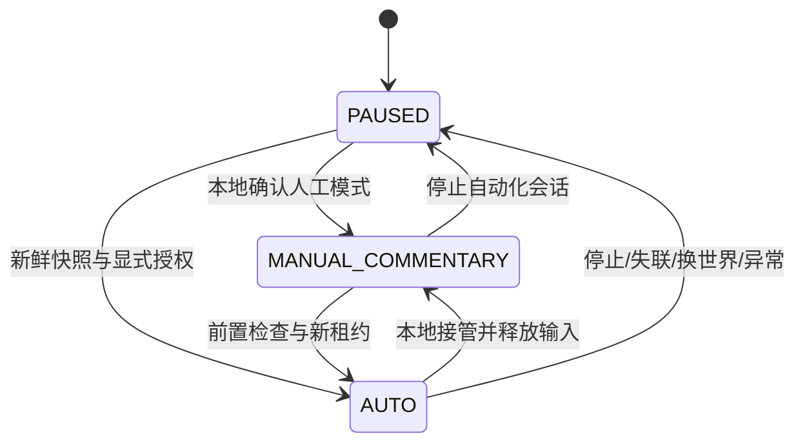
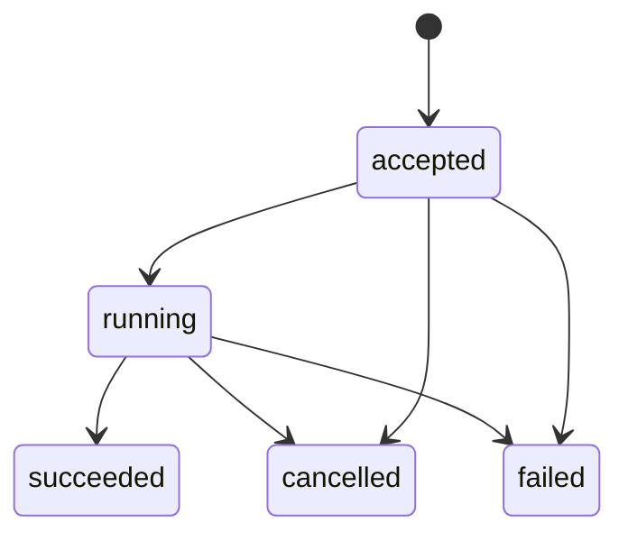

# 02 游戏桥与控制协议

[架构](01-系统架构与模块.md) · [接口与数据](04-接口与数据.md) · [JSON契约](contracts/game.schema.json)

本章为内部协议设计。协议版本`1.0`，JSON UTF-8文本WebSocket；能力协商先于任何控制命令。内部消息不是Neuro官方消息格式。

实现入口为[Fabric桥](../../../game-adapters/minecraft/fabric/README.md)。当前可构建的`native_core`提供状态、控制仲裁、热栏进食、取消、原始帧及[当前世界配方查询](配方查询与DSH对接.md)；固定生存候选的[同玩家入口及效果核验](真实玩家执行器接入与效果核验.md)已接入源码，预启动仍无条件拒绝。完整技能与生存执行档仍须按本章实现。CPU协议检查不替代实机验收，完整状态见[实现进度](实现进度.md)。

## 1. 主线程与本地执行

Fabric桥在客户端tick形成不可变快照，读取背包/界面及输入操作也回到合法游戏线程。网络收发、JSON编码、文件日志与LLM等待放到有界异步队列，不在tick内阻塞。执行器在tick检查模式、epoch、租约、世界和任务状态后才允许写入输入。

只调用已封装的游戏API和技能。寻路/资源任务库的后台线程、自动模块和视角控制都进入同一仲裁边界；仅停止Baritone不能证明其他攻击或进食线程已停止。

## 2. 身份与握手

| 字段 | 生成方 | 生命周期与作用 |
|---|---|---|
| `game_instance_id` | 本地安装 | 同一受管MC实例的持久标识，不能用昵称代替 |
| `bridge_boot_id` | Fabric桥 | 每次桥进程启动随机生成，拒绝旧进程命令 |
| `world_id` | 本地登记 | 稳定世界命名空间，不导出服务器凭证或地址 |
| `world_session_id` | Fabric桥 | 每次进入/切换世界重新生成 |
| `connection_generation` | Fabric桥 | 同一次boot内每次成功连接递增 |
| `control_epoch` | 本地仲裁器 | 控制模式变更、停控、失联或世界变更时递增 |
| `seq` | Fabric桥 | 当前world_session内观测递增序号 |
| `controller_session_id` | GameManager | 当前宿主进程的控制会话，不能复用上次启动值 |

顺序为：Mod连接 → hello（版本/实例/boot/能力/模式）→ A校验并返回hello_ack → B发完整snapshot → 双方确认只读READY → 需要AUTO时单独请求控制租约并确认模式。hello_ack不授予自动输入权。

同一game_instance的新连接先使旧connection_generation失效；旧套接字关闭，旧输入租约撤销。本版本拒绝不同实例，不自动切换当前玩家。

## 3. 帧与消息类型

统一封套含`protocol_version`、`type`、`message_id`、`game_instance_id`、`bridge_boot_id`、`connection_generation`、`sent_at`、`payload`。会话相关消息的payload另带world_session；控制消息带epoch和租约。`sent_at`供审计，不直接用来跨机判定有效期。

| 方向 | 类型 | 内容/行为 |
|---|---|---|
| B→A | hello、snapshot | 实例/能力；当前完整游戏状态 |
| B→A | delta、game_event | 基于明确序号的字段替换；去重关键事件 |
| 双向 | heartbeat | 连接状态；控制续租按独立grant规则处理 |
| A→B | snapshot_request、query | 缺口补全；配方/动作前置/图像查询 |
| A→B | control_request、lease_grant | 请求模式；当前会话的有限租约 |
| B→A | control_result | 实际模式、epoch、已释放输入及错误 |
| A→B | task_start、task_cancel | 固定技能请求；取消现有任务 |
| B→A | task_update、query_result | 状态与证据；只读查询结果 |
| 双向 | protocol_error | 已知格式错误与可恢复性，不回显私有内容 |

单帧默认上限128KiB；图像走独立二进制资源通道/受控查询结果，不塞base64进普通状态。实例只允许一条活动控制连接。未知主版本拒绝；未知类型拒绝并记录，不能猜测执行。

传输顺序不等于业务有效：socket重连或异步处理仍可能迟到。每条命令必须再次检查会话围栏，不能仅信任WebSocket有序。

## 4. 观测与数据新鲜度

完整快照包括：状态元信息、玩家/维度/界面、库存摘要、已观测局部环境、规则指纹、当前控制与任务。客户端未能取得的字段用null并列入`unknown_fields`，不能填0冒充观测。

增量使用`base_seq`与`seq`；`changes`只允许替换player、inventory、screen、environment等已声明字段，不接受任意JSON路径。base_seq不等于A最后应用序号时，暂停增量应用并请求完整快照。收到新世界快照时原子清空旧缓存、事件归并窗口及待执行计划。

| 参数 | 初始值/上限 | 语义 |
|---|---|---|
| 本地采样 | 目标10–20Hz | 取决于实际tick，不能承诺固定实时频率 |
| 状态发送 | 默认5Hz，上限按实测调节 | 合并覆盖旧普通状态；关键事件独立 |
| 心跳 | 1000ms | 不代表状态本身仍新鲜 |
| 状态过期 | 2000ms | A按自身单调时钟距最近有效观测计算 |
| 完整快照 | 启动、重连、换世界、缺口；稳定时10秒补全 | 完整快照也须保持seq递增 |
| 待发送普通增量 | 最多1份可覆盖项 | 避免网络慢时按旧轨迹排队 |
| 关键事件未确认窗口 | 最多256项 | 达上限时暂停自动化、请求恢复；不能静默丢失任务结果 |

协议ACK按连续序号推进。关键事件与任务更新先写B本地账本再发送，A去重后回确认；重发允许，游戏副作用不因重发重复执行。普通状态可覆盖合并，不逐tick持久化。

可靠发送的game_event和task_update另有各自流内递增delivery_seq，ACK的through_seq指该发送流，不能与观测seq混用；task_update同时含单任务transition_seq。一次观测可产生多个事件，因此观测seq不能作为可靠投递的唯一序号。

## 5. 租约与时间

控制租约由B执行器按本地单调时间判定。A的grant包含controller_session_id、lease_id、epoch、grant_seq和ttl_ms；默认每1秒续租，期限3秒。B只在当前已协商连接、递增grant_seq和当前epoch下接受，模式/会话变化立即撤销。

续租必须带based_on_heartbeat_seq，引用B本次连接已发出的心跳及其B本地发出时刻；B的租约截止计算为该时刻＋ttl_ms，而不是grant到达时刻＋ttl_ms。过期或不存在的引用拒绝，防止网络积压的旧续租不断延长控制。heartbeat_seq与grant_seq分别递增，不与观测seq混用。

已经成形但迟到、过期或旧代数的grant只被拒绝，不因此覆盖本地人工模式。实际到期仍由B本地时钟停控；迟到grant既不复活AUTO，也不将人工接管改写成另一模式。

AUTO切换采用两段确认：B核对请求后升epoch并生成当前lease_id，先回报mode=AUTO、automation_ready=false；A用新epoch与lease_id发首个grant；B接受后才置automation_ready=true并回报最终control_result。无首个grant期间不允许输入；未完成授权在租约期限内退回PAUSED。control_request/cancel内部帧由宿主补operation_id与controller_session_id，不要求模型生成这些字段。

AUTO首个control_result同时给出B登记的heartbeat_seq，便于首个grant引用；人工模式结果可为空。后台只有收到automation_ready=true或已释放输入的相应终态确认，才完成模式操作。

单向传输时间不能用A/B单调时钟相减。墙钟只作记录；有效期使用B已知观察序号的本地采样时间、租约与任务本地截止时间。

任务含`based_on_seq`、`accept_within_ms`（默认1500ms、最多2000ms）。B查该观测的本地采样时刻，超过时窗即拒绝；不能从“迟到命令收到时”重新开始计时。模型生成耗时较长时，A必须先取新观测并重新跑前置检查，再提交任务。

该时窗限制新任务的受理。已持久受理的任务经过磁盘或线程队列后，在游戏线程读取最新观测，重新核对同一controller/lease/world/epoch、界面、新鲜度与实际动作前置条件；不能反复使用旧受理快照，也不能从当前时刻延长原租约或任务总时限。最新观测仍过期、租约失效或条件变化时停止，不产生新的输入。

任务执行总时限`max_duration_ms`默认120000、上限600000；到时停止并验证部分结果。仅文字LLM超时、但控制租约和本地状态健康时，已授权有限任务可继续到本地截止；A/B失联则租约到期退出。两类故障分开处理。

## 6. 模式状态机与人工接管

连接状态DISCONNECTED/HANDSHAKING/READY/STALE与控制模式是两个维度。断线后台显示“实际模式未知/最后确认模式”，不能把缓存AUTO继续标成已确认。

本地热键为最终接管入口，按实例配置并避免与游戏常用键冲突；先验证热键在菜单/战斗中也能处理。接管步骤必须在本地先完成：递增epoch → 拒绝新自动输入 → 取消所有自动模块 → 释放合成按键/鼠标 → 确认输入无持有 → 返回实际MANUAL_COMMENTARY。

人工真实键鼠输入本身不能被“释放合成输入”代码误清除。实现中单独跟踪合成输入所有权；必要的自动焦点/光标操作纳入同一释放清单。人工模式的自动防御也只提示。

AUTO请求必须带当前boot、world_session和expected_control_epoch；人工/暂停的保守停控不因调用方epoch过期而被阻止。停止操作可以在A无法连接时由B热键直接完成。

AUTO恢复必须显式发起，读取新快照、确认无阻塞界面且前置条件成立；保留旧目标只能作为候选，不能恢复旧路径和持续按键。PAUSED是自动输入暂停，不表示多人世界、服务器tick或游戏画面真正暂停。

## 7. 六项技能的完成定义

| 技能 | 关键参数 | 前置条件 | 完成证据 |
|---|---|---|---|
| navigate | 维度、整数坐标、允许到达半径 | 当前维度一致、路径可查询 | 当前玩家位于目标半径内、执行器已结束 |
| gather | 物品命名空间ID、目标增量数 | 工具/空间/可达性满足 | 任务期间关联拾取/库存变化达到目标增量 |
| craft | 物品ID、目标制作数量 | 实际配方、材料、界面/工作台满足 | 合成结果与库存变化核验，记录实际制作数 |
| use_item | 当前库存ID、固定用途枚举 | 物品可用、用途已支持 | 消耗/状态/交互结果满足该物品的专用后置条件 |
| return_base | 已登记base_id | 同一世界、维度与有效路标 | 实际到达登记范围；不凭名字猜位置 |
| cancel | task_id或全局停控入口 | 无需路径可达性 | 任务结束且合成输入已释放；不是回滚游戏副作用 |

`gather.count`表示相对任务起始库存的目标增量；`craft.count`表示产物单位数，按配方批量向上取整并在结果记录实际数。不混用“最终库存总数”。服务器未同步或库存中途被人工修改时重新核验/终止，不能虚构增量。

`return_base`的公开goal只接收base_id；A从当前登记生成BaseTarget并绑定实例、世界/基地修订、位置、范围与登记来源。TaskCreate可用base_ref固定已检查修订；DSH及弹幕派发自动保存该ref。线协议和持久Task携带不可变base_target，B按原Permit执行，之后的新观测才可证明到达。详情与当前未完成边界见[专项说明](回基地目标绑定与到达核验.md)。

cancel属于控制操作，使用任务取消接口，不作为新动作goal启动；因此Goal数据契约只有五种动作，能力清单仍计入“可取消”这第六项能力。use_item的用途也必须出现在运行时item_uses能力中。

未经实现的技能不发布在capabilities中。自定义Mod物品只有适配器实际支持后才开放操作；参数校验通过仍需运行时前置检查。

## 8. 任务生命周期与幂等

同一玩家最多一个活动动作任务；只读查询可并发但有上限。任务内部的进食/防御子任务由同一执行器协调，不额外占有另一位输入写入者。

幂等键作用域为game_instance_id＋world_session_id＋request_id；请求体规范化hash一致则返回原task_id，不同则409。B在第一次执行副作用前持久化accepted记录；重复网络请求或宿主重试不重复动作。

任务终态不可复活。取消是停止后续动作，结果带`effect_status=verified/partial/unknown`及实际已发生变化，不承诺撤销挖掉方块。部分成功但未达到目标仍为failed或cancelled，不能标succeeded。

崩溃恢复不从数据库自动重放running任务；先停控、取真实快照，将未能证明状态的旧任务记failed，reason=`INTERRUPTED_RESTART`，effect_status为partial/unknown。需要继续时新建任务并关联previous_task_id。

完成证据至少含当前世界会话、观测序号和核验类型；A只能据终态与证据形成“完成”口播。空HTTP响应、路径规划成功、模型自述均不构成证据。

## 9. Neuro兼容范围

内部协议首先服务本项目，不以接入真实Neuro服务作为运行依赖。兼容层按固定规范实现startup、context、actions注册/注销、action及action/result的映射，单连接只保留一个强制动作窗口。

协议动作校验回复与游戏任务完成分开：尽早返回参数/接收结果和task_id说明，再通过后续事件报告实际终态。正式媒体的“说完”只可由真实播放回执投影。内部lease/epoch/task字段留在独立协议，不塞进官方字段冒充通用标准。

完整兼容声明必须另有协议回放用例；当前只完成设计，不能宣称已与第三方服务互通。[规范基准](https://github.com/VedalAI/neuro-sdk/blob/0cad33ac692f6cc90d36747fea9bbc53ca34b97a/API/SPECIFICATION.md)
