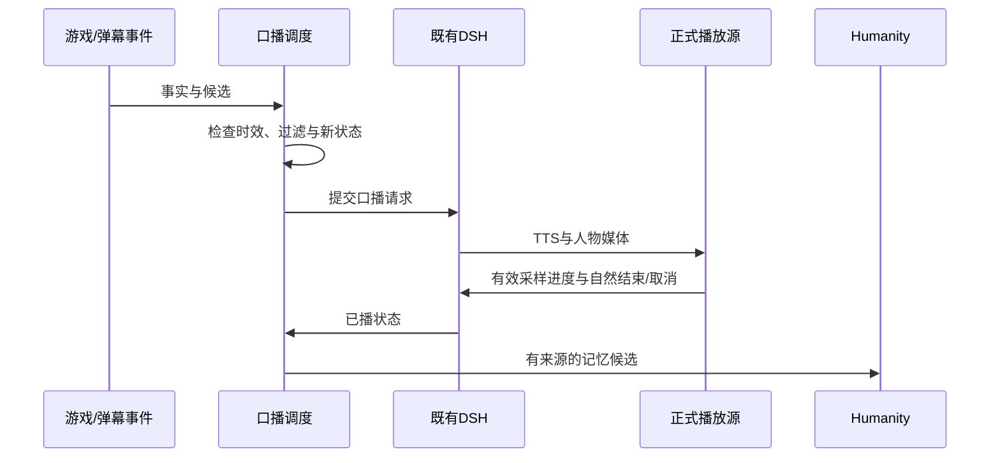

# 03 DSH、弹幕与记忆

[入口](README.md) · [控制协议](02-游戏桥与控制协议.md) · [实施验收](07-实施与验收.md)

正式播放器准备、迟到响应/关闭围栏与真实PCM完成约束见[播放就绪握手与故障诊断](正式播放就绪握手与故障诊断.md)。准备租约保持独占，确认本地输出就绪前不激活新请求；旧客户端立即就绪语义继续回归。

## 1. 唯一人格，规划与口播分轨

复用现有DSH宿主、已保存模型渠道和Humanity，不启动第二套Mindcraft人格或独立长期记忆服务。DSH是调度/会话框架，不等于DeepSeek模型；当前研究记录的文字渠道为gpt-6-luna，模型替换必须验证现有兼容层。

规划为宿主内独立用途的模型调用：输入结构化状态摘要与固定游戏工具，输出高层目标或工具请求；不进入TTS、观众回答状态或正式播放回执。口播仍走已有DSH请求状态机，保持中文最终回复约束。初始全局文字模型并发为1；规划与口播队列共享预算，口播可取消/取代未执行规划，但本地技能继续运行。

规划调用不能使用现有“只输出口播文字”的路径解析JSON。已接入`GamePlanner`调用边界，在host中区分用途：`speech`、`game_plan`、`operator_private`、`maintenance`。不同用途使用不同工具白名单和完成处理；同一Humanity写入权威不变。当前仅有隔离适配器检查，实际DSH渠道兼容仍需验收。

模型服务不支持底层取消时，只丢弃迟到结果并记录；不得因此重新执行旧epoch任务，也不能声称远端推理已经停止。工具兼容不通过时禁用新规划，人工陪玩仍可使用既有口播链。

## 2. 游戏工具清单

| 工具 | 参数要点 | 返回与限制 |
|---|---|---|
| game_get_state | 无；范围由当前绑定实例决定 | 最新状态、年龄、世界、模式；未知或过期显式返回 |
| game_get_recent_events | cursor、limit≤50 | 有界关键事件，附来源与发生时间 |
| game_query_inventory | 可选item_ids，最多32项 | 当前已知库存；不会把旧记忆当库存 |
| game_get_recipe | namespaced item_id、count | 实际规则、所需材料、工作台条件、规则指纹 |
| game_check_action | 固定goal | 新鲜前置检查，不执行动作 |
| game_get_task | task_id | 实际任务状态、结果证据、部分副作用 |
| game_request_observation | 提交purpose；读取operation_id；取消operation_id＋cancel=true | 立即返回pending；后续读取带帧ID、捕获时间与实际年龄的历史视觉结果；不连续轮询 |
| game_get_audience | 无 | 当前B站房间有界建议、投票和任务反馈；不含选民明细，口播状态只读实际候选及正式完成证明 |
| game_start_task | 固定技能goal，可选suggestion_id | 同一goal关联已采纳建议；宿主补齐会话/epoch/新观测后提交；返回task_id |
| game_cancel_task | task_id、reason | 异步取消操作ID；直到本地确认才算停控 |

工具不能改变控制模式、扩大技能白名单、关闭过滤或执行Shell。AUTO由后台/本地明确开启；人工模式下game_start_task返回`GAME_MODE_BLOCKED`。模型传入的世界ID、epoch或用户身份不能覆盖服务器绑定上下文。

执行器发布能力与配置enabled_skills取交集后，才对规划模型暴露可执行动作。工具参数在宿主、GameManager和B本地三处校验；模型JSON Schema不替代运行时校验。

规划输出遵循固定选择：查询、启动一个技能、取消、等待或建议人工。最多一次活跃动作任务；多步骤目标由任务账本记录，逐项检查材料与完成情况，不一次生成任意代码链。

## 3. 上下文构建

每次规划只提供：当前世界与规则指纹、状态年龄、玩家危险/库存摘要、当前目标与任务、最近相关事件、当前能力、有限的观众建议，以及必要的长期目标回忆。

083的规划投影在首轮提供基地、检查点与有限目标的来源信息。重复读取先比较当前新鲜原生事实和账本；完全一致才省略重复库存、环境和账本，变化或过期时返回当前投影。近期真实前置拒绝在同一世界、boot、连接、控制epoch、位置和库存中最多带入三条；最多保留两分钟，位置、库存或权限变化即失效。它是历史反馈，不是永久禁令或可执行授权。详情见[规划反馈与异步视觉](规划反馈与异步视觉.md)。

先用原生规则过滤无效目标，再调用模型；模型返回后重新读新状态。若仅坐标变化且前置条件仍满足，可用新观测提交；若维度、界面、库存条件或控制模式已变，取消旧计划并按需重规划。语义目标需要重新检查，不机械替换一个seq就视为新计划。

规则来源顺序为运行时实际配方 → 已适配Mod规则 → 对应版本基础资料 → 待验证语言假设。每个结果附source、rule_fingerprint、observed_at及unknown_fields；未知规则不能成为执行承诺。

## 4. 平台事件与显示

复用`scripts/platform_blivedm.py`及`backend/room/manager.mjs`。平台只连接一个已选择的采集路径；事件归一、持久去重与过滤后，分别进入显示和互动候选。显示成功不标记“已回答”，口播取消也不伪造回答完成。

| 字段 | 使用规则 |
|---|---|
| event_id / event_key | 优先平台原始唯一ID；缺失时保留适配器生成规则及其局限 |
| room_id / occurred_at / received_at | 房间与双时间轴；重连旧事件不能当新事件重复播 |
| user_key | 沿用现有稳定身份映射；无可靠ID时只用公开上下文 |
| nickname / text | 纯文本渲染，不作为HTML、代码或权限指令 |
| notice_kind / gift_name / gift_count | 保留平台类型；礼物同类短窗合并 |
| 头像、角色、金额、删除 | 仅消费受信字段；当前未转发的信息留空，不猜舰长或价格 |

024轮已把SC金额、房管/大航海、表情和来源状态接入Python输出、平台持久字段、Room公共投影、SSE及页面，删除支持跨重放墓碑和关联撤票；具体语义及实机边界见[平台事件来源与撤回](平台事件来源与撤回.md)。不可信或缺失字段留空，角色不授予权限，真实平台样本与Humanity删除联动仍须验收和完善。

025轮补充[建议支持与过滤联动](建议支持与过滤联动.md)：完整来源与32项公开摘要分开存储，核对当前有效事件、可识别账号及身份未知事件；屏蔽词/昵称/用户修改立即撤票和重算。普通建议失去最后来源时取消，旧审批由修订检查拒绝；临时来源不可用按未知处理。公开回应从实际剩余来源取有界引用，不把内部投票编号当作留言编号。此机制不建立第二个记忆写入者，Humanity多观众归属与删除仍待完成。

建议归并、投票胜出生成待审核建议、当前AUTO前置核验、事务关联及后台已接入源码，详见[观众建议投票与任务闭环](观众建议投票与任务闭环.md)。互动读取后台实际B站room_id；DSH人物会话命名空间不能替代平台房间。当前支持明确的固定格式建议，任意自然语言映射仍待实现。022候选已将任务终态、建议/投票状态、问题/礼物和重要游戏事件接入同一公开回应队列，具体实现与局限见[任务结果与公开口播](任务结果与公开口播.md)；真实DSH、MC及正式输出整链仍未验收。

平台Cookie或开放平台身份要求沿用现有流程，在平台侧处理；本技术方案不增加应用登录步骤，不导出密钥，也不承诺任意房间永远可无条件采集。

## 5. 队列、优先级与背压

| 队列 | 初始上限 | 满载/过期策略 |
|---|---|---|
| 高层规划 | 1运行＋1可覆盖待规划目标 | 合并普通事件，保留最新目标；控制变化取消旧调用 |
| 口播候选 | 16条 | 丢弃过期/低优先重复候选，记录原因 |
| MC可见留言 | 4条 | 以冻结布局为准 |
| MC待显示留言 | 24条，等待TTL20秒 | 按真实事件年龄丢弃；不影响平台事实账本 |
| 礼物可见提醒 | 1条，默认7秒 | 合并同类，溢出缩成摘要；不额外发声 |
| 视觉查询 | 1运行＋1可覆盖待观察 | 旧帧待观察可被更新帧取代 |

候选优先级依次为：控制/停播事务；仍相关的紧急游戏事件；直接提问和明确点名；当前任务结果/阻塞；礼物感谢与一般聊天；背景探索。控制事务不必生成口播。高优先事件不默认中断当前声音，只有严重性、时效和既有取消能力均满足才走打断流程。

每条候选包含candidate_id、source_event_ids、world_session_id、task_id、priority、created_at、expires_at、dedupe_key、fact_refs、speech_request_id。初始有效期：紧急现场8秒、普通问题30秒、任务结果30秒；过期事件如仍有叙事价值，重新生成“刚才发生”的候选，不沿用现场措辞。

后台设置和过滤即时生效。去重key合并重复受伤/拾取，但保留严重程度、首末时间和总变化。相同主题至少3秒再触发规划；任务终态与人工接管不受普通冷却压制。连续礼物不能无限饿死普通提问，需通过等待时长提升候选权重。

023轮已将确定性主题合并、等待权重、原始来源期限、严重危险取消及后台CAS设置接入同一候选链路，实际边界见[回应调度与严重事件打断](回应调度与严重事件打断.md)。相同留言只按明确规范化文本合并，变化总量缺依据时为未知。026轮补入多人独立来源/召回/候选和跨库删除投影，见[多人记忆专项](多人回应记忆与删除恢复.md)；普通聊天/问句与点名的完整语义分类、历史回顾节目及真实声音打断仍须验收。

## 6. 口播生命周期

生成前核对一次事实；准备播出前再核对一次。尚未提交的文本可改写；已进入媒体链的旧回复必须走现有取消屏障，不能仅在UI隐藏字幕后假定声音已停止。

口播request_id、runtime_epoch、generation属于现有DSH媒体围栏；game的control_epoch、world_session_id属于游戏围栏，二者分别记录，不互相复用。任务完成和说完也分别记录。

导播私聊继续是私人渠道：不会因为讨论“去挖矿”自动转成游戏命令或直播口播。明确的后台任务操作和“发送到直播”按钮才进入对应公开链路，并保留来源。

## 7. 世界账本与长期记忆

| 数据 | 归属 | 写入条件 |
|---|---|---|
| 血量、位置、局部画面、当前GUI | 内存状态缓存 | 覆盖更新，不逐帧永久保存 |
| 世界、基地、任务、资源目标、核验事件 | GameStore事实账本 | 附世界命名空间、来源和证据序号 |
| 观众偏好、共同经历、人物叙事 | Humanity | 既有候选核验流程，不直接写长期文件 |
| 配方/规则 | 可重建缓存 | 规则指纹变化即失效 |

只保存有意义的游戏经历。观众建议“基地在X”先记为观众提议，实际确认后才登记基地；视觉说“像钻石”不能直接计入已获得钻石的成就。

下播：停止新任务 → B确认停控 → 保存最新快照与任务终态 → 生成本场世界摘要 → 经唯一DSH写入者提交Humanity候选 → 按现有维护规则整理。故障中断时摘要标记“不完整”，重开播先实测核对。

删除/更正沿用现有Humanity流程，同时使关联游戏摘要的可检索投影失效；游戏任务日志不会成为绕过观众删除的第二份关系记忆。匿名化的技术指标可以保留，但不保存被删除个人正文的副本。

多人共享口播按真实平台来源绑定独立个人输入；顶层公共记忆和各账号召回分开，工具只能选择当前绑定的source_event_id。上下文来源清单包含实际注入的记忆与历史；删除原来源会使后来依赖它的共享派生内容失效，同时保留别人的独立输入。canonical事务、跨库持久投影、待完成屏障和旧备份重放的实现/未验收边界见[专项](多人回应记忆与删除恢复.md)，不据本地检查关闭D07完整维护和联合恢复。

## 8. 费用与负载控制

文字模型只在任务边界、关键事件、相关提问或必要超时触发；不随5Hz状态调用。记录每场模型调用数、输入/输出token（供应商提供时）、取消/超时次数与每个任务调用次数，不凭假设报价填写预算。

本地视觉默认关闭，启用后单并发、按需和有限采样。视觉不可用不阻断已验证的结构化游戏理解；文字模型不可用时停止新高层规划，已有本地任务依租约继续或终止，人工接管始终可用。

## 观众历史维护与原事件清理

[观众历史维护与账号归属](观众历史维护与账号归属.md)说明可信账号哈希索引、原始平台事件清理后的指定/全账号删除、Room到期来源撤回与崩溃重放。它继续使用同一DSH/Humanity权威，清理展示历史不自动删除个人长期记忆；真实Humanity和联合恢复仍须完成。
