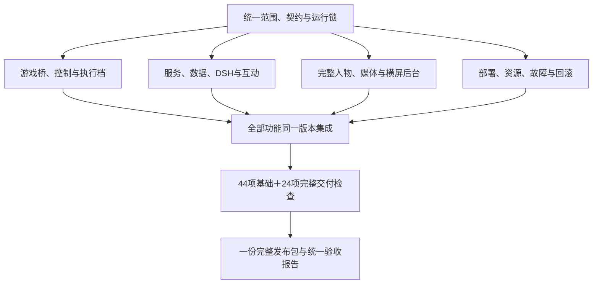

# 08 完整交付规划 v1.2

日期：2026-10-30（Asia/Taipei）。分支：mc。状态：完整规划已形成，部分服务端已实现，完整运行与实机验收未完成。

实际交付包经073轮核对为NeoForge 21.1.248。当前游戏接入以[14章整合包与NAIMEI约束](14-NeoForge整合包与NAIMEI接入约束.md)补充本章：使用同一玩家、共享核心和唯一控制权威实现Mojmap适配；下文Fabric/AltoClef设计保留为前期执行路线及待完成的生存适配依据。不得将Fabric生存JAR放入该整合包，原生存preLaunch无条件拒绝保持。完整D01–D15及68项验收范围不变。

本章落实用户最新要求：按一个完整版本组织全部开发与交付。此前“先交付只读版、再交付陪玩版、之后扩展自主版”的安排由本章替代。模块依赖、内部调试与测试顺序保留，只有整套目标满足后才判定交付完成。

[技术入口](README.md) · [全端实现蓝图](09-全端实现蓝图.md) · [机器可读交付清单](完整交付清单.json) · [接口](04-接口与数据.md) · [验收基础矩阵](07-实施与验收.md)

[完整总规划与交付约束](11-完整总规划与交付约束.md)集中说明全部方案；[全量交付执行总表](全量交付执行总表.md)将全部工作、依赖、产物和完成证据合并为一份执行依据。各端仍按同一完整版本实现并统一交接。

[10章全量执行与资源计划](10-全量执行与资源计划.md)补齐各项主责、全范围预算、最长依赖链、跨端施工接线、故障关闭、实机样本与完整交接包。本文定义的D01–D15和68项统一验收保持不变，工作顺序不构成开发分批交付。

本修订将全端实现责任进一步收束到09章：各端进程、唯一事实/控制/播放权威、边玩边聊、全部游戏能力、弹幕投票、世界记忆、完整人物/声音/媒体、后台、参数、恢复和发布包均有明确落点。D01–D15、F01–F12、Q01–Q08、E01–E08及68项验收范围保持同一完整交付，实际实现与实测进度另行记录。

## 1. 唯一交付目标

交付一套可运行、可管理、可恢复的林知夏MC横屏互动直播系统：同一真实玩家由Agent配合Mindcraft自主游戏，日常推进与失败恢复不依赖人工接管；主播持续理解状态与画面；弹幕、礼物和SC进入统一互动；人物、声音、字幕、留言与游戏合成为正式横屏节目；任务与记忆能够跨场续接。最新自主约束和实机边界见[自主游玩增补](Agent与Mindcraft自主游玩.md)。

完整版本同时包含以下运行形态，均在同一程序和同一发布清单内：AUTO、MANUAL_COMMENTARY、PAUSED；圆形/横窗人物；连续留言/顶部飘屏；留言左/右；游玩/互动/休息/恢复包装。模式切换不会另开人格、媒体权威或玩家。

功能开关用于实际运行时控制负载和节目安排。关闭某功能不能替代该功能的实现、测试与交付。演示截图、假数据、只读界面和仅存在的接口声明不能替代完整系统。

MC版本范围锁定一个通过兼容验证的原生Java游戏档，研究基线为1.21.1。完整范围包括基础采集/合成、普通难度补给与PvE、多步骤资源目标、失败/取消/接管；复杂PvP、任意整合包和任意种子全自动通关不作为未限定承诺。无人深空属于独立游戏项目范围。

## 2. 完整交付清单

| 域 | 必须同时完成的内容 | 最终交付物 |
|---|---|---|
| D01 工程与运行契约 | mc来源、设备profile、依赖与媒体版本锁、预检、安装/启停/回滚 | 发布清单、原生脚本、运行锁和安装说明 |
| D02 MC桥 | 玩家/库存/环境/规则/GUI、快照/增量/事件、原始帧、世界切换 | Fabric Mod源码、构建产物、协议回放与真机证据 |
| D03 控制权 | 本地仲裁、epoch、租约、热键、任务幂等、异常释放输入 | 唯一输入控制链、接管日志与重复请求用例 |
| D04 游戏能力 | 六项基础能力、普通PvE/补给、危险处理、多步骤资源任务 | 完整执行档、支持项清单、每项成功/失败/退出证据 |
| D05 DSH接入 | 游戏查询/执行工具、规划、口播、取消、既有人格与渠道 | 工具注册/处理、用途隔离、模型兼容结果 |
| D06 弹幕互动 | 统一采集、去重、过滤、礼物/SC、建议、投票、响应调度 | 实际平台链路、互动状态、背压与过期处理 |
| D07 记忆与数据 | 世界任务账本、基地、检查点、观众记忆、跨场核对与删除 | 数据迁移、恢复、摘要与唯一写入者证据 |
| D08 后台 | 游戏、任务、互动、人物/包装、声音、模型/资源、运行诊断 | 完整管理界面、实时反馈和操作审计 |
| D09 正式横屏媒体 | 1920×1080正式页、v3尺寸协商、旧流兼容、字幕与正式回执 | 官方源可加载页面、媒体协议与实际录制 |
| D10 人物素材 | 圆形和横窗两套完整派生动作包，身份与动态裁切一致 | 每套2待机＋48改编动作、索引/hash/脸框/映射/QA |
| D11 声音与混音 | O07/F07、游戏声、BGM、人声压低、取消/静音/恢复 | 单一路径声音、音轨分析与完整播放回执 |
| D12 视觉理解 | 原始帧获取、短时上传、本地视觉、超时与冲突处理 | 原生视觉服务配置、模型运行锁、真实画面用例 |
| D13 平台输出 | 官方直播姬素材、真实弹幕、公开状态、观众端音画验证 | 本地/观众证据、开播下播与异常处理说明 |
| D14 运维诊断 | 资源与延迟、结构化日志、磁盘预算、备份、故障恢复 | 状态面板、日志/曲线、恢复与回滚演练 |
| D15 完整验收与发布 | 全功能联合运行、长时稳定、跨场、源码/素材/契约一致 | 统一验收报告、发布包、已知边界与复现步骤 |

所有D01–D15都是必需交付项。现有可复用组件也要完成MC集成回归，不能因为历史人物测试通过就直接将对应域记为完成。

## 3. 各端最终职责

| 端 | 完整职责 | 禁止出现的职责冲突 |
|---|---|---|
| 游戏端 | 同一真实客户端、结构化状态、局部规则、原始帧、唯一输入仲裁、技能/生存/战斗 | 多个执行器同时写键鼠；人工接管后自动防御继续抢输入 |
| 主播服务端 | DSH、渠道、规划、互动、候选口播、世界账本、Humanity唯一写入 | Mindcraft或其他框架另开一位常驻主播人格 |
| 人物/语音端 | K02、O07/F07、新素材预处理与显式媒体profile | 新旧脸框/缓存交叉，重新播放已取消人声 |
| 视觉端 | 新鲜原始MC帧、单并发、明确未知、有限资源 | 分析合成后的弹幕人物；用旧帧覆盖新游戏事实 |
| 接收/节目端 | 官方素材、媒体回执、MC叠层、源内声音、正式横屏输出 | 静音预览或管理页成为第二位播放权威 |
| 后台 | 任务/模式/建议/投票/显示/混音/素材/诊断的明确控制 | 按钮已点击就显示任务完成、接管完成或已公开开播 |

既有结构化状态和规则为精确事实依据，视觉补充外观/特殊界面，文字模型组织目标和表达，本地规则处理即时动作。整套版本包括四者，不将“加大模型”作为缺失执行链的替代方案。

## 4. 游戏与本地生存执行

正式游戏侧围绕Fabric桥及单一控制仲裁设计。普通生存能力优先适配MiranCZ/altoclef及其配套寻路实现；标准Baritone档用于基础兼容对照，发布时只加载运行锁声明的一套依赖。

外部任务仍采用已定义的navigate/gather/craft/use_item/return_base及取消操作。资源依赖、补给和普通防御作为同一执行器内部子任务协调，任务状态向上汇总；不额外创建另一位键鼠写入者。完整能力在运行时capabilities与执行档清单中声明，未通过的支持项不能填true。

普通PvE验收固定敌人、装备、难度和地形；补给覆盖有食物/无食物、可继续/需退出；危险处理覆盖水下、着火和危险路径。任务不可行时必须能停止、解释并交还人工，不以无限重试维持“自主中”。

本地接管优先于所有任务与反射；AUTO恢复重新核对世界、界面、状态、租约和前置条件。任务副作用与取消分别记录，不能把取消当回滚。

## 5. 弹幕、建议与投票的完整闭环

平台事件统一进入Room，显示与DSH分别消费同一事件。身份、金额、角色和删除仅使用平台可核验字段。评论不直接成为系统操作或任意代码。

建议流程为：事件归并 → 结构化建议 → 检查支持能力/当前目标 → 采纳或拒绝 → 按实际模式派发 → 真实任务证据 → 公开回应。人工模式可采纳为候选，但不自动抢控制权；转换为任务后显示task_id及真实状态。

投票采用2–5个固定选项、30–120秒、同一房间最多一个活动投票。可信稳定user_key每人一票，重复事件不重复计数；缺稳定身份不按昵称伪造独立选票。截止后冻结结果，平票交后台明确选择或取消，不能静默随机选目标。

投票胜出不跳过AUTO授权、前置检查或控制租约；胜出但当前不可执行时给出原因。建议/投票接口、Schema、数据表及后台同版完成；私聊内容仍不会自动变成公开投票。

## 6. 完整后台信息结构

| 页面/区域 | 必须具备 |
|---|---|
| 游戏总览 | 玩家/世界/规则/状态年龄、控制模式与实际确认、当前任务、紧急停控 |
| 任务管理 | 创建支持目标、队列、前置条件、真实进度、证据、失败原因、取消与续接候选 |
| 观众互动 | 留言过滤、建议采纳/拒绝、投票创建/关闭、回复队列与过期原因 |
| 人物与包装 | 圆形/横窗、feed/fly、留言左/右、节目场景、字幕、素材版本与缺失检查 |
| 声音 | 人声/BGM/游戏音轨状态、音量、压低、静音、引擎主备与实际输出观测 |
| 记忆与世界 | 基地、目标、检查点、跨场摘要、既有更正/删除入口 |
| 运行诊断 | 模型/视觉/媒体/游戏连接、资源、各段延迟、错误、日志、备份与发布版本 |

沿用现有免登录后台。后台操作受版本、状态和能力校验；这些校验不是新增登录流程。显示切换保持媒体与游戏控制权连续。

## 7. 人物、媒体与视觉一次齐备

布局沿用v1.0.0/revision04，唯一坐标来源不变：全画布游戏、默认264圆形人物、备选320×180横窗、四条连续留言、后台左右切换、礼物跟随、飘屏互斥、无“正在看的弹幕”卡。

人物两套派生包各50段：2待机＋48逐项改编动作，按每段8秒/25FPS规划，共100段、800秒源视频。圆形动作可以改为符合遮罩的头肩表达，逐项登记新ID/语义映射，不承诺旧大幅手势全部可见。两套均提供完整manifest、索引、脸框、缓存版本和动态QA；制作中的小样是内部质量检查，不作为单独交付版本。

正式媒体支持新尺寸协商、关键帧重建、旧v2流回归、唯一正式播放权威。人物尺寸、显示尺寸和1920×1080节目尺寸分别管理。游戏、人声、BGM各有单一路径，游戏音轨可控与人声压低一并纳入实现/测试；旧静态裁切不满足素材完成定义。

视觉功能在完整交付中必须实现与验收，运行时允许关闭。候选沿用Qwen3-VL-4B与llama.cpp原生CUDA；模型/构建/端口/参数记录进运行锁。当前下载及远控约束仍有效，本次规划不启动安装。视觉失败时具备降级行为，也必须保留启用后的真实画面正确/错误/未知样例。

## 8. 设备与资源规划

完整功能的推荐部署目标沿用研究中的A4090＋B3080：A承载DSH、人物、语音与视觉，B承载真实游戏、控制、接收和官方直播姬。目的是把人物/视觉推理与游戏/编码的资源占用分开管理。

当前实际契约仍为mc继承3080、FP16 batch4、原状态根；4090仍暂停。推荐拓扑是发布规划，不是本次设备切换。完整MC发布必须建立真实设备与source_branch=mc一致的profile，保留来源检查、状态隔离与唯一写入者；48GB4090参数不能套到24GB型号。

交付代码需具备设备配置分离；最终验收绑定一个明确且获准运行的完整拓扑。若只有单3080可用，必须证明同一完整功能清单及性能门槛均成立才能采用，不能删除视觉或生存功能后标记整套完成。没有硬件证据时对应交付域保持未验收。

| 资源/职责 | 规划要求 |
|---|---|
| Java游戏集成 | Fabric线程、依赖、输入仲裁、寻路/生存执行与游戏实测 |
| Node与前端 | 协议、DSH、事件/任务/互动、SQLite、后台、正式页面 |
| Python与媒体 | 已有K02/TTS、预处理、媒体profile、采集/接收与资源测量 |
| 素材与QA | 两套完整动作、身份/口型/遮罩/接缝和手机观看评审 |
| 集成与发布 | 模拟/真机/官方源/观众端、4小时运行、跨场、备份回滚 |
| 云端额度 | 沿用现有渠道；按实际调用/token计量，设置有界并发与候选队列 |
| 本地资源 | 实测CPU/RAM/GPU/显存/编码/磁盘，运行锁记录；不凭显卡名承诺余量 |

上述是职责划分，不要求调度子代理。人员/执行者可以兼任，整体范围不因内部职责拆分而成为分批交付。

## 9. 工程依赖网络

W00–W13全部保留为内部任务，W11普通生存与W12视觉纳入必需范围。每项都有源码、配置、契约、自动检查、真机证据和失败恢复责任。模块测试和集成修复可以迭代，交付完成只判一次整体状态。

工期与成本按全部职责、素材数量、设备使用窗口和真实问题记录管理，不用“完成接口数量”折算整体完成度。任务清单可以显示内部进度，但不能把只读、陪玩或单个技能作为用户验收版本。

## 10. 统一验收

既有V01–V44全部保留，增加C01–C24完整交付检查；总计68项。以下均为待执行要求，不是本轮通过记录。

| ID | 检查 | 完成标准 |
|---|---|---|
| C01 | 普通近战PvE | 固定条件可执行防御/攻击/停手，保留掉血及失败证据 |
| C02 | 远程敌人与引爆危险 | 已声明条件下能识别/应对或退出，未覆盖条件明确暴露 |
| C03 | 有/无食物补给 | 补给与移动/战斗协调，缺少资源时不会持续空操作 |
| C04 | 水下/着火/危险路径 | 本地危险处理与退出可核对，不等待口播 |
| C05 | 多步骤资源链 | 材料依赖、合成、工具与库存条件真实，阶段失败不冒充整体成功 |
| C06 | 生存子任务中接管 | 本地所有自动子任务释放输入，迟到目标不复活 |
| C07 | 视觉建筑描述 | 原始帧关联正确，描述保留准确/错误案例 |
| C08 | 菜单与可辨文字 | 核对原帧，不能将不可辨小字补成已知事实 |
| C09 | 视觉未知与来源冲突 | 明确未知；更新的结构化信息优先 |
| C10 | 视觉超时与负载 | 查询超时不拖住声音/控制，完整联合负载通过 |
| C11 | 旧帧/换世界 | 旧观察不能作为当前世界口播或决策依据 |
| C12 | 建议采纳/拒绝/转任务 | revision、来源、状态及task_id对应正确 |
| C13 | 投票完整生命周期 | 创建、计票、截止、结果、关闭与取消可核对 |
| C14 | 重复与缺失身份投票 | 一人一票、重复不计、无稳定身份不造选票 |
| C15 | 平票/不可行胜出/人工模式 | 明确决策与原因，不绕过AUTO与前置条件 |
| C16 | 圆形完整50段 | 文件/帧数/索引/语义映射齐全，动态遮罩与口型合格 |
| C17 | 横窗完整50段 | 横构图、手势、循环与实际显示尺寸通过 |
| C18 | 新媒体全链与旧流兼容 | 尺寸/codec/关键帧/采样回执正确，换形状无重复音频 |
| C19 | 官方音画与互动同时运行 | 真实游戏、人物、留言、字幕与三路声音在录像中一致 |
| C20 | 连续4小时完整负载 | 包含原60分钟稳定段；无未处理断流/欠载/解码问题，资源有界 |
| C21 | 多模块同时异常 | 模型/视觉/平台/播放器异常分别隔离，停控与实际状态可确认 |
| C22 | 跨场/次日核对 | 世界、目标、人物与观众记忆连续，启动不重放旧动作 |
| C23 | 发布/数据库/素材回滚 | 一致备份、迁移与旧版本恢复可复现 |
| C24 | 干净原生环境复现 | 按运行锁与手册重建，在正确设备不借用未登记环境 |

4小时是完整交付的连续性测试窗口，不等于承诺任意世界数小时零死亡。日常目标、补给、阻塞与死亡恢复均须由Agent配合Mindcraft自行处理；停止保护和故障注入单独记录，不能用人工游玩或接管补齐通过。未能自动恢复的阻塞如实记为失败或待实现，任务成败与系统是否正确处理分开评分。

统一完成条件为：D01–D15必需产物齐备，V01–V44及C01–C24均有通过证据，代码/协议/素材/数据库/设备运行锁一致，无未解决的控制权、重复播音、假完成或数据丢失问题；正式平台与观众证据分别存在。任何必需项not_run/failed均不能将整体状态置为完成。

## 11. 风险与完整处置

| 风险 | 完整版本内的处置 | 关闭依据 |
|---|---|---|
| 生存依赖冲突 | 独立游戏档、配套Baritone、锁定构建、唯一输入链 | 启动/接管/任务与普通PvE实测 |
| GPU/编码争用 | 目标双机职责、有限并发、视觉单并发、素材尺寸独立 | 4小时峰值/稳定段与音画记录 |
| 语音落后于现场 | 事件绑定、过期淘汰、播放前复核、正确取消 | 同时发生的任务/弹幕与录像时间线 |
| 官方采集能力不符 | 验证透明素材/游戏捕获/游戏音轨，修订同版合成实现 | 官方客户端实际录像与观众端 |
| 新素材动态不合格 | 每条动作与取景映射、脸框缓存隔离、动态QA | 两套完整清单与失败片段修复记录 |
| 设备暂停/平台资格 | 不虚构部署完成，保留完整代码和明确未验收项 | 实际设备/平台获准运行后的证据 |
| 接口与实现漂移 | Schema/OpenAPI/迁移/客户端同版更新，契约与真实行为双测 | 统一版本清单与验收报告 |

风险通过工程修复、运行配置和真实验收关闭，不通过删除已纳入范围的功能来达成“完整交付”。当前没有启动游戏、模型、远程设备或公开直播。

## 12. 源码落地路径与完整发布产物

以下为同一完整版本的修改位置；拟新增路径尚不是可执行组件。具体输入/输出和接入关系见[01章模块表](01-系统架构与模块.md)。

| 范围 | 源码/配置落点 | 交付要求 |
|---|---|---|
| 游戏端 | `game-adapters/minecraft/fabric/` | 构建脚本、Mod、采集/仲裁/技能/生存模块、锁定依赖与真实用例 |
| 游戏核心 | `backend/game/` | manager、protocol、state、tasks、rules、planner、narration、store及数据库迁移 |
| 互动与视觉 | `backend/game/suggestions.mjs`、`votes.mjs`、`vision.mjs`、`frames.mjs` | 生命周期、去重/事务、原始帧边界、单并发与失败隔离 |
| DSH与平台 | `backend/dsh-bridge/game-tools.mjs`，现有host/server及Room/采集适配 | 全量工具注册、同一人格、事件字段能力、明确未知与用途隔离 |
| 正式页面与后台 | `web/mc-programme.*`、`web/game-client.js`，现有admin和媒体消费者 | 横屏正式页、完整后台、唯一音频权威、冻结坐标投影 |
| 媒体与接收 | 既有人物/TTS服务、`scripts/receiver_service.py`及receiver-b | v3与v2兼容、显式尺寸、关键帧/取消屏障、源内声音和回执 |
| 人物包 | `mc-avatar-circle-v1/`、`mc-avatar-landscape-v1/`独立素材包 | 每包50段、manifest/索引/脸框/hash/语义映射与动态QA；完整结构见[素材规范](../../design/mc-landscape-v1/人物素材重制规范.md) |
| 运行与部署 | `configs/releases/`、`configs/deployment-profiles/`、`scripts/mc_preflight.py`、`scripts/mc_run.py` | 与真实来源及设备相符的MC应用profile，原生准备/启停/诊断/回滚 |
| 契约与验收 | 本目录contracts、`outputs/mc-validation/<run_id>/` | API/Schema、模拟与实机检查、全部68项报告及脱敏证据 |

一份完整发布包包含：源码版本、游戏构建物、依赖/设备运行锁、契约/数据库迁移、两套完整人物包引用、默认配置、原生运行说明、全部验收报告、故障/备份/回滚手册。体积大的媒体与权重按现有本地素材管理方式引用和校验；凭证、活动数据库和私有配置不进入公共Git。

规划产物是本文及配套章节、机器清单、API/Schema和文档校验记录。后续实施以这份完整范围为统一任务输入，内部按依赖建设与修复，最终交付全部能力；实际代码与验证状态另见[实现进度](实现进度.md)。

## 13. 完整直播的端到端操作闭环

以下F01–F12共同构成一套完整产品的运行流程，均是最终必须联通的目标流程，不代表已经实现。每条流程同时约束发起端、处理端、结果与异常出口，不能只完成其中一个页面或接口。

| 流程 | 触发与各端交接 | 最终可核对结果 | 对应域与验收 |
|---|---|---|---|
| F01 原生准备与启动 | 运行器核对源码、真实设备、依赖/素材/数据库版本和占用，再依次准备宿主、接收器与独立游戏实例 | 各进程归属明确；不匹配时不加载推理；游戏初始不恢复AUTO | D01、D14；V38–V41、C23–C24 |
| F02 同一玩家接入 | Fabric主动连接应用入口，逐层通过B/8010/3092路由，提交能力、世界身份和完整快照 | 后台显示实际连接、状态年龄和模式；旧世界、旧连接及重复观测不更新为新事实 | D02、D03；V01–V07、V12 |
| F03 自主目标执行 | 后台明确开启AUTO后，DSH按当前目标查询事实和前置条件，GameManager提交固定技能，游戏端仲裁后执行并核验 | accepted、running与终态分别记录；补给/PvE/危险处理共享一条输入链；成功、失败和部分效果都有证据 | D03–D05；V14–V19、V23、C01–C06 |
| F04 边玩边聊 | 已过滤平台事件与游戏事件进入候选队列；口播调用和规划调用共享有界模型队列；本地已授权技能继续运行 | 回答关联当前世界与事实，过期现场语句改写或丢弃；口播经正式人声回执确认，与任务完成分别记账 | D05、D06、D11；V20–V25、V31–V32 |
| F05 观众建议到任务 | 同主题留言归并为带来源的结构化建议，后台/明确策略采纳，核对当前模式、能力、世界和前置条件后建立任务关联 | 采纳不冒充已执行；人工模式只保留候选；实际派发后有task_id和独立任务结果 | D04–D08；C12、C15 |
| F06 投票到目标 | 后台创建固定选项，Room可信身份计票，截止冻结，平票明确选择或取消，再经过与F05相同的执行检查 | 一人一票、重复不计；胜出结果与实际可执行结果分开；不可行时保留原因，不抢人工控制 | D04–D08；C13–C15 |
| F07 画面理解 | DSH提出限定观察目的，Fabric取得原始帧，异步编码并有界上传，短时缓存交给单并发本地视觉，再回传关联结果 | 帧ID、世界、时间与描述一一对应；未知/超时明确；旧帧不覆盖新状态；控制与声音不等视觉完成 | D02、D05、D12；C07–C11 |
| F08 人工接管与恢复 | 本地热键/实际人工输入先进入唯一仲裁器，释放合成输入、变更控制epoch并终止旧任务；后台随后收到真实确认 | 人工持键不被误清除；迟到规划/防御子任务不复活；重新AUTO必须重新授权和核对 | D03–D05；V08–V13、C06 |
| F09 正式节目与平台输出 | 正式页取得唯一播放租约并完成媒体尺寸/关键帧协商；官方直播姬组合游戏底层、透明叠层及单一路径声音 | 本地就绪、正式播放、平台公开开播和观众收到分别记录；音频/字幕/人物与留言在实际录像中可核对 | D09–D13；V26–V33、V42–V43、C16–C19 |
| F10 后台显示与场景控制 | 导播选择留言左右、feed/fly、圆形/横窗、字幕和节目场景；设置通过Room/Game实际状态投影至正式页 | 留言和礼物一起换边且队列连续；显示切换不另起声音；休息包装与真实停控是两个独立确认项 | D08–D11；V27–V32、C18 |
| F11 故障隔离与恢复 | 游戏/模型/视觉/平台/媒体/存储分别报告异常；本地租约保障停控；恢复时查询新状态并核对任务账本 | 不凭按钮或已发送消息宣称停控；未知副作用不重放；恢复不重复口播、不绕过数据库所有权 | D03、D07、D14；V12–V13、V19、V35–V36、V41、C21、C23 |
| F12 下播与跨场续接 | 停收新目标，核对本地停控，结束媒体请求，保存世界检查点/任务结果；唯一DSH写入者提交记忆候选；次场先实测核对 | 下播状态与平台分别确认；世界/基地/长期目标连续；更正删除同步生效；不恢复旧持续输入 | D07、D13–D15；V34–V37、V44、C20、C22–C24 |

上述流程的HTTP/WS/SSE数据结构遵循02–04章；媒体和播放回执遵循05章；异常责任和关闭顺序遵循06章。每条流程在同一个发布清单、同一个目标拓扑中检查，不能拼接不同机器或不同版本的成功记录。

## 14. 已定设计与必须实测定值的项目

一次规划必须明确结构决策，也必须明确哪些值需要真实构建和运行后才能锁定。以下项目不形成另一个产品批次；未关闭时，完整交付仍未满足。

| 编号 | 已定设计 | 需落入运行锁/证据的值与关闭条件 |
|---|---|---|
| Q01 游戏与执行器 | 同一真实Fabric玩家；一个输入仲裁器；基础技能、普通生存/PvE均必需 | MC研究基线1.21.1/JDK21；Loader/API/映射、AltoClef配套寻路构建及hash以兼容实测定值；冲突必须修复，不能加载两套Baritone |
| Q02 模型与人格 | 复用现有DSH/Humanity和已保存文字渠道，规划/口播用途隔离 | Node正式24.22.1、DSH SDK、实际模型/工具/取消行为全链通过；协议替身检查不能关闭此项 |
| Q03 设备与来源 | 完整目标推荐现有48GB规格A4090推理＋B3080游戏/接收；mc为开发来源 | 真实MC profile、来源凭据、设备参数、状态根与发布清单一致；4090控制暂停有效，当前3080配置不因规划变更 |
| Q04 人物与媒体 | 圆形、横窗各50段新素材，同版支持新媒体尺寸与旧流回归 | 两套源文件/hash/动作映射齐备；实际推理尺寸、脸框/缓存版本、编码配置、口型与动态遮罩通过 |
| Q05 本地视觉 | 原始帧、有界上传/缓存、单并发、超时/未知；完整交付必需 | 已列候选模型和原生CUDA运行器需获准准备并实测后锁定hash、输入上限、端口、超时和资源；不自动下载 |
| Q06 官方捕获与声音 | 使用官方直播姬，游戏底层＋透明网页叠层，唯一正式人声路径 | 实际客户端版本、透明捕获、游戏音轨、混音/压低与观众音画证据；能力不符时修复同版合成设计 |
| Q07 性能与开销 | 有界队列、按需模型调用、资源/时延连续观测，完整功能联合4小时 | 在最终拓扑按07章门槛测量；登记GPU/RAM/编码/磁盘与token，不用空闲截图或假设价格承诺运行成本 |
| Q08 完成判定 | D01–D15全部必需，V01–V44与C01–C24统一验收，一份完整版本 | 版本和证据一致，全部68项通过；缺实机、平台、素材或恢复证据时保持未完成，不用关闭功能代替交付 |

## 15. 最终交接与复现

最终交接同时给出可直接使用的原生入口、完整后台、正式节目页、游戏Mod与执行档、两套人物包、配置样例、依赖/设备/媒体/数据库运行锁、统一验收报告及运维手册。管理页可看见连接状态、实际控制模式、任务结果、媒体权威、平台状态和当前版本；不会把“配置已保存”显示成“游戏已执行”或“已经开播”。

干净环境复现按同一发布清单执行：核验文件与来源 → 原生准备和预检 → 启动并确认同一玩家 → 加载正式节目 → 复现目标/弹幕/视觉/接管 → 检查音画与观众端 → 正常停止 → 次场恢复 → 备份回滚。每个入口需有失败原因、所属进程与恢复操作；不要求操作者手工拼接临时测试脚本。

规划、源码、配置、素材、数据库迁移、运行锁和验收报告必须对应同一个发布版本。新迭代只更新内部实现进度，用户面对的是这套完整系统的一次统一交付。

## 16. 一次性交付的执行约束

本规划不设置第一期、第二期或独立功能交付版本。W00–W13是同一发布内的工程任务，D01–D15是完整责任清单，68项是同一份联合验收。源码构建、内部小样与模块回归都只记录实际进度；完整发布包齐备并通过统一验收后，才交接为可用系统。

实施从共同运行契约和唯一游戏控制链入手，因为游戏状态、任务结果、口播与恢复均依赖这一基础；后台、互动、正式横屏媒体、人物素材、视觉和运维按同一契约建设。内部先后关系不减少任何必需能力，也不把中间构建物作为交付版本。

| 约束 | 必须落实的实现与配套内容 | 对应依据 |
|---|---|---|
| E01 同一玩家与人格 | Fabric采集真实客户端，生存/寻路共用本地仲裁；DSH负责既有人格、目标和表达。Mindcraft保留为研究/对照，不能直接另起机器人或第二个人格取代此结构 | D02–D05；01、02章 |
| E02 输入闭环 | 原task/lease/world/epoch贯穿实际副作用；按键、点击、移动输入、视角、GUI及异步事件均有归属；正常结束、取消、失焦、断线和人工接管均释放自己的输入 | D03–D04；V07–V19、C06 |
| E03 边玩边聊 | 本地技能持续运行；游戏事实、弹幕与视觉以来源和新鲜度进入规划/口播队列；任务结果到公开回复、字幕、真实播完回执全过程关联，不将受理当成功 | D05–D07、D11–D12；F03–F07 |
| E04 完整节目 | 正式横屏页使用冻结布局，圆形/横窗与feed/fly均可切换；后台控制留言/礼物左右；人物、人声、游戏声、BGM与字幕在官方源内联合工作 | D08–D11、D13；F09–F10 |
| E05 素材和模型配套 | 两套各50段新人物及索引、脸框、动作映射、缓存版本齐全；文字/语音/视觉依赖与实测参数列入同版运行锁，保留原始人物和历史素材 | D01、D10、D12；C07–C11、C16–C18 |
| E06 可运行与可恢复 | 原生准备、预检、统一启停、诊断、备份和回滚具有明确入口；核对真实设备、来源与状态根。设备暂停及现有模型下载约束仍有效 | D01、D07、D14；F01、F11–F12 |
| E07 一次联合验收 | 全部68项、20次接管、完整负载连续4小时、次日恢复、官方源与观众端证据绑定同一候选；模块CPU检查不能替代这些项目 | D15；07章与本章第10节 |
| E08 统一交接 | 一份版本清单关联源码、全部构建物、素材、迁移、运行锁、完整报告及手册；缺任一必需产物或验收项，整套状态保持未完成 | D01–D15；第12、15节 |

最终发布清单至少登记：release_id、源码提交与分支、全部文件hash、MC/Fabric/执行档、Node/DSH/Humanity、设备profile与来源记录、模型/素材/媒体版本、数据库schema与迁移、运行入口、68项报告及4小时/次日/回滚证据。私有配置、凭证和活动数据库使用本机准备与一致备份流程管理，不混入公共源码包。

联合验收前冻结候选和实际环境；验收中发现的失败保留原始证据并修复。修改影响控制、媒体、数据或设备契约时，重新执行受影响的模块和联合检查；最终4小时与次日记录必须对应实际交付候选。所有not_run、failed、待素材、待平台或待设备项目均明确列出，不换算成整体完成百分比。
