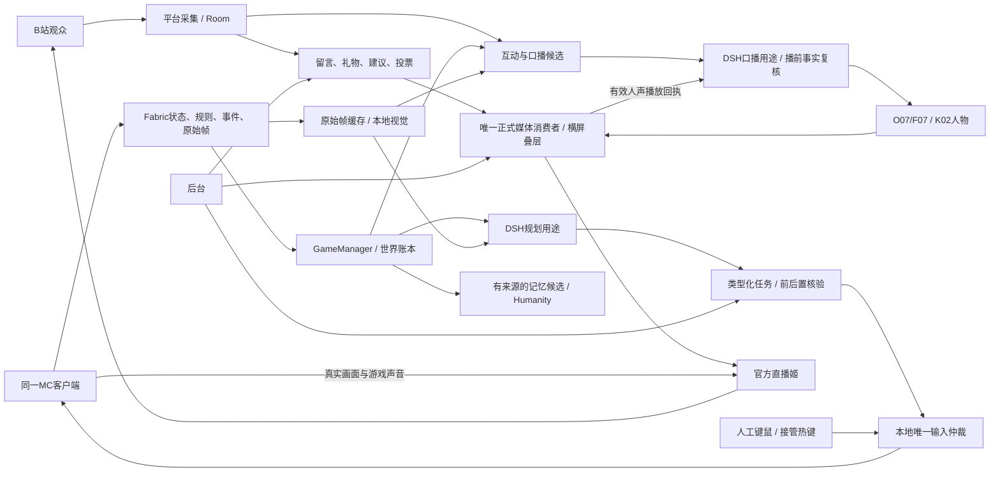
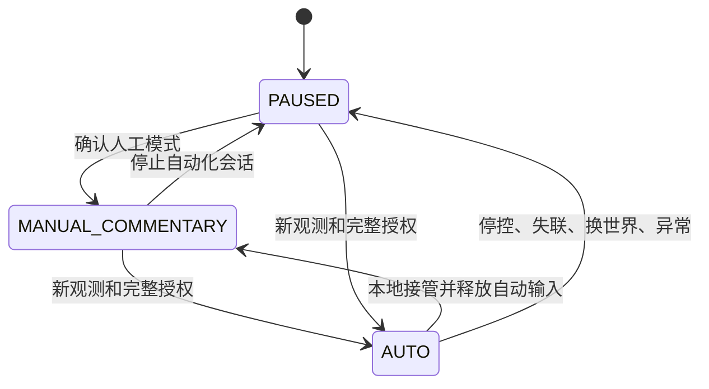
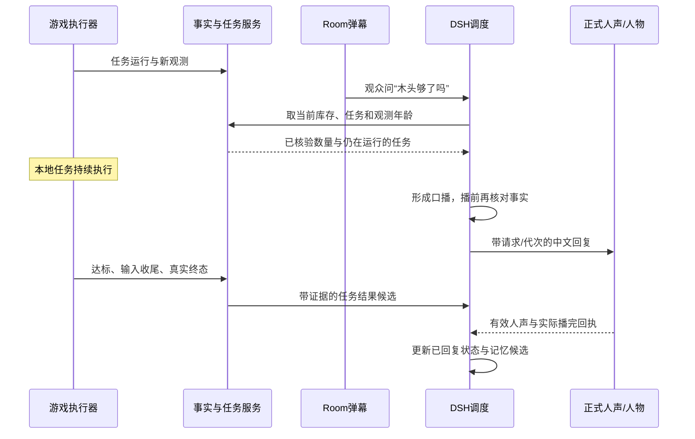

# 09 全端实现蓝图：一次完整交付

> 后续用户选型与实现增补：[Agent与Mindcraft自主游玩](Agent与Mindcraft自主游玩.md)。Mindcraft的实际依赖求解器已纳入原生同角色接法，替换本章原“仅作参考”选择；人工接管不作为日常推进路径。完整验收状态以实现进度为准。

各项责任、工作量、依赖、资源及完整发布排程统一见[10章全量执行与资源计划](10-全量执行与资源计划.md)。本章提供各端实现依据；完整系统统一交付，不因模块先后完成而分批。

规划修订：1.2。日期：2026-10-30。工作分支：`mc`。性质：完整系统的实现约束与交接蓝图；实际完成情况以[实现进度](实现进度.md)和真实验收报告为准。

当前实物为NeoForge整合包，游戏端差异以[14章](14-NeoForge整合包与NAIMEI接入约束.md)补充。原BridgeCore、GameManager、仲裁、任务账本和人物/弹幕链继续共用，游戏对象由Mojmap原生适配；下述Fabric与AltoClef为前期设计及完整生存移植依据，不能直接当作当前已运行的加载器或完整执行器。所有完整交付要求及原生存启动拒绝保持。

[完整范围与68项验收](08-完整交付规划.md) · [技术文档入口](README.md) · [接口权威文件](contracts/openapi.json) · [数据权威文件](contracts/game.schema.json) · [机器可读交付清单](完整交付清单.json)

[全量交付执行总表](全量交付执行总表.md)集中列出W00–W13的实际实现、依赖、产物和完成证据，作为本蓝图的执行入口。所有工作均汇入一个完整候选。

## 1. 成品定义与结构决策

成品是一套可以安装、配置、开播、互动、接管、下播并跨场恢复的MC主播系统。林知夏使用同一个真实Minecraft玩家游玩，同时读取游戏状态、观察必要画面、回应B站弹幕。正式节目为1920×1080横屏，游戏占满底层，右下小人物和滚动留言叠加其上，留言与礼物由后台统一选择左侧或右侧。

全部D01–D15在同一个版本中实现、集成和交付。普通生存/PvE、补给、资源链、视觉、两套完整人物、完整后台、平台输出和恢复均属于这次范围。工程任务有依赖关系；用户验收只有一份完整系统。内部样片、单模块构建、协议测试仅提供开发证据。

| 事项 | 本次完整版本的确定设计 | 实现约束 |
|---|---|---|
| 游戏主体 | Minecraft Java真实客户端，自有Fabric桥 | 人工与AI控制同一玩家；一个实例、一条有效控制连接 |
| 本地执行 | 适配AltoClef及其配套寻路，统一输入仲裁 | 普通生存必须接齐；运行包只装一套锁定的寻路依赖 |
| 人格与调度 | 现有DSH宿主和Humanity | 规划、口播、私聊用途分开，记忆写入权威唯一 |
| 文字模型 | 复用已有已保存渠道，经适配器调用 | 本地/外接由实际渠道配置决定；DSH名称不限定模型品牌 |
| 游戏知识 | 当前游戏结构化状态、服务器配方和实际规则 | 模型常识、观众文字、视觉推断均保留各自来源和未知项 |
| 视觉 | 原始MC帧→有界缓存→本地视觉服务 | 属于必需交付；推理按需、单并发，与游戏控制分开 |
| 人物和声音 | K02、O07主用、F07备用及现有权重 | 新圆形/横窗素材独立版本；一条正式可听人声路径 |
| 留言姬 | 现有Room采集/归一化，MC留言组件呈现 | 借鉴blivechat样式；实际事件和身份字段由Room提供 |
| 节目与推流 | 正式横屏页面＋官方直播姬 | 游戏捕获、透明叠层、声音和公开状态均做实际客户端验收 |
| 部署 | 原生Windows、Java、Node、Python | 使用真实设备profile和来源凭据；远端4090暂停约束继续有效 |

Mindcraft采用LLM＋Mineflayer并支持外接API及本地模型入口，可作为技能组织和机器人行为对照。本项目既有方案已选择真实客户端路线，正式主链使用Fabric；将Mindcraft直接启动为第二个玩家会改变同一角色接管的语义，故不纳入正式控制链。[Mindcraft官方说明](https://github.com/mindcraft-bots/mindcraft)

DSH提供插件/宿主能力，项目通过自身游戏工具适配器对接。Fabric桥、AltoClef、Mindcraft和blivechat分别是游戏桥、执行器、机器人框架和留言组件参考；它们的上游仓库身份不能写成“已安装DSH游戏插件”。DSH版本按项目锁文件固定，工具行为以该版本实测为准。[DSH官方项目](https://github.com/deepseek-ai/deepseek-harness)

## 2. 所有端如何组成一条完整链路

游戏动作由本地执行器持续推进，模型在目标边界和关键事件时介入。因此主播回答“你现在在做什么”时，采集任务仍能继续；语音生成等待不会卡住移动或输入释放。观众洪峰首先影响候选等待和过期淘汰，本地控制时钟和租约仍独立运行。

| 真值 | 权威提供方 | 消费者如何使用 |
|---|---|---|
| 玩家、界面、库存、世界会话 | 当前Fabric观测 | 后台和模型同时显示观测年龄；过期则停止新动作受理 |
| 模式、输入释放、控制epoch | B端本地仲裁器 | 后台等实际确认；单纯点击按钮不改变确认状态 |
| 任务效果 | B端执行结果及核验证据 | A端保存投影；受理、运行、部分效果与成功分开 |
| 观众事件与身份 | 平台采集归一化 | 显示与互动共用事件ID；未知角色、金额留空 |
| 已播人声 | 当前正式播放源的有效回执 | 驱动字幕、口播完成和公开回复状态 |
| 世界与长期目标 | GameStore事实账本 | 进入游戏后重核对；历史目标不直接恢复持续按键 |
| 人格与观众关系 | 唯一DSH/Humanity写入者 | 游戏摘要经候选核验后进入既有长期记忆 |
| 是否公开开播及观众收到 | 平台公开状态及独立观众端 | 与本地准备、媒体连接和本地录制分别报告 |

## 3. 各设备、进程与连接

完整目标拓扑为A4090推理＋B3080游戏/接收/官方直播姬。此处的A4090沿用项目现有48GB规格；当前`mc`仍继承3080同机FP16 batch4配置，规划不会切换正在使用的部署目标。双机准备须待设备可操作时按真实来源生成MC profile。

| 端/进程 | 承担内容 | 固定连接方向与生命周期 |
|---|---|---|
| B：MC/Fabric/执行档 | 真实玩家、采集、规则、唯一输入、任务本地账本 | 主动连应用游戏WS；断连本地租约退出；退出时释放所属输入 |
| A：Node/DSH/Room/GameManager | 平台事件、规划、互动、任务投影、世界账本、人格与记忆 | 复用既有3092宿主和8010应用入口；一个DSH安装独占状态根 |
| A：人物/TTS | O07/F07、K02、新素材profile、H264/PCM输出 | 由正式媒体请求驱动；取消和重置具有独立媒体代次 |
| A：视觉服务 | 原始游戏帧按需分析 | 本地调用；运行锁记录实际原生构建、模型hash、端口、资源上限 |
| B：接收器 | 媒体及限定游戏HTTP/WS/SSE透传 | 沿用本机`127.0.0.1:8020`；不加载第二套人物/TTS |
| B：正式节目页 | 唯一人物播放、留言、礼物、字幕、包装 | 官方源持正式租约；静音预览与管理页不成为播放权威 |
| B：官方直播姬 | 游戏捕获、透明叠层、音源、编码及推流 | 当版客户端验证；本地录像与公开直播证据分开保存 |
| 操作者后台 | 控制、任务、互动、显示、声音、诊断与维护 | 复用免登录后台；每项操作回显实际结果、冲突或未确认 |
| 观众端 | 接收平台节目、发送留言 | 独立记录实际可见与可听结果，包含平台分发延迟 |

单3080作为完整目标时，须在同样功能、同样素材和同样验收条件下证明资源足够；不能将“人物短句已通过”外推为完整MC负载已通过。游戏目录、状态根、模型缓存、素材缓存和公开源码分开管理，不在两个运行实例间共享活动SQLite。

HTTP、SSE、WS复用[01章入口](01-系统架构与模块.md)。游戏WS是`/api/dsh/game/bridge`，后台游戏SSE是`/api/dsh/game/events`，人物流使用独立媒体路径。Mod不另开远程键鼠监听服务。所有新路径逐层验证3092、8010和8020的大小限制、重连、取消与断线传播。

## 4. 游戏观测、规则与实际执行

### 4.1 必须读到的事实

| 信息组 | 实现内容 | 成功、未知与过期的处理 |
|---|---|---|
| 玩家 | 位置/维度、血量、饥饿、氧气、装备、效果、选中物品 | 绑定同一玩家及世界；不可读字段为null并列出未知项 |
| 库存与GUI | 背包、热栏、当前屏幕、已打开容器、槽位与交互条件 | 未打开箱子的内容保持未知；GUI变化触发动作前置重核对 |
| 环境 | 已加载局部方块、可见实体、危险、时间/天气及可取得规则 | 限制采样范围；不把未加载区域补成已知地图 |
| 配方 | 当前服务器配方、形状/材料选择、批次/产量、工作条件 | 规则指纹变化清缓存；动态产物、组件、解锁和库存逐项另核对 |
| 事件 | 受伤、拾取、死亡、界面/维度变化、任务受阻及终态 | 普通事件合并；可靠事件先记本地账本再重发和去重 |
| 原始画面 | 当前MC帧ID、会话、捕获时间、尺寸和观察目的 | 渲染线程只取图像；编码、上传和模型推理在有界异步链运行 |

配方查询成功只表明“查到了候选规则”。`inventory_checked=false`明确保留，不能据此承诺材料足够、自动选择一个歧义配方或宣布已合成。执行前要读取当前物品组件、材料、空间和实际界面，执行后核对产物和数量。

### 4.2 一套执行档覆盖完整生存

外部使用五种固定goal：`navigate`、`gather`、`craft`、`use_item`、`return_base`；取消通过`game_cancel_task`及任务取消接口。它们构成六项基础能力，取消不新增第六种动作goal。普通防御、补给、撤离和资源依赖由同一执行档内部的子任务协调。

| 能力 | 必须实现的内容 | 终态依据 |
|---|---|---|
| 导航/回基地 | 已知目标、世界/维度/基地版本、可达性、范围与超时 | 真实到达；不可达或世界改变则失败/停止 |
| 采集 | 起始库存基线、目标资源、工具/空间、实际掉落与拾取 | 目标增量达到；路过已有物品不能伪造挖掘效果 |
| 合成 | 实际配方消歧、材料/组件、工作台与槽位、产物核验 | 真实产物与数量；部分消耗保留证据 |
| 使用物品 | 固定支持物品及专门前后置条件 | 进食、放置等分别核验；不开放物品明确拒绝 |
| 普通PvE | 固定难度/装备/地形的敌人识别、攻击、防御与退出 | 行为、伤害/风险及停手可核对；失败有明确原因 |
| 补给与危险 | 有/无食物、氧气、着火、危险路径及有限撤离 | 原生及时处理；无资源/无路线时保留失败与真实效果，Agent基于新观测有界换路或换目标，不以人工接管补缺；未知副作用先核对 |
| 资源链 | 有界依赖树、材料/工具、任务节点与重复利用 | 每个节点有真实效果；任何节点失败均不记整体完成 |
| 取消/接管 | 子任务、异步回调、事件订阅、GUI及合成输入全部收尾 | 输入已释放且旧回调不能改变新任务；取消不等于撤销既有效果 |

AltoClef上游说明其内置配套Baritone，且Mod兼容存在边界，因此正式发布必须使用本项目锁定并完成适配的一套构建。上游能自主生存不等于本项目接管、取消、素材和DSH集成已通过。[AltoClef官方说明](https://github.com/MiranCZ/altoclef)

现有生存工程候选仍有启动阻挡。去除阻挡的条件是完整副作用/线程/回调分类、MinecraftPort绑定、全部输入与GUI收尾及实际任务验证完成；编译成功或选定写点检查通过不能作为开放条件。

## 5. 控制权与任务协议的完整约束

游戏连接状态、实际控制模式、任务状态、媒体状态和平台状态分别维护。AUTO只在新鲜观测、有效能力、无阻塞GUI和显式授权下进入；断线、换世界、重启均不会自动恢复旧AUTO。

任务贯穿`game_instance_id`、`bridge_boot_id`、`world_session_id`、`connection_generation`、`controller_session_id`、`control_epoch`、`lease_id`和原任务身份。宿主补齐有效上下文，模型不能自己指定权限或复用旧租约。

处理顺序为：验证请求与幂等key→本地持久受理→在实际游戏线程重新核对当前状态与许可→执行有限任务→清理所有输入/订阅→核验真实效果→持久终态→可靠回报。网络重发只重发结果，不重做游戏动作。

人工接管本地优先：升epoch、禁止新自动输入、取消全部自动子任务、释放各自持有的输入，再回报实际模式。人工真实持键保持原状；旧寻路线程、网络事件、脉冲队列和收尾代码都只能作用于原任务代次。正式验收至少20次接管往返，包括进食、攻击、GUI和延迟回调。

A端进程停止或控制网络失联时，B使用自己的单调时钟判租约到期；迟到grant不能续活旧任务。网络ACK、accepted、running、verified success和已播人声分别记录。未知任务结果在恢复时只读核对，不能靠换一个request_id重新执行。

## 6. DSH、模型与“边玩边聊”

### 6.1 调用边界

| 用途 | 输入/工具 | 输出及后续 |
|---|---|---|
| `game_plan` | 新鲜游戏摘要、能力/规则、当前目标和有限观众候选 | 查询、一个固定技能、取消、等待或建议人工；不进入TTS |
| `speech` | 已过滤提问、游戏事实引用、人物上下文 | 中文口播候选，经播前复核和既有媒体生命周期 |
| `operator_private` | 导播私聊、运行诊断上下文 | 私人回复；只有明确公开发送/任务操作才进入公开链 |
| `maintenance` | 经核验的世界摘要和记忆候选 | 唯一写入者维护；不抢游戏输入或正式播放权 |

完整接入复用现有10个游戏工具：状态、事件、库存、配方、前置检查、任务查询、观察、观众摘要、启动任务和取消任务。工具名称与参数以[03章](03-DSH弹幕与记忆.md)和Schema为准。工具白名单按用途、配置技能和实际已验收能力取交集；任意Shell、任意游戏指令、控制模式切换均不通过游戏模型工具暴露。

文字模型使用现有渠道。完整版本验证工具格式、中文输出、超时、底层取消/迟到丢弃、上下文窗口和费用统计；外接/本地模型更换均经过同一兼容适配，不将新增模型作为启动规划的隐含前提。初始文字模型全局并发1，规划单飞，普通事件合并，紧急控制由本地规则处理。

### 6.2 一次实际互动如何完成

弹幕提问不会取消健康的采集动作；观众建议改变任务则必须经过采纳、AUTO/前置核验和旧任务取消闭环。高层模型返回时世界或库存已变，重新语义核验，不能只换成最新seq就执行旧意图。

### 6.3 口播的事实与过期处理

每条候选关联原事件、世界/会话、task_id、事实引用、优先级、创建/过期时间和speech_request_id。生成前、进入媒体前各核对一次；数量改变时改写，问题过期时丢弃，旧现场有叙事价值时改为明确的过去时。

口播已进入媒体链后，取消同时处理模型迟到结果、待播PCM、人物帧、字幕和回执屏障。只隐藏字幕不算停止声音。已生成、已提交、已首播、已自然播完、已取消分别可查；正式回执无法证实时保留未确认。

## 7. B站弹幕、留言姬、建议和投票

平台事件复用当前blivedm采集和RoomManager，选择一个有效采集源。平台事件去重、过滤后分两路：显示队列尽快呈现；互动队列按时效和优先级挑选可回答内容。显示和已回复状态独立，不对每条弹幕强制模型调用。

| 环节 | 实现内容 | 异常/边界 |
|---|---|---|
| 归一化 | event_id、room_id、稳定user_key、昵称/正文、时间、可信类型 | 缺稳定身份保留未知；不按同名昵称伪造独立观众 |
| 留言呈现 | 4条向上滚动、24条待显示、真实经过时间TTL、文本安全渲染 | 刷新/重连去重；左右切换保存节点、队列及寿命 |
| 礼物/SC | 同类短窗合并、可信金额/类型、感谢候选 | 不猜测身份/金额；礼物不自行再创建声音源 |
| 自然语言建议 | 映射固定goal、消歧、前置检查、采纳/拒绝理由 | 无法映射或不支持则解释；观众原文不变为权限指令 |
| 投票 | 2–5选项、30–120秒、同房间最多1个活动投票、每人1票 | 重复不增票；平票后台明确选择或取消；截止结果冻结 |
| 胜出到任务 | 生成候选建议→采纳→模式/租约/前置核验→task_id | 人工模式只保留候选；胜出不自行获得控制权 |
| 结果到回复 | 来源事件/建议/投票/task/证据关联，公开回应候选 | 部分效果按部分说；已回复只认正式播放结果 |
| 删除/撤回 | 清待显示、候选和对应可检索记忆；处理中口播走取消 | 删除是否来自平台按真实能力声明；不伪造上游删除事件 |

SC金额、表情、角色及删除扩展要同时修改Python字段、Room白名单、持久化、SSE、后台与正式页。平台连接资格沿用当前平台流程，应用后台保持现有免登录方式。

blivechat作为B站评论栏的视觉/交互参考；本项目使用自身Room事件和统一正式节目页，避免第二次采集和重复显示。官方直播姬捕获的兼容性由本项目实测，不由参考组件名称推断。[blivechat官方项目](https://github.com/xfgryujk/blivechat)

## 8. 世界、任务、检查点与长期记忆

| 数据 | 存储/所有者 | 完整实现要求 |
|---|---|---|
| 高频状态/局部画面 | 有时效内存与短时帧缓存 | 有界保留，过期删除；不将逐帧画面写成长记忆 |
| 游戏执行账本 | B端唯一写入的本地SQLite | 接受先落盘、真实transition、可靠投递、重启只读核对 |
| 世界/基地/目标/检查点 | A端GameStore事实账本 | 稳定world_id分区，会话历史、CAS、分页、归档/保留与摘要 |
| 观众共同经历和偏好 | 唯一Humanity权威 | 有来源的候选核验、更正/删除、去身份化及维护 |
| 原始素材/模型/运行锁 | 独立文件及hash清单 | 公开源码、私有状态和大媒体引用分开；可复现并可回滚 |

后台选择“查看某个历史世界”只切数据视图。实际MC世界、当前直播模式和全局停控状态仍单独显示；自动刷新不能将历史视图悄悄跳回当前世界。历史目标、基地和任务按所选world_id筛选，不能从历史页误派当前世界动作。

基地登记使用当前新鲜观测坐标；选择/归档校验世界及基地revision、当前会话和停控条件。改变活动基地只改变账本，不等于人物已移动。检查点记录观测快照与任务引用，不能标成MC存档备份、世界加载或一键回档。

完整历史必须从B归档投影到A，包含容量、摘要、过期清理和离线可查；只做当前页不能关闭这一项。重启先核对B任务与真实库存，unknown/partial保留人工处置记录。次场可以生成续接候选，不能重放旧按键或不确定合成。

备份须在停收新任务、本地输入已释放、账本写入完成后进行。A/B SQLite使用一致备份，MC存档在实际保存完成或游戏关闭后复制，另记录世界版本和时间差；无法协调远端服务器保存时明确不拥有原子世界快照。备份包含schema/迁移、素材/模型引用和删除账本，恢复后重做真实世界核对。观众删除在恢复旧备份时仍须重新应用，避免已删除内容重新可检索。

保留规则统一采用[04章](04-接口与数据.md)：关键事件7天/50000条、任务30天/20000项、日志100MiB×5，保留当前恢复依赖；有效世界/基地/检查点到明确归档。投票关闭24小时后可去身份化，删除请求提前执行。现有B端硬限和单库备份不等于上述清理、跨库备份和次日恢复已实现。

## 9. 正式横屏节目、人物与声音

### 9.1 最终节目布局

权威坐标保持[冻结JSON](../../../configs/layouts/mc-landscape-v1.json)的v1.0.0/revision04，不另建第二份坐标配置。游戏占据整个1920×1080底层，人物、留言、礼物和字幕使用透明叠层。以下尺寸为阅读说明，实现读取权威配置。

| 元素 | 成品形态 | 后台操作边界 |
|---|---|---|
| 游戏 | 全画布真实捕获；中心准星、底部HUD与Boss条保护 | 留言换边和人物换形状均保持游戏画面尺寸 |
| 默认人物 | 右下264×264圆形遮罩 | 保留身份与小幅表情/动作，动态检查头发、嘴部和手势 |
| 横窗人物 | 右下320×180横构图备选 | 使用独立完整素材/取景profile，切换不产生第二路人声 |
| 留言姬 | 4条连续向上滚动；左右两套位置 | `overlay.mc_chat_side`持久保存，留言和礼物一起即时换边 |
| 飘屏 | 顶部两条右向左轨道 | 与连续留言互斥；换边不反转飘屏方向 |
| 礼物 | 所选留言侧1条提醒、短窗合并 | 队列连续，不另发声；类型/金额来自可信平台字段 |
| 字幕 | 下部专用区，绑定当前正式人声 | 取消/失去有效人声时清理，不能成为“正在看的弹幕”卡 |
| 包装 | 游玩、互动、休息、恢复 | 场景切换只改显示；停控和下播有独立实际确认 |

正式地址设计为`/mc/programme?renderer=livehime`，静音预览为`/mc/preview`，须实现路由和正式媒体消费者后使用。正式页复用媒体时钟/租约，Room显示与Game状态使用独立客户端；不通过iframe嵌入第二份完整人物播放器。前后台、开发工具和静音预览都不确认正式已播。

官方直播姬中使用真实游戏捕获＋透明网页叠层。透明捕获、圆形遮罩、游戏音轨、鼠标焦点、特殊GUI和手机观看均需实际录像检查。若固定官方版本缺乏必要接口，在同一版本范围内修复合成/接收方案并重新验证；这项能力保持交付要求。

### 9.2 两套完整人物包

| 包 | 制作与媒体配套 | 完整交接内容 |
|---|---|---|
| 圆形 | 母版720×720，候选推理640×640，25FPS | 2待机＋48逐项语义改编动作，共50段；圆形动态安全及口型QA |
| 横窗 | 母版1280×720，候选推理960×540，25FPS | 同样50段；真实横构图、小手势、接缝和320×180显示QA |

共100段，按每段8秒规划，合计800秒源素材。候选推理尺寸必须通过现有K02环境验证后写入运行锁。每条具有独立ID、源hash、实际尺寸/FPS/帧数、动作语义、新旧映射、脸框、预处理/缓存版本和遮罩录像；旧48动作及2待机保留。详见[完整素材规范](../../design/mc-landscape-v1/人物素材重制规范.md)。

制作检查同时覆盖身份一致、头肩/发丝安全余量、嘴部无遮挡、动作极值、首尾接缝、说话期间动态和小屏可辨性。圆形动作允许重设计成轻点头/头肩表达，每项语义对应必须可追踪。静态裁切和单帧美术图不能满足完整视频包。

### 9.3 媒体和混音实现

新媒体使用v3显式`media.init`/`media.reset`及实际AVC参数，维持现有H264/PCM载荷和人声样本映射；v2旧流回归同时保留。解码器依据init尺寸配置，流重置清旧代映射并等新关键帧。节目尺寸、人物传输尺寸和屏上显示尺寸分别管理。

| 声音 | 输入和处理 | 唯一输出与验证 |
|---|---|---|
| 人物人声 | O07主用/F07备用，沿用正式PCM请求与样本时钟 | 一位正式消费者；自然结束/取消与已播进度可追溯 |
| BGM | 复用Room混音，按有效人声驱动音量包络 | 压低/恢复平滑，取消与静音后无旧尾音 |
| 游戏声音 | 固定官方版本验证可控的单一路径 | 可靠收音、音量控制/压低与恢复；禁止源内和桌面重复采集 |
| 人工麦克风 | 仅用于明确的人工节目用途 | 后台显示真实启用状态；避免回声和无关环境声 |

游戏压低需真实接口支持。固定官方版本若没有可程序化包络，则在本次版本内补齐原生接收/游戏音轨处理并只输出一次，实测后锁定方案；不能用已有BGM压低替代游戏音轨实现。采集方式变更同步记录来源、通道、采样率、重采样/延迟和取消行为，新增系统驱动不作为隐含依赖。

正式口播字幕按已提交文本和有效播放进度分页；它不是逐字ASR字幕。人声、人物视频、游戏事件、源内采样、官方录像和观众录屏保留关联时间线。晚到回复使用改写/过期机制，操作者本地游戏不为等待模型而延迟。

## 10. 视觉服务、资源与延迟

原始MC图像由Fabric取得，经独立有界上传进入A的短时缓存，再由视觉适配器调用原生服务。候选为现有研究中的Qwen3-VL-4B及llama.cpp原生CUDA；模型/投影文件、构建、显存、像素上限和端口全部实测锁定。现行新模型下载和4090暂停约束保持有效。

视觉目的限定建筑描述、当前菜单和可辨文字。结果带帧ID、世界会话、年龄、来源及unknowns；结构化库存/位置优先，视觉不负责逐帧战斗。视觉超时只结束该查询，旧帧与换世界结果丢弃，不阻塞游戏、声音或后台。

以下是同版默认值/候选目标，分别以[02章](02-游戏桥与控制协议.md)、[03章](03-DSH弹幕与记忆.md)、[07章](07-实施与验收.md)及实际运行锁维护。目标值表示验收要求，绝不填作已测成绩。

| 项目 | 初始约束或验收目标 | 检查方式 |
|---|---|---|
| 游戏采样/发送 | 本地目标10–20Hz，状态默认5Hz | 实际tick与队列年龄；普通状态覆盖合并 |
| 完整快照 | 启动/重连/换世界/缺口；稳定时10秒补全 | 检查seq、base_seq与会话，禁止倒退 |
| 心跳/租约/过期 | 1000ms / 3000ms / 2000ms | B本地时钟、心跳引用及状态独立新鲜度 |
| 新动作受理窗口 | 默认1500ms、上限2000ms | 按原观测本地采样时间计算；游戏线程执行前再次检查 |
| 任务时限 | 默认120秒、上限600秒 | 到时停后续动作并核验部分效果 |
| 输入接管 | 目标≤250ms，至少20次无残留 | 记录分布/最大值与物理持键，不仅看网络回包 |
| 文字模型 | 全局并发1；规划1运行＋1可覆盖待规划 | 记录等待、调用、取消/迟到、token与每任务预算 |
| 口播候选 | 16条；紧急8秒，普通问题/任务结果30秒 | 过期淘汰、播前复核、可解释丢弃与公平调度 |
| 显示留言 | 4可见＋24待显示，等待TTL20秒 | 隐藏页/重连仍按真实经过时间计龄 |
| 视觉 | 1运行＋1可覆盖等待，最多1帧/秒，初始超时8秒 | 真实正确/错误/未知、取消及峰值负载 |
| 游戏/人物呈现 | 游戏平均≥30FPS、1%低分位≥20；人物稳定段≥22FPS | 同一完整拓扑连续测量帧时间/实际呈现 |
| 应用状态延迟 | P95目标≤500ms | 使用进程耗时/RTT，跨机说明校时误差 |
| 稳定与恢复 | 连续4小时完整负载＋次日核对 | 包含正常、突发、接管、故障及独立稳定段 |

图像缓存、普通状态、关键事件、任务、模型、候选、音频和解码器均有容量/时限。满载时按自身语义覆盖、淘汰或停控：关键终态不能被普通状态挤掉；磁盘/可靠窗口触顶时保留证据并停发新动作。后台能看见每种丢弃、拒绝和未知原因。

不预填固定运行费用或显存余量。完整负载记录CPU/RAM/GPU/显存、Java堆、网络、编码和磁盘峰值；模型成本用供应商实际token/费用与本地功耗统计。最终锁定一个符合全部门槛的完整拓扑，并保留失败配置和修复记录。

## 11. 完整后台与操作者路径

| 区域 | 操作者最终能做的事 | 实际反馈与约束 |
|---|---|---|
| 游戏总览 | 看玩家、世界/维度、状态年龄，选AUTO/人工/暂停，紧急停控 | 显示实际模式/未确认、输入释放、当前版本和连接 |
| 世界与基地 | 查看/命名世界，登记/选择/归档基地，保存/查看检查点 | 浏览选择与真实游戏世界分开；CAS冲突提示刷新，不代替加载存档 |
| 任务与目标 | 创建支持目标、看前置/进度/证据、取消、复核未知、选续接候选 | 当前世界和有效能力下派发；受理、完成、部分效果分别呈现 |
| 观众互动 | 过滤、建议采纳/拒绝、投票创建/关闭、看结果与回复状态 | 保留来源/实际task_id，过期/拒绝原因可查 |
| 回复编排 | 看待回复、取消/公开发送、模型排队和事实年龄 | 私聊保持私密，删除与取消同步至媒体屏障 |
| 人物和包装 | 圆形/横窗、feed/fly、左右、场景、字幕、素材版本 | 保存状态与正式页实际状态分别核对，无重复播放器 |
| 声音 | 人声/BGM/游戏音量，压低、静音、主备引擎与音轨观测 | 设置值和实际出声分别显示；恢复不重播旧内容 |
| 记忆和维护 | 世界摘要、观众记忆更正/删除、保留清理、备份/恢复 | 展示作用范围和真实维护结果，保护未结束任务证据 |
| 运行诊断 | 模型/游戏/视觉/媒体/平台健康、延迟、资源、日志、版本 | 错误归属明确，公开开播/观众收到与本地准备分别显示 |

操作者路径贯通：原生预检→进入真实世界并核对历史任务→加载正式节目/音源→确认平台采集与房间→明确授予AUTO或保持人工→游玩与互动→接管/故障恢复→正常停控和下播→一致备份/摘要→次日重核对。所有按钮都要有处理中、真实成功、拒绝/冲突和未确认状态。

后台沿用现有免登录要求，不增加应用认证步骤。表单只提交明确操作所需字段；不让网页传入任意文件路径、截图来源、代码或无边界键鼠命令。窄屏、键盘操作、焦点/对话框、空态、离线态及跨世界迟到响应都纳入前端检查。

## 12. 按交付域落实到源码和验收

表中路径含已有源码及计划新增项，均属于同一版本。计划新增的脚本/页面在实现前不能作为可执行入口；某路径存在也不能等同该域完成。

| 域 | 主要源码/配置落点 | 同版必须补齐的实现 | 必须关联的验收 |
|---|---|---|---|
| D01 | `configs/releases/`、计划`configs/deployment-profiles/`、原生准备/预检/启停脚本 | MC真实设备profile、来源和依赖锁、许可/构建物对应、干净安装与回滚 | V38、V39、C23、C24 |
| D02 | `game-adapters/minecraft/fabric/`、`backend/game/state.mjs`、`recipes.mjs`、`worlds.mjs` | 当前玩家完整状态/GUI/规则、配方核对、历史投影、可靠采集和原始帧 | V01–V06 |
| D03 | Fabric仲裁/输入/Mixin、任务本地账本、控制WS | 所有副作用与线程归属、有限租约、幂等、真实物理输入/光标/GUI释放 | V07–V13、V19、C06 |
| D04 | Fabric `MinecraftPort`与完整生存执行档、构建锁/源码审查 | 五种goal＋取消、真实合成/使用、普通PvE、补给/危险、资源链与全部收尾 | V14–V19、C01–C06 |
| D05 | `backend/dsh-bridge/host.mjs`、`game-tools.mjs`、`backend/game/planner.mjs`、计划口播调度模块 | 真实模型渠道、用途/预算/迟到隔离、完整目标规划和播前事实核验 | V20、V22–V24 |
| D06 | 平台采集、`backend/room/`、`suggestions.mjs`、`votes.mjs` | 字段生命周期、自然语言建议/消歧、投票/任务/公开回应/删除完整闭环 | V21、V25、V42、C12–C15 |
| D07 | `store.mjs`、`worlds.mjs`、`continuity.mjs`、B账本与Humanity | B→A全历史、清理/摘要/删除、跨库和世界备份、重启/次日续接 | V34–V37、V44、C22、C23 |
| D08 | `web/admin.*`、`web/mc-control.*`及计划后台客户端 | 世界/任务/互动、回复、人物/声音、记忆/维护和完整诊断；前端整链核对 | V07、V13、V24、V29、V30、V41、C12、C13、C15 |
| D09 | 计划`web/mc-programme.*`/预览路由、现有媒体消费者、接收器 | 正式横屏、冻结布局、v3/v2、关键帧、字幕/取消与唯一播放权威 | V26–V31、V33、C18、C19 |
| D10 | 独立`mc-avatar-circle-v1`/`mc-avatar-landscape-v1`及预处理/缓存 | 完整100段、索引/hash/脸框/语义映射、动态遮罩/口型/接缝QA | V27、C16–C18 |
| D11 | 既有人物/TTS/Room音频链、正式播放器和官方音轨接入 | O07/F07、三路混音/游戏压低、静音/取消/恢复、无重复采集 | V22、V31–V33、C18、C19 |
| D12 | `frames.mjs`、`frame-decode-worker.mjs`、`vision.mjs`及计划原生运行器 | 固定模型/投影/CUDA、真实帧与未知/失败、取消/带宽/完整负载 | V06、C07–C11 |
| D13 | `scripts/receiver_service.py`、正式页面、平台和官方直播姬配置 | B端透传/捕获、真实留言/音画、公开状态核对、独立观众验收 | V26、V32、V42、V43、C19 |
| D14 | 原生运行/备份/恢复入口、日志/资源采集及诊断页 | 进程所有权、启动/端口/故障诊断、磁盘/预算、联合恢复与回滚 | V05、V12、V35、V36、V38、V40、V41、C20、C21、C23、C24 |
| D15 | 统一发布清单、`outputs/mc-validation/<run_id>/`、验收和操作手册 | 全部68项、4小时、次日、干净环境、源码/素材/迁移/运行锁同版交接 | V01–V44、C01–C24 |

接口、Schema、业务状态机、实现和使用方在同一个改动中同步。新增字段/路径先明确版本、边界、幂等和错误，再提供真实路由及客户端处理；文档生成器、协议替身和截图不代替端到端行为。当前正式工具接口参见[04章](04-接口与数据.md)，具体工作依赖保留[07章W00–W13](07-实施与验收.md)。

## 13. 运维、故障与恢复责任

原生运行入口统一负责准备、只读预检、启停、状态、诊断和备份/恢复；拟新增入口见06章。记录本任务创建的PID、启动时间、端口和浏览器资源，停止时核对所有权，关闭自己的进程/页面，不按程序名全机结束。Docker、WSL和虚拟机始终不参与运行与测试。

| 故障 | 当场动作 | 完整恢复条件 |
|---|---|---|
| 游戏/桥退出、世界改变 | 撤销许可、升代数、停止旧任务/输入 | 新握手＋完整快照＋历史核对，重新明确授权 |
| 模型超时、渠道不可用 | 停止新高层规划，丢弃迟到结果 | 新事实重新规划；健康本地任务只在原租约/期限内继续 |
| 视觉超时/旧帧 | 该观察标失败或未知，清过期等待 | 新会话新帧；不补播旧描述，不阻塞其他端 |
| 控制网络故障 | B按单调时钟到期停控 | 新连接且先PAUSED，旧grant和控制会话不能复活 |
| 任务卡住/执行器异常 | 有限时限退出、清输入、记录partial/unknown | 真实证据或人工处置后新目标；不重复未证实动作 |
| 媒体/TTS丢失 | 按取消屏障停旧代、隐藏失效字幕 | 正式消费者/关键帧/有效人声恢复，默认联动停控实际确认 |
| 正式播放源丢失 | 口播暂停并请求游戏PAUSED | 播放权和本地停控分别确认；恢复后明确授权 |
| 平台采集断连 | 显示断连和最后有效时间，停止虚构新留言 | 实际来源重连与去重；游戏按明确节目策略继续或停控 |
| 官方输出/公开状态不明 | 分开显示本地与公开状态 | 平台状态与观众实录重新核对 |
| 数据库不可写/磁盘满 | 停收新动作、保护终态证据、请求本地停控 | 空间/权限/完整性修复，备份与当前世界重核对 |
| 回滚/恢复旧版本 | 停控后保存当前一致备份 | 源码、schema、素材、媒体和设备锁匹配，删除账本重新应用 |

资源、延迟和错误以run_id关联world/session/task/request/speech/utterance/stream，各层epoch保持各自语义。跨机不直接相减单调时钟；先记录本进程耗时、RTT与校时误差，再关联官方录像和观众分发时间。

## 14. 一个发布包如何交接

| 交接项 | 内容及完整性要求 |
|---|---|
| 源码与依赖 | `mc`提交、锁文件、游戏Mod/执行档构建、许可与源对应、全部文件SHA256 |
| 配置与入口 | 真正可用的原生准备/预检/启停/诊断/备份恢复入口、配置样例与设备profile |
| 运行锁 | MC/Java/Fabric/执行档、Node/DSH/Humanity、Python/CUDA、模型/投影、官方客户端和来源记录 |
| 人物/媒体 | 两套完整素材及manifest/预处理版本、v3与v2兼容、实际媒体profile及缓存隔离 |
| 持久化 | Schema/迁移、一致备份和恢复操作、保留/删除规则、世界/任务/记忆边界 |
| 用户界面 | 完整后台、正式节目地址、静音预览及官方素材配置 |
| 验收报告 | 同一候选/拓扑全部68项、20次接管、4小时、次日、官方与观众音画、干净环境和回滚 |
| 操作手册 | 首次准备、开播/下播、模式切换、内容控制、故障排查、数据维护和已验收能力边界 |

一份release_id关联18类既定清单字段，详见[机器清单](完整交付清单.json)。私有配置、Cookie、渠道密钥、活动数据库及未脱敏证据不进入公共源码包；大媒体/权重用实际文件清单和hash核对。启动能明确显示所运行的完整版本、素材与世界。

## 15. 统一验收与当前未关闭项

V01–V44的逐条标准以07章为准，C01–C24以08章为准，共68项全部保留。每项报告pass/fail/not_run、实际环境、样本、原始失败、修复、最终证据及文件hash。模块CPU/协议检查、历史人物短句和静态设计截图分别记录，均不折算为MC实机通过项。

验收冻结同一发布候选和实际拓扑，完成全功能4小时联合运行、至少20次接管、次日恢复、官方本地录像和独立观众端验证。修改涉及控制、媒体、持久化或设备后，重跑受影响检查；最终长时和次日记录必须对应实际交付候选。完成必须同时满足：全部D域齐备、全部68项通过、完整产物可复现、无残留控制/重复播音/假完成/数据丢失问题。

| 未关闭项 | 完整版本内的关闭工作 | 判定依据 |
|---|---|---|
| 执行器实机可用性 | 全写点/线程/GUI/收尾适配，MinecraftPort完整绑定，普通生存实测 | Q01；D02–D04真实任务与接管 |
| DSH渠道兼容 | 固定项目版本工具/规划/取消/预算/口播和Humanity整链 | Q02；D05–D07 |
| 正确设备与资源 | 获准目标上生成真实MC profile、来源收据及资源运行锁 | Q03、Q07；D01、D14、D15 |
| 新素材与新媒体 | 100段实际制作及QA、新尺寸推理、v3/v2和唯一播放权 | Q04；D09–D11 |
| 本地视觉 | 获准准备并验证实际模型/投影/原生CUDA和真实画面 | Q05；D12与C07–C11 |
| 官方音画/公开平台 | 固定客户端捕获/音轨/压低、真实留言、公开状态与观众证据 | Q06；D11、D13 |
| 数据与跨场 | 全历史投影、保留/删除、联合备份恢复和次日 | D07、D14；V34–V37、V44、C22、C23 |
| 统一完成审计 | 全部产物、68项、4小时和干净环境一致 | Q08；D15 |

这些是需要实际实现与验证的任务，均不另形成交付批次。本蓝图形成时最后完整登记的实现记录为第013轮，世界目录/基地选择当时仍在集成；后续实际完成与验证以[实现进度](实现进度.md)及逐轮证据为准。本蓝图不改变其证据等级，也不把“规划已明确”写成“系统已可用”。

## 16. 从哪里入手，以及怎样保持一次交付

实施入口是共同运行契约与游戏控制主链：固定真实设备/源码/依赖/素材版本，接齐同一玩家的观测和唯一输入执行。后台、DSH互动、正式媒体、人物素材、视觉、数据和运维均依据这份共同契约建设，任务树、事实引用、播放回执和恢复从一开始贯通。

内部工作按依赖执行构建、检查和修复，成果始终汇入同一个完整候选。W00–W13用于工程跟踪，D01–D15用于责任完整性，F01–F12用于操作闭环，Q01–Q08用于实测绑定，68项用于统一验收；这些编号都不表示产品分期。

这次规划完成后的直接工作依据是本蓝图、08章范围、02–05章契约及机器清单。每次改动说明实际改变和验证范围，并列出全系统剩余项；完整系统达到唯一完成条件后，一次交接所有程序、素材、配置、手册与报告。
