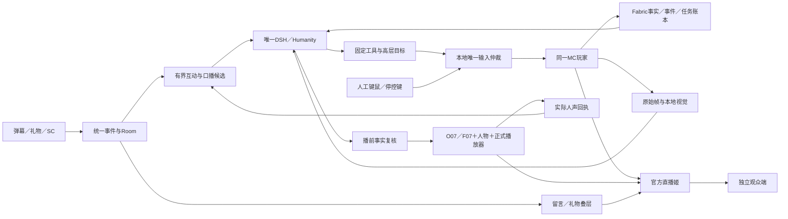
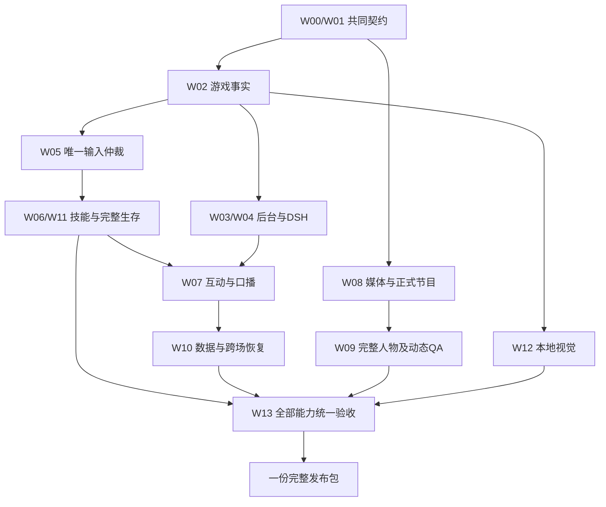

# 10 全量执行与资源计划：一个完整版本交付

日期：2026-10-30（Asia/Taipei）。开发分支：`mc`。范围基线：v1.2；执行规划补充：2026-10-30-r4。本文规定同一完整版本的建设、联合验证与交接，不增加实机通过记录。

[完整范围](08-完整交付规划.md) · [全端实现蓝图](09-全端实现蓝图.md) · [工程执行总表](全量交付执行总表.md) · [机器清单](完整交付清单.json) · [真实实现状态](实现进度.md) · [完整总规划与交付约束](11-完整总规划与交付约束.md)

## 1. 成品、交付方式与当前事实

交付一套能安装、运行、管理、接管、直播和恢复的林知夏MC横屏互动直播系统。主播游玩时持续获得真实游戏信息，处理B站弹幕、礼物和SC，按事实回应观众；人物、口播、字幕、留言和游戏画面组成同一横屏节目。完整版本同时具备自主游玩、人工陪玩、暂停、建议、投票、跨场记忆、本地视觉和完整素材。

**只有一份用户交付版本。** W00–W13表示工作依赖，D01–D15表示完整范围，V01–V44和C01–C24表示统一验收。内部可以反复构建、测试和修复；最终交接须同时满足全部范围及68项验收。界面演示、单个技能、静音预览或关闭未实现功能均不能独立构成完成版本。

“一步到位”落实为完整范围一次规划、同一候选联合实现和一次完整交接。所有端、数据库迁移、素材、安装维护和真实平台验证从这份基线中共同安排；工作依赖不形成产品分期。每次工程记录都回到全部15域核对影响和剩余工作，不能把某模块完成改写为系统完成。第13节补充24种运行组合和12类并发场景，第14节规定8项最终发布判据。

本次r3核对时，最近完整登记的实现记录是第025轮，见[025证据](../../evidence/mc-runtime-round-025.json)。游戏桥、任务与账本、DSH工具、建议/投票、部分后台、媒体v3和横屏页面已有源码及本地检查；022–025继续补充公开回应、调度、平台来源/撤回及支持/过滤联动。**真实整套验收仍为0/68，新人物素材仍为0/100**；生存执行档仍有未关闭写点、完整绑定及实机门禁，现有构建物不能据此视为可安装成品。后续实施状态由[机器状态](implementation-status.json)和逐轮证据维护。

工作区另有尚未正式登记的026多观众记忆草稿，其13项本地检查的最终记录为通过，原始两项失败与修正记录保留。它尚未完成跨存储删除、恢复、全套回归和正式实现审计，不计入025轮成绩，也不代表D07已经完成。本次仅完善完整规划，不继续改写该功能草稿。第16–19节把当前差距、记忆/删除接线、实际运行准备和最终候选冻结纳入同一份规划。

r2规划核对时，022口播草稿的一次17项本地检查为16通过、1失败，涉及完成事件异步分发前读取“已回答”标记。该规划快照保留源码及失败原文，未将其计入交付。后续022实现已修正检查边界、补齐调度/来源/重启及后台并登记本地验证，见[任务结果与公开口播](任务结果与公开口播.md)及[022轮证据](../../evidence/mc-runtime-round-022.json)；D05/D06/D08/D15的真实整链与完整范围待办继续保留，旧失败不删除。

## 2. 统一结构决策

| 编号 | 固定设计 | 施工与交接约束 |
|---|---|---|
| L01 游戏角色 | 同一个真实Minecraft Java玩家，自有Fabric桥采集与控制 | AUTO与人工陪玩共享存档、库存、世界和任务；不另开Mineflayer玩家替代接管 |
| L02 执行器 | 受控AltoClef及其配套寻路作为完整生存执行档 | 一个输入仲裁器覆盖导航、采集、合成、使用、补给、PvE及危险处理；发布只装一套寻路依赖 |
| L03 Mindcraft定位 | 参考技能组织、目标调度和游戏代理经验 | 它是独立LLM＋Mineflayer框架，不是现成DSH插件；本项目正式游戏适配器需自行实现、注册和验收 |
| L04 主播大脑 | 复用现有DSH/Humanity、林知夏人格与已保存文字渠道 | game_plan、speech、operator_private、maintenance分用途；每个安装只有一个记忆权威写入者 |
| L05 推理分工 | 文字模型负责目标与表达，本地执行器负责即时动作，视觉补充画面 | 文字推理位置随现有渠道配置；O07/F07、人物及候选视觉属本地链路，不把所有环节统称为一个模型 |
| L06 平台互动 | 现有blivedm→Room统一事件，显示与DSH分开消费 | 礼物金额、身份、角色、删除能力来自平台事实；缺失字段保留未知，不从昵称或文本补造 |
| L07 留言姬 | 参考blivechat的留言组织，自有横屏叠层消费Room | 留言姬与最终推流客户端分工明确；不增加另一套TTS、人格或独立弹幕采集器 |
| L08 横屏节目 | 1920×1080游戏全画布；默认右下264px圆形人物 | 支持320×180横窗、4条连续留言或两道飘屏；后台切左右，留言与礼物一起移动 |
| L09 正式输出 | 官方B站直播姬捕获游戏与透明叠层 | 一路正式人物声音、一位播放权威；管理页/预览页静音且不能确认正式播完 |
| L10 数据恢复 | 游戏事实、控制账本、世界记忆、观众记忆各有归属 | 启动和跨场先核对再续接目标；旧持续输入、未知副作用、旧语音不得重放 |
| L11 部署 | Windows原生；设备、源码、状态和发布运行锁一致 | 当前mc继承3080 FP16 batch4；完整双机推荐是既有48GB规格A4090＋B3080，4090仍暂停控制 |
| L12 完成标准 | 15域全部齐备，68项统一通过，一份发布包 | 包含100段新人物、至少20次接管、全功能连续4小时、次日恢复、官方源和独立观众证据 |

Mindcraft的LLM＋Mineflayer及云端/本地模型接口由[上游README](https://github.com/mindcraft-bots/mindcraft)核对。选择真实客户端路线是本项目对同一角色、人工接管和实际GUI的工程决定，不是对Mindcraft能力的否定。AltoClef的版本与内置寻路关系见[上游说明](https://github.com/MiranCZ/altoclef)；本项目的线程、输入、任务与恢复改造仍需独立验证。[blivedm](https://github.com/xfgryujk/blivedm)与[blivechat](https://github.com/xfgryujk/blivechat)分别作为采集依赖和留言组织参考，上游适用环境不自动证明官方直播姬兼容。以上页面复核日期为2026-10-30；发布使用锁定提交，不追随浮动分支。

## 3. 所有端的完整链路与权威



游戏端是实际输入和游戏效果的权威，A端维护投影与调度；DSH/Humanity维护人格与观众长期记忆；正式播放器确认实际人声；平台与观众端分别证明公开开播和节目可达。任何一端不能替其他端提前确认成功。

推荐双机中，B运行游戏、接收器、本机正式页和官方直播姬；A运行Node/DSH/Room/GameManager、人物/TTS及视觉。现有3092宿主、8010应用入口和B端127.0.0.1:8020继续按[01章](01-系统架构与模块.md)和[09章](09-全端实现蓝图.md)路由。单机完整方案须在同样功能和验收条件下证明资源足够，不能用历史人物短句成绩替代。

## 4. 全量工作、依赖、责任和工作量

以下估算用于**全范围从零计量的资源预算**，不是对现有代码剩余工作量的审计，也不是完成日期承诺。一个人日按8小时有效工程工作计，包含对应模块的代码、配置、模块检查和文档；W13只计系统级集成、实机验收与交接，避免重复计算模块检查。已有成果须完成源码、证据和同版回归核对后，才能从预算中扣除相应工作。

| 工作 | 完整责任与必备结果 | 完成依赖 | 主责角色 | 估算人日 |
|---|---|---|---|---|
| W00 | MC设备profile、来源与版本锁；原生准备/预检/启停/诊断；官方捕获、透明度和声音能力核对 | 既有设备契约 | 集成发布 | 4–6 |
| W01 | HTTP/WS/SSE与Schema、状态/任务协议、幂等、错误、迁移、协议回放；前后端同版契约 | 统一范围 | 后端与数据 | 5–8 |
| W02 | Fabric同玩家状态/库存/GUI/规则/配方、世界身份、可靠事件、原始帧及实际Mixin应用 | W00、W01 | Java游戏集成 | 8–12 |
| W03 | 游戏总览、实际/浏览世界隔离、任务/基地/检查点、状态年龄、冲突/断线反馈 | W01、W02 | 前端与后台 | 5–8 |
| W04 | DSH十项游戏工具、上下文、既有人格、渠道、用途隔离、取消和预算；人工陪玩解说 | W02、W03 | DSH与后端 | 5–8 |
| W05 | 全输入写点/GUI/线程/回调归属、Permit/epoch/租约、物理键鼠与停顿处理、撤权和清理 | W02 | Java游戏集成 | 12–18 |
| W06 | 五种固定目标及独立取消，前置条件、实际操作、部分效果、未知结果与后置核验 | W05 | Java＋游戏后端 | 12–18 |
| W07 | 游戏规划与口播、弹幕/礼物/SC、建议消歧/审核、投票、结果回应、删除联动与回复后台 | W04、W06 | DSH＋互动前后端 | 10–15 |
| W08 | 正式横屏、v3/v2媒体、唯一播放权、字幕/取消、留言/礼物/场景、声音联控与官方源 | W00、W03 | 媒体＋前端 | 10–15 |
| W09 | 圆形与横窗各50段新人物、动作语义映射、manifest/hash、脸框/缓存隔离、完整动态QA | W08的媒体契约与最终联调 | 素材与媒体QA | 15–25 |
| W10 | A/B全历史投影、世界目标/检查点、保留/摘要/更正/删除、Humanity联动、一致备份与恢复 | W05、W07 | 后端与数据 | 7–11 |
| W11 | 完整任务树、补给/防御/PvE/危险处理/资源链、全副作用适配和失败退出 | W05、W06 | Java游戏集成 | 15–24 |
| W12 | 原始帧→上传/短时缓存→本地视觉→带来源结果；原生CUDA、单并发、取消/超时/未知和负载 | W00、W02及获准设备/模型准备 | 视觉与媒体 | 6–10 |
| W13 | 同一候选全域联合、68项、20次接管、4小时、次日、官方/观众、干净复现、回滚与交接 | W00–W12全部齐备 | 集成发布＋QA | 10–15 |
| 合计 | 同一个完整交付范围，未抵扣已复用成果 | — | 职责可以兼任 | **124–193** |

责任是岗位职责，不表示必须新增人员或调度子代理。每项指定一位实际主责，其他角色为协作；兼任时按同一人的真实可用工时排程，不能把多个角色同时按满负荷计算。

### 4.1 工作量如何转为可执行排程

完整预算在上述范围上预留25%–35%的依赖修复、素材返工、设备联调和长时问题处置，向上取整约为155–261人日。它是容量预算，不能用“已有多少行代码”直接换算完成比例。

估算日历工期使用：经审计的剩余人日 ÷ 实际每周可投入人日，再取与依赖网络最长路径、素材生产及设备/平台窗口所需时间的较大值。例如，单人每周5人日且从零计量，仅容量换算约31–53周；4位等效全时人员每周20人日，容量下限约8–14周，真实排程还受游戏关键链和设备窗口约束。该算例用于防止把全功能项目误估成几天接插件，不代表本项目已安排人员或约定日期。

规划采用完整范围预算；后续按W项审计现有成果并更新剩余工时。审计只调整工作量和实施顺序，不删除D域、素材数量或验收项。设备暂停、未获准模型准备和公开平台窗口单列为外部等待，不混入开发“已完成”。

## 5. 工程顺序、最长依赖链与协作

实施主链为：共同运行锁/协议 → 同一玩家观测 → 本地输入仲裁 → 基础技能与完整生存 → 任务/互动/口播闭环 → 数据恢复 → 统一实机验收。这条主链决定“从哪里入手”；后台、媒体、素材和视觉从共同契约建立时就纳入同一候选。



依赖表示完成所需条件，不禁止提前制作素材、编写协议消费者或设计检查用例。W09可依据冻结构图开展制作，最终QA必须接真实媒体；W07可先按契约建设，关闭时必须接真实任务与播放回执。准备、实现、联调、验收属于同一工程过程，用户不接收中间缩小版本。

所有工作共用一份release_id、世界/任务标识规则、接口版本和素材/媒体profile。合入候选时附源码、影响域、依赖、检查、真实未验项和恢复方法。控制、声音、数据库和设备改动触发受影响的联合检查；最终4小时和次日记录必须对应实际交接候选。

## 6. 跨端接口施工清单

具体字段及路径沿用[02章](02-游戏桥与控制协议.md)、[03章](03-DSH弹幕与记忆.md)、[04章](04-接口与数据.md)、[OpenAPI](contracts/openapi.json)和[Schema](contracts/game.schema.json)。本表说明施工完成必须接齐的生产者、消费者及异常出口，不另造一套冲突接口。

| 编号 | 生产者→消费者 | 必须贯通的数据/行为 | 完成核对 |
|---|---|---|---|
| J01 | Fabric→GameManager | hello/能力、完整快照、增量、事件、心跳；世界/玩家/会话/连接/序号 | 乱序/缺口/过期/重连不倒退；心跳正常不能掩盖状态陈旧 |
| J02 | GameManager→仲裁器→执行器 | 控制代数、基于本地心跳的租约、任务/操作幂等、原观测引用、时限 | 游戏线程动手前重查；受理、执行、效果、终态分别确认 |
| J03 | 执行器→本地账本→A投影 | 进度、不可变结果收据、前后证据、部分效果、未知与撤权原因 | 终态可靠重传不重复执行；A重启不重放未知动作 |
| J04 | DSH→游戏工具 | 八项查询、启动、取消；固定用途和支持能力交集 | speech不得写游戏，私聊不得公开；模型超时/迟到不能夺回控制 |
| J05 | 平台→Room→显示/互动 | 去重事件、可信身份/金额/角色、来源、时间、过滤、删除和重连 | 不重复礼物感谢/计票；两消费者共享事件标识，展示不等于已回答 |
| J06 | 建议/投票→任务 | 来源归并、审核/胜出、模式/前置条件、task_id和真实结果 | 自然语言含糊时澄清；人工模式不派发；结果与执行证据相互链接 |
| J07 | 事实/互动→口播队列→DSH | 原事件、世界/会话/任务、事实引用、优先级、创建与过期时间 | 生成前和入媒体前复核；过期/删除/换世界可丢弃；保留原因 |
| J08 | 口播→人物/TTS→正式回执 | request/utterance/epoch/generation、人声样本、首播、自然完成、取消 | 仅正式有效PCM完成可更新“已回答”；入队/生成成功不能代替 |
| J09 | 人物→接收器→节目页 | v3 init/reset、实际AVC尺寸/配置、H264/PCM、样本映射；旧v2回归 | 重置等新配置/关键帧；断流/静音/租约失效清旧音画与字幕 |
| J10 | 原始帧→视觉→DSH | 帧ID/世界/时间、受限上传、实际解码、模型/投影版本、来源与未知 | 不送合成弹幕；旧帧不覆盖新事实；视觉卡住不阻塞本地停控 |
| J11 | 后台→Room/Game/媒体 | CAS设置、实际控制确认、留言换边、素材/场景/混音及维护 | 保存与生效区分；拒绝/冲突/超时可见；显示设置不隐式控制MC |
| J12 | 世界账本/Humanity→备份恢复 | 一致版本、检查点、删除账本、历史投影、schema与资源引用 | 恢复先核对实际世界；删除不复活；活动数据库不直接拷贝 |

每条接线至少保留正常、拒绝、超时、断连、重复/迟到、恢复的检查记录。协议替身用于定位错误，真实游戏、真实模型、实际官方源和观众证据按各自验收项另行给出。

## 7. 同时游玩与聊天的完整调度

本地已授权技能、感知和防御按游戏线程继续执行，不等待模型或TTS。文字模型全局并发1：口播优先于尚未完成的游戏规划，旧规划可取消或被覆盖；规划只能产生后续高层目标，不能直接持键。视觉独立单并发；媒体使用唯一正式播放队列。

一个实际场景按以下顺序联通：

1. 观众建议采集4块原木，事件经Room过滤与去重，后台/明确策略采纳后检查世界、AUTO、支持项、库存基线及可行性，建立建议与任务关联。
2. 本地执行器受理并执行；另有观众问“你现在有多少木头”，口播读取较新的库存和任务事实，本地采集继续。
3. 生成期间库存变化，入媒体前复核；数量已失效则重写，问题过期则丢弃，不能把旧数量作为当前数量播出。
4. 任务真实结束后依据新增数量和执行证据生成结果回应；失败、取消、有部分收获、结果未知分别表达，不把accepted说成完成。
5. 口播经历生成、媒体提交、首播和自然结束；只有有效正式PCM完成回执才把关联回应记为已回答。
6. 期间若人工接管，先在本地撤权和释放自动输入；旧计划失效，主播继续人工陪玩。若相关弹幕被删除，清显示、候选及记忆引用；已入媒体的内容走真实取消屏障。

候选上限16条；紧急候选8秒，普通问题/任务结果30秒。队列按已定义优先级并兼顾普通问题与任务结果，过期、删除、合并、事实变化、取消和模型失败都有可见原因。高频事件归并，不逐tick调用模型；礼物/SC不会无限挤占普通互动。模型/视觉不通时本地停控与后台保持可用，恢复不补播过期积压。

## 8. 正式画面、人物与声音

| 项目 | 完整版本要求 | 必须提供的实物/证据 |
|---|---|---|
| 游戏底层 | 1920×1080全画布，优先游戏可见面积 | 正式客户端实际录制；准星、快捷栏、Boss及特殊GUI检查 |
| 人物 | 默认右下264px圆形，备选320×180横窗；位置由冻结JSON投影 | 两套新素材真实动态遮罩、口型、发丝/手势边界和手机观看 |
| 留言 | 4条向上滚动或两道飘屏，每次一种；与游戏叠层 | 真实Room事件、洪峰/重连/隐藏页/过期/删除检查 |
| 左右控制 | 后台`overlay.mc_chat_side`保存并生效 | 留言和礼物换边，队列/年龄连续，人物/字幕/游戏尺寸不变 |
| 包装场景 | 游玩/互动/休息/恢复 | 实际节目切换；休息画面不冒充游戏已停控 |
| 字幕 | 来自有效正式口播及人声进度 | 取消/重置/静音/失权不遗留旧字幕 |
| 人声 | O07主用、F07备用，唯一正式源 | 主备失败切换、完整PCM回执、取消/静音/恢复实录 |
| 游戏声/BGM | 各有单一路径、后台音量、说话压低 | 实际音轨分离/组合测试，无重复采集、回声和恢复重播 |

布局唯一来源仍为[冻结JSON](../../../configs/layouts/mc-landscape-v1.json)，不新增“正在看的弹幕”卡，也不改定稿坐标。

素材每套2段待机＋48段逐项改编动作，共100段，每段按8秒/25FPS规划，共800秒源视频。圆形母版720×720、候选推理640×640；横窗母版1280×720、候选960×540。候选尺寸须经人物、脸框、编码、解码和正式源全链验证后锁定。旧48动作及历史母版保留，新动作逐项映射语义；旧竖屏静态裁切不是新素材完成证据。

每包同时交付源文件、manifest、动作索引、hash、实际帧数/FPS、裁切安全范围、脸框、预处理/缓存版本及逐段QA。具体制作契约见[人物素材规范](../../design/mc-landscape-v1/人物素材重制规范.md)。

## 9. 资源、运行参数和费用口径

| 资源 | 设计预算/目标 | 运行锁与验收记录 |
|---|---|---|
| 游戏观察 | 本地10–20Hz，状态默认5Hz；稳定时10秒补全 | 实际tick、采样年龄、序号缺口与发送队列 |
| 心跳/租约/过期 | 1000ms/3000ms/2000ms，采用既有本地时钟和心跳引用规则 | 断线、进程/游戏线程停顿、续租迟到和状态失效分别检查 |
| 动作窗口/任务时限 | 动作默认1500ms、上限2000ms；任务默认120秒、上限600秒 | 动手前重查，超时后停止后续动作并核验部分效果 |
| 模型 | 全局并发1；规划1运行＋1可覆盖等待；口播16候选 | 等待/生成/取消/迟到、输入输出token、重试与上下文长度 |
| 留言显示 | 4可见＋24等待，等待TTL20秒 | 刷新、重连、隐藏页和左右切换均按真实时间计龄 |
| 视觉 | 1运行＋1可覆盖等待，最多1帧/秒，初始超时8秒 | 帧字节、上传/解码/推理时延、GPU与正确/错误/未知样本 |
| 游戏呈现 | 初始1080p、上限60FPS；目标平均≥30、1%低分位≥20FPS | 实际帧时间、地形/GUI/战斗/负载场景分组 |
| 人物呈现 | 源25FPS，稳定段实际呈现目标≥22FPS | 解码与实际呈现，不能用绘制调用计数替代 |
| 控制/状态 | 本地接管目标≤250ms；应用状态P95≤500ms | 分布/最大值、物理持键、进程耗时/RTT及校时误差 |
| 系统负载 | CPU/RAM/GPU/显存/编码/磁盘/网络连续计量 | 峰值、稳定段、突发、异常注入和完整4小时曲线 |

这些是沿用[07章性能目标](07-实施与验收.md)与[09章参数](09-全端实现蓝图.md)的施工输入，不是本轮测量结果。文字、TTS、人物和观众CDN时延分段记录；不将“本地接管≤250ms”解释为“观众250ms内听到回答”。

磁盘按模型/运行器＋两套源视频＋预处理与脸框＋缓存＋游戏/世界＋验收录像＋两份恢复副本分别核算，再预留生成中的临时空间。以候选推理尺寸计算，50×8秒×25FPS×640×640×3字节，加50×8秒×25FPS×960×540×3字节，未压缩RGB帧约27.84GB；这只是帧数据的量级计算，既不是最终视频/缓存总量，也不是显存需求。4小时录像按实测总码率b Mbps估算约1.8b GB，再加容器和其他文件。预算须记录实际压缩格式及保留策略。

费用台账采用实际渠道账单：文字输入/输出token、视觉若有外部费用、素材生成调用、本地实测功率与电价、存储和上行流量。研发费用为各职责实际人日×对应费率，素材返工和系统修复只计一次。当前不新增模型采购、云实例或固定价格承诺；已有设备的可用窗口和现有渠道额度作为可核对输入。

## 10. 数据、保留、备份与跨场

| 数据 | 权威与边界 | 必须实现 |
|---|---|---|
| 控制/动作账本 | B端保存本地实际控制和副作用；A投影查询 | 可靠归档、事务关联、未知结果复核，重启不重放 |
| 世界与目标 | 稳定world_id＋维度；连接session单独管理 | 基地、资源目标、检查点、跨场摘要、实际/浏览世界隔离 |
| 观众互动 | 平台原事件及Room去重结果 | 建议/投票/回复与来源关联，删除/撤回清显示与待处理引用 |
| 长期人格/记忆 | DSH/Humanity唯一写入者 | 候选核验、来源追踪、更正/删除、跨场调用与私聊隔离 |
| 口播状态 | 实际媒体请求与正式PCM回执 | 候选/生成/提交/首播/播完/取消分别记账，恢复不重复感谢 |
| 原始帧 | 游戏端原始来源，短时缓存 | 过期/跨世界拒绝；诊断留存按明确范围脱敏，非长期观众记忆 |
| 日志/证据 | release_id、运行环境、trace与文件hash | 容量限制、清理、失败原文、脱敏导出、版本对应 |
| 备份 | 版本一致的数据库与资源清单 | 唯一写入者协调，SQLite一致备份，A/B/MC/Humanity联合恢复 |

下播先停收新目标，核对本地停控，结束人物请求，保存检查点和任务事实，再提交跨场记忆候选；平台下播另行确认。次场先查真实存档、世界、玩家和库存，再提出续接候选，不能恢复旧按键或旧AUTO授权。备份恢复须包含删除账本并验证删除仍生效，不能恢复已删除观众内容。更详细的物理账本与迁移规则见[B端账本与恢复](B端账本与恢复.md)。

## 11. 后台与完整操作路径

后台沿用免应用登录要求，仍通过版本、支持能力、实际控制状态和CAS核验操作。完整后台包括游戏总览、任务、互动/回复、人物/包装、声音、世界/记忆、诊断/发布；每次操作呈现实际结果、拒绝、冲突或未确认。

| 操作 | 使用者动作 | 系统必须反馈 |
|---|---|---|
| 开机准备 | 选择明确的设备/发布profile并原生预检 | 来源/版本/进程/端口/依赖/素材/数据库一致；错误时指明原因 |
| 进入节目 | 启动同一游戏、正式页和官方客户端 | 游戏事实新鲜、正式源唯一、素材齐全、音轨就绪；此时仍不代表公开开播 |
| 开始游玩 | 明确进入AUTO并选择目标/采纳建议 | 本地确认模式、任务真实进度及可核对结果 |
| 处理互动 | 查看/审核建议、投票、待回复、过期或删除原因 | 来源与任务/口播绑定；已生成、正在播和已回答分开 |
| 调整显示 | 留言左右、feed/fly、圆形/横窗、场景/字幕 | 保存且实际投影，队列连续，不中断游戏或增加声音 |
| 人工接管 | 本地停控键或人工输入，必要时后台panic | 本地释放/epoch与实际模式；声音和MC的停控分别反馈 |
| 故障处置 | 查看失效端、trace、资源与恢复建议 | 不扩大重启范围，不把恢复按钮成功当实际恢复 |
| 正常下播 | 停新目标、核对停控、保存检查点、停止媒体及平台 | 游戏、媒体、数据和平台各自确认；给出下次续接依据 |

## 12. 故障清单、处置和关闭条件

| 编号 | 必须解决的问题 | 完整版本内的处置与关闭依据 |
|---|---|---|
| K01 | 生存执行器仍有未审副作用/线程/回调及实际GUI绑定 | 补齐唯一输入归属和完整端口；门禁保持失败关闭，真实技能/生存和接管通过后才能发布 |
| K02 | 网络断开、租约/观测陈旧、游戏线程停顿 | 本地计时/撤权，停止新输入，可靠记录终态；重连PAUSED，20次物理接管及停顿测试 |
| K03 | 模型生成迟到、口播事实改变、旧任务/旧世界 | 用途隔离和世界/任务围栏；两次事实复核，丢弃或改写，媒体取消屏障真实生效 |
| K04 | 人物/视觉/游戏/编码争用 | 有界队列、单并发、资源测量及设备profile；同功能4小时满足门槛，不能删功能换通过 |
| K05 | 官方透明捕获、音轨和页面行为不符 | 当版官方客户端实录核对；修复同一版本的合成与音频路径，保留观众端证据 |
| K06 | 新素材出界、口型/身份/接缝不合格 | 100段逐项QA与返工，脸框/缓存隔离；旧裁切和纯色协议测试不能顶替 |
| K07 | 平台身份/金额/删除字段不全、重复事件或洪峰 | 能力探测、明确未知、去重/背压、关联删除；实际弹幕/礼物/SC场景闭环 |
| K08 | 数据丢失、删除复活或未知动作重放 | 存储故障停发新动作；一致备份/迁移/恢复及次日核对，保留失败和恢复时间线 |
| K09 | 既有慢I/O、续租/模式等待、HTTP边界和后台连接不稳定 | 保留017–021等历史失败证据，补资源/时序诊断并定位根因；串行重跑通过不单独关闭稳定性问题 |
| K10 | 4090暂停、模型准备或真实平台窗口尚未满足 | 代码/文档继续在授权目录完成，真实项目保持未验收；设备获准后按同一完整候选实测，不改写来源记录 |

K09至少追踪既有账本慢提交/冷启动、LEASE_EXPIRED/GAME_MODE_BLOCKED及重复消息等待、chunked超限413→502、后台连接30秒超时。已修复的首次撤权原因竞态和解码错误计数与尚未定位的稳定性问题分别记录，不将其合并为“全修复”。具体原文见[实现进度](实现进度.md)与对应逐轮证据。

## 13. 统一验收怎样执行

完整检查仍为[07章V01–V44](07-实施与验收.md)加[08章C01–C24](08-完整交付规划.md)，不改变编号或门槛。每项保留pass/fail/not_run、实际场景、样本、版本、原始失败、修复、最终证据及hash。文档校验、CPU/协议替身、真实MC、真实模型、官方本地录像和观众端各自标注来源。

| 样本组 | 完整执行要求 | 通过依据 |
|---|---|---|
| 游戏事实/控制 | 状态/配方/库存/世界逐字段；导航/采集/合成/使用/回基地/取消；至少20次接管 | 真实同一玩家与输入日志，成功/失败/超时/取消/部分效果，零旧动作复活 |
| 普通生存 | 固定难度、装备、地形与敌人，补给/危险/资源链及中途接管 | 完整执行档真实运行，支持边界清楚，不凭上游功能列表判通过 |
| 游戏与互动并发 | 实际弹幕/礼物/SC、普通问题/建议/投票与正在进行的任务交错 | 来源/任务/事实/口播相互可追踪；删除、过期和公平调度可核对 |
| 视觉 | 建筑、文字/菜单、未知/冲突、过期/跨世界、超时和负载 | 原帧对照，真实模型正确与错误都保留，不使用合成节目帧 |
| 人物/声音/节目 | 两套100段、圆形/横窗、feed/fly/左右、旧v2/新v3、租约竞争、取消/静音/恢复 | 正式官方录制、实际音轨/PCM/字幕、720P和手机观看 |
| 全功能长时 | 同一候选连续4小时，含原60分钟稳定段及独立异常注入 | 全部功能真实启用和使用，完整帧时间/资源/错误/时延，不拼接不同版本 |
| 跨场与恢复 | 正常下播、崩溃/网络/存储异常、一致备份回滚、次日重新进入 | 存档/基地/目标/记忆连续，删除不复活，未知动作和旧口播不重放 |
| 发布复现与观众 | 干净原生环境、正式源及独立观众端、公开状态核对 | 文件/配置/迁移/运行锁/手册一致；本地就绪和观众可达分别证明 |

验收过程中的公开广播继续受现有授权边界约束，本次规划不启动广播、远控、下载模型或推理。未执行的实机/平台项目保持not_run。最终全部68项通过、全部必需产物齐全、资源和恢复达标，才生成完整发布的完成结论。

### 13.1 完整运行组合：24种都要可用

必须验证的组合为：3种控制模式 × 2种人物形式 × 2种留言形式 × 2种留言位置＝24种。控制模式为AUTO、MANUAL_COMMENTARY、PAUSED；人物为circle、landscape；留言为feed、fly；位置为left、right。组合是既有68项中的样本覆盖要求，不新增验收项或另设交付版本。

每个组合在同一候选、同一实际设备profile上保留模式实际确认、游戏可见区、人物/字幕、真实留言/礼物和正式音轨证据。AUTO核对真实任务；人工陪玩核对人工输入与持续解说；PAUSED核对自动输入已释放且不会因问答恢复。两种人物都使用新素材，feed/fly互斥，fly换边不改变飘动方向。

另外检查四种运行中变更：控制模式改变、圆形/横窗切换、feed/fly切换、留言左右切换。变更过程按实际状态反馈，不能重放旧任务、过期留言或旧语音，不能增加第二路人声。留言位置变更保持事件、队列和计龄连续；人物形态变更仍服从同一正式播放权和媒体代数。v3与旧v2兼容分别给出正常、重置、关键帧、取消及恢复证据。

24种组合覆盖不要求把4小时或100段素材重复24遍：素材逐段QA、媒体兼容检查和各组合检查分别记录；全功能4小时则对应最后实际交接的完整候选。不能用一次静态布局截图代替组合运行，也不能用仅在某一组合通过的结果推断其他组合。

### 13.2 十二类并发场景：验证端与端真正衔接

| 场景 | 同时发生的输入与变化 | 必须观察到的结果 | 归入既有验收 |
|---|---|---|---|
| H01 | 游戏、正式页、后台及多个静音预览同时进入；两个页面竞争正式播放权 | 只有一个正式人声源；预览无完成回执权；后台就绪、平台公开状态分别显示 | V26、V31、V32、V42、V43、C19 |
| H02 | AUTO采集期间连续提问，并穿插礼物和SC | 本地任务继续，普通问题不被无限挤占；真实身份/金额保留未知边界；仅正式播完标已回答 | V20–V25、C12、C15 |
| H03 | 合成/回基地期间收到自然语言建议、含糊目标和投票结果 | 需要澄清的目标不擅自执行；建议/选票/任务来源可追溯；胜出不跳过控制和材料核验 | V14–V19、C12–C15 |
| H04 | 普通生存遇敌或缺食，同时模型/TTS等待、观众催促 | 本地既定生存规则在许可内工作；不会为等模型停住本地时钟；人工输入仍最高优先 | V08–V13、C01–C06 |
| H05 | 任务和口播进行中物理接管，随后尝试后台AUTO/暂停和重复旧命令 | 自动写入立即撤权并释放；旧任务不复活；解说与游戏控制分别确认，重新AUTO必须重新授权 | V07–V13、V19、C06 |
| H06 | 查询库存生成回答时库存/任务变更；或换世界、断线后模型迟到 | 两次事实核对生效，旧世界/旧代结果拒绝；事实变化重写有界且不延长原过期时间 | V05、V20、V23、V24、C15 |
| H07 | 弹幕分别在候选等待、生成、媒体排队和播放中被删除/过滤 | 相关显示、候选及记忆引用按删除规则处理；已入媒体走真实取消；不把取消标为已回答 | V21、V22、V25、V37、C15 |
| H08 | 弹幕洪峰、平台重连、页面隐藏/刷新，同时切左右及feed/fly | 去重、背压和真实计龄保持；不重复感谢/计票，不补播过期积压，位置变化不清空队列 | V21、V25、V28–V30、V42、C14 |
| H09 | 游戏桥/A服务重启、可靠终态重复投递、存档/玩家切换 | 先核对世界与账本；accepted与真实效果分开；未知动作不重放，旧租约和口播不复活 | V01–V05、V12、V19、V34–V36、V44 |
| H10 | 本地视觉处理建筑/菜单时出现新帧、跨世界或超时，且人物正在讲话 | 只用原始帧，结果带世界/时间和模型来源；旧帧不覆盖新事实；视觉取消不阻塞本地停控与声音取消 | V06、C07–C11、C18 |
| H11 | 全功能运行时注入网络/游戏线程/模型/媒体故障、静音或磁盘不可写 | 各端给出实际失效与恢复状态；控制/声音分别停止，无双重声音或假完成；资源和错误有连续记录 | V12、V22、V31–V36、V40、V41、C20、C21、C23 |
| H12 | 正常下播、跨日进入、从一致备份恢复，再查询旧任务及已删除观众内容 | 存档/基地/目标与Humanity一致；删除不复活；续接是新核对后的目标，不恢复旧输入或旧口播 | V34–V39、V44、C22–C24 |

每类场景关联适用的F操作流、D交付域和V/C验收编号，记录触发顺序、实际时序、trace及预期/实际差异。H编号是联合场景索引，不是开发批次。H02/H07等平台来源场景保留真实来源证据；协议替身仍只作为本地检查。模型输出的事实来源可核验不代表任意措辞天然正确，真实渠道输出还须逐样本对照游戏事实和正式录音。

### 13.3 同一候选与变更后的证据

所有报告声明release_id、源码SHA、依赖/设备/媒体/素材profile及配置hash。模块结果只有在输入契约和对应文件未变、环境仍适用时才可引用；保留引用依据，不能把历史结果改日期冒充重跑。代码/配置/素材修改导致输入、执行、媒体、记忆或恢复行为变化时，重跑对应检查和相关H场景。

最终4小时、至少20次物理接管、次日恢复、干净原生复现和官方/观众验证，必须能追溯到实际交接候选。若候选随后变化，应列明证据失效范围并重新取得受影响的真实证据，不能把多个不同候选的局部成绩相加为一次完整通过。测试失败和未执行项保留，不能用关闭功能、放宽租约/过期或隐藏错误换取通过。

## 14. 最终发布与交接包

以下是目标发布包结构，不表示这些产物当前已经生成：

```text
mc-live-<release_id>/
  release-manifest.json          # 源码/分支/文件hash/设备/接口/素材/验收引用
  source/                        # 本项目完整源码、依赖锁、许可及构建说明
  minecraft/                     # Fabric桥、完整执行档、锁定依赖与支持范围
  programme/                     # 正式横屏、后台、静音预览与冻结布局
  avatar-manifests/               # 两套50段素材引用、动作映射、hash与QA
  runtime-locks/                  # Node/Java/MC/模型/媒体/原生运行器与设备profile
  config-examples/                # 脱敏默认配置；私人凭证在本机准备
  migrations/                    # 游戏/Room/Humanity适用迁移与备份恢复版本
  native-tools/                  # 准备、预检、统一启停、诊断、备份、恢复和回滚
  acceptance/                    # 68项、20次、4小时、次日、官方与观众、复现证据
  handover/                      # 安装、日常操作、支持边界、故障和恢复手册
```

大体积媒体、模型和本地状态依照既有管理方式引用并校验；对外交付的源码/脱敏报告不包含私人配置、渠道密钥、平台凭证或活动数据库。运行入口与缺失资源提示必须完整，不能让操作者从研究文件中手工拼接临时命令。

交接演练从干净原生准备到进游戏、正式页、目标执行、互动/视觉、人工接管、音画、正常下播、次日续接和恢复回滚全部走通；代码、配置、素材、数据库及报告属于同一候选。任何必需项未完成都列在同一完整计划内，整套状态保持未交付。

### 14.1 最终发布的八项共同判据

| 判据 | 必须同时满足的事实 | 未满足时的处理 |
|---|---|---|
| Z01 | 源码、依赖/许可、构建物、MC与真实设备运行锁及来源收据一致 | 明确不一致或缺失文件，不启动错误设备profile |
| Z02 | D01–D15全部具备必需产物，100段新人物及完整运行资源可校验 | 保留具体缺口，功能开关不抵扣交付范围 |
| Z03 | V01–V44、C01–C24全部取得适用的真实pass证据 | fail/not_run保持可见，文档/替身检查不折算通过 |
| Z04 | 24种运行组合和H01–H12联合场景有完整覆盖与对应证据 | 返回同一候选修复受影响端，不生成缩小版结论 |
| Z05 | 4小时、20次物理接管、次日恢复和干净原生复现达到既定门槛 | 记录实际性能/稳定性不足及复测范围，不靠历史短句或静态图替代 |
| Z06 | 控制、媒体、官方本地源、公开状态和独立观众证据一致；关键故障已关闭 | 不把本地连接、生成成功或按钮返回值当作实际输出 |
| Z07 | 一致备份/迁移/回滚演练通过，删除有效，旧动作/旧口播不重放 | 保护当前一致数据，修复恢复规则后重新演练 |
| Z08 | 一份发布清单关联全部文件、证据及操作手册，操作者能按手册完整使用 | 补齐入口、明确提示与手册，整套状态继续为未交付 |

机器清单中的发布条件与上述判据共同使用，任何一项未知都保留为未完成。Q01–Q08仍是必须实测绑定的运行项：MC/执行器版本、DSH渠道、设备、素材/媒体、视觉、官方音画、资源和最终验收。每项登记实际值、来源、主责、核对记录及关闭证据；不以候选值或“上游支持”冒充已锁定运行值。

## 15. 规划本身的交付记录

本补充把全部工作、责任、预算、依赖、接线、资源、故障、样本和发布包汇入同一执行依据。r2增加24种运行组合、12类联合场景、证据同版规则和8项发布判据；r2形成时正式登记的实现记录为021，022候选草稿及其失败另行保留。这是历史规划时点，当前登记状态以第1节和机器状态为准，规划检查不记作新的实现完成或真实功能通过。

配套机器清单登记执行文档、14个工作估算、单一交付约束及证据等级；[规划检查记录](../../evidence/mc-planning-execution-20261030.json)保存文档/契约结果。后续实施的入口是W00/W01共同运行契约和W02/W05真实游戏主链，全部D01–D15从一开始纳入，同一候选完成后统一交接。

r1检查保留为历史快照；r2的规划、组合覆盖和文件保护检查见[一体化规划检查记录](../../evidence/mc-planning-integrated-20261030.json)。r2补充修改规划文档、规划元数据及核对脚本/记录，保留当时功能代码/接口草稿和历史测试原文；核对脚本的HTTP操作数量基线由43同步为当时已有的45项，仅作结构检查，没有实际执行游戏、模型或平台联合验收。r3沿用既有文档校验器，不修改校验脚本或功能代码，新增内容为第16–19节及配套规划状态/核对记录。

## 16. 当前起点到完整成品：15域共同关闭清单

当前r4以026正式记录为基线，原样保留027观众历史/归属维护草稿，未由本次规划测试或宣布完成。每个域同时核对实现、消费方、真实效果与恢复：先满足上游契约，再关闭下游使用场景。下表与机器清单中的`execution_planning.completion_closure.domains`配对，机器条目保存026时点完整剩余原文、源码落点、W依赖及V/C映射；真实验收仍为0/68、新人物0/100。r3历史快照与026实现证据保持原样。

| 域 | 一次完整实现中必须补齐的闭环 | 依赖与交接对象 | 关闭时必须具备的事实 |
|---|---|---|---|
| D01 | MC专用设备/来源profile、正式Node与Java/MC/依赖/许可/模型/素材锁；统一准备、预检、启停、诊断及发布包 | W00/W01；供全部端使用 | 干净Windows原生安装与来源核对通过；不得手改继承3080收据冒充MC或4090 |
| D02 | 同一玩家完整状态、GUI、配方/组件/解锁/库存/规则、可靠事件、原始帧及世界身份 | W02；交给执行器、DSH、视觉和后台 | 实际Fabric/Mixin、服务器与数据包/模组重载逐字段对照；B历史能完整投影至A |
| D03 | 全部输入写点、异步线程/回调/网络/GUI归属，物理持键、热栏/光标/失焦与停顿处理 | W05；约束所有D04动作 | 至少20次真实接管；人工输入保留，旧代动作、迟到包与防御子任务不能复活 |
| D04 | 完整MinecraftPort/任务树、五项goal及取消、复杂合成/物品用途、补给/PvE/危险/资源链 | W06/W11；向调度、口播和账本提供真实结果 | 成功/失败/超时/取消/部分效果、GUI/组件/剩余物/服务器响应均有证据；解除启动阻挡须有完整审查依据 |
| D05 | 真实DSH/渠道、全用途工具、目标/预算/取消、语义分类/点名、事实复核和Neuro固定消息兼容 | W04/W07；消费D02/D04/D06/D07，输出正式口播 | 实际模型工具往返、迟到/危险打断和游戏持续执行联通；保留旧事件历史回顾与现场回应的区别 |
| D06 | 自然语言建议/消歧、实际弹幕/礼物/SC、可信来源、投票/过滤/任务/公开反馈完整生命周期 | W07；交接D04/D05/D07/D08 | 重连、洪峰、撤回、跨进程故障均不重复计票/感谢；未知金额/身份不补造 |
| D07 | B→A全历史、保留/摘要/清理、按真实来源分区的观众记忆及删除、A/B/MC一致备份恢复 | W10；贯穿平台、Room、Game、DSH/Humanity和后台 | 多人不串记忆，删除不被缓存/摘要/旧备份恢复，次日先核对真实游戏再续接；详见第17节 |
| D08 | 任务/世界/基地/检查点、互动与回复、人物/场景/声音、记忆维护和完整诊断后台 | W03/W07/W08/W10；消费各端实际状态 | 点击、保存、远端确认与真实完成分别反馈；离线/CAS冲突/迟到结果可见，操作能在实机走通 |
| D09 | 新人物profile、v3/v2、所有旧入口排他迁移、正式页/透明捕获、字幕/取消/恢复和手机可读性 | W08；连接D10/D11与官方客户端 | 实际推理/NVENC/官方录制证实唯一正式源；尺寸、关键帧、音画与字幕在断线/重置后正确 |
| D10 | 圆形和横窗各50段新素材、完整动作索引/语义/hash/脸框/预处理缓存版本及逐段返工 | W09；接真实人物/媒体profile，保留原始人物档 | 100段全部动态QA通过，包括口型、接缝、发丝/手势边界和手机效果；静态旧裁切不能顶替 |
| D11 | 游戏声、人声、BGM各单一路径、后台音量/压低、O07/F07主备、取消/零音量/静音恢复 | W08；接正式播放权和官方音轨 | 实际音轨/PCM证明无重复收声、回声与过期声音重播；取消和自然播完分别记录 |
| D12 | 原始帧、本地视觉模型/投影/原生CUDA锁、未知/冲突/超时/取消及GPU/网络预算 | W12；依赖D02/D01，供D05按需查询 | 真实文字/菜单/建筑和失败样本可对照；跨机时钟、旧帧/跨世界拒绝及完整负载通过 |
| D13 | B端完整透传、官方透明捕获/音轨、真实平台接入、公开状态与独立观众验证 | W00/W08/W13；消费完整正式节目 | 本地就绪、平台公开开播、独立观众实际收到分别有证据；本地录制不能代替CDN验证 |
| D14 | 完整诊断/日志/时延/资源/磁盘台账，全部历史故障根因、联合恢复和回滚 | 全工作包；为D15提供连续证据 | 015/017/018/020/021及025仍未关闭问题逐项有根因、修复、复现与受影响回归；重跑通过不单独关闭故障 |
| D15 | 同版68项、24组合、12并发场景、100段素材、20次接管、4小时、次日、干净复现与完整交接 | W13；D01–D14全部齐备 | Z01–Z08同时满足，文件/数据迁移/运行锁/手册及全部真实证据对应一个最终候选 |

当前应先落实W00/W01实际运行契约、W02真实事实和W05完整输入所有权，因为游戏、模型、后台、恢复都依赖它们；完整生存W06/W11不能绕过未审副作用的启动门禁。同时将人物/媒体W08/W09、平台互动W07、数据W10和视觉W12接入同一候选的契约与产物管理。这里描述工程依赖，最终始终只交接全部功能齐备的系统。

## 17. 多观众互动、个人记忆与删除的共同接线

这一节是完整成品必须实现的约束，包含026草稿尚未完成的部分。不得因当前13项本地检查通过，就将以下整条链路记为已实现。

### 17.1 来源、所有者和工具作用域

平台原始事件键、Room显示键、DSH canonical `source_event_id`、口播候选/请求/utterance、任务和世界标识各有用途，关联关系由服务端保存。模型只选择当前上下文中已绑定的来源，不能提交`viewer_id`、昵称或自行构造的分区决定记忆所有者。可信平台稳定账号可进入对应个人记忆；匿名、身份缺失或中继自报账号不能因此读取个人记忆。同名账号必须保持独立，昵称变化不产生新所有者。

多人合并一次回应时，每人的实际输入各记一份并绑定各自分区；共享口播按公共经历记账，不能默认归给第一个人，也不能把整段共同回应复制进每人的私有历史。个人召回与候选写入必须引用实际来源，跨用户查询拒绝；候选仍需原有事实核验和维护流程，不因模型提出就直接生效。重试/重连复用原始来源绑定，不能重复制造偏好或重复累计共同经历。

上下文对个人记忆、公共事实和短期历史分别标注来源并受总预算约束。多人数量增加时有界截取并说明省略量，不扩大既有上下文/游戏事实上限掩盖问题；没有可识别所有者时保留未知。后台需能查看实际归属、候选/有效/失效状态、来源、维护结果及删除进度，不展示无依据的账户推断。

### 17.2 删除经过哪些存储

| 落点 | 必须处理的内容 | 必须保留的真实边界 |
|---|---|---|
| canonical事件/记忆 | 本人来源正文、引用、候选、有效记忆/修订及相关派生载荷 | 别人的独立输入与记忆不因多人合并一并误删 |
| 上下文/维护 | 引用了被删来源的上下文、摘要、提取任务/分块及模型会话 | 跨分区依赖也要失效；已失效内容不能经维护重新激活 |
| 平台/Room | 已识别本人的历史事件正文/昵称/账号明文、显示缓存/队列与后台可检索副本 | 身份未知的旧行不能凭昵称猜归属；无法完整关联时明确未完成 |
| 游戏/互动 | 来源支持、选票、建议引用、口播候选及缓存的游戏事实读取结果 | 已实际执行的游戏效果不回滚；必要的匿名技术终态与真实完成证明保留 |
| 模型/媒体 | 生成中、排队中和播放中的关联请求、字幕与声音 | 通过真实取消屏障处理；已公开播出不能声称从观众端撤回，也不伪造为从未播出 |
| 备份/恢复 | 删除计划/账本、事件墓碑、分区删除围栏及恢复后投影修复 | 恢复旧库必须先重施删除，再允许读取与新请求，不能先显示旧内容再异步清理 |

跨库采用canonical事务内持久化删除计划/待办，再幂等投影至平台、Room、Game和Humanity；不宣称几个独立SQLite库具有同一原子事务。记录每个投影的成功、失败与重试位置。失败或重启后保持维护未完成状态，在恢复就绪前补齐删除；新输入与模型处理不得穿过未完成删除读出旧数据。单条记忆删除与全账号删除分别限定范围，旧事件重放与删除后的真实新输入分别判断。

删除计划及审计只存必要的不透明标识、截止点、来源引用和状态，不把被删正文再复制进删除账本。历史记录若缺失所有者映射，应在保留/迁移维护中补齐可核验映射或明确覆盖缺口，不能宣称完全删除。人工停控继续可用，维护锁不能反过来阻塞本地释放输入。

### 17.3 在既有联合场景中怎么验

H02增加两名同名账号、不同偏好及匿名插入；H06增加多人上下文期间事实变化/过期；H07覆盖等待、生成、媒体排队、实际播放四个删除时机及被删者仍支持建议/投票的情况；H09覆盖投影途中进程崩溃、重复投递；H12覆盖含旧个人内容的联合备份恢复、删除计划重施与次日召回。另核对单条/全账号范围、另一个账号记忆保留、来源已清理导致的覆盖未知和新输入不被旧墓碑误伤。它们仍归入原有68项，不新增交付批次或虚报真实通过。

## 18. 完整系统真正开跑前必须落实的输入

| 编号 | 必须形成的运行输入 | 责任与输出 | 当前约束和处理 |
|---|---|---|---|
| R01 | 一个真实可用的MC设备profile | 集成负责人绑定机器、GPU/内存、端口、来源、状态根与release_id | 当前继承3080 FP16 batch4；4090仍暂停，规划不改来源收据或启动远端 |
| R02 | 唯一游戏执行档 | 游戏集成负责人给出MC/Java/Loader/API/映射/Mod/执行器提交、依赖hash和许可证 | 兼容构建与全部副作用改造未完成即保持不可发布；不同时加载两套寻路 |
| R03 | 真实DSH文字渠道 | DSH负责人登记现有模型、SDK、工具/取消支持、上下文与token计量 | 沿用已保存渠道；实际不支持的调用方式应在本适配层修复并验证 |
| R04 | 两套完整人物和声音profile | 媒体负责人提交100段新素材、动作映射、缓存版本、O07/F07及尺寸/编码锁 | 原素材保留；新尺寸/脸框实际通过后才写运行锁，旧静态裁切不能抵扣 |
| R05 | 原生视觉运行资源 | 视觉负责人提交已准备模型/投影/运行器hash、端口、资源与超时实测 | 模型下载约束继续有效；没有实际准备就保持该项未关闭，不能用空实现宣布具备 |
| R06 | 实际B站与官方客户端 | 平台负责人核对房间、采集身份/能力、实际官方版本、捕获/音轨与测试窗口 | 平台身份要求与免应用登录分开；本地准备不会自动开播 |
| R07 | 一致数据及恢复入口 | 数据负责人登记schema、唯一写入者、世界/玩家、删除账本、备份集和恢复点 | 不直接复制活动数据库，不将另一设备状态混入本机；恢复先核对后续接 |
| R08 | 资源/费用与验收窗口 | 集成负责人形成可投入工时、设备窗口、实测费用台账及68项执行日程 | 124–193人日是从零全范围估算；剩余工时须按现有成果审计，不能直接据此承诺日期 |

R01–R08是执行所需输入，不是要求用户重复确认已授权的目录、分支、布局和开发工作。可在当前授权内继续完成的源码、素材规划、文档和本地检查照常推进；受已有暂停/下载/公开广播约束的实际动作，保持待条件满足，不通过改文档伪造成已执行。岗位可由同一执行者承担，本计划不授权调度子代理。

## 19. 一份最终候选怎样贯通安装、节目和恢复

冻结候选时，发布清单至少绑定：`release_id`、源码提交/工作区快照hash、构建物与依赖/许可、设备profile及真实来源、接口/schema/迁移版本、MC/世界/玩家身份规则、人物/语音/视觉profile、冻结布局hash、运行参数、备份/删除账本格式、全部证据和操作手册。私有密钥及平台凭证在设备本地准备，不进入公开包。规划形成时尚未冻结真实候选，不能提前填造源码SHA或设备验收值。

整套操作者路径一次走通：原生准备与预检 → 启动宿主/接收器/同一游戏 → 核对新鲜状态与唯一正式音源 → 本地核对节目 → 明确授权AUTO或人工陪玩 → 同时完成真实任务、观众互动和按需视觉 → 留言左右/人物形式/场景与混音可控 → 人工接管及故障恢复 → 停新目标/停控/结束媒体/保存检查点 → 核对平台状态 → 次日先检查真实存档再续接。游戏、声音、记忆与公开状态各自确认，不能由一个“启动成功”覆盖全部端。

计划关闭只认Z01–Z08共同满足。任何D域缺实现、Q/R项缺实际运行输入、V/C项仍为fail/not_run、100段素材不齐或关键故障未关闭，最终状态仍是未完成，回到同一候选继续修复。文档检查、本地协议测试和进度编号用于追踪工程事实，不能提高真实完成计数。

r3的实际规划变更编号为P13–P16：同步025/026边界；把15域当前差距落实到依赖/交接/证据；补全多观众记忆与跨库删除/恢复；固定R01–R08及最终候选操作路径。核对记录见[完整规划r3证据](../../evidence/mc-planning-complete-20261030-r3.json)，本轮不修改功能代码，不增加实现轮次，不启动真实游戏/模型/官方客户端/公开广播或远端设备。

## 20. 完整总规划与当前执行基线

[11章完整总规划](11-完整总规划与交付约束.md)将成品、选型/DSH定位、全端权威、15域、边玩边聊、冻结画面/素材/声音、接口/数据/删除/恢复、完整后台、资源、工程依赖、风险、统一验收和交接包集中说明。执行依赖继续沿用W00–W13及J01–J12，所有功能共同进入一份候选并完整交接。

本次P17–P22仅更新规划与机器清单，正式实现轮次保持026。机器关闭清单同步026完整待办；工作区027草稿、原始失败和历史证据不改写。文档核对不增加功能通过、实机0/68或新素材0/100计数。配套[r4规划证据](../../evidence/mc-planning-complete-20261030-r4.json)。
