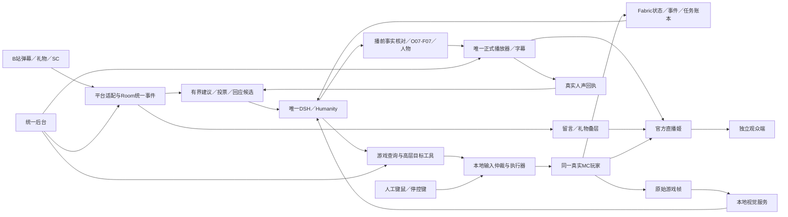
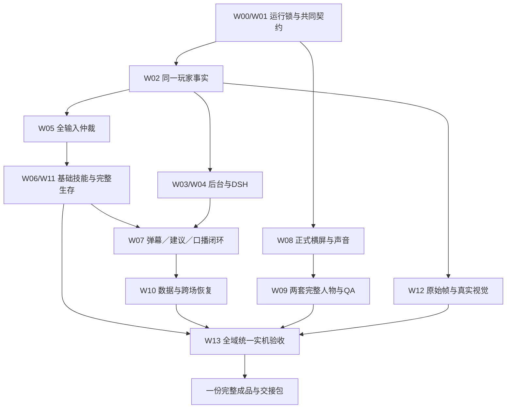

# 11 完整总规划与交付约束

日期：2026-10-30（Asia/Taipei）。项目：林知夏 MC 互动直播系统。工作分支：`mc`。范围基线：v1.2；规划整理：2026-10-30-r4。

本文将成品、各端接线、完整功能、工程依赖、资源、风险和交付条件集中为一份总规划。用户接收一个全部功能齐备的版本。工程依赖、内部检查及修复记录用于建设这一个版本，不设置缩小功能的中间产品。

范围和验收编号以[08章](08-完整交付规划.md)为准，端内实现以[09章](09-全端实现蓝图.md)为准，责任、预算、联合场景和发布条件以[10章](10-全量执行与资源计划.md)为准。本文是三者的完整总览，不建立第二套接口、布局或验收编号。

## 1. 成品和可行性结论

目标是交付一套可安装、可运行、可管理、可接管、可直播、可恢复的系统。林知夏使用同一个真实 Minecraft Java 玩家游玩；持续读取游戏状态和必要的原始画面；同时接收 B站弹幕、礼物和SC，结合当前游戏事实回答；人物、声音、字幕与留言叠加在横屏游戏画面上；任务、基地和记忆支持跨场续接。

方案在工程上具有可实现的结构：即时动作由本地执行器负责，DSH负责高层目标、人格和语言，弹幕处理与游戏执行各自持续运行，正式声音有唯一播放权威。**整套系统目前仍待完成实现与实机验证。** 当前正式实现记录为026；真实验收仍为0/68、新人物素材仍为0/100。已有本地检查支持部分模块判断，不能证明全功能资源、普通生存、官方输出和观众端已经可用。

完整范围包含 AUTO、MANUAL_COMMENTARY、PAUSED；普通生存/PvE、补给、危险处理及多步骤资源目标；弹幕问答、建议与投票；本地视觉；圆形与横窗两套人物；完整后台、数据维护、部署、备份和恢复。运行时关闭某功能，不减少该功能应交付的实现和证据。

MC固定在一个兼容验证通过的原生Java执行档，研究基线为1.21.1。复杂PvP、任意整合包与任意种子自动通关不属于无限承诺；无人深空属于另一游戏项目，不能混入本次MC完成计数。

## 2. 技术选择与DSH接入定位

| 部分 | 本项目采用的方案 | 完整实现责任 |
|---|---|---|
| 游戏载体 | 同一个真实Java客户端，Fabric桥读取事实并承接受控任务 | 观测、GUI、世界身份、帧、控制与恢复均绑定同一玩家 |
| 游戏执行 | 受控AltoClef执行档及唯一配套寻路 | 完成全部输入写点、线程、回调、任务树和副作用审查；普通生存按真实效果验收 |
| Mindcraft | 技能组织、代理调度和玩法设计参考 | 其独立模型循环不能直接充当本项目DSH插件；正式工具由本项目适配层注册和处理 |
| DSH/Humanity | 复用既有人格、文字渠道和唯一记忆写入者 | 游戏规划、公开口播、操作者私聊、维护分用途运行，约束各自工具和副作用 |
| 平台采集 | 现有blivedm/平台适配→统一事件→Room | 去重、身份与角色、金额、表情、删除、重连和过滤贯通 |
| 留言姬 | 自有横屏留言层，参考blivechat的留言组织 | 只消费统一Room事件，提供连续留言/飘屏、礼物和后台换边 |
| 人物与语音 | 既有林知夏身份、O07主用/F07备用及新人物派生包 | 重新制作并验证两套素材，接入实际推理、编码、字幕和正式回执 |
| 最终推流 | B站官方直播姬 | 核对真实透明捕获、源内声音、公开状态和观众可达性 |

文字模型实际在云端还是本地，由已保存渠道配置决定。游戏桥、人物、TTS与视觉有各自的执行位置，发布清单分别登记。DSH接入的交付物是本项目的工具注册、请求处理、数据绑定、任务与回应闭环；不能仅因某个上游仓库可调用LLM，就登记为已安装的DSH插件。选型依据和上游引用集中见[10章第2节](10-全量执行与资源计划.md#2-统一结构决策)。

## 3. 所有端怎样连成一个系统

| 端 | 必须承担的职责 | 权威事实 |
|---|---|---|
| 游戏端 | 采样、执行、输入仲裁、本地可靠账本和帧来源 | 实际玩家、控制释放、游戏效果及不可重放结果 |
| A业务/推理端 | Node宿主、DSH、Room、GameManager、人物/TTS及视觉调度 | 统一业务投影、人格和观众长期记忆；不冒认本地效果 |
| B节目端 | 游戏、接收器、正式节目页、实际音轨与官方客户端 | 正式播放器产生有效播放收据，官方客户端确认本地输出 |
| 管理端 | 状态、任务、互动、布局、素材/声音、记忆与诊断 | 显示真实受理/应用/失败状态；预览不取得正式播放权 |
| 平台/观众端 | 平台公开状态、实际收到的节目 | 公开开播和观众音画可达，分别采证 |

A/B表示职责，可以在经过验证的单机profile中同机运行。完整双机规划沿用A4090推理＋B3080游戏/接收/官方输出，4090控制仍暂停。当前`mc`继承3080 FP16 batch4、O07/F07、`state/female-a-3080-k02`；规划本身不切换设备或伪造运行来源。原生路由沿用宿主3092、应用8010、B本机127.0.0.1:8020，实际绑定写入同一设备运行锁。

## 4. 全部15个交付域

表中各域全部必需。每项同时完成生产者、消费方、后台反馈、异常处理、文档和对应真实验收。源码锚点与V/C映射见[09章第12节](09-全端实现蓝图.md#12-按交付域落实到源码和验收)及[机器清单](完整交付清单.json)。

| 域 | 必须完成的全部主要内容 | 主要落点和交付物 |
|---|---|---|
| D01 工程与运行 | MC设备profile、来源与版本锁、原生准备/预检/启停、依赖许可、打包和干净复现 | `configs`、`scripts`、部署手册及完整发布清单 |
| D02 游戏桥 | 玩家/库存/环境/GUI/规则/配方、世界身份、快照/增量/可靠事件、原始帧、B历史向A投影 | Fabric桥、`backend/game`及兼容构建物 |
| D03 控制权 | 全写点/线程/回调仲裁、epoch/租约、物理键鼠、热栏/光标/失焦、停顿、接管和输入释放 | 唯一本地输入链；至少20次真实接管证据 |
| D04 游戏能力 | 导航/采集/合成/使用/回基地及取消，完整普通生存、补给、PvE、危险处理、资源链和效果核验 | 完整MinecraftPort/任务树、支持能力清单及成功/失败/退出证据 |
| D05 DSH | 查询/启动/取消工具、真实渠道、人设、用途隔离、目标预算、口播、事实核对和取消 | DSH适配器、工具往返、Neuro兼容与实际模型样本 |
| D06 平台互动 | 弹幕/礼物/SC、可信来源/角色/金额、过滤/撤回/重连、问答、建议消歧、投票、任务反馈和公平调度 | 平台适配、Room、互动与回应后台，真实平台联合样本 |
| D07 数据与记忆 | 世界/基地/检查点、任务历史、观众归属/个人记忆、摘要/保留/更正/删除、一致备份和跨日恢复 | 数据迁移、账本、Humanity维护和联合恢复入口 |
| D08 完整后台 | 游戏/世界/任务、互动/回应、人物/场景/声音、模型/资源、记忆删除、运行与故障诊断 | 完整页面、SSE状态、CAS设置、拒绝/超时反馈和审计 |
| D09 正式横屏媒体 | 1920×1080、透明叠层、v3实际尺寸协商/旧v2兼容、字幕、取消、唯一播放权与恢复 | 正式节目页、协议、全部遗留入口排他迁移及官方实录 |
| D10 人物素材 | 圆形/横窗各2待机＋48改编动作，共100段；脸框、动作语义、缓存隔离及动态QA | 两套完整源片、manifest、索引/hash、预处理与QA记录 |
| D11 声音 | O07/F07主备、游戏声/BGM/人声单路混音、说话压低、取消、音量零/静音/恢复 | 实际音轨与PCM分析、正式播放收据，消除双重收声和回声 |
| D12 视觉 | 原始帧、限流上传/短时缓存、原生模型/投影/CUDA锁、来源、未知/冲突/过期/取消与负载 | 真实模型配置、原帧对照、正确/错误/未知样本及资源实测 |
| D13 官方与公开输出 | B端整链、实际官方捕获/音轨、真实平台身份/公开状态、独立观众音画 | 官方本地实录与平台/观众证据，资格和操作手册 |
| D14 运维 | CPU/RAM/GPU/编码/磁盘/网络、分段延迟、结构化日志、容量、告警、全部关键故障关闭、备份回滚 | 连续诊断后台、曲线、故障台账、恢复/回滚演练 |
| D15 完整交付 | 全部68项、24组合、12联合场景、8发布判据、4小时、跨日和干净原生复现 | 同一候选完整报告、发布包、手册及真实已知边界 |

## 5. 边玩边聊的完整运行方式

游戏执行、模型、视觉和正式播放分别调度。已授权的本地采集、移动及防御不等待一句话生成；文字模型处理高层目标与表达，不逐帧持键。模型全局并发1，游戏规划1个运行＋1个可覆盖等待；口播最多16候选；视觉另设1个运行＋1个可覆盖等待；正式声音保持一路。

完整互动必须贯通以下全过程：

1. 平台消息经过归一、去重、过滤和可信来源绑定，同时进入留言显示及独立互动消费；显示不等于已经回答。
2. 普通问题读取当前事实；建议先消歧、审核/采纳，再检查模式、能力、材料、世界和任务占用；投票胜出也要经过同一执行检查。
3. DSH以`game_get_state`、`game_get_recent_events`、`game_query_inventory`、`game_get_recipe`、`game_check_action`、`game_get_task`、`game_request_observation`、`game_get_audience`取得有界依据；用`game_start_task`、`game_cancel_task`操作固定高层目标。
4. 宿主补齐可信会话、控制代数和观测引用。本地在实际动手前再次核对；受理、运行、部分效果、效果未知和终态分别记账。
5. 口播在生成前、进入媒体前分别复核事实、来源、世界和原始有效期。游戏变化时有界重写；旧问题、旧世界或已删除消息按规则丢弃，不延长原有效期。
6. 人物/TTS提交到正式队列，经过首播、人声进度和自然完成回执；只有有效正式PCM完成才将关联回应记为已回答。
7. 人工接管先在本地撤权、释放自动输入，再取消旧规划与任务。主播可以继续人工陪玩；重新AUTO必须取得新的明确控制授权。
8. 严重事件、观众撤回、过滤或隐私删除按来源取消等待/生成/媒体请求；实际已经发生的游戏效果和真实技术播放历史保留其事实。

例如：采集木头时观众A询问库存、观众B送礼、观众C建议回家，系统必须让本地采集持续、按当前库存回答A、调度B的感谢，并把C转为可核对的建议；任务结果依据真实新增数量描述。多人共享一次公开口播时，个人输入、记忆所有者和工具作用域仍分别绑定，不把整段共享上下文写给第一个观众。

普通问题、任务结果与礼物/SC采用已定义优先级、合并、等待权重和主题间隔，避免某一类长期挤占。紧急候选8秒、普通问题/结果30秒为现有初始有效期；真实负载下验证公平性、丢弃原因和最终口播事实。

## 6. 最终直播布局、人物与声音

布局唯一来源为[冻结JSON](../../../configs/layouts/mc-landscape-v1.json)，v1.0.0/revision04，SHA256为`6d3e60cc91934dd44017f65f992cc4c820f52d84fffb2a3d90da759f3acd9f76`。正式节目按1920×1080投影，不重设坐标。

| 元素 | 最终要求 |
|---|---|
| 游戏 | 铺满整个画布；保护准星、底部原生HUD和顶部Boss区域 |
| 人物 | 默认右下264px圆形，支持320×180横窗；只显示一种人物形式 |
| 留言姬 | 默认4条连续向上滚动留言；备选顶部两道飘屏，两种形式互斥 |
| 左右设置 | 后台`overlay.mc_chat_side`持久保存left/right；留言与礼物共同换边，保留队列、节点与计龄 |
| 字幕与状态 | 使用正式语音和真实运行状态；换边不移动人物、字幕或游戏，不改变飘屏方向 |
| 包装 | 游玩、互动、休息、恢复四种场景；包装切换与游戏控制分开确认 |
| 人声/游戏声/BGM | 各自唯一可听路径，后台调音与压低；预览静音，正式播放权唯一 |

留言等待24条、TTL20秒，显示4条；去重、隐藏页、重连、删除和切换均使用真实时间。节目不显示“正在看的弹幕”卡。此处“直播姬”按用户要求指留言姬/弹幕姬；最终推流软件另称官方直播姬。

新素材完整重制两套，每套2待机＋48动作、每段按8秒/25FPS规划，总计100段/800秒。圆形母版720×720、候选推理640×640；横窗母版1280×720、候选960×540，最终运行尺寸经全链验证后锁定。保留原身份和48动作历史母版，每段新动作交付源片、语义映射、实际帧数/FPS、脸框、安全裁切、hash和动态QA。详细契约见[人物素材重制规范](../../design/mc-landscape-v1/人物素材重制规范.md)。

正式媒体覆盖H264/PCM、实际AVC尺寸、配置与关键帧重置、v3与旧v2、字幕、人声取消、失权和断线恢复。实际官方源录制核对口型、发丝/手势、音画同步、静音恢复和手机可读性。旧竖屏静态裁切不能代替这100段素材及其真实推理验收。

## 7. 接口、数据和完整恢复

接口复用[OpenAPI](contracts/openapi.json)、[Schema](contracts/game.schema.json)和[04章](04-接口与数据.md)。游戏HTTP前缀`/api/dsh/game`，SSE`/events`提供快照与更新；Fabric桥负责游戏连接、可靠事件与本地任务账本。接口能力、错误、幂等标识、revision、世界/玩家/session、epoch、任务和操作ID采用同一契约。

| 数据 | 完整保留/维护要求 |
|---|---|
| 游戏关键事件 | 7天/50000条较先到达的预算，保护当前未结束任务和恢复依赖，先形成必要摘要 |
| 游戏任务/转移 | 30天/20000任务预算；未知副作用、未确认历史不能按普通超期数据删除 |
| 世界/基地/目标/检查点 | 按稳定世界身份归属，明确归档前保留；浏览历史世界不改变实际执行世界 |
| 观众与来源 | 可信账号绑定独立于昵称；匿名/非可信转发不授予个人记忆；原事件清理后仍须维持必要删除归属 |
| 个人长期记忆 | 按所有者召回和提议，候选核验、来源追踪、更正/删除；私聊不自动公开或生成观众记忆 |
| 删除计划 | 最小不透明标识及持久删除投影；跨独立数据库用幂等恢复，不假设跨库原子事务 |
| 原始帧 | 短时缓存、来源/世界/时间绑定；长期诊断留存有明确范围，不作为观众长期记忆 |
| 日志/证据 | trace、release_id、schema、hash及原始失败；容量与清理可见，导出脱敏 |

平台原事件和Room留言的具体保留规则仍按各自存储约束实现；它们与B端7天事件/30天任务是不同数据集，不能互相折算完成。本轮规划基线中，B端已有硬容量保护但时间保留/摘要和完整历史投影仍待实现；工作区027观众历史/归属维护属于未登记完成草稿，保持原样，未由本规划测试或宣布可用。

删除必须覆盖平台、Room、建议/投票、口播、上下文/摘要和Humanity等实际依赖。保留别的观众独立输入，撤回共享依赖；旧记录归属未知时报告覆盖缺口。进程崩溃、部分库失败和恢复旧备份后，在就绪前重放删除计划；已删除内容不能重新进入展示、模型或播放。真实Humanity联动、删除计划容量/保留和联合恢复仍纳入完整交付。

整套恢复必须协调唯一写入者、A/B SQLite一致备份、MC存档、schema、删除账本及素材/模型运行锁。下播停新目标、确认停控、结束媒体、保存检查点；次场先核对实际世界/玩家/库存和旧任务，再提出新的续接目标。旧按键、旧AUTO许可、未知动作及旧语音不重放。正常退出、崩溃、网络/磁盘故障、备份回滚和次日都提供实际演练。

## 8. 后台完整操作路径

后台保持现有免应用登录要求。平台身份和云服务协议各自满足外部要求；不把控制epoch、revision或CAS当成另一套用户登录。

完整后台入口贯通：运行profile与预检→游戏连接/世界/状态年龄→AUTO/人工陪玩/暂停→任务/取消/效果→弹幕/礼物/SC→建议/投票/回应调度→人物/留言/场景→声音/正式播放权→模型/视觉/资源→记忆/更正/删除/覆盖诊断→保留/备份/恢复→日志与故障。

所有操作都区分请求受理、保存、实际生效、失败/超时和需复核。断线、旧响应、冲突和不支持能力必须有明确反馈。布局换边不隐式控制MC，预览页面不产生正式播完回执。后台完整链路还要验证键盘、窄屏、刷新和迟到返回。

## 9. 资源、容量和性能目标

| 项目 | 初始规划目标/预算 | 必须实测的内容 |
|---|---|---|
| 状态 | 本地10–20Hz采样，默认5Hz状态，稳定时10秒补全 | 实际tick、状态年龄、缺口、队列和长时负载 |
| 控制 | 1000ms心跳、3000ms租约、2000ms观测过期 | 本地时钟、停顿/断线/迟到、实际撤权和释放 |
| 动作/任务 | 动作默认1500ms/上限2000ms；任务默认120秒/上限600秒 | 动手前核对、部分效果、超时和取消 |
| 模型/视觉 | 文字并发1；视觉并发1＋1等待，最多1帧/秒，初始超时8秒 | token/等待/重试/取消、解码、GPU/带宽、正确/错误/未知 |
| 游戏/人物 | 游戏1080p上限60FPS、平均目标≥30/1%低分位≥20；人物源25FPS、稳定呈现目标≥22 | 真实帧时间、解码/呈现、地形/GUI/战斗及完整负载 |
| 本地响应 | 人工接管目标≤250ms、应用状态P95≤500ms | 物理操作到实际效果的分布/最大值；另计模型、媒体和CDN延迟 |
| 存储/运维 | 模型、源片、预处理/脸框、缓存、MC世界、录像及两份恢复副本逐项预算 | 实际总字节、临时空间、磁盘告警、滚动和保留清理 |

以上是验收目标，尚未由本次规划实测确认。按候选两套尺寸估算的未压缩RGB帧约27.84GB只是存储量级；4小时录像按总码率b Mbps约1.8b GB，另计容器和其他文件。最终CPU、内存、显存、编码、磁盘、网络和功耗用同一完整候选连续记录。

费用按既有渠道实际token账单、素材生成调用、电价/功耗、存储/流量及实际人日计量。全范围从零估算124–193人日，含25%–35%预留的预算口径约155–261人日；这不是现有成果抵扣后的剩余工期或交付日期。已有成果须通过源码、证据、同版回归核对后计入复用。

## 10. 完整施工依赖与责任

完整工程主链先落实真实运行契约、观测和输入所有权，再完成全部技能/生存、互动与恢复；媒体、素材、后台和视觉同时纳入共同契约与候选管理。W00–W13是工程编号，无单独产品交付。各项具体产物、依赖、负责人职责、人日及J01–J12跨端接线已在[10章第4–6节](10-全量执行与资源计划.md#4-全量工作依赖责任和工作量)和[全量执行总表](全量交付执行总表.md)逐项登记。

责任涵盖集成发布、Java游戏集成、后端数据、DSH、互动前端、媒体、素材、视觉与QA，可由同一执行者兼任。工作量按真实可用工时计算，不将职责列表当作已派人或已调度子代理。

每次候选变更记录影响域、源码/配置/素材hash、检查、未验项及恢复方法。受影响的接口、控制、数据库、声音和联合场景重新核对；最终4小时及次日证据必须属于实际交付候选。失败原文保留，追加修复和复测记录，重跑通过不单独关闭未知根因。

## 11. 完整风险与运行输入

| 关键风险 | 关闭要求 |
|---|---|
| 执行档兼容或隐藏输入写点 | 固定提交/依赖，完成线程/回调/全部副作用归属和真实接管；未完成保持启动阻挡 |
| 单机或双机完整负载不足 | 实测游戏、人物、TTS、视觉、编码和网络；满足同一完整功能，调整运行参数后复验 |
| 文字/视觉事实失效 | 时间/世界/来源绑定、两次复核、未知显式表达、真实模型逐样本核对 |
| 弹幕洪峰、同名/匿名或撤回 | 可信账号、来源账本、去重/背压/公平性、取消和多观众隐私真实联动 |
| 官方捕获/声音/公开状态不一致 | 实际透明度、音轨、唯一播放权、官方本地源及独立观众分别留证 |
| 数据容量、删除或旧备份复活 | 完整保留/摘要/覆盖诊断、一致备份、就绪前删除重放和跨日演练 |
| 历史故障尚未关闭 | 015/017/018/020/021/025等已登记问题逐项保留根因、修复、复现与受影响回归 |

实际开跑所需R01–R08为：真实设备profile、唯一完整MC执行档、真实DSH渠道、两套人物/声音profile、原生视觉资源、实际平台与官方客户端、一致数据恢复入口、资源/工时/验收窗口。每项登记实际值、hash/来源、责任和证据；使用既有输入，不以占位值写成已经准备。

全部工作继续在本项目和`mc`进行，使用原生Windows/Python/Node；不使用Docker/WSL/虚拟机。保留4090暂停、不得新增模型下载及不得自行公开开播的现有边界。不干扰其他应用/GPU任务，不覆盖原人物与历史数据。若实际使用桌面浏览器，结束后关闭本任务不用的标签页/上下文。

## 12. 统一验收与一次发布

完成必须同时满足：

1. D01–D15全部必需产物齐备，包含100段新素材及实际模型/媒体运行资源。
2. V01–V44＋C01–C24共68项取得同一适用候选的真实通过证据，失败和未执行保持可见。
3. 3种控制×2种人物×2种留言×2种位置共24组合及H01–H12联合场景覆盖完整，运行中切换正确。
4. 全功能连续4小时、至少20次物理接管、次日恢复及干净原生安装复现达标。
5. 控制、声音、官方本地输出、平台公开状态和独立观众证据一致，关键故障关闭。
6. 一致备份/迁移/回滚演练通过，删除不复活，旧动作/旧口播不重放。
7. Z01–Z08共同满足，由一份发布清单关联所有文件、运行锁、证据及操作手册。

24组合和12场景属于68项的样本覆盖，不新增交付批次，也不要求将同一4小时或100段QA机械重复24遍。本地协议、CPU或浏览器检查各自留证；真实MC、真实模型、官方源和观众证据按既有验收要求执行，来源不得互换。

## 13. 最终交接包与当前规划记录

交接包完整包含：可追溯源码/快照、Fabric与业务构建物、依赖hash和许可证、原生安装/预检/启停/诊断入口、实际设备来源与运行锁、接口/schema/迁移、MC执行档、两套人物素材和索引、O07/F07与视觉profile、冻结布局、后台/正式页、数据保留/删除/备份恢复工具、全量验收及故障关闭记录、操作者/维护/回滚手册。私有密钥、平台凭证及设备专属活动状态不进入公开包。

操作者能够依手册一次走通：安装预检→启动业务/游戏/接收器→核对新鲜状态与正式音源→本地核对节目→明确选择AUTO/人工陪玩/暂停→真实任务与观众互动→人物/留言/场景/声音控制→人工接管与异常恢复→停止新目标/停控/结束媒体→检查点和平台状态→次日核对存档后续接。

本次P17–P22仅整理完整规划、同步026正式记录和保留027未完成草稿，不修改功能代码或增加实现轮次。配套[r4规划核对记录](../../evidence/mc-planning-complete-20261030-r4.json)包含文档/契约、范围一致性和文件保护核对。完整系统仍未交付，正式事实见[实现进度](实现进度.md)及[026证据](../../evidence/mc-runtime-round-026.json)。
