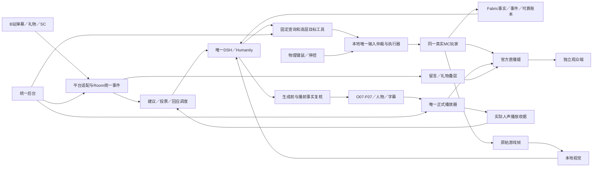

# 12 一次完整交付总计划

日期：2026-10-30（Asia/Taipei）。规划整理：2026-10-30-r5。范围版本：v1.2。项目：林知夏 × Minecraft × B站互动直播。唯一工作分支：`mc`。

本计划按用户要求完整规划各端、全部功能、接线、素材、部署、资源、异常处置和最终交接。用户收到一个完整版本。W编号说明施工依赖，D编号说明必需范围，H编号说明联合场景；这些编号均不构成开发分期或分批产品。

范围与验收沿用[08章](08-完整交付规划.md)，模块与源码责任沿用[09章](09-全端实现蓝图.md)，详细工作量及既有接线沿用[10章](10-全量执行与资源计划.md)。[11章r4](11-完整总规划与交付约束.md)保留形成时的历史状态；本计划以最新正式登记的027实现记录为起点。字段以[接口章](04-接口与数据.md)、[OpenAPI](contracts/openapi.json)和[Schema](contracts/game.schema.json)为准，不建立第二套协议。

## 1. 最终成品与可行性结论

成品是一套可原生安装、可启动维护、可自主游玩、可人工接管、可边玩边聊、可横屏直播、可备份恢复的系统。主播使用同一个真实Minecraft Java玩家；DSH保留林知夏人格和记忆；B站消息、当前游戏事实与必要视觉观察共同进入回应调度；人物、字幕、留言、礼物和游戏组成同一个节目。

最终同时具备AUTO、MANUAL_COMMENTARY、PAUSED，普通生存/PvE、补给与多步骤资源目标，建议/投票，观众问答与任务结果口播，本地视觉，两套完整人物，完整管理后台，跨场与次日恢复。运行开关用于操作者选择已经完成的功能。

**工程结构可行，整套实际可用性尚未得到完整证明。** 主要待关闭条件是同玩家执行器的全部输入归属与生存绑定、真实模型和官方音画联合负载、100段新人物、数据恢复和独立观众验收。现有局部检查支持继续建设，不能推导整体通过率或交付日期。

固定兼容执行档的研究基线为MC Java 1.21.1，最终以经过联合验证的运行锁为准。普通生存纳入完整范围；高强度PvP、任意整合包、任意种子自动通关没有无限成功保证。无人深空的游戏执行适配另立项目，可复用上层人格、弹幕和节目框架。

## 2. 当前起点与证据边界

| 项目 | 本计划采用的实际起点 |
|---|---|
| 正式实现状态 | [027记录](../../evidence/mc-runtime-round-027.json)、[实现进度](实现进度.md)、[机器状态](implementation-status.json)；仍为未完成 |
| 027本地回归 | 400项Node通过；最终37项浏览器36通过、1失败；共437项不同本地检查，含28项既有Node→Java无头协议检查 |
| 真实全系统验收 | V01–V44、C01–C24全部68项仍为not_run，实际通过0/68 |
| 新人物素材 | 圆形50段＋横窗50段，当前0/100；旧素材及静态裁切保留历史身份 |
| 未完成工作区 | 存在028播放就绪握手及游戏诊断草稿与定向检查记录，尚无正式028完整审计；本次规划保留原状，不计作本轮功能实现 |
| 设备 | `mc`继承3080 FP16 batch4、O07/F07、`state/female-a-3080-k02`；4090控制仍暂停 |
| 历史故障 | 015/017/018/020/021/025及027的连接、时延、播放回执等记录继续跟踪；同源码重跑通过不能代替根因关闭 |

027证据SHA256：`1007eddc3ae712a35d4ac12644ac7feeaeec75c5a3ac9bad45e99dec7f8de31f`。本计划只变更规划与配套索引/元数据，真实游戏、人物/TTS推理、官方客户端和公开广播均不由本次启动。

工作区028的既有结果与本规划新执行的检查分别留存。其定向通过记录不能替代最终全量回归，也不能证明027历史失败必然具有相同根因。完整待办继续按D01–D15保留。

## 3. 统一架构、选型与部署位置

| 端或依赖 | 本项目的实现决定 | 运行与完成责任 |
|---|---|---|
| 游戏端 | 同一真实Java客户端＋Fabric桥＋受控AltoClef及配套寻路 | 真实输入、GUI、世界、原帧和实际效果的最终依据 |
| Mindcraft | 借鉴技能组织、代理调度与玩法经验 | 上游是LLM＋Mineflayer框架；DSH工具、控制、来源和恢复由本项目适配；不再并行启动第二套人格循环 |
| A业务/推理端 | Node宿主、DSH/Humanity、Room、GameManager、人物/TTS和视觉 | 统一业务投影、用途隔离、模型调度、唯一长期记忆写入 |
| B节目端 | 游戏、接收器、正式节目页、官方直播姬 | 唯一实际可听人声、游戏/BGM混音、本地捕获及平台输出 |
| 管理端 | 游戏/世界/任务/互动/人物/声音/记忆/运行诊断 | 展示受理、实际应用、失败和超时，支持接管与恢复 |
| 平台/观众端 | 真实采集身份、公开状态、独立观众录制 | 各自证明事件来源、实际开播和节目可达 |

DSH是插件宿主，文字模型可以使用其已保存的外接或本地兼容渠道；DSH本身不规定文字推理必须在哪台机器。游戏即时动作、本地TTS、人物口型和视觉分别登记各自执行位置。现有DSH包基线为`@deepseek-ai/dsh 0.2.0-rc.2`，发布绑定实际包/依赖/接口版本；上游迭代后先做兼容审查，不直接替换运行安装。

完整双机结构沿用既有48GB规格A4090推理＋B3080游戏/接收/官方输出。A/B也可以在经过全功能资源验收的3080单机profile中同机运行。当前分支不切换目标，不复制另一设备私有配置或状态，不提前宣称单机负载足够。宿主3092、应用8010、B本机接收器127.0.0.1:8020沿用现有路由，最终绑定纳入同一运行锁。

## 4. 全部15个必需交付域

每个域完成生产者、消费方、后台、异常处置、文档与实际验收。下表落实完整产物；逐域V/C映射、详细当前差距和源码锚点保存在[09章第12节](09-全端实现蓝图.md#12-按交付域落实到源码和验收)、[机器清单](完整交付清单.json)和[全系统待办](实现进度.md#全系统剩余事项)。

| 编号 | 完整产物与施工要求 | 主要源码与配套路径 |
|---|---|---|
| D01 | MC专用设备profile、源码/依赖/运行锁、原生准备/预检/启停/状态/诊断、许可证、发布包和干净安装；正式Node24.22.1复现 | `configs`、`scripts`、`deployment`、设备与发布手册 |
| D02 | 同玩家状态/库存/环境/GUI/规则/配方、世界身份、快照/增量/可靠事件、原帧及B全历史向A投影 | `game-adapters/minecraft/fabric`、`backend/game` |
| D03 | 所有输入写点/线程/回调/网络/GUI归属、epoch/租约、物理键鼠、热栏/光标/焦点/停顿及至少20次真实接管 | Fabric仲裁器、Mixin、执行器适配和本地输入契约 |
| D04 | 导航/采集/合成/使用/回基地、独立取消、完整MinecraftPort/任务树、补给/PvE/危险处理/资源链和效果证明 | Fabric执行档、`backend/game/tasks.mjs`相关模块与完整生存构建锁 |
| D05 | DSH十项游戏工具、真实模型渠道、人设、用途隔离、预算/取消/迟到、普通问答与历史回顾、Neuro固定消息兼容 | `backend/dsh-bridge`、`integration/dsh_bridge.py`及DSH配置 |
| D06 | 可信B站身份/角色/金额/表情、去重/重连/背压、来源撤回/过滤、自然语言消歧、建议/投票/问答/任务反馈及公平调度 | `backend/platforms`、`backend/room`、`backend/game`互动模块与平台脚本 |
| D07 | B历史7天/30天保留和摘要、世界/基地/检查点、个人归属/长期记忆/更正/删除、容量与覆盖诊断、一致备份和次日恢复 | 游戏账本、`backend/memory`、平台/Room存储、Humanity |
| D08 | 游戏/世界/任务/互动/调度/人物/声音/视觉/记忆/维护/诊断完整后台，CAS、断线/超时/冲突/窄屏和刷新反馈 | `web/mc-control.*`、既有管理页及相应HTTP/SSE接口 |
| D09 | 1920×1080正式横屏、透明叠层、v3实际尺寸/旧v2、全部遗留入口排他、字幕/取消、正式播放就绪与失权恢复 | `web/mc-programme.*`、`web/dsh-playback.js`、`web/local-stream.js`、接收器 |
| D10 | 圆形与横窗各2待机＋48动作，共100段新人物；源片/语义/索引/hash/脸框/缓存隔离/动态QA | 分别版本化的素材包与[人物规范](../../design/mc-landscape-v1/人物素材重制规范.md) |
| D11 | O07/F07主备、唯一人声/游戏/BGM路径、混音/说话压低/取消/音量零/静音恢复与正式PCM回执 | 现有语音/媒体链、`web/room-audio.js`、正式源与官方音轨 |
| D12 | 原始帧、限流上传/短时缓存、真实本地视觉/投影/CUDA锁、来源/未知/过期/冲突/取消和完整负载 | 帧接口、`backend/game`视觉适配、`configs/mc-vision.example.json` |
| D13 | B端整链、官方透明捕获/源内音轨、实际采集身份/资格、公开状态核对和独立观众音画 | 接收器、官方直播姬运行手册、平台及观众证据 |
| D14 | 连续资源/分段时延/结构化日志/磁盘容量、故障后台、原始失败留存、关键故障根因关闭、联合恢复与回滚 | 运行诊断、故障台账、日志/录像预算及恢复入口 |
| D15 | 68项、24种组合、12类联合场景、8项发布判据，4小时/20次接管/次日/干净复现和同版交接 | 验收矩阵、最终运行清单、完整发布包及用户手册 |

## 5. DSH接入、模型与边玩边聊

DSH适配层注册和处理八项查询：`game_get_state`、`game_get_recent_events`、`game_query_inventory`、`game_get_recipe`、`game_check_action`、`game_get_task`、`game_request_observation`、`game_get_audience`；两项写操作为`game_start_task`、`game_cancel_task`。查询结果有界，写操作只接收已定义的高层目标。

`game_plan`负责目标，`speech`负责公开表达，`operator_private`负责导播私聊，`maintenance`负责维护。每种用途配置独立工具白名单和上下文；公开表达不直接持键，私聊不自动公开或写观众记忆。沿用唯一DSH/Humanity，游戏服务只维护事实与执行投影。

本地已授权技能、防御和采样持续运行。文字模型全局并发1；游戏规划1运行＋1个可覆盖等待；回应候选最多16条；视觉另设1运行＋1等待；正式声音一路。口播可打断尚未完成的旧规划，取消和迟到结果均绑定原世界/会话/epoch。

一条真实互动经过：平台归一与来源绑定→提问/建议/投票分类→读取新鲜事实→有界上下文→DSH生成→再次核对事实与来源→人物/TTS→正式首播/人声进度/完成→更新对应回应状态。普通问题初始有效期30秒，紧急候选8秒；事实改变时有界重写，沿用原到期时间。生成、排队和收到媒体包各自记录，实际正式播完才确认“已回答”。

采集木头时收到库存提问、礼物和“回家”建议，应让本地采集继续，按最新库存回答，适当感谢，并把回家转为经核验的建议。礼物/SC调度保留普通问题和任务结果的等待权重。多人共享一段回应时，个人输入、所有者、工具召回和长期记忆仍分别绑定。

## 6. 游戏执行、控制权与完整生存

游戏桥绑定实际世界/玩家/会话/连接代数，提供完整快照、增量、可靠事件和本地账本。状态新鲜度依据实际采样；网络心跳正常不替代新鲜游戏事实。序号缺口触发有界补全，重连不倒退已确认任务。

所有自动输入、热栏选择、光标、交互、容器事务、网络回调及上游清理进入唯一本地仲裁。游戏主线程在实际副作用前重新检查模式、许可、epoch、租约、观察年龄、GUI/handler和操作归属。物理输入或停控先撤权并释放自动输入，再取消旧规划；恢复AUTO重新取得明确许可。

完整执行档逐项绑定MinecraftPort及任务树：移动/寻路、采集数量与材料、配方/解锁/产量、工作台与其他容器、普通物品/工具/武器、进食/穿戴/放置、基地到达、补给/近战/PvE/引爆危险/水火危险和多步骤资源链。上游包含的寻路依赖唯一安装；来源/包对应、反射/线程/写点和Mixin实际应用全部审查后关闭启动阻挡。

accepted、running、部分效果、效果未知和终态分别记账。成功依据实际新增库存、服务器同步、位置或声明的可验证效果；任务报错/取消也保留已发生效果。重复命令不重复合成，迟到包不归给复用的界面，重启不重放未知动作。可支持能力及真实边界写入发布清单。

## 7. B站互动、留言姬与跨端接线

沿用blivedm/现有采集→平台适配→Room统一事件。显示与AI消费共享事件标识，各自持续运行。昵称不授予可信身份；角色、金额、表情和撤回能力来自真实平台字段，缺失保留未知。

建议先分类和消歧，再审核/采纳，最后核对模式、世界、能力、材料、任务占用并关联task_id。投票具备创建、稳定身份去重计票、截止、平票/取消/胜出和不可行处理；胜出同样经过执行检查。过滤、撤回和隐私删除贯通显示、支持/选票、候选、生成、媒体和记忆。

| 接线 | 生产者→消费者 | 一并完成的正常与异常行为 |
|---|---|---|
| J01 | Fabric→GameManager | hello/能力/状态/可靠事件/心跳；乱序、缺口、过期、重连与完整历史 |
| J02 | GameManager→仲裁器→执行器 | epoch/本地租约/幂等/原观测/时限；动手前重查与拒绝 |
| J03 | 执行器→B账本→A投影 | 进度、不可变效果收据、partial/unknown；可靠重传与恢复 |
| J04 | DSH→游戏工具 | 八项查询/启动/取消、用途白名单；格式错、预算、超时与迟到 |
| J05 | 平台→Room→显示/互动 | 可信来源、去重/过滤/撤回/重连；展示与已回答分别确认 |
| J06 | 建议/投票→任务 | 消歧、审核、胜出、可行性、task_id及实际结果闭环 |
| J07 | 游戏/互动→回应队列→DSH | 事实与来源绑定、两次复核、优先级/公平性/原有效期 |
| J08 | 回应→人物/TTS→正式回执 | request/utterance/epoch/generation、PCM样本、首播/完成/取消 |
| J09 | 人物→接收器→节目页 | v3/v2、实际尺寸/AVC配置/关键帧、音频样本映射与失权清理 |
| J10 | 原始帧→视觉→DSH | 世界/时间/帧ID、短时缓存、真实解码/模型来源、未知/取消 |
| J11 | 后台→Room/Game/媒体 | CAS/生效确认、布局/素材/混音/维护，冲突/失败/超时可见 |
| J12 | 账本/Humanity/世界→备份恢复 | 一致快照、schema/删除重放、实际世界复核和新的续接目标 |

每条接线核对正常、拒绝、超时、断连、重复/迟到和恢复，并关联既有验收。平台事件原文留在设备私有证据中；公开报告只输出脱敏来源和技术结果。

## 8. 正式横屏、100段人物和声音

布局唯一来源为[冻结JSON](../../../configs/layouts/mc-landscape-v1.json)，v1.0.0/revision04，SHA256：`6d3e60cc91934dd44017f65f992cc4c820f52d84fffb2a3d90da759f3acd9f76`。

| 元素 | 最终固定要求 |
|---|---|
| 游戏 | 1920×1080、16:9全画布，保护准星/底部HUD/顶部Boss及特殊GUI |
| 人物 | 默认右下264px圆形；支持320×180横窗，同一时刻一种形式 |
| 留言 | 默认4条向上连续滚动，等待24条、等待TTL20秒；备选顶部两道飘屏，两种模式互斥 |
| 后台左右 | `overlay.mc_chat_side=left/right`持久保存，默认right；留言和礼物一起移动，队列/节点/计时保留 |
| 字幕/场景 | 字幕对应实际人声；游玩/互动/休息/恢复场景可控，场景设置与游戏控制分别确认 |
| 可听声音 | 人声、游戏、BGM各有唯一入口，混音与说话压低；预览静音 |

人物与字幕不随留言换边，游戏尺寸和飘屏方向不变。没有“正在看的弹幕”卡。这里的留言姬/弹幕姬是观众留言组件，最终推流软件称官方直播姬。

圆形和横窗各制作2待机＋48改编动作，每段按8秒/25FPS规划，合计100段/800秒。圆形母版720×720、候选推理640×640；横窗母版1280×720、候选推理960×540。最终尺寸由实际推理/编码/呈现/官方捕获共同锁定，原48动作和林知夏身份参考原样保留。每段交付源片、动作语义、帧数/FPS、脸框、安全裁切/遮罩、循环/过渡、manifest/hash和动态QA。

正式地址沿用`/mc/programme?renderer=livehime`，静音预览`/mc/preview`。透明节目网页位于真实游戏捕获层上方，官方客户端实际验证透明度。覆盖v3与旧v2、H264/PCM、实际AVC尺寸、配置/关键帧重置、字幕、取消、掉线和静音恢复，全部旧媒体入口参与唯一播放权迁移。

正式播放完整链包含“申请保留→本地音频准备→确认就绪→允许生成→实际播放收据”。准备中的独占权、到期、关闭/静音、迟到HTTP和请求超时均受同一租约约束；未就绪不提前消耗首段人声。028草稿按这些要求继续纳入后续完整实现审计，本计划不宣布其已经联合通过。

O07主用、F07备用分别验证取消与恢复；游戏声/BGM/人声检查实际录制音轨、零音量/静音/恢复和无重复采集。真实PCM推进字幕与完成，静音、取消或丢失首段不能伪报自然完成。官方源和手机观众实录核对口型、手势、发丝、遮罩、文字可读性和音画同步。

## 9. 世界、个人记忆、删除与完整恢复

| 数据 | 保留、维护和恢复要求 |
|---|---|
| B游戏事件 | 7天/50000条预算较先到达；保护活动任务/恢复依赖并形成必要摘要 |
| B任务/转移 | 30天/20000任务预算；效果未知和未确认历史保留复核依赖 |
| 世界/基地/目标/检查点 | 稳定世界身份分区，明确归档前保留；后台浏览不切换实际执行世界 |
| 平台/Room | 按各自保留规则有界清理、保护活动来源；维护结果和中断/失败可见 |
| 观众归属/长期记忆 | 稳定可信账号归属；多人独立召回/提议/写入，更正/删除可追溯；旧账号覆盖缺口明确报告 |
| 删除计划/别名 | 保留最小不透明归属及幂等投影；原事件清理后仍可定位所需依赖，长期容量受控 |
| 原始帧 | 带来源/世界/时间，短时缓存；诊断长期留存另设明确范围 |
| 日志/录像/备份 | 按实际容量与保留预算滚动，release_id/trace/schema/hash可对应，公开导出脱敏 |

个人内容删除经过平台、Room、建议/投票、口播、上下文/摘要与Humanity实际依赖。独立库之间使用持久幂等删除计划与启动前重放；恢复旧备份后先应用删除投影，再允许内容展示、进入模型或播放。多人共享引用删除不抹去别的观众独立输入；已实际发生的游戏效果和技术播放事实保持真实。

一致备份协调唯一DSH/Humanity写入者、A/B SQLite、MC存档、schema、删除账本和资源运行锁。正常下播停新目标、确认停控、结束媒体、保存检查点并核对平台状态。崩溃/网络/磁盘故障、版本回滚、次日恢复都先核对实际世界/玩家/库存/任务，再建立新的续接目标。旧持续输入、旧AUTO许可、未知副作用和旧语音不重放。

## 10. 完整后台与操作者路径

后台按实际操作组织：运行profile/预检→游戏连接与状态年龄→模式/任务/取消→世界/基地/检查点→弹幕/礼物/SC→建议/投票/回应调度→人物/留言/场景→声音与正式播放权→模型/视觉/资源→个人记忆/更正/删除/覆盖诊断→保留维护/备份/恢复→日志与故障。

所有写操作展示请求受理、持久保存、实际生效、失败/超时与需复核。revision/CAS冲突、断线、迟到返回、刷新和重复点击不覆盖更新状态。游戏失去新鲜事实或存储故障时，后台仍显示可取得的诊断，自动控制入口停止接受新操作。

故障说明面向操作者提供影响、当前实际状态和可执行恢复步骤；技术详情提供有界阶段/错误码/序号/耗时/断线记录，不输出密钥、原始SQL、路径或观众私密文本。区分故障的内存诊断与持久运维日志，后者仍须完成容量、导出和跨进程关联。页面验证键盘、390px窄屏、刷新和SSE重连。

公共页面/API沿用免应用登录要求。平台采集身份和云服务协议按其外部要求准备；控制epoch、revision和播放租约承担各自的业务并发职责。

## 11. 原生部署、运行诊断与故障关闭

在`mc`内完成MC设备profile和完整发布运行锁。当前配置继承`deploy/rtx3080`，需要通过正式支持的MC运行契约解决分支、目标和来源核验，不能手改来源回执绕过检查。固定Node、Python、Java、MC/Fabric/执行器/寻路、DSH包、人物/TTS/视觉、编解码和官方客户端实际版本。

原生安装/准备/预检验证设备、显存规格、batch、来源、端口、状态根、模型文件hash、依赖/许可、磁盘空间、官方捕获和唯一写入者；启停覆盖宿主、桥、接收器、模型与必要日志。无Docker、WSL或虚拟机。4090暂停、模型下载约束和公开广播边界保持；本次不执行这些动作。只清理本任务拥有的浏览器资源，其他应用和GPU作业保持其归属。

连续记录CPU/RAM/GPU/显存/编码/磁盘/网络与队列，分别计量平台事件→候选→模型→TTS/人物→传输→首播→正式完成→观众端。游戏采样年龄、请求/桥ACK、SQLite提交、控制释放、取消屏障、解码与实际呈现各有时序。跨机采用进程耗时/RTT和已声明的校时误差，不能直接相减未校准时钟。

故障台账逐项保存触发、原始结果、根因、修复、同版复现、受影响回归及真实联合证据。持续跟踪015/017/018/020/021/025负载/连接/取消问题，027新鲜快照等待和正式PCM回执超时；028新增诊断和可复现首段人声竞态记录与旧失败分别归因。关键控制、重复声音、假完成、数据丢失和恢复问题没有关闭前，最终发布保持未完成。

## 12. 完整施工依赖、资源与费用

全部W00–W13构建同一个成品。先落实共同运行锁/契约、同玩家事实和输入所有权，依赖这些能力完成全技能/生存、DSH互动与恢复；媒体、人物、视觉、后台从共同契约接入同一候选。岗位可以由同一个执行者兼任，职责表不表示已安排人员或调度子代理。

| 工作 | 完整结果 | 依赖 | 主责 | 从零估算人日 |
|---|---|---|---|---|
| W00 | MC设备profile、来源/版本锁、原生准备/预检/启停、官方捕获核对 | 既有设备契约 | 集成发布 | 4–6 |
| W01 | HTTP/WS/SSE、Schema、状态/任务/幂等/错误、迁移和协议回放 | 完整范围 | 后端数据 | 5–8 |
| W02 | Fabric同玩家事实、GUI/规则/配方、世界、可靠事件、原帧和Mixin | W00/W01 | Java游戏集成 | 8–12 |
| W03 | 游戏/世界/任务/基地/检查点后台、状态年龄与冲突反馈 | W01/W02 | 前端后台 | 5–8 |
| W04 | DSH工具/人格/渠道/用途/上下文、取消预算和人工陪玩 | W02/W03 | DSH后端 | 5–8 |
| W05 | 全写点/GUI/线程/回调、输入许可、物理接管、撤权/停顿/清理 | W02 | Java游戏集成 | 12–18 |
| W06 | 五种固定高层目标、独立取消、实际效果/partial/unknown | W05 | Java及游戏后端 | 12–18 |
| W07 | 问答/礼物/SC、建议消歧/投票、任务结果、调度/删除和后台 | W04/W06 | DSH及互动端 | 10–15 |
| W08 | 正式横屏、v3/v2、唯一播放权、字幕/留言/场景、混音与官方源 | W00/W03 | 媒体前端 | 10–15 |
| W09 | 两套完整100段人物、语义/索引/hash、脸框/缓存与动态QA | W08媒体契约及最终联调 | 素材媒体QA | 15–25 |
| W10 | B全历史/保留/摘要、世界/记忆/删除、一致备份/恢复 | W05/W07 | 后端数据 | 7–11 |
| W11 | 完整生存任务树、补给/PvE/危险/资源链和全副作用适配 | W05/W06 | Java游戏集成 | 15–24 |
| W12 | 原帧/上传/缓存/真实视觉、CUDA锁、超时/取消/未知和负载 | W00/W02及实际运行资源 | 视觉媒体 | 6–10 |
| W13 | 全端同版、68项/接管/4小时/次日/官方观众/干净复现/回滚交接 | W00–W12齐备 | 集成与QA | 10–15 |

从零全范围估算合计124–193人日；按8小时有效工程工作计，预留25%–35%约155–261人日。**这不是现有成果抵扣后的剩余工期，也没有承诺日期。** 逐W核对可复用源码、证据和同版回归后登记剩余人日；实际工期同时受最长依赖链、素材生产、人员有效工时和设备/平台窗口约束。

| 资源或性能 | 规划输入/目标 | 最终记录 |
|---|---|---|
| 游戏状态 | 本地采样10–20Hz，状态默认5Hz，稳定时10秒补全 | tick/年龄/队列/序号缺口和长时曲线 |
| 控制 | 心跳1000ms、租约3000ms、观察过期2000ms | 本地时钟、断连/停顿/迟到与真实撤权 |
| 动作/任务 | 动作默认1500ms/上限2000ms；任务默认120秒/上限600秒 | 前置检查、取消、partial/unknown与真实结果 |
| 模型/视觉 | 文字并发1；视觉1运行＋1等待、最多1帧/秒、初始超时8秒 | token/等待/取消/解码/推理、实际CUDA/显存/带宽 |
| 游戏呈现 | 初始1080p、上限60FPS，目标平均≥30、1%低分位≥20 | 原始帧时间、GUI/地形/战斗与完整负载 |
| 人物呈现 | 源25FPS，稳定呈现目标≥22FPS | 实际呈现帧数/解码/欠载，不能用绘制调用替代 |
| 接管/状态 | 本地释放目标≤250ms；应用状态P95≤500ms | 分布/最大值、物理持键和校时误差 |
| 存储/费用 | 模型/源片/预处理/缓存/世界/录像/两份恢复副本逐项计量 | 实际字节与临时余量，token账单/素材调用/功耗电价/存储流量 |

以上均是待实测目标。两套候选尺寸的未压缩RGB源帧约27.84GB只是量级；4小时总码率b Mbps约需1.8b GB录像，另计容器和其他文件。显存余量、功耗、价格和最终编码预算以实际设备/账单记录，不填造测量值。

## 13. 同一完整候选的统一验收

V01–V44和C01–C24共68项全部保留。24种运行组合为3种模式×2种人物×2种留言×2个左右位置；各组合验证实际功能与切换。完整4小时测试不要求为每个组合重复4小时，但全部组合有明确覆盖记录。

| 场景 | 同时发生的行为 | 必须证明的结果 |
|---|---|---|
| H01 | 游戏/正式页/后台/多个预览及播放权竞争 | 单一人声和权威；本地就绪与公开状态分别确认 |
| H02 | AUTO采集＋问答/礼物/SC | 动作持续、公平回应、真实来源及正式播完闭环 |
| H03 | 合成/回基地＋建议消歧/投票 | 不擅自猜目标，采纳/胜出均核验并关联真实任务 |
| H04 | 遇敌/缺食/危险＋模型/TTS等待 | 既定本地生存规则有效，人工接管始终优先 |
| H05 | 物理接管＋模式变化/重复旧命令 | 自动输入释放，旧任务/许可不复活，新AUTO重新授权 |
| H06 | 生成中库存/任务变化、换世界或模型迟到 | 两次事实复核、旧代拒绝、有界重写和原到期时间 |
| H07 | 等待/生成/媒体排队/播放阶段撤回或删除 | 显示/选票/候选/媒体/记忆按来源取消，不假报已回答 |
| H08 | 平台洪峰/重连/隐藏/刷新＋布局换边换型 | 有界去重/计龄，不重复感谢或投票，不清空有效队列 |
| H09 | A/B重启、可靠终态重复、存档/玩家切换 | 事实与账本核对、不可重放效果、旧租约和语音不复活 |
| H10 | 视觉建筑/菜单＋新帧/跨世界/超时＋讲话 | 原帧来源/未知明确，视觉不阻塞停控和声音取消 |
| H11 | 网络/线程/模型/媒体/磁盘故障与静音 | 各端独立失效和恢复，实际停控/停声，资源及错误连续 |
| H12 | 下播/次日/一致备份恢复＋旧任务/删除内容查询 | 世界/记忆连续，删除不复活，续接重新核验 |

H场景归入既有68项，详细F/D/V/C关联沿用[10章第13节](10-全量执行与资源计划.md#13-统一验收怎样执行)和机器清单。另完成至少20次物理接管、全功能连续4小时（含60分钟稳定段）、跨场/次日、实际官方源录制、独立观众、故障与回滚、干净原生复现。

验收记录绑定同一release_id、源码/配置/素材/模型hash、设备profile、schema、操作、时序、预期/实际、原始证据和结论。改动控制/数据/媒体/运行环境后，重做受影响检查和联合场景；最终长时与次日证据属于实际交付候选。原始失败保留，不叠加重试次数充当不同用例，不把协议替身计作真实游戏验收。

## 14. 必须落实的运行输入和八项发布判据

R01–R08用实际值、来源/hash和证据关闭。它们是运行准备项，不要求用户重复确认已明确的目录、分支、布局或开发范围。

| 输入 | 需要登记并核验的实际内容 |
|---|---|
| R01 | MC设备profile：目标/真实GPU/源码来源/端口/状态根/启动入口/完整资源预算 |
| R02 | 唯一兼容MC执行档：MC/Fabric/API/Java/执行器/寻路版本、构建hash、输入审查和启动门禁 |
| R03 | DSH渠道：锁定包/插件、实际兼容文字模型、用途/工具、预算、唯一Humanity状态 |
| R04 | 100段新人物及声音：两套完整源片/动作/脸框/hash、O07/F07、尺寸和编码锁 |
| R05 | 视觉：实际准备模型/投影/运行器hash、原生CUDA、端口、资源和超时 |
| R06 | 平台和官方客户端：真实房间/采集身份与能力、官方版本、捕获/音轨及验收窗口 |
| R07 | 数据恢复：schema、唯一写入者、实际世界/玩家、删除账本、一致备份集及恢复点 |
| R08 | 执行容量：可用工时、设备/平台窗口、实际费用台账和完整验收日程 |

| 判据 | 唯一完整版本的共同通过条件 |
|---|---|
| Z01 | 源码、依赖/许可、构建物、设备运行锁和来源一致 |
| Z02 | D01–D15全部产物及100段新人物齐备可核验 |
| Z03 | 68项真实验收全部通过 |
| Z04 | 24种运行组合和12类联合场景完整覆盖 |
| Z05 | 4小时、20次真实接管、次日和干净原生复现达标 |
| Z06 | 控制、音画、官方、公开状态和观众证据一致，关键故障关闭 |
| Z07 | 一致备份、迁移、恢复/回滚及删除不复活通过 |
| Z08 | 完整发布清单、安装运行维护手册和实际入口可使用 |

任何必需功能缺实现、运行输入未落实、验收failed/not_run或关键故障未关闭，整体仍为未完成；回到同一个完整候选修复。

## 15. 开始施工的位置、最终操作和一次交接

下一次进入实现时，从全范围共同运行基线着手：逐W审核现有代码/证据可复用项与真实缺口，形成可执行的MC设备profile/预检/启停和版本锁；同步核对WS/HTTP/SSE、唯一玩家、输入所有权及正式声音权威；再按第12节依赖闭合全部技能、生存、互动、媒体、人物、视觉、数据和运维。当前028草稿先保留原失败、源码快照和已有结果，完成影响审查及所需全量回归后方可登记为后续正式实现记录。

这条入口用于管理共同依赖，全部D域、素材和真实验收始终在同一交付范围。既有控制/设备/下载/公开广播约束对应的实际执行条件单独登记；允许范围内的工作不因已明确的事项反复等待确认。

最终操作者一次走通：原生准备与预检→启动宿主/接收器/同一MC→核对新鲜事实和唯一正式人声→官方本地节目核对→选择AUTO/人工陪玩/暂停→任务/问答/建议/投票/视觉共同运行→留言左右/人物/场景/混音→接管与故障恢复→停新目标/确认停控/结束媒体/检查点→核对平台状态→次日恢复并重新核验目标。

一份交接包包括：全部源代码及构建物、锁定依赖/许可、配置模板和原生准备/预检/启停/诊断入口、接口/schema/迁移、两套完整人物、声音/视觉/编解码运行锁、冻结布局、完整后台与节目入口、一致备份/删除账本恢复格式、68项及联合证据、官方/观众实录、故障关闭记录、安装/运行/维护/回滚手册和真实已知边界。密钥、平台凭证、私有状态和模型缓存留在指定安装/状态根，不进入公开源码包。

发布清单绑定源码提交或完整工作区快照、release_id、全部依赖与资源hash、实际设备与来源、MC世界身份规则、schema和备份格式、参数、证据及手册。所有Z判据共同满足后，一次性交付该完整版本。

## 16. 本次规划变更与来源

| 编号 | 本次实际完成的规划工作 | 完成边界 |
|---|---|---|
| P23 | 形成16节一次完整交付总计划，统一当前成品、各端和交接 | 沿用v1.2范围、15域及同一完整候选 |
| P24 | 同步027正式起点与028未完成草稿边界 | 保留原始源码/检查/失败，真实验收仍0/68、人物0/100 |
| P25 | 汇合DSH/同玩家执行/平台互动的全部职责与12条接线 | 十项工具、并发、事实复核、接管、建议/投票与正式回执 |
| P26 | 固定横屏、两套100段人物、混音、完整后台和数据恢复 | 原冻结布局/身份不变，落实各自实际完成证据 |
| P27 | 统一14项施工依赖、责任、资源/费用和8项运行输入 | 从零预算与剩余工期分开，不建立产品分批 |
| P28 | 收束68项、24组合、12场景、8判据和同版交接 | 全部保持实际未验状态，关键历史故障继续跟踪 |
| P29 | 更新文档入口、机器清单、进度索引并做一致性和保护核对 | 只规划；不更改功能代码或启动真实运行 |

本次核对来源：本项目现有源码/契约/027证据、028已存草稿结果，以及2026-10-30读取的上游仓库。上游事实与本项目实现决定分别说明：

- [Mindcraft](https://github.com/mindcraft-bots/mindcraft)：上游基于LLM＋Mineflayer，列出外部API和本地模型后端。本项目据此采用其技能/调度经验，DSH游戏工具与同玩家控制属于本项目适配决定。
- [DeepSeek Harness](https://github.com/deepseek-ai/deepseek-harness)：插件宿主且仍处于快速迭代预览；本项目锁定实际包与工具往返兼容，不据名称推断现成MC插件已经接好。
- [AltoClef](https://github.com/MiranCZ/altoclef)：上游说明包含配套Baritone与版本对应。本项目固定兼容档，完成输入/任务/恢复改造和真实效果验收。
- [blivedm](https://github.com/xfgryujk/blivedm)：沿用B站采集依赖；真实字段/身份/重连/撤回能力由实际通道采证。
- [blivechat](https://github.com/xfgryujk/blivechat)：用于留言组织和视觉参考；本项目自有Room叠层，并单独验证官方直播姬捕获。

本次规划证据见[r5记录](../../evidence/mc-planning-complete-20261030-r5.json)。本地文档/契约核对只证明规划一致性；最终可用系统以D01–D15及Z01–Z08的实际完整证据为准。
