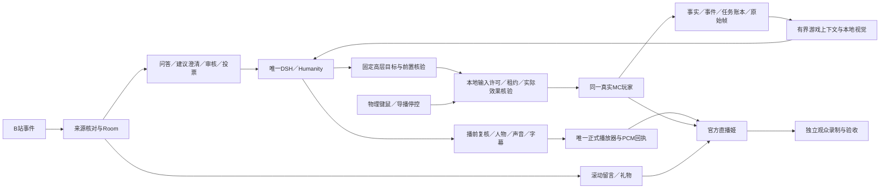

# 完整方案实施总纲

适用：`mc`分支、林知夏×Minecraft×B站互动直播；完整范围v1.2，规划整理r6，2026-10-31（Asia/Taipei）。本文是完整方案的当前总入口：成品、各端实现、接线、操作者路径、资源、异常、验收和交接一次纳入同一工程。用户接收一个完整版本；W编号只表示工程依赖，不表示分批开发交付。

[总计划r5](12-一次完整交付总计划.md)、[工作量及资源计划](10-全量执行与资源计划.md)、[全端蓝图](09-全端实现蓝图.md)和[机器清单](完整交付清单.json)保留详细契约与形成时起点。最新已登记实情由[实现进度](实现进度.md)及[机器状态](implementation-status.json)维护，未登记工作和失败单独说明，不能由旧规划推导当前完成度。本次整理只调整规划与记录，不继续修改功能代码。

## 1. 交付定义

用户只接收一个全功能、同版、可安装维护的完整系统。各模块、依赖施工和反复验证属于同一工程；不会把只读、陪聊、基础移动、单个技能、静态预览或关闭未实现功能包装为交付版本。15个D领域、100段新素材、68项实际验收和完整发布产物全部达成，才可宣布完成。

完整体验为：主播在同一个真实MC Java玩家上游玩普通生存/PvE，接收游戏结构化事实和必要原始帧视觉，保留林知夏人格与记忆，边玩边回应B站弹幕/礼物/SC；观众建议和投票经过明确审核；导播随时停控或物理接管；节目输出为横屏游戏主画面、滚动留言、小人物和字幕，可原生安装、启停、恢复及次日续播。

MC固定兼容执行档研究基线为Java 1.21.1，最终版本由真实联合验证后的运行锁确定。任意整合包、高强度PvP、任意种子自动通关不属于无限成功承诺。无人深空没有纳入当前MC执行器的替代适配；其上层人格、互动和节目框架可复用，游戏适配需要另立完整规格。

## 2. 选型与部署

| 层 | 最终决定 | 说明 |
|---|---|---|
| 游戏 | Fabric同玩家桥＋受控生存执行器＋唯一输入仲裁 | 真实玩家、世界与实际效果为依据；所有自动写点受本地许可 |
| Mindcraft | 技能与代理经验参考 | 它自身使用模型适配器与Mineflayer；当前工程选择同玩家控制，不能直接当成DSH插件接上即用 |
| 模型 | 唯一DSH/Humanity宿主及已有可配置渠道 | 模型可由外部接口或兼容本地服务提供；不由Mindcraft仓库内置权重决定。以实际渠道、运行锁和设备测量验收 |
| 文字调度 | speech/game_plan/audience_intent/operator_private/maintenance用途隔离 | 全局模型并发1，各自工具白名单、取消和截止 |
| 人物/声音 | 林知夏、K02、O07主用/F07备用 | 沿用已接受身份与历史素材；新圆形/横窗素材单独版本化 |
| 平台 | 真实B站采集身份＋Room统一来源 | 留言姬负责弹幕/礼物显示；官方直播姬负责节目输出 |
| 推流 | 官方直播姬、唯一正式播放器与源内声音 | 本地预览与管理页不成为声音播放权威 |
| 当前设备 | 继承rtx3080、FP16 batch4、`state/female-a-3080-k02` | 设备profile、源码来源、模型和GPU核对后才能实际启动 |

现有3092宿主、8010应用入口、B节目端本机8020接收器沿用既有路由。单机和双机必须遵循各自独立运行锁；双机A推理/B接收与原生3080同机不是同一种部署。4090控制继续暂停，不能据规划自行恢复；禁止Docker、WSL及虚拟机。模型下载和公开广播按现有授权状态执行，不以本地测试替代。

## 3. 全端接线与数据权威

游戏端对真实位置、库存、GUI、动作和效果负责；A业务端维护投影与审核，不自行声称游戏成功；DSH/Humanity是人格和长期记忆的唯一写入者；正式播放器的有效人声PCM收据对是否回答负责；官方端和独立观众分别对捕获、输出和实际观看负责。各自的“已受理、生成、排队、执行、播放、送达”不能互相代替。

## 4. 全量施工责任与配套实现路径

| 编号 | 必须完成的模块 | 配套实现与关闭证据 |
|---|---|---|
| D01 | 原生安装、全依赖/模型/许可/运行锁、设备profile与统一生命周期 | `scripts/mc_runtime.py`、`mc_deployment.py`及设备手册；完整包、干净安装、来源一致、启停失败回收 |
| D02 | 完整游戏观测、世界/GUI/规则/配方、事件和全部历史 | `game-adapters/minecraft/fabric`与`backend/game`；真实Mixin/服务器与长期账本核对 |
| D03 | 唯一输入所有权和物理接管 | 所有键鼠/热栏/GUI/包/线程/回调/清理逐写点绑定；失权释放、迟到隔离与20次物理接管 |
| D04 | 基础目标＋完整普通生存/PvE/补给/资源链 | 生存适配器、MinecraftPort及任务树；全副作用和后置效果证据，关闭真实preLaunch阻挡条件 |
| D05 | DSH人格、游戏规划、公开回应、私聊和维护 | `backend/dsh-bridge`与游戏工具；真实渠道、预算、公平调度、危险中断及声音取消闭环 |
| D06 | B站问答/礼物/SC、自然语言澄清/审核、投票与撤回 | 平台/Room/建议/投票；[自然语言规范](观众自然语言建议与澄清.md)，真实语义和身份、金额、重连与跨进程负载 |
| D07 | 世界/观众记忆、历史保留与一致恢复 | A/B/MC独立数据、7/30天保留/摘要/依赖、Humanity召回和删除、次日一致恢复 |
| D08 | 完整导播管理与诊断 | 游戏/世界/任务/互动/声音/人物/记忆/维护/启停/故障；正确区分受理与实际应用 |
| D09 | 正式横屏节目、媒体/字幕/取消、唯一播放权 | `web/mc-programme.*`及接收器；v3/v2与遗留入口排他，真实透明捕获及资源/恢复 |
| D10 | 两套各50段新人物 | 每套2待机＋48动作，100段新源片/脸框/索引/hash/动作映射、隔离缓存和动态QA |
| D11 | O07/F07主备、游戏/BGM/人声唯一音频路径 | 源内混音/说话压低、音量零/静音/取消恢复、正式PCM与官方音轨核验 |
| D12 | 原始帧与本地视觉完整部署 | 帧限流/缓存、模型/投影/CUDA锁、来源/未知/冲突、GPU取消和联合负载 |
| D13 | 官方输出与独立观众可见可听 | 真实采集身份/资格、透明窗口和音轨、公开状态核对及独立观众音画证据 |
| D14 | 稳定性、容量、日志和故障闭环 | 资源与时延连续记录、原始失败留存、同条件复现/修复/再验、跨进程恢复和回滚 |
| D15 | 全量验收和完整交接 | V01–V44＋C01–C24、24组合/12场景/8发布门槛、4小时、20接管、次日与干净环境同版复现 |

源码接口以[Schema](contracts/game.schema.json)与[OpenAPI](contracts/openapi.json)为唯一字段来源；通用HTTP/WS/SSE、任务/世界/媒体、重试/幂等/错误/超时均按[接口章](04-接口与数据.md)施工。模块详情及W编号依赖见09/10章，W编号不表示用户交付批次。

## 5. 边玩边聊的控制与调度

AUTO执行完整已授权玩法；MANUAL_COMMENTARY由人工操作游戏、主播根据实际事实解说；PAUSED撤销自动输入。模型只下达已注册高层目标。实际副作用前，游戏主线程重查世界、模式、epoch、租约、输入许可、观察年龄、GUI/handler和操作归属。物理接管先撤权、释放，再取消旧任务和规划；重新AUTO必须重新明确许可。

公开回应、游戏目标规划和观众建议理解使用同一模型队列。公开讲话可打断旧规划/理解，但不取消已经获准且仍有效的本地生存动作。普通问题、礼物/SC、任务反馈和危险事件各保留等待与合并规则，不能让付费消息永久挤掉普通互动。取消/迟到按原世界、来源、请求和截止核对。

典型路径：“正在采木头”期间读取新库存回答数量问题，合并适当礼物感谢；收到“回家”先查现有基地，未明确时澄清，形成建议后审核；正式回应结束由人声收据确认；游戏到达由真实位置/半径证据确认。两个完成状态独立记录。

## 6. 最终直播间与素材

唯一布局权威为冻结的`configs/layouts/mc-landscape-v1.json`，1920×1080、16:9，全画布游戏。默认右下264px圆形人物，320×180横窗为完整可用备选。留言默认4条向上滚动；两轨飞行弹幕为另一个模式，同一时刻只启用一种。无“正在看的弹幕”卡片。

后台`overlay.mc_chat_side`选择left/right，留言和礼物一起移动；切换保持消息/队列/年龄，人物、字幕、游戏尺寸与飞行方向不变。不同MC界面和手机观看必须真实核验遮挡和可读性。人物面积缩小不能借裁切丢掉手势语义；圆形/横窗各自生产完整50段、独立profile与缓存，旧48动作和历史来源全部保留。

人物/TTS/游戏/BGM经过唯一正式源，管理员页和预览无可听副本。字幕按实际人声样本对齐；取消、静音、音量零、恢复和播放权变化均需要真实音频确认。正式画面/声音合流后由官方直播姬输出。

## 7. 资源、工作量与运行预算

| 项目 | 规划输入 | 必须补齐的测量 |
|---|---|---|
| 模型 | 全局并发1；规划1运行＋1覆盖等待；口播候选16 | 实际排队/调用/首句/取消时延与token成本 |
| 观众理解 | 最多16待处理、512保留、4来源、30秒原截止、默认8秒调用 | 中文语义质量、队列满与突发、Room/SQLite负载 |
| 视觉 | 1运行＋1覆盖等待、最多1帧/秒、默认8秒超时 | 解码/传输/投影/推理、显存/争用、错误与未知 |
| 控制 | 心跳1秒/租约3秒/状态过期2秒 | 接管目标≤250ms、状态P95≤500ms，按实际时钟分段 |
| 呈现 | 游戏1080p上限60FPS；平均目标≥30、1%低分位≥20；人物源25FPS、稳定呈现目标≥22 | 实际帧时间、编码和官方捕获；绘制调用不等于呈现 |
| 留言 | 4可见＋24等待、等待TTL20秒 | 刷新/重连/切边/隐藏页仍按真实时间计龄 |
| 存储/日志 | 模型、两套源片、缓存、世界、账本、验收录像及恢复副本分项 | 实际码率/容量、保留/摘要、坏条目/满盘及回滚空间 |

上述值是目标和容量限制，不能写成已测成绩。3080整套同机能否在所有功能下满足目标，必须以实际MC＋人物＋TTS＋视觉＋编码的4小时记录证明。不能通过关闭必需功能或降低验收范围来宣布达标。

10章全范围工程容量预算加25%–35%依赖/返工余量约155–261人日，按8小时有效工时计；它不是当前剩余工期或交付日期。先按源码和同版证据审计既有成果，才可扣减对应工作量。模型/调用费用、素材返工、设备及平台等待分别记账，不凭公开star数或代码行数估算完成比例。

## 8. 实施依赖及完整操作路径

全项目从共同运行锁和接口、同玩家完整观测、输入仲裁/所有副作用绑定入手；这是决定后续真实玩法可用性的主依赖。完整生存、互动/口播、后台、节目、人物和视觉都纳入同一候选，数据恢复和联合验收按同一release_id闭合。可先做不依赖未到位设备的源码、素材规格和检查，但其完成不构成缩小交付。

操作者最终路径完整覆盖：原生安装→来源/版本/设备预检→配置世界/平台/模型/人物/声音→统一启动→观察实际就绪→选择控制模式→建议/投票/目标/接管→节目与留言左右调控→停播/维护→一致备份→次日复核恢复。每个入口显示实际应用、失败/超时和恢复方式；不手填来源证明或绕过生存启动阻挡。

## 9. 数据和异常闭环

每端保存自己的事实及幂等/删除记录；一致备份必须同时绑定A业务、B游戏账本、MC世界、Humanity、渠道/素材/模型/源码运行版本。恢复前核对来源、版本、世界和删除账本，已完成动作不重放；原未知结果经人工核对后仍保留未知的历史。

断网、旧帧、模型错误/取消、来源撤回、服务器拒绝、GUI变化、数据库所有权丢失、GPU满载、编码失败、官方源丢失、播放权丢失、磁盘满和进程崩溃都需明确触发、可观察状态、停止/释放、恢复及再验。首次失败和历史证据永久按既有规则留存；一次定向重跑通过不关闭原始根因。

## 10. 统一验收与交接

最终同一候选执行68项，覆盖3控制模式×2人物×2留言模式×2位置＝24组合、12联合场景和8项发布门槛；连续全功能4小时、至少20次物理接管、次日恢复和干净原生环境复现。真实模型、真实MC、官方端本地录制和独立观众证据分别标明来源，协议替身与文档校验只算工程验证。

交接物为完整源码/版本与许可、原生依赖/安装包、模型与素材manifest/hash、运行profile/端口与配置模板、统一启停/预检/诊断、操作/维护/备份恢复手册、完整验收录像与结构化记录、原始失败/修复/根因及同版回滚包。私人凭据、实际观众数据和运行状态按设备隔离，不进入公共源码。

当前真实完整验收0/68，新人物0/100，完整系统尚未交付。后续以D01–D15逐项补齐并联合验收，保持一个完整版本的交付约定。

## 11. 当前起点与可行性判定

**结构可行，完整系统的实际可用性仍须证明。** 主问题已经从“能否接模型”转为“真实游戏全副作用是否可控、同一设备能否同时承担全部音画与视觉负载、官方端能否正确捕获、全部状态能否一致恢复”。仅证明某个仓库可启动、HTTP返回成功或画面能预览，不足以关闭这些条件。

| 编号 | 当前事实 | 对本规划的约束 |
|---|---|---|
| B01 | 正式实现登记截至035；其原生本地473个不同用例通过，另有6个实际原生CLI工作流场景 | 属于CPU/JVM/SQLite/协议检查，不能记作实机玩法或整套回归通过 |
| B02 | 最近已登记的完整应用回归为034，通过918、失败2 | 旧失败及其未证根因保留；后续专项通过不能覆盖该结论 |
| B03 | 036五源历史投影及后台存在未完成工作；历史专项37项通过，原生互通33项中32过、1失败，整次原生构建退出1 | 维护资料查询是待完成候选，不在本次规划中登记为正式完成功能；浏览器及完整应用回归尚未补齐 |
| B04 | 036失败发生在桥重启后导入历史，返回GAME_HISTORY_MODE_BLOCKED；原日志未采集该瞬间全部准入字段 | 模式、输入释放或活动任务的具体阻挡原因仍须直接取证，不把时序推测当成根因结论 |
| B05 | B端schema3离线7/30天维护、摘要、最小任务防重凭据和旧备份恢复已有本地检查 | A端依赖整理、全端协调维护、长期容量与A/B/MC/Humanity联合恢复仍必须补齐 |
| B06 | 当前MC完整环境尚未准备，真实验收0/68，两套新人物0/100 | 文档/契约通过、历史竖屏素材和模拟游戏效果均不增加这些数字 |

本次规划保留上述原始输入、日志及构建产物，不重跑功能检查来改写既有结果。036失败后的维护资料在B端可能已存在，但它们被A端读取、过滤和呈现的完整路径尚未正式关闭。详见[035证据](../../evidence/mc-runtime-round-035.json)和[本次规划记录](../../evidence/mc-planning-complete-20261031-r6.json)。

选型判定分三层：本项目原生DSH工具适配是正式接入面；Mindcraft、AltoClef等上游提供游戏思路或执行候选；Neuro规范提供消息边界参考。后两类没有经过本项目工具/用途/状态/取消适配前，都不称为“已安装的DSH插件”。最终执行器仍以同玩家Fabric桥和完整输入审查为准。

## 12. 各端进程、源码与实际接线

下表的“必须实现”是交付约束，不能按目录存在判为功能完成。A表示业务/推理职责，B表示游戏/接收/官方输出职责；当前单机3080仍可同时承载两种职责，数据和播放权的边界继续存在。

| 端与源码入口 | 输入 | 必须实现的处理与输出 | 就绪/失败判定 |
|---|---|---|---|
| 原生应用与安装：`scripts/mc_runtime.py`、`mc_deployment.py`、`deployment_target.py` | 源码包、设备profile、资源manifest、实际文件 | 核对来源/版本/可执行文件/模型/端口/状态根，准备与统一启停，生成实际安装证明 | 逐依赖实际就绪；任一步失败只回收本次拥有的资源，保留失败原因 |
| MC/Fabric：`game-adapters/minecraft/fabric` | 同一玩家、已加载世界、服务器同步与物理输入 | 主线程采集状态/GUI/配方/规则；可靠事件/账本；原始游戏帧；输入许可与任务核验 | hello不等于快照新鲜；新鲜不等于输入释放；失联/失权先撤控 |
| 完整生存：`game-adapters/minecraft/survival` | 类型化目标、当前规则与有效Permit | 任务树、导航/采集合成/物品/PvE/补给/危险/资源链；所有副作用和清理绑定原任务 | 支持范围、材料/路径/GUI和服务器证据闭合；未知效果不重试成重复动作 |
| A游戏服务：`backend/game` | 桥状态/事件/收据、后台及DSH请求 | 验证/投影、世界任务、基地检查点、建议/投票、历史、视觉/口播上下文 | HTTP受理与B实际执行分开；存储所有权丢失后禁止继续控制 |
| DSH/Humanity：`backend/dsh-bridge`、`integration/dsh_bridge.py` | 带来源与时效的游戏/观众上下文 | 唯一人格与记忆、用途隔离、真实渠道调用、固定工具、预算/取消/迟到处理 | 规划结果只形成候选目标；私聊和维护不产生公开声音 |
| 平台与Room：`backend/platforms`、`backend/room`、`scripts/platform_blivedm.py` | 真实房间的弹幕、礼物、SC及撤回 | 身份/角色/金额来源、去重/过滤/隐私、显示与互动分发、持久设置 | 平台登录/身份由外部协议核验；重连不重复计票或感谢 |
| 人物与声音：现有`integration`人物链 | 已复核口播、动作语义、人物/声音profile | O07/F07、K02、两套新素材及缓存、带代次的媒体和字幕 | 真实模型就绪、首段PCM完整、取消不残留；生成完成与播完分开 |
| 接收与节目：`scripts/receiver_service.py`、`web/mc-programme.*`、`web/dsh-playback.js` | 媒体v3/v2、Room与游戏投影 | 唯一正式源、实际解码/呈现、字幕、人物遮罩、留言/礼物、场景和音量 | 管理/预览不取正式播放权；失权、静音与解码故障有明确状态 |
| 后台：`web/mc-control.*`及既有平台/记忆页 | 当前实际状态、配置修订与操作结果 | 世界/任务/互动/人物/声音/历史/维护/诊断；保存、生效、失败分别显示 | 窄屏/键盘可用；旧请求不覆盖新世界；离线历史可读但不冒充现场 |
| 视觉适配：`backend/game/frames.mjs`、`vision.mjs`及原生运行器 | 未叠加留言和人物的原始帧 | 限流/尺寸/真实JPEG解码、短时缓存、固定模型/投影、本地推理、来源/未知 | 过期、跨世界、超时或取消不覆盖新事实，不阻塞停控 |
| 官方直播姬与观众端 | 游戏原生捕获、透明节目叠层、唯一声音 | 横屏合成、编码、本地录制、获准后的正式平台输出与独立观众检查 | 分别保留本地捕获、平台状态和观众端音画证据 |

现有连接沿用A应用8010、DSH内部3092、B本机接收器127.0.0.1:8020。Fabric主动连`/api/dsh/game/bridge`；游戏SSE为`/api/dsh/game/events`，Room继续使用自己的事件流；人物媒体继续使用既有人物流，不与游戏WS混装。视觉端口以实际原生运行锁登记。完整包中统一列出全部监听者、连接方向、拥有进程和退出条件，不新增网页登录或管理token。

同机profile先用真实全负载关闭3080能力条件。若全部必需能力同时运行仍不达标，容量问题作为发布阻挡记录，提出有测量依据的部署调整；双机方案仍属于同一个全功能版本，4090保持当前暂停状态，不能由规划自动切换。

## 13. 贯通协议、任务及模型调用

### 13.1 共同字段和状态权威

接口字段以[Schema](contracts/game.schema.json)、[OpenAPI](contracts/openapi.json)和[控制协议](02-游戏桥与控制协议.md)为准。下面列的是需要贯通的标识，不能向旧消息随意添加未经契约允许的字段。

| 标识/记录 | 用途 | 必须拒绝或保留的情况 |
|---|---|---|
| `game_instance_id`、玩家/世界身份、`world_session_id` | 区分安装、存档、玩家和本次加载会话 | 同名世界不推定相同；换世界后旧目标不成为当前目标 |
| `bridge_boot_id`、连接身份、序号 | 区分桥重启、旧连接和状态先后 | 心跳不能替代新鲜观测；有缺口先核对，不倒退现场 |
| `control_epoch`、本地租约、Permit | 每次实际副作用的所有权与时限 | 原世界/任务/GUI/线程/handler失效时拒绝，不能靠模型续权 |
| `request_id`、`operation_id`、`task_id`与请求hash | 区分受理、控制操作、实际任务与重复请求 | 相同ID不同参数拒绝；超时和未知结果先查账本 |
| 平台事件/稳定账号/Room绑定、建议/投票ID | 同一来源的展示、审核、计票、任务和删除 | 不接受模型自报身份/金额；撤回贯通全部引用 |
| 人声request/utterance、epoch/generation、正式租约、PCM样本 | 生成、排队、首播、播放进度与完成 | 预览回执、旧代、无声或无有效PCM不能记为已回答 |
| release_id、配置/schema/模型/素材hash、trace | 定位候选和故障、绑定恢复与最终证据 | 不把不同候选的局部成功拼成最终整体验收 |

### 13.2 五种目标和独立取消

| 目标 | 必须先核对 | 完成证据和异常出口 |
|---|---|---|
| `navigate` | 当前世界、目标可解释、可达性、危险与输入许可 | 真实更晚位置/距离；不可达、超时、危险退出可解释 |
| `gather` | 实际资源、所需工具/耐久、库存容量、所需新增数量 | 原库存基线与实际新增量，不能拿旧库存冒充本次采集 |
| `craft` | 当前实际配方、批量产出、材料分配、工作台/GUI/组件及解锁 | 具体点击与服务器同步收据、更晚库存；无收据的物品增加不认合成成功 |
| `use_item` | 支持用途、原物品/槽位/组件、当前准星或装备条件 | 进食/装备/放置分别核验真实效果；迟到响应和特殊物品保留未知 |
| `return_base` | 后台登记基地、修订、世界/维度与有效半径 | 服务端绑定基地，不接受模型自带坐标；真实到达及更晚观测 |
| 独立取消操作 | 原任务、当前代数、所有子任务/寻路/GUI和输入 | 收到请求先标处理中；实际释放和取消终态后确认，不能只凭HTTP成功 |

普通PvE、补给与多步骤资源链由这些目标及受控本地任务树组成，所有防御/进食/撤离子任务同样受仲裁器管辖。持续攻击、热栏、GUI点击/网络包、选项/反射、异步线程及退出清理逐写点登记。当前生存preLaunch拒绝只能在全部约束与真实核验关闭后解除。

### 13.3 DSH十项工具和并发

八项查询为`game_get_state`、`game_get_recent_events`、`game_query_inventory`、`game_get_recipe`、`game_check_action`、`game_get_task`、`game_request_observation`、`game_get_audience`；写操作为`game_start_task`、`game_cancel_task`。用途白名单按实际契约设置，公开口播不直接派发游戏动作；AUTO由导播或本地明确授权。

文字模型由已有渠道提供，外部API或兼容本地服务均通过同一适配契约；不引入第二个人格规划器。调用前设置原请求截止、工具预算、上下文来源、世界和取消信号；返回后检查结构与原上下文，再执行前置核验。未知工具、任意脚本、模型自行改模式/设备/过滤设置均不进入执行器。

一条示范流程用于联调：“采16块木头”受理为T→本地采集；观众问“现在多少木头”→读新库存并标采样时间→生成回答→播前再查来源和事实→正式人声播完记回答完成；有人说“回家”→有界识别/缺信息澄清→导播采纳或投票结果→复核登记基地→建立独立任务T2。T未完成、被取消或只有部分产出时必须按实际结果说明，不能把T2获准当作T成功。

## 14. 横屏节目、素材和声音的施工约束

### 14.1 画面合成

| 图层 | 冻结尺寸/位置与功能 | 实现及验收 |
|---|---|---|
| 游戏 | 1920×1080，全画布 | 官方原生游戏捕获，保持HUD/准星与帧时间；不留固定大侧栏 |
| 留言 | 默认右侧408×480，最多4条上滚；左侧同尺寸 | 既有Room事件驱动；后台left/right保存并实时投影，留言/礼物共同移动，节点/队列/年龄连续 |
| 飞行弹幕备选 | 两轨、从右向左，与上滚模式互斥 | 切左右只保存上滚位置，不反转飞行方向；洪峰限流/过期丢弃 |
| 人物 | 默认右下264px圆形；备选320×180横窗 | 固定区域与遮罩；真实素材动态QA，切换不重复取得人声播放权 |
| 字幕/礼物/状态 | 沿冻结JSON，字幕避开底部HUD | 字幕随正式PCM，礼物无附加声音，不显示“正在看的弹幕”卡片 |

颜色、字体、场景、保护区和具体坐标由冻结JSON唯一提供，本文不复制为第二套可修改常量。游戏、互动、休息、恢复四场景的视觉切换不隐式切换MC控制权。

完整节目包含源捕获、叠层、人物媒体、音轨和官方输出，而不是只交网页。官方端必须实测透明叠层、源内声音、游戏捕获与本地录制：若透明叠层能力不成立，改为同版原生合成的单一1920×1080节目窗口，再由官方直播姬捕获。备选合成仍须保持布局、唯一音频和实际PCM回执，并重新完成性能与捕获验收；不把OBS作为替代发布要求。

### 14.2 两套各50段人物

圆形和横窗各2段待机＋48动作，共100段，按每段8秒/25FPS规划。圆形母版720×720、候选推理640×640；横窗母版1280×720、候选推理960×540。母版/推理/编码/画面遮罩是不同尺寸，实际运行锁共同核验后确定，不能把旧竖屏预览裁切当成完成新素材。

每段交付身份参考、动作语义、源片、帧数/FPS、脸框、遮罩安全区、循环/过渡、索引及hash；预处理/特征缓存按人物profile/源片/模型版本隔离。完整检查脸部、嘴形、手部语义、动作边界、遮罩和手机观看。身份沿用林知夏，旧48动作及历史原件完整保留。

### 14.3 唯一声音与取消

O07主用/F07备用、游戏声音、BGM分别受控，最终只有一路混合后的正式可听路径。说话压低游戏/BGM，字幕按实际样本进度呈现；正式源切换、静音、音量零、模型失败或来源撤回都清理原代剩余媒体。备用TTS只能在旧请求可靠取消后接替，不能同时播两次；导播/预览页保持静音或无播放权。

回执证明正式播放器实际处理有效人声，官方本地录制再证明捕获，独立观众再证明实际听到；三个层次单独验证。首句丢失、旧尾音、静音后恢复重播、双重桌面声和字幕超前都属于发布阻挡。

## 15. 数据、维护和恢复的完整配套

| 数据域 | 完整实现要求 | 恢复/容量核对 |
|---|---|---|
| B可靠事件及任务版本 | 事件7天、任务30天，结合50000事件/20000任务预算；保护未确认、活动和未知结果依赖 | 保留必要摘要和最小防重凭据；任何容量阈值都不能静默删除仍需恢复的原记录 |
| A现场任务与历史投影 | 现场状态与只读历史独立；分页/分块/hash/来源核验；维护汇总、退休凭据和维护结果作为历史类型 | 历史不是当前任务状态；变更汇总按版本保存，不累加不同版本计数，不虚造序号/ACK |
| 观众/平台/Room | 可信归属、7/30天明细与摘要、来源依赖、稳定身份去重、删除墓碑 | 已过滤/撤回/删除内容从显示、建议、选票、口播、召回和旧备份恢复中继续失效 |
| Humanity人格与记忆 | 唯一写入者；事实/个人记忆/跨场摘要保留来源与依赖 | 不另造游戏人格；删除和恢复先重放相应账本，再允许召回 |
| MC存档/基地/检查点 | 真实世界与玩家身份、基地修订、目标和下播检查点 | 一致备份包含世界文件；重启重新观测并形成新目标，不恢复旧AUTO/租约 |
| 日志、录像、素材缓存与备份 | 分域预算、容量预警、脱敏导出、同版manifest | 计算临时/迁移/回滚余量；清理不损坏首错、正式验收和历史原件 |

B离线维护CLI只是底层入口。完整后台还必须提供：预览拟删除/保留依赖与实际预计字节→停止新任务并确认输入释放→停止相关写入者并取得独占→一致备份→按原计划hash/代数原子应用→校验摘要与防重记录→恢复进程→A历史和Humanity复核。中途失联、计划过期、仍有依赖或磁盘不足则明确拒绝，并保留未应用状态。

恢复点绑定A业务、B账本、MC世界、Humanity、删除账本及配置/源码/模型/素材版本；不能把单个SQLite文件当作整套恢复包。先验证版本/路径/hash与删除约束，再恢复到隔离目标核对，正式替换保持可回滚。恢复后模式为非AUTO，先核对实际世界、原未知任务与当前位置，人工确认后再创建新的续接任务。

## 16. 全部工程依赖、运行输入与费用

### 16.1 同一成品的施工表

| 工作 | 关闭时必须具备的结果 | 主要依赖 | 主责及从零人日 |
|---|---|---|---|
| W00 | 原生设备/来源/profile/全依赖锁、完整安装与统一生命周期 | 既有设备规范 | 集成发布，4–6 |
| W01 | HTTP/WS/SSE、Schema、状态/任务/错误/幂等、迁移与回放 | 全部范围 | 后端数据，5–8 |
| W02 | 同玩家观测、GUI/规则/配方/世界/事件/原帧与真实Mixin | W00/W01 | Java游戏集成，8–12 |
| W03 | 游戏/世界/任务/基地/检查点后台、年龄/冲突/离线 | W01/W02 | 后台前端，5–8 |
| W04 | 唯一DSH、十工具/用途/渠道/上下文、预算/取消 | W02/W03 | DSH后端，5–8 |
| W05 | 全写点/线程/GUI/清理归属、本地Permit和物理接管 | W02 | Java游戏集成，12–18 |
| W06 | 五目标＋独立取消，真实效果/partial/unknown | W05 | Java及游戏后端，12–18 |
| W07 | 问答/礼物/SC、自然语言澄清/审核/投票/删除、正式结果口播 | W04/W06 | DSH与互动端，10–15 |
| W08 | 正式横屏、接收器、唯一播放权、字幕/留言/混音及官方捕获 | W00/W03 | 媒体前端，10–15 |
| W09 | 两套完整100段、预处理/缓存、动作/口型/遮罩动态QA | W08媒体契约及实际联调 | 素材媒体QA，15–25 |
| W10 | A/B全历史/保留/依赖/删除、Humanity、世界一致恢复 | W05/W07 | 后端数据，7–11 |
| W11 | 完整普通生存/PvE、补给/危险/资源链和全部副作用 | W05/W06 | Java游戏集成，15–24 |
| W12 | 原帧、真实视觉、模型/投影/CUDA锁、取消/未知/负载 | W00/W02及实际设备资源 | 视觉媒体，6–10 |
| W13 | 全功能同版验收、干净安装、次日/回滚、完整交接 | W00–W12 | 集成QA，10–15 |

主依赖为W00/W01→W02→W05→W06/W11→W07→W10→W13；W03/W04、W08/W09和W12按共同契约接入，并在W13前闭合所有真实依赖。这是施工图，不分配子代理、不表示当前已安排人员。素材可按冻结规范制作，最终必经实际媒体QA；任何提前完成的模块仍属于同一候选。

合计从零124–193人日，加25%–35%余量约155–261人日；按8小时有效工时计。现有代码必须逐W核对可复用产物、同版证据与真实缺口，才能扣减剩余人日。当前不能据此给出固定交付日期；设备/平台窗口、素材返工和实际人员容量分别登记。

### 16.2 八份实际运行输入

| 输入 | 最终必须有的实际值与来源 |
|---|---|
| R01 | 当前设备profile、真实GPU/内存/可用磁盘、端口/进程/状态根、源码来源与统一启动入口 |
| R02 | MC/Java/Fabric/API/映射/执行器/配套寻路的唯一兼容版本、构建/依赖hash、全副作用审查结果 |
| R03 | 实际DSH/Humanity/插件/文字模型渠道、工具兼容/用途/预算和唯一状态目录 |
| R04 | 两套100段素材、O07/F07、模型/脸框/缓存/动作/codec及实际尺寸锁 |
| R05 | 视觉模型/投影/原生运行器与CUDA兼容、文件hash、端口、容量与超时 |
| R06 | 真实B站房间、采集身份/能力、官方版本、透明捕获/音轨、获准的实际验收窗口 |
| R07 | A/B/MC/Humanity schema、唯一写入者、世界/玩家、删除账本和一致恢复点 |
| R08 | 可用人员/有效工时、设备与平台窗口、费用台账、完整验收日程与回滚空间 |

已确定的目录、分支、横屏、左右留言和完整交付范围不重复请求用户确认。真实渠道/房间身份/资源的值从现有配置核对；缺失条件登记到运行输入，不伪造配置或准备证明。当前未授权的模型下载、4090恢复和公开广播依现有约束处理，不影响其余已授权规划工作。

费用分别计文字模型输入/输出token、素材制作/返工、设备电力/占用、存储和网络。计算采用实际调用量×实际单价，避免预填未核实价格。容量按模型＋100段源片＋特征/缓存＋世界/账本＋验收录像＋一致备份/回滚＋临时余量计算；4小时总码率b Mbps的视频约1.8b GB，容器和额外轨另计。

## 17. 操作者完整流程与故障处理

| 操作 | 操作者必须看到的实际结果 | 未满足时的处理 |
|---|---|---|
| 安装/准备 | 来源、依赖/模型/素材、设备及状态目录逐项核对；完整安装清单 | 指明缺项、正确修复路径和已保留状态，不生成虚假就绪证明 |
| 配置 | 房间/渠道/游戏档/人物/声音/视觉、留言左右和混音可保存 | 校验和CAS冲突明确，保存成功不等于运行已应用 |
| 统一启动 | 存储与唯一写入者→宿主→媒体/视觉/接收→MC握手/新快照→正式播放就绪 | 按实际依赖逐项显示，失败只回收本次所属进程/端口/租约 |
| 本地节目核对 | 游戏/人物/留言/字幕、三路声音、唯一正式人声和官方录制 | 未取得就绪/捕获证据时显示具体原因，不声称已开播 |
| AUTO/人工/暂停 | 实际模式、输入释放、任务和控制代数 | PAUSED只停自动输入，不保证世界/服务器暂停；重新AUTO明确授权 |
| 互动/目标/建议/投票 | 可信来源、澄清/审核、前置核验、task_id和结果；回答/播完分开 | 不可行/含糊/过期/取消有明确状态，不猜目标执行 |
| 人物/场景/左右/音量 | 实际生效值、连续留言队列、媒体与声音状态 | 取景变化不隐式变控制权；旧响应不覆盖新配置 |
| 停播/维护 | 停新目标→真实停控→清理正式声音→检查点/一致备份→核对平台状态 | 页面关闭不当作正式已下播，超时保留未知和待处理项 |
| 次日/异常恢复 | 删除账本重放、实际世界/位置/库存/未知任务复核、Humanity连续 | 不自动重放旧目标/声音/AUTO；重新核验后创建续接任务 |

| 故障触发 | 必须立即发生的行为 | 恢复关闭条件 |
|---|---|---|
| WS断开、观察过期、主线程停顿 | 本地租约失效、撤销自动副作用、后台标明状态年龄 | 新连接/新快照与释放证据，旧命令不能复活 |
| GUI/handler/世界或控制代数变化 | 原操作和回调失效、按原归属清理 | 当前界面/任务重新核对，防止迟到包修改新界面 |
| 模型/视觉超时或迟到 | 原请求取消、释放队列；本地生存和接管独立可用 | 新调用有新截止/来源；不提高旧结论为新事实 |
| 平台重连、来源撤回/删除 | 去重/墓碑、清除关联候选/选票/媒体/召回 | 跨进程与旧备份重放后仍不复活，不重复播报 |
| 正式播放器失权、静音/关闭、解码失败 | 清原代音画、字幕及有效人声回执 | 重新准备/就绪和关键帧/PCM，从合法新代恢复 |
| SQLite所有权丢失、满盘、维护中断 | 禁写/停派控制、记录最早故障，保护原库/备份 | 独占与容量恢复、一致核对，不跳过删除/幂等约束 |
| GPU/编码满载或官方源丢失 | 有界队列、可解释故障、保留停控/停声与节目状态 | 全功能同候选重新测量，官方/观众分别证实恢复 |

每个故障记录原输入/源码与配置hash、原时限、操作链、实际状态、日志/录像、修复及同条件复查。当前015/017/018/020/021/025/027/031/033/034等未关闭根因与036准入失败均纳入D14；一次定向通过不能关闭首次原因。资源观察只作证据，不能凭同时出现就宣称因果。

## 18. 统一验收、发布清单和规划完成边界

### 18.1 同一候选的覆盖

保留V01–V44＋C01–C24共68项，定义见[基础验收](07-实施与验收.md)和[完整验收](08-完整交付规划.md)。以下H场景映射回原68项，不另计为额外已通过用例。24组合为AUTO/人工陪玩/暂停×圆形/横窗×上滚/飞行×左/右；全部有覆盖，不要求为每个组合各重跑4小时。

| 联合场景 | 必须一起证明 |
|---|---|
| H01 | 正式页、后台、多预览和播放权竞争下，只有一份正式人声；实际平台状态独立可知 |
| H02 | AUTO采集＋问答/礼物/SC，动作持续、回应公平、事实准确且正式播完 |
| H03 | 合成/回基地＋建议澄清/投票，来源/审核/可行性/task_id与结果相互对应 |
| H04 | 遇敌/缺食/危险＋模型/TTS等待，本地生存与人工接管不等待模型 |
| H05 | 物理接管＋模式变化/旧重复命令，自动输入释放且旧许可不能复活 |
| H06 | 库存/任务变化、换世界/模型迟到，播前复核、原有效期和未知表达有效 |
| H07 | 候选/生成/排队/播放中撤回或删除，显示/选票/声音/记忆按来源失效 |
| H08 | 洪峰/重连/隐藏/刷新＋换边/换人物，计龄与队列连续、身份去重正确 |
| H09 | A/B重启、终态重复、存档/玩家切换，账本核对且效果/旧声音不重放 |
| H10 | 建筑/菜单视觉＋跨世界/超时＋讲话，来源/未知与控制/声音取消各自正确 |
| H11 | 网络/线程/模型/媒体/磁盘故障＋静音，各端失效隔离、状态与恢复可证 |
| H12 | 下播/次日/一致恢复＋旧任务和删除内容查询，记忆/世界连续且删除不复活 |

还必须完成全功能连续4小时（含60分钟稳定段）、至少20次物理接管、次日恢复、真实官方捕获、独立观众、故障回滚和干净原生安装复现。测试替身、文档校验、原生CPU构建和已有竖屏人物案例均单独记录。

### 18.2 八项共同发布条件

| 判据 | 通过条件 |
|---|---|
| Z01 | 源码、依赖/许可、构建物、设备profile、真实来源及完整运行锁一致 |
| Z02 | D01–D15全部必需产物和两套100段人物齐备可用 |
| Z03 | 68项真实验收全部通过，有原始可复核证据 |
| Z04 | 24种组合与12类联合场景全部覆盖 |
| Z05 | 4小时、20次接管、次日和干净原生复现通过 |
| Z06 | 控制、实际音画、官方/公开状态/观众证据一致，关键故障关闭 |
| Z07 | 一致备份、迁移、恢复/回滚和删除不复活通过 |
| Z08 | 完整发布清单、安装/运行/维护手册及真实操作入口可用 |

### 18.3 一次交接的具体产物

| 产物 | 必含内容 |
|---|---|
| 完整可重建源码与依赖 | mc准确提交或全工作区快照、构建脚本/JAR、兼容依赖锁、上游对应、许可证和第三方清单 |
| 原生安装与运行包 | 完整文件/预期hash、安装/准备/预检/启停/诊断/回滚入口、进程/端口归属、设备profile与配置模板 |
| 模型、人物和媒体资源 | 获准方式准备的模型/投影/声音清单、100段源片/脸框/动作/缓存索引、编码及冻结布局；私有模型缓存按部署规则另存 |
| 数据与恢复工具 | Schema/迁移、A/B/MC/Humanity一致备份格式、删除重放、维护预览/应用/失败恢复及实际演练证据 |
| 完整操作者手册 | 首次安装、配置与就绪、完整游玩互动、留言/人物/声音调控、接管、故障、停播、次日恢复 |
| 候选验收和故障档案 | release_id及全部源码/配置/模型/素材hash、68项/组合/场景、资源时延曲线、官方/观众实录、首次失败与关闭依据 |

私人渠道密钥、平台凭据、真实观众数据、运行中的数据库和进程登记不进入公共源码；安装证明由真实预检产生，不随源码复制冒用。公开源码包、完整私有运行资源和一致状态备份分别交接，并在同一manifest中声明关联。

本规划整理完成后，实现状态仍保持active、正式轮次035，036候选未登记。规划核对只证明范围、依赖、文档与机器清单一致；完整系统完成必须由上述Z01–Z08和全部实际证据共同证明。
