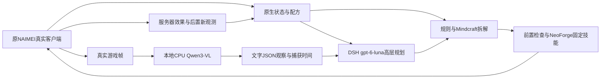
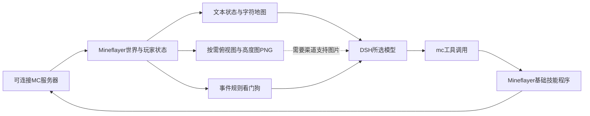
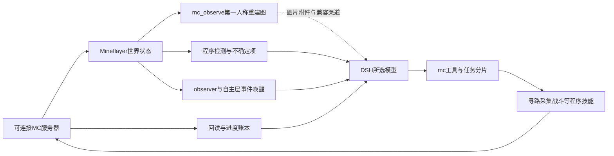

# MC三方案模型、视觉与控制详解

评估日期：2026-11-03；工作分支：mc。本次只比较当前原生方案、Whale Craft、dsh-mc-agent。原研究及20261103MC冻结留存保持原件，本页作为三方案比较的当前补充。

最终成品的路线优先级以[成品视角选型复评](成品视角选型复评与路线取舍.md)为准：dsh-mc-agent列为优先验证的执行候选，原生保留为实测基线与特定模组兼容备选。下文“当前继续使用原生”描述实际运行与原档连接条件，不代表已证明其成品更优。

固定外部模型为gpt-6-luna时，进一步的速度、图像效果和部署位置比较见[固定模型视觉性能对比](固定gpt-6-luna的视觉性能对比.md)。官方模型能力支持图像输入；当前项目宿主仍是text-only接法，两者分别记录，不将模型文档当作实际渠道已经验证。

本次是公开源码复核和既有证据分析，没有安装候选插件、连接远端、启动游戏/模型、执行本机运行测试或公开推流。下文严格区分当前实际、候选源码提供的能力、以及建议但尚未实现的接法。

## 一、直接结论

1. 三者的高层语言模型都可以由DSH管理。DSH是宿主与调度框架，名称不能证明正在使用DeepSeek模型。当前项目实际外接渠道标签为gpt-6-luna；两个候选插件没有固定一个推理模型或随包提供MC专用权重。
2. 当前项目采用“本地Qwen读真实游戏帧→返回文字/JSON观察→DSH文本模型决策”；现有宿主明确把渠道声明为text输入，并将工具输出渲染为文本。不能据模型名称声称它正在直接看图。
3. Whale Craft支持字符地形图及图片俯视图/高度图；图片交给DSH当前所选的、具备图像输入能力的模型。已核查的版本没有dsh-mc-agent的mc_observe第一人称工具。
4. dsh-mc-agent提供“第一人称重建图＋程序状态＋不确定项”，经DSH图片附件交给所选模型。该图由机器人接收的方块/实体数据重建，默认192×108，不是原Java客户端截图或连续直播视频。
5. 三者的低层动作都由程序执行。当前是NeoForge原生技能与输入所有者；另外两个是Mineflayer及其技能代码。没有证据表明三者当前使用视觉动作模型直接连续输出鼠标、键盘或逐帧动作。
6. 若未来服务器与Mineflayer兼容，dsh-mc-agent在通用游戏技能上更值得优先验证；当前未开LAN的350模组离线档仍由原生执行器控制。候选插件不能直接接管已打开的NAIMEI图形客户端。

## 二、核查版本

2026-11-03重新查询GitHub默认分支后，两个候选的HEAD均与上次固定研究一致。Star按本次查询数列出，不能代替兼容性或效果验收。

| 编号 | 方案 | 版本/固定提交 | Star | 本项目采用情况 |
|---|---|---|---:|---|
| 1 | 当前原生方案 | 最后实机代码084最终v8；运行证据085；公共源码摘要50a1d9827ae95f858b6bcb4de66be4fc7d4872361cbe0a533c1d94ea255417d1 | 不适用 | 已在原NAIMEI离线档实际游玩，完整系统未验收 |
| 2 | [Whale Craft](https://github.com/yzi1b/whale-craft) | 0.2.0-beta.3；ddc21637dc48b0818f2159dc69e4f4b26f64cb83 | 52 | 源码研究，未安装替换 |
| 3 | [dsh-mc-agent](https://github.com/blueziii/dsh-mc-agent) | 0.6.75；a518f79e77e168aa5158dacc58e0c25d562a42b8 | 31 | 源码研究，未安装替换 |

当前环境和历史实测以[冻结基线](../../freezes/20261103MC/01-版本基线与运行环境.md)为准。候选均声明Node≥22、DSH≥0.2.0-rc.2且<0.3.0；版本声明相合只说明值得适配，不证明本项目定制宿主可以无改造接入。

## 三、分别是谁在看、想、拆解、执行与说话

| 编号 | 职责 | 当前原生方案 | Whale Craft | dsh-mc-agent |
|---|---|---|---|---|
| M01 | 高层决策模型 | 同一DSH/Humanity链路的外接gpt-6-luna，承担模型规划、弹幕理解与表达 | DSH当前会话所选模型，仓库未锁定具体模型名称 | 同左，仓库未锁定具体模型名称 |
| M02 | 看图的模型 | 本地Qwen3-VL-4B-Instruct，GGUF Q4_K_M＋F16投影器 | 若请求地图图片，由DSH所选的图像输入模型理解；没有另设固定视觉模型 | 若请求mc_observe图片，由DSH所选的图像输入模型理解；没有自动调用本项目Qwen |
| M03 | 模型实际部署 | DSH应用在3080，语言推理走外接渠道；Qwen在3080主机CPU上由llama.cpp运行，语言GPU层0、视觉不卸载GPU | 插件在DSH进程内；模型远端或本地API取决于宿主渠道配置，插件不决定 | 同左；安装插件本身不意味着本地下载/执行大模型 |
| M04 | 图片如何到决策模型 | Qwen返回caption/visible_text/unknowns，经文字工具结果给gpt-6-luna；当前宿主input仅text | mc_map/mc_height产出PNG，宿主attachments服务附图，模型具图像能力时直接读图 | mc_observe产出PNG＋文本，宿主attachments服务附图；当前项目的文本工具封装需另适配 |
| M05 | 世界信息读取者 | NeoForge原生代码读当前玩家、库存、配方、碰撞、GUI、敌对实体和任务结果 | Mineflayer从服务器协议形成方块、实体、背包与地图数据 | Mineflayer＋observer/spatial-map等代码形成结构化感知 |
| M06 | 物品目标拆解者 | 真实Mindcraft ItemGoal/ItemWrapper算法原生移植，读原生配方与库存；它是算法，不是另一大模型 | DSH模型组织目标与工具/序列；本版本主线未接入Mindcraft求解器 | DSH模型＋任务/技能代码；本版本主线未接入Mindcraft求解器 |
| M07 | 开局固定补给推进 | Mindcraft bootstrap和规则分支可先推进已定义起步物品，无需每小步调用模型；目标/建议或规则未覆盖时再进入模型规划 | 主要由DSH模型调用工具继续推进，具体动作在工具内完成 | 主要由DSH模型调用工具/任务分片继续推进，技能内部用程序执行 |
| M08 | 寻路控制者 | 本项目原生有界碰撞搜索与NeoForge技能，复杂地形仍有失败 | core.walkTo朝目标前进、跳跃与卡住检测，通用寻路能力较基础 | mineflayer-pathfinder等现成库＋插件策略；A*搜索是程序算法 |
| M09 | 攻击/挖掘/合成执行者 | 原生固定技能、输入所有者、交互事务及效果核验 | Mineflayer的控制状态与dig/attack/place等API | Mineflayer＋collectblock/tool/pvp等技能与战斗策略代码，依赖须实际安装 |
| M10 | 紧急情况判断者 | 新鲜结构化状态＋程序规则优先触发有限撤离/恢复，DSH可参与后续规划；完整PvE未通过 | 看门狗按事件规则通知/唤醒同一模型，不是另一个视觉模型 | 默认ai-led大部分自动吃/捡/穿/避险动作关闭，事件唤醒同一模型；autoFloat例外 |
| M11 | 动作结果确认者 | 服务器效果回执、库存/位置变化与后置新观测；Qwen描述不能代替 | 工具与Mineflayer世界状态/事件；仅有请求或解释不等于实际完成 | 工具回读、任务账本和事件；仍需在本环境验证每类成功语义 |
| M12 | 主播语言/人格 | 唯一DSH/Humanity人格林知夏，共享模型预算与记忆 | 可复用同一DSH人格；整套MC preset不能直接替换现有主播persona | 同左；应导入游戏能力并保留唯一人格/状态写入者 |
| M13 | 声音与人物画面 | OmniVoice O07主语音、F5-TTS v1 F07备用；MuseTalk1.5 K02 FP16/batch4 | 插件不提供本项目人物、语音和节目合成，接入后可继续复用现有链 | 同左，不会自动提升人物供帧或素材动作质量 |
| M14 | 是否有专用MC视觉动作模型 | 已核查链路中无此模型；Qwen输出被限制为观察，不输出动作 | 已核查链路中无；语言模型调工具，工具控制机器人 | 已核查链路中无；图文模型调工具，技能程序控制机器人 |

当前模型与文字封装依据：[host.mjs](../../../backend/dsh-bridge/host.mjs)、[vision.mjs](../../../backend/game/vision.mjs)、[GamePlanner](../../../backend/game/planner.mjs)、[Mindcraft原生规划](../../../backend/game/mindcraft/native-planner.mjs)、[视觉启动参数](../../../scripts/mc_vision_service.py)。候选依据见末尾固定提交源码索引。

## 四、多模态与视觉推进的实际区别

这里把“取得一张图”“模型理解图”“理解结果导致动作”“动作结果核验”分开。图像生成成功、附件保存成功或工具叫observe，都不足以单独证明最后三步。

| 编号 | 检查项 | 当前原生方案 | Whale Craft | dsh-mc-agent |
|---|---|---|---|---|
| V01 | 图像来源 | 真实Java游戏渲染目标帧，原始MC帧经有界上传 | 根据世界方块数据生成俯视地图/高度图，默认可只给字符图 | 根据Mineflayer世界数据做软件射线渲染，重建机器人第一人称 |
| V02 | 是否就是观众看到的画面 | 来源是同一真实客户端；观察帧有自己的捕获时间，不等于直播正在显示的那一帧 | 地图不是最终直播画面 | 重建图不是原Java客户端画面，也不是最终节目画面 |
| V03 | 图像精度 | 曾实际输入1920×1080帧；视觉运行器固定图像token预算256，不等于保留全部文字细节 | mc_map地图半径默认32、上限96，默认每格放大4；不是原屏幕分辨率 | 默认192×108；参数宽32–480、高18–480，尺寸增大仍需性能/模型验证 |
| V04 | GUI、模组材质、文字 | 原帧可包含真实GUI/模组视觉；Qwen仍存在文字/护甲误判 | 地图不能代替真实背包菜单、HUD或模组GUI识别 | 重建图不含完整真实GUI、粒子及客户端渲染；贴图/皮肤不等于任意模组模型完整 |
| V05 | 看图时机 | game_request_observation按目的提交building/screen/text；异步pending后再读取。普通开局与大部分动作可走结构化链 | 模型按需调用地图等工具；没有已核查的“每动作必须看原始屏幕”机制 | 默认由AI自主调用；强制看图门禁默认off，不能写成每步必看 |
| V06 | 强制看图限制 | 新鲜状态和权限是动作门槛；视觉不是所有动作的前置条件 | 可用字符地图在纯文本模式推进；图像不是动作硬门槛 | 可显式开启VIEW_GATE；默认门禁尺度为看图后最多4个动作、60秒，但仅在开启时适用 |
| V07 | 描述从何而来 | caption等由Qwen推断，带frame_id/source_seq/captured_at，保留未知与年龄 | 字符地图、方块ID和高程来自程序；图像语义才由所选模型推断 | “我看到”的像素占比/实体投影也有大量程序统计；“程序检测到”来自协议状态，不是独立视觉模型验证 |
| V08 | 多模态模型要求 | 主模型文本输入即可接收Qwen转述；Qwen本身必须能读图 | 直接读地图PNG需所选模型和DSH渠道支持image；源码做best-effort模态查询，未知时仍尝试附图 | 直接读第一人称PNG同样需宿主和渠道支持image；源码注释称文本宿主可用占位，不构成当前渠道实测证明 |
| V09 | 非视觉模式 | 可读原生结构化状态；不能把结构化结论冒称看图 | mc_map默认chars，可不依赖视觉理解 | mc_observe image:false只返回结构化状态，既不出图也不计作门禁已看图 |
| V10 | 频率与时延 | 历史联合负载成功约21–27秒，也有30秒超时；不适合逐动作闭环或即时保命 | 地图生成时间、模型看图时间及回合延迟没有本环境同条件成绩 | 工具预算11秒、动作预算10秒；不含后续模型理解全链耗时，也不证明11秒一定成功 |
| V11 | 新鲜度机制 | 世界/boot/连接代次、图像来源seq、捕获时间、超时/取消；推断不能覆盖更新原生事实 | 地图反映调用时已加载世界，仍需检查未知区块和回合延迟 | capturedAt与不确定项、已加载区块、可选门禁年龄；门禁只证明附件成功交付，不能证明模型理解正确 |
| V12 | 游戏音频感知 | 当前游戏声音可进入节目输出；已核查游戏决策链没有“听音辨位”的音频理解模型 | 已核查主线是文本/协议状态/图片，未证明游戏音频理解 | 同左；图文观察不等于游戏声音多模态感知 |

Whale在模型元数据明确不支持image时跳过附图并警告；元数据未知仍尝试，因此不能把这一检查当作渠道可用性测试。dsh的门禁把成功保存的图片附件记为已看过，不验证视觉回答，也不能作为安全动作授权的替代品。

## 五、三条可追溯链路

### 1. 当前原生方案

正常游玩以原生结构化状态为基础，紧急规则、已批准目标及Mindcraft起步链可直接选下一固定技能；需要模型选择时再调用唯一DSH高层模型。视觉是旁路观察，不能写成每次动作前都串行等Qwen。

源码中GamePlanner先处理紧急规则、已批准世界目标；在没有已采纳建议时尝试mindcraft.bootstrap，之后才可能调用host.generate。bootstrap选择固定起步物品、工作台放置、少量探索等。**因此现有短场有效成果不能逐项都归功于语言模型自主看图推理。**最近084i实际132.058秒包含11条采集/制作/放置成果、4条导航成功及4条导航失败，实际做出熔炉；长期自主生存仍未通过。

### 2. Whale Craft

看门狗是事件判断、记录和唤醒代码，不是第二个LLM。Whale的图像工具sharp/SVG光栅化也不执行图像理解。模型选择下一目标/工具，core.walkTo等程序控制身体；大模型不负责逐tick走路。

### 3. dsh-mc-agent

源码的三段式感知具有实用价值：图片/渲染统计、程序检测、未知项一并提供。但它们大量来自同一份Mineflayer世界数据，不能称为两套完全独立传感器。模型即使正确读图，行动仍受寻路、物品库、服务器协议与技能实现限制。

## 六、具体场景由谁负责

| 编号 | 场景 | 当前原生方案 | Whale Craft | dsh-mc-agent |
|---|---|---|---|---|
| S01 | 观众建议做石镐 | 弹幕进入DSH意图/建议链→采纳和目标关联→Mindcraft拆材料→原生采集/合成→效果核验→DSH表达 | 需接本项目B站入口；DSH组织工具调用→基础技能；材料依赖主要由模型/序列组织 | 同样需B站适配；DSH调用采集/制作及任务工具，现成技能更丰富 |
| S02 | 前方有树但路线受阻 | 原生可达候选与碰撞搜索先判断，规则/Mindcraft换目标或DSH重规划；Qwen不是常规路径求解器 | 模型可看地图再选坐标，walkTo实际走；复杂绕路能力较基础 | 图/空间地图帮助模型选目标，pathfinder搜索绕路/挖穿/搭桥；不是视觉模型自己解算每一步 |
| S03 | 怪物靠近 | 新鲜敌对实体/危险状态触发有限撤离，随后重规划；不得等待20多秒Qwen作为唯一反应 | 看门狗受伤等事件唤醒DSH，由工具执行反应；现有代码不能证明完整自保 | ai-led主要监测/唤醒，autoFloat独立保留；不能把未开启的自动吃、穿甲、撤退当成默认能力 |
| S04 | 问眼前建筑/招牌 | 请求真实帧，Qwen产出观察与不确定，DSH据此答复；文字准确性尚不足 | 地图可说明轮廓/方块分布，缺少完整真实招牌和客户端画面依据 | 重建图适合方位/实体/结构理解，不能据此保证真实招牌、材质或模组GUI识别 |
| S05 | 一边挖矿一边回复弹幕 | 持续原生任务和唯一模型队列可协调，实际及时性仍未完全验收 | 同一模型/工具回合可能被长调用占用；需接语音和任务优先级 | 分片限制工具长占用，有改善潜力；下一分片仍可能依赖模型回合，不保证弹幕即时响应 |
| S06 | 判断熔炉已完成 | 以库存/任务效果确认为准，DSH不能把视觉描述当成物品入包 | 需工具状态、实际容器/库存确认，不由地图证明 | 有熔炉/容器能力和回读策略，仍需验证本服物品、配方及菜单兼容 |

## 七、控制、画面和接入成本

| 编号 | 项目 | 当前原生方案 | Whale Craft | dsh-mc-agent |
|---|---|---|---|---|
| C01 | 玩家身体 | 控制当前已打开的原NAIMEI客户端 | 另建一个Mineflayer协议玩家 | 同左，源自Whale的独立维护版本 |
| C02 | 现有单人档 | 已能在未开LAN的原档执行 | 必须先有可连接服务器入口 | 同左，不能直接进入未开放的单人实例 |
| C03 | 350模组 | 有原档实测短链，复杂功能仍待完善 | 握手、注册表、配方、容器、方块模型均未验证 | 通用技能更多仍不证明NeoForge整合包兼容 |
| C04 | 直播画面 | 真实Java画面及游戏音效，现有横屏叠加 | 机器人无完整图形客户端画面，须另定真实取景方案 | mc_observe是观察图，须另定连续高质量直播与真实游戏声音 |
| C05 | 镜头观感 | 真实转向仍需平滑 | 工具控制转向，不能预设镜头天然平滑 | camera.aimAt直接改yaw/pitch，不能预设镜头天然平滑 |
| C06 | 人物卡顿 | 已记录19.81–22.68FPS供帧及约4秒播放停顿 | 更换控制器没有直接修复媒体链依据 | 同左；仍保留Java客户端时也不能预估省下其全部GPU负载 |
| C07 | 动作互斥 | 已有单输入所有者、租约、世界代次、停止及新鲜回执门槛 | 需适配本项目统一权限/停止/任务语义 | scheduler默认observe-only只记账，需核对enforce及本项目门槛，不能直接替代 |
| C08 | 主播宿主 | 已定制DSH/Humanity、工具目录和文本渲染 | 原MC preset包含自己的persona，不能不经审查覆盖林知夏 | 同左；导入MC工具不等于已经接通现有B站、记忆、口播和正式播放回执 |
| C09 | Mindcraft定位 | 保留真实物品求解器移植 | 换为Whale主线后，Mindcraft不会自动继续负责控制 | 换为dsh主线后同样需明确是否另接求解器；不能以名称混称为Mindcraft运行时 |
| C10 | 同名NAIMEI | 当前原玩家/UUID及世界状态已绑定 | bot与原图形玩家同名同时进同服可能冲突；改显示名不等于接管库存/身份 | 同左，须核对离线UUID、位置、库存、模组玩家数据与取景身份 |

dsh的README写苦力怕贴近先退，但固定提交的creeperFlee实现主要举盾/告警且明确不移动；ai-led默认还关闭此项。这里以代码为准，不把宣传文字记为实机通过。

## 八、怎样组合才可能真正提升推进速度

当前离线档继续以原生执行器为唯一身体，优先吸收候选的成熟技能处理、短工具预算、明确进度和感知格式。不是把两个Mineflayer插件叠装到同一玩家上。

未来用户提供服务器、实际协议/内容兼容且取景方案可用后，优先验证dsh-mc-agent作为一个MC执行候选。保留同一个林知夏人格、同一个DSH/Humanity状态写入者和同一个正式发声出口。Whale适合较轻的工具基础，但现成生存能力少于其扩展版，不能因代码更少就推断完整收口更快。

视觉模型可以有两种明确接法，均须另行验证：

| 编号 | 候选接法 | 谁看图 | 谁决策 | 需要补的内容 |
|---|---|---|---|---|
| A | 同一DSH模型读图与规划 | DSH所选、实际验证支持image的多模态模型 | 同一模型 | 当前host的text-only声明、图片附件/工具render、渠道协议、预算、会话隔离和实际图像回答都要验证 |
| B | 保留当前双模型职责 | Qwen读原始帧或另适配mc_observe图片 | 当前gpt-6-luna读取文字结论 | 增加候选图片→本地视觉服务→带来源/时间的文本观察适配，不能假定安装插件自动复用Qwen；CPU时延仍需处理 |

当前gpt-6-luna渠道已验证文本/工具链，不代表已经验证直接图像输入。本次不指定替换模型，也不把A或B记为已完成。若使用B，真实客户端帧与重建图应分别标注来源，不能混淆成同一观察证据。

应比较四类收益：工程复用、每分钟有效游戏成果、互动响应、音画呈现。dsh有可能改善前两类；第三类取决于模型队列和分片调度；第四类仍需独立修MuseTalk供帧、正式播放缓冲和镜头。没有同条件3080测试，不给出倍数、百分比或确定工期。

| 编号 | 后续比较必须补证据 | 完成标准 |
|---|---|---|
| P01 | 模型身份与图片输入 | 记录实际provider/model、工具图片块与模型回答；不能只看界面标签 |
| P02 | 真帧/重建图准确性 | 相同场景分别核对GUI、方块、实体、文字和未知项；确认来源、捕获时间与可见范围 |
| P03 | 服务器/模组与身份 | 实际连服、区块/物品/配方/菜单成功，NAIMEI玩家数据及取景无身份冲突 |
| P04 | 同目标自主推进 | 同起点完成采木→工作台→石工具→熔炉/食物；记录真实入包、耗时、失败与恢复，不人工代打 |
| P05 | 危险与中断 | 遇怪、落水、背包满、工具坏、死亡、断线后的自动恢复及停止保护 |
| P06 | 弹幕与节目 | 真实弹幕到首段声音延迟、游戏是否仍推进、镜头与音频完整、正式源实际播完 |
| P07 | 联合负载 | 游戏/人物/语音/视觉共同运行的帧间隔、最长停顿、CPU/GPU/显存及连续稳定性 |

## 九、本轮核查与完整剩余范围

| 编号 | 本轮实际事项 | 核查结果 |
|---|---|---|
| R01 | 比较范围收敛 | 当前原生方案＋Whale＋dsh三项；旧冻结原件保留 |
| R02 | 重新查询公开版本 | 两个GitHub默认分支仍为上述固定提交；52/31 Star |
| R03 | 定位模型边界 | 当前host明确text-only；Qwen读图且只输出观察；候选用DSH所选模型 |
| R04 | 复核图片与控制代码 | 地图图片/第一人称重建/默认非强制看图/技能执行者分开列明 |
| R05 | 交付性质 | 文档/源码审阅完成；候选实际安装/运行/视觉渠道与完整验收未推进 |

完整系统仍为D01–D15、117项未关闭事项，正式0/68、新人物素材0/100。逐项ID、优先级和完成标准见[完整冻结待办](../../freezes/20261103MC/03-全范围剩余事项.md)，没有因本次选型研究缩小范围。

| 编号 | 全范围仍需完成 |
|---|---|
| D01 | 完整安装交付、干净环境复现与恢复 |
| D02 | 游戏桥生命周期、模组配方/容器及复杂地形 |
| D03 | 无人值守危险处理、异常恢复与统一控制保护 |
| D04 | 食物、PvE、烧炼、装备耐久、储物和死亡后补给 |
| D05 | 长期目标推进、资源阻塞、跨会话与模型预算 |
| D06 | 真实B站弹幕、去重重连、建议/投票及反馈闭环 |
| D07 | 记忆纠错删除、跨日、备份恢复和容量管理 |
| D08 | 后台任务/诊断/资源/音量与生命周期维护 |
| D09 | 人物供帧、重缓冲、解说及时性和语言自然度 |
| D10 | 两套100段新人物素材及完整动态QA |
| D11 | 主备语音、混音、取消、同步和真实录音 |
| D12 | 视觉准确性/超时/联合负载及过期观察处理 |
| D13 | 官方直播状态与获授权后的独立观众端验证 |
| D14 | 联合长稳、帧率延迟、日志轮转和资源预算 |
| D15 | 68用例、24组合、12场景、8发布条件与同版交付 |

## 十、可复核来源

当前实现锚点：

- [DSH宿主：text输入与文本工具结果](../../../backend/dsh-bridge/host.mjs:156)
- [Qwen输入、输出与视觉结果绑定](../../../backend/game/vision.mjs:59)
- [异步视觉工具](../../../backend/game/vision-queries.mjs:7)
- [规划先规则/Mindcraft后模型](../../../backend/game/planner.mjs:111)
- [Mindcraft原生起步链](../../../backend/game/mindcraft/native-planner.mjs:199)
- [原生输入所有者](../../../game-adapters/minecraft/neoforge/src/main/java/dev/aitalkstreamer/mc/neoforge/NativeInputOwner.java:15)
- [CPU视觉启动参数](../../../scripts/mc_vision_service.py:23)
- [真实游戏渲染目标截图](../../../game-adapters/minecraft/neoforge/src/main/java/dev/aitalkstreamer/mc/neoforge/NativeGamePort.java:310)
- [模型、设备、模组基线](../../freezes/20261103MC/01-版本基线与运行环境.md)
- [084成果与样片](修复结果与120秒实况.md)、[085性能诊断](120秒实况卡顿排查.md)

候选固定提交主源码：

- [Whale主入口：模型模态检测与图片工具](https://github.com/yzi1b/whale-craft/blob/ddc21637dc48b0818f2159dc69e4f4b26f64cb83/index.js#L2304)
- [Whale preset：由模型驱动](https://github.com/yzi1b/whale-craft/blob/ddc21637dc48b0818f2159dc69e4f4b26f64cb83/presets/minecraft.patch.yml)
- [Whale核心：Mineflayer、walkTo与基础动作](https://github.com/yzi1b/whale-craft/blob/ddc21637dc48b0818f2159dc69e4f4b26f64cb83/src/core.mjs#L1562)
- [Whale看门狗](https://github.com/yzi1b/whale-craft/blob/ddc21637dc48b0818f2159dc69e4f4b26f64cb83/src/watchdog.mjs)
- [dsh观察工具：默认门禁、图片附件与感知](https://github.com/blueziii/dsh-mc-agent/blob/a518f79e77e168aa5158dacc58e0c25d562a42b8/extensions/mc_observe.mjs)
- [dsh第一人称重建渲染器](https://github.com/blueziii/dsh-mc-agent/blob/a518f79e77e168aa5158dacc58e0c25d562a42b8/extensions/mc_view-render.mjs)
- [dsh程序技能依赖与寻路](https://github.com/blueziii/dsh-mc-agent/blob/a518f79e77e168aa5158dacc58e0c25d562a42b8/src/plugins.mjs)
- [dsh自主模式与反应实现](https://github.com/blueziii/dsh-mc-agent/blob/a518f79e77e168aa5158dacc58e0c25d562a42b8/extensions/mc_auto.mjs#L165)
- [dsh控制调度默认值](https://github.com/blueziii/dsh-mc-agent/blob/a518f79e77e168aa5158dacc58e0c25d562a42b8/src/action-scheduler.mjs#L67)
- [dsh工具与动作预算](https://github.com/blueziii/dsh-mc-agent/blob/a518f79e77e168aa5158dacc58e0c25d562a42b8/src/budget.mjs)
- [dsh镜头朝向控制](https://github.com/blueziii/dsh-mc-agent/blob/a518f79e77e168aa5158dacc58e0c25d562a42b8/src/camera.mjs#L47)

部分GitHub网页/原始文件读取发生缓存未命中；本次补充源文件通过GitHub Contents API按固定提交取得，并与递归文件树的Git blob摘要核对。原研究源码位于outputs/mc-validation/round-086/research，本次补充索引位于outputs/mc-validation/comparison-20261103/research/model-visual-source-receipt.json；本轮结果记录于[源码审阅回执](../../evidence/mc-three-scheme-model-visual-20261103.json)。网页访问没有创建本机浏览器标签页。
