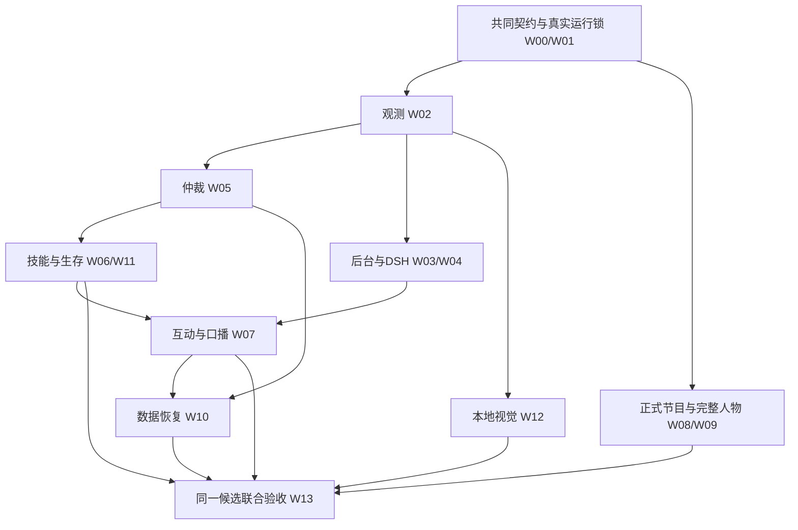

# MC直播系统：全量交付执行总表

日期：2026-10-30。工作目录：本项目。分支：`mc`。适用规划：v1.2。完整总览见[11章](11-完整总规划与交付约束.md)，执行规划r4以026正式记录为基线，027草稿未由规划核对记为完成。

[总规划](08-完整交付规划.md)定义全部范围，[全端实现蓝图](09-全端实现蓝图.md)定义各端实现，[接口与数据](04-接口与数据.md)定义契约。本表将这些约束汇成一份执行与交接依据，继续沿用W00–W13、D01–D15及68项验收编号，不新增产品批次。实际完成情况见[实现进度](实现进度.md)。

[全量执行与资源计划](10-全量执行与资源计划.md)进一步登记责任角色、124–193人日全范围从零预算及预留口径、工程依赖、12条跨端接线、资源、故障和交接样本。该估算未经已有成果抵扣，不代表当前剩余工期；全部工作仍只交付一个完整版本。

同一计划r2补齐24种模式/人物/留言/位置组合、H01–H12并发场景和Z01–Z08发布判据；它们是完整候选的覆盖与交接要求，仍归入既有68项验收。正式实现与未登记草稿分别记录，规划清楚不代表草稿已通过。

## 1. 一次交付的成品

交付可安装、可配置、可直播、可接管、可恢复的完整系统。林知夏控制同一个真实MC玩家，在游玩时接收真实游戏信息、理解必要画面、回应B站弹幕，并通过正式横屏节目输出人物、声音、字幕与留言。

最终同时包含：AUTO、MANUAL_COMMENTARY、PAUSED；五种固定游戏目标与取消；普通生存、补给、危险处理、普通PvE和资源链；弹幕/礼物/SC、建议与投票；世界/基地/检查点与长期记忆；完整后台；本地视觉；两套完整人物包；混音；官方直播姬；部署、维护、备份和回滚。

布局按冻结JSON执行：1920×1080，游戏铺满底层，右下默认264px圆形人物，可切换320×180横窗。四条连续留言叠加在游戏上，后台选左/右时留言与礼物一起移动且保持队列；顶部飘屏与连续留言互斥。坐标、人物、字幕、游戏尺寸和飘屏方向不随换边改变，不恢复“正在看的弹幕”卡。

主链采用Fabric真实客户端、受控AltoClef执行档和DSH适配器。Mindcraft继续作为行为和技能组织参考；正式游戏工具是本项目适配器，上游项目身份与“DSH插件已安装”分别登记。文字模型使用现有已保存渠道，真实调用位置由渠道配置决定；人格和Humanity保持一个权威写入者。

## 2. 完整工程工作表

以下全部工作汇入同一发布候选。表内依赖是实施与验证顺序；任一工作包内部完成都不构成独立交付。文件路径及接口细节以蓝图第12节和01–06章为准，计划入口在实际实现前不作为可执行程序。

| 编号 | 覆盖域 | 实现与配套产物 | 依赖 | 完成证据 |
|---|---|---|---|---|
| W00 | D01、D13、D14 | MC真实设备profile、源码/依赖/模型/素材运行锁；原生准备、预检、启停、诊断；官方客户端透明捕获和声音能力核对 | 现有设备与来源契约 | 干净原生安装、版本/hash一致、端口与进程归属、捕获/声音实录；不伪造来源收据 |
| W01 | D02、D03、D07 | HTTP/WS/SSE、Schema、观测归并、任务/恢复状态机、错误/幂等、数据库迁移和协议夹具 | 统一契约 | 正常与非法输入、乱序、旧会话、重复请求和迁移检查；夹具结果单列 |
| W02 | D02 | Fabric同一玩家采集、库存/界面/规则/配方、世界身份、快照/事件/原始帧；构建物与依赖锁 | W00、W01 | 实际客户端、服务器、数据包/配方重载与未知项逐字段核对；Mixin实际应用证据 |
| W03 | D08 | 后台游戏总览、连接/新鲜度、实际世界/浏览世界、任务、基地、检查点和离线/冲突处理 | W01、W02 | 真实MC状态和浏览器整链；键盘/窄屏、迟到返回、断线和CAS冲突 |
| W04 | D05 | DSH查询工具、用途隔离、既有人格、人工模式解说、真实渠道/取消/预算 | W02、W03 | 真实DSH模型工具往返、私聊不误播、事实与未知来源可追溯 |
| W05 | D03 | 唯一输入仲裁、Permit/epoch/租约、热键、键鼠/视角/GUI与异步归属、清理和本地账本 | W02 | 至少20次真实接管，物理持键不丢、旧动作不复活，断线/停顿/异常可释放 |
| W06 | D04 | navigate/gather/craft/use_item/return_base及取消；前置/实际执行/结果核验；部分效果与未知结果 | W05 | 每项实际成功、失败、超时、取消；真实数量/组件/GUI/服务器响应与更晚观测 |
| W07 | D05、D06、D08 | 规划/口播调度，真实弹幕/礼物/SC，建议消歧/审核，投票，任务结果公开回复和删除联动 | W04、W06 | 游戏与问答并发、洪峰背压、可信身份计票、任务关联、播前事实复核和正式播完回执 |
| W08 | D08、D09、D11、D13 | 正式横屏页、媒体v3/v2、唯一播放器、字幕/取消、留言/礼物/场景、三路声音与后台控制 | W00、W03 | 官方源真实捕获；左右切换队列连续；人物/字幕/音频同步、无双重声音、静音恢复不重播 |
| W09 | D10 | 圆形和横窗各2待机＋48改编动作，共100段；独立manifest/hash、脸框、语义映射、预处理/缓存版本 | W08 | 完整素材逐项动态QA、身份/口型/接缝/遮罩和手机观看评审，保留原48动作历史素材 |
| W10 | D07、D14 | A/B账本全历史投影、保留/摘要/删除、世界检查点、Humanity联动、一致备份和联合恢复 | W05、W07 | 重启/跨世界/重复投递不重放，未知结果可处置，恢复后删除生效，次日续接 |
| W11 | D04 | 全写点/线程/回调适配、完整任务树、补给/普通PvE/危险/多步骤资源链及失败退出 | W05、W06 | 固定普通难度、装备和环境的真实效果；反射子任务也服从接管，资源不足可解释退出 |
| W12 | D12 | 原始帧获取/上传/缓存，本地视觉模型、投影与原生CUDA运行器，单并发、取消/超时/未知及诊断 | 获准设备与资源、W00/W02契约 | 真实文字/建筑/场景及错误/未知样例，过期/跨世界帧拒绝，GPU/带宽/延迟实测 |
| W13 | D15 | 同一候选集成全部域；68项、4小时、次日、官方与观众、干净环境、恢复回滚及操作手册 | W00–W12全部齐备 | 一份完整报告与发布清单；全部必需项通过、产物可复现，失败原文及修复记录保留 |

## 3. 开始实施时锁定的共同基础

从共同契约和游戏控制主链入手：真实设备/源码来源 → 版本与数据契约 → 同一玩家观测 → 唯一输入仲裁 → 完整技能与生存执行。DSH、后台、人物媒体、视觉、互动和恢复使用相同的世界/任务/媒体版本约束，成果持续汇入同一个完整候选。

游戏事实、控制模式、任务结果、观众身份、已播人声和公开直播状态分别有权威。后台保存设置不等于任务执行，running不等于副作用发生，库存增加不单独证明完成合成，媒体连接不等于观众已收到。

各工作包登记具体责任、输入契约、实际源码/产物、依赖、未关闭问题、对应验收和证据位置。不同职责可由同一执行者承担；本图不要求调度子代理，也不允许启动多套控制权威。

## 4. 必须联通的实际场景

使用08章F01–F12逐条检查开播准备、玩家接入、自主目标、边玩边聊、建议、投票、视觉、人工接管、正式节目、后台、故障和跨场。它们共享同一发布候选和实际拓扑。

典型场景：操作者进入真实世界并明确授予AUTO；主播收到“新增采集4个原木”的目标，本地任务持续执行；期间观众询问进度，DSH使用新鲜状态组织回答，正式源播放人声后回执确认；其他观众建议做工作台，系统登记来源、核对能力/材料/界面并按策略采纳，合成按真实配方与服务器结果核验；任务结果生成公开回复。任一步出现材料不足、库存满、取消或接管，都保存已确认副作用及退出原因。

在此过程中切换留言左/右，游戏与人物尺寸、留言内容/队列、播放权和声音保持连续；切换人工模式立即停止全部自动游戏副作用，主播仍可解说。下播后保存检查点与摘要，次日核对同一世界和账本，明确确认后再开始新任务，不恢复旧按键。

视觉使用原始游戏帧，包含帧ID/世界/时刻；不能分析合成人物/弹幕后的节目画面来冒充游戏事实。语音与视觉等待不阻塞本地控制时钟或输入释放。

## 5. 完成证据与统一交接

| 证据类别 | 必须提交 | 完成判定 |
|---|---|---|
| 构建与模块 | Java/Node/Python/浏览器报告、成对产物与源码hash、接口校验 | 说明实际执行与沿用输入；不冒充真实游戏验收 |
| 实际游戏 | 每种目标、普通PvE/补给/危险/资源链、服务器/Mixin、GUI/组件/配方和接管记录 | 真实效果及失败/取消均能核对；不少于20次真实接管 |
| 人物与音画 | 100段新素材、正式节目录像、O07/F07、混音/字幕/遮罩/切换、唯一播放回执 | 全部素材和实际推理通过；旧裁切和静音预览不代替正式播放 |
| 平台与观众 | 实际留言/身份/礼物/SC、官方客户端、公开状态、独立观众端录制 | 本地录制与公开/观众结果分别确认 |
| 长时与恢复 | 全功能4小时、次日、断线/崩溃/磁盘等故障注入、备份与回滚 | 绑定实际交付候选；无旧控制复活、重复播音和数据丢失 |
| 完整发布 | 全部D01–D15、V01–V44+C01–C24、源码/素材/迁移/运行锁/入口/手册 | 同一release_id，全部68项通过，干净原生环境能复现 |

最终交接同时包含可用程序、完整后台与正式节目地址、Fabric Mod和执行档、两套人物包、配置样例、运行锁、原生管理入口、备份恢复与回滚入口、统一验收报告和操作手册。18类发布字段以机器清单为准，私有凭证和活动数据库按本地准备/一致备份管理。

计划不以固定显卡名推算性能或写死未测成本。实际锁记录CPU/RAM/GPU/显存/编码/磁盘、各段延迟、网络、模型调用与token计量，门槛沿用07章；未通过则在同一完整版本内修复执行方式、资源调度或部署配置，全部必需能力仍保留。

## 6. 当前实施边界与状态维护

当前完整施工依据为[10章r3](10-全量执行与资源计划.md)，其第16–19节逐域规定从现有代码到最终成品的交接/关闭证据、多观众记忆与跨库删除恢复、8项运行输入和同版操作路径。正式实现基线为025；026工作区记忆草稿尚未完成正式审计，保持独立标记。完整68项真实验收均未执行，100段新人物均待制作，本规划不另增开发轮次或交付批次。

完整目标沿用A4090推理＋B3080游戏/接收/官方直播姬规划；当前`mc`继承3080 FP16 batch4及原状态根，4090仍暂停，模型下载限制有效。MC正式profile尚须真实生成与核验，规划不代替部署授权或运行收据。全程Windows原生，不调用Docker、WSL或虚拟机；本任务使用的浏览器页面完成后关闭。

第021轮W08已新增正式横屏页面、v3/v2配置与重置、留言/礼物/字幕、后台取景/场景及新页租约等待策略，并完成本地协议和浏览器检查，见[实际接入说明](横屏节目与媒体接入.md)。真实推理/NVENC、所有旧入口排他、完整后台、官方捕获、游戏声音及两套人物仍待完成，W08尚未整体关闭。

源码、协议与CPU检查可记录为局部工程完成。所有真实验收尚未执行的项目继续标`not_run`；构建成功、已声明capability、候选测试通过或预启动阻挡存在，均不等于完整系统可发布。

每轮维护两张中文编号表：本轮实际实现与验证、全系统D01–D15剩余事项；同步机器状态与证据。内部工作不向用户交接为只读、陪玩、缩小或缺功能版本。只有上述统一完成条件全部满足后，才交接这一个完整系统。
