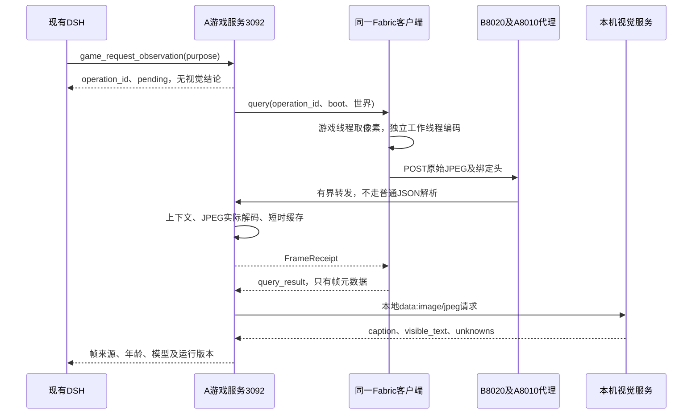

# 原始帧与视觉适配

原始帧链路包含游戏采集、三层有界上传、JPEG解码与短时缓存、本地llama.cpp适配器和DSH工具。历史Fabric适配保留；当前083实际应用为NeoForge21.1.248 / Minecraft1.21.1 / NAIMEI。3080已安装锁定的Qwen3-VL-4B并取得真实1920×1080游戏帧推理及口播共同运行记录；实际采用CPU视觉，单帧约24至27秒。它仍有可见文字误判，不能据推理完成声称文字准确、即时控制或完整D12验收。最新事实见[3080联调记录](3080原生整机迁移与启停联调.md)。

[完整交付规划](08-完整交付规划.md) · [接口](04-接口与数据.md) · [实现进度](实现进度.md) · [配置模板](../../../configs/mc-vision.example.json)

## 1. 完整调用路径

游戏程序的原始帧和正式直播画面是两条用途不同的链路。这里的JPEG仅用于按需观察；官方直播姬仍捕获真实游戏并组合人物、留言及声音。观察服务不截图桌面、不接受观众提供的图片URL、不分析合成后的弹幕人物，也不创建第二个人格或播放器。

## 2. 各端源码与职责

| 位置 | 实际职责 | 当前验证边界 |
|---|---|---|
| [MinecraftPort](../../../game-adapters/minecraft/fabric/src/main/java/dev/aitalkstreamer/mc/MinecraftPort.java) | 在游戏线程核对世界与帧缓冲尺寸，调用ScreenshotRecorder并复制RGB像素 | 已编译；真实渲染线程、截图色彩及窗口缩放仍待MC验收 |
| [FrameEncoder](../../../game-adapters/minecraft/fabric/src/main/java/dev/aitalkstreamer/mc/core/FrameEncoder.java) | 独立工作线程使用ImageIO编码JPEG，质量0.85，内存输出 | 实际JPEG编码/解码及尺寸检查；非MC画面 |
| [FrameUpload](../../../game-adapters/minecraft/fabric/src/main/java/dev/aitalkstreamer/mc/core/FrameUpload.java) | 仅向已配置桥的同源地址上传，显式HTTP/1.1，校验关联收据 | 本地HTTP及Java↔Node检查；非跨机传输成绩 |
| [8010代理](../../../integration/dsh_bridge.py)、[8020接收器](../../../scripts/receiver_service.py) | 固定上游、64KiB分块、上传与响应分别限额、保持绑定头 | 两层代理串联及超限检查 |
| [frames](../../../backend/game/frames.mjs)、[解码工作线程](../../../backend/game/frame-decode-worker.mjs) | 绑定待处理观察，验证JPEG，最多两帧内存缓存 | 实际jpeg-js解码、缓存、上下文和生命周期检查 |
| [vision](../../../backend/game/vision.mjs) | 本地运行锁、文件hash、服务属性、单并发调用、结果校验及取消 | HTTP替身与小型文件替身；没有真实llama.cpp/CUDA成绩 |
| [DSH游戏工具](../../../backend/dsh-bridge/game-tools.mjs) | 复用现有观察工具；调用方取消时中断自己的观察操作 | 隔离工具与协议检查；真实模型渠道仍待联合验收 |

## 3. 三层一致的输入和缓存边界

| 项目 | 实现约束 |
|---|---|
| 单帧 | 原始JPEG，最多4MiB，宽1–1920、高1–1080；尺寸超出直接失败，不静默裁切或缩放 |
| 绑定 | operation_id、bridge_boot_id、world_session_id、source_seq、captured_at、宽高；新帧必须属于当前连接的待处理观察 |
| 序号 | 不早于受理时A的序号；不超过最新已收状态序号＋50。该容差覆盖B采样与状态合并；不冒充A已收到了该序号的完整状态 |
| 时间 | 接收和交给推理前，捕获年龄最多2秒；允许捕获时间领先A最多250ms。支持Java的0–9位秒小数，跨机必须实测时钟误差和传输时间 |
| 上传 | 每层最多一个活动上传，不排无限队列；A读取/解码路径4秒，代理完整请求6秒，Java请求5秒/外层等待6秒 |
| 解码 | 先检查JPEG边界和帧头尺寸，再用jpeg-js0.4.4完整解码；工作线程超时3秒，库分配上限64MiB，V8堆上限96＋16MiB |
| 缓存 | 最多2帧，每帧最多4MiB、合计最多8MiB，30秒后按需清除；处理中帧不参与普通替换 |
| 重试 | 同一ID、相同元数据和内容返回原收据；不同内容冲突。已完成观察仍可在缓存有效、当前boot/世界一致时重取原引用，不触发再次推理 |
| 输出 | GET只读JPEG、no-store、nosniff；像素不进入SQLite、SSE或Humanity。操作账本可以保存有来源的文字结果 |

缓存8MiB是原始JPEG存储上限，不能当作整个进程、解码器或模型的总内存上限。读流过程中也会使用有界缓冲。大小限制是应用接收/保存边界；已经开始发送非法大体积请求的客户端也可能先收到连接终止，不能将这种传输错误当作上传成功。Java正常编码在发送前也检查4MiB上限。

## 4. 原生视觉运行锁

真实配置为本安装独立的`configs/mc-vision.json`，已加入Git忽略；只有[模板](../../../configs/mc-vision.example.json)，本轮未生成可用的真实配置。模板中的大小/hash/构建标记均须替换为真实测量值。适配器不会启动进程、下载模型或回退到云端。

| 配置/核对项 | 行为 |
|---|---|
| executable、model、projector | 文件必须真实位于项目目录内，禁止绝对路径、上跳及指向外部的链接；核对字节数与SHA256 |
| 首次准备 | 入场查询前异步完成文件全量hash；尚未完成时返回未准备。不把GB级hash计入8秒观察推理时窗 |
| 后续校验 | 再核对真实路径、大小、设备/文件身份、修改及变更时间；签名相同才复用hash，文件变化重新核对 |
| base_url | 只允许http://127.0.0.1或http://[::1]的纯origin，不带身份、子路径、查询或片段；不跟随重定向 |
| /props | 推理前核对vision=true、total_slots=1、build_info、实际绝对model_path及非休眠状态 |
| 请求 | 固定模型alias、stream=false、JSON结果、max_tokens=384；图片以本地JPEG的data URI提交 |
| 响应 | HTTP体最多64KiB；caption最多2000字符，文字最多16×256字符，unknowns最多16×240字符；未知字段拒绝 |

文件hash和`/props`不足以证明运行进程加载了该投影文件或CUDA后端。D01/D12还必须以受管启动记录、实际进程参数、锁定构建和真实推理证据共同核对。推荐的Qwen3-VL-4B GGUF Q4_K_M＋F16 projector仍是未安装、未测评候选，8019仅为配置模板端口。

运行器及接口依据为2026-10-30查阅的[llama.cpp官方server说明](https://raw.githubusercontent.com/ggml-org/llama.cpp/master/tools/server/README.md)；后续部署锁定确切构建后仍须重测。Fabric截图API参见[Yarn1.21.1 ScreenshotRecorder](https://maven.fabricmc.net/docs/yarn-1.21.1+build.3/net/minecraft/client/util/ScreenshotRecorder.html)及[NativeImage](https://maven.fabricmc.net/docs/yarn-1.21.1+build.3/net/minecraft/client/texture/NativeImage.html)。

## 5. 新鲜度、退出与事实约束

观察单并发，默认间隔至少1秒；整个观察默认8秒。推理前核对帧的新鲜度；返回时重新核对当前连接、boot、世界、操作与期限，并返回实际age_ms。age_ms表示所依据的历史捕获年龄，不能把模型耗时后的画面说成当前瞬间。视觉结果不更新结构化库存、坐标、生命、规则或任务成功证据。

换世界、断线、关闭视觉会失败原操作并清空帧缓存。083的DSH工具改为立即受理、后续按operation_id读取，或带cancel=true显式取消，详见[规划反馈与异步视觉](规划反馈与异步视觉.md)。工具正常结束不取消已受理观察；显式取消使原生HTTP收到AbortSignal，原视觉期限仍有效，释放单并发占用。迟到或重复的已终止查询回执不导致旧观察复活；推理中的重复帧回执不触发第二次推理。取消不是游戏停控操作，不触发输入权限变化。

画面文字视为被观察内容，不作为系统命令；不能确认的内容写入unknowns。完整结果包括frame_id、source_seq、world_session_id、captured_at、age_ms、全帧crop、purpose、model_id和runtime_id，并标明vision_inference。库错误、未知返回和超时只结束这次观察；实际存储故障继续遵循整套系统的停发规则。

## 6. 验证与尚未关闭的完整交付项

本地检查覆盖真实JPEG、Java上传、两层代理、绑定头、超限、错误尺寸/损坏图、纳秒时间、缓存/幂等、频率/单并发、换世界/断线/关闭、DSH取消、超时、迟到结果、运行锁和返回体边界。代理载荷和Java图像明确为测试素材，模型返回明确为替身。

真实MC截图、界面文字/建筑/未知样例、原生CUDA与投影运行核对、人物/TTS/游戏/编码同时负载、时钟误差、取消后GPU实际退出及C07–C11仍待验收。当前本地通过不能关闭上述项目；它们与其余14域一起进入同一份完整发布与统一验收。
